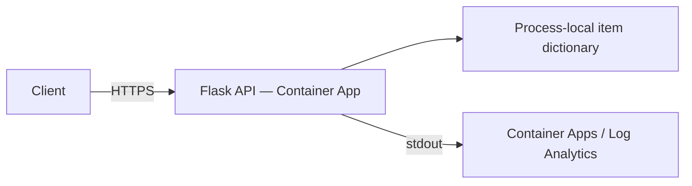

# Prosta API Flask — Azure Container Apps

**Poziom:** Początkujący · **Czas:** 30–45 minut wraz z konfiguracją

Wdróż API Python Flask CRUD za pomocą Azure Developer CLI (azd). Źródło, Dockerfile,
Bicep oraz parametry wdrożenia są dołączone. To jest **przykład do nauki**, a nie
produkcyjna API.

## Czego się nauczysz

- Budowania i publikowania kontenera za pomocą azd.
- Konfigurowania ingress i sond liveness/readiness.
- Weryfikowania odpowiedzi CRUD i przeglądania logów aplikacji.
- Zrozumienia, dlaczego dane w pamięci ulotnej nie nadają się do trwałych aplikacji.



**Ważne:** elementy są przechowywane w jednym procesie. Domyślnie jest **jeden worker Gunicorna,
0–1 replik**, celowo unikając niespójnych danych między workerami/replicami.
Elementy są utracone po restarcie, zmianie rewizji lub skalowaniu do zera. Zwiększenie liczby replik
wymaga współdzielonego trwałego magazynu. API nie ma uwierzytelniania ani autoryzacji.

## Wymagania wstępne

- [Obecna stabilna wersja azd](https://learn.microsoft.com/azure/developer/azure-developer-cli/install-azd)
  (wydanie opublikowane w czasie recenzji: 1.37.2).
- [Azure CLI](https://learn.microsoft.com/cli/azure/install-azure-cli) do weryfikacji.
- Docker z uruchomionym demonem; wymagany do domyślnego lokalnego budowania obrazu.
- Subskrypcja Azure, uprawnienia do tworzenia zasobów oraz regionalny limit Container Apps.
- Bash do poniższych poleceń (lub równoważny PowerShell).
- Python 3.11 do opcjonalnego lokalnego rozwoju.

```bash
azd version
az version
docker info
azd auth login
az login
```

Narzędzia CLI mają oddzielne sesje logowania. Używaj tej samej subskrypcji w obu.

## Szybki start

Z katalogu głównego repozytorium:

```bash
cd examples/container-app/simple-flask-api
azd env new flask-demo
azd up
API_URL=$(azd env get-value API_ENDPOINT)
RG_NAME=$(azd env get-value AZURE_RESOURCE_GROUP)
API_NAME=$(azd env get-value API_NAME)
curl --fail-with-body "${API_URL}/health"
```

Oczekiwane: HTTP 200 i JSON z `"status":"healthy"`,
`"service":"simple-flask-api"` oraz aktualnym znacznikiem czasu UTC.
Provisioning i budowa obrazu zwykle zajmują kilka minut; czas zależy od sytuacji.

Początkowe provisionowanie używa publicznego obrazu hello-world nasłuchującego na porcie 80.
`azure.yaml` wybiera `infra/app/api.bicep` oraz odpowiadający mu plik parametrów do
wdrożenia usługi, co przełącza obraz, ingress i sondy na port 8000.
Nie usuwaj tych parametrów wdrożenia.

## Weryfikacja CRUD

Uruchom następujące polecenia kolejno, gdy ta sama replika pozostaje aktywna:

```bash
# Create: HTTP 201; note the returned id (1 for a fresh process).
curl -i -X POST "${API_URL}/api/items" \
  -H "Content-Type: application/json" \
  -d '{"name":"Test Item","description":"My first item"}'

# Read list: HTTP 200, total 1 in a fresh process.
curl --fail-with-body "${API_URL}/api/items"

# Replace 1 if your create response returned another id.
curl --fail-with-body "${API_URL}/api/items/1"
curl -i -X PUT "${API_URL}/api/items/1" \
  -H "Content-Type: application/json" -d '{"name":"Updated Item"}'
curl -i -X DELETE "${API_URL}/api/items/1"
curl -i "${API_URL}/api/items/1"
```

Sukces: POST 201, odczyt/PUT 200, DELETE 204 bez ciała, potem brakujący element 404.
Niepoprawny/nieobiektowy JSON lub pusta nazwa zwraca 400.
Jeśli element znika między zapytaniami, sprawdź czy nie było restartu lub skalowania do zera;
to celowe ograniczenie pamięci ulotnej, nie trwałość danych.

| Endpoint | Metody |
|---|---|
| `/` | GET — informacje o usłudze |
| `/health` | GET — liveness/readiness |
| `/api/items` | GET, POST |
| `/api/items/{id}` | GET, PUT, DELETE |

## Logi i konfiguracja

```bash
az containerapp logs show --name "$API_NAME" --resource-group "$RG_NAME" --follow
```

Oczekiwane: uruchomienie Gunicorna, logi dostępu do żądań i komunikaty aplikacji.
`azd monitor --logs` otwiera widok portalu; nie przesyła strumieniowo do terminala.
Application Insights jest provisionowany, ale **ten kod Flask go nie instrumentuje**;
użyj Container Apps/Log Analytics do logów stdout.

Edytuj `infra/app/api.bicep` dla CPU/pamięci, limitów replik lub reguł skalowania, następnie
uruchom `azd up`. Domyślnie 0.5 vCPU, 1 GiB, minimum 0 / maksimum 1 replika i
próg HTTP 50 równoczesnych zapytań. Skalowanie do zera może powodować opóźnienie na zimny start.

Dowolne `azd env set MAX_REPLICAS`, `API_KEY`, `LOG_LEVEL` lub
Wartości `SCALE_TO_ZERO_TIMEOUT` **nie są powiązane z tym szablonem ani aplikacją**.
Ustawienie wartości nie powoduje automatycznego uczynienia jej zmienną środowiskową w czasie wykonywania.
Obraz wiąże port 8000 bezpośrednio; zaktualizuj Dockerfile, Bicep ingress oraz sondy
razem, jeśli zmieniasz port.

## Pliki

```text
azure.yaml
infra/main.bicep
infra/main.parameters.json
infra/app/container-apps.bicep       # Environment, registry, monitoring
infra/app/api.bicep                  # App, ingress, probes, scale settings
infra/app/api.parameters.json        # Image and resource values for azd deploy
src/app.py
src/Dockerfile
src/requirements.txt
```

## Lokalny rozwój

Z tego katalogu przykładu:

```bash
python -m venv .venv
source .venv/bin/activate  # PowerShell: .\.venv\Scripts\Activate.ps1
python -m pip install -r src/requirements.txt
python src/app.py
```

W innym terminalu przetestuj `http://localhost:8000/health` i punkty końcowe CRUD.
Lub zbuduj i uruchom faktyczny obraz:

```bash
docker build -t flask-api:local ./src
docker run --rm -p 8000:8000 flask-api:local
```

Dla zmian tylko w kodzie po pierwszym wdrożeniu uruchom `azd deploy api`.
Dla zmian w Bicep uruchom `azd up`, aby ponownie przygotować i wdrożyć.

## Ćwiczenia praktyczne

### 1. Sprawdź odrzucanie niepoprawnych danych wejściowych

**Punkt startowy:** wdrożone API, `API_URL` powyżej.
**Cel:** zweryfikować, czy API odrzuca nieprawidłowe kształty JSON i brakujące nazwy.

```bash
curl -i -X POST "${API_URL}/api/items" \
  -H "Content-Type: application/json" -d '[]'
curl -i -X POST "${API_URL}/api/items" \
  -H "Content-Type: application/json" -d '{"name":""}'
```

**Kryteria sukcesu / rozwiązanie:** oba zwracają 400 z błędem JSON, nie 500.
**Częsty problem:** pominięcie nagłówka typu zawartości JSON.

### 2. Dodaj punkt końcowy tylko do odczytu

**Punkt startowy:** `src/app.py`. **Cel:** rozbudować i ponownie wdrożyć API.
Dodaj to przed blokiem `if __name__ == '__main__':`:

```python
@app.route('/version', methods=['GET'])
def version():
    return jsonify({'version': '1.0.0'})
```

Uruchom `azd deploy api`, następnie `curl --fail-with-body "${API_URL}/version"`.
**Kryteria sukcesu:** HTTP 200 i `{"version":"1.0.0"}`.
**Częsty problem:** umieszczenie trasy po blokującym wywołaniu `app.run()` podczas
testowania z `python src/app.py`.

### Punkt kontrolny wiedzy

Dlaczego jeden worker jest niewystarczający do trwałych danych? Bo nawet jeden proces traci
swój słownik po restarcie. Wersja produkcyjna wymaga trwałej współdzielonej pamięci,
uwierzytelniania, autoryzacji, migracji, testów oraz monitorowania operacyjnego.

## Koszty i rozwiązywanie problemów

To nie jest gwarantowane wdrożenie za $0: rejestr Basic i przechowywanie/logowanie mogą
generować opłaty nawet gdy obliczenia aplikacji wynoszą zero. Użyj
[kalkulatora cen](https://azure.microsoft.com/pricing/calculator/) dla swojego regionu.

- **Błąd budowania Dockera:** potwierdź `docker info`, dostęp sieciowy i zależności.
- **Niezdrowa aplikacja:** sprawdź logi konsolowe/systemowe i zweryfikuj zgodność portu obrazu, ingressu
  i sond. Placeholder nie powinien być sondowany na porcie Flask.
- **403/uprawnienia:** potwierdź uprawnienia subskrypcji i tworzenia zasobów.
- **Przedmioty znikają:** stan w pamięci resetuje się po restarcie/skalu do zera; dodaj bazę danych
  dla trwałego zachowania.

## Sprzątanie i kolejne kroki

```bash
azd down
```

Przejrzyj monit o usunięcie i potwierdź, że dedykowana grupa zasobów została usunięta.
Nie używaj destrukcyjnego sprzątania do grupy zasobów zawierającej niezwiązane dane.

[Następny: Aplikacja bazy danych](../../../../../examples/database-app) · [Mikrousługi](../../../../../examples/container-app/microservices) ·
[Przegląd kontenerów](../README.md) · [Strona główna kursu](../../../README.md) ·
[Zgłoś problem](https://github.com/microsoft/AZD-for-beginners/issues)

---

<!-- CO-OP TRANSLATOR DISCLAIMER START -->
**Zastrzeżenie**:
Niniejszy dokument został przetłumaczony za pomocą usługi tłumaczenia AI [Co-op Translator](https://github.com/Azure/co-op-translator). Choć dążymy do dokładności, prosimy pamiętać, że automatyczne tłumaczenia mogą zawierać błędy lub niedokładności. Oryginalny dokument w jego języku źródłowym należy uznawać za autorytatywne źródło. W przypadku informacji krytycznych zalecane jest skorzystanie z profesjonalnego tłumaczenia wykonanego przez człowieka. Nie ponosimy odpowiedzialności za jakiekolwiek nieporozumienia lub błędne interpretacje wynikające z użycia tego tłumaczenia.
<!-- CO-OP TRANSLATOR DISCLAIMER END -->