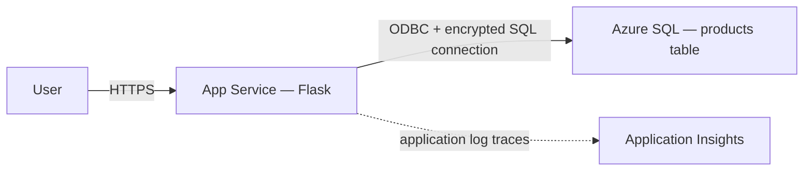

# Flask i Azure SQL na App Service

**Poziom:** Średniozaawansowany · **Czas:** 30–60 minut wraz z wymaganiami wstępnymi

Ten przykład wdraża API odczytu Python Flask na **Linux App Service** oraz podstawową
bazę danych Azure SQL. Źródło, Bicep i konfiguracja azd są dołączone. To jest
aplikacja edukacyjna, a nie gotowa do produkcji architektura bazy danych.

## Czego się nauczysz

- Tworzyć zasoby App Service, SQL i monitoringu za pomocą Bicep.
- Konfigurować zaszyfrowane połączenie z SQL bez umieszczania poświadczeń w kodzie.
- Inicjalizować schemat przed uruchomieniem pracowników Gunicorn.
- Weryfikować zasiane dane, odpowiedzi na brak zasobu i stan bazy danych.



Zasoby: dedykowana grupa zasobów, plan App Service Linux B1, Python 3.11 Web
App, serwer SQL oraz baza danych Basic 2 GB, Application Insights i Log Analytics.
Aplikacja Web korzysta z **wdrożenia źródła/ZIP oraz instalacji zależności Oryx**;
`azd deploy` nie buduje ani nie wdraża opcjonalnego Dockerfile.

## Wymagania wstępne

- Aktualna stabilna wersja [azd](https://learn.microsoft.com/azure/developer/azure-developer-cli/install-azd)
  (opublikowane wydanie na moment przeglądu: 1.37.2).
- [Azure CLI](https://learn.microsoft.com/cli/azure/install-azure-cli) do weryfikacji.
- Subskrypcja Azure, uprawnienia do tworzenia wymienionych zasobów i dostępny limit regionalny.
- Python **3.11** do lokalnego rozwoju; załączony `pyodbc==5.0.1` może wymagać
  natywnych narzędzi budowania na nowszych wersjach Pythona.
- Microsoft ODBC Driver 18 (lub 17) dla SQL Server na lokalnych maszynach. `pip install
  pyodbc` nie instaluje sterownika systemowego. Zobacz
  [instalację ODBC](https://learn.microsoft.com/sql/connect/odbc/download-odbc-driver-for-sql-server).
- Docker tylko jeśli testujesz opcjonalny kontener lokalnie.

```bash
azd version
az version
azd auth login
az login
```

Używaj tej samej subskrypcji w obu narzędziach. Polecenia poniżej używają Basza.

## Wdrażanie

Z katalogu głównego repozytorium:

```bash
cd examples/database-app
azd env new sql-demo
azd provision
azd deploy
WEB_URL=$(azd env get-value WEB_APP_URI)
WEB_NAME=$(azd env get-value WEB_APP_NAME)
RG_NAME=$(azd env get-value AZURE_RESOURCE_GROUP)
```

Wybierz obsługiwany region. `sqlAdminLogin` domyślnie ustawia `sqladmin`; wymagany
`sqlAdminPassword` jest bezpiecznym parametrem. Podaj silne hasło, gdy zostaniesz o to poproszony.
Trzymaj poświadczenia wdrożenia z dala od Git i raportów o błędach. Aktualna interpolacja
łańcucha połączenia oczekuje hasła bez delimiterów łańcucha połączenia, takich jak
`;`; dostosuj escaping przed użyciem takich wartości.

Bicep ustawia polecenie startowe, które uruchamia `init_database()` **przed** startem pracowników Gunicorn.
Jest to konieczne, ponieważ importowanie `app:app` nie wykonuje
bloku `if __name__ == '__main__'` Pythona. Na świeżej bazie danych inicjalizacja
tworzy `products` oraz wstawia pięć wierszy. Jest to prosta przykładowa sekwencja, a nie
środowisko migracji współbieżnych; przed skalowaniem instancji zastosuj właściwe migracje.

Aplikacja wybiera zainstalowany Microsoft ODBC Driver 18, następnie 17, jeśli łańcuch
połączenia nie wskazuje wyraźnie sterownika. Jeśli żaden nie istnieje, start kończy się
błędem instalacji z zaleceniami. Sprawdź dostępność sterownika w wybranym
środowisku uruchomieniowym App Service, zamiast zakładać jego istnienie.

## Weryfikacja

```bash
curl --fail-with-body "${WEB_URL}/"
curl --fail-with-body "${WEB_URL}/health"
curl --fail-with-body "${WEB_URL}/products"
curl --fail-with-body "${WEB_URL}/products/1"
curl -i "${WEB_URL}/products/999"
```

Oczekiwane:

- `/` zwraca informacje o punkcie końcowym.
- `/health` zwraca 200 z `{"status":"healthy","database":"connected"}`.
- `/products` zwraca pięć zasianych produktów na świeżej bazie danych.
- `/products/1` zwraca Laptop z ceną 1299.99.
- Nieistniejący produkt zwraca 404 z `{"error":"Product not found"}`.

API jest tylko do odczytu. Nie ma trasy POST/PUT/DELETE ani UI w przeglądarce.
Błąd połączenia z bazą danych zwraca 503 z `/health`; nie jest sukcesem.

## Pliki i konfiguracja

```text
azure.yaml                         # Python App Service source deployment
infra/main.bicep
infra/main.parameters.json
infra/abbreviations.json
infra/resources/sql-server.bicep
infra/resources/sql-database.bicep
infra/resources/app-service-plan.bicep
infra/resources/web-app.bicep       # Settings + initialization/startup command
infra/resources/app-insights.bicep
src/web/app.py
src/web/requirements.txt
src/web/Dockerfile                 # Optional local container, not the azd target
.env.sample
```

`SQL_CONNECTION_STRING` jest przekazywany jako zabezpieczony parametr Bicep do modułu Web App
i przechowywany w ustawieniach App Service, a nie w wynikach wdrożenia.
`APPLICATIONINSIGHTS_CONNECTION_STRING` konfiguruje eksport logów.
`SCM_DO_BUILD_DURING_DEPLOYMENT=true` aktywuje instalację zależności po stronie serwera.
Ustawienie dowolnych wartości `azd env` nie zmienia automatycznie ustawień aplikacji.

Reguła zapory `0.0.0.0` pozwala na połączenia z **usług Azure,
w tym subskrypcji innych klientów**, pod warunkiem uwierzytelnienia SQL. Nie jest
ograniczona do tej aplikacji ani subskrypcji. Publiczny dostęp sieciowy SQL jest włączony.
Przed produkcją stosuj ograniczone sieci i tożsamość aplikacji z najmniejszymi uprawnieniami.

## Lokalne środowisko developerskie

Używaj Python 3.11 i zainstalowanego sterownika Microsoft SQL ODBC:

```bash
python -m venv .venv
source .venv/bin/activate  # PowerShell: .\.venv\Scripts\Activate.ps1
python -m pip install -r src/web/requirements.txt
export SQL_CONNECTION_STRING='Server=tcp:YOUR_SERVER.database.windows.net,1433;Database=YOUR_DATABASE;UID=YOUR_USER;PWD=YOUR_PASSWORD;Encrypt=yes;TrustServerCertificate=no;Connection Timeout=30;'
python src/web/app.py
```

Bezpiecznie zastąp zastępniki. Skopiowany plik `.env` **nie jest automatycznie ładowany**
przez tę aplikację. Zamiast tego wyeksportuj zmienne w bieżącej powłoce.
Dla Azure SQL z laptopa tymczasowo pozwól tylko na swój własny publiczny IP:

```bash
SQL_SERVER=$(azd env get-value SQL_SERVER_NAME)
MY_IP=YOUR_PUBLIC_IP
az sql server firewall-rule create -g "$RG_NAME" -s "$SQL_SERVER" \
  -n AllowMyLearningIP --start-ip-address "$MY_IP" --end-ip-address "$MY_IP"
```

Usuń regułę po testowaniu:

```bash
az sql server firewall-rule delete -g "$RG_NAME" -s "$SQL_SERVER" -n AllowMyLearningIP
```

Opcjonalny test kontenera z katalogu tego przykładu:

```bash
docker build -t sql-flask:local src/web
docker run --rm -p 8000:8000 -e SQL_CONNECTION_STRING sql-flask:local
```

Ten obraz instaluje sterownik 18 korzystając z repozytorium pakietów Debian 12 odpowiadającego
bazie Bookworm, inicjalizuje bazę danych jednokrotnie, a następnie uruchamia Gunicorn.

## Monitorowanie i rozwiązywanie problemów

Włącz/oglądaj logi aplikacji systemu plików App Service podczas diagnozowania startu:

```bash
az webapp log config --name "$WEB_NAME" --resource-group "$RG_NAME" \
  --application-logging filesystem --level information
az webapp log tail --name "$WEB_NAME" --resource-group "$RG_NAME"
```

Ten kod eksportuje **śledzenie logów** aplikacji przez przestarzały handler OpenCensus.
Nie konfiguruje automatycznego śledzenia żądań/zależności Flask, Live Metrics,
audytu SQL, ustawień diagnostycznych ani alertów. Te wymagają osobnej konfiguracji.
Dla nowych instrumentacji preferuj Azure Monitor OpenTelemetry.

W Application Insights Logs, po wykonaniu zapytań API:

```kusto
traces
| where timestamp > ago(1h)
| where message contains "products" or message contains "Health check"
| project timestamp, message, severityLevel
```

Pozwól na opóźnienie przetworzenia. Aktywność w tabeli żądań lub Live Metrics nie jest kryterium ukończenia
dla tej instrumentacji tylko logów.

- **Brak sterownika:** sprawdź `pyodbc.drivers()` w środowisku uruchomieniowym i zainstaluj
  obsługiwany sterownik Microsoft ODBC. Sam pakiet Pythona nie wystarczy.
- **Błąd połączenia:** sprawdź ustawienia SQL, poświadczenia, zaporę i wybraną
  subskrypcję. Nie wyłączaj szyfrowania, aby ominąć błąd.
- **Brak tabeli produktów:** potwierdź, że polecenie startowe Bicep zostało wdrożone;
  uruchomienie samego `gunicorn app:app` pomija inicjalizację.
- **Błąd budowania pakietu:** używaj Pythona 3.11 lub zapewnij natywne narzędzia budowania.
- **Dane z zerową ceną:** zero jest prawidłową ceną dziesiętną; musi być serializowane jako 0.0,
  a nie `null`.

## Ćwiczenia praktyczne

### Ćwiczenie 1: Weryfikacja zachowania dla brakującego produktu

**Punkt startowy:** wdrożone API i `WEB_URL` powyżej.
**Cel:** odróżnić brakujący wiersz od uszkodzonej bazy danych.
Wywołaj `/health` i `/products/999` używając powyższych poleceń.
**Kryteria sukcesu / odpowiedź:** stan zdrowia 200, brakujący produkt 404 (nie 500 ani 503).
**Częsty problem:** założenie, że odpowiedź brak-zasobu dowodzi uszkodzenia połączenia SQL.

### Ćwiczenie 2: Zmiana zasianej wartości

**Punkt startowy:** Azure SQL Query Editor, połączony z przykładową bazą.
**Cel:** pokazać, że dane API są przechowywane w SQL, a nie w pamięci procesu.

```sql
UPDATE products SET price = 0 WHERE id = 1;
SELECT id, name, price FROM products WHERE id = 1;
```

Wywołaj `${WEB_URL}/products/1`. **Kryteria sukcesu:** cena jest `0.0`, nie `null`.
Przywróć wartość:

```sql
UPDATE products SET price = 1299.99 WHERE id = 1;
```

**Częsty problem:** edycja listy seeda Python nie aktualizuje wierszy już w SQL.
Nie wykonuj ćwiczeń schematu/danych na bazie produkcyjnej.

### Ćwiczenie 3: Dodanie punktu końcowego tylko do odczytu z liczeniem

**Punkt startowy:** `src/web/app.py`.
**Cel:** rozszerzyć API o zapytanie agregujące bez parametrów.
Dodaj to przed blokiem `if __name__ == '__main__':`:

```python
@app.route('/product-count')
def product_count():
    from contextlib import closing
    with closing(get_db_connection()) as conn, closing(conn.cursor()) as cursor:
        cursor.execute("SELECT COUNT(*) FROM products")
        return jsonify({'count': cursor.fetchone()[0]})
```

Uruchom `azd deploy web`, następnie wywołaj `${WEB_URL}/product-count`.
**Kryteria sukcesu:** 200 z `{"count":5}` na nietkniętej zasianej bazie.
**Częsty problem:** zmiana trasy, ale zapomnienie o ponownym wdrożeniu.
W produkcji dodaj obsługę błędów/testy; to krótkie ćwiczenie skupia się na zapytaniu.

## Koszty, luki produkcyjne i sprzątanie

Plan B1 App Service oraz podstawowa baza są naliczane podczas ich obecności. Zatrzymanie
aplikacji Web **nie** zatrzymuje naliczania planu App Service. Logi i pamięć mogą generować
dodatkowe koszty. Używaj [kalkulatora cen Azure](https://azure.microsoft.com/pricing/calculator/)
dla aktualnych cen regionalnych. Przełączenie na F1 wymaga również wyłączenia `alwaysOn`;
nie jest to jedno-liniowa zamiana. SQL serverless nie jest automatycznie darmowy.

Prace produkcyjne obejmują tożsamość aplikacji z minimalnymi uprawnieniami (nie SQL admin),
uwierzytelnianie/autoryzację, prywatne sieci, bezpieczne migracje, przegląd puli połączeń/cyklu życia,
telemetrię, audyty, alerty, testy oraz procedury odzyskiwania.
Caching Redis i dodatkowe tabele to pomysły na rozwój, a nie zaimplementowane ćwiczenia.

Z katalogu tego przykładu:

```bash
azd down
```

Sprawdź monit usuwania i zweryfikuj usunięcie dedykowanej grupy zasobów.
Nie usuwaj grup zawierających niezwiązane dane.

[Przykłady kontenerów](../../../../examples/container-app) ·
[Rozwój AI](../../docs/chapter-02-ai-development/README.md) ·
[Strona kursu](../../README.md) · [Zgłoś problem](https://github.com/microsoft/AZD-for-beginners/issues)

---

<!-- CO-OP TRANSLATOR DISCLAIMER START -->
**Zastrzeżenie**:
Niniejszy dokument został przetłumaczony za pomocą usługi tłumaczenia AI [Co-op Translator](https://github.com/Azure/co-op-translator). Choć dążymy do dokładności, prosimy pamiętać, że automatyczne tłumaczenia mogą zawierać błędy lub niedokładności. Oryginalny dokument w jego języku źródłowym należy uznawać za autorytatywne źródło. W przypadku informacji krytycznych zalecane jest skorzystanie z profesjonalnego tłumaczenia wykonanego przez człowieka. Nie ponosimy odpowiedzialności za jakiekolwiek nieporozumienia lub błędne interpretacje wynikające z użycia tego tłumaczenia.
<!-- CO-OP TRANSLATOR DISCLAIMER END -->