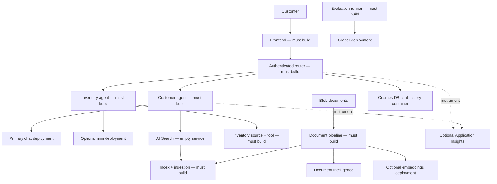

# Obsługa klienta z wieloma agentami — Plan architektury detalicznej

**Rozdział 5: Wieloagentowe rozwiązania AI**

- [Strona główna kursu](../README.md)
- [Rozdział 5](../docs/chapter-05-multi-agent/README.md)
- [Wymagania wstępne: integracja AI](../docs/chapter-02-ai-development/microsoft-foundry-integration.md)
- [Następny: Planowanie pojemności](../docs/chapter-06-pre-deployment/capacity-planning.md)
- [Szablon infrastruktury ARM](retail-multiagent-arm-template/README.md)

> **Przewodnik architektoniczny, nie działająca aplikacja.** Jedynymi plikami implementacji detalicznej
> są `azuredeploy.json`, `azuredeploy.parameters.json` oraz `deploy.sh` w
> `retail-multiagent-arm-template/`. Kontenery routera/frontend to zastępcze hello-world.
> Nie ma lokalnie agenta detalicznego, interfejsu użytkownika, potoku pobierania danych,
> oceny, skanera ani zestawu testów aplikacji.

## Przegląd

**Cel:** zaprojektować system obsługi klienta z agentem klienta i agentem inwentaryzacji,
określić, co zapewnia infrastruktura, oraz zaplanować brakujące umowy aplikacyjne
oraz weryfikację.

**Odbiorcy:** deweloperzy, którzy ukończyli lokalną
[próbkę czatu](../../../examples/azure-openai-chat) oraz [próbkę dwóch serwisów w kontenerach](../../../examples/container-app/microservices).
Przeznacz 2–3 godziny na naukę architektury. Budowa aplikacji to odrębny
projekt: 80–120 godzin rozwoju to szacunkowa wartość planowania dla
doświadczonych programistów, **nie obietnica dostawy**; produkcyjne zabezpieczenia, testy,
przegląd bezpieczeństwa oraz operacje wymagają dodatkowej pracy.

### Rezultaty nauki

- Wyjaśnij trasowanie, podstawy, uprawnienia narzędzi i własność rozmowy.
- Rozróżnij identyfikatory modeli, nazwy wdrożeń, wersje API i wersje ARM.
- Zaprojektuj pobieranie i wyszukiwanie dokumentów z dopasowaniem wymiarów wektora.
- Zdefiniuj weryfikowalne wymagania funkcjonalne, ewaluacyjne i dotyczące odzyskiwania po awarii.
- Oddziel opcjonalne cele architektoniczne od rzeczywiście udostępnionych zasobów.

## Architektura rozwiązania



To jest **docelowa architektura aplikacji**, a nie diagram działających usług agentów.
Szablon ARM tworzy tylko podstawowe usługi i dwa zastępcze
kontenery. Front Door, rejestr, zarządzane tożsamości, przypisania ról,
prywatne punkty końcowe, przełączanie awaryjne, instrumentacja aplikacji i alerty nie są uwzględnione.

### Obowiązki i umowy

| Komponent | Wymagane zachowanie | Dowód przed uznaniem za ukończone |
|---|---|---|
| Frontend | Autoryzacja użytkowników, renderowanie czatu, bezpieczny upload dokumentów | Testy interfejsu i uploadu, dostępne błędy |
| Router | Autoryzacja żądań, wybór agenta, ograniczenia wywołań narzędzi/czasu | Testy trasowania, kontrole autoryzacji, testy awarii |
| Agent klienta | Opieranie odpowiedzi na politykach/produktach o zatwierdzone źródła | Poprawne cytowania, powstrzymanie się przy braku danych |
| Narzędzie inwentaryzacji | Odczyt autorytatywnych stanów magazynowych z ograniczonymi uprawnieniami | Deterministyczne testy zapasów; brak wymyślonej dostępności |
| Potok dokumentów | Ekstrakcja, dzielenie na chunk’i, osadzanie, indeksowanie, aktualizacja/usuwanie | Indeksowane zasoby testowe oraz obsługa ponowień/niepowodzeń |
| Przechowywanie rozmów | Izolacja użytkowników, egzekwowanie retencji | Testy autoryzacji między użytkownikami i czasu przechowywania |
| Uruchamianie oceny | Porównywanie wyników z prawdą źródłową i rubricą | Pokrycie testów, liczba awarii, odtwarzalne raporty |

Traktuj router jak recepcję, a narzędzia jak ograniczone wewnętrzne systemy:
wybór specjalisty nie jest autoryzacją do dostępu do danych wszystkich klientów.
Egzekwuj tożsamość i uprawnienia w kodzie aplikacji i usługach danych, nie w promptach.

## Infrastruktura vs. Aplikacja

Przeczytaj [README szablonu](retail-multiagent-arm-template/README.md) przed
uruchomieniem. Zawiera dokładną listę zasobów, trybów, kosztów i ograniczeń.

| Logiczne użycie | Nazwa wdrożenia ARM | Model / wersja | Domyślny region |
|---|---|---|---|
| Czatu klienta | `gpt-4.1-chat` | `gpt-4.1` / `2025-04-14` | `eastus2` |
| Inwentaryzacja | `gpt-4.1-mini-inventory` | `gpt-4.1-mini` / `2025-04-14` | `westus2`, opcjonalny |
| Osadzenia | `text-embedding-ada-002` | `text-embedding-ada-002` / `2` | `francecentral`, opcjonalny |
| Ewaluacja | `gpt-4.1-grader` | `gpt-4.1` / `2025-04-14` | Domyślny główny region |

Sprawdź dostępność modelu/wersji/SKU i limity w **każdym regionie**. Chat/mini/grader
używa `GlobalStandard`; embedingów używa `Standard`. Mapowania jednostek pojemności na TPM są
specyficzne dla modelu. Nie dodawaj niepodobnych jednostek jako uniwersalnej gwarancji limitu.

Argument `model` dla żądania Azure OpenAI to **nazwa wdrożenia**, a nie
koniecznie identyfikator modelu katalogowego. Wersja API data-plane `2024-10-21`
różni się od wersji modelu `2025-04-14` oraz zasobu ARM `apiVersion`.
Nie da się naprawić niedostępnego modelu, zmieniając tylko wersję API data-plane.

`--no-multi-region` pomija konta pomocnicze i embeddings. Pozostaje podstawowe konto czatu oraz
niezależne konto oceniające. Oddzielne konta modelowe nie zapewniają automatycznego
przełączania awaryjnego; wymaga to trasowania aplikacji, kompatybilnych wdrożeń, kontroli stanu,
limitów ponowień i przeglądu dostępu do danych.

## Plan wdrożenia

### 1. Zacznij od jednej przetestowanej interakcji

Przed uruchomieniem dużego szablonu użyj lokalnej próbki czatu, aby ustalić
łączność inferencyjną. Zdefiniuj jedno reprezentatywne pytanie klienta, zatwierdzone
źródło odpowiedzi, oczekiwane cytowanie oraz zachowanie w przypadku braku tego źródła.

### 2. Określ trasowanie i granice narzędzi

Utwórz własne źródło routera, manifest zależności, Dockerfile i testy. 
Przykładowa umowa to `POST /chat` z `{"message":"...","conversation_id":"..."}`.
**Ten punkt końcowy to propozycja projektu; nie jest zaimplementowany w szablonie ARM.**

Sprawdź typy/limity w ciele żądania, wyprowadź tożsamość użytkownika z uwierzytelniania,
egzekwuj własność rozmowy, stosuj limity czasowe żądań i zwracaj znaczące kody błędów.
Nie traktuj niepowodzeń HTTP ani pustych odpowiedzi jako poprawnych wyników agenta.

### 3. Wdrożenie podstaw i pobierania

Szablon ARM nie tworzy indeksu wyszukiwania. To jest **referencyjny fragment JSON
do adaptacji w twojej własnej definicji indeksu**, nie plik już w repozytorium:

```json
{
  "name": "retail-product-index",
  "fields": [
    {"name": "id", "type": "Edm.String", "key": true},
    {"name": "title", "type": "Edm.String", "searchable": true},
    {"name": "content", "type": "Edm.String", "searchable": true},
    {"name": "category", "type": "Edm.String", "filterable": true},
    {
      "name": "content_vector",
      "type": "Collection(Edm.Single)",
      "searchable": true,
      "dimensions": 1536,
      "vectorSearchProfile": "retail-profile"
    }
  ],
  "vectorSearch": {
    "algorithms": [{"name": "retail-hnsw", "kind": "hnsw"}],
    "profiles": [{"name": "retail-profile", "algorithm": "retail-hnsw"}]
  }
}
```

Profil łączy pole wektorowe z jego algorytmem. Wymiary muszą odpowiadać
rzeczywistemu wynikowi osadzenia (1536 dla tego wdrożenia `ada-002`). W przypadku pobierania w Pythonie
użyj `azure.search.documents.models.VectorizedQuery` zamiast niekompletnego
słownika pozbawionego rodzaju zapytania wektorowego:

```python
# Reference function only: supply an authenticated async SearchClient and an embedding.
from azure.search.documents.models import VectorizedQuery

async def retrieve(search_client, embedding):
    results = await search_client.search(
        search_text=None,
        vector_queries=[VectorizedQuery(
            vector=embedding,
            k_nearest_neighbors=5,
            fields="content_vector"
        )],
        select=["id", "title", "content"]
    )
    return [document async for document in results]
```

Utwórz oddzielną implementację pobierania, która:

1. Autoryzuje dostęp do uploadu i weryfikuje typ i rozmiar zawartości.
2. Odczytuje prywatne blob’y za pomocą uwierzytelnionych wywołań SDK. Sam adres URL prywatnego blob’a
    **nie jest** czytelnym wejściem Document Intelligence; prześlij pobrane bajty za pomocą
    `AnalyzeDocumentRequest(bytes_source=...)` lub użyj odpowiednio ograniczonego,
    krótkotrwałego SAS po przeglądzie wymagań dostępu.
3. Ekstrahuje tekst, dzieli na segmenty pasujące do limitów embedingu i generuje embedy.
4. Tworzy stabilne, prawidłowe klucze dokumentów i przesyła segmenty z dopasowanymi wektorami.
5. Sprawdza wyniki indeksowania dla każdego dokumentu, obsługuje ponowienia i aktualizuje/usuwa przestarzałe dane.

Nie interpoluj dowolnych kluczy/wartości użytkownika w filtry OData. Zezwalaj na określone pola,
waliduj typy wartości i unikaj cudzysłowów w łańcuchach. Filtry logiczne i numeryczne wymagają
literałów typowanych, a nie ciągów znaków w cudzysłowie.

### 4. Internetowe podstawy

**Bing Search v7 został wycofany 11 sierpnia 2025.** Stary zasób `Microsoft.Bing/accounts`
i przykłady `api.bing.microsoft.com/v7.0/search` nie są wspieraną
ścieżką implementacji. Oceń obecnie wspieraną integrację w
Microsoft Foundry oraz jej SDK, uprawnienia, billing i wymagania dotyczące cytowania;
tutaj żadna nie jest zaimplementowana. To nie jest zamiennik wtyknięcia za wycofany punkt końcowy.

### 5. Dodaj telemetrykę i ocenę

Utworzenie Application Insights nie instrumentuje kodu. Korzystaj z obsługiwanej instrumentacji Azure Monitor
OpenTelemetry podczas tworzenia nowej aplikacji, propaguj kontekst śledzenia
między usługami i unikaj logowania promptów klientów, dokumentów lub sekretów.
Skracanie zapytania **nie** anonimizuje go.

Mierz czas trwania żądań, błędy trasowania/narzędzi, trafność wyszukiwania, poprawność cytowania,
zużycie tokenów i powstrzymanie się od odpowiedzi. Przechowuj fakty inventaryzacyjne/polityczne
wraz z przypadkami ewaluacyjnymi: grader nie może wiarygodnie ocenić poprawności faktualnej
jedynie na podstawie pytania i odpowiedzi.

Wdrożenie gradującego nie jest uruchomieniem oceny. Zaimplementuj wersjonowaną rubricę,
walidację wyjścia/struktury, kontrole zakresu punktacji, liczbę awarii transportu
oraz przypadki z recenzją ludzką. Raportuj osobno przypadki niekompletne/błędne;
nie traktuj ich jako poprawnych ocen ani nie włączaj ich cicho jako odpowiedzi zerowej jakości.

Podobnie, kilka kontroli słów kluczowych nie jest certyfikatem bezpieczeństwa. Nieudane żądanie HTTP,
brak strategii testowej lub pusta odpowiedź musi uczynić test **niejednoznacznym lub
niezdanym**, a nie wygenerować ocenę „100% bezpieczna”. Przeprowadź autoryzowane testy z odpowiednimi
narzędziami i recenzją ludzką przed zgłoszeniem gotowości produkcyjnej.

### 6. Wdróż swoją aplikację

Utwórz własne katalogi źródłowe, manifesty, testy, rejestr i uprawnienia do pobierania obrazów.
Zamień zastępniki na zbudowane obrazy i aktualizuj ingress/probes, aby
pasowały do portu nasłuchującego każdej aplikacji. Skonfiguruj zmienne środowiskowe runtime w Bicep
lub jawne, wspierane mapowanie środowiska azd.

Nie istnieje ogólny słownik `config` pod usługą azd, który automatycznie
tworzy zmienne środowiskowe runtime. `azd env set` zmienia tylko zasoby, które
wyraźnie korzystają z tych wartości. W tym szablonie nie zaimplementowano mechanizmów canary, list regionów ani haków fine-tuningu.


## Praktyczne ćwiczenia projektowe

Są to **ćwiczenia architektoniczne**, a nie twierdzenia o wykonalności detalicznego kodu startowego.

### Ćwiczenie 1: Zweryfikuj granicę

**Punkt startowy:** trzy pliki w `retail-multiagent-arm-template/`.
**Cel:** rozróżnić provisioning od funkcjonalności aplikacji.
Otwórz `azuredeploy.json`, znajdź zarówno obrazy kontenerów, jak i wartości `targetPort`,
następnie wypisz komponenty aplikacji, których brakuje w repozytorium.

**Kryteria sukcesu / odpowiedź:** oba obrazy to zastępcze hello-world nasłuchujące
na porcie 80; agenci, chat UI, router handlers, index/ingestion, oceniający i skaner
są nieobecni. Pomyślne zastępcze zapytanie do root nie waliduje `/chat`.
**Typowy problem:** interpretowanie nazw zasobów takich jak `retail-router` jako działającego kodu.

### Ćwiczenie 2: Śledzenie konfiguracji vectora

**Punkt startowy:** index JSON powyżej.
**Cel:** zrozumieć relację field → profile → algorithm.
Wskaż, które wartości muszą się zmienić podczas przełączania na model embedding z
innym wymiarem wyjściowym, następnie sprawdź funkcję `retrieve`.

**Kryteria sukcesu / odpowiedź:** zmień pole `dimensions` na rzeczywistą długość wektora;
utrzymuj `vectorSearchProfile` zgodnie z deklarowanym profilem i jego algorytmem;
zapytanie `fields` musi wskazywać pole wektora. Wygeneruj ponownie wektory dokumentów
, gdy model embedding się zmieni.
**Typowy problem:** zmiana tylko nazwy modelu przy jednoczesnym utrzymaniu niekompatybilnych wektorów.

### Ćwiczenie 3: Zdefiniuj test awarii

**Punkt startowy:** tabela odpowiedzialności.
**Cel:** zapobiec fałszywemu sukcesowi.
Opisz spodziewane zachowanie dla niedostępnego API inwentarza, indeksu wyszukiwania bez
pasujących dokumentów oraz zapytania ewaluacyjnego zwracającego HTTP 503.

**Kryteria sukcesu / odpowiedź:** żadnych wymyślonych wartości inwentarza; wyraźne powstrzymanie się lub
eskalacja, gdy kontekst jest brakujący; ewaluacja raportuje błąd transportu zamiast
poprawnej jakości lub bezpieczeństwa. Dodaj testy wykonywalne podczas budowy aplikacji.
**Typowy problem:** wychwytywanie wszystkich wyjątków i kontynuowanie z pustą odpowiedzią.

## Koszty, rozwiązywanie problemów i sprzątanie

- Infrastruktura generuje stałe opłaty nawet przy pustych indeksach wyszukiwania i zastępczych
  aplikacjach. Używaj aktualnych cen regionalnych; ani „minimalny”, ani wieloregionalny nie oznacza darmowego.
- Koszty tokenów zależą od modelu, pamięci podręcznej niepamięci podręcznej, danych wejściowych, wyjściowych i SKU wdrożenia.
  Routing może oszczędzać pieniądze tylko jeśli zmierzona praca i wyniki jakości to uzasadniają;
  stała oszczędność 60–80% nie jest gwarantowana.
- Sprawdź dostępność modelu i limit przed provisioningiem; rozróżniaj błędy uprawnień,
  nazwy wdrożenia, regionu, wersji modelu i wersji API.
- Nie uruchamiaj brakujących `setup-data.sh`, evaluator CLI ani poleceń `pytest tests/`.
  Ich implementacje są częścią twojego backlogu rozwoju.
- Scaffold działa tylko na ARM: postępuj zgodnie z jego
  [instrukcjami weryfikacji i sprzątania](retail-multiagent-arm-template/README.md).
  `azd down` nie zarządza tymi zasobami.

## Powiązane zasoby

- [Działający lokalny przykład czatu](../../../examples/azure-openai-chat)
- [Działający przykład kontenera z dwiema usługami](../../../examples/container-app/microservices)
- [Wektorowe indeksy AI Search](https://learn.microsoft.com/azure/search/vector-search-how-to-create-index)
- [Dokumentacja Container Apps](https://learn.microsoft.com/azure/container-apps/)
- [Rozwiązywanie problemów](../docs/chapter-07-troubleshooting/common-issues.md)
- [Zgłoś problem](https://github.com/microsoft/AZD-for-beginners/issues)

---

<!-- CO-OP TRANSLATOR DISCLAIMER START -->
**Zastrzeżenie**:
Niniejszy dokument został przetłumaczony za pomocą usługi tłumaczenia AI [Co-op Translator](https://github.com/Azure/co-op-translator). Choć dążymy do dokładności, prosimy pamiętać, że automatyczne tłumaczenia mogą zawierać błędy lub niedokładności. Oryginalny dokument w jego języku źródłowym należy uznawać za autorytatywne źródło. W przypadku informacji krytycznych zalecane jest skorzystanie z profesjonalnego tłumaczenia wykonanego przez człowieka. Nie ponosimy odpowiedzialności za jakiekolwiek nieporozumienia lub błędne interpretacje wynikające z użycia tego tłumaczenia.
<!-- CO-OP TRANSLATOR DISCLAIMER END -->