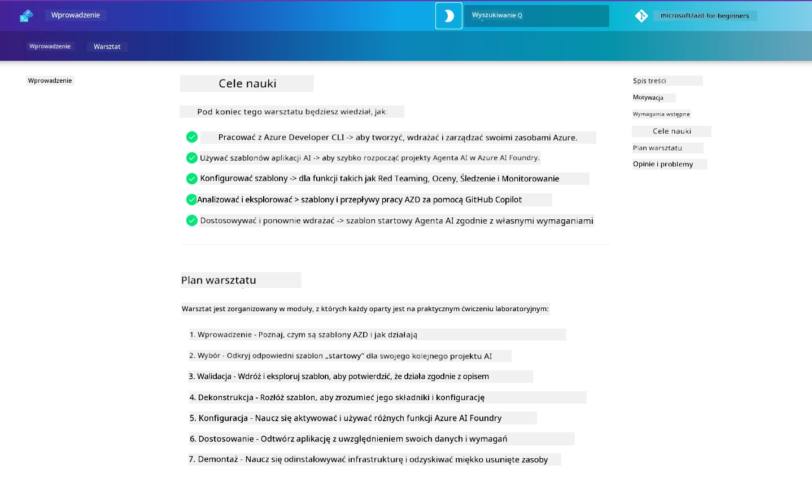

<div align="center">
  <div style="background: linear-gradient(135deg, #0078d4, #106ebe); border-radius: 10px; padding: 20px; margin: 20px 0; box-shadow: 0 4px 15px rgba(0, 120, 212, 0.3); border: 2px solid #005a9e;">
    <h2 style="color: white; margin: 0; font-size: 24px; text-shadow: 1px 1px 2px rgba(0,0,0,0.3);">
      🎯 Warsztaty AZD dla programistów AI
    </h2>
    <p style="color: white; margin: 10px 0 0 0; font-size: 16px; text-shadow: 1px 1px 2px rgba(0,0,0,0.3);">
      <strong>Praktyczne warsztaty budowania aplikacji AI z użyciem Azure Developer CLI.</strong><br>
      Ukończ 7 modułów, aby opanować szablony AZD i przepływy wdrażania AI.
    </p>
    <div style="margin-top: 15px;">
      <span style="background: rgba(255,255,255,0.2); padding: 5px 10px; border-radius: 15px; color: white; font-size: 14px;">
        📅 Źródło wskazówek zaktualizowane: listopad 2026
      </span>
    </div>
  </div>
</div>

# Warsztaty AZD dla programistów AI

Witamy na praktycznych warsztatach uczących Azure Developer CLI (AZD) ze szczególnym naciskiem na wdrażanie aplikacji AI. Te warsztaty pomogą Ci zdobyć praktyczną wiedzę o szablonach AZD w 3 krokach:

1. **Odkrywanie** - znajdź szablon odpowiedni dla Ciebie.
1. **Wdrażanie** - wdroż i zweryfikuj, że działa
1. **Dostosowywanie** - modyfikuj i rozwijaj, aby był Twój!

W trakcie tych warsztatów zostaniesz również zapoznany z podstawowymi narzędziami i przepływami pracy dewelopera, które pomogą Ci usprawnić całą ścieżkę tworzenia.

<br/>

## Przewodnik w przeglądarce

Lekcje warsztatowe są w formacie Markdown. Możesz poruszać się po nich bezpośrednio na GitHubie lub uruchomić podgląd w przeglądarce, jak pokazano na zrzucie ekranu poniżej.



Aby skorzystać z tej opcji — rozgałęź repozytorium do swojego profilu i uruchom GitHub Codespaces. Gdy terminal VS Code będzie aktywny, wpisz tę komendę:

Ten podgląd w przeglądarce działa w GitHub Codespaces, kontenerach deweloperskich lub lokalnej kopii z zainstalowanym Pythonem i MkDocs.

```bash title="" linenums="0"
python -m pip install -r requirements-dev.txt
python -m mkdocs serve --config-file workshop/mkdocs.yml
```

Uruchom te polecenia z **katalogu głównego repozytorium kursu**, a nie z osobno zainicjowanego przykładu AI. Trzymaj podgląd na pierwszym planie, żeby błędy były widoczne; zatrzymaj go za pomocą Ctrl+C. Aby sprawdzić stronę bez jej uruchamiania, wpisz `python -m mkdocs build --strict --config-file workshop/mkdocs.yml`.

Po kilku sekundach pojawi się okienko dialogowe. Wybierz opcję `Open in browser`. Przewodnik internetowy otworzy się w nowej karcie przeglądarki. Niektóre z zalet tego podglądu:

1. **Wbudowane wyszukiwanie** — szybko znajdź słowa kluczowe lub lekcje.
1. **Ikona kopiowania** — najedź na bloki kodu, aby zobaczyć tę opcję.
1. **Przełącznik motywów** — zmieniaj między ciemnym i jasnym motywem.
1. **Uzyskaj pomoc** — kliknij ikonę Discord w stopce, aby dołączyć!

<br/>

## Przegląd warsztatów

**Czas trwania:** 3-4 godziny  
**Poziom:** Od podstawowego do średniozaawansowanego  
**Wymagania wstępne:** Znajomość Azure, koncepcji AI, VS Code i narzędzi wiersza poleceń.

To praktyczne warsztaty, na których uczysz się przez działanie. Po ukończeniu ćwiczeń polecamy zapoznać się z kursem AZD dla początkujących, aby kontynuować naukę najlepszych praktyk w zakresie bezpieczeństwa i produktywności.

| Czas| Moduł  | Cel |
|:---|:---|:---|
| 15 minut | [Wprowadzenie](docs/instructions/0-Introduction.md) | Ustaw scenę, zrozum cele |
| 30 minut | [Wybierz szablon AI](docs/instructions/1-Select-AI-Template.md) | Poznaj opcje i wybierz startowy | 
| 30 minut | [Zweryfikuj szablon AI](docs/instructions/2-Validate-AI-Template.md) | Wdróż domyślne rozwiązanie w Azure |
| 30 minut | [Analiza szablonu AI](docs/instructions/3-Deconstruct-AI-Template.md) | Zbadaj strukturę i konfigurację |
| 30 minut | [Konfiguracja szablonu AI](docs/instructions/4-Configure-AI-Template.md) | Aktywuj i wypróbuj dostępne funkcje |
| 30 minut | [Dostosowanie szablonu AI](docs/instructions/5-Customize-AI-Template.md) | Dopasuj szablon do swoich potrzeb |
| 30 minut | [Usuwanie infrastruktury](docs/instructions/6-Teardown-Infrastructure.md) | Sprzątanie i zwolnienie zasobów |
| 15 minut | [Podsumowanie i kolejne kroki](docs/instructions/7-Wrap-up.md) | Materiały do nauki, wyzwanie warsztatowe |

<br/>

## Czego się nauczysz

Traktuj szablon AZD jako piaskownicę do nauki, aby eksplorować różne możliwości i narzędzia do kompleksowego tworzenia na platformie Microsoft Foundry. Po zakończeniu warsztatów powinieneś mieć intuicyjne pojęcie o różnych narzędziach i koncepcjach w tym kontekście.

| Koncepcja  | Cel |
|:---|:---|
| **Azure Developer CLI** | Poznaj komendy i przepływy narzędzia |
| **Szablony AZD** | Zrozum strukturę projektu i konfigurację |
| **Azure AI Agent** | Twórz i wdrażaj projekt Microsoft Foundry |
| **Azure AI Search** | Włącz inżynierię kontekstu za pomocą agentów |
| **Obserwowalność** | Poznaj śledzenie, monitorowanie i ewaluacje |
| **Red Teaming** | Poznaj testy przeciwstawne i zabezpieczenia |

<br/>

## Struktura warsztatów

Warsztaty są zaplanowane tak, aby przeprowadzić Cię od odkrywania szablonu, przez wdrożenie, analizę, aż po dostosowanie — bazując na oficjalnym szablonie startowym [Getting Started with AI Agents](https://github.com/Azure-Samples/get-started-with-ai-agents).

### [Moduł 1: Wybierz szablon AI](docs/instructions/1-Select-AI-Template.md) (30 minut)

- Czym są szablony AI?
- Gdzie mogę znaleźć szablony AI?
- Jak zacząć budować agentów AI?
- **Ćwiczenie**: Szybki start w Codespaces lub kontenerze deweloperskim

### [Moduł 2: Zweryfikuj szablon AI](docs/instructions/2-Validate-AI-Template.md) (30 minut)

- Jaka jest architektura szablonu AI?
- Jaki jest przepływ prac deweloperskich AZD?
- Gdzie mogę uzyskać pomoc w rozwoju AZD?
- **Ćwiczenie**: Wdróż i zweryfikuj szablon Agentów AI

### [Moduł 3: Analiza szablonu AI](docs/instructions/3-Deconstruct-AI-Template.md) (30 minut)

- Zbadaj środowisko w `.azure/` 
- Zbadaj konfigurację zasobów w `infra/` 
- Zbadaj konfigurację AZD w `azure.yaml`
- **Ćwiczenie**: Modyfikuj zmienne środowiskowe i ponownie wdrażaj

### [Moduł 4: Konfiguruj szablon AI](docs/instructions/4-Configure-AI-Template.md) (30 minut)
- Poznaj: Retrieval Augmented Generation
- Poznaj: Ewaluację agentów i Red Teaming
- Poznaj: Śledzenie i monitorowanie
- **Ćwiczenie**: Poznaj agenta AI i obserwowalność

### [Moduł 5: Dostosuj szablon AI](docs/instructions/5-Customize-AI-Template.md) (30 minut)
- Zdefiniuj: PRD z wymaganiami scenariusza
- Skonfiguruj: zmienne środowiskowe dla AZD
- Wdroż: haki cyklu życia dla dodatkowych zadań
- **Ćwiczenie**: Dostosuj szablon do mojego scenariusza

### [Moduł 6: Usuwanie infrastruktury](docs/instructions/6-Teardown-Infrastructure.md) (30 minut)
- Podsumowanie: Czym są szablony AZD?
- Podsumowanie: Dlaczego warto używać Azure Developer CLI?
- Kolejne kroki: Wypróbuj inny szablon!
- **Ćwiczenie**: Usuń infrastrukturę i posprzątaj

<br/>

## Wyzwanie warsztatowe

Chcesz podjąć większe wyzwanie? Oto kilka sugestii projektów — lub podziel się z nami swoimi pomysłami!

| Projekt | Opis |
|:---|:---|
|1. **Analiza złożonego szablonu AI** | Użyj opisanych narzędzi i przepływu, aby wdrożyć, zweryfikować i dostosować inny szablon rozwiązania AI. _Czego się nauczyłeś?_|
|2. **Dostosuj do swojego scenariusza**  | Spróbuj napisać PRD (dokument wymagań produktowych) dla innego scenariusza. Następnie użyj GitHub Copilot w repozytorium szablonu w trybie Agent Model i poproś o wygenerowanie przepływu dostosowania. _Czego się nauczyłeś? Jak możesz ulepszyć te sugestie?_|
| | |

## Masz opinię?

1. Dodaj zgłoszenie w tym repozytorium — oznacz je tagiem `Workshop` dla wygody.
1. Dołącz do Discorda Microsoft Foundry — nawiąż kontakt z innymi!


| | | 
|:---|:---|
| **📚 Strona główna kursu**| [AZD dla początkujących](../README.md)|
| **📖 Dokumentacja** | [Pierwsze kroki z szablonami AI](https://learn.microsoft.com/en-us/azure/ai-foundry/how-to/develop/ai-template-get-started)|
| **🛠️Szablony AI** | [Szablony Microsoft Foundry](https://ai.azure.com/templates) |
|**🚀 Kolejne kroki** | [Rozpocznij warsztaty](#workshop-overview) |
| | |

<br/>

---

**Nawigacja:** [Kurs główny](../README.md) | [Wprowadzenie](docs/instructions/0-Introduction.md) | [Moduł 1: Wybierz szablon](docs/instructions/1-Select-AI-Template.md)

**Gotowy, aby zacząć budować aplikacje AI z AZD?**

[Rozpocznij warsztaty: Wprowadzenie →](docs/instructions/0-Introduction.md)

---

<!-- CO-OP TRANSLATOR DISCLAIMER START -->
**Zastrzeżenie**:
Niniejszy dokument został przetłumaczony za pomocą usługi tłumaczenia AI [Co-op Translator](https://github.com/Azure/co-op-translator). Choć dążymy do dokładności, prosimy pamiętać, że automatyczne tłumaczenia mogą zawierać błędy lub niedokładności. Oryginalny dokument w jego języku źródłowym należy uznawać za autorytatywne źródło. W przypadku informacji krytycznych zalecane jest skorzystanie z profesjonalnego tłumaczenia wykonanego przez człowieka. Nie ponosimy odpowiedzialności za jakiekolwiek nieporozumienia lub błędne interpretacje wynikające z użycia tego tłumaczenia.
<!-- CO-OP TRANSLATOR DISCLAIMER END -->