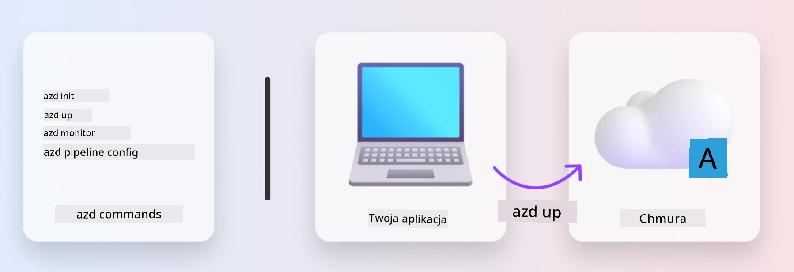
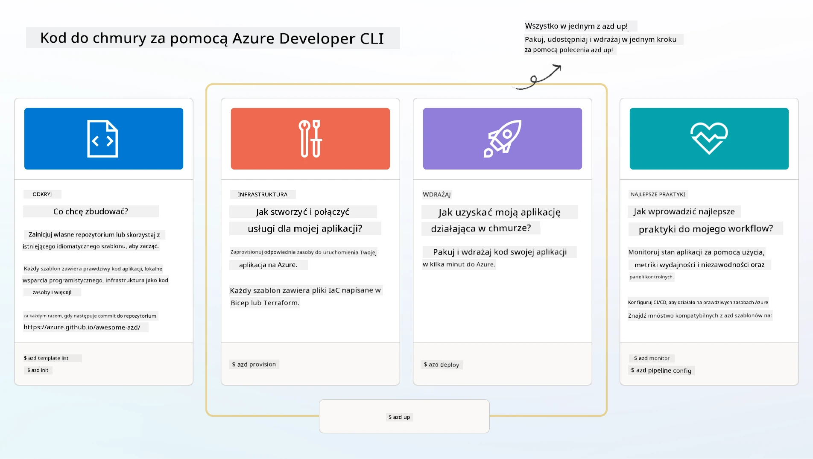

# 1. Wybierz szablon

!!! tip "NA KOŃCU TEGO MODUŁU BĘDZIESZ W STANIE"

    - [ ] Describe what AZD templates are
    - [ ] Discover and use AZD templates for AI
    - [ ] Get started with the AI Agents template
    - [ ] **Lab 1:** AZD Quickstart in Codespaces or a dev container

---

## 1. Analogią jest budowniczy

Zbudowanie nowoczesnej aplikacji AI gotowej na potrzeby przedsiębiorstwa _od zera_ może być przytłaczające. To trochę jak budowanie własnego nowego domu, cegła po cegle. Tak, można to zrobić! Ale to nie jest najbardziej efektywny sposób, by osiągnąć pożądany efekt końcowy!

Zamiast tego często zaczynamy od istniejącego _planu projektowego_ i współpracujemy z architektem, aby dostosować go do naszych osobistych wymagań. I właśnie takie podejście powinno się zastosować przy budowaniu inteligentnych aplikacji. Najpierw znajdź dobrą architekturę projektową, która pasuje do Twojego obszaru problemów. Potem współpracuj z architektem rozwiązań, aby dostosować i rozwinąć rozwiązanie pod Twoje konkretne scenariusze.

Ale gdzie możemy znaleźć te plany projektowe? I jak znaleźć architekta, który chętnie nauczy nas, jak samodzielnie dostosować i wdrożyć te plany? W tym warsztacie odpowiadamy na te pytania, przedstawiając Ci trzy technologie:

1. [Azure Developer CLI](https://aka.ms/azd) – narzędzie open-source, które przyspiesza ścieżkę dewelopera od lokalnego tworzenia (build) do wdrożenia w chmurze (ship).
1. [Microsoft Foundry Templates](https://ai.azure.com/templates) – standaryzowane publiczne repozytoria zawierające przykładowy kod, infrastrukturę i pliki konfiguracyjne do wdrażania architektury rozwiązania AI.
1. [GitHub Copilot Agent Mode](https://code.visualstudio.com/docs/copilot/chat/chat-agent-mode) – agent kodujący oparty na wiedzy o Azure, który może nas prowadzić w nawigacji po bazie kodu i wprowadzaniu zmian – używając naturalnego języka.

Mając te narzędzia w rękach, możemy teraz _odkrywać_ właściwy szablon, _wdrażać_ go, aby zweryfikować, czy działa, oraz _dostosowywać_ go do naszych specyficznych scenariuszy. Zagłębmy się i nauczmy, jak one działają.


---

## 2. Azure Developer CLI

Narzędzie wiersza poleceń [Azure Developer CLI](https://learn.microsoft.com/en-us/azure/developer/azure-developer-cli/) (lub `azd`) jest otwartoźródłowym narzędziem, które może przyspieszyć twoją podróż od kodu do chmury dzięki zestawowi przyjaznych dla programistów poleceń działających spójnie zarówno w twoim IDE (środowisko programistyczne), jak i w środowiskach CI/CD (devops).

Dzięki `azd` Twoja podróż wdrożeniowa może być tak prosta jak:

- `azd init` - Inicjuje nowy projekt AI na podstawie istniejącego szablonu AZD.
- `azd up` - Przygotowuje infrastrukturę i wdraża aplikację w jednym kroku.
- `azd monitor` - Uzyskaj monitorowanie i diagnostykę w czasie rzeczywistym dla wdrożonej aplikacji.
- `azd pipeline config` - Skonfiguruj potoki CI/CD, aby zautomatyzować wdrażanie w Azure.

**🎯 | ĆWICZENIE**: <br/> Zapoznaj się teraz z narzędziem wiersza poleceń `azd` w swoim aktualnym środowisku warsztatowym. Może to być GitHub Codespaces, kontener deweloperski lub lokalna kopia z zainstalowanymi wymaganiami wstępnymi. Zacznij od wpisania tego polecenia, aby zobaczyć, co narzędzie potrafi:

```bash title="" linenums="0"
azd help
```



---

## 3. Szablon AZD

Aby `azd` mógł to osiągnąć, musi znać infrastrukturę do wdrożenia, ustawienia konfiguracji do wymuszenia oraz aplikację do wdrożenia. W tym miejscu wchodzą [szablony AZD](https://learn.microsoft.com/en-us/azure/developer/azure-developer-cli/azd-templates?tabs=csharp). 

Szablony AZD to repozytoria open-source łączące przykładowy kod z plikami infrastruktury i konfiguracji wymaganymi do wdrożenia architektury rozwiązania.
Stosując podejście _Infrastructure-as-Code_ (IaC), pozwalają na wersjonowanie definicji zasobów szablonów i ustawień konfiguracji (tak jak kodu źródłowego aplikacji) - tworząc wielokrotnego użytku i spójne procesy pracy wśród użytkowników tego projektu.

Tworząc lub ponownie używając szablon AZD dla _twojego_ scenariusza, rozważ następujące pytania:

1. Co tworzysz? → Czy istnieje szablon, który zawiera kod startowy dla tego scenariusza?
1. Jak jest zaprojektowane twoje rozwiązanie? → Czy jest szablon zawierający potrzebne zasoby?
1. Jak jest wdrażane twoje rozwiązanie? → Pomyśl o `azd deploy` z hakami przed/po przetwarzaniu!
1. Jak możesz je dalej zoptymalizować? → Pomyśl o wbudowanym monitoringu i automatyzacji potoków!

**🎯 | ĆWICZENIE**: <br/> 
Odwiedź galerię [Awesome AZD](https://azure.github.io/awesome-azd/) i użyj filtrów, aby przeglądać ponad 250 dostępnych szablonów. Sprawdź, czy znajdziesz taki, który odpowiada _twoim_ wymaganiom scenariusza.



---

## 4. Szablony Aplikacji AI

Dla aplikacji wspieranych sztuczną inteligencją Microsoft udostępnia specjalistyczne szablony zawierające **Microsoft Foundry** i **Foundry Agents**. Szablony te przyspieszają tworzenie inteligentnych, gotowych do produkcji aplikacji.

### Szablony Microsoft Foundry i Foundry Agents

Wybierz szablon poniżej, aby go wdrożyć. Każdy szablon jest dostępny w [Awesome AZD](https://azure.github.io/awesome-azd/) i można go zainicjalizować jednym poleceniem.

| Szablon | Opis | Polecenie wdrożenia |
|--------|-------|--------------------|
| **[Czat AI z RAG](https://github.com/Azure-Samples/azure-search-openai-demo)** | Aplikacja czatu oparta na wyszukiwaniu | `azd init -t Azure-Samples/azure-search-openai-demo .` |
| **[Rozpocznij pracę z agentami AI](https://github.com/Azure-Samples/get-started-with-ai-agents)** | Aplikacja czatu wspierana przez agenta; używana w całym tym warsztacie | `azd init -t Azure-Samples/get-started-with-ai-agents .` |
| **[Rozpocznij pracę z czatem AI](https://github.com/Azure-Samples/get-started-with-ai-chat)** | Startowa aplikacja czatu AI | `azd init -t Azure-Samples/get-started-with-ai-chat .` |

To są alternatywy: zainicjuj **jeden** szablon w jego własnym pustym katalogu. Końcowy `.` wybiera ten katalog; pominięcie go w obecnych wersjach AZD tworzy podkatalog o nazwie szablonu. Inicjalizacja pobiera projekt; `azd up` wykonuje rozliczalne wdrożenie po przejrzeniu wymagań wstępnych, zasobów, wsparcia regionu i limitów.

### Szybki start

1. **Przeglądaj szablony**: Odwiedź [https://azure.github.io/awesome-azd/](https://azure.github.io/awesome-azd/) i filtruj według `AI`, `Agents` lub `Microsoft Foundry`
2. **Wybierz swój szablon**: Wybierz taki, który odpowiada Twojemu przypadkowi użycia
3. **Zainicjuj**: Uruchom polecenie `azd init` dla wybranego szablonu
4. **Wdróż**: Uruchom `azd up`, aby przygotować i wdrożyć

**🎯 | ĆWICZENIE**: <br/>
Wybierz jeden z powyższych szablonów na podstawie swojego scenariusza:

- **Kontynuujesz ten warsztat?** → Wybierz **Rozpocznij pracę z agentami AI**
- **Budujesz czat oparty na wyszukiwaniu?** → Poznaj osobno **AI Chat z RAG**
- **Potrzebujesz innej architektury?** → Przeszukaj galerię i zweryfikuj aktualne repozytorium, status implementacji i wymagania wstępne

```bash title="Initialize the workshop template in an empty directory" linenums="0"
azd init -t Azure-Samples/get-started-with-ai-agents .
azd auth login
azd up
```

!!! info "Poznaj więcej szablonów"
    Galeria [Awesome AZD Gallery](https://azure.github.io/awesome-azd/) zawiera ponad 250 szablonów. Użyj filtrów, aby znaleźć szablony odpowiadające Twoim konkretnym wymaganiom dotyczącym języka, frameworka i usług Azure.

---

<!-- CO-OP TRANSLATOR DISCLAIMER START -->
**Zastrzeżenie**:
Niniejszy dokument został przetłumaczony za pomocą usługi tłumaczenia AI [Co-op Translator](https://github.com/Azure/co-op-translator). Choć dążymy do dokładności, prosimy pamiętać, że automatyczne tłumaczenia mogą zawierać błędy lub niedokładności. Oryginalny dokument w jego języku źródłowym należy uznawać za autorytatywne źródło. W przypadku informacji krytycznych zalecane jest skorzystanie z profesjonalnego tłumaczenia wykonanego przez człowieka. Nie ponosimy odpowiedzialności za jakiekolwiek nieporozumienia lub błędne interpretacje wynikające z użycia tego tłumaczenia.
<!-- CO-OP TRANSLATOR DISCLAIMER END -->