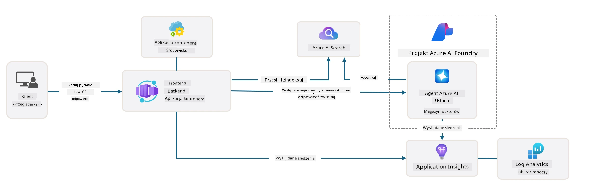

# 3. Dekonstruuj szablon

!!! tip "PO PRZECZYTANIU TEGO MODUŁU BĘDZIESZ POTRAFIŁ"

    - [ ] Use GitHub Copilot and optional MCP tools for Azure documentation and read-only exploration
    - [ ] Identify the template's application, infrastructure, configuration, and test entry points
    - [ ] Verify generated explanations against actual repository files
    - [ ] **Lab 3:** Trace one request and one configuration input through the project

---

## 1. Aktywuj GitHub Copilot

Otwórz zainicjowany przykład AI w VS Code i włącz [GitHub Copilot](https://code.visualstudio.com/docs/copilot/chat/chat-agent-mode). Zaloguj się kontem z odpowiednim planem; limity użycia mogą się różnić. Poproś Copilota o wyjaśnienie repozytorium przed zatwierdzeniem zmian.

### Opcjonalne serwery MCP

Te usługi mogą dostarczyć dodatkowe narzędzia:

- [Serwer Azure MCP](https://learn.microsoft.com/azure/developer/azure-mcp-server/overview)
- [Serwer Microsoft Learn MCP](https://learn.microsoft.com/training/support/mcp)

W VS Code zapoznaj się z [wytycznymi konfiguracji MCP](https://code.visualstudio.com/docs/copilot/chat/mcp-servers) i w razie potrzeby utwórz `.vscode/mcp.json`:

```json
{
  "servers": {
    "Azure MCP Server": {
      "type": "stdio",
      "command": "npx",
      "args": ["-y", "@azure/mcp@latest", "server", "start"]
    },
    "microsoft.docs.mcp": {
      "type": "http",
      "url": "https://learn.microsoft.com/api/mcp"
    }
  }
}
```

Polecenie `npx` wymaga obsługiwanej instalacji Node.js/npm i pobiera wykonywalny kod. Sprawdź pakiet i przypnij zatwierdzoną wersję, aby zapewnić powtarzalną konfigurację zespołu. Uruchom serwery za pomocą narzędzi MCP w VS Code i sprawdź dostępne narzędzia; nazwy mogą się zmieniać między wersjami.

**Uwierzytelnianie jest oddzielne.** Użyj `azd auth login` dla AZD. Postępuj zgodnie z udokumentowanym przepływem uwierzytelniania Azure MCP dla jego narzędzi; samo logowanie AZD nie ustanawia sesji MCP. Używaj `az login` osobno, gdy ćwiczenie lub hook wywołuje Azure CLI.

Wypróbuj polecenia tylko do odczytu:

1. „Użyj Microsoft Learn MCP, aby znaleźć dokumentację konfiguracji Azure Developer CLI.”
2. „Wyjaśnij `azure.yaml` tego repozytorium; podaj pliki, które implementują każdy hook.”
3. „Korzystając z dostępnych narzędzi Azure MCP, wypisz moje wdrożone zasoby bez wprowadzania zmian.”

Sprawdź wybranego najemcę/subskrypcję i każde proponowane wywołanie narzędzia. Nie zatwierdzaj tworzenia, usuwania ani zmian dostępu do zasobów tylko po to, by zbadać architekturę.

## 2. Zrozum architekturę

Przykład hostuje backend Python FastAPI oraz frontend React/TypeScript w Azure Container Apps. Backend komunikuje się z agentem w projekcie Microsoft Foundry. Pobieranie i obserwowalność zależą od włączonych funkcji szablonu i pomyślnej konfiguracji; nie są gwarantowane tylko dlatego, że aplikacja została wdrożona.



Porównaj tę grafikę z [aktualnym przewodnikiem wdrożenia upstream](https://github.com/Azure-Samples/get-started-with-ai-agents/blob/main/docs/deployment.md) i swoimi rzeczywistymi zasobami. Sprawdź skonfigurowane wdrożenie modelu, narzędzia agenta, zarządzaną tożsamość, przypisania ról oraz opcjonalne zasoby AI Search/Application Insights.

**Ćwiczenie:** Poproś Copilota o śledzenie zapytania czatu od frontendu przez API do Foundry, z odniesieniami do plików i funkcji. Otwórz te odniesienia i zweryfikuj wyjaśnienie. Nie wyciągaj wniosków o zaimplementowanym uwierzytelnianiu, trasowaniu ani autoryzacji wyłącznie z diagramu.

## 3. Struktura repozytorium

Wybrane ścieżki zostały sprawdzone względem przykładu 4 listopada 2026 r. Twoja zainicjowana rewizja pozostaje źródłem prawdy:

```text
get-started-with-ai-agents/
  azure.yaml
  docker-compose.yaml
  requirements-dev.txt
  .devcontainer/
  infra/
    main.bicep
    main.parameters.json
    api.bicep
    core/
  src/
    Dockerfile
    pyproject.toml
    requirements.txt
    api/
      main.py
      routes.py
      search_index_manager.py
    frontend/
      package.json
      src/
    files/
  scripts/
    validate_env_vars.sh
    validate_env_vars.ps1
    postdeploy.sh
    postdeploy.ps1
  tests/
    test_evaluation.py
    test_red_teaming.py
  docs/
    deployment.md
    deploy_customization.md
    ai_search.md
    observability.md
    local_development.md
    troubleshooting.md
```

### Infrastruktura i konfiguracja

`infra/main.bicep` orkiestruje zasoby; `main.parameters.json` łączą dane wejściowe szablonu z wartościami środowiska AZD. `azure.yaml` wybiera usługę aplikacji i hooki cyklu życia. Prześledź takie dane wejściowe jak `USE_AZURE_AI_SEARCH_SERVICE` przez te pliki, aby znaleźć, co faktycznie się zmienia.

### Aplikacja i tożsamość

Przeczytaj `src/api/` i `src/frontend/` razem. Zidentyfikuj, gdzie agent jest tworzony lub pobierany, gdzie konfigurowane są instrukcje/narzędzia oraz której tożsamości używa każde wywołanie Azure. Przykładowe pliki pod `src/files/` to dane demonstracyjne, nie katalog produkcyjny ani model autoryzacji.

### Testy i obserwowalność

Aktualne punkty wejścia do ewaluacji i red-teamingu znajdują się pod `tests/`; starsze odwołania do katalogów `evals/` i `airedteaming/` są nieaktualne dla tego przykładu. Przeczytaj `docs/observability.md` o wymaganiach i kosztach przed uruchomieniem testów w chmurze. Te testy w Pythonie są oddzielne od opcjonalnego rozszerzenia AZD `azure.ai.evaluations`.

## 4. Zweryfikuj swoje ustalenia

- Zidentyfikuj trasę API, interakcję z agentem i kod pobierania dla jednego przykładowego pytania.
- Wyjaśnij, która tożsamość uzyskuje dostęp do Foundry i która konfiguracja wybiera jej punkt końcowy.
- Znajdź faktyczne skrypty przedwdrożeniowe i po wdrożeniu oraz ich zachowanie w przypadku błędów.
- Wymień wszelkie zależności lub funkcje opcjonalne, które są nieobecne w twoim wdrożeniu.

Kontynuuj do [Konfiguracji szablonu](4-Configure-AI-Template.md).

---

<!-- CO-OP TRANSLATOR DISCLAIMER START -->
**Zastrzeżenie**:
Niniejszy dokument został przetłumaczony za pomocą usługi tłumaczenia AI [Co-op Translator](https://github.com/Azure/co-op-translator). Choć dążymy do dokładności, prosimy pamiętać, że automatyczne tłumaczenia mogą zawierać błędy lub niedokładności. Oryginalny dokument w jego języku źródłowym należy uznawać za autorytatywne źródło. W przypadku informacji krytycznych zalecane jest skorzystanie z profesjonalnego tłumaczenia wykonanego przez człowieka. Nie ponosimy odpowiedzialności za jakiekolwiek nieporozumienia lub błędne interpretacje wynikające z użycia tego tłumaczenia.
<!-- CO-OP TRANSLATOR DISCLAIMER END -->