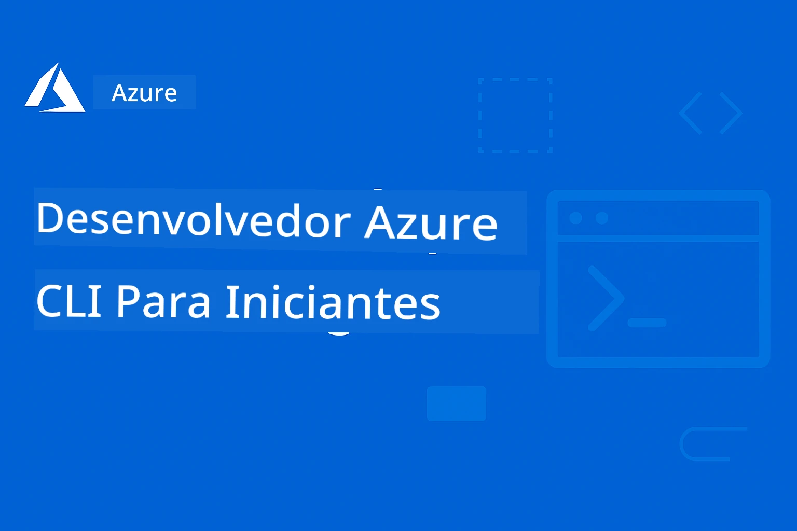

# AZD para Iniciantes: Uma Jornada de Aprendizado Estruturada

 

[](https://github.com/microsoft/AZD-for-beginners)
[](https://GitHub.com/microsoft/azd-for-beginners/network/)
[](https://github.com/microsoft/AZD-for-beginners)

[](https://discord.com/invite/nkVh3dp)
[](https://discord.gg/nTYy5BXMWG)

---

### Traduções Automáticas (Sempre Atualizadas)

<!-- CO-OP TRANSLATOR LANGUAGES TABLE START -->
[Árabe](../ar/README.md) | [Bengali](../bn/README.md) | [Búlgaro](../bg/README.md) | [Birmanês (Myanmar)](../my/README.md) | [Chinês (Simplificado)](../zh-CN/README.md) | [Chinês (Tradicional, Hong Kong)](../zh-HK/README.md) | [Chinês (Tradicional, Macau)](../zh-MO/README.md) | [Chinês (Tradicional, Taiwan)](../zh-TW/README.md) | [Croata](../hr/README.md) | [Tcheco](../cs/README.md) | [Dinamarquês](../da/README.md) | [Holandês](../nl/README.md) | [Estoniano](../et/README.md) | [Finlandês](../fi/README.md) | [Francês](../fr/README.md) | [Alemão](../de/README.md) | [Grego](../el/README.md) | [Hebraico](../he/README.md) | [Hindi](../hi/README.md) | [Húngaro](../hu/README.md) | [Indonésio](../id/README.md) | [Italiano](../it/README.md) | [Japonês](../ja/README.md) | [Kannada](../kn/README.md) | [Khmer](../km/README.md) | [Coreano](../ko/README.md) | [Lituano](../lt/README.md) | [Malaio](../ms/README.md) | [Malaiala](../ml/README.md) | [Marata](../mr/README.md) | [Nepali](../ne/README.md) | [Pidgin Nigeriano](../pcm/README.md) | [Norueguês](../no/README.md) | [Persa (Farsi)](../fa/README.md) | [Polonês](../pl/README.md) | [Português (Brasil)](./README.md) | [Português (Portugal)](../pt-PT/README.md) | [Punjabi (Gurmukhi)](../pa/README.md) | [Romeno](../ro/README.md) | [Russo](../ru/README.md) | [Sérvio (Cirílico)](../sr/README.md) | [Eslovaco](../sk/README.md) | [Esloveno](../sl/README.md) | [Espanhol](../es/README.md) | [Suaíli](../sw/README.md) | [Sueco](../sv/README.md) | [Tagalog (Filipino)](../tl/README.md) | [Tâmil](../ta/README.md) | [Telugo](../te/README.md) | [Tailandês](../th/README.md) | [Turco](../tr/README.md) | [Ucraniano](../uk/README.md) | [Urdu](../ur/README.md) | [Vietnamita](../vi/README.md)

> **Prefere Clonar Localmente?**
>
> Este repositório inclui traduções em mais de 50 idiomas, o que aumenta significativamente o tamanho do download. Para clonar sem traduções, use sparse checkout:
>
> **Bash / macOS / Linux:**
> ```bash
> git clone --filter=blob:none --sparse https://github.com/microsoft/AZD-for-beginners.git
> cd AZD-for-beginners
> git sparse-checkout set --no-cone '/*' '!translations' '!translated_images'
> ```
>
> **CMD (Windows):**
> ```cmd
> git clone --filter=blob:none --sparse https://github.com/microsoft/AZD-for-beginners.git
> cd AZD-for-beginners
> git sparse-checkout set --no-cone "/*" "!translations" "!translated_images"
> ```
>
> Isso lhe dá tudo que precisa para completar o curso com um download muito mais rápido.
<!-- CO-OP TRANSLATOR LANGUAGES TABLE END -->

## 🆕 Novidades no azd Hoje

> 📌 **Revisão do lançamento da AI CLI (2026-11-04):** A orientação foi verificada contra a documentação/fonte publicada de **`azd 1.37.2`**, **agentes `1.0.0-beta.23`**, e **avaliações `1.0.0-beta.2`**. Use `azd >= 1.37.0` para o fluxo de trabalho combinado. Execute `azd version` e [atualize o núcleo do CLI](https://learn.microsoft.com/azure/developer/azure-developer-cli/install-azd) antes das extensões. Veja [mudanças e correções do lançamento](docs/chapter-08-production/production-ai-practices.md#recent-release-changes-and-fixes). Esta não é uma validação ao vivo da implantação do curso todo.

O Azure Developer CLI suporta muitos tipos de aplicações, incluindo aplicativos web, APIs e agentes de IA, através de hosts, templates e extensões suportadas.

Veja o que isso significa para você:

- **Agentes de IA agora são workloads de primeira classe no azd.** Você pode inicializar, implantar e gerenciar projetos de agentes de IA usando o mesmo fluxo `azd init` → `azd up` que você já conhece.
- **Um ciclo de vida de agente em duas extensões.** Use `azure.ai.agents` para inicializar, invocar, otimizar e aposentar agentes. Instale **`azure.ai.evaluations`** separadamente para `azd ai eval init`, `generate`, e `run start`. Beta.22 dos agentes substituiu o fluxo legado de avaliação e mudou a configuração de otimização; siga o [guia de migração](docs/chapter-08-production/production-ai-practices.md#evaluation-migration-and-quality-checks).
- **Mais blocos de construção de IA.** Novas extensões de pré-visualização—`azure.ai.skills` e `azure.ai.connections`—permitem gerenciar habilidades reutilizáveis de agentes e conexões do Foundry diretamente com azd.
- **Integração com Microsoft Foundry** traz implantação de modelos, hospedagem de agentes e configuração de serviços de IA diretamente ao ecossistema de templates do azd.
- **Noções básicas do dia-a-dia mais suaves.** Lançamentos recentes tornaram `azd init` idempotente (seguro para reexecutar), fizeram `azd auth login` limpar tokens obsoletos automaticamente e adicionaram um prompt amigável `azd tool` na primeira execução para configuração.
- **O fluxo básico não mudou.** Seja implantando um app todo, um microsserviço ou uma solução AI multi-agente, os comandos são os mesmos.

> **Nota para usuários Aspire:** A Microsoft agora se refere ao produto simplesmente como **Aspire** (anteriormente ".NET Aspire"). O suporte do azd para Aspire não mudou—apenas o nome foi atualizado.

Se você já usou azd antes, o suporte a IA é uma extensão natural—não uma ferramenta separada ou uma trilha avançada. Se está começando agora, aprenderá um fluxo que funciona para tudo.

---

## 🚀 O que é Azure Developer CLI (azd)?

**Azure Developer CLI (azd)** é uma ferramenta de linha de comando amigável para desenvolvedores que facilita a implantação de aplicações no Azure. Em vez de criar e conectar manualmente dezenas de recursos no Azure, você pode implantar aplicações inteiras com um único comando.

### A Magia do `azd up`

```bash
# This single command does everything:
# ✅ Creates all Azure resources  
# ✅ Configures networking and security
# ✅ Builds your application code
# ✅ Deploys to Azure
# ✅ Gives you a working URL
azd up
```

O template fornece a configuração da aplicação e infraestrutura. O sucesso da implantação ainda requer serviços/modelos suportados, cotações e permissões suficientes, entradas corretas e verificação da aplicação implantada. `azd up` não torna automaticamente um template seguro, conforme as normas, ou pronto para produção.

---

## ❓ Azure Developer CLI vs Azure CLI: Qual a Diferença?

Esta é a pergunta mais comum feita por iniciantes. Aqui está a resposta simples:

| Característica | **Azure CLI (`az`)** | **Azure Developer CLI (`azd`)** |
|---------|---------------------|--------------------------------|
| **Finalidade** | Gerenciar recursos individuais do Azure | Implantar aplicações completas |
| **Mentalidade** | Focado em infraestrutura | Focado em aplicações |
| **Exemplo** | `az webapp create --name myapp...` | `azd up` |
| **Curva de aprendizado** | É preciso conhecer os serviços do Azure | Só precisa conhecer seu app |
| **Indicada para** | DevOps, Infraestrutura | Desenvolvedores, Protótipos |

### Analogia Simples

- **Azure CLI** é como ter todas as ferramentas para construir uma casa - martelos, serras, pregos. Você pode construir qualquer coisa, mas precisa saber construção.
- **Azure Developer CLI** é como contratar um empreiteiro - você descreve o que quer, e ele cuida da construção.

### Quando Usar Cada Um

| Cenário | Use Isto |
|----------|----------|
| "Quero implantar meu app web rapidamente" | `azd up` |
| "Preciso criar apenas uma conta de armazenamento" | `az storage account create` |
| "Estou construindo uma aplicação completa de IA" | `azd init --template azure-search-openai-demo` |
| "Preciso depurar um recurso específico do Azure" | `az resource show` |
| "Quero implantar no meu ambiente de produção configurado" | Revise configuração, acesso, custo e medidas operacionais antes de `azd up --environment production` |

### Eles Funcionam Juntos!

AZD e Azure CLI têm autenticação e configuração separadas. Use `azd auth login` para AZD, e `az login` quando um comando de gancho ou diagnóstico precisar explicitamente do Azure CLI. Você pode usar ambos:
```bash
# Deploy your app with AZD
azd up

# Then fine-tune specific resources with Azure CLI
az webapp config set --name myapp --always-on true
```

---

## 🌟 Encontre Templates no Awesome AZD

Não comece do zero! **Awesome AZD** é uma coleção comunitária de templates prontos para implantar:

| Recurso | Descrição |
|----------|-------------|
| 🔗 [**Galeria Awesome AZD**](https://azure.github.io/awesome-azd/) | Navegue por mais de 200 templates com implantação com um clique |
| 🔗 [**Enviar um Template**](https://github.com/Azure/awesome-azd/issues) | Contribua com seu próprio template para a comunidade |
| 🔗 [**Repositório GitHub**](https://github.com/Azure/awesome-azd) | Dê estrela e explore o código-fonte |

### Templates Populares de IA no Awesome AZD

Escolha um template em seu próprio diretório vazio; os comandos abaixo são alternativas. O `.` no final inicializa esse diretório.

```bash
# RAG Chat with Microsoft Foundry Models + AI Search
azd init --template azure-search-openai-demo .

# Quick AI Chat Application
azd init --template openai-chat-app-quickstart .

# AI Agents with Foundry Agents
azd init --template get-started-with-ai-agents .
```

---

## 🎯 Começando em 3 Passos

Antes de começar, certifique-se que sua máquina está pronta para o template que deseja implantar:

**Windows:**
```powershell
.\validate-setup.ps1
```

**macOS / Linux:**
```bash
bash ./validate-setup.sh
```

Se alguma verificação obrigatória falhar, corrija isso primeiro e depois continue com o início rápido.

### Passo 1: Instale o AZD (2 minutos)

**Windows:**
```powershell
winget install microsoft.azd
```

**macOS:**
```bash
brew tap azure/azd && brew install azd
```

**Linux:**
```bash
curl -fsSL https://aka.ms/install-azd.sh | bash
```

### Passo 2: Autentique-se para AZD

```bash
# Optional if you plan to use Azure CLI commands directly in this course
az login

# Required for AZD workflows
azd auth login
```

Se não souber qual precisa, siga o fluxo de configuração completo em [Instalação & Configuração](docs/chapter-01-foundation/installation.md#authentication-setup).

### Passo 3: Implante seu Primeiro App

```bash
# Initialize from a template
azd init --template todo-nodejs-mongo .

# Deploy to Azure (creates everything!)
azd up
```

**🎉 Pronto!** Seu app agora está ativo no Azure.

### Limpeza (Não esqueça!)

```bash
# Remove all resources when done experimenting
azd down --force --purge
```

---

## 📚 Como Usar Este Curso

Este curso é projetado para **aprendizado progressivo** - comece onde se sentir confortável e avance:

| Sua Experiência | Comece Aqui |
|-----------------|------------|
| **Novo no Azure** | [Capítulo 1: Fundamentos](#-chapter-1-foundation--quick-start) |
| **Conhece Azure, novo no AZD** | [Capítulo 1: Fundamentos](#-chapter-1-foundation--quick-start) |
| **Quer implantar apps de IA** | [Capítulo 2: Desenvolvimento Com Foco em IA](#-chapter-2-ai-first-development-recommended-for-ai-developers) |
| **Quer prática hands-on** | [🎓 Workshop Interativo](workshop/README.md) - laboratório guiado de 3-4 horas |
| **Precisa de padrões para produção** | [Capítulo 8: Produção & Enterprise](#-chapter-8-production--enterprise-patterns) |

### Configuração Rápida

1. **Fork deste Repositório**: [](https://GitHub.com/microsoft/azd-for-beginners/fork)
2. **Clone-o**: `git clone https://github.com/YOUR-USERNAME/azd-for-beginners.git`
3. **Obtenha Ajuda**: [Comunidade Azure Discord](https://discord.com/invite/ByRwuEEgH4)

> **Prefere Clonar Localmente?**

> Este repositório inclui traduções em mais de 50 idiomas, o que aumenta significativamente o tamanho do download. Para clonar sem traduções, use sparse checkout:
> ```bash
> git clone --filter=blob:none --sparse https://github.com/microsoft/AZD-for-beginners.git
> cd AZD-for-beginners
> git sparse-checkout set --no-cone '/*' '!translations' '!translated_images'
> ```
> Isso lhe dá tudo que precisa para completar o curso com um download muito mais rápido.


## Visão Geral do Curso

Domine o Azure Developer CLI (azd) por meio de capítulos estruturados para aprendizado progressivo. **Foco especial na implantação de aplicações de IA com integração Microsoft Foundry.**

### Por Que Este Curso é Essencial para Desenvolvedores Modernos

Desenvolvedores que implementam cargas de trabalho de IA frequentemente precisam de orientação sobre:
- Arquiteturas complexas de IA com múltiplos serviços
- Melhores práticas para implantação de IA em produção  
- Integração e configuração de serviços de IA do Azure
- Otimização de custos para cargas de trabalho de IA
- Solução de problemas específicos de implantação de IA

### Objetivos de Aprendizagem

Ao concluir este curso estruturado, você irá:
- **Dominar os Fundamentos do AZD**: Conceitos principais, instalação e configuração
- **Implantar Aplicações de IA**: Usar AZD com serviços Microsoft Foundry
- **Implementar Infraestrutura como Código**: Gerenciar recursos Azure com templates Bicep
- **Resolver Problemas de Implantação**: Corrigir problemas comuns e depurar falhas
- **Otimizar para Produção**: Segurança, escalonamento, monitoramento e gerenciamento de custos
- **Construir Soluções Multi-Agentes**: Implantar arquiteturas complexas de IA

## Antes de Começar: Contas, Acesso e Pressupostos

Antes de iniciar o Capítulo 1, certifique-se de que o seguinte está disponível. Os passos de instalação posteriormente neste guia assumem que esses requisitos básicos já estejam resolvidos.

- **Uma assinatura Azure**: Você pode usar uma assinatura existente do trabalho ou pessoal, ou criar uma [trial gratuita](https://aka.ms/azurefreetrial) para começar.
- **Permissão para criar recursos Azure**: Para a maioria dos exercícios, você deve ter ao menos acesso de **Contribuidor** na assinatura ou grupo de recursos alvo. Alguns capítulos também presumem que você pode criar grupos de recursos, identidades gerenciadas e atribuições de RBAC.
- [**Uma conta GitHub**](https://github.com): Útil para fazer fork do repositório, acompanhar suas alterações e usar GitHub Codespaces durante o workshop.
- **Pré-requisitos de tempo de execução do template**: Alguns templates precisam de ferramentas locais como Node.js, Python, Java ou Docker. Execute o validador de setup antes de começar para detectar ferramentas faltantes.
- **Familiaridade básica com terminal**: Não é necessário ser expert, mas deve se sentir confortável executando comandos como `git clone`, `azd auth login` e `azd up`.

> **Trabalha em uma assinatura corporativa?**
> Se seu ambiente Azure for gerenciado por um administrador, confirme antecipadamente se pode implantar recursos na assinatura ou grupo de recursos que planeja usar. Caso contrário, peça uma assinatura sandbox ou acesso de Contribuidor antes de começar.

> **Novo no Azure?**
> Comece com sua própria assinatura trial ou pay-as-you-go em https://aka.ms/azurefreetrial para poder terminar os exercícios do início ao fim sem esperar aprovações em nível de tenant.

## 🗺️ Mapa do Curso: Navegação Rápida por Capítulo

Cada capítulo tem um README dedicado com objetivos, introduções rápidas e exercícios:

| Capítulo | Tema | Lições | Duração | Complexidade |
|---------|-------|---------|----------|------------|
| **[Cap 1: Fundamentos](docs/chapter-01-foundation/README.md)** | Primeiros Passos | [Noções do AZD](docs/chapter-01-foundation/azd-basics.md) &#124; [Instalação](docs/chapter-01-foundation/installation.md) &#124; [Primeiro Projeto](docs/chapter-01-foundation/first-project.md) | 30-45 min | ⭐ |
| **[Cap 2: Desenvolvimento IA](docs/chapter-02-ai-development/README.md)** | Aplicações IA Primeira | [Integração Foundry](docs/chapter-02-ai-development/microsoft-foundry-integration.md) &#124; [Agentes de IA](docs/chapter-02-ai-development/agents.md) &#124; [Implantação de Modelo](docs/chapter-02-ai-development/ai-model-deployment.md) &#124; [Workshop](docs/chapter-02-ai-development/ai-workshop-lab.md) | 1-2 hrs | ⭐⭐ |
| **[Cap 3: Configuração](docs/chapter-03-configuration/README.md)** | Autenticação & Segurança | [Configuração](docs/chapter-03-configuration/configuration.md) &#124; [Autenticação & Segurança](docs/chapter-03-configuration/authsecurity.md) | 45-60 min | ⭐⭐ |
| **[Cap 4: Infraestrutura](docs/chapter-04-infrastructure/README.md)** | IaC & Implantação | [Guia de Implantação](docs/chapter-04-infrastructure/deployment-guide.md) &#124; [Provisionamento](docs/chapter-04-infrastructure/provisioning.md) | 1-1.5 hrs | ⭐⭐⭐ |
| **[Cap 5: Multi-Agente](docs/chapter-05-multi-agent/README.md)** | Soluções Agente IA | [Cenário Varejo](examples/retail-scenario.md) &#124; [Padrões de Coordenação](docs/chapter-06-pre-deployment/coordination-patterns.md) | 2-3 hrs | ⭐⭐⭐⭐ |
| **[Cap 6: Pré-Implantação](docs/chapter-06-pre-deployment/README.md)** | Planejamento & Validação | [Checagens Preliminares](docs/chapter-06-pre-deployment/preflight-checks.md) &#124; [Planejamento de Capacidade](docs/chapter-06-pre-deployment/capacity-planning.md) &#124; [Seleção de SKU](docs/chapter-06-pre-deployment/sku-selection.md) &#124; [App Insights](docs/chapter-06-pre-deployment/application-insights.md) | 1 hr | ⭐⭐ |
| **[Cap 7: Solução de Problemas](docs/chapter-07-troubleshooting/README.md)** | Depuração & Correção | [Problemas Comuns](docs/chapter-07-troubleshooting/common-issues.md) &#124; [Depuração](docs/chapter-07-troubleshooting/debugging.md) &#124; [Problemas IA](docs/chapter-07-troubleshooting/ai-troubleshooting.md) | 1-1.5 hrs | ⭐⭐ |
| **[Cap 8: Produção](docs/chapter-08-production/README.md)** | Padrões Corporativos | [Práticas de Produção](docs/chapter-08-production/production-ai-practices.md) | 2-3 hrs | ⭐⭐⭐⭐ |
| **[🎓 Workshop](workshop/README.md)** | Laboratório Prático | [Introdução](workshop/docs/instructions/0-Introduction.md) &#124; [Seleção](workshop/docs/instructions/1-Select-AI-Template.md) &#124; [Validação](workshop/docs/instructions/2-Validate-AI-Template.md) &#124; [Desconstrução](workshop/docs/instructions/3-Deconstruct-AI-Template.md) &#124; [Configuração](workshop/docs/instructions/4-Configure-AI-Template.md) &#124; [Personalização](workshop/docs/instructions/5-Customize-AI-Template.md) &#124; [Encerramento](workshop/docs/instructions/6-Teardown-Infrastructure.md) &#124; [Conclusão](workshop/docs/instructions/7-Wrap-up.md) | 3-4 hrs | ⭐⭐ |

**Duração Total do Curso:** ~10-14 horas | **Progressão de Habilidade:** Iniciante → Pronto para Produção

---

## 📚 Capítulos de Aprendizagem

*Selecione seu caminho de aprendizado baseado no nível de experiência e objetivos*

### 🚀 Capítulo 1: Fundamentos & Início Rápido
**Pré-requisitos**: assinatura Azure, conhecimento básico de linha de comando  
**Duração**: 30-45 minutos  
**Complexidade**: ⭐

#### O Que Você Vai Aprender
- Entender os fundamentos do Azure Developer CLI
- Instalar o AZD na sua plataforma
- Sua primeira implantação bem-sucedida

#### Recursos de Aprendizagem
- **🎯 Comece Aqui**: [O que é Azure Developer CLI?](#-what-is-azure-developer-cli-azd)
- **📖 Teoria**: [Noções do AZD](docs/chapter-01-foundation/azd-basics.md) - Conceitos centrais e terminologia
- **⚙️ Configuração**: [Instalação & Configuração](docs/chapter-01-foundation/installation.md) - Guias específicos da plataforma
- **🛠️ Prático**: [Seu Primeiro Projeto](docs/chapter-01-foundation/first-project.md) - Tutorial passo a passo
- **📋 Referência Rápida**: [Resumo de Comandos](resources/cheat-sheet.md)

#### Exercícios Práticos
```bash
# Quick installation check
azd version

# Deploy your first application
azd init --template todo-nodejs-mongo .
azd up
```

**💡 Resultado do Capítulo**: Implantar com sucesso uma aplicação web simples no Azure usando AZD

**✅ Validação de Sucesso:**
```bash
# After completing Chapter 1, you should be able to:
azd version              # Shows installed version
azd init --template todo-nodejs-mongo  # Initializes project
azd up                  # Deploys to Azure
azd show                # Displays running app URL
# Application opens in browser and works
azd down --force --purge  # Cleans up resources
```

**📊 Tempo Estimado:** 30-45 minutos  
**📈 Nível de Habilidade Após:** Capaz de implantar aplicações básicas de forma independente

---

### 🤖 Capítulo 2: Desenvolvimento IA Primeira (Recomendado para Desenvolvedores de IA)
**Pré-requisitos**: Capítulo 1 concluído  
**Duração**: 1-2 horas  
**Complexidade**: ⭐⭐

#### O Que Você Vai Aprender
- Integração Microsoft Foundry com AZD
- Implantação de aplicações impulsionadas por IA
- Entendimento das configurações dos serviços de IA

#### Recursos de Aprendizagem
- **🎯 Comece Aqui**: [Integração Microsoft Foundry](docs/chapter-02-ai-development/microsoft-foundry-integration.md)
- **🤖 Agentes de IA**: [Guia de Agentes de IA](docs/chapter-02-ai-development/agents.md) - Implantar agentes inteligentes com AZD
- **📖 Padrões**: [Implantação de Modelos de IA](docs/chapter-02-ai-development/ai-model-deployment.md) - Implantar e gerenciar modelos de IA
- **🛠️ Workshop**: [Laboratório de IA](docs/chapter-02-ai-development/ai-workshop-lab.md) - Prepare suas soluções de IA para AZD
- **🎥 Guia Interativo**: [Materiais do Workshop](workshop/README.md) - Aprendizado no navegador com MkDocs * Ambiente DevContainer
- **📋 Templates**: [Templates Microsoft Foundry](#featured-microsoft-foundry-templates)
- **📝 Exemplos**: [Exemplos de Implantação AZD](examples/README.md)

#### Exercícios Práticos
```bash
# Deploy your first AI application
azd init --template azure-search-openai-demo .
azd up

# Try additional AI templates
azd init --template openai-chat-app-quickstart .
azd init --template agent-openai-python-prompty .
```

**💡 Resultado do Capítulo**: Implantar e configurar uma aplicação de chat impulsionada por IA com capacidades RAG

**✅ Validação de Sucesso:**
```bash
# After Chapter 2, you should be able to:
azd init --template azure-search-openai-demo .
azd up
# Test the AI chat interface
# Ask questions and get AI-powered responses with sources
# Verify search integration works
azd monitor  # Check Application Insights shows telemetry
azd down --force --purge
```

**📊 Tempo Estimado:** 1-2 horas  
**📈 Nível de Habilidade Após:** Capaz de implantar aplicações de aprendizado de IA e identificar requisitos adicionais para prontidão de produção
**💰 Consciência de Custos:** Entenda custos de desenvolvimento $80-150/mês, custos de produção $300-3500/mês

#### 💰 Considerações de Custo para Implantações IA

**Ambiente de Desenvolvimento (Estimado $80-150/mês):**
- Modelos Microsoft Foundry (pay-as-you-go): $0-50/mês (baseado no uso de tokens)
- AI Search (nível Básico): $75/mês
- Container Apps (Consumo): $0-20/mês
- Armazenamento (Padrão): $1-5/mês

**Ambiente de Produção (Estimado $300-3.500+/mês):**
- Modelos Microsoft Foundry (PTU para desempenho consistente): $3.000+/mês OU Pay-as-you-go com alto volume
- AI Search (nível Standard): $250/mês
- Container Apps (Dedicado): $50-100/mês
- Application Insights: $5-50/mês
- Armazenamento (Premium): $10-50/mês

**💡 Dicas de Otimização de Custos:**
- Verifique preços de inferência de modelo e créditos específicos da conta; Azure OpenAI não inclui uma franquia gratuita universal mensal de 50.000 tokens
- Execute `azd down` para excluir recursos quando não forem mais necessários, após revisar o ambiente selecionado
- Comece com cobrança baseada em consumo, só faça upgrade para PTU em produção
- Use `azd provision --preview` para inspecionar infraestrutura planejada, então precifique os recursos resultantes com o Calculador de Preços Azure
- Habilite autoescalonamento: pague apenas pelo uso real

**Monitoramento de Custos:**
```bash
# Inspect planned resources (this does not calculate prices)
azd provision --preview

# Monitor actual costs in Azure Portal
az consumption budget list --resource-group <your-rg>
```

---

### ⚙️ Capítulo 3: Configuração & Autenticação
**Pré-requisitos**: Capítulo 1 concluído  
**Duração**: 45-60 minutos  
**Complexidade**: ⭐⭐

#### O Que Você Vai Aprender
- Configuração e gerenciamento de ambientes
- Melhores práticas de autenticação e segurança
- Nomeação e organização de recursos

#### Recursos de Aprendizagem
- **📖 Configuração**: [Guia de Configuração](docs/chapter-03-configuration/configuration.md) - Setup de ambiente
- **🔐 Segurança**: [Padrões de autenticação e identidade gerenciada](docs/chapter-03-configuration/authsecurity.md) - Padrões de autenticação
- **📝 Exemplos**: [Exemplo de aplicação com banco de dados](examples/database-app/README.md) - Exemplos AZD com banco de dados

#### Exercícios Práticos
- Configurar múltiplos ambientes (dev, staging, prod)
- Configurar autenticação com identidade gerenciada
- Implementar configurações específicas para cada ambiente

**💡 Resultado do Capítulo**: Gerenciar múltiplos ambientes com autenticação e segurança adequadas

---

### 🏗️ Capítulo 4: Infraestrutura como Código & Implantação
**Pré-requisitos**: Capítulos 1-3 concluídos  
**Duração**: 1-1.5 horas  
**Complexidade**: ⭐⭐⭐

#### O Que Você Vai Aprender
- Padrões avançados de implantação
- Infraestrutura como Código com Bicep
- Estratégias de provisionamento de recursos

#### Recursos de Aprendizagem
- **📖 Implantação**: [Guia de Implantação](docs/chapter-04-infrastructure/deployment-guide.md) - Fluxos de trabalho completos
- **🏗️ Provisionamento**: [Provisionamento de Recursos](docs/chapter-04-infrastructure/provisioning.md) - Gerenciamento de recursos Azure
- **📝 Exemplos**: [Exemplo Container App](../../examples/container-app) - Implantações conteinerizadas

#### Exercícios Práticos
- Criar templates Bicep customizados
- Implantar aplicações multi-serviço
- Implementar estratégias de implantação blue-green

**💡 Resultado do Capítulo**: Implantar aplicações complexas multi-serviço usando templates de infraestrutura customizados

---

### 🎯 Capítulo 5: Soluções Multi-Agente de IA (Avançado)
**Pré-requisitos**: Capítulos 1-2 concluídos  
**Duração**: 2-3 horas  
**Complexidade**: ⭐⭐⭐⭐

#### O Que Você Vai Aprender
- Padrões de arquitetura multi-agente
- Orquestração e coordenação de agentes
- Implantações de IA prontas para produção

#### Recursos de Aprendizagem
- **🤖 Design em Destaque**: [Solução Multi-Agente para Varejo](examples/retail-scenario.md) - Plano de arquitetura, não uma aplicação completa
- **🛠️ Templates ARM**: [Pacote de Template ARM](../../examples/retail-multiagent-arm-template) - Estrutura de infraestrutura; revise pré-requisitos e componentes de aplicação faltantes
- **📖 Arquitetura**: [Padrões de coordenação multiagentes](docs/chapter-06-pre-deployment/coordination-patterns.md) - Padrões

#### Exercícios Práticos
```bash
# Inspect the retail infrastructure scaffold before choosing to deploy it
cd examples/retail-multiagent-arm-template
cat README.md

# After an intentional deployment, inspect infrastructure state
az deployment group show --resource-group <rg-name> --name <deployment-name>
```

**💡 Resultado do Capítulo**: Compreender o design multiagente e identificar o trabalho de implementação, validação e operação necessário além da estrutura de infraestrutura

---

### 🔍 Capítulo 6: Validação & Planejamento Pré-Implantação
**Pré-requisitos**: Capítulo 4 concluído  
**Duração**: 1 hora  
**Complexidade**: ⭐⭐

#### O que Você Vai Aprender
- Planejamento de capacidade e validação de recursos
- Estratégias de seleção de SKU
- Verificações pré-voo e automação

#### Recursos de Aprendizagem
- **📊 Planejamento**: [Planejamento de Capacidade](docs/chapter-06-pre-deployment/capacity-planning.md) - Validação de recursos
- **💰 Seleção**: [Seleção de SKU](docs/chapter-06-pre-deployment/sku-selection.md) - Escolhas custo-efetivas
- **✅ Validação**: [Verificações Pré-voo](docs/chapter-06-pre-deployment/preflight-checks.md) - Scripts automatizados

#### Exercícios Práticos
- Execute scripts de validação de capacidade
- Otimize seleções de SKU para custo
- Implemente verificações automáticas pré-implantação

**💡 Resultado do Capítulo**: Validar e otimizar implantações antes da execução

---

### 🚨 Capítulo 7: Solução de Problemas & Depuração
**Pré-requisitos**: Qualquer capítulo de implantação concluído  
**Duração**: 1-1.5 horas  
**Complexidade**: ⭐⭐

#### O que Você Vai Aprender
- Abordagens sistemáticas para depuração
- Problemas comuns e soluções
- Solução de problemas específica para IA

#### Recursos de Aprendizagem
- **🔧 Problemas Comuns**: [Problemas Comuns](docs/chapter-07-troubleshooting/common-issues.md) - FAQ e soluções
- **🕵️ Depuração**: [Guia de Depuração](docs/chapter-07-troubleshooting/debugging.md) - Estratégias passo a passo
- **🤖 Problemas de IA**: [Solução de Problemas Específica para IA](docs/chapter-07-troubleshooting/ai-troubleshooting.md) - Problemas de serviços de IA

#### Exercícios Práticos
- Diagnosticar falhas de implantação
- Resolver problemas de autenticação
- Depurar conectividade do serviço de IA

**💡 Resultado do Capítulo**: Diagnosticar e resolver independentemente problemas comuns de implantação

---

### 🏢 Capítulo 8: Padrões para Produção & Empresas
**Pré-requisitos**: Capítulos 1-4 concluídos  
**Duração**: 2-3 horas  
**Complexidade**: ⭐⭐⭐⭐

#### O que Você Vai Aprender
- Estratégias de implantação em produção
- Padrões de segurança empresariais
- Monitoramento e otimização de custo

#### Recursos de Aprendizagem
- **🏭 Produção**: [Melhores Práticas em IA para Produção](docs/chapter-08-production/production-ai-practices.md) - Padrões para empresas
- **📝 Exemplos**: [Exemplo de Microsserviços](../../examples/microservices) - Arquiteturas complexas
- **📊 Monitoramento**: [Integração do Application Insights](docs/chapter-06-pre-deployment/application-insights.md) - Monitoramento

#### Exercícios Práticos
- Implemente padrões de segurança empresariais
- Configure monitoramento abrangente
- Faça implantação em produção com governança adequada

**💡 Resultado do Capítulo**: Implantar aplicações prontas para produção com capacidades completas

---

## 🎓 Visão Geral do Workshop: Experiência de Aprendizado Prática

> **⚠️ STATUS DO WORKSHOP: Desenvolvimento Ativo**  
> Os materiais do workshop estão atualmente em desenvolvimento e refinamento. Os módulos principais estão funcionais, mas algumas seções avançadas estão incompletas. Estamos trabalhando ativamente para completar todo o conteúdo. [Acompanhe o progresso →](workshop/README.md)

### Materiais Interativos do Workshop
**Aprendizado prático completo com ferramentas baseadas em navegador e exercícios guiados**

Nossos materiais do workshop fornecem uma experiência de aprendizado estruturada e interativa que complementa o currículo baseado em capítulos acima. O workshop é projetado tanto para aprendizado no próprio ritmo quanto para sessões conduzidas por instrutores.

#### 🛠️ Características do Workshop
- **Interface Baseada em Navegador**: Workshop completo baseado em MkDocs com recursos de busca, cópia e temas
- **Integração com GitHub Codespaces**: Configuração do ambiente de desenvolvimento com um clique
- **Caminho de Aprendizagem Estruturado**: 8 módulos de exercícios guiados (3-4 horas no total)
- **Metodologia Progressiva**: Introdução → Seleção → Validação → Desconstrução → Configuração → Customização → Desmontagem → Conclusão
- **Ambiente DevContainer Interativo**: Ferramentas e dependências pré-configuradas

#### 📚 Estrutura dos Módulos do Workshop
O workshop segue uma **metodologia progressiva de 8 módulos** que leva você da descoberta ao domínio da implantação:

| Módulo | Tópico | O Que Você Vai Fazer | Duração |
|--------|-------|----------------|----------|
| **0. Introdução** | Visão Geral do Workshop | Entender objetivos de aprendizado, pré-requisitos e estrutura do workshop | 15 min |
| **1. Seleção** | Descoberta de Template | Explorar templates AZD e selecionar o template AI certo para seu cenário | 20 min |
| **2. Validação** | Implantar & Verificar | Implantar o template com `azd up` e validar funcionamento da infraestrutura | 30 min |
| **3. Desconstrução** | Entender a Estrutura | Usar GitHub Copilot para explorar arquitetura do template, arquivos Bicep e organização de código | 30 min |
| **4. Configuração** | Mergulho Profundo em azure.yaml | Dominar configuração de `azure.yaml`, ganchos de ciclo de vida e variáveis de ambiente | 30 min |
| **5. Customização** | Faça do Seu Jeito | Ativar AI Search, rastreamento, avaliação e personalizar para seu cenário | 45 min |
| **6. Desmontagem** | Limpar | Desprovisionar recursos com segurança com `azd down --purge` | 15 min |
| **7. Conclusão** | Próximos Passos | Revisar conquistas, conceitos-chave e continuar seu aprendizado | 15 min |

**Fluxo do Workshop:**
```
Introduction → Selection → Validation → Deconstruction → Configuration → Customization → Teardown → Wrap-up
     ↓            ↓           ↓              ↓               ↓              ↓            ↓           ↓
  Overview    Find the     Deploy &      Explore        Master         Customize     Clean up    Review &
             right        verify        code &        azure.yaml      for your      resources   next steps
             template                   structure                     scenario
```

#### 🚀 Começando com o Workshop
```bash
# Option 1: GitHub Codespaces (Recommended)
# Click "Code" → "Create codespace on main" in the repository

# Option 2: Local Development
git clone https://github.com/microsoft/azd-for-beginners.git
cd azd-for-beginners/workshop
# Follow the setup instructions in workshop/README.md
```

#### 🎯 Resultados de Aprendizagem do Workshop
Ao completar o workshop, os participantes irão:
- **Implantar Aplicações de IA em Produção**: Usar AZD com serviços Microsoft Foundry
- **Dominar Arquiteturas Multiagente**: Implementar soluções coordenadas com agentes de IA
- **Implementar Melhores Práticas de Segurança**: Configurar autenticação e controle de acesso
- **Otimizar para Escalabilidade**: Projetar implantações custo-efetivas e performáticas
- **Solução de Problemas em Implantações**: Resolver problemas comuns independentemente

#### 📖 Recursos do Workshop
- **🎥 Guia Interativo**: [Materiais do Workshop](workshop/README.md) - Ambiente de aprendizagem baseado em navegador
- **📋 Instruções Módulo a Módulo**:
  - [0. Introdução](workshop/docs/instructions/0-Introduction.md) - Visão geral e objetivos do workshop
  - [1. Seleção](workshop/docs/instructions/1-Select-AI-Template.md) - Encontrar e selecionar templates AI
  - [2. Validação](workshop/docs/instructions/2-Validate-AI-Template.md) - Implantar e verificar templates
  - [3. Desconstrução](workshop/docs/instructions/3-Deconstruct-AI-Template.md) - Explorar arquitetura do template
  - [4. Configuração](workshop/docs/instructions/4-Configure-AI-Template.md) - Dominar azure.yaml
  - [5. Customização](workshop/docs/instructions/5-Customize-AI-Template.md) - Personalizar para seu cenário
  - [6. Desmontagem](workshop/docs/instructions/6-Teardown-Infrastructure.md) - Limpar recursos
  - [7. Conclusão](workshop/docs/instructions/7-Wrap-up.md) - Revisão e próximos passos
- **🛠️ Laboratório Workshop de IA**: [Laboratório do Workshop de IA](docs/chapter-02-ai-development/ai-workshop-lab.md) - Exercícios focados em IA
- **💡 Início Rápido**: [Guia de Configuração do Workshop](workshop/README.md#browser-based-guide) - Configuração do ambiente

**Perfeito para**: Treinamento corporativo, cursos universitários, aprendizado no próprio ritmo e bootcamps para desenvolvedores.

---

## 📖 Mergulho Profundo: Capacidades do AZD

Além do básico, AZD oferece recursos poderosos para implantações em produção:

- **Implantações baseadas em template** - Use templates pré-construídos para padrões comuns de aplicação
- **Infraestrutura como Código** - Gerencie recursos Azure usando Bicep ou Terraform  
- **Workflows integrados** - Provisionar, implantar e monitorar aplicações de forma integrada
- **Amigável para desenvolvedores** - Otimizado para produtividade e experiência do desenvolvedor

### **AZD + Microsoft Foundry: Perfeito para Implantações de IA**

**Por que AZD para Soluções de IA?** AZD resolve os principais desafios que desenvolvedores de IA enfrentam:

- **Templates Prontos para IA** - Templates pré-configurados para modelos Microsoft Foundry, serviços Azure AI e cargas ML
- **Implantações Seguras de IA** - Padrões de segurança integrados para serviços IA, chaves API e endpoints de modelo  
- **Padrões de IA para Produção** - Melhores práticas para implantações escaláveis e custo-efetivas de aplicações IA
- **Workflows de IA de Ponta a Ponta** - Do desenvolvimento do modelo à implantação com monitoramento adequado
- **Otimização de Custos** - Alocação inteligente de recursos e estratégias de escala para cargas IA
- **Integração com Microsoft Foundry** - Conexão perfeita ao catálogo e endpoints de modelos Microsoft Foundry

---

## 🎯 Biblioteca de Templates & Exemplos

### Em Destaque: Templates Microsoft Foundry
**Comece aqui se você está implantando aplicações de IA!**

> **Nota:** Esses templates demonstram vários padrões de IA. Alguns são Azure Samples externos, outros são implementações locais.

| Template | Capítulo | Complexidade | Serviços | Tipo |
|----------|---------|------------|----------|------|
| [**Comece com chat de IA**](https://github.com/Azure-Samples/get-started-with-ai-chat) | Capítulo 2 | ⭐⭐ | AzureOpenAI + Azure AI Model Inference API + Azure AI Search + Azure Container Apps + Application Insights | Externo |
| [**Comece com agentes de IA**](https://github.com/Azure-Samples/get-started-with-ai-agents) | Capítulo 2 | ⭐⭐ | Agentes Foundry + AzureOpenAI + Azure AI Search + Azure Container Apps + Application Insights| Externo |
| [**Demonstração Azure Search + OpenAI**](https://github.com/Azure-Samples/azure-search-openai-demo) | Capítulo 2 | ⭐⭐ | Azure OpenAI + Azure AI Search + Container Apps (padrão) + Storage | Externo |
| [**Início rápido App Chat OpenAI**](https://github.com/Azure-Samples/openai-chat-app-quickstart) | Capítulo 2 | ⭐ | AzureOpenAI + Container Apps + Application Insights | Externo |
| [**Agente OpenAI Python Prompty**](https://github.com/Azure-Samples/agent-openai-python-prompty) | Capítulo 5 | ⭐⭐⭐ | AzureOpenAI + Azure Functions + Prompty | Externo |
| [**Contoso Chat RAG**](https://github.com/Azure-Samples/contoso-chat) | Capítulo 8 | ⭐⭐⭐⭐ | AzureOpenAI + AI Search + Cosmos DB + Container Apps | Externo |
| [**Solução Multi-Agente para Varejo**](examples/retail-scenario.md) | Capítulo 5 | ⭐⭐⭐⭐ | Arquitetura proposta e estrutura de infraestrutura; implementação de aplicação necessária | **Blueprint local** |

### Em Destaque: Cenários Completos de Aprendizagem
**Templates de aplicações prontas para produção mapeadas para capítulos de aprendizado**

| Template | Capítulo de Aprendizado | Complexidade | Aprendizado Chave |
|----------|------------------|------------|--------------|
| [**openai-chat-app-quickstart**](https://github.com/Azure-Samples/openai-chat-app-quickstart) | Capítulo 2 | ⭐ | Padrões básicos de implantação IA |
| [**azure-search-openai-demo**](https://github.com/Azure-Samples/azure-search-openai-demo) | Capítulo 2 | ⭐⭐ | Implementação RAG com Azure AI Search |
| [**get-started-with-ai-agents**](https://github.com/Azure-Samples/get-started-with-ai-agents) | Capítulo 2 | ⭐⭐ | Chat com agentes e testes específicos de avaliação |
| [**agent-openai-python-prompty**](https://github.com/Azure-Samples/agent-openai-python-prompty) | Capítulo 5 | ⭐⭐⭐ | Framework de agente e chamadas de função |
| [**contoso-chat**](https://github.com/Azure-Samples/contoso-chat) | Capítulo 8 | ⭐⭐⭐ | Orquestração de IA empresarial |
| [**retail-multi-agent-solution**](examples/retail-scenario.md) | Capítulo 5 | ⭐⭐⭐⭐ | Arquitetura multiagente com agentes de Cliente e Inventário |

### Aprendizagem por Tipo de Exemplo

> **📌 Exemplos Locais vs. Externos:**  
> **Exemplos Locais** (neste repositório) = Ver README do exemplo para status de implementação e pré-requisitos
> **Exemplos Externos** (Azure Samples) = Clone de repositórios vinculados

#### Exemplos Locais (Prontos para Usar)
- [**Solução Multi-Agente para Varejo**](examples/retail-scenario.md) - Blueprint de arquitetura com estrutura ARM de infraestrutura
  - Funções propostas para agentes de Cliente e Inventário
  - Monitoramento, avaliação e código de aplicação devem ser implementados e verificados
  - Apenas provisionar recursos não gera aplicação de varejo funcional

#### Exemplos Locais - Aplicações em Contêiner (Capítulos 2-5)
**Exemplos abrangentes de implantação de contêineres neste repositório:**
- [**Exemplos de Aplicações em Contêiner**](examples/container-app/README.md) - Guia completo para implantações containerizadas
  - [Simple Flask API](../../examples/container-app/simple-flask-api) - API REST básica com scale-to-zero
  - [Arquitetura de Microsserviços](../../examples/container-app/microservices) - Exemplo de aprendizado com dois serviços; endurecimento para produção é trabalho adicional
  - Padrões de implantação de Início Rápido, Produção e Avançado
  - Orientações de monitoramento, segurança e otimização de custo

#### Exemplos Externos - Aplicações Simples (Capítulos 1-2)
**Clone estes repositórios Azure Samples para começar:**
- [Aplicativo Web Simples - Node.js + MongoDB](https://github.com/Azure-Samples/todo-nodejs-mongo) - Padrões básicos de implantação
- [Website Estático - React SPA](https://github.com/Azure-Samples/todo-csharp-sql-swa-func) - Implantação de conteúdo estático
- [Aplicação em Contêiner - Python Flask](https://github.com/Azure-Samples/container-apps-store-api-microservice) - Implantação de API REST

#### Exemplos Externos - Integração de Banco de Dados (Capítulo 3-4)  
- [App de Banco de Dados - C# + SQL](https://github.com/Azure-Samples/todo-csharp-sql) - Padrões de conectividade com banco de dados
- [Funções + Cosmos DB](https://github.com/Azure-Samples/todo-python-mongo-swa-func) - Fluxo de trabalho de dados serverless

#### Exemplos Externos - Padrões Avançados (Capítulos 4-8)
- [Java Microservices](https://github.com/Azure-Samples/java-microservices-aca-lab) - Arquiteturas multi-serviço
- [Container Apps Jobs](https://github.com/Azure-Samples/container-apps-jobs) - Processamento em segundo plano  
- [Enterprise ML Pipeline](https://github.com/Azure/mlops-v2) - Padrões referenciais de MLOps; não é um template AZD plug and play

### Coleções de Templates Externos
- [**Galeria Oficial de Templates AZD**](https://azure.github.io/awesome-azd/) - Coleção selecionada de templates oficiais e da comunidade
- [**Templates Azure Developer CLI**](https://learn.microsoft.com/en-us/azure/developer/azure-developer-cli/azd-templates) - Documentação dos templates no Microsoft Learn
- [**Diretório de Exemplos**](examples/README.md) - Exemplos locais de aprendizado com explicações detalhadas

---

## 📚 Recursos de Aprendizado & Referências

### Referências Rápidas
- [**Resumo de Comandos**](resources/cheat-sheet.md) - Comandos essenciais do azd organizados por capítulo
- [**Glossário**](resources/glossary.md) - Terminologia do Azure e azd  
- [**Perguntas Frequentes**](resources/faq.md) - Perguntas comuns organizadas por capítulo de aprendizado
- [**Guia de Estudos**](resources/study-guide.md) - Exercícios práticos abrangentes

### Workshops Práticos
- [**Lab de Workshop de IA**](docs/chapter-02-ai-development/ai-workshop-lab.md) - Torne suas soluções de IA implantáveis com AZD (2-3 horas)
- [**Workshop Interativo**](workshop/README.md) - Exercícios guiados em 8 módulos com MkDocs e GitHub Codespaces
  - Segue: Introdução → Seleção → Validação → Desconstrução → Configuração → Customização → Desmontagem → Conclusão

### Recursos Externos de Aprendizado
- [Documentação do Azure Developer CLI](https://learn.microsoft.com/en-us/azure/developer/azure-developer-cli/)
- [Centro de Arquitetura do Azure](https://learn.microsoft.com/en-us/azure/architecture/)
- [Calculadora de Preços do Azure](https://azure.microsoft.com/pricing/calculator/)
- [Status do Azure](https://status.azure.com/)

### Skills de Agentes de IA para Seu Editor
- [**Microsoft Azure Skills em skills.sh**](https://skills.sh/microsoft/github-copilot-for-azure) - 37 skills abertas de agentes para Azure AI, Foundry, implantação, diagnóstico, otimização de custos e mais. Instale-os no GitHub Copilot, Cursor, Claude Code ou qualquer agente compatível:
  ```bash
  npx skills add microsoft/github-copilot-for-azure
  ```

---

## 🔧 Guia Rápido de Solução de Problemas

**Problemas comuns que iniciantes enfrentam e soluções imediatas:**

<details>
<summary><strong>❌ "azd: comando não encontrado"</strong></summary>

```bash
# Install AZD first
# Windows (PowerShell):
winget install microsoft.azd

# macOS:
brew tap azure/azd && brew install azd

# Linux:
curl -fsSL https://aka.ms/install-azd.sh | bash

# Verify installation
azd version
```
</details>

<details>
<summary><strong>❌ "Nenhuma assinatura encontrada" ou "Assinatura não definida"</strong></summary>

```bash
# List available subscriptions
az account list --output table

# Set default subscription
az account set --subscription "<subscription-id-or-name>"

# Set for AZD environment
azd env set AZURE_SUBSCRIPTION_ID "<subscription-id>"

# Verify
az account show
```
</details>

<details>
<summary><strong>❌ "InsufficientQuota" ou "Quota excedida"</strong></summary>

```bash
# Try different Azure region
azd env set AZURE_LOCATION "westus2"
azd up

# Or use smaller SKUs in development
# Edit infra/main.parameters.json:
{
  "sku": "B1"  // Instead of "P1V2"
}
```
</details>

<details>
<summary><strong>❌ "azd up" falha no meio do processo</strong></summary>

```bash
# Option 1: Inspect the error and retry after correcting its cause
azd show
azd up --debug

# Option 2: Just fix infrastructure
azd provision

# Option 3: Check detailed status
azd show

# Option 4: Check logs in Azure Monitor
azd monitor --logs
```
</details>

<details>
<summary><strong>❌ "Falha de autenticação" ou "Token expirado"</strong></summary>

```bash
# Re-authenticate for AZD
azd auth logout
azd auth login

# Optional: refresh Azure CLI too if you are running az commands
az logout
az login

# Verify authentication
az account show
```
</details>

<details>
<summary><strong>❌ "Recurso já existe" ou conflitos de nomenclatura</strong></summary>

```bash
# Inspect the conflicting resource before changing or deleting anything.
# For an isolated new deployment, create a separate environment:
azd env new dev-v2
azd up
```
</details>

<details>
<summary><strong>❌ Implantação do template está demorando muito</strong></summary>

**Tempos normais de espera:**
- Aplicativo web simples: 5-10 minutos
- Aplicativo com banco de dados: 10-15 minutos
- Aplicações de IA: 15-25 minutos (provisionamento do OpenAI é lento)

```bash
# Check progress
azd show

# If stuck >30 minutes, check Azure Portal:
azd monitor --overview
# Look for failed deployments
```
</details>

<details>
<summary><strong>❌ "Permissão negada" ou "Proibido"</strong></summary>

```bash
# Check your Azure role
az role assignment list --assignee $(az account show --query user.name -o tsv)

# You need at least "Contributor" role
# Ask your Azure admin to grant:
# - Contributor (for resources)
# - User Access Administrator (for role assignments)
```
</details>

<details>
<summary><strong>❌ Não consegue encontrar a URL da aplicação implantada</strong></summary>

```bash
# Show all service endpoints
azd show

# Or open Azure Portal
azd monitor

# Check specific service
azd env get-values
# Look for *_URL variables
```
</details>

### 📚 Recursos completos de solução de problemas

- **Guia de Problemas Comuns:** [Soluções Detalhadas](docs/chapter-07-troubleshooting/common-issues.md)
- **Problemas Específicos de IA:** [Solução de Problemas de IA](docs/chapter-07-troubleshooting/ai-troubleshooting.md)
- **Guia de Depuração:** [Depuração passo a passo](docs/chapter-07-troubleshooting/debugging.md)
- **Obter Ajuda:** [Discord do Azure](https://discord.gg/microsoft-azure) #azure-developer-cli

---

## 🎓 Conclusão do Curso & Certificação

### Rastreamento de Progresso
Acompanhe seu progresso de aprendizado em cada capítulo:

- [ ] **Capítulo 1**: Fundamentos & Início Rápido ✅
- [ ] **Capítulo 2**: Desenvolvimento AI-First ✅  
- [ ] **Capítulo 3**: Configuração & Autenticação ✅
- [ ] **Capítulo 4**: Infraestrutura como Código & Implantação ✅
- [ ] **Capítulo 5**: Soluções AI Multi-Agentes ✅
- [ ] **Capítulo 6**: Validação & Planejamento Pré-Implantação ✅
- [ ] **Capítulo 7**: Solução de Problemas & Depuração ✅
- [ ] **Capítulo 8**: Padrões de Produção & Empresariais ✅

### Verificação de Aprendizado
Após completar cada capítulo, verifique seu conhecimento por:
1. **Exercício Prático**: Complete a implantação prática do capítulo
2. **Verificação de Conhecimento**: Revise a seção FAQ do seu capítulo
3. **Discussão na Comunidade**: Compartilhe sua experiência no Discord do Azure
4. **Próximo Capítulo**: Avance para o próximo nível de complexidade

### Benefícios da Conclusão do Curso
Ao concluir todos os capítulos, você terá:
- **Experiência em Produção**: Aplicativos reais de IA implantados no Azure
- **Habilidades Profissionais**: Capacidades de implantação empresariais  
- **Reconhecimento na Comunidade**: Membro ativo da comunidade de desenvolvedores Azure
- **Avanço na Carreira**: Expertise demandada em implantação AZD e IA

---

## 🤝 Comunidade & Suporte

### Obtenha Ajuda & Suporte
- **Problemas Técnicos**: [Reportar bugs e solicitar recursos](https://github.com/microsoft/azd-for-beginners/issues)
- **Dúvidas sobre Aprendizado**: [Comunidade Discord Microsoft Azure](https://discord.gg/microsoft-azure) e [](https://discord.gg/nTYy5BXMWG)
- **Ajuda Específica para IA**: Participe do [](https://discord.gg/nTYy5BXMWG)
- **Documentação**: [Documentação oficial Azure Developer CLI](https://learn.microsoft.com/en-us/azure/developer/azure-developer-cli/)

### Insights da Comunidade no Discord Microsoft Foundry

**Tópicos debatidos pela comunidade:**
- Implantação multi-serviço, gerenciamento de credenciais e preparo para produção
- Templates específicos de IA, guias de solução de problemas e melhores práticas

**Junte-se à nossa comunidade para:**
- Compartilhar suas experiências com AZD + IA e receber ajuda
- Acessar prévias antecipadas de novos templates de IA
- Contribuir para melhores práticas de implantação de IA
- Influenciar o desenvolvimento futuro de recursos IA + AZD

### Contribuindo para o Curso
Agradecemos contribuições! Por favor, leia nosso [Guia de Contribuição](CONTRIBUTING.md) para detalhes sobre:
- **Melhorias de Conteúdo**: Aprimorar capítulos e exemplos existentes
- **Novos Exemplos**: Adicionar cenários e templates do mundo real  
- **Tradução**: Ajudar a manter suporte multilíngue
- **Relatórios de Bugs**: Melhorar a precisão e clareza
- **Padrões da Comunidade**: Seguir nossas diretrizes inclusivas de comunidade

---

## 📄 Informações do Curso

### Licença
Este projeto está licenciado sob a Licença MIT - veja o arquivo [LICENSE](../../LICENSE) para detalhes.

### Recursos Relacionados da Microsoft Learn

Nossa equipe produz outros cursos abrangentes de aprendizado:

<!-- CO-OP TRANSLATOR OTHER COURSES START -->
### LangChain
[](https://aka.ms/langchain4j-for-beginners)
[](https://aka.ms/langchainjs-for-beginners?WT.mc_id=m365-94501-dwahlin)
[](https://github.com/microsoft/langchain-for-beginners?WT.mc_id=m365-94501-dwahlin)
---

### Azure / Edge / MCP / Agentes
[](https://github.com/microsoft/AZD-for-beginners?WT.mc_id=academic-105485-koreyst)
[](https://github.com/microsoft/edgeai-for-beginners?WT.mc_id=academic-105485-koreyst)
[](https://github.com/microsoft/mcp-for-beginners?WT.mc_id=academic-105485-koreyst)
[](https://github.com/microsoft/ai-agents-for-beginners?WT.mc_id=academic-105485-koreyst)

---
 
### Série de IA Generativa
[](https://github.com/microsoft/generative-ai-for-beginners?WT.mc_id=academic-105485-koreyst)
[-9333EA?style=for-the-badge&labelColor=E5E7EB&color=9333EA)](https://github.com/microsoft/Generative-AI-for-beginners-dotnet?WT.mc_id=academic-105485-koreyst)
[-C084FC?style=for-the-badge&labelColor=E5E7EB&color=C084FC)](https://github.com/microsoft/generative-ai-for-beginners-java?WT.mc_id=academic-105485-koreyst)
[-E879F9?style=for-the-badge&labelColor=E5E7EB&color=E879F9)](https://github.com/microsoft/generative-ai-with-javascript?WT.mc_id=academic-105485-koreyst)

---
 
### Aprendizado Fundamental
[](https://aka.ms/ml-beginners?WT.mc_id=academic-105485-koreyst)
[](https://aka.ms/datascience-beginners?WT.mc_id=academic-105485-koreyst)
[](https://aka.ms/ai-beginners?WT.mc_id=academic-105485-koreyst)
[](https://github.com/microsoft/Security-101?WT.mc_id=academic-96948-sayoung)
[](https://aka.ms/webdev-beginners?WT.mc_id=academic-105485-koreyst)
[](https://aka.ms/iot-beginners?WT.mc_id=academic-105485-koreyst)
[](https://github.com/microsoft/xr-development-for-beginners?WT.mc_id=academic-105485-koreyst)

---
 
### Série Copilot
[](https://aka.ms/GitHubCopilotAI?WT.mc_id=academic-105485-koreyst)
[](https://github.com/microsoft/mastering-github-copilot-for-dotnet-csharp-developers?WT.mc_id=academic-105485-koreyst)
[](https://github.com/microsoft/CopilotAdventures?WT.mc_id=academic-105485-koreyst)
<!-- CO-OP TRANSLATOR OTHER COURSES END -->

---

## 🗺️ Navegação do Curso

**🚀 Pronto para Começar a Aprender?**

**Iniciantes**: Comece pelo [Capítulo 1: Fundamentos & Início Rápido](#-chapter-1-foundation--quick-start)  
**Desenvolvedores de IA**: Vá para [Capítulo 2: Desenvolvimento AI-First](#-chapter-2-ai-first-development-recommended-for-ai-developers)  
**Desenvolvedores Experientes**: Comece pelo [Capítulo 3: Configuração & Autenticação](#️-chapter-3-configuration--authentication)

**Próximos Passos**: [Iniciar Capítulo 1 - Conceitos Básicos AZD](docs/chapter-01-foundation/azd-basics.md) →

---

<!-- CO-OP TRANSLATOR DISCLAIMER START -->
**Aviso Legal**:
Este documento foi traduzido usando o serviço de tradução por IA [Co-op Translator](https://github.com/Azure/co-op-translator). Embora nos esforcemos pela precisão, por favor, esteja ciente de que traduções automatizadas podem conter erros ou imprecisões. O documento original em seu idioma nativo deve ser considerado a fonte autorizada. Para informações críticas, recomenda-se tradução profissional humana. Não nos responsabilizamos por quaisquer mal-entendidos ou interpretações incorretas decorrentes do uso desta tradução.
<!-- CO-OP TRANSLATOR DISCLAIMER END -->