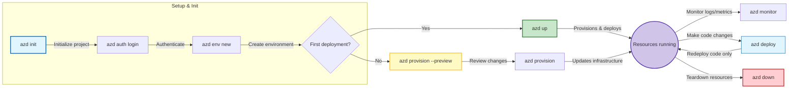
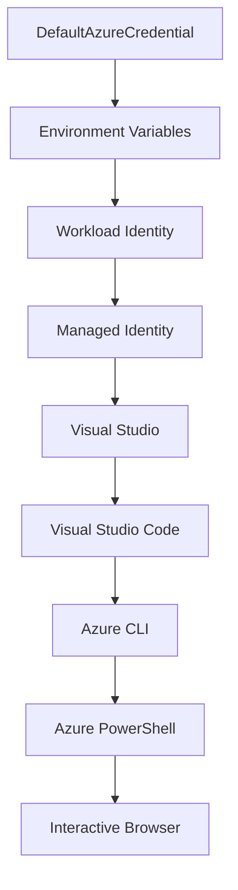

# Conceitos Básicos do AZD - Conceitos Centrais e Fundamentos

**Navegação do Capítulo:**
- **📚 Página Inicial do Curso**: [AZD para Iniciantes](../../README.md)
- **📖 Capítulo Atual**: Capítulo 1 - Fundação & Início Rápido
- **⬅️ Anterior**: [Visão Geral do Curso](../../README.md#-chapter-1-foundation--quick-start)
- **➡️ Próximo**: [Instalação & Configuração](installation.md)
- **🚀 Próximo Capítulo**: [Capítulo 2: Desenvolvimento AI-First](../chapter-02-ai-development/microsoft-foundry-integration.md)

## Introdução

> Revisado com base em `azd 1.37.2` (Novembro de 2026). Comandos Bash usam espaços reservados entre aspas que você deve substituir. Workflows de template usam `.` para inicializar o diretório atual; sem argumento de diretório, a inicialização do template cria um subdiretório e não altera o diretório de trabalho do shell. Trechos avançados são ilustrativos, não projetos completos.

Esta lição apresenta o Azure Developer CLI (azd), uma ferramenta poderosa de linha de comando que acelera sua jornada do desenvolvimento local até a implantação no Azure. Você aprenderá os conceitos fundamentais, recursos principais e entenderá como o azd simplifica a implantação de aplicações nativas na nuvem.

## Objetivos de Aprendizagem

Ao final desta lição, você irá:
- Compreender o que é o Azure Developer CLI e seu propósito principal
- Aprender os conceitos centrais de templates, ambientes e serviços
- Explorar recursos chave incluindo desenvolvimento orientado a templates e Infraestrutura como Código
- Entender a estrutura de um projeto azd e seu fluxo de trabalho
- Estar preparado para instalar e configurar o azd para seu ambiente de desenvolvimento

## Resultados Esperados

Após completar esta lição, você será capaz de:
- Explicar o papel do azd em fluxos de trabalho modernos de desenvolvimento em nuvem
- Identificar os componentes da estrutura de um projeto azd
- Descrever como templates, ambientes e serviços trabalham juntos
- Entender os benefícios da Infraestrutura como Código com o azd
- Reconhecer diferentes comandos azd e suas finalidades

## O que é o Azure Developer CLI (azd)?

O Azure Developer CLI (azd) é uma ferramenta de linha de comando projetada para acelerar sua jornada do desenvolvimento local até a implantação no Azure. Ele simplifica o processo de construir, implantar e gerenciar aplicações nativas na nuvem no Azure.

### O que você pode implantar com azd?

O azd suporta uma ampla gama de cargas de trabalho — e a lista continua crescendo. Hoje, você pode usar o azd para implantar:

| Tipo de Carga de Trabalho | Exemplos | Mesmo Workflow? |
|---------------|----------|----------------|
| **Aplicações tradicionais** | Aplicativos web, APIs REST, sites estáticos | ✅ `azd up` |
| **Serviços e microsserviços** | Aplicativos em Contêiner, Aplicativos de Função, backends multi-serviços | ✅ `azd up` |
| **Aplicações com IA** | Aplicativos de chat com Microsoft Foundry Models, soluções RAG com AI Search | ✅ `azd up` |
| **Agentes inteligentes** | Agentes hospedados no Foundry, orquestrações multi-agentes | ✅ `azd up` |

A ideia principal é que **o ciclo de vida do azd permanece o mesmo independentemente do que você está implantando**. Você inicializa um projeto, provisiona a infraestrutura, implanta seu código, monitora seu aplicativo e limpa — seja um site simples ou um agente sofisticado baseado em IA.

Essa continuidade é proposital. O azd trata as capacidades de IA como outro tipo de serviço que sua aplicação pode usar, não algo fundamentalmente diferente. Um endpoint de chat suportado por Microsoft Foundry Models é, da perspectiva do azd, apenas mais um serviço para configurar e implantar.

### 🎯 Por que usar o AZD? Uma comparação do mundo real

Vamos comparar a implantação de um aplicativo web simples com banco de dados:

#### ❌ SEM AZD: Implantação Manual no Azure (30+ minutos)

**Comparação ilustrativa de Bash, não um início de aplicação executável.** Assume código de aplicação existente, nomes únicos de recursos, autenticação Azure CLI e quaisquer extensões CLI necessárias. Use o exercício de template abaixo para o caminho suportado de ponta a ponta.

```bash
# Step 1: Create resource group
az group create --name myapp-rg --location eastus

# Step 2: Create App Service Plan
az appservice plan create --name myapp-plan \
  --resource-group myapp-rg \
  --sku B1 --is-linux

# Step 3: Create Web App
az webapp create --name myapp-web-unique123 \
  --resource-group myapp-rg \
  --plan myapp-plan \
  --runtime "NODE:22-lts"

# Step 4: Create Cosmos DB account (10-15 minutes)
az cosmosdb create --name myapp-cosmos-unique123 \
  --resource-group myapp-rg \
  --kind MongoDB

# Step 5: Create database
az cosmosdb mongodb database create \
  --account-name myapp-cosmos-unique123 \
  --resource-group myapp-rg \
  --name tododb

# Step 6: Create collection
az cosmosdb mongodb collection create \
  --account-name myapp-cosmos-unique123 \
  --resource-group myapp-rg \
  --database-name tododb \
  --name todos

# Step 7: Get connection string
CONN_STR=$(az cosmosdb keys list \
  --name myapp-cosmos-unique123 \
  --resource-group myapp-rg \
  --type connection-strings \
  --query "connectionStrings[0].connectionString" -o tsv)

# Step 8: Configure app settings
az webapp config appsettings set \
  --name myapp-web-unique123 \
  --resource-group myapp-rg \
  --settings MONGODB_URI="$CONN_STR"

# Step 9: Enable logging
az webapp log config --name myapp-web-unique123 \
  --resource-group myapp-rg \
  --application-logging filesystem \
  --detailed-error-messages true

# Step 10: Set up Application Insights
az monitor app-insights component create \
  --app myapp-insights \
  --location eastus \
  --resource-group myapp-rg

# Step 11: Link App Insights to Web App
INSTRUMENTATION_KEY=$(az monitor app-insights component show \
  --app myapp-insights \
  --resource-group myapp-rg \
  --query "instrumentationKey" -o tsv)

az webapp config appsettings set \
  --name myapp-web-unique123 \
  --resource-group myapp-rg \
  --settings APPINSIGHTS_INSTRUMENTATIONKEY="$INSTRUMENTATION_KEY"

# Step 12: Build application locally
npm install
npm run build

# Step 13: Create deployment package
zip -r app.zip . -x "*.git*" "node_modules/*"

# Step 14: Deploy application
az webapp deployment source config-zip \
  --resource-group myapp-rg \
  --name myapp-web-unique123 \
  --src app.zip

# Step 15: Wait and pray it works 🙏
# (No automated validation, manual testing required)
```

**Problemas:**
- ❌ Mais de 15 comandos para lembrar e executar em ordem
- ❌ 30-45 minutos de trabalho manual
- ❌ Fácil cometer erros (erros de digitação, parâmetros incorretos)
- ❌ Credenciais requerem manuseio explícito; logs de depuração e rastreamento do shell podem expô-las
- ❌ Sem rollback automático se algo falhar
- ❌ Difícil de replicar para membros da equipe
- ❌ Diferente a cada vez (não reprodutível)

#### ✅ COM AZD: Implantação Automática (5 comandos, 10-15 minutos)

```bash
# Step 1: Initialize from template
azd init --template todo-nodejs-mongo .

# Step 2: Authenticate
azd auth login

# Step 3: Select the environment created during init
azd env select dev

# Step 4: Preview changes (optional but recommended)
azd provision --preview

# Step 5: Deploy everything
azd up

# ✨ Done! Everything is deployed, configured, and monitored
```

**Benefícios:**
- ✅ **5 comandos** vs. mais de 15 passos manuais
- ✅ **10-15 minutos** de tempo total (principalmente aguardando Azure)
- ✅ **Menos erros manuais** - workflow consistente, orientado por template
- ✅ **Manuseio seguro de segredos** - muitos templates usam armazenamento de segredos gerenciado pelo Azure
- ✅ **Implantações repetíveis** - mesmo workflow todas as vezes
- ✅ **Definições repetíveis de infraestrutura** - sujeitas a cotas, disponibilidade regional e versões de template
- ✅ **Pronto para equipe** - qualquer pessoa pode implantar com os mesmos comandos
- ✅ **Infraestrutura como Código** - templates Bicep versionados
- ✅ **Monitoramento definido por template** - Application Insights quando incluído no template

### Tempo e Confiabilidade

Os tempos acima são estimativas, não benchmarks. O azd reduz os comandos que você precisa coordenar, mas não garante duração da implantação, elimina erros ou fornece rollback automático para aplicação/banco de dados. Mantenha versões funcionais no controle de fonte e teste procedimentos de recuperação.

## Conceitos Centrais

### Templates
Templates são a base do azd. Eles contêm:
- **Código da aplicação** - Seu código fonte e dependências
- **Definições de infraestrutura** - Recursos Azure definidos em Bicep ou Terraform
- **Arquivos de configuração** - Configurações e variáveis de ambiente
- **Scripts de implantação** - Workflows automatizados de implantação

### Ambientes
Ambientes representam diferentes destinos de implantação:
- **Desenvolvimento** - Para testes e desenvolvimento
- **Homologação** - Ambiente de pré-produção
- **Produção** - Ambiente ao vivo de produção

Cada ambiente mantém seu próprio:
- Nome e valores do ambiente; isolamento de recursos depende do template de infraestrutura
- Configurações
- Estado da implantação

### Serviços
Serviços em `azure.yaml` descrevem componentes de aplicação que podem ser implantados:
- **Frontend** - Aplicações web, SPAs
- **Backend** - APIs, microsserviços

Bancos de dados e armazenamento normalmente são provisionados como recursos de infraestrutura, não hosts de serviço inventados como `host: postgres`.

## Recursos Principais

### 1. Desenvolvimento Orientado a Template
```bash
# Browse available templates
azd template list

# Initialize from a template
azd init --template "<template-name>" .
```

### 2. Infraestrutura como Código
- **Bicep** - Linguagem específica de domínio do Azure
- **Terraform** - Ferramenta multi-nuvem para infraestrutura
- Bicep compila para templates ARM; JSON bruto ARM não é `infra.provider` nativo separado.

### 3. Workflows Integrados
```bash
# Complete deployment workflow
azd up            # Provision + Deploy this is hands off for first time setup

# 🧪 NEW: Preview infrastructure changes before deployment (SAFE)
azd provision --preview    # Simulate infrastructure deployment without making changes

azd provision     # Create Azure resources if you update the infrastructure use this
azd deploy        # Deploy application code or redeploy application code once update
azd down          # Clean up resources
```

#### 🛡️ Planejamento Seguro de Infraestrutura com Preview
O comando `azd provision --preview` é um divisor de águas para implantações seguras:
- **Análise de simulação** - Mostra o que será criado, modificado ou excluído
- **Nenhuma aplicação de infraestrutura** - Revisa mudanças do provedor; inspecione hooks do projeto primeiro, pois hooks podem executar comandos com efeitos colaterais
- **Colaboração em equipe** - Compartilhe resultados do preview antes da implantação
- **Entrada para planejamento de custos** - Inspecione SKUs propostos, depois calcule preços com a Calculadora de Preços do Azure; preview não calcula preços

```bash
# Example preview workflow
azd provision --preview           # See what will change
# Review the output, discuss with team
azd provision                     # Apply changes with confidence
```

### 📊 Visual: Fluxo de Trabalho de Desenvolvimento AZD



**Explicação do Workflow:**
1. **Init** - Comece com template ou projeto novo
2. **Auth** - Autentique no Azure
3. **Ambiente** - Crie ambiente de implantação isolado
4. **Preview** - 🆕 Sempre faça preview das mudanças de infraestrutura primeiro (prática segura)
5. **Provision** - Crie/atualize recursos Azure
6. **Deploy** - Envie o código da sua aplicação
7. **Monitor** - Observe desempenho da aplicação
8. **Iterar** - Faça mudanças e reimplante código
9. **Cleanup** - Remova recursos quando terminar

### 4. Gerenciamento de Ambientes
```bash
# Create and manage environments
azd env new "<environment-name>"
azd env select "<environment-name>"
azd env list
```

### 5. Extensões e Comandos de IA

O azd usa um sistema de extensões para adicionar capacidades além do CLI principal. Isso é especialmente útil para cargas de trabalho de IA:

```bash
# List available extensions
azd extension list

# Install the Foundry agents extension
azd extension install azure.ai.agents

# Initialize an AI agent project interactively
azd ai agent init

# Test a deployed agent (shows latency and time-to-first-byte)
azd ai agent invoke

# Start the MCP server for AI-assisted development (Alpha)
azd mcp start
```

**O ciclo de vida do agente, do início ao fim.** Use `azure.ai.agents` para operações do ciclo de vida do agente e instale `azure.ai.evaluations` separadamente para avaliação. Use `azd >= 1.37.0` para o fluxo combinado. Você não precisa de todos eles no primeiro dia:

| Etapa | Comando | O que faz |
|-------|---------|--------------|
| **Estruturação** | `azd ai agent init --template <path-to-azure.yaml>` | Adote um template atual de projeto de agente |
| **Teste** | `azd ai agent invoke` | Chama o agente e exibe tempo de resposta |
| **Medição** | `azd ai eval init`, `generate`, `run start` | Configure, implante e execute avaliações usando a extensão separada |
| **Melhoria** | `azd ai agent optimize --eval <evaluation-name> --optimize-model <optimizer-deployment>` | Reutilize avaliação compatível para otimizar o agente |
| **Inspeção** | `azd ai agent endpoint show` | Veja a configuração do endpoint ao vivo |
| **Limpeza** | `azd ai agent delete` | Delete um agente hospedado e todas suas versões |

> Extensões são detalhadas em [Capítulo 2: Desenvolvimento AI-First](../chapter-02-ai-development/agents.md) e no referencial [Comandos AZD AI CLI](../chapter-08-production/production-ai-practices.md#azd-ai-cli-commands-and-extensions).

## 📁 Estrutura do Projeto

Uma estrutura típica de projeto azd:
```
my-app/
├── .azure/                  # Local environments and selected-environment config
│   ├── config.json
│   └── dev/.env
├── .devcontainer/          # Development container config
├── .github/workflows/      # GitHub Actions
├── .vscode/               # VS Code settings
├── infra/                 # Infrastructure code
│   ├── main.bicep        # Main infrastructure template
│   ├── main.parameters.json
│   └── modules/          # Reusable modules
├── src/                  # Application source code
│   ├── api/             # Backend services
│   └── web/             # Frontend application
├── azure.yaml           # azd project configuration
└── README.md
```

## 🔧 Arquivos de Configuração

### azure.yaml
O arquivo principal de configuração do projeto:
```yaml
name: my-awesome-app
metadata:
  template: my-template@1.0.0

services:
  web:
    project: ./src/web
    language: js
    host: appservice
  api:
    project: ./src/api
    language: js
    host: appservice

hooks:
  preprovision:
    shell: pwsh
    run: echo "Preparing to provision..."
```

### .azure/config.json
Seleção local do projeto do ambiente padrão (ilustrativo; gerenciado pelo azd):
```json
{
  "defaultEnvironment": "dev"
}
```

## 🎪 Workflows Comuns com Exercícios Práticos

> **💡 Dica de Aprendizagem:** Siga estes exercícios na ordem para desenvolver suas habilidades AZD progressivamente.

### 🎯 Exercício 1: Inicialize Seu Primeiro Projeto

**Objetivo:** Criar um projeto AZD e explorar sua estrutura

**Passos:**
```bash
# Use a proven template
mkdir azd-basics-practice
cd azd-basics-practice
# Choose "dev" for the environment name when prompted
azd init --template todo-nodejs-mongo .

# Explore the generated files
ls -la  # View all files including hidden ones

# Key files created:
# - azure.yaml (main config)
# - infra/ (infrastructure code)
# - src/ (application code)
```

**✅ Sucesso:** Você possui os diretórios azure.yaml, infra/ e src/

---

### 🎯 Exercício 2: Deployment no Azure

**Objetivo:** Completar implantação de ponta a ponta

**Passos:**
```bash
# 1. Authenticate
azd auth login

# 2. Select the dev environment created in Exercise 1
azd env select dev
azd env set AZURE_LOCATION eastus

# 3. Preview changes (RECOMMENDED)
azd provision --preview

# 4. Deploy everything
azd up

# 5. Verify deployment
azd show    # View your app URL
```

**Tempo esperado:** 10-15 minutos  
**✅ Sucesso:** URL da aplicação abre no navegador

---

### 🎯 Exercício 3: Múltiplos Ambientes

**Objetivo:** Implantar em dev e staging

**Passos:**
```bash
# Already have dev, create staging
azd env new staging
azd env set AZURE_LOCATION westus2
azd up

# Switch between them
azd env list
azd env select dev
```

**✅ Sucesso:** Dois grupos de recursos separados no Portal Azure

**Limpeza:** O exercício 3 cria uma segunda implantação cobrável. Apague ambos quando terminar:

```bash
azd down --environment dev
azd down --environment staging
```

---

### 🛡️ Limpeza Destrutiva: `azd down --force --purge`

Quando você deseja deletar intencionalmente os recursos Azure do ambiente selecionado:

```bash
azd down --force --purge
```

**O que faz:**
- `--force`: Sem solicitações de confirmação
- `--purge`: Também exclui permanentemente recursos com exclusão suave suportada (por exemplo, Key Vaults), quando a proteção contra limpeza permite. Não deleta o diretório local `.azure/`.

**Use quando:** terminar com um ambiente descartável. Não trate a limpeza destrutiva como primeira resposta a erro de autenticação, cota ou configuração.

---

## 🎪 Referência do Workflow Original

### Iniciando um Projeto Novo
```bash
# Method 1: Use existing template
azd init --template todo-nodejs-mongo .

# Method 2: Start from scratch
azd init

# Method 3: Use current directory
azd init .
```

### Ciclo de Desenvolvimento
```bash
# Set up development environment
azd auth login
azd env new dev
azd env select dev

# Deploy everything
azd up

# Make changes and redeploy
azd deploy

# Clean up when done
azd down --force --purge # Deletes this environment's discovered Azure resources; review before forcing deletion.
```

## Compreendendo `azd down --force --purge`
O comando `azd down --force --purge` é uma maneira poderosa de desmontar completamente seu ambiente azd e todos os recursos associados. Aqui está uma explicação do que cada flag faz:
```
--force
```
- Ignora prompts de confirmação.
- Útil para automação ou scripts onde entrada manual não é viável.
- Não contorna permissões, proteção contra limpeza ou falhas na exclusão.

```
--purge
```
Exclui permanentemente os recursos Azure suportados que foram excluídos suavemente, sem confirmação adicional. A proteção contra purga e permissões ainda se aplicam. **Não** remove ambientes locais nem a pasta `.azure/`.


### Por que usar ambos?
Use ambos somente quando você pretende excluir os recursos Azure do ambiente selecionado e purgar recursos recuperáveis. Esta é uma limpeza destrutiva, não uma reparação geral ou redefinição do estado local.

É especialmente útil após exclusões manuais de recursos no portal Azure ou ao trocar modelos, ambientes ou convenções de nomenclatura de grupos de recursos.


### Gerenciando Múltiplos Ambientes
```bash
# Create staging environment
azd env new staging
azd env select staging
azd up

# Switch back to dev
azd env select dev

# Compare environments
azd env list
```

## 🔐 Autenticação e Credenciais

Diferencie a autenticação de implantação (`azd auth login`) da autenticação do SDK da aplicação (`DefaultAzureCredential`). Elas são separadas. azd não usa as credenciais do Azure CLI por padrão.

### Autenticação Azure CLI (`az login`)

Execute `azd auth login` para azd. Os seguintes comandos Azure CLI são opcionais e autenticam comandos `az` separadamente:

```bash
# Interactive login (opens browser)
az login

# Login with specific tenant
az login --tenant "<tenant-id>"

# Login with service principal
az login --service-principal -u "<app-id>" -p "<password>" --tenant "<tenant-id>"

# Check current login status
az account show

# List available subscriptions
az account list --output table

# Set default subscription
az account set --subscription "<subscription-id>"
```

### Fluxo de Autenticação
1. **Login Interativo**: Abre seu navegador padrão para autenticação
2. **Fluxo de Código de Dispositivo**: Para ambientes sem acesso ao navegador
3. **Principal de Serviço**: Para automação e cenários CI/CD
4. **Identidade Gerenciada**: Para aplicações hospedadas no Azure

### Cadeia DefaultAzureCredential

`DefaultAzureCredential` é um tipo de credencial que fornece uma experiência de autenticação simplificada ao tentar automaticamente várias fontes de credenciais em uma ordem específica:

#### Cadeia de Credenciais do SDK da Aplicação

A cadeia exata depende da linguagem do SDK do Azure Identity, da versão, dos plugins instalados e das opções. Este diagrama é conceitual, não uma sequência fixa de autenticação azd; SDKs recentes também podem incluir credenciais do Azure Developer CLI.


#### 1. Variáveis de Ambiente
```bash
# Set environment variables for service principal
export AZURE_CLIENT_ID="<app-id>"
export AZURE_CLIENT_SECRET="<password>"
export AZURE_TENANT_ID="<tenant-id>"
```

#### 2. Workload Identity (Kubernetes/GitHub Actions)
Usado automaticamente em:
- Azure Kubernetes Service (AKS) com Workload Identity
- GitHub Actions com federação OIDC
- Outros cenários de identidade federada

#### 3. Identidade Gerenciada
Para recursos do Azure como:
- Máquinas Virtuais
- App Service
- Azure Functions
- Instâncias de Contêiner

```bash
# Inspect a deployed Container App's configured identity (requires az login)
az containerapp show --name "<app-name>" --resource-group "<rg-name>" --query identity
```

#### 4. Integração com Ferramentas de Desenvolvimento
- **Visual Studio**: Usa automaticamente a conta autenticada
- **VS Code**: Suporte depende do SDK e da configuração do broker/plugin suportada
- **Azure CLI**: Usa credenciais `az login` (mais comum para desenvolvimento local)

### Configuração de Autenticação do AZD

```bash
# Method 1: Direct azd authentication (recommended)
azd auth login

# Method 2: Direct azd authentication
azd auth login --use-device-code  # For headless environments

# Method 3: Check authentication status
azd auth login --check-status

# Method 4: Logout and re-authenticate
azd auth logout
azd auth login
```

### Melhores Práticas de Autenticação

#### Para Desenvolvimento Local
```bash
# 1. Log in to azd
azd auth login

# 2. Select the subscription for this initialized environment
azd env set AZURE_SUBSCRIPTION_ID "<subscription-id>"

# 3. Check azd sign-in details (read the status message)
azd auth login --check-status
```

#### Para Pipelines CI/CD
```yaml
# Partial GitHub Actions steps: assumes checkout, azd installation,
# required AZURE_* environment values, and pipeline secret configuration.
- name: Deploy with azd
  run: |
    azd auth login --client-id ${{ secrets.AZURE_CLIENT_ID }} \
                    --client-secret ${{ secrets.AZURE_CLIENT_SECRET }} \
                    --tenant-id ${{ secrets.AZURE_TENANT_ID }}
    azd up --no-prompt
```

#### Para Ambientes de Produção
- Use **Identidade Gerenciada** ao executar em recursos do Azure
- Use **Service Principal** para cenários de automação
- Evite armazenar credenciais no código ou arquivos de configuração
- Use **Azure Key Vault** para configurações sensíveis

### Problemas Comuns de Autenticação e Soluções

#### Problema: "Nenhuma assinatura encontrada"
```bash
# Solution: Set default subscription
az account list --output table
az account set --subscription "<subscription-id>"
azd env set AZURE_SUBSCRIPTION_ID "<subscription-id>"
```

#### Problema: "Permissões insuficientes"
```bash
# Solution: Check and assign required roles
az role assignment list --assignee $(az account show --query user.name --output tsv)

# Common required roles:
# - Contributor (for resource management)
# - User Access Administrator (for role assignments)
```

#### Problema: "Token expirado"
```bash
# Solution: Re-authenticate
az logout
az login
azd auth logout
azd auth login
```

### Autenticação em Diferentes Cenários

#### Desenvolvimento Local
```bash
# Personal development account
az login
azd auth login
```

#### Desenvolvimento em Equipe
```bash
# Use specific tenant for organization
az login --tenant contoso.onmicrosoft.com
azd auth login --tenant-id "<tenant-id>"
```

#### Cenários Multi-inquilino
```bash
# Switch between tenants
az login --tenant tenant1.onmicrosoft.com
azd auth login --tenant-id "<tenant-1-id>"
# Select an environment configured with tenant 1's subscription
azd env select tenant1-dev
# Deploy to tenant 1
azd up

az login --tenant tenant2.onmicrosoft.com  
azd auth login --tenant-id "<tenant-2-id>"
azd env select tenant2-dev
# Deploy to tenant 2
azd up
```

### Considerações de Segurança

1. **Armazenamento de Credenciais**: Nunca armazene credenciais no código fonte
2. **Limitação de Escopo**: Use o princípio do menor privilégio para service principals
3. **Rotação de Token**: Rotacione regularmente os segredos do service principal
4. **Registro de Auditoria**: Monitore atividades de autenticação e implantação
5. **Segurança de Rede**: Use endpoints privados quando possível

### Solução de Problemas de Autenticação

```bash
# Debug authentication issues
azd auth login --check-status
az account show
az account get-access-token

# Common diagnostic commands
whoami                          # Current user context
az ad signed-in-user show      # Microsoft Entra ID user details
az group list                  # Test resource access
```

## Descoberta de Comandos

### Descoberta
```bash
azd template list              # Browse templates
azd template list --help       # Template discovery options
azd init --help               # Initialization options
```

### Gerenciamento de Projetos
```bash
azd show                     # Project overview
azd env list                # Available environments and selected default
azd config show            # Configuration settings
```

### Monitoramento
```bash
azd monitor                  # Open Azure portal monitoring
azd monitor --logs           # View application logs
azd monitor --live           # View live metrics
azd pipeline config          # Set up CI/CD
```

## Melhores Práticas

### 1. Use Nomes Significativos
```bash
# Good
azd env new production-east
azd init --template todo-nodejs-mongo .

# Avoid
azd env new env1
azd init --template template1 .
```

### 2. Aproveite Templates
- Comece com templates existentes
- Personalize conforme suas necessidades
- Crie templates reutilizáveis para sua organização

### 3. Isolamento de Ambiente
- Use ambientes separados para dev/staging/prod
- Nunca faça deploy diretamente para produção da máquina local
- Use pipelines CI/CD para deploys em produção

### 4. Gerenciamento de Configuração
- Use identidade gerenciada e Key Vault para segredos; valores `azd env set` comuns são texto simples local
- Mantenha a configuração em controle de versão
- Documente configurações específicas do ambiente

## Progressão de Aprendizado

### Iniciante (Semana 1-2)
1. Instale o azd e autentique-se
2. Faça o deploy de um template simples
3. Entenda a estrutura do projeto
4. Aprenda comandos básicos (up, down, deploy)

### Intermediário (Semana 3-4)
1. Personalize templates
2. Gerencie múltiplos ambientes
3. Entenda código de infraestrutura
4. Configure pipelines CI/CD

### Avançado (Semana 5+)
1. Crie templates personalizados
2. Padrões avançados de infraestrutura
3. Deploys multi-região
4. Configurações de nível empresarial

## Próximos Passos

**📖 Continue Aprendendo o Capítulo 1:**
- [Instalação e Configuração](installation.md) - Instale e configure o azd
- [Seu Primeiro Projeto](first-project.md) - Complete tutorial prático
- [Guia de Configuração](../chapter-03-configuration/configuration.md) - Opções avançadas de configuração

**🎯 Pronto para o Próximo Capítulo?**
- [Capítulo 2: Desenvolvimento AI-First](../chapter-02-ai-development/microsoft-foundry-integration.md) - Comece a construir aplicações de IA

## Recursos Adicionais

- [Visão Geral do Azure Developer CLI](https://learn.microsoft.com/en-us/azure/developer/azure-developer-cli/)
- [Galeria de Templates](https://azure.github.io/awesome-azd/)
- [Exemplos da Comunidade](https://github.com/Azure-Samples)

---

## 🙋 Perguntas Frequentes

### Perguntas Gerais

**P: Qual a diferença entre AZD e Azure CLI?**

R: Azure CLI (`az`) é para gerenciar recursos individuais do Azure. AZD (`azd`) é para gerenciar aplicações inteiras:

```bash
# Azure CLI - Low-level resource management
az webapp create --name myapp --resource-group rg
az sql server create --name myserver --resource-group rg
# ...many more commands needed

# AZD - Application-level management
azd up  # Deploys entire app with all resources
```

**Pense assim:**
- `az` = Operar em peças individuais de Lego
- `azd` = Trabalhar com conjuntos completos de Lego

---

**P: Preciso conhecer Bicep ou Terraform para usar AZD?**

R: Não! Comece pelos templates:
```bash
# Use existing template - no IaC knowledge needed
azd init --template todo-nodejs-mongo .
azd up
```

Você pode aprender Bicep mais tarde para personalizar a infraestrutura. Templates fornecem exemplos prontos para aprender.

---

**P: Quanto custa rodar templates AZD?**

R: Custos variam por região, SKU, tempo ativo, modo do banco de dados e uso do modelo. Um ambiente de desenvolvimento pode gerar custos mensais significativos mesmo inativo; não presuma um intervalo universal de $50-150:

```bash
# Preview resource changes (not prices)
azd provision --preview

# Always cleanup when not using
azd down --force --purge  # Removes all resources
```

**Dica profissional:** Use camadas gratuitas quando disponíveis:
- App Service: camada F1 (Grátis)
- Azure OpenAI: não há isenção mensal garantida geral de tokens; verifique preços do modelo e ofertas atuais
- Cosmos DB: contas com throughput provisionado elegíveis podem optar por camada gratuita; templates serverless não se qualificam automaticamente

---

**P: Posso usar AZD com recursos Azure existentes?**

R: Sim, mas é mais fácil começar do zero. AZD funciona melhor quando gerencia o ciclo de vida completo. Para recursos existentes:

```bash
# Option 1: Import existing resources (advanced)
azd init
# Then modify infra/ to reference existing resources

# Option 2: Start fresh (recommended)
azd init --template "<verified-template-name>" .
azd up  # Creates new environment
```

---

**P: Como compartilho meu projeto com colegas?**

R: Faça commit do projeto AZD no Git (mas NÃO da pasta .azure):

```bash
# Already in .gitignore by default
.azure/        # Contains secrets and environment data
*.env          # Environment variables

# Team members then:
git clone "<your-repo>"
# Change into the cloned repository before running the remaining commands.
azd auth login
azd env new "<their-name>-dev"
azd up
```

Todos recebem a mesma infraestrutura a partir dos mesmos templates.

---

### Perguntas de Solução de Problemas

**P: "azd up" falhou no meio do processo. O que faço?**

R: Verifique o erro, corrija-o e tente novamente:

```bash
# Capture detailed diagnostics (redact sensitive values before sharing)
azd up --debug

# Common fixes:

# 1. If quota exceeded:
azd env set AZURE_LOCATION "westus2"  # Try different region

# 2. If resource name conflict:
azd down --force --purge  # Clean slate
azd up  # Retry

# 3. If auth expired:
az login
azd auth login
azd up
```

**Problema mais comum:** Assinatura Azure errada selecionada
```bash
az account list --output table
az account set --subscription "<correct-subscription>"
azd env set AZURE_SUBSCRIPTION_ID "<correct-subscription-id>"
```

---

**P: Como faço deploy apenas de mudanças de código sem reprovisionar?**

R: Use `azd deploy` em vez de `azd up`:

```bash
azd up          # First time: provision + deploy (slow)

# Make code changes...

azd deploy      # Subsequent times: deploy only (fast)
```

Comparação de velocidade:
- `azd up`: 10-15 minutos (provisiona a infraestrutura)
- `azd deploy`: 2-5 minutos (apenas código)

---

**P: Posso personalizar os templates de infraestrutura?**

R: Sim! Edite os arquivos Bicep em `infra/`:

```bash
# After azd init
cd infra/
code main.bicep  # Edit in VS Code

# Preview changes
azd provision --preview

# Apply changes
azd provision
```

**Dica:** Comece pequeno - mude primeiro os SKUs:
```bicep
// infra/main.bicep
sku: {
  name: 'B1'  // Change to 'P1V2' for production
}
```

---

**P: Como apago tudo que o AZD criou?**

R: Um comando remove todos os recursos:

```bash
azd down --force --purge

# This deletes:
# - Azure resources/resource groups discovered for the selected environment
# - Supported soft-deleted resources, if purge protection allows
# Local .azure files remain; shared/external resources may remain too.
```

**Sempre execute isso quando:**
- Finalizar o teste de um template
- Mudar para outro projeto
- Querer começar do zero

**Verificação de custo:** Confirme a exclusão no Azure e verifique recursos retidos/compartilhados. Cobranças já incorridas ainda são aplicáveis.

---

**P: E se eu apagar recursos acidentalmente no Portal Azure?**

R: O estado do AZD pode ficar fora de sincronia. Abordagem de limpeza total:

```bash
# 1. Delete remaining resources only if that is your intent
azd down --force --purge

# 2. Start fresh
azd up

# Alternative: Let AZD detect and fix
azd provision  # Will create missing resources
```

---

### Perguntas Avançadas

**P: Posso usar AZD em pipelines CI/CD?**

R: Sim! Exemplo GitHub Actions:

```yaml
# .github/workflows/deploy.yml
name: Deploy with AZD

on:
  push:
    branches: [main]

jobs:
  deploy:
    runs-on: ubuntu-latest
    steps:
      - uses: actions/checkout@v4
      
      - name: Install azd
        run: curl -fsSL https://aka.ms/install-azd.sh | bash
      
      - name: Azure Login
        run: |
          azd auth login \
            --client-id ${{ secrets.AZURE_CLIENT_ID }} \
            --client-secret ${{ secrets.AZURE_CLIENT_SECRET }} \
            --tenant-id ${{ secrets.AZURE_TENANT_ID }}
      
      - name: Deploy
        env:
          AZURE_ENV_NAME: dev
          AZURE_LOCATION: ${{ vars.AZURE_LOCATION }}
          AZURE_SUBSCRIPTION_ID: ${{ vars.AZURE_SUBSCRIPTION_ID }}
        run: azd up --no-prompt
```

---

**P: Como trato segredos e dados sensíveis?**

R: Use Key Vault explicitamente. `azd env set` grava valores comuns no arquivo local de ambiente; não cria automaticamente um cofre, atribui funções ou injeta segredos na aplicação.

```bash
# Interactive: create/select a Key Vault secret and save its reference
azd env set-secret DATABASE_PASSWORD
```

Você precisa de permissões adequadas no cofre. Sua infraestrutura/aplicação ainda deve ligar o segredo ao consumidor e conceder acesso à identidade de runtime. Não imprima valores de segredos resolvidos em logs.

**Nunca faça commit de:**
- Pasta `.azure/` (contém dados do ambiente)
- Arquivos `.env` (segredos locais)
- Strings de conexão

---

**P: Posso fazer deploy para múltiplas regiões?**

R: Sim, crie um ambiente por região:

```bash
# East US environment
azd env new prod-eastus
azd env set AZURE_LOCATION eastus
azd up

# West Europe environment
azd env new prod-westeurope
azd env set AZURE_LOCATION westeurope
azd up

# Each environment is independent
azd env list
```

Para apps verdadeiramente multi-região, personalize os templates Bicep para deploy simultâneo em várias regiões.

---

**P: Onde posso obter ajuda se ficar travado?**

1. **Documentação AZD:** https://learn.microsoft.com/azure/developer/azure-developer-cli/
2. **Issues no GitHub:** https://github.com/Azure/azure-dev/issues
3. **Discord:** [Azure Discord](https://discord.gg/microsoft-azure) - canal #azure-developer-cli
4. **Stack Overflow:** Tag `azure-developer-cli`
5. **Este Curso:** [Guia de Solução de Problemas](../chapter-07-troubleshooting/common-issues.md)

**Dica profissional:** Antes de perguntar, execute:
```bash
azd show       # Shows current state
azd version    # Shows your version
```
Inclua estas informações na sua pergunta para ajuda mais rápida.

---

## 🎓 E Agora?

Você agora entende o básico do AZD. Escolha seu caminho:

### 🎯 Para Iniciantes:
1. **Próximo:** [Instalação e Configuração](installation.md) - Instale AZD na sua máquina
2. **Depois:** [Seu Primeiro Projeto](first-project.md) - Faça deploy do seu primeiro app
3. **Prática:** Complete todos os 3 exercícios desta lição

### 🚀 Para Desenvolvedores de IA:
1. **Pule para:** [Capítulo 2: Desenvolvimento AI-First](../chapter-02-ai-development/microsoft-foundry-integration.md)
2. **Faça deploy:** Em um diretório de projeto vazio, comece com `azd init --template get-started-with-ai-chat .`
3. **Aprenda:** Construa enquanto faz o deploy

### 🏗️ Para Desenvolvedores Experientes:
1. **Revise:** [Guia de Configuração](../chapter-03-configuration/configuration.md) - Configurações avançadas
2. **Explore:** [Infraestrutura como Código](../chapter-04-infrastructure/provisioning.md) - Mergulho profundo em Bicep
3. **Construa:** Crie templates personalizados para seu stack

---

**Navegação do Capítulo:**
- **📚 Início do Curso**: [AZD Para Iniciantes](../../README.md)
- **📖 Capítulo Atual**: Capítulo 1 - Fundação e Início Rápido  
- **⬅️ Anterior**: [Visão Geral do Curso](../../README.md#-chapter-1-foundation--quick-start)
- **➡️ Próximo**: [Instalação e Configuração](installation.md)
- **🚀 Próximo Capítulo**: [Capítulo 2: Desenvolvimento AI-First](../chapter-02-ai-development/microsoft-foundry-integration.md)

---

<!-- CO-OP TRANSLATOR DISCLAIMER START -->
**Aviso Legal**:
Este documento foi traduzido usando o serviço de tradução por IA [Co-op Translator](https://github.com/Azure/co-op-translator). Embora nos esforcemos pela precisão, por favor, esteja ciente de que traduções automatizadas podem conter erros ou imprecisões. O documento original em seu idioma nativo deve ser considerado a fonte autorizada. Para informações críticas, recomenda-se tradução profissional humana. Não nos responsabilizamos por quaisquer mal-entendidos ou interpretações incorretas decorrentes do uso desta tradução.
<!-- CO-OP TRANSLATOR DISCLAIMER END -->