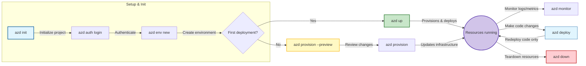
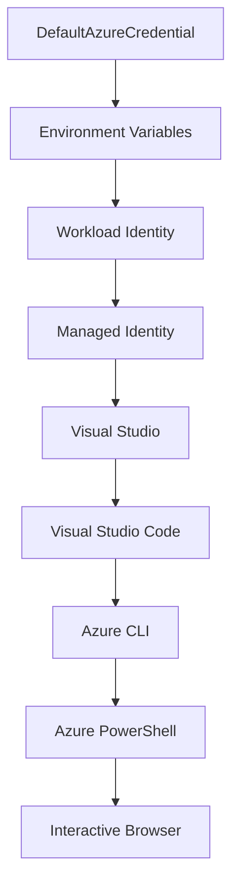

# Noções Básicas do AZD - Conceitos e Fundamentos Principais

**Navegação do Capítulo:**
- **📚 Página Inicial do Curso**: [AZD para Iniciantes](../../README.md)
- **📖 Capítulo Atual**: Capítulo 1 - Fundamentos e Início Rápido
- **⬅️ Anterior**: [Visão Geral do Curso](../../README.md#-chapter-1-foundation--quick-start)
- **➡️ Próximo**: [Instalação e Configuração](installation.md)
- **🚀 Próximo Capítulo**: [Capítulo 2: Desenvolvimento AI-First](../chapter-02-ai-development/microsoft-foundry-integration.md)

## Introdução

> Revisado conforme `azd 1.37.2` (Novembro de 2026). Comandos Bash utilizam espaços reservados entre aspas que você precisa substituir. Fluxos de trabalho de template usam `.` para inicializar o diretório atual; sem argumento de diretório, a inicialização do template cria um subdiretório e não altera o diretório de trabalho do seu shell. Trechos avançados são ilustrativos, não projetos completos.

Esta lição apresenta o Azure Developer CLI (azd), uma ferramenta poderosa de linha de comando que acelera sua jornada do desenvolvimento local à implantação no Azure. Você aprenderá os conceitos fundamentais, recursos principais e entenderá como o azd simplifica a implantação de aplicações nativas da nuvem.

## Objetivos de Aprendizagem

Ao final desta lição, você irá:
- Entender o que é o Azure Developer CLI e seu propósito principal
- Aprender os conceitos centrais de templates, ambientes e serviços
- Explorar recursos-chave incluindo desenvolvimento orientado por templates e Infraestrutura como Código
- Entender a estrutura do projeto azd e seu fluxo de trabalho
- Estar preparado para instalar e configurar o azd em seu ambiente de desenvolvimento

## Resultados de Aprendizagem

Após completar esta lição, você será capaz de:
- Explicar o papel do azd nos fluxos de trabalho modernos de desenvolvimento em nuvem
- Identificar os componentes da estrutura de projeto do azd
- Descrever como templates, ambientes e serviços funcionam juntos
- Entender os benefícios da Infraestrutura como Código com azd
- Reconhecer diferentes comandos azd e suas finalidades

## O que é Azure Developer CLI (azd)?

Azure Developer CLI (azd) é uma ferramenta de linha de comando feita para acelerar sua jornada do desenvolvimento local até a implantação no Azure. Ela simplifica o processo de construir, implantar e gerenciar aplicações nativas da nuvem no Azure.

### O que você pode implantar com azd?

azd suporta uma ampla variedade de cargas de trabalho — e a lista continua crescendo. Hoje, você pode usar azd para implantar:

| Tipo de Carga de Trabalho | Exemplos | Mesmo Fluxo? |
|---------------|----------|----------------|
| **Aplicações tradicionais** | Aplicações web, APIs REST, sites estáticos | ✅ `azd up` |
| **Serviços e microsserviços** | Container Apps, Function Apps, backends multi-serviço | ✅ `azd up` |
| **Aplicações com IA** | Aplicativos de chat com Modelos Microsoft Foundry, soluções RAG com AI Search | ✅ `azd up` |
| **Agentes inteligentes** | Agentes hospedados no Foundry, orquestrações multi-agente | ✅ `azd up` |

A visão principal é que **o ciclo de vida do azd permanece o mesmo independentemente do que você está implantando**. Você inicializa um projeto, provisiona infraestrutura, implanta seu código, monitora sua aplicação e faz a limpeza — seja um site simples ou um agente sofisticado de IA.

Essa continuidade é por design. O azd trata as capacidades de IA como outro tipo de serviço que sua aplicação pode usar, e não como algo fundamentalmente diferente. Um endpoint de chat suportado por Modelos Microsoft Foundry é, do ponto de vista do azd, apenas mais um serviço para configurar e implantar.

### 🎯 Por que Usar AZD? Uma Comparação do Mundo Real

Vamos comparar a implantação de um aplicativo web simples com banco de dados:

#### ❌ SEM AZD: Implantação manual no Azure (30+ minutos)

**Comparação ilustrativa em Bash, não um iniciador de aplicação executável.** Assume código existente, nomes únicos de recursos, autenticação do Azure CLI e quaisquer extensões CLI necessárias. Use o exercício template abaixo para o caminho suportado de ponta a ponta.

```bash
# Step 1: Create resource group
az group create --name myapp-rg --location eastus

# Step 2: Create App Service Plan
az appservice plan create --name myapp-plan \
  --resource-group myapp-rg \
  --sku B1 --is-linux

# Step 3: Create Web App
az webapp create --name myapp-web-unique123 \
  --resource-group myapp-rg \
  --plan myapp-plan \
  --runtime "NODE:22-lts"

# Step 4: Create Cosmos DB account (10-15 minutes)
az cosmosdb create --name myapp-cosmos-unique123 \
  --resource-group myapp-rg \
  --kind MongoDB

# Step 5: Create database
az cosmosdb mongodb database create \
  --account-name myapp-cosmos-unique123 \
  --resource-group myapp-rg \
  --name tododb

# Step 6: Create collection
az cosmosdb mongodb collection create \
  --account-name myapp-cosmos-unique123 \
  --resource-group myapp-rg \
  --database-name tododb \
  --name todos

# Step 7: Get connection string
CONN_STR=$(az cosmosdb keys list \
  --name myapp-cosmos-unique123 \
  --resource-group myapp-rg \
  --type connection-strings \
  --query "connectionStrings[0].connectionString" -o tsv)

# Step 8: Configure app settings
az webapp config appsettings set \
  --name myapp-web-unique123 \
  --resource-group myapp-rg \
  --settings MONGODB_URI="$CONN_STR"

# Step 9: Enable logging
az webapp log config --name myapp-web-unique123 \
  --resource-group myapp-rg \
  --application-logging filesystem \
  --detailed-error-messages true

# Step 10: Set up Application Insights
az monitor app-insights component create \
  --app myapp-insights \
  --location eastus \
  --resource-group myapp-rg

# Step 11: Link App Insights to Web App
INSTRUMENTATION_KEY=$(az monitor app-insights component show \
  --app myapp-insights \
  --resource-group myapp-rg \
  --query "instrumentationKey" -o tsv)

az webapp config appsettings set \
  --name myapp-web-unique123 \
  --resource-group myapp-rg \
  --settings APPINSIGHTS_INSTRUMENTATIONKEY="$INSTRUMENTATION_KEY"

# Step 12: Build application locally
npm install
npm run build

# Step 13: Create deployment package
zip -r app.zip . -x "*.git*" "node_modules/*"

# Step 14: Deploy application
az webapp deployment source config-zip \
  --resource-group myapp-rg \
  --name myapp-web-unique123 \
  --src app.zip

# Step 15: Wait and pray it works 🙏
# (No automated validation, manual testing required)
```

**Problemas:**
- ❌ 15+ comandos para lembrar e executar na ordem correta
- ❌ 30-45 minutos de trabalho manual
- ❌ Fácil cometer erros (erros de digitação, parâmetros incorretos)
- ❌ Credenciais requerem manipulação explícita; logs de depuração e rastreamento do shell podem expô-las
- ❌ Sem reversão automática se algo falhar
- ❌ Difícil replicar para membros da equipe
- ❌ Diferente a cada vez (não reprodutível)

#### ✅ COM AZD: Implantação automatizada (5 comandos, 10-15 minutos)

```bash
# Step 1: Initialize from template
azd init --template todo-nodejs-mongo .

# Step 2: Authenticate
azd auth login

# Step 3: Select the environment created during init
azd env select dev

# Step 4: Preview changes (optional but recommended)
azd provision --preview

# Step 5: Deploy everything
azd up

# ✨ Done! Everything is deployed, configured, and monitored
```

**Benefícios:**
- ✅ **5 comandos** vs. 15+ passos manuais
- ✅ **10-15 minutos** tempo total (maior parte aguardando Azure)
- ✅ **Menos erros manuais** - fluxo consistente orientado por templates
- ✅ **Manipulação segura de segredos** - muitos templates usam armazenamento de segredos gerenciado pelo Azure
- ✅ **Implantações repetíveis** - mesmo fluxo todas as vezes
- ✅ **Definições repetíveis de infraestrutura** - sujeitas a cotas, disponibilidade regional e versões de templates
- ✅ **Pronto para equipe** - qualquer um pode implantar com os mesmos comandos
- ✅ **Infraestrutura como Código** - templates Bicep versionados
- ✅ **Monitoramento definido por template** - Application Insights quando incluído no template

### Tempo e Confiabilidade

Os tempos acima são estimativas, não benchmarks. azd reduz os comandos que você deve coordenar, mas não garante duração da implantação, elimina erros ou fornece rollback automático de aplicativo/banco de dados. Mantenha versões funcionais no controle de versão e teste procedimentos de recuperação.

## Conceitos Principais

### Templates
Templates são a base do azd. Eles contêm:
- **Código da aplicação** - Seu código-fonte e dependências
- **Definições de infraestrutura** - Recursos Azure definidos em Bicep ou Terraform
- **Arquivos de configuração** - Configurações e variáveis de ambiente
- **Scripts de implantação** - Fluxos de trabalho de implantação automatizados

### Ambientes
Ambientes representam diferentes alvos de implantação:
- **Desenvolvimento** - Para testes e desenvolvimento
- **Pré-produção** - Ambiente de staging
- **Produção** - Ambiente ativo de produção

Cada ambiente mantém seu próprio:
- Nome do ambiente e valores; isolamento de recursos dependente do template de infraestrutura
- Configurações
- Estado da implantação

### Serviços
Serviços em `azure.yaml` descrevem componentes implantáveis da aplicação:
- **Frontend** - Aplicações web, SPAs
- **Backend** - APIs, microsserviços

Bancos de dados e armazenamento normalmente são provisionados como recursos de infraestrutura, não como hosts de serviço inventados como `host: postgres`.

## Recursos Principais

### 1. Desenvolvimento Orientado por Template
```bash
# Browse available templates
azd template list

# Initialize from a template
azd init --template "<template-name>" .
```

### 2. Infraestrutura como Código
- **Bicep** - Linguagem específica do domínio da Azure
- **Terraform** - Ferramenta multi-nuvem de infraestrutura
- Bicep compila para templates ARM; ARM JSON puro não é uma `infra.provider` embutida separada.

### 3. Fluxos de Trabalho Integrados
```bash
# Complete deployment workflow
azd up            # Provision + Deploy this is hands off for first time setup

# 🧪 NEW: Preview infrastructure changes before deployment (SAFE)
azd provision --preview    # Simulate infrastructure deployment without making changes

azd provision     # Create Azure resources if you update the infrastructure use this
azd deploy        # Deploy application code or redeploy application code once update
azd down          # Clean up resources
```

#### 🛡️ Planejamento Seguro de Infraestrutura com Preview
O comando `azd provision --preview` é revolucionário para implantações seguras:
- **Análise dry-run** - Mostra o que será criado, modificado ou excluído
- **Sem apply na infraestrutura** - Revê mudanças do provedor; inspeccione hooks do projeto primeiro, pois eles podem executar comandos com efeitos colaterais
- **Colaboração de equipe** - Compartilhe resultados de preview antes da implantação
- **Entrada para planejamento de custo** - Inspecione SKUs propostos, depois precifique com o Calculador de Preços do Azure; preview não calcula preços

```bash
# Example preview workflow
azd provision --preview           # See what will change
# Review the output, discuss with team
azd provision                     # Apply changes with confidence
```

### 📊 Visual: Fluxo de Trabalho de Desenvolvimento AZD



**Explicação do Fluxo:**
1. **Init** - Comece com template ou projeto novo
2. **Auth** - Autentique-se com Azure
3. **Environment** - Crie ambiente isolado de implantação
4. **Preview** - 🆕 Sempre visualize mudanças na infraestrutura primeiro (boa prática)
5. **Provision** - Crie/atualize recursos Azure
6. **Deploy** - Publique seu código de aplicação
7. **Monitor** - Observe o desempenho da aplicação
8. **Iterate** - Faça alterações e reimplante o código
9. **Cleanup** - Remova recursos quando terminar

### 4. Gerenciamento de Ambientes
```bash
# Create and manage environments
azd env new "<environment-name>"
azd env select "<environment-name>"
azd env list
```

### 5. Extensões e Comandos AI

azd usa um sistema de extensões para adicionar capacidades além do CLI core. Isso é especialmente útil para cargas de trabalho de IA:

```bash
# List available extensions
azd extension list

# Install the GA Foundry bundle (requires azd >= 1.37.0)
azd ext install microsoft.foundry

# Initialize an AI agent project interactively
azd ai agent init

# Test a deployed agent (shows latency and time-to-first-byte)
azd ai agent invoke

# Start the MCP server for AI-assisted development (Alpha)
azd mcp start
```

**O ciclo de vida do agente, de ponta a ponta.** O pacote GA `microsoft.foundry` inclui `azure.ai.agents` e outras seis extensões principais. Instale `azure.ai.evaluations` separadamente para avaliação. Use `azd >= 1.37.0` para esse fluxo de trabalho. Você não precisa de todos no primeiro dia:

| Etapa | Comando | O que faz |
|-------|---------|--------------|
| **Preparar** | `azd ai agent init --template <path-to-azure.yaml>` | Adote um template atual de projeto de agente |
| **Executar localmente** | `azd ai agent run`, depois `azd ai agent invoke --local "Test prompt"` em outro terminal | Inspecione atividade local no Agent Inspector; chamadas de modelo ainda usam Azure |
| **Implantar** | `azd deploy` | Para agentes hospedados em modo código, envie o código-fonte para build remota no Foundry |
| **Testar** | `azd ai agent invoke` | Chame o agente e visualize o tempo de resposta |
| **Medir** | `azd ai eval init`, `generate`, `run start` | Configure, implante e execute avaliações usando a extensão separada |
| **Melhorar** | `azd ai agent optimize --eval <evaluation-name> --optimize-model <optimizer-deployment>` | Reutilize uma avaliação compatível para otimizar o agente |
| **Inspecionar** | `azd ai agent endpoint show` | Veja a configuração do endpoint ao vivo |
| **Limpar** | `azd ai agent delete` | Apague um agente hospedado e todas as suas versões |

> Comece pelo [tutorial do agente hospedado GA](../chapter-02-ai-development/microsoft-foundry-integration.md#hosted-agent-walkthrough-ga), que cobre pré-requisitos, provisionamento e limpeza segura. Extensões são abordadas mais a fundo na referência [Comandos AZD AI CLI](../chapter-08-production/production-ai-practices.md#azd-ai-cli-commands-and-extensions).

## 📁 Estrutura do Projeto

Uma estrutura típica de projeto azd:
```
my-app/
├── .azure/                  # Local environments and selected-environment config
│   ├── config.json
│   └── dev/.env
├── .devcontainer/          # Development container config
├── .github/workflows/      # GitHub Actions
├── .vscode/               # VS Code settings
├── infra/                 # Infrastructure code
│   ├── main.bicep        # Main infrastructure template
│   ├── main.parameters.json
│   └── modules/          # Reusable modules
├── src/                  # Application source code
│   ├── api/             # Backend services
│   └── web/             # Frontend application
├── azure.yaml           # azd project configuration
└── README.md
```

## 🔧 Arquivos de Configuração

### azure.yaml
O arquivo principal de configuração do projeto:
```yaml
name: my-awesome-app
metadata:
  template: my-template@1.0.0

services:
  web:
    project: ./src/web
    language: js
    host: appservice
  api:
    project: ./src/api
    language: js
    host: appservice

hooks:
  preprovision:
    shell: pwsh
    run: echo "Preparing to provision..."
```

### .azure/config.json
Seleção local do projeto para o ambiente padrão (ilustrativo; gerenciado pelo azd):
```json
{
  "defaultEnvironment": "dev"
}
```

## 🎪 Fluxos de Trabalho Comuns com Exercícios Práticos

> **💡 Dica de Aprendizagem:** Siga estes exercícios na ordem para construir suas habilidades com AZD progressivamente.

### 🎯 Exercício 1: Inicialize Seu Primeiro Projeto

**Objetivo:** Criar um projeto AZD e explorar sua estrutura

**Passos:**
```bash
# Use a proven template
mkdir azd-basics-practice
cd azd-basics-practice
# Choose "dev" for the environment name when prompted
azd init --template todo-nodejs-mongo .

# Explore the generated files
ls -la  # View all files including hidden ones

# Key files created:
# - azure.yaml (main config)
# - infra/ (infrastructure code)
# - src/ (application code)
```

**✅ Sucesso:** Você tem os diretórios azure.yaml, infra/ e src/

---

### 🎯 Exercício 2: Implante no Azure

**Objetivo:** Completar implantação de ponta a ponta

**Passos:**
```bash
# 1. Authenticate
azd auth login

# 2. Select the dev environment created in Exercise 1
azd env select dev
azd env set AZURE_LOCATION eastus

# 3. Preview changes (RECOMMENDED)
azd provision --preview

# 4. Deploy everything
azd up

# 5. Verify deployment
azd show    # View your app URL
```

**Tempo Estimado:** 10-15 minutos  
**✅ Sucesso:** URL da aplicação abre no navegador

---

### 🎯 Exercício 3: Múltiplos Ambientes

**Objetivo:** Implante em dev e staging

**Passos:**
```bash
# Already have dev, create staging
azd env new staging
azd env set AZURE_LOCATION westus2
azd up

# Switch between them
azd env list
azd env select dev
```

**✅ Sucesso:** Dois grupos de recursos separados no Portal do Azure

**Limpeza:** O Exercício 3 cria uma segunda implantação faturável. Exclua ambas quando terminar:

```bash
azd down --environment dev
azd down --environment staging
```

---

### 🛡️ Limpeza Destrutiva: `azd down --force --purge`

Quando quiser apagar intencionalmente os recursos Azure do ambiente selecionado:

```bash
azd down --force --purge
```

**O que faz:**
- `--force`: Sem prompt de confirmação
- `--purge`: Também apaga permanentemente recursos soft-deleted suportados (por exemplo Key Vaults), onde a proteção de purge permite. Não apaga o diretório local `.azure/`.

**Use quando:** tiver terminado com um ambiente descartável. Não use limpeza destrutiva como primeira resposta a erros de autenticação, quota ou configuração.

---

## 🎪 Referência Original do Fluxo de Trabalho

### Iniciando um Novo Projeto
```bash
# Method 1: Use existing template
azd init --template todo-nodejs-mongo .

# Method 2: Start from scratch
azd init

# Method 3: Use current directory
azd init .
```

### Ciclo de Desenvolvimento
```bash
# Set up development environment
azd auth login
azd env new dev
azd env select dev

# Deploy everything
azd up

# Make changes and redeploy
azd deploy

# Clean up when done
azd down --force --purge # Deletes this environment's discovered Azure resources; review before forcing deletion.
```

## Entendendo `azd down --force --purge`
O comando `azd down --force --purge` é uma forma poderosa de destruir completamente seu ambiente azd e todos os recursos associados. Aqui está uma explicação do que cada flag faz:
```
--force
```
- Ignora prompts de confirmação.
- Útil para automação ou scripts onde entrada manual não é viável.
- Não ignora permissões, proteção de purge ou falhas de exclusão.

```
--purge
```
Exclui permanentemente recursos do Azure que foram excluídos de forma suave e são suportados, sem uma confirmação adicional. A proteção contra purge e as permissões ainda se aplicam. **Não** remove ambientes locais ou a pasta `.azure/`.


### Por que usar ambos?
Use ambos apenas quando você pretende excluir os recursos do Azure do ambiente selecionado e realizar a purga de recursos recuperáveis. Esta é uma limpeza destrutiva, não um reparo geral ou uma redefinição do estado local.

É especialmente útil após exclusões manuais de recursos no portal do Azure ou ao alternar templates, ambientes ou convenções de nomenclatura de grupos de recursos.


### Gerenciando Múltiplos Ambientes
```bash
# Create staging environment
azd env new staging
azd env select staging
azd up

# Switch back to dev
azd env select dev

# Compare environments
azd env list
```

## 🔐 Autenticação e Credenciais

Distinga a autenticação de implantação (`azd auth login`) da autenticação do SDK da aplicação (`DefaultAzureCredential`). Elas são separadas. azd não usa as credenciais do Azure CLI por padrão.

### Autenticação via Azure CLI (`az login`)

Execute `azd auth login` para azd. Os seguintes comandos do Azure CLI são opcionais e autenticam os comandos `az` separadamente:

```bash
# Interactive login (opens browser)
az login

# Login with specific tenant
az login --tenant "<tenant-id>"

# Login with service principal
az login --service-principal -u "<app-id>" -p "<password>" --tenant "<tenant-id>"

# Check current login status
az account show

# List available subscriptions
az account list --output table

# Set default subscription
az account set --subscription "<subscription-id>"
```

### Fluxo de Autenticação
1. **Login Interativo**: Abre seu navegador padrão para autenticação
2. **Fluxo do Código do Dispositivo**: Para ambientes sem acesso a navegador
3. **Principal de Serviço**: Para cenários de automação e CI/CD
4. **Identidade Gerenciada**: Para aplicações hospedadas no Azure

### Cadeia DefaultAzureCredential

`DefaultAzureCredential` é um tipo de credencial que oferece uma experiência de autenticação simplificada ao tentar automaticamente várias fontes de credenciais em uma ordem específica:

#### Cadeia de Credenciais do SDK da Aplicação

A cadeia exata depende da linguagem do SDK Azure Identity, versão, plugins instalados e opções. Este diagrama é conceitual, não uma sequência fixa de autenticação azd; SDKs recentes também podem incluir credenciais do Azure Developer CLI.


#### 1. Variáveis de Ambiente
```bash
# Set environment variables for service principal
export AZURE_CLIENT_ID="<app-id>"
export AZURE_CLIENT_SECRET="<password>"
export AZURE_TENANT_ID="<tenant-id>"
```

#### 2. Identidade de Carga de Trabalho (Kubernetes/GitHub Actions)
Usado automaticamente em:
- Azure Kubernetes Service (AKS) com Identidade de Carga de Trabalho
- GitHub Actions com federação OIDC
- Outros cenários de identidade federada

#### 3. Identidade Gerenciada
Para recursos do Azure como:
- Máquinas Virtuais
- App Service
- Azure Functions
- Instâncias de Contêiner

```bash
# Inspect a deployed Container App's configured identity (requires az login)
az containerapp show --name "<app-name>" --resource-group "<rg-name>" --query identity
```

#### 4. Integração com Ferramentas de Desenvolvedor
- **Visual Studio**: Usa automaticamente a conta conectada
- **VS Code**: Suporte depende do SDK e da configuração do broker/plugin suportada
- **Azure CLI**: Usa credenciais `az login` (mais comum para desenvolvimento local)

### Configuração de Autenticação AZD

```bash
# Method 1: Direct azd authentication (recommended)
azd auth login

# Method 2: Direct azd authentication
azd auth login --use-device-code  # For headless environments

# Method 3: Check authentication status
azd auth login --check-status

# Method 4: Logout and re-authenticate
azd auth logout
azd auth login
```

### Melhores Práticas de Autenticação

#### Para Desenvolvimento Local
```bash
# 1. Log in to azd
azd auth login

# 2. Select the subscription for this initialized environment
azd env set AZURE_SUBSCRIPTION_ID "<subscription-id>"

# 3. Check azd sign-in details (read the status message)
azd auth login --check-status
```

#### Para Pipelines CI/CD
```yaml
# Partial GitHub Actions steps: assumes checkout, azd installation,
# required AZURE_* environment values, and pipeline secret configuration.
- name: Deploy with azd
  run: |
    azd auth login --client-id ${{ secrets.AZURE_CLIENT_ID }} \
                    --client-secret ${{ secrets.AZURE_CLIENT_SECRET }} \
                    --tenant-id ${{ secrets.AZURE_TENANT_ID }}
    azd up --no-prompt
```

#### Para Ambientes de Produção
- Use **Identidade Gerenciada** ao rodar em recursos Azure
- Use **Principal de Serviço** para cenários de automação
- Evite armazenar credenciais no código ou arquivos de configuração
- Use **Azure Key Vault** para configurações sensíveis

### Problemas Comuns de Autenticação e Soluções

#### Problema: "Nenhuma assinatura encontrada"
```bash
# Solution: Set default subscription
az account list --output table
az account set --subscription "<subscription-id>"
azd env set AZURE_SUBSCRIPTION_ID "<subscription-id>"
```

#### Problema: "Permissões insuficientes"
```bash
# Solution: Check and assign required roles
az role assignment list --assignee $(az account show --query user.name --output tsv)

# Common required roles:
# - Contributor (for resource management)
# - User Access Administrator (for role assignments)
```

#### Problema: "Token expirado"
```bash
# Solution: Re-authenticate
az logout
az login
azd auth logout
azd auth login
```

### Autenticação em Diferentes Cenários

#### Desenvolvimento Local
```bash
# Personal development account
az login
azd auth login
```

#### Desenvolvimento em Equipe
```bash
# Use specific tenant for organization
az login --tenant contoso.onmicrosoft.com
azd auth login --tenant-id "<tenant-id>"
```

#### Cenários Multi-inquilino
```bash
# Switch between tenants
az login --tenant tenant1.onmicrosoft.com
azd auth login --tenant-id "<tenant-1-id>"
# Select an environment configured with tenant 1's subscription
azd env select tenant1-dev
# Deploy to tenant 1
azd up

az login --tenant tenant2.onmicrosoft.com  
azd auth login --tenant-id "<tenant-2-id>"
azd env select tenant2-dev
# Deploy to tenant 2
azd up
```

### Considerações de Segurança

1. **Armazenamento de Credenciais**: Nunca armazene credenciais no código-fonte
2. **Limitação de Escopo**: Use o princípio do menor privilégio para principais de serviço
3. **Rotação de Tokens**: Rotate regularmente os segredos dos principais de serviço
4. **Rastreamento de Auditoria**: Monitore atividades de autenticação e implantação
5. **Segurança de Rede**: Use endpoints privados quando possível

### Solução de Problemas de Autenticação

```bash
# Debug authentication issues
azd auth login --check-status
az account show
az account get-access-token

# Common diagnostic commands
whoami                          # Current user context
az ad signed-in-user show      # Microsoft Entra ID user details
az group list                  # Test resource access
```

## Descoberta de Comandos

### Descoberta
```bash
azd template list              # Browse templates
azd template list --help       # Template discovery options
azd init --help               # Initialization options
```

### Gerenciamento de Projetos
```bash
azd show                     # Project overview
azd env list                # Available environments and selected default
azd config show            # Configuration settings
```

### Monitoramento
```bash
azd monitor                  # Open Azure portal monitoring
azd monitor --logs           # View application logs
azd monitor --live           # View live metrics
azd pipeline config          # Set up CI/CD
```

## Melhores Práticas

### 1. Use Nomes Significativos
```bash
# Good
azd env new production-east
azd init --template todo-nodejs-mongo .

# Avoid
azd env new env1
azd init --template template1 .
```

### 2. Aproveite Templates
- Comece com templates existentes
- Personalize conforme suas necessidades
- Crie templates reutilizáveis para sua organização

### 3. Isolamento de Ambiente
- Use ambientes separados para dev/staging/prod
- Nunca faça deploy diretamente para produção da máquina local
- Use pipelines CI/CD para implantações de produção

### 4. Gerenciamento de Configuração
- Use identidade gerenciada e Key Vault para segredos; valores comuns `azd env set` são texto simples local
- Mantenha a configuração em controle de versão
- Documente configurações específicas do ambiente

## Progressão de Aprendizado

### Iniciante (Semana 1-2)
1. Instale o azd e autentique-se
2. Faça deploy de um template simples
3. Entenda a estrutura do projeto
4. Aprenda comandos básicos (up, down, deploy)

### Intermediário (Semana 3-4)
1. Personalize templates
2. Gerencie múltiplos ambientes
3. Entenda código de infraestrutura
4. Configure pipelines CI/CD

### Avançado (Semana 5+)
1. Crie templates customizados
2. Padrões avançados de infraestrutura
3. Implantações multirregionais
4. Configurações de nível empresarial

## Próximos Passos

**📖 Continue no Capítulo 1 Aprendizado:**
- [Instalação & Configuração](installation.md) - Instale e configure o azd
- [Seu Primeiro Projeto](first-project.md) - Tutorial prático completo
- [Guia de Configuração](../chapter-03-configuration/configuration.md) - Opções avançadas de configuração

**🎯 Pronto para o Próximo Capítulo?**
- [Capítulo 2: Desenvolvimento com AI em Primeiro Lugar](../chapter-02-ai-development/microsoft-foundry-integration.md) - Comece a construir aplicações AI

## Recursos Adicionais

- [Visão Geral Azure Developer CLI](https://learn.microsoft.com/en-us/azure/developer/azure-developer-cli/)
- [Galeria de Templates](https://azure.github.io/awesome-azd/)
- [Exemplos da Comunidade](https://github.com/Azure-Samples)

---

## 🙋 Perguntas Frequentes

### Perguntas Gerais

**P: Qual a diferença entre AZD e Azure CLI?**

R: Azure CLI (`az`) é para gerenciar recursos individuais do Azure. AZD (`azd`) é para gerenciar aplicações inteiras:

```bash
# Azure CLI - Low-level resource management
az webapp create --name myapp --resource-group rg
az sql server create --name myserver --resource-group rg
# ...many more commands needed

# AZD - Application-level management
azd up  # Deploys entire app with all resources
```

**Pense assim:**
- `az` = Operar em blocos Lego individuais
- `azd` = Trabalhar com conjuntos completos de Lego

---

**P: Preciso saber Bicep ou Terraform para usar AZD?**

R: Não! Comece com templates:
```bash
# Use existing template - no IaC knowledge needed
azd init --template todo-nodejs-mongo .
azd up
```

Você pode aprender Bicep depois para personalizar a infraestrutura. Templates fornecem exemplos funcionais para aprender.

---

**P: Quanto custa rodar templates AZD?**

R: Os custos variam por região, SKU, tempo de atividade, modo do banco de dados e uso do modelo. Um ambiente de desenvolvimento pode gerar cobranças mensais substanciais mesmo sem uso; não assuma uma faixa universal de $50-150:

```bash
# Preview resource changes (not prices)
azd provision --preview

# Always cleanup when not using
azd down --force --purge  # Removes all resources
```

**Dica profissional:** Use camadas gratuitas quando disponíveis:
- App Service: camada F1 (Grátis)
- Azure OpenAI: nenhuma garantia geral de tokens gratuitos mensais; verifique preços atuais do modelo e oferta
- Cosmos DB: contas provisionadas elegíveis podem optar por camada gratuita; templates serverless não qualificam automaticamente

---

**P: Posso usar AZD com recursos Azure existentes?**

R: Sim, mas é mais fácil começar do zero. AZD funciona melhor gerenciando o ciclo completo. Para recursos existentes:

```bash
# Option 1: Import existing resources (advanced)
azd init
# Then modify infra/ to reference existing resources

# Option 2: Start fresh (recommended)
azd init --template "<verified-template-name>" .
azd up  # Creates new environment
```

---

**P: Como compartilho meu projeto com colegas?**

R: Faça commit do projeto AZD no Git (mas NÃO a pasta .azure):

```bash
# Already in .gitignore by default
.azure/        # Contains secrets and environment data
*.env          # Environment variables

# Team members then:
git clone "<your-repo>"
# Change into the cloned repository before running the remaining commands.
azd auth login
azd env new "<their-name>-dev"
azd up
```

Todos recebem infraestrutura idêntica dos mesmos templates.

---

### Perguntas de Solução de Problemas

**P: "azd up" falhou na metade. O que faço?**

R: Verifique o erro, corrija e tente novamente:

```bash
# Capture detailed diagnostics (redact sensitive values before sharing)
azd up --debug

# Common fixes:

# 1. If quota exceeded:
azd env set AZURE_LOCATION "westus2"  # Try different region

# 2. If resource name conflict:
azd down --force --purge  # Clean slate
azd up  # Retry

# 3. If auth expired:
az login
azd auth login
azd up
```

**Problema mais comum:** Assinatura Azure incorreta selecionada
```bash
az account list --output table
az account set --subscription "<correct-subscription>"
azd env set AZURE_SUBSCRIPTION_ID "<correct-subscription-id>"
```

---

**P: Como deployar apenas mudanças de código sem reprovisionar?**

R: Use `azd deploy` em vez de `azd up`:

```bash
azd up          # First time: provision + deploy (slow)

# Make code changes...

azd deploy      # Subsequent times: deploy only (fast)
```

Comparação de velocidade:
- `azd up`: 10-15 minutos (provisiona infraestrutura)
- `azd deploy`: 2-5 minutos (só código)

---

**P: Posso personalizar os templates de infraestrutura?**

R: Sim! Edite arquivos Bicep em `infra/`:

```bash
# After azd init
cd infra/
code main.bicep  # Edit in VS Code

# Preview changes
azd provision --preview

# Apply changes
azd provision
```

**Dica:** Comece pequeno - altere SKUs primeiro:
```bicep
// infra/main.bicep
sku: {
  name: 'B1'  // Change to 'P1V2' for production
}
```

---

**P: Como deleto tudo que o AZD criou?**

R: Um comando remove todos recursos:

```bash
azd down --force --purge

# This deletes:
# - Azure resources/resource groups discovered for the selected environment
# - Supported soft-deleted resources, if purge protection allows
# Local .azure files remain; shared/external resources may remain too.
```

**Sempre execute quando:**
- Terminar de testar um template
- Mudar para projeto diferente
- Quiser começar do zero

**Verificação de custo:** Confirme exclusão no Azure e verifique recursos retidos/compartilhados. Custos anteriormente incorridos ainda valem.

---

**P: E se deletar recursos acidentalmente no Azure Portal?**

R: Estado AZD pode ficar desincronizado. Abordagem limpa:

```bash
# 1. Delete remaining resources only if that is your intent
azd down --force --purge

# 2. Start fresh
azd up

# Alternative: Let AZD detect and fix
azd provision  # Will create missing resources
```

---

### Perguntas Avançadas

**P: Posso usar AZD em pipelines CI/CD?**

R: Sim! Exemplo GitHub Actions:

```yaml
# .github/workflows/deploy.yml
name: Deploy with AZD

on:
  push:
    branches: [main]

jobs:
  deploy:
    runs-on: ubuntu-latest
    steps:
      - uses: actions/checkout@v4
      
      - name: Install azd
        run: curl -fsSL https://aka.ms/install-azd.sh | bash
      
      - name: Azure Login
        run: |
          azd auth login \
            --client-id ${{ secrets.AZURE_CLIENT_ID }} \
            --client-secret ${{ secrets.AZURE_CLIENT_SECRET }} \
            --tenant-id ${{ secrets.AZURE_TENANT_ID }}
      
      - name: Deploy
        env:
          AZURE_ENV_NAME: dev
          AZURE_LOCATION: ${{ vars.AZURE_LOCATION }}
          AZURE_SUBSCRIPTION_ID: ${{ vars.AZURE_SUBSCRIPTION_ID }}
        run: azd up --no-prompt
```

---

**P: Como gerencio segredos e dados sensíveis?**

R: Use Key Vault explicitamente. `azd env set` grava valores comuns no arquivo de ambiente local; não cria automaticamente vault, atribui funções ou injeta segredos na aplicação.

```bash
# Interactive: create/select a Key Vault secret and save its reference
azd env set-secret DATABASE_PASSWORD
```

Você precisa de permissões apropriadas no vault. Sua infraestrutura/aplicação deve conectar o segredo ao consumidor e conceder acesso à identidade de runtime. Não imprima valores resolvidos de segredos nos logs.

**Nunca faça commit:**
- Pasta `.azure/` (contém dados do ambiente)
- Arquivos `.env` (segredos locais)
- Strings de conexão

---

**P: Posso deployar para múltiplas regiões?**

R: Sim, crie um ambiente por região:

```bash
# East US environment
azd env new prod-eastus
azd env set AZURE_LOCATION eastus
azd up

# West Europe environment
azd env new prod-westeurope
azd env set AZURE_LOCATION westeurope
azd up

# Each environment is independent
azd env list
```

Para apps verdadeiramente multi-região, customize templates Bicep para deploy simultâneo em múltiplas regiões.

---

**P: Onde consigo ajuda se ficar travado?**

1. **Documentação AZD:** https://learn.microsoft.com/azure/developer/azure-developer-cli/
2. **Issues GitHub:** https://github.com/Azure/azure-dev/issues
3. **Discord:** [Azure Discord](https://discord.gg/microsoft-azure) - canal #azure-developer-cli
4. **Stack Overflow:** Tag `azure-developer-cli`
5. **Este Curso:** [Guia de Solução de Problemas](../chapter-07-troubleshooting/common-issues.md)

**Dica profissional:** Antes de perguntar, execute:
```bash
azd show       # Shows current state
azd version    # Shows your version
```
Inclua essas informações na sua dúvida para obter ajuda mais rápido.

---

## 🎓 E Agora?

Agora você entende os fundamentos do AZD. Escolha seu caminho:

### 🎯 Para Iniciantes:
1. **Próximo:** [Instalação & Configuração](installation.md) - Instale o AZD na sua máquina
2. **Depois:** [Seu Primeiro Projeto](first-project.md) - Faça deploy da sua primeira app
3. **Pratique:** Complete os 3 exercícios desta lição

### 🚀 Para Desenvolvedores AI:
1. **Vá para:** [Capítulo 2: Desenvolvimento com AI em Primeiro Lugar](../chapter-02-ai-development/microsoft-foundry-integration.md)
2. **Implante:** Em um diretório de projeto vazio, comece com `azd init --template get-started-with-ai-chat .`
3. **Aprenda:** Construa enquanto implanta

### 🏗️ Para Desenvolvedores Experientes:
1. **Revise:** [Guia de Configuração](../chapter-03-configuration/configuration.md) - Configurações avançadas
2. **Explore:** [Infraestrutura como Código](../chapter-04-infrastructure/provisioning.md) - Mergulho no Bicep
3. **Construa:** Crie templates customizados para sua stack

---

**Navegação do Capítulo:**
- **📚 Início do Curso**: [AZD Para Iniciantes](../../README.md)
- **📖 Capítulo Atual**: Capítulo 1 - Fundamento & Início Rápido  
- **⬅️ Anterior**: [Visão Geral do Curso](../../README.md#-chapter-1-foundation--quick-start)
- **➡️ Próximo**: [Instalação & Configuração](installation.md)
- **🚀 Próximo Capítulo**: [Capítulo 2: Desenvolvimento com AI em Primeiro Lugar](../chapter-02-ai-development/microsoft-foundry-integration.md)

---

<!-- CO-OP TRANSLATOR DISCLAIMER START -->
**Aviso Legal**:
Este documento foi traduzido usando o serviço de tradução por IA [Co-op Translator](https://github.com/Azure/co-op-translator). Embora nos esforcemos pela precisão, por favor, esteja ciente de que traduções automatizadas podem conter erros ou imprecisões. O documento original em seu idioma nativo deve ser considerado a fonte autorizada. Para informações críticas, recomenda-se tradução profissional humana. Não nos responsabilizamos por quaisquer mal-entendidos ou interpretações incorretas decorrentes do uso desta tradução.
<!-- CO-OP TRANSLATOR DISCLAIMER END -->