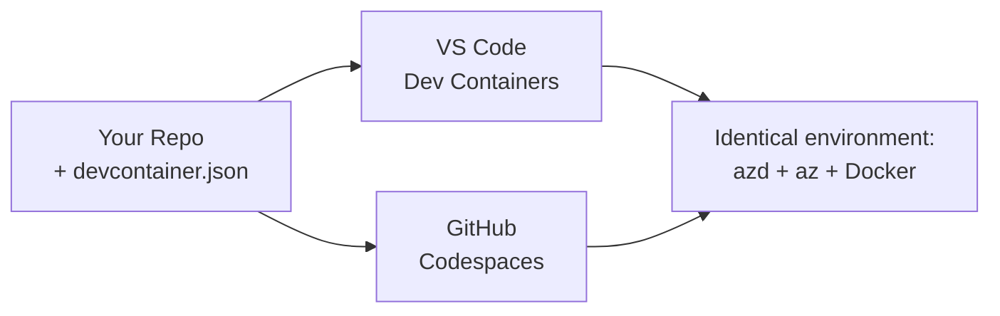

# Contêineres de Desenvolvimento & GitHub Codespaces para azd

**Navegação do Capítulo:**
- **📚 Início do Curso**: [AZD Para Iniciantes](../../README.md)
- **📖 Capítulo Atual**: Capítulo 1 - Fundamentos & Início Rápido
- **⬅️ Anterior**: [Traga Seu Próprio Aplicativo](bring-your-own-app.md)
- **🚀 Próximo Capítulo**: [Capítulo 2: Desenvolvimento AI-First](../chapter-02-ai-development/README.md)

> Alvo da revisão de comandos e configuração: `azd 1.37.2` (novembro de 2026). A construção de contêineres e implantações no Azure não foram executadas como parte desta revisão.

## Introdução

Instalar azd, o runtime da linguagem certa, Docker e o Azure CLI em cada máquina é uma tarefa — e é a principal razão pela qual um tutorial que "funciona na minha máquina" falha para outra pessoa. Um **contêiner de desenvolvimento** resolve isso ao descrever toda a sua cadeia de ferramentas em um arquivo. Qualquer pessoa que abrir o projeto no VS Code ou no GitHub Codespaces recebe exatamente o mesmo ambiente, com azd já instalado. Esta lição mostra como adicionar um.

## Objetivos de Aprendizagem

Ao final desta lição, você irá:
- Entender o que é um contêiner de desenvolvimento e por que ele é útil para azd
- Adicionar um `.devcontainer/devcontainer.json` mínimo a um projeto
- Incluir azd, o Azure CLI e Docker por meio de *features* do Contêiner de Desenvolvimento
- Abrir o projeto no GitHub Codespaces ou VS Code

## Resultados de Aprendizagem

Após completar esta lição, você será capaz de:
- Criar um `devcontainer.json` para um projeto azd
- Adicionar azd e ferramentas do Azure sem instalações manuais
- Executar `azd up` de dentro de um contêiner ou Codespace

---

## O que é um Contêiner de Desenvolvimento?

Um contêiner de desenvolvimento é um ambiente de desenvolvimento baseado em Docker definido por um arquivo `.devcontainer/devcontainer.json` no seu repositório. Quando você abre o projeto:

- **VS Code** (com a extensão Dev Containers) constrói o contêiner e se conecta a ele.
- **GitHub Codespaces** constrói o mesmo contêiner na nuvem e fornece um editor baseado no navegador.

De qualquer forma, todo colaborador recebe ferramentas idênticas — nenhum "você instalou azd?" para solucionar problemas.



---

## Passo 1: Crie o arquivo devcontainer

Crie `.devcontainer/devcontainer.json` na raiz do seu projeto:

```json
{
  "name": "azd-project",
  "image": "mcr.microsoft.com/devcontainers/base:bookworm",
  "features": {
    "ghcr.io/devcontainers/features/azure-cli:1": {},
    "ghcr.io/azure/azure-dev/azd:0": { "version": "1.37.2" },
    "ghcr.io/devcontainers/features/docker-in-docker:2": {},
    "ghcr.io/devcontainers/features/node:1": {}
  },
  "customizations": {
    "vscode": {
      "extensions": [
        "ms-azuretools.azure-dev",
        "ms-azuretools.vscode-bicep"
      ]
    }
  },
  "forwardPorts": [3000],
  "postCreateCommand": "azd version"
}
```

O que cada parte faz:

| Chave | Propósito |
|-----|---------|
| `image` | O sistema operacional base para o contêiner |
| `features` | Instaladores pré-construídos — aqui: Azure CLI, **azd**, Docker e Node.js |
| `customizations.vscode.extensions` | Instala automaticamente as extensões azd e Bicep para VS Code |
| `forwardPorts` | Expõe a porta do seu app para o navegador |
| `postCreateCommand` | Executa uma vez após o contêiner ser construído (aqui, uma checagem de sanidade) |

> A versão da feature (`azd:0`) e a versão instalada do CLI são diferentes. Defina a opção `version` da feature para `"1.37.2"` para fixar a versão do CLI; não use uma versão do CLI como a tag da feature.

---

## Passo 2: Combine a feature com a linguagem do seu app

Substitua a feature `node` pela que sua aplicação usa:

```jsonc
// Python project
"ghcr.io/devcontainers/features/python:1": {},

// .NET project
"ghcr.io/devcontainers/features/dotnet:2": {},

// Java project
"ghcr.io/devcontainers/features/java:1": {},

// Go project
"ghcr.io/devcontainers/features/go:1": {}
```

Mantenha `docker-in-docker` ao construir imagens localmente. Uma construção remota configurada no ACR (`docker.remoteBuild: true`) é uma alternativa; o tipo de host sozinho nem sempre exige Docker local.

---

## Passo 3: Abra o Contêiner

**No VS Code:**
1. Instale a extensão **Dev Containers**.
2. Abra a pasta do projeto.
3. Clique em **Reabrir no Contêiner** quando for solicitado (ou execute *Dev Containers: Reopen in Container*).

**No GitHub Codespaces:**
1. Faça push do repositório para o GitHub.
2. Clique em **Code → Codespaces → Create codespace on main**.
3. Aguarde a construção do contêiner — azd estará pronto no terminal.

---

## Passo 4: Faça o Deploy de Dentro do Contêiner

O contêiner já tem o azd pré-instalado, então o fluxo normal simplesmente funciona:

```bash
azd auth login --use-device-code   # device code is handy inside Codespaces
azd up
```

> **Por que `--use-device-code`?** Em um contêiner remoto ou Codespace não há navegador local para redirecionar, então o login via código do dispositivo é o caminho confiável. Você irá colar um código em uma aba do navegador para completar o login.

---

## Erros Comuns

| Problema | Solução |
|---------|-----|
| `azd up` não consegue construir uma imagem | Adicione a feature `docker-in-docker` |
| Login pelo navegador trava no Codespaces | Use `azd auth login --use-device-code` |
| Ferramentas diferentes entre colegas | Fixe o CLI pela opção `version` da feature azd e fixe os runtimes das linguagens |
| App não acessível no navegador | Adicione a porta ao `forwardPorts` |

---

## Resumo

- Um contêiner de desenvolvimento torna sua cadeia de ferramentas azd reproduzível para todos.
- Adicione azd, o Azure CLI e Docker por meio de *features* do Contêiner de Desenvolvimento.
- Combine a feature da linguagem com seu app e mantenha `docker-in-docker` para hosts de contêiner.
- Use o login via código do dispositivo ao rodar dentro do Codespaces.

---

## 🔗 Navegação

| Direção | Recurso |
|-----------|----------|
| **Anterior** | [Traga Seu Próprio Aplicativo](bring-your-own-app.md) |
| **Início do Capítulo** | [Capítulo 1: Fundamentos & Início Rápido](README.md) |
| **Próximo Capítulo** | [Capítulo 2: Desenvolvimento AI-First](../chapter-02-ai-development/README.md) |

## 📖 Recursos Relacionados

- [Instalação & Configuração](installation.md)
- [Tabela de Comandos](../../resources/cheat-sheet.md)
- [Especificação oficial dos Contêineres de Desenvolvimento](https://containers.dev/)
- [Feature de Contêiner de Desenvolvimento do azd](https://github.com/Azure/azure-dev/tree/main/ext/devcontainer)

---

<!-- CO-OP TRANSLATOR DISCLAIMER START -->
**Aviso Legal**:
Este documento foi traduzido usando o serviço de tradução por IA [Co-op Translator](https://github.com/Azure/co-op-translator). Embora nos esforcemos pela precisão, por favor, esteja ciente de que traduções automatizadas podem conter erros ou imprecisões. O documento original em seu idioma nativo deve ser considerado a fonte autorizada. Para informações críticas, recomenda-se tradução profissional humana. Não nos responsabilizamos por quaisquer mal-entendidos ou interpretações incorretas decorrentes do uso desta tradução.
<!-- CO-OP TRANSLATOR DISCLAIMER END -->