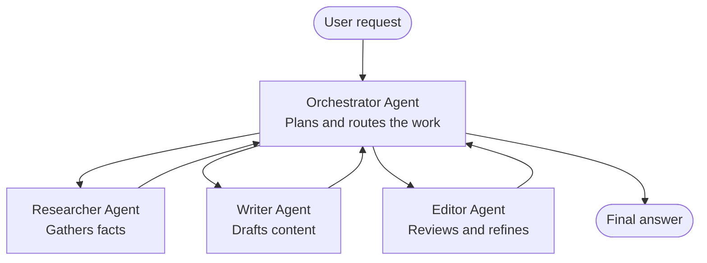

# Noções Básicas de Multiagentes - Implante Seu Primeiro Sistema de IA Coordenado

**Navegação do Capítulo:**
- **📚 Página Inicial do Curso**: [AZD Para Iniciantes](../../README.md)
- **📖 Capítulo Atual**: Capítulo 5 - Soluções de IA Multiagente
- **⬅️ Anterior**: [Capítulo 4: Infraestrutura](../chapter-04-infrastructure/README.md)
- **➡️ Próximo**: [Padrões de Coordenação](../chapter-06-pre-deployment/coordination-patterns.md)

> Orientação dos comandos revisada com base na referência lançada `azd 1.37.2`. Implantações em nuvem não foram executadas.

## Introdução

Nos capítulos anteriores, você implantou um único aplicativo—e no Capítulo 2, um único agente de IA. Esta lição dá o próximo passo: implantar um **sistema multiagente**, onde vários agentes especializados trabalham juntos para resolver um problema que um único agente sozinho não poderia resolver bem.

A boa notícia para iniciantes: **você não precisa de novos comandos.** Uma solução multiagente ainda é um projeto azd. Você vai `azd init`, `azd up`, testar e `azd down`—exatamente o fluxo de trabalho que você já conhece. O que muda é a *estrutura* do aplicativo internamente.

## Objetivos de Aprendizagem

Ao final desta lição, você irá:
- Entender o que significa "multiagente" e quando vale a pena a complexidade extra
- Reconhecer os papéis comuns em um sistema multiagente (orquestrador + especialistas)
- Implantar um template multiagente real e funcional com `azd up`
- Compreender os recursos do Azure que suportam um aplicativo multiagente
- Saber como verificar, personalizar e desmontar a solução com segurança

## Resultados do Aprendizado

Depois de concluir esta lição, você será capaz de:
- Explicar a diferença entre um agente único e um sistema multiagente
- Escolher entre um agente único com ferramentas e um design verdadeiramente multiagente
- Implantar e testar um template multiagente de ponta a ponta com azd
- Identificar onde cada agente é executado e como eles se comunicam
- Limpar todos os recursos para evitar cobranças contínuas

---

## O Que É Um Sistema Multiagente?

Um único agente de IA é um modelo com um conjunto de instruções e (opcionalmente) algumas ferramentas. Isso funciona bem para tarefas focadas. Mas conforme uma tarefa cresce—pesquisar, depois escrever, depois editar, depois checar fatos—empacotar tudo em um único prompt torna o agente mais lento, menos confiável e mais difícil de depurar.

Um **sistema multiagente** divide o trabalho em especialistas que fazem um trabalho bem feito, coordenados por um orquestrador:



### Os dois papéis que você sempre verá

| Papel | Trabalho | Exemplo |
|------|---------|---------|
| **Orquestrador** | Decide *o que acontece a seguir* e roteia o trabalho entre os agentes | "Primeiro pesquisa, depois escreve, depois edita" |
| **Especialista** | Faz um trabalho focado e retorna um resultado | Um "pesquisador" que apenas coleta fatos |

### Você realmente precisa de múltiplos agentes?

Comece simples. Use multiagente **somente** quando uma destas condições for verdadeira:

- ✅ A tarefa tem **estágios distintos** que se beneficiam de instruções diferentes (pesquisa vs. escrita vs. revisão)
- ✅ Você quer que especialistas rodem **em paralelo** para economizar tempo
- ✅ Diferentes etapas precisam de **ferramentas ou fontes de dados distintas**
- ✅ Você precisa que cada etapa seja **testável e depurável de forma independente**

Se sua tarefa é uma única pergunta e resposta ou uma chamada simples de ferramenta, um **agente único com ferramentas** (Capítulo 2) é mais simples, mais barato e mais fácil de operar.

> **Dica para iniciantes:** "Mais agentes" não é "melhor." Cada agente adiciona latência, custo e um novo item para monitorar. Adicione agentes somente quando o problema claramente se divide em partes.

---

## Duas Maneiras de Construir Multiagente no Azure

| Abordagem | O que é | Melhor para |
|-----------|----------|-------------|
| **Agente único + ferramentas** | Um agente Foundry que chama funções/ferramentas | Fluxos simples, começando |
| **Múltiplos agentes coordenados** | Vários agentes com um orquestrador | Estágios distintos, trabalho paralelo, especialização |

Esta lição foca na segunda abordagem usando um **template pronto**, para que você possa ver um sistema multiagente real em funcionamento antes de construir o seu.

---

## Prática: Implemente um App Multiagente Funcional

Vamos implantar o **Contoso Creative Writer**, um exemplo oficial da Azure que coordena agentes de pesquisa, produto, escrita e edição para produzir um artigo. Antes de prosseguir, verifique os [prerequisitos e custos do exemplo](https://github.com/Azure-Samples/contoso-creative-writer#azure-account-requirements): ele precisa de cota do modelo, Azure AI Search, acesso Bing Grounding, Python, Docker e hooks compatíveis com Bash. Disponibilidade de modelo e região depende da sua assinatura; a implantação não é garantida apenas escolhendo determinada região.

### Passo 1: Inicializar o template

```bash
# Create a working folder
mkdir creative-writer && cd creative-writer

# Initialize from the official multi-agent template
azd init --template Azure-Samples/contoso-creative-writer .
```

> Explore mais templates multiagente a qualquer momento na [galeria Awesome AZD AI](https://azure.github.io/awesome-azd/?tags=ai). Outras opções amigáveis para iniciantes incluem `get-started-with-ai-agents` e `azure-ai-travel-agents`.

### Passo 2: Autenticar

```bash
# Required for azd workflows
azd auth login

# Also required by this sample's Azure CLI hooks
az login
```

### Passo 3: Verificar o ambiente

```bash
# init normally creates/selects an environment; confirm it before proceeding
azd env list
# Only if you need an additional environment:
# azd env new dev
```

### Passo 4: Visualizar, depois implantar

```bash
# See what will be created before spending anything (recommended)
azd provision --preview

# Provision infrastructure and deploy all agents in one step
azd up
```

`azd up` solicitará as configurações de assinatura e região faltantes, depois provisionará recursos e implantará o aplicativo. A visualização não reserva cota nem garante sucesso; hooks do template ainda podem executar durante uma prévia de provisionamento, então inspecione-os primeiro. Para estender o tempo que azd espera para cada **implantação de serviço** (não provisionamento de modelo):

```bash
azd deploy --timeout 1800
```

Um tempo limite para azd esperar; ele não cancela a implantação no Azure. Verifique o estado do recurso antes de tentar novamente.

> **Aviso sobre custo e capacidade:** Aplicativos multiagente implantam modelos de IA que consomem cota e geram custo. Se `azd up` falhar por cota de modelo, veja [Solução de Problemas de IA](../chapter-07-troubleshooting/ai-troubleshooting.md) para correções de região e cota, e Capítulo 6 [Planejamento de Capacidade](../chapter-06-pre-deployment/capacity-planning.md).

---

## Compreendendo O Que Você Implantou

Um aplicativo multiagente típico assim provisiona um conjunto de recursos do Azure que correspondem diretamente às responsabilidades no diagrama acima:

| Recurso | Por que está lá |
|---------|----------------|
| **Microsoft Foundry / Modelos** | Hospeda os modelos de linguagem usados por cada agente |
| **Azure AI Search** | Fornece dados fundamentados para pesquisa pelo agente pesquisador |
| **Container Apps** (ou App Service) | Hospeda o orquestrador e o código dos agentes |
| **Cosmos DB** (em alguns exemplos) | Armazena estado/memória compartilhada passada entre agentes |
| **Application Insights** | Rastrea solicitações *entre* agentes para que você possa depurar o fluxo |

### Como os agentes se comunicam

Na maioria dos exemplos azd multiagente, o **orquestrador roda no seu código de aplicativo** (por exemplo, usando um framework como Semantic Kernel ou Microsoft Agent Framework). O orquestrador chama cada agente especialista por sua vez, passa os resultados e monta a resposta final. Os agentes compartilham contexto por meio de:

- **Chamadas de função/ferramenta** — o orquestrador invoca um especialista e recebe um resultado de volta
- **Memória compartilhada** — um banco de dados (frequentemente Cosmos DB) mantém o estado que ambos agentes podem ler
- **Mensagens/eventos** — para acoplamento mais solto, os agentes comunicam via fila ou Service Bus

> **Por que isso importa para depuração:** porque cada etapa é separada, o Application Insights mostra *qual* agente foi lento ou falhou. Esse é um dos principais motivos para dividir o trabalho entre agentes em primeiro lugar.

---

## Verifique a Implantação

Confirme que o sistema realmente está funcionando antes de prosseguir:

```bash
# Show the deployed endpoints
azd show

# Open the app's monitoring dashboard
azd monitor

# Open Application Insights Logs (not a terminal log stream)
azd monitor --logs
```

Então abra a URL do app a partir de `azd show` e solicite um artigo curto. Use a visualização de depuração da amostra para inspecionar o fluxo de trabalho dos agentes. A busca de transações no Application Insights pode mostrar as etapas individuais somente se a amostra as instrumentar e correlacionar; azd não adiciona spans de agentes automaticamente.

**Critérios de sucesso:**
- ✅ `azd show` lista um endpoint acessível
- ✅ Uma solicitação produz um resultado que claramente passou por múltiplos estágios
- ✅ A visualização de depuração mostra múltiplas etapas de agentes; se o rastreamento estiver habilitado, verifique a telemetria correspondente após ingestão

---

## Personalize: Adicione ou Ajuste um Agente

Como cada agente é apenas instruções mais ferramentas, personalizar é simples:

1. **Encontre as definições dos agentes** no template (geralmente um conjunto de arquivos `prompts/`, `agents/` ou `*.prompty`).
2. **Ajuste as instruções de um agente** — por exemplo, diga ao agente editor para aplicar um tom específico ou contagem de palavras.
3. **Reimplante somente o código** (a infraestrutura permanece a mesma):

   ```bash
   azd deploy
   ```

Para avançar com seu *próprio* projeto de agente Foundry, use a inicialização interativa da extensão de agente:

```bash
azd extension install azure.ai.agents
azd ai agent init
azd up
azd ai agent invoke      # test, with response timing
```

Veja [Capítulo 2: Agentes](../chapter-02-ai-development/agents.md) e a [referência AZD AI CLI](../chapter-08-production/production-ai-practices.md#azd-ai-cli-commands-and-extensions) para o ciclo completo: agente `invoke`, o fluxo de trabalho separado da extensão de avaliações `azd ai eval`, agente `optimize`, e agente `delete`.

---

## Limpeza

Apps multiagente rodam múltiplos serviços faturáveis. Desmonte tudo quando terminar:

```bash
# Review the resources and confirm deletion interactively
azd down
```

A exclusão é destrutiva. Para um laboratório descartável, `azd down --force --purge` pula a exclusão e confirmações de limpeza suave suportadas; a limpeza suave é uma preocupação de recuperação/reescopo de nome, não uma prova de cobranças contínuas. Verifique se não há recursos retidos e cobranças após a limpeza.

---

## Uma Nota Sobre Sistemas Multiagente em Produção

A [Solução Multiagente para Varejo](../../examples/retail-scenario.md) neste repositório é uma **planta arquitetural**, não um template de um comando—ela documenta como um sistema de varejo em produção *seria* construído (e deixa claro que uma construção completa é um esforço substancial). Use-a como referência de design *depois* de ter implantado uma amostra funcional aqui. Para preocupações de produção (resiliência, custo, monitoramento, governança), continue para [Capítulo 8: Práticas de IA em Produção](../chapter-08-production/production-ai-practices.md).

---

## Resumo

- Um sistema multiagente divide o trabalho entre especialistas coordenados por um orquestrador.
- Use-o somente quando a tarefa tiver estágios distintos, paralelismo, ou ferramentas diferentes por etapa—caso contrário, prefira um agente único.
- O fluxo azd é inalterado: `azd init` → `azd up` → teste → `azd down`.
- Um template real como `contoso-creative-writer` permite que você veja e personalize um app multiagente funcional hoje.
- O rastreamento do Application Insights entre agentes é um dos maiores benefícios práticos do design multiagente.

---

## 🔗 Navegação

| Direção | Lição |
|---------|-------|
| **Anterior** | [Capítulo 4: Infraestrutura](../chapter-04-infrastructure/README.md) |
| **Próximo** | [Padrões de Coordenação](../chapter-06-pre-deployment/coordination-patterns.md) |

## 📖 Recursos Relacionados

- [Guia de Agentes de IA](../chapter-02-ai-development/agents.md)
- [Padrões de Coordenação](../chapter-06-pre-deployment/coordination-patterns.md)
- [Práticas de IA em Produção](../chapter-08-production/production-ai-practices.md)
- [Solução de Problemas de IA](../chapter-07-troubleshooting/ai-troubleshooting.md)

---

<!-- CO-OP TRANSLATOR DISCLAIMER START -->
**Aviso Legal**:
Este documento foi traduzido usando o serviço de tradução por IA [Co-op Translator](https://github.com/Azure/co-op-translator). Embora nos esforcemos pela precisão, por favor, esteja ciente de que traduções automatizadas podem conter erros ou imprecisões. O documento original em seu idioma nativo deve ser considerado a fonte autorizada. Para informações críticas, recomenda-se tradução profissional humana. Não nos responsabilizamos por quaisquer mal-entendidos ou interpretações incorretas decorrentes do uso desta tradução.
<!-- CO-OP TRANSLATOR DISCLAIMER END -->