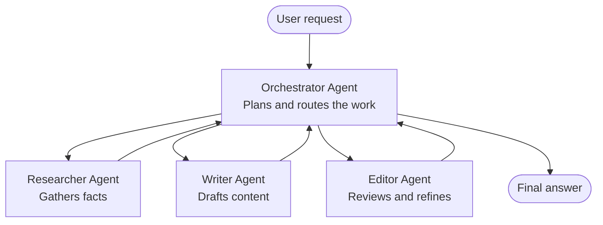

# Noções Básicas de Multi-Agentes - Implante Seu Primeiro Sistema de IA Coordenado

**Navegação do Capítulo:**
- **📚 Página Inicial do Curso**: [AZD Para Iniciantes](../../README.md)
- **📖 Capítulo Atual**: Capítulo 5 - Soluções de IA Multi-Agente
- **⬅️ Anterior**: [Capítulo 4: Infraestrutura](../chapter-04-infrastructure/README.md)
- **➡️ Próximo**: [Padrões de Coordenação](../chapter-06-pre-deployment/coordination-patterns.md)

> Orientação de comando revisada contra a referência lançada `azd 1.37.2`. Implantações em nuvem não foram executadas.

## Introdução

Nos capítulos anteriores, você implantou uma única aplicação—e no Capítulo 2 implantou um único agente de IA. Esta lição dá o próximo passo: implantar um **sistema multi-agente**, onde vários agentes especializados trabalham juntos para resolver um problema que nenhum agente único poderia manejar bem sozinho.

A boa notícia para iniciantes: **você não precisa de comandos novos.** Uma solução multi-agente ainda é um projeto azd. Você vai `azd init`, `azd up`, testar, e `azd down`—exatamente o fluxo de trabalho que você já conhece. O que muda é a *forma* do app internamente.

## Objetivos de Aprendizagem

Ao final desta lição, você irá:
- Entender o que "multi-agente" significa e quando vale a pena a complexidade extra
- Reconhecer os papéis comuns em um sistema multi-agente (orquestrador + especialistas)
- Implantar um template multi-agente real e funcional com `azd up`
- Compreender os recursos do Azure que suportam um app multi-agente
- Saber como verificar, personalizar e desmontar a solução com segurança

## Resultados de Aprendizagem

Após completar esta lição, você será capaz de:
- Explicar a diferença entre um agente único e um sistema multi-agente
- Escolher entre um agente único com ferramentas e um verdadeiro design multi-agente
- Implantar e testar um template multi-agente de ponta a ponta com azd
- Identificar onde cada agente roda e como eles se comunicam
- Limpar todos os recursos para evitar cobranças contínuas

---

## O Que é um Sistema Multi-Agente?

Um único agente de IA é um modelo com um conjunto de instruções e (opcionalmente) algumas ferramentas. Isso funciona bem para tarefas focadas. Mas à medida que uma tarefa cresce—pesquisa, depois escrita, depois edição, depois checagem dos fatos—colocar tudo em um único prompt torna o agente mais lento, menos confiável e mais difícil de depurar.

Um **sistema multi-agente** divide o trabalho em especialistas que fazem um trabalho bem feito, coordenados por um orquestrador:



### Os dois papéis que você sempre verá

| Papel | Função | Exemplo |
|------|---------|---------|
| **Orquestrador** | Decide *o que acontece a seguir* e direciona o trabalho entre agentes | "Primeiro pesquisa, depois escreve, depois edita" |
| **Especialista** | Faz um trabalho focado e retorna um resultado | Um “pesquisador” que só recolhe fatos |

### Você realmente precisa de múltiplos agentes?

Comece simples. Use multi-agente **somente** quando uma destas condições for verdadeira:

- ✅ A tarefa tem **etapas distintas** que se beneficiam de instruções diferentes (pesquisa vs escrever vs revisar)
- ✅ Você quer que especialistas rodem **em paralelo** para economizar tempo
- ✅ Diferentes passos precisam de **ferramentas ou fontes de dados diferentes**
- ✅ Você precisa que cada passo seja **testável e depurável de forma independente**

Se sua tarefa for uma única pergunta e resposta ou uma simples chamada de ferramenta, um **agente único com ferramentas** (Capítulo 2) é mais simples, barato e fácil de operar.

> **Dica para iniciantes:** "Mais agentes" não é "melhor." Cada agente adiciona latência, custo e uma nova coisa para monitorar. Adicione agentes somente quando o problema claramente se divide em partes.

---

## Duas Formas de Construir Multi-Agente no Azure

| Abordagem | O que é | Melhor para |
|----------|---------|-------------|
| **Agente único + ferramentas** | Um agente Foundry que chama funções/ferramentas | Fluxos simples, iniciando |
| **Múltiplos agentes coordenados** | Vários agentes com um orquestrador | Etapas distintas, trabalho paralelo, especialização |

Esta lição foca na segunda abordagem usando um **template pronto**, para que você veja um sistema multi-agente real rodando antes de construir o seu próprio.

---

## Prática: Implante um App Multi-Agente Funcional

Vamos implantar o **Contoso Creative Writer**, um exemplo oficial do Azure que coordena agentes de pesquisa, produto, escrita e edição para produzir um artigo. Antes de prosseguir, verifique os [pré-requisitos e custos do exemplo](https://github.com/Azure-Samples/contoso-creative-writer#azure-account-requirements): ele precisa de cota de modelo, Azure AI Search, acesso Bing Grounding, Python, Docker e ganchos compatíveis com Bash. Disponibilidade de modelo e região dependem da sua assinatura; a implantação não é garantida ao escolher uma região específica.

### Passo 1: Inicialize o template

```bash
# Create a working folder
mkdir creative-writer && cd creative-writer

# Initialize from the official multi-agent template
azd init --template Azure-Samples/contoso-creative-writer .
```

> Explore mais templates multi-agente a qualquer momento na [galeria Awesome AZD AI](https://azure.github.io/awesome-azd/?tags=ai). Outras opções amigáveis para iniciantes incluem `get-started-with-ai-agents` e `azure-ai-travel-agents`.

### Passo 2: Autentique-se

```bash
# Required for azd workflows
azd auth login

# Also required by this sample's Azure CLI hooks
az login
```

### Passo 3: Verifique o ambiente

```bash
# init normally creates/selects an environment; confirm it before proceeding
azd env list
# Only if you need an additional environment:
# azd env new dev
```

### Passo 4: Visualize, depois implante

```bash
# See what will be created before spending anything (recommended)
azd provision --preview

# Provision infrastructure and deploy all agents in one step
azd up
```

`azd up` solicitará assinaturas e configurações de região ausentes, então provisionará recursos e implantará a aplicação. A visualização não reserva cota nem garante sucesso; ganchos do template podem ainda rodar durante a visualização da provisão, então inspecione-os primeiro. Para estender o tempo que azd espera por cada **implantação de serviço** (não provisão de modelo):

```bash
azd deploy --timeout 1800
```

Um tempo limite acaba a espera do azd; não cancela a implantação no Azure. Inspecione o estado do recurso antes de tentar novamente.

> **Aviso sobre custo e capacidade:** Apps multi-agente implantam modelos de IA que consomem cota e geram custo. Se `azd up` falhar por cota de modelo, veja o [AI Troubleshooting](../chapter-07-troubleshooting/ai-troubleshooting.md) para correções de região e cota, e o Capítulo 6 [Planejamento de Capacidade](../chapter-06-pre-deployment/capacity-planning.md).

---

## Entendendo o Que Você Implantou

Um app multi-agente típico como este provisiona um conjunto de recursos Azure que correspondem diretamente às responsabilidades no diagrama acima:

| Recurso | Por que existe |
|---------|--------------|
| **Microsoft Foundry / Modelos** | Hospeda os modelos de linguagem que cada agente usa |
| **Azure AI Search** | Dá ao agente pesquisador dados fundamentados para busca |
| **Container Apps** (ou App Service) | Hospeda o orquestrador e o código dos agentes |
| **Cosmos DB** (em alguns exemplos) | Armazena estado/memória compartilhada passada entre agentes |
| **Application Insights** | Traça requisições *entre* agentes para ajudar a depurar o fluxo |

### Como os agentes se comunicam

Na maioria dos exemplos azd multi-agente, o **orquestrador roda no código da aplicação** (por exemplo, usando um framework como Semantic Kernel ou Microsoft Agent Framework). O orquestrador chama cada agente especialista em sequência, passa os resultados e monta a resposta final. Os agentes compartilham contexto por meio de:

- **Chamadas de função/ferramenta** — o orquestrador invoca um especialista e recebe um resultado
- **Memória compartilhada** — um banco de dados (geralmente Cosmos DB) guarda estado que ambos os agentes podem ler
- **Mensagens/eventos** — para acoplamento mais flexível, agentes se comunicam via fila ou Service Bus

> **Por que isso é importante para depuração:** porque cada passo é separado, o Application Insights mostra *qual* agente foi lento ou falhou. Essa é uma grande razão para dividir o trabalho entre agentes desde o início.

---

## Verifique a Implantação

Confirme que o sistema está realmente funcionando antes de continuar:

```bash
# Show the deployed endpoints
azd show

# Open the app's monitoring dashboard
azd monitor

# Open Application Insights Logs (not a terminal log stream)
azd monitor --logs
```

Depois abra a URL do app obtida em `azd show` e solicite um artigo curto. Use a vista de depuração do exemplo para inspecionar o fluxo de trabalho dos agentes. A busca de transações no Application Insights pode mostrar os passos individuais apenas se o exemplo instrumentar e correlacionar eles; azd não adiciona spans de agente automaticamente.

**Critérios de sucesso:**
- ✅ `azd show` lista um endpoint acessível
- ✅ Uma requisição produz um resultado que claramente passou por múltiplas etapas
- ✅ A vista de depuração mostra múltiplos passos de agentes; se rastreamento estiver habilitado, verifique a telemetria correspondente após ingestão

---

## Personalize: Adicione ou Ajuste um Agente

Como cada agente é apenas instruções mais ferramentas, personalizar é acessível:

1. **Encontre as definições dos agentes** no template (geralmente um conjunto de arquivos `prompts/`, `agents/` ou `*.prompty`).
2. **Ajuste as instruções de um agente** — por exemplo, diga ao editor para impor um tom ou contagem de palavras específica.
3. **Reimplante só o código** (a infraestrutura permanece a mesma):

   ```bash
   azd deploy
   ```

Para ir além com seu *próprio* projeto de agente Foundry, use o bundle GA com AZD 1.37.0+ em um diretório vazio separado:

```bash
azd ext install microsoft.foundry
azd ai agent init
azd up
azd ai agent invoke      # test, with response timing
```

Veja o [tutorial do agente hospedado GA](../chapter-02-ai-development/microsoft-foundry-integration.md#hosted-agent-walkthrough-ga) para testes locais com Agent Inspector, implantação remota de código e limpeza de propriedade. A [referência da CLI AZD AI](../chapter-08-production/production-ai-practices.md#azd-ai-cli-commands-and-extensions) cobre também extensão de avaliações separadas, otimização e exclusão de agentes.

---

## Limpeza

Apps multi-agente rodam múltiplos serviços cobrados. Desmonte tudo quando terminar:

```bash
# Review the resources and confirm deletion interactively
azd down
```

A exclusão é destrutiva. Para um laboratório descartável, `azd down --force --purge` pula a exclusão e confirmações de limpeza suportadas; a limpeza é irreversível onde suportada e pode ser bloqueada por proteção contra limpeza. Exclusão suave é uma preocupação de recuperação/uso de nome, não prova por si só cobranças contínuas. Verifique recursos retidos e cobrança após a limpeza.

Se você também inicializou um agente hospedado contra um projeto Foundry existente, `azd down` mantém o agente desse projeto e outros recursos no lugar. Remova apenas recursos indesejados que você possui separadamente. Para um novo projeto Foundry criado pelo seu ambiente AZD, `azd down` exclui o grupo de recursos e tudo dentro dele.

---

## Uma Nota Sobre Sistemas Multi-Agente de Produção

A [Solução Multi-Agente de Varejo](../../examples/retail-scenario.md) neste repositório é um **modelo de arquitetura**, não um template de um comando—documenta como um sistema de varejo em produção *seria* construído (e deixa claro que a construção completa é um grande esforço). Use-o como referência de design *depois* de você implantar um exemplo funcional aqui. Para preocupações de produção (resiliência, custo, monitoramento, governança), continue para o [Capítulo 8: Práticas de IA em Produção](../chapter-08-production/production-ai-practices.md).

---

## Resumo

- Um sistema multi-agente divide o trabalho entre especialistas coordenados por um orquestrador.
- Use-o somente quando a tarefa tem etapas distintas, paralelismo ou ferramentas diferentes por passo—caso contrário, prefira um agente único.
- O fluxo azd permanece o mesmo: `azd init` → `azd up` → testar → `azd down`.
- Um template real como `contoso-creative-writer` permite ver e personalizar um app multi-agente funcional hoje.
- O rastreamento do Application Insights entre agentes é uma das maiores vantagens práticas do design multi-agente.

---

## 🔗 Navegação

| Direção | Lição |
|---------|-------|
| **Anterior** | [Capítulo 4: Infraestrutura](../chapter-04-infrastructure/README.md) |
| **Próximo** | [Padrões de Coordenação](../chapter-06-pre-deployment/coordination-patterns.md) |

## 📖 Recursos Relacionados

- [Guia de Agentes de IA](../chapter-02-ai-development/agents.md)
- [Padrões de Coordenação](../chapter-06-pre-deployment/coordination-patterns.md)
- [Práticas de IA em Produção](../chapter-08-production/production-ai-practices.md)
- [Resolução de Problemas em IA](../chapter-07-troubleshooting/ai-troubleshooting.md)

---

<!-- CO-OP TRANSLATOR DISCLAIMER START -->
**Aviso Legal**:
Este documento foi traduzido usando o serviço de tradução por IA [Co-op Translator](https://github.com/Azure/co-op-translator). Embora nos esforcemos pela precisão, por favor, esteja ciente de que traduções automatizadas podem conter erros ou imprecisões. O documento original em seu idioma nativo deve ser considerado a fonte autorizada. Para informações críticas, recomenda-se tradução profissional humana. Não nos responsabilizamos por quaisquer mal-entendidos ou interpretações incorretas decorrentes do uso desta tradução.
<!-- CO-OP TRANSLATOR DISCLAIMER END -->