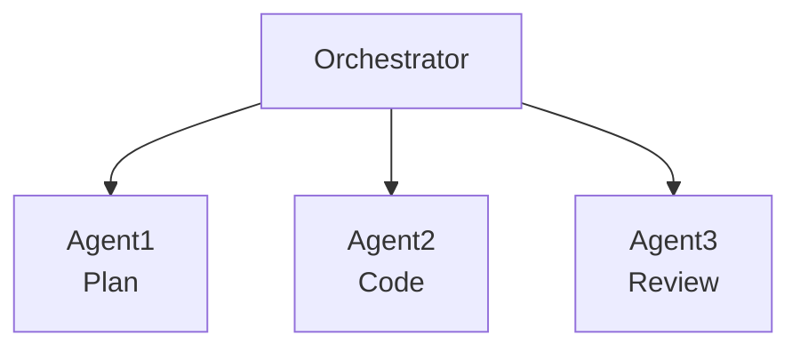
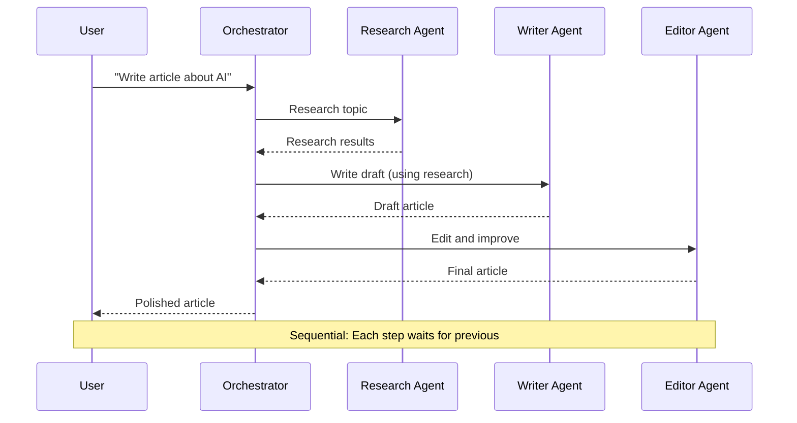
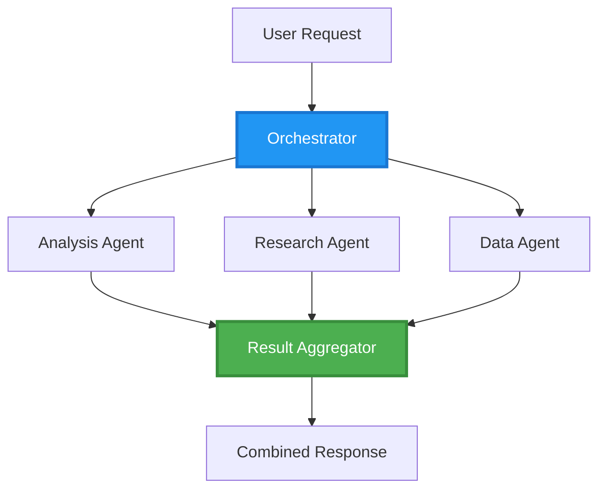
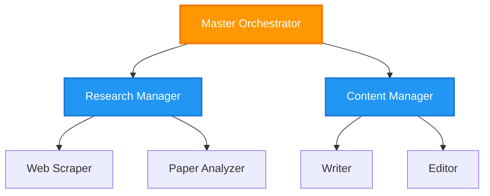
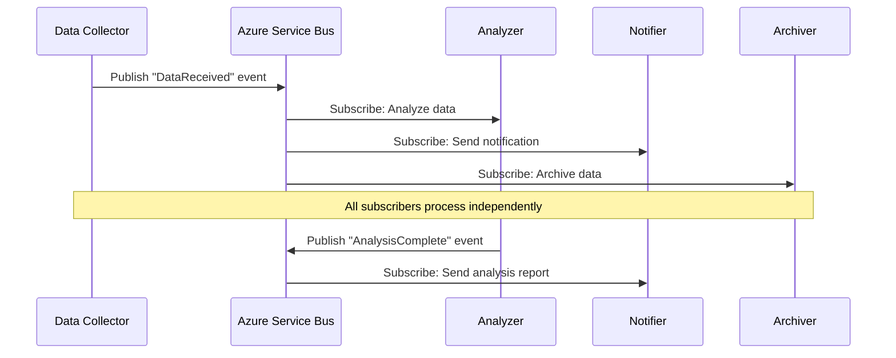
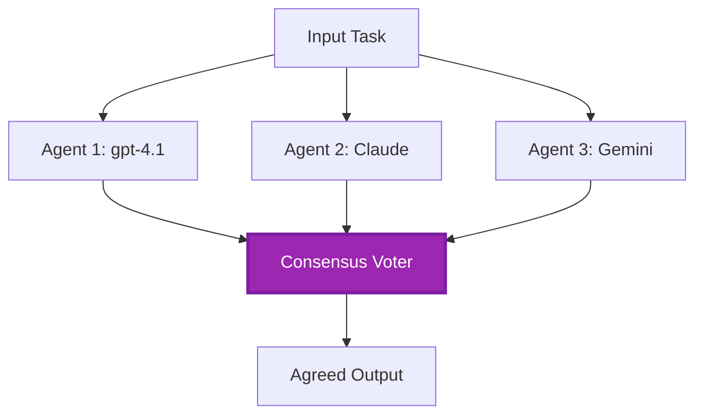
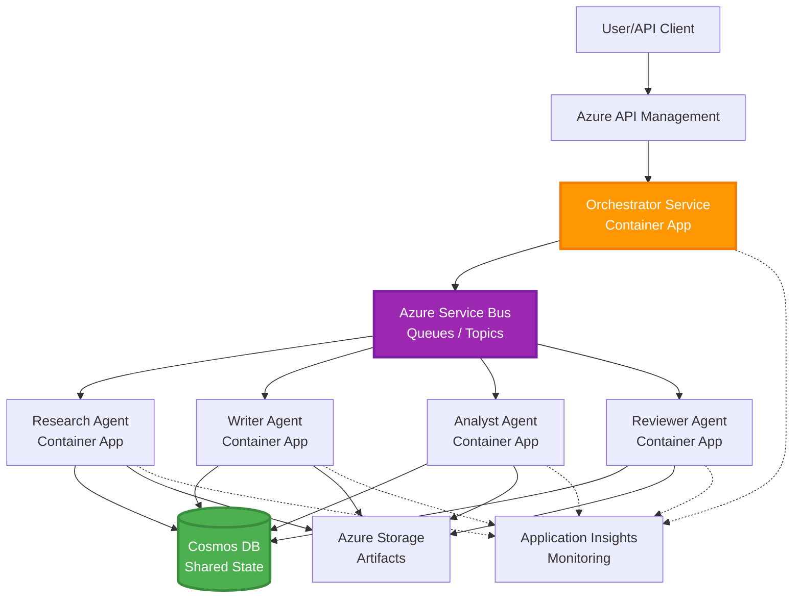

# Padrões de Coordenação Multiagente

⏱️ **Tempo Estimado**: 60-75 minutos de leitura; várias horas para implementar | 💰 **Custo Estimado**: depende da carga de trabalho | ⭐ **Complexidade**: Avançada

**📚 Roteiro de Aprendizagem:**
- ← Anterior: [Planejamento de Capacidade](capacity-planning.md) - Estratégias de dimensionamento e escalabilidade de recursos
- 🎯 **Você Está Aqui**: Padrões de Coordenação Multiagente (Orquestração, comunicação, gerenciamento de estado)
- → Próximo: [Seleção de SKU](sku-selection.md) - Escolhendo os serviços Azure certos
- 🏠 [Página Inicial do Curso](../../README.md)

---

## O Que Você Vai Aprender

Ao completar esta lição, você irá:
- Entender padrões de **arquitetura multiagente** e quando usá-los
- Implementar **padrões de orquestração** (centralizado, descentralizado, hierárquico)
- Projetar estratégias de **comunicação entre agentes** (síncrona, assíncrona, orientada a eventos)
- Gerenciar **estado compartilhado** entre agentes distribuídos
- Implantar **sistemas multiagente** no Azure com AZD
- Aplicar **padrões de coordenação** para cenários reais de IA
- Monitorar e depurar sistemas de agentes distribuídos

## Por Que a Coordenação Multiagente é Importante

### A Evolução: De Agente Único para Multiagente

**Agente Único (Simples):**
```
User → Agent → Response
```
- ✅ Fácil de entender e implementar
- ✅ Rápido para tarefas simples
- ❌ Limitado pelas capacidades do modelo único
- ❌ Não pode paralelizar tarefas complexas
- ❌ Sem especialização

**Sistema Multiagente (Avançado):**

- ✅ Agentes especializados para tarefas específicas
- ✅ Execução paralela para maior rapidez
- ✅ Modular e fácil de manter
- ✅ Melhor em fluxos de trabalho complexos
- ⚠️ Requer lógica de coordenação

**Analogia**: Agente único é como uma pessoa fazendo todas as tarefas. Multiagente é como uma equipe onde cada membro tem habilidades especializadas (pesquisador, programador, revisor, escritor) trabalhando juntos.

---

## Padrões Centrais de Coordenação

### Padrão 1: Coordenação Sequencial (Cadeia de Responsabilidade)

**Quando usar**: As tarefas devem ser concluídas em ordem específica, cada agente usa a saída do anterior.



**Benefícios:**
- ✅ Fluxo de dados claro
- ✅ Fácil de depurar
- ✅ Ordem de execução previsível

**Limitações:**
- ❌ Mais lento (sem paralelismo)
- ❌ Uma falha bloqueia toda a cadeia
- ❌ Não suporta tarefas interdependentes

**Exemplos de Uso:**
- Pipeline de criação de conteúdo (pesquisa → escrever → editar → publicar)
- Geração de código (planejar → implementar → testar → implantar)
- Geração de relatórios (coleta de dados → análise → visualização → resumo)

---

### Padrão 2: Coordenação Paralela (Fan-Out/Fan-In)

**Quando usar**: Tarefas independentes podem rodar simultaneamente, resultados combinados no final.



**Benefícios:**
- ✅ Rápido (execução paralela)
- ✅ Tolerante a falhas (resultados parciais aceitáveis)
- ✅ Escala horizontalmente

**Limitações:**
- ⚠️ Resultados podem chegar fora de ordem
- ⚠️ Precisa lógica de agregação
- ⚠️ Gerenciamento complexo de estado

**Exemplos de Uso:**
- Coleta de dados de múltiplas fontes (APIs + bancos de dados + web scraping)
- Análise competitiva (vários modelos geram soluções, a melhor é selecionada)
- Serviços de tradução (traduz simultaneamente para múltiplos idiomas)

---

### Padrão 3: Coordenação Hierárquica (Gerente-Trabalhador)

**Quando usar**: Fluxos complexos com sub-tarefas, é necessária delegação.



**Benefícios:**
- ✅ Lida com fluxos complexos
- ✅ Modular e fácil de manter
- ✅ Limites claros de responsabilidade

**Limitações:**
- ⚠️ Arquitetura mais complexa
- ⚠️ Maior latência (múltiplas camadas de coordenação)
- ⚠️ Requer orquestração sofisticada

**Exemplos de Uso:**
- Processamento corporativo de documentos (classificar → roteirizar → processar → arquivar)
- Pipelines de dados em múltiplas etapas (ingestão → limpeza → transformação → análise → relatório)
- Fluxos de automação complexos (planejamento → alocação de recursos → execução → monitoramento)

---

### Padrão 4: Coordenação Orientada a Eventos (Publicação-Inscrição)

**Quando usar**: Agentes precisam reagir a eventos, desejável desacoplamento.



**Benefícios:**
- ✅ Desacoplamento entre agentes
- ✅ Fácil adicionar novos agentes (basta assinar)
- ✅ Processamento assíncrono
- ✅ Resiliente (persistência de mensagens)

**Limitações:**
- ⚠️ Consistência eventual
- ⚠️ Depuração complexa
- ⚠️ Desafios na ordenação de mensagens

**Exemplos de Uso:**
- Sistemas de monitoramento em tempo real (alertas, dashboards, logs)
- Notificações multicanal (e-mail, SMS, push, Slack)
- Pipelines de processamento de dados (múltiplos consumidores dos mesmos dados)

---

### Padrão 5: Coordenação Baseada em Consenso (Votação/Quórum)

**Quando usar**: Necessário acordo entre múltiplos agentes antes de prosseguir.



**Benefícios:**
- ✅ Maior precisão (múltiplas opiniões)
- ✅ Tolerante a falhas (falhas minoritárias aceitáveis)
- ✅ Garantia de qualidade embutida

**Limitações:**
- ❌ Custo elevado (múltiplas chamadas ao modelo)
- ❌ Mais lento (espera por todos os agentes)
- ⚠️ Necessita resolução de conflitos

**Exemplos de Uso:**
- Moderação de conteúdo (vários modelos revisam o conteúdo)
- Revisão de código (vários linters/analisadores)
- Diagnóstico médico (múltiplos modelos de IA, validação por especialistas)

---

## Visão Geral da Arquitetura

### Sistema Multiagente Completo no Azure



**Componentes Principais:**

| Componente | Propósito | Serviço Azure |
|-----------|---------|---------------|
| **API Gateway** | Ponto de entrada, limitação de taxa, autenticação | API Management |
| **Orquestrador** | Coordena fluxos dos agentes | Container Apps |
| **Fila de Mensagens** | Comunicação assíncrona | Service Bus / Event Hubs |
| **Agentes** | Trabalhadores de IA especializados | Container Apps / Functions |
| **Armazenamento de Estado** | Estado compartilhado, monitoramento de tarefas | Cosmos DB |
| **Armazenamento de Artefatos** | Documentos, resultados, logs | Blob Storage |
| **Monitoramento** | Rastreamento distribuído, logs | Application Insights |

Fila/tópicos do Service Bus e Event Hubs são serviços diferentes com modelos de entrega/consumo distintos; Event Hubs não é substituto direto do código de worker do Service Bus abaixo. Paralelismo, mensagens persistentes e votação do modelo não garantem isoladamente tolerância a falhas ou maior precisão.

---

## Pré-Requisitos

### Ferramentas Necessárias

```bash
# Verify Azure Developer CLI
azd version
# Command reference baseline: azd 1.37.2

# Verify Azure CLI
az --version
# ✅ Expected: azure-cli 2.50.0 or higher

# Verify Docker (for local testing)
docker --version
# ✅ Expected: Docker version 20.10 or higher
```

### Requisitos do Azure

- Assinatura Azure ativa
- Permissões para criar:
  - Container Apps
  - Namespaces do Service Bus
  - Contas Cosmos DB
  - Contas de armazenamento
  - Application Insights

### Conhecimentos Pré-requisitos

Você deve ter concluído:
- [Gestão de Configuração](../chapter-03-configuration/configuration.md)
- [Autenticação & Segurança](../chapter-03-configuration/authsecurity.md)
- [Exemplo de Microsserviços](../../../../examples/microservices)

---

## Guia de Implementação

> **Fragmentos de design, não um laboratório completo:** A árvore de projeto e os rótulos `File:` abaixo descrevem arquivos para criar em seu próprio projeto; este repositório não contém uma aplicação completa `multi-agent-system`. Faltam templates principais/parâmetros, ambiente/registro Container Apps, Dockerfiles e travas de dependências, configuração de banco/container Cosmos, deploys de modelos, configuração de identidade/permissão, regras de escalonamento e workers/filas paralelos. Não espere que `azd init` gere esses arquivos nem que `azd up` implante os snippets sem alterações. Para um ponto inicial executável, complete [Fundamentos Multiagente](../chapter-05-multi-agent/multi-agent-basics.md).

**Assumptos de runtime:** Python 3.10+, `azure-servicebus`, `azure-cosmos`, `openai`, Flask e (para monitoramento) `azure-monitor-opentelemetry`; coloque `shared` no caminho de importação Python em cada imagem de serviço. O container Cosmos `agent-state/tasks` deve existir com chave de partição `/id`. Conexões baseadas em chave facilitam estes fragmentos, mas não são recomendação para produção: prefira identidades gerenciadas com papéis Service Bus/Cosmos/OpenAI de plano de dados com escopo. Não exponha chaves em outputs ou logs.

Entrega do Service Bus é **pelo menos uma vez**. Persista idempotência por tarefa **e passo**, use concorrência otimista (ETags) para estado ler/alterar/escrever e renove bloqueios de mensagens durante processamento longo. O gerenciador de estado simples abaixo é apenas sequencial e não implementa essas garantias para produção.

### Estrutura do Projeto

```
multi-agent-system/
├── azure.yaml                    # AZD configuration
├── infra/
│   ├── main.bicep               # Main infrastructure
│   ├── core/
│   │   ├── servicebus.bicep     # Message queue
│   │   ├── cosmos.bicep         # State store
│   │   ├── storage.bicep        # Artifact storage
│   │   └── monitoring.bicep     # Application Insights
│   └── app/
│       ├── orchestrator.bicep   # Orchestrator service
│       └── agent.bicep          # Agent template
└── src/
    ├── orchestrator/            # Orchestration logic
    │   ├── app.py
    │   ├── workflows.py
    │   └── Dockerfile
    ├── agents/
    │   ├── research/            # Research agent
    │   ├── writer/              # Writer agent
    │   ├── analyst/             # Analyst agent
    │   └── reviewer/            # Reviewer agent
    └── shared/
        ├── state_manager.py     # Shared state logic
        └── message_handler.py   # Message handling
```

---

## Lição 1: Padrão de Coordenação Sequencial

### Implementação: Pipeline de Criação de Conteúdo

Vamos projetar um pipeline sequencial: Pesquisa → Escrever → Editar. A publicação está fora deste exemplo.

### 1. Configuração AZD

**Arquivo: `azure.yaml`**

```yaml
name: content-pipeline
metadata:
  template: multi-agent-sequential@1.0.0

services:
  orchestrator:
    project: ./src/orchestrator
    language: python
    host: containerapp
  
  research-agent:
    project: ./src/agents/research
    language: python
    host: containerapp
  
  writer-agent:
    project: ./src/agents/writer
    language: python
    host: containerapp
  
  editor-agent:
    project: ./src/agents/editor
    language: python
    host: containerapp
```

### 2. Infraestrutura: Service Bus para Coordenação

**Arquivo: `infra/core/servicebus.bicep`**

```bicep
param name string
param location string
param tags object = {}

resource serviceBusNamespace 'Microsoft.ServiceBus/namespaces@2022-10-01-preview' = {
  name: name
  location: location
  tags: tags
  sku: {
    name: 'Standard'
    tier: 'Standard'
  }
  properties: {
    minimumTlsVersion: '1.2'
  }
}

// Queue for orchestrator → research agent
resource researchQueue 'Microsoft.ServiceBus/namespaces/queues@2022-10-01-preview' = {
  parent: serviceBusNamespace
  name: 'research-tasks'
  properties: {
    maxDeliveryCount: 3
    lockDuration: 'PT5M'
    deadLetteringOnMessageExpiration: true
  }
}

// Queue for research agent → writer agent
resource writerQueue 'Microsoft.ServiceBus/namespaces/queues@2022-10-01-preview' = {
  parent: serviceBusNamespace
  name: 'writer-tasks'
  properties: {
    maxDeliveryCount: 3
    lockDuration: 'PT5M'
  }
}

// Queue for writer agent → editor agent
resource editorQueue 'Microsoft.ServiceBus/namespaces/queues@2022-10-01-preview' = {
  parent: serviceBusNamespace
  name: 'editor-tasks'
  properties: {
    maxDeliveryCount: 3
    lockDuration: 'PT5M'
  }
}

output namespace string = serviceBusNamespace.name
// Do not output RootManageSharedAccessKey. Resolve scoped credentials
// securely or use managed identity in the application and scale rules.
```

### 3. Gerenciador de Estado Compartilhado

**Arquivo: `src/shared/state_manager.py`**

```python
from azure.cosmos import CosmosClient, PartitionKey
from datetime import datetime, timezone
import os

class StateManager:
    """Manages shared state across agents using Cosmos DB"""
    
    def __init__(self):
        endpoint = os.environ['COSMOS_ENDPOINT']
        key = os.environ['COSMOS_KEY']
        
        self.client = CosmosClient(endpoint, key)
        self.database = self.client.get_database_client('agent-state')
        self.container = self.database.get_container_client('tasks')
    
    def create_task(self, task_id: str, task_type: str, input_data: dict):
        """Create a new task"""
        task = {
            'id': task_id,
            'type': task_type,
            'status': 'pending',
            'input': input_data,
            'created_at': datetime.now(timezone.utc).isoformat(),
            'steps': []
        }
        self.container.create_item(task)
        return task
    
    def update_task_step(self, task_id: str, step_name: str, result: dict):
        """Update task with completed step"""
        task = self.container.read_item(task_id, partition_key=task_id)
        
        task['steps'].append({
            'name': step_name,
            'completed_at': datetime.now(timezone.utc).isoformat(),
            'result': result
        })
        
        self.container.replace_item(task_id, task)
        return task
    
    def complete_task(self, task_id: str, final_result: dict):
        """Mark task as complete"""
        task = self.container.read_item(task_id, partition_key=task_id)
        task['status'] = 'completed'
        task['result'] = final_result
        task['completed_at'] = datetime.now(timezone.utc).isoformat()
        self.container.replace_item(task_id, task)
        return task
    
    def get_task(self, task_id: str):
        """Retrieve task state"""
        return self.container.read_item(task_id, partition_key=task_id)
```

### 4. Serviço Orquestrador

**Arquivo: `src/orchestrator/app.py`**

```python
from flask import Flask, request, jsonify
from azure.servicebus import ServiceBusClient, ServiceBusMessage
import json
import uuid
import os
from shared.state_manager import StateManager

app = Flask(__name__)
state_manager = StateManager()

# Service Bus connection
servicebus_connection_str = os.environ['SERVICEBUS_CONNECTION_STRING']
servicebus_client = ServiceBusClient.from_connection_string(servicebus_connection_str)

@app.route('/health', methods=['GET'])
def health():
    return jsonify({'status': 'healthy', 'service': 'orchestrator'})

@app.route('/create-content', methods=['POST'])
def create_content():
    """
    Sequential workflow: Research → Write → Edit (returns a draft; no publishing)
    """
    data = request.get_json(silent=True) or {}
    topic = data.get('topic')
    
    if not topic:
        return jsonify({'error': 'Topic required'}), 400
    
    # Create task in state store
    task_id = str(uuid.uuid4())
    task = state_manager.create_task(
        task_id=task_id,
        task_type='content_creation',
        input_data={'topic': topic}
    )
    
    # Send message to research agent (first step)
    sender = servicebus_client.get_queue_sender('research-tasks')
    message = ServiceBusMessage(
        body=json.dumps({
            'task_id': task_id,
            'topic': topic,
            'next_queue': 'writer-tasks'  # Where to send results
        }),
        content_type='application/json'
    )
    
    with sender:
        sender.send_messages(message)
    
    return jsonify({
        'task_id': task_id,
        'status': 'started',
        'workflow': 'sequential',
        'steps': ['research', 'write', 'edit'],
        'message': 'Content creation pipeline initiated'
    }), 202

@app.route('/task/<task_id>', methods=['GET'])
def get_task_status(task_id):
    """Check task status"""
    try:
        task = state_manager.get_task(task_id)
        return jsonify(task)
    except Exception as e:
        return jsonify({'error': str(e)}), 404

if __name__ == '__main__':
    app.run(host='0.0.0.0', port=8080)
```

### 5. Agente de Pesquisa

**Arquivo: `src/agents/research/app.py`**

```python
from azure.servicebus import ServiceBusClient, ServiceBusMessage
from openai import AzureOpenAI
import json
import os
import time
from shared.state_manager import StateManager

# Initialize clients
state_manager = StateManager()
servicebus_client = ServiceBusClient.from_connection_string(
    os.environ['SERVICEBUS_CONNECTION_STRING']
)

openai_client = AzureOpenAI(
    api_key=os.environ['AZURE_OPENAI_API_KEY'],
    api_version="2024-10-21",
    azure_endpoint=os.environ['AZURE_OPENAI_ENDPOINT']
)

def process_research_task(message_data):
    """Process research request and pass to writer"""
    task_id = message_data['task_id']
    topic = message_data['topic']
    next_queue = message_data['next_queue']
    
    print(f"🔬 Researching: {topic}")
    
    # Call Microsoft Foundry Models for research
    response = openai_client.chat.completions.create(
        model=os.environ['AZURE_OPENAI_DEPLOYMENT'],
        messages=[
            {"role": "system", "content": "You are a research assistant. Provide comprehensive research on the given topic."},
            {"role": "user", "content": f"Research this topic thoroughly: {topic}"}
        ],
        max_tokens=1500
    )
    
    research_results = response.choices[0].message.content
    
    # Update state
    state_manager.update_task_step(
        task_id=task_id,
        step_name='research',
        result={'research': research_results}
    )
    
    # Send to next agent (writer)
    sender = servicebus_client.get_queue_sender(next_queue)
    message = ServiceBusMessage(
        body=json.dumps({
            'task_id': task_id,
            'topic': topic,
            'research': research_results,
            'next_queue': 'editor-tasks'
        }),
        content_type='application/json'
    )
    
    with sender:
        sender.send_messages(message)
    
    print(f"✅ Research complete for task {task_id}")

def main():
    """Listen to research queue"""
    receiver = servicebus_client.get_queue_receiver('research-tasks')
    
    print("🔬 Research Agent started, listening for tasks...")
    
    with receiver:
        while True:
            messages = receiver.receive_messages(max_wait_time=5)
            for message in messages:
                try:
                    message_data = json.loads(str(message))
                    process_research_task(message_data)
                    receiver.complete_message(message)
                except Exception as e:
                    print(f"❌ Error processing message: {e}")
                    receiver.abandon_message(message)

if __name__ == '__main__':
    main()
```

### 6. Agente Escritor

**Arquivo: `src/agents/writer/app.py`**

```python
from azure.servicebus import ServiceBusClient, ServiceBusMessage
from openai import AzureOpenAI
import json
import os
from shared.state_manager import StateManager

state_manager = StateManager()
servicebus_client = ServiceBusClient.from_connection_string(
    os.environ['SERVICEBUS_CONNECTION_STRING']
)

openai_client = AzureOpenAI(
    api_key=os.environ['AZURE_OPENAI_API_KEY'],
    api_version="2024-10-21",
    azure_endpoint=os.environ['AZURE_OPENAI_ENDPOINT']
)

def process_writing_task(message_data):
    """Write article based on research"""
    task_id = message_data['task_id']
    topic = message_data['topic']
    research = message_data['research']
    next_queue = message_data['next_queue']
    
    print(f"✍️ Writing article: {topic}")
    
    # Call Microsoft Foundry Models to write article
    response = openai_client.chat.completions.create(
        model=os.environ['AZURE_OPENAI_DEPLOYMENT'],
        messages=[
            {"role": "system", "content": "You are a professional writer. Write engaging, well-structured articles."},
            {"role": "user", "content": f"Based on this research:\n\n{research}\n\nWrite a comprehensive article about: {topic}"}
        ],
        max_tokens=2000
    )
    
    article_draft = response.choices[0].message.content
    
    # Update state
    state_manager.update_task_step(
        task_id=task_id,
        step_name='writing',
        result={'draft': article_draft}
    )
    
    # Send to editor
    sender = servicebus_client.get_queue_sender(next_queue)
    message = ServiceBusMessage(
        body=json.dumps({
            'task_id': task_id,
            'topic': topic,
            'draft': article_draft
        }),
        content_type='application/json'
    )
    
    with sender:
        sender.send_messages(message)
    
    print(f"✅ Article draft complete for task {task_id}")

def main():
    """Listen to writer queue"""
    receiver = servicebus_client.get_queue_receiver('writer-tasks')
    
    print("✍️ Writer Agent started, listening for tasks...")
    
    with receiver:
        while True:
            messages = receiver.receive_messages(max_wait_time=5)
            for message in messages:
                try:
                    message_data = json.loads(str(message))
                    process_writing_task(message_data)
                    receiver.complete_message(message)
                except Exception as e:
                    print(f"❌ Error: {e}")
                    receiver.abandon_message(message)

if __name__ == '__main__':
    main()
```

### 7. Agente Editor

**Arquivo: `src/agents/editor/app.py`**

```python
from azure.servicebus import ServiceBusClient
from openai import AzureOpenAI
import json
import os
from shared.state_manager import StateManager

state_manager = StateManager()
servicebus_client = ServiceBusClient.from_connection_string(
    os.environ['SERVICEBUS_CONNECTION_STRING']
)

openai_client = AzureOpenAI(
    api_key=os.environ['AZURE_OPENAI_API_KEY'],
    api_version="2024-10-21",
    azure_endpoint=os.environ['AZURE_OPENAI_ENDPOINT']
)

def process_editing_task(message_data):
    """Edit and finalize article"""
    task_id = message_data['task_id']
    topic = message_data['topic']
    draft = message_data['draft']
    
    print(f"📝 Editing article: {topic}")
    
    # Call Microsoft Foundry Models to edit
    response = openai_client.chat.completions.create(
        model=os.environ['AZURE_OPENAI_DEPLOYMENT'],
        messages=[
            {"role": "system", "content": "You are an expert editor. Improve grammar, clarity, and structure."},
            {"role": "user", "content": f"Edit and improve this article:\n\n{draft}"}
        ],
        max_tokens=2000
    )
    
    final_article = response.choices[0].message.content
    
    # Mark task as complete
    state_manager.complete_task(
        task_id=task_id,
        final_result={
            'topic': topic,
            'final_article': final_article,
            'word_count': len(final_article.split())
        }
    )
    
    print(f"✅ Article finalized for task {task_id}")

def main():
    """Listen to editor queue"""
    receiver = servicebus_client.get_queue_receiver('editor-tasks')
    
    print("📝 Editor Agent started, listening for tasks...")
    
    with receiver:
        while True:
            messages = receiver.receive_messages(max_wait_time=5)
            for message in messages:
                try:
                    message_data = json.loads(str(message))
                    process_editing_task(message_data)
                    receiver.complete_message(message)
                except Exception as e:
                    print(f"❌ Error: {e}")
                    receiver.abandon_message(message)

if __name__ == '__main__':
    main()
```

### 8. Deploy e Teste

Esses comandos se aplicam **somente após implementar os arquivos de projeto faltantes**. A inicialização interativa do agente Foundry é um fluxo separado; não gera este design de Service Bus.

```bash
# In your completed custom project
azd up

# Alternative in a SEPARATE empty folder (agents beta.23 requires azd >= 1.37)
azd extension install azure.ai.agents
azd ai agent init
azd up
```

> Veja [Comandos AZD AI CLI](../chapter-08-production/production-ai-practices.md#azd-ai-cli-commands-and-extensions) para todas as flags e opções `azd ai`.

```bash
# Get orchestrator URL
ORCHESTRATOR_URL=$(azd env get-values | grep ORCHESTRATOR_URL | cut -d '=' -f2 | tr -d '"')

# Create content
curl -X POST $ORCHESTRATOR_URL/create-content \
  -H "Content-Type: application/json" \
  -d '{"topic": "The Future of AI in Healthcare"}'
```

**✅ Saída esperada:**
```json
{
  "task_id": "a1b2c3d4-e5f6-7890-abcd-ef1234567890",
  "status": "started",
  "workflow": "sequential",
  "steps": ["research", "write", "edit"],
  "message": "Content creation pipeline initiated"
}
```

**Verifique o progresso da tarefa:**
```bash
TASK_ID="a1b2c3d4-e5f6-7890-abcd-ef1234567890"
curl $ORCHESTRATOR_URL/task/$TASK_ID
```

**✅ Saída esperada (completo):**
```json
{
  "id": "a1b2c3d4-e5f6-7890-abcd-ef1234567890",
  "type": "content_creation",
  "status": "completed",
  "steps": [
    {
      "name": "research",
      "completed_at": "2025-11-19T10:30:00Z",
      "result": {"research": "..."}
    },
    {
      "name": "writing",
      "completed_at": "2025-11-19T10:32:00Z",
      "result": {"draft": "..."}
    }
  ],
  "result": {
    "topic": "The Future of AI in Healthcare",
    "final_article": "...",
    "word_count": 1500
  }
}
```

---

## Lição 2: Padrão de Coordenação Paralela

### Implementação: Agregador de Pesquisa Multi-Fonte

Vamos construir um sistema paralelo que coleta informações de várias fontes simultaneamente.

### Orquestrador Paralelo

**Arquivo: `src/orchestrator/parallel_workflow.py`**

```python
from flask import Flask, request, jsonify
from azure.servicebus import ServiceBusClient, ServiceBusMessage
import json
import uuid
import os
from shared.state_manager import StateManager

app = Flask(__name__)
state_manager = StateManager()

servicebus_client = ServiceBusClient.from_connection_string(
    os.environ['SERVICEBUS_CONNECTION_STRING']
)

@app.route('/research-parallel', methods=['POST'])
def research_parallel():
    """
    Parallel workflow: Multiple agents work simultaneously
    """
    data = request.json
    query = data.get('query')
    
    task_id = str(uuid.uuid4())
    task = state_manager.create_task(
        task_id=task_id,
        task_type='parallel_research',
        input_data={
            'query': query,
            'agents': ['web', 'academic', 'news', 'social']
        }
    )
    
    # Fan-out: publish sequentially; workers may process concurrently.
    agents = [
        ('web-research-queue', 'web'),
        ('academic-research-queue', 'academic'),
        ('news-research-queue', 'news'),
        ('social-research-queue', 'social')
    ]
    
    for queue_name, agent_type in agents:
        sender = servicebus_client.get_queue_sender(queue_name)
        message = ServiceBusMessage(
            body=json.dumps({
                'task_id': task_id,
                'query': query,
                'agent_type': agent_type,
                'result_queue': 'aggregation-queue'
            }),
            content_type='application/json'
        )
        
        with sender:
            sender.send_messages(message)
    
    return jsonify({
        'task_id': task_id,
        'status': 'started',
        'workflow': 'parallel',
        'agents_dispatched': 4,
        'message': 'Parallel research initiated'
    }), 202

if __name__ == '__main__':
    app.run(host='0.0.0.0', port=8080)
```

### Lógica de Agregação

**Arquivo: `src/agents/aggregator/app.py`**

```python
from azure.servicebus import ServiceBusClient
import json
import os
from collections import defaultdict
from shared.state_manager import StateManager

state_manager = StateManager()
servicebus_client = ServiceBusClient.from_connection_string(
    os.environ['SERVICEBUS_CONNECTION_STRING']
)

# Single-process demo only: not durable or shared across replicas.
# Production: use durable unique (task_id, agent_type) result records.
task_results = defaultdict(dict)
expected_agents = 4  # web, academic, news, social

def process_result(message_data):
    """Aggregate results from parallel agents"""
    task_id = message_data['task_id']
    agent_type = message_data['agent_type']
    result = message_data['result']
    
    # Store result
    task_results[task_id][agent_type] = {
        'agent': agent_type,
        'data': result
    }
    
    print(f"📊 Received result from {agent_type} agent ({len(task_results[task_id])}/{expected_agents})")
    
    # Check if all agents completed (fan-in)
    if len(task_results[task_id]) == expected_agents:
        print(f"✅ All agents completed for task {task_id}. Aggregating...")
        
        # Combine results
        aggregated = {
            'query': message_data['query'],
            'sources': list(task_results[task_id].values()),
            'summary': generate_summary(list(task_results[task_id].values()))
        }
        
        # Mark complete
        state_manager.complete_task(task_id, aggregated)
        
        # Clean up
        del task_results[task_id]
        
        print(f"✅ Aggregation complete for task {task_id}")

def generate_summary(results):
    """Generate summary from all sources"""
    summaries = [r['data'].get('summary', '') for r in results]
    return '\n\n'.join(summaries)

def main():
    """Listen to aggregation queue"""
    receiver = servicebus_client.get_queue_receiver('aggregation-queue')
    
    print("📊 Aggregator started, listening for results...")
    
    with receiver:
        while True:
            messages = receiver.receive_messages(max_wait_time=5)
            for message in messages:
                try:
                    message_data = json.loads(str(message))
                    process_result(message_data)
                    receiver.complete_message(message)
                except Exception as e:
                    print(f"❌ Error: {e}")
                    receiver.abandon_message(message)

if __name__ == '__main__':
    main()
```

**Benefícios do Padrão Paralelo:**
- ⚡ **Potencialmente menor latência** (limitada pelo worker mais lento mais sobrecarga da coordenação)
- 🔄 **Pode suportar resultados parciais** com prazos explícitos e política de falha (não implementado pelo agregador básico)
- 📈 **Escalável** (adicione mais agentes facilmente)

---

## Exercícios Práticos

### Exercício 1: Adicionar Tratamento de Timeout ⭐⭐ (Médio)

**Objetivo**: Implementar lógica de timeout para que o agregador não espere indefinidamente por agentes lentos.

**Ponto de partida:** Execute esta simulação local de prazo antes de integrá-la a um worker de fila. Um timeout verificado somente quando outra mensagem chega nunca dispara se o worker ausente não enviar nada.

**Passos**:

1. **Adicionar monitoramento de timeout no agregador:**

```python
import asyncio

async def simulated_agent(name, delay):
    await asyncio.sleep(delay)
    return {'agent': name, 'result': 'done'}

async def main():
    tasks = [asyncio.create_task(simulated_agent(name, delay))
             for name, delay in [('web', 0.1), ('academic', 0.2),
                                 ('news', 0.3), ('social', 3)]]
    done, pending = await asyncio.wait(tasks, timeout=1)
    results = [task.result() for task in done]
    for task in pending:
        task.cancel()
    await asyncio.gather(*pending, return_exceptions=True)
    print({'completed_agents': len(results), 'timed_out': bool(pending)})
    assert len(results) == 3 and pending

asyncio.run(main())
```

2. **Saída esperada:**

```text
{'completed_agents': 3, 'timed_out': True}
```

3. **Integração com sistema de fila (tarefa de design):** Persistir prazo de despacho e agentes esperados ao criar a tarefa, executar captura periódica do prazo independente dos resultados recebidos, finalizar atomica resultados parciais e ignorar mensagens tardias/duplicadas para tarefas finalizadas. Um timeout local não cancela workers remotos.

Apenas para seu projeto implementado:

```bash
azd deploy aggregator

# Submit task
curl -X POST $ORCHESTRATOR_URL/research-parallel \
  -H "Content-Type: application/json" \
  -d '{"query": "AI safety research"}'

# Check results after 30 seconds
curl $ORCHESTRATOR_URL/task/$TASK_ID
```

**✅ Critérios de Sucesso:**
- ✅ O teste local retorna após seu prazo de um segundo mesmo que um agente esteja incompleto
- ✅ A resposta indica resultados parciais (`"timed_out": true`)
- ✅ Resultados disponíveis são retornados (3 de 4 agentes)

**Tempo**: 20-25 minutos

---

### Exercício 2: Implementar Lógica de Retentativa ⭐⭐⭐ (Avançado)

**Objetivo**: Retentar automaticamente tarefas de agentes falhadas antes de desistir.

**Passos**:

1. **Usar contagens de entrega do Service Bus em vez de contadores customizados de retentativa:**

```python
import json
import time
# Integration fragment: use a live peek-lock ServiceBusReceiver.
# Set queue maxDeliveryCount to 4 for one attempt + up to three retries.
```

2. **Adicionar manipulação de retentativa nos agentes:**

```python
def process_with_retry(message, receiver, process_func):
    """Process message with automatic retry on failure"""
    try:
        message_data = json.loads(str(message))
        
        # Process the message
        process_func(message_data)
        
        # Success - complete
        receiver.complete_message(message)
        
    except Exception as e:
        if message.delivery_count < 4:
            # Bounded exponential delay: 5s, 10s, 20s.
            # Renew the lock if processing + waiting can exceed its duration.
            time.sleep(5 * 2 ** (message.delivery_count - 1))
            receiver.abandon_message(message)
        else:
            # Max retries exceeded - move to dead letter queue
            print(f"❌ Max attempts exceeded for message {message.message_id}")
            receiver.dead_letter_message(
                message,
                reason="MaxRetriesExceeded",
                error_description=str(e)
            )
```

3. **Monitorar fila dead letter:**

```python
def monitor_dead_letters():
    """Check dead letter queue for failed messages"""
    receiver = servicebus_client.get_queue_receiver(
        'research-tasks',
        sub_queue='deadletter'
    )
    
    with receiver:
        messages = receiver.receive_messages(max_wait_time=5)
        for message in messages:
            print(f"☠️ Dead letter: {message.message_id}")
            print(f"Reason: {message.dead_letter_reason}")
            print(f"Description: {message.dead_letter_error_description}")
```

**✅ Critérios de Sucesso:**
- ✅ Tarefas falhadas retentadas automaticamente (até 3 vezes)
- ✅ Backoff exponencial entre as retentativas (5s, 10s, 20s), com renovação de bloqueio de mensagem onde necessário
- ✅ Após retentativas máximas, mensagens vão para fila dead letter
- ✅ Mensagens dead letter podem ser inspecionadas; replay requer fluxo de recuperação idempotente separado

**Tempo**: 30-40 minutos

---

### Exercício 3: Implementar Circuit Breaker ⭐⭐⭐ (Avançado)

**Objetivo**: Evitar falhas em cascata interrompendo requisições a agentes com falha.

**Passos**:

1. **Criar classe de circuit breaker:**

```python
from enum import Enum
from datetime import datetime, timedelta, timezone

class CircuitState(Enum):
    CLOSED = "closed"      # Normal operation
    OPEN = "open"          # Failing, reject requests
    HALF_OPEN = "half_open"  # Testing if recovered

class CircuitBreaker:
    def __init__(self, failure_threshold=5, timeout_seconds=60):
        self.failure_threshold = failure_threshold
        self.timeout_seconds = timeout_seconds
        self.failure_count = 0
        self.last_failure_time = None
        self.state = CircuitState.CLOSED
    
    def call(self, func):
        """Execute function with circuit breaker protection"""
        if self.state == CircuitState.OPEN:
            # Check if timeout expired
            if datetime.now(timezone.utc) - self.last_failure_time > timedelta(seconds=self.timeout_seconds):
                self.state = CircuitState.HALF_OPEN
                print("🔄 Circuit breaker: HALF_OPEN (testing)")
            else:
                raise Exception(f"Circuit breaker OPEN for agent. Try again in {self.timeout_seconds}s")
        
        try:
            result = func()
            
            # Success
            self.failure_count = 0 # Count consecutive failures only
            if self.state == CircuitState.HALF_OPEN:
                self.state = CircuitState.CLOSED
                self.failure_count = 0
                print("✅ Circuit breaker: CLOSED (recovered)")
            
            return result
            
        except Exception as e:
            self.failure_count += 1
            self.last_failure_time = datetime.now(timezone.utc)
            
            if self.failure_count >= self.failure_threshold:
                self.state = CircuitState.OPEN
                print(f"🔴 Circuit breaker: OPEN (too many failures)")
            
            raise
```

2. **Aplicar às chamadas dos agentes:**

```python
# In orchestrator
agent_circuits = {
    'web': CircuitBreaker(failure_threshold=5, timeout_seconds=60),
    'academic': CircuitBreaker(failure_threshold=5, timeout_seconds=60),
    'news': CircuitBreaker(failure_threshold=5, timeout_seconds=60),
    'social': CircuitBreaker(failure_threshold=5, timeout_seconds=60)
}

def send_to_agent(agent_type, message_data):
    """Send with circuit breaker protection"""
    circuit = agent_circuits[agent_type]
    
    try:
        circuit.call(lambda: send_message(agent_type, message_data))
    except Exception as e:
        print(f"⚠️ Skipping {agent_type} agent: {e}")
        # Continue with other agents
```

Este circuito protege a **operação de envio**, não a conclusão pelo trabalhador remoto: enfileirar com sucesso uma mensagem não diz nada sobre se um agente está ativo. `send_message` é a função de envio da sua aplicação. Para circuitos de execução, alimente falhas/timeouts de tarefas observadas em um coordenador durável. Esta classe em memória é uma demonstração de thread única, não um disjuntor distribuído.

3. **Teste o disjuntor localmente:**

```python
# Run after the class definition; no Azure changes required.
circuit = CircuitBreaker(failure_threshold=5, timeout_seconds=0)
def fail():
    raise RuntimeError("simulated failure")
for _ in range(5):
    try:
        circuit.call(fail)
    except RuntimeError:
        pass
assert circuit.state == CircuitState.OPEN
assert circuit.call(lambda: "recovered") == "recovered"
assert circuit.state == CircuitState.CLOSED
print("Circuit breaker recovery verified")
```

**✅ Critérios de Sucesso:**
- ✅ Após 5 falhas, o circuito abre (rejeita solicitações)
- ✅ Após 60 segundos, o circuito fica meio aberto (testa recuperação)
- ✅ Outros agentes continuam funcionando normalmente
- ✅ O circuito fecha automaticamente quando o agente se recupera

**Tempo**: 40-50 minutos

---

## Monitoramento e Depuração

### Rastreamento Distribuído com Application Insights

**Arquivo: `src/shared/tracing.py`**

```python
from azure.monitor.opentelemetry import configure_azure_monitor
from opentelemetry import trace
from opentelemetry.trace import SpanKind
import logging
import os

connection_string = os.environ.get('APPLICATIONINSIGHTS_CONNECTION_STRING')

# Configure once per process. Message send/receive trace-context propagation
# and agent attributes on exceptions need explicit instrumentation.
if connection_string:
    configure_azure_monitor(connection_string=connection_string, logger_name=__name__)
tracer = trace.get_tracer(__name__)

# Configure logging
logger = logging.getLogger(__name__)
logger.setLevel(logging.INFO)

def trace_agent_call(agent_name, task_id, operation_name, operation):
    """Trace agent operations"""
    with tracer.start_as_current_span(f'agent.{agent_name}.{operation_name}', kind=SpanKind.CLIENT) as span:
        span.set_attribute('agent', agent_name)
        span.set_attribute('task_id', task_id)
        span.set_attribute('operation', operation_name)
        
        try:
            result = operation()
            span.set_attribute('status', 'success')
            logger.info('Agent operation completed', extra={
                'agent': agent_name, 'task_id': task_id, 'operation': operation_name
            })
            return result
        except Exception as e:
            span.set_attribute('status', 'error')
            logger.exception('Agent operation failed', extra={
                'agent': agent_name, 'task_id': task_id, 'operation': operation_name
            })
            raise
```

### Consultas no Application Insights

**Acompanhe fluxos multi-agente:**

```kusto
// Trace complete workflow for a task
traces
| where customDimensions.task_id == "a1b2c3d4-..."
| project timestamp, message, customDimensions.agent, customDimensions.operation
| order by timestamp asc
```

**Comparação de desempenho dos agentes:**

```kusto
// Compare agent execution times
dependencies
| where name contains "agent"
| summarize 
    avg_duration = avg(duration),
    p95_duration = percentile(duration, 95),
    count = count()
  by agent = tostring(customDimensions.agent)
| order by avg_duration desc
```

**Análise de falhas:**

```kusto
// Find which agents fail most
exceptions
| where customDimensions.agent != ""
| summarize 
    failure_count = count(),
    unique_errors = dcount(outerMessage)
  by agent = tostring(customDimensions.agent)
| order by failure_count desc
```

---

## Análise de Custos

### Custos do Sistema Multi-Agente (Estimativas Mensais)

Figuras de planejamento ilustrativas apenas, não cotações: o total abaixo é **$240-565/mês**. Verifique taxas regionais atuais, horas de réplicas ativas/ociosas, mix de tokens de entrada/saída, armazenamento e telemetria. Serverless não tem throughput provisionado mínimo, mas ainda cobra por solicitações e armazenamento.

| Componente | Configuração | Custo |
|-----------|--------------|------|
| **Orquestrador** | 1 Container App (1 vCPU, 2GB) | $30-50 |
| **4 Agentes** | 4 Container Apps (0.5 vCPU, 1GB cada) | $60-120 |
| **Service Bus** | Nível Standard, 10M mensagens | $10-20 |
| **Cosmos DB** | Serverless, 5GB armazenamento, 1M RUs | $25-50 |
| **Blob Storage** | 10GB armazenamento, 100K operações | $5-10 |
| **Application Insights** | 5GB ingestão | $10-15 |
| **Microsoft Foundry Models** | gpt-4.1, 10M tokens | $100-300 |
| **Total** | | **$240-565/mês** |

### Estratégias de Otimização de Custos

1. **Use serverless sempre que possível:**
   ```bicep
   // Cosmos DB serverless (no minimum cost)
   properties: {
     databaseAccountOfferType: 'Standard'
     capabilities: [{ name: 'EnableServerless' }]
   }
   ```

2. **Escale agentes para zero quando ocioso:**
   ```bicep
   scale: {
     minReplicas: 0  // Requires a Service Bus/KEDA scale rule to wake workers
     maxReplicas: 10
   }
   ```

3. **Use agrupamento para Service Bus:**
   ```python
   # Send messages in batches (cheaper)
   sender.send_messages([message1, message2, message3])
   ```

4. **Armazene em cache resultados usados frequentemente:**
   ```python
   # Use Azure Cache for Redis
   if cache.exists(query_hash):
       return cache.get(query_hash)
   ```

---

## Melhores Práticas

### ✅ FAÇA:

1. **Use operações idempotentes**
   ```python
   # Pseudocode: implement a durable, atomic per-step deduplication claim.
   def process_task(task_id):
       raise NotImplementedError("Claim (task_id, step) atomically, execute, persist outcome")
   ```

2. **Implemente logging abrangente**
   ```python
   logger.info(f"Agent: {agent_name}, Task: {task_id}, Action: {action}")
   ```

3. **Use IDs de correlação**
   ```python
   # Pass task_id through entire workflow
   message_data = {
       'task_id': task_id,  # Correlation ID
       'timestamp': datetime.utcnow().isoformat()
   }
   ```

4. **Defina TTL (time-to-live) das mensagens**
   ```bicep
   properties: {
     defaultMessageTimeToLive: 'PT1H'  // 1 hour max
   }
   ```

5. **Monitore filas de dead letter**
   ```python
   # Regular monitoring of failed messages
   monitor_dead_letters()
   ```

### ❌ NÃO FAÇA:

1. **Não crie dependências circulares**
   ```python
   # ❌ BAD: Agent A → Agent B → Agent A (infinite loop)
   # ✅ GOOD: Define clear directed acyclic graph (DAG)
   ```

2. **Não bloqueie threads de agentes**
   ```python
   # ❌ BAD: Synchronous wait
   while not task_complete:
       time.sleep(1)
   
   # ✅ GOOD: Use message queue callbacks
   ```

3. **Não ignore falhas parciais**
   ```python
   # ❌ BAD: Fail entire workflow if one agent fails
   # ✅ GOOD: Return partial results with error indicators
   ```

4. **Não use tentativas infinitas**
   ```python
   # ❌ BAD: retry forever
   # ✅ GOOD: max_retries = 3, then dead letter
   ```

---

## Guia de Solução de Problemas

### Problema: Mensagens presas na fila

**Sintomas:**
- Mensagens se acumulam na fila
- Agentes não processam
- Status da tarefa preso em "pendente"

**Diagnóstico:**
```bash
# Check queue depth
az servicebus queue show \
  --resource-group "$RG_NAME" \
  --namespace-name mybus \
  --name research-tasks \
  --query "countDetails"

# Check agent logs using Azure CLI
az containerapp logs show --name research-agent --resource-group $RG_NAME --tail 50
```

**Soluções:**

1. **Aumente réplicas de agentes:**
   ```bash
   az containerapp update \
     --resource-group "$RG_NAME" \
     --name research-agent \
     --min-replicas 3 \
     --max-replicas 10
   ```

2. **Verifique a fila de dead letter:**
   ```bash
   az servicebus queue show \
     --resource-group "$RG_NAME" \
     --namespace-name mybus \
     --name research-tasks \
     --query "countDetails.deadLetterMessageCount"
   ```

---

### Problema: Timeout de tarefa/nunca conclui

**Sintomas:**
- Status da tarefa permanece "em progresso"
- Alguns agentes concluem, outros não
- Sem mensagens de erro

**Diagnóstico:**
```bash
# Check task state
curl $ORCHESTRATOR_URL/task/$TASK_ID

# Check Application Insights
# Run query: traces | where customDimensions.task_id == "..."
```

**Soluções:**

1. **Implemente timeout no agregador (Exercício 1)**

2. **Verifique falhas de agentes usando Azure Monitor:**
   ```bash
   # View logs via azd monitor
   azd monitor --logs
   
   # Or use Azure CLI to check specific container app logs
   az containerapp logs show --name <agent-name> --resource-group $RG_NAME --follow | grep "ERROR\|FAIL"
   ```

3. **Verifique se todos os agentes estão executando:**
   ```bash
   az containerapp list \
     --resource-group rg-agents \
     --query "[].{name:name, status:properties.runningStatus}"
   ```

---

## Saiba Mais

### Documentação Oficial
- [Azure Service Bus](https://learn.microsoft.com/azure/service-bus-messaging/service-bus-messaging-overview)
- [Cosmos DB](https://learn.microsoft.com/azure/cosmos-db/introduction)
- [Container Apps DAPR](https://learn.microsoft.com/azure/container-apps/dapr-overview)
- [Padrões de Orquestração de Agente de IA](https://learn.microsoft.com/azure/architecture/ai-ml/guide/ai-agent-design-patterns)

### Próximos Passos Neste Curso
- ← Anterior: [Planejamento de Capacidade](capacity-planning.md)
- → Próximo: [Seleção de SKU](sku-selection.md)
- 🏠 [Início do Curso](../../README.md)

### Exemplos Relacionados
- [Exemplo de Microsserviços](../../../../examples/microservices) - Padrões de comunicação de serviço
- [Exemplo de Microsoft Foundry Models](../../../../examples/azure-openai-chat) - Integração de IA

---

## Resumo

**Você aprendeu:**
- ✅ Cinco padrões de coordenação (sequencial, paralelo, hierárquico, orientado a eventos, consenso)
- ✅ Arquitetura multi-agente na Azure (Service Bus, Cosmos DB, Container Apps)
- ✅ Gerenciamento de estado entre agentes distribuídos
- ✅ Tratamento de timeout, tentativas e disjuntores
- ✅ Monitoramento e depuração de sistemas distribuídos
- ✅ Estratégias de otimização de custos

**Principais Conclusões:**
1. **Escolha o padrão correto** - Sequencial para fluxos ordenados, paralelo para velocidade, orientado a eventos para flexibilidade
2. **Gerencie estado cuidadosamente** - Use Cosmos DB ou similar para estado compartilhado
3. **Trate falhas com cuidado** - Timeouts, tentativas, disjuntores, filas de dead letter
4. **Monitore tudo** - Rastreamento distribuído é essencial para depuração
5. **Otimize custos** - Escale para zero, use serverless, implemente cache

**Próximos Passos:**
1. Complete os exercícios práticos
2. Construa um sistema multi-agente para seu caso de uso
3. Estude [Seleção de SKU](sku-selection.md) para otimizar desempenho e custo

---

<!-- CO-OP TRANSLATOR DISCLAIMER START -->
**Aviso Legal**:
Este documento foi traduzido usando o serviço de tradução por IA [Co-op Translator](https://github.com/Azure/co-op-translator). Embora nos esforcemos pela precisão, por favor, esteja ciente de que traduções automatizadas podem conter erros ou imprecisões. O documento original em seu idioma nativo deve ser considerado a fonte autorizada. Para informações críticas, recomenda-se tradução profissional humana. Não nos responsabilizamos por quaisquer mal-entendidos ou interpretações incorretas decorrentes do uso desta tradução.
<!-- CO-OP TRANSLATOR DISCLAIMER END -->