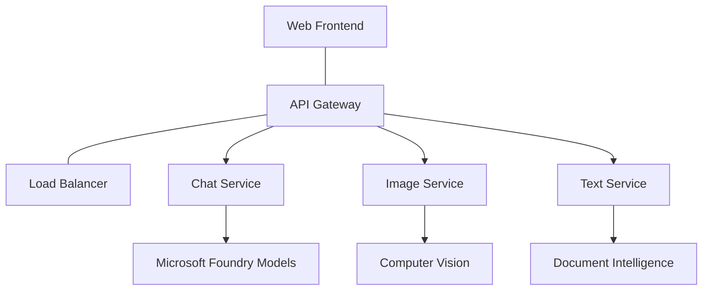

# Melhores Práticas para Carga de Trabalho de IA em Produção com AZD

**Navegação pelo Capítulo:**
- **📚 Início do Curso**: [AZD Para Iniciantes](../../README.md)
- **📖 Capítulo Atual**: Capítulo 8 - Padrões de Produção & Empresariais
- **⬅️ Capítulo Anterior**: [Capítulo 7: Solução de Problemas](../chapter-07-troubleshooting/debugging.md)
- **⬅️ Também Relacionado**: [Laboratório de Workshop de IA](../chapter-02-ai-development/ai-workshop-lab.md)
- **🎯 Curso Completo**: [AZD Para Iniciantes](../../README.md)

## Visão Geral

Este guia explica padrões de design de IA para produção usando Azure Developer CLI (AZD). É uma referência de design, não uma aplicação implantável nem uma certificação de produção.

**Limites do exemplo:** A menos que descrito explicitamente como completo, fragmentos Bicep assumem parâmetros e recursos referenciados de um template contêiner. Eles omitem imagens/planos host, identidades, atribuições de função, DNS, saídas e outras integrações necessárias. Caminhos de serviço YAML e scripts hook/teste são arquivos ilustrativos para criar em **sua própria aplicação**; não são fornecidos por este curso. Use uma amostra AZD funcional como base, compile a infraestrutura completa e teste-a em ambiente isolado antes da produção.

## Principais Desafios Abordados

Preocupações comuns em produção incluem implantações multi-serviço, gerenciamento de identidade e segredos, escalabilidade, controle de custos e monitoramento. Não se afirma prevalência mensurada aqui.

## Padrões de Arquitetura para IA em Produção

### Padrão 1: Arquitetura de IA com Microsserviços

**Quando usar**: Aplicações complexas de IA com múltiplas capacidades



**Implementação AZD**:

```yaml
# azure.yaml
name: enterprise-ai-platform
services:
  web:
    project: ./web
    host: staticwebapp
  api-gateway:
    project: ./api-gateway
    host: containerapp
  chat-service:
    project: ./services/chat
    host: containerapp
  vision-service:
    project: ./services/vision
    host: containerapp
  text-service:
    project: ./services/text
    host: containerapp
```

### Padrão 2: Processamento de IA Orientado a Eventos

**Quando usar**: Processamento em lote, análise de documentos, fluxos de trabalho assíncronos

```bicep
// Event Hub for AI processing pipeline
resource eventHub 'Microsoft.EventHub/namespaces@2024-01-01' = {
  name: eventHubNamespaceName
  location: location
  sku: {
    name: 'Standard'
    tier: 'Standard'
    capacity: 1
  }
}

// Service Bus for reliable message processing
resource serviceBus 'Microsoft.ServiceBus/namespaces@2024-01-01' = {
  name: serviceBusNamespaceName
  location: location
  sku: {
    name: 'Premium'
    tier: 'Premium'
    capacity: 1
  }
}

// Function App for processing
resource functionApp 'Microsoft.Web/sites@2023-01-01' = {
  name: functionAppName
  location: location
  kind: 'functionapp,linux'
  properties: {
    siteConfig: {
      appSettings: [
        {
          name: 'FUNCTIONS_EXTENSION_VERSION'
          value: '~4'
        }
        {
          name: 'AZURE_OPENAI_ENDPOINT'
          value: '@Microsoft.KeyVault(VaultName=${keyVault.name};SecretName=openai-endpoint)'
        }
      ]
    }
  }
}
```

Isto cria fragmentos de namespace, não hubs, filas, assinaturas ou gatilhos de Função. Uma Função executável também precisa de um plano de hospedagem, configuração de runtime/armazenamento, uma identidade anexada, RBAC e acesso de rede. A referência ao Key Vault precisa de permissão para ler o segredo; uma URL de endpoint por si só não é uma credencial.

## Pensando sobre a Saúde do Agente de IA

Quando um app web tradicional quebra, os sintomas são familiares: uma página não carrega, uma API retorna erro ou uma implantação falha. Aplicações com IA podem falhar dessas mesmas formas — mas também podem se comportar de maneira mais sutil sem mensagens de erro óbvias.

Esta seção ajuda a construir um modelo mental para monitorar cargas de trabalho de IA para que você saiba onde procurar quando algo não parecer certo.

### Como a Saúde do Agente Difere da Saúde da Aplicação Tradicional

Aplicações tradicionais também podem ter falhas sutis de correção. Um agente de IA adiciona qualidade de resposta não determinística às preocupações usuais de disponibilidade e correção. Pense na saúde do agente em duas camadas:

| Camada | O Que Observar | Onde Procurar |
|-------|---------------|--------------|
| **Saúde da infraestrutura** | O serviço está em execução? Os recursos estão provisionados? Os endpoints são acessíveis? | `azd monitor`, saúde do recurso no Portal Azure, logs de container/app |
| **Saúde do comportamento** | O agente responde com precisão? As respostas são pontuais? O modelo está sendo chamado corretamente? | Rastreamentos do Application Insights, métricas de latência de chamada ao modelo, logs de qualidade da resposta |

Saúde da infraestrutura é familiar — é igual para qualquer app azd. Saúde do comportamento é a nova camada que as cargas de trabalho de IA introduzem.

### Onde Procurar Quando Apps de IA Não se Comportam Como Esperado

Se sua aplicação de IA não está produzindo os resultados esperados, aqui está uma lista conceitual de verificação:

1. **Comece pelo básico.** A aplicação está em execução? Consegue acessar suas dependências? Verifique `azd monitor` e saúde dos recursos como faria em qualquer aplicação.
2. **Cheque a conexão com o modelo.** Sua aplicação está chamando o modelo de IA com sucesso? Chamadas ao modelo que falham ou expiram são as causas mais comuns dos problemas de aplicações de IA e aparecerão nos logs da aplicação.
3. **Analise entradas e base de conhecimento com segurança.** Respostas erradas podem resultar de recuperação, instruções, limitações do modelo ou execução de ferramentas. Use dados diagnósticos redigidos e com controle de acesso; não habilite logs indiscriminados de prompt/resposta em produção.
4. **Revise a latência das respostas.** Chamadas ao modelo de IA são mais lentas que chamadas típicas de API. Se o app parecer lento, verifique se os tempos de resposta do modelo aumentaram — isso pode indicar restrição, limites de capacidade ou congestionamento na região.
5. **Fique atento a sinais de custo.** Picos inesperados no uso de tokens ou chamadas de API podem indicar um loop, um prompt incorretamente configurado ou tentativas excessivas.

Você não precisa dominar as ferramentas de observabilidade imediatamente. A principal mensagem é que aplicações de IA têm uma camada extra de comportamento para monitorar, e o monitoramento embutido do azd (`azd monitor`) oferece um ponto de partida para investigar ambas as camadas.

---

## Melhores Práticas de Segurança

### 1. Modelo de Segurança Zero-Trust

**Estratégia de Implementação**:
- Nenhuma comunicação entre serviços sem autenticação
- Todas chamadas API usam identidades gerenciadas
- Isolamento de rede com endpoints privados
- Controles de acesso com privilégio mínimo

```bicep
// Managed Identity for each service
resource chatServiceIdentity 'Microsoft.ManagedIdentity/userAssignedIdentities@2023-01-31' = {
  name: 'chat-service-identity'
  location: location
}

// Role assignments with minimal permissions
resource openAIUserRole 'Microsoft.Authorization/roleAssignments@2022-04-01' = {
  scope: openAIAccount
  name: guid(openAIAccount.id, chatServiceIdentity.id, '5e0bd9bd-7b93-4f28-af87-19fc36ad61bd')
  properties: {
    roleDefinitionId: subscriptionResourceId('Microsoft.Authorization/roleDefinitions', '5e0bd9bd-7b93-4f28-af87-19fc36ad61bd')
    principalId: chatServiceIdentity.properties.principalId
    principalType: 'ServicePrincipal'
  }
}
```

### 2. Gerenciamento Seguro de Segredos

**Padrão de Integração Key Vault**:

```bicep
// Key Vault with proper access policies
resource keyVault 'Microsoft.KeyVault/vaults@2023-02-01' = {
  name: keyVaultName
  location: location
  properties: {
    tenantId: tenant().tenantId
    sku: {
      family: 'A'
      name: 'standard' // Premium is needed for HSM-backed keys, not ordinary secrets
    }
    enableRbacAuthorization: true  // Use RBAC instead of access policies
    enablePurgeProtection: true    // Prevent accidental deletion
    enableSoftDelete: true
    softDeleteRetentionInDays: 90
  }
}

// Optional legacy key-auth alternative; omit when using Entra ID.
resource openAIKeySecret 'Microsoft.KeyVault/vaults/secrets@2023-02-01' = {
  parent: keyVault
  name: 'openai-api-key'
  properties: {
    value: openAIAccount.listKeys().key1
    attributes: {
      enabled: true
    }
  }
}
```

Atribua a identidade de tempo de execução `Key Vault Secrets User` no escopo apropriado e anexe-a ao host; `enableRbacAuthorization` isoladamente não concede acesso. Prefira autenticação por identidade gerenciada OpenAI com `disableLocalAuth: true`. O segredo de chave opcional só faz sentido para uma conta habilitada deliberadamente para chave, e o principal de provisionamento também precisa de permissão para escrever segredos.

### 3. Segurança de Rede

**Configuração de Endpoint Privado**:

```bicep
// Virtual Network for AI services
resource virtualNetwork 'Microsoft.Network/virtualNetworks@2023-04-01' = {
  name: vnetName
  location: location
  properties: {
    addressSpace: {
      addressPrefixes: ['10.0.0.0/16']
    }
    subnets: [
      {
        name: 'ai-services-subnet'
        properties: {
          addressPrefix: '10.0.1.0/24'
          privateEndpointNetworkPolicies: 'Disabled'
        }
      }
      {
        name: 'app-services-subnet'
        properties: {
          addressPrefix: '10.0.2.0/24'
          delegations: [
            {
              name: 'Microsoft.Web/serverFarms'
              properties: {
                serviceName: 'Microsoft.Web/serverFarms'
              }
            }
          ]
        }
      }
    ]
  }
}

// Private endpoints for all AI services
resource openAIPrivateEndpoint 'Microsoft.Network/privateEndpoints@2023-04-01' = {
  name: '${openAIAccountName}-pe'
  location: location
  properties: {
    subnet: {
      id: virtualNetwork.properties.subnets[0].id
    }
    privateLinkServiceConnections: [
      {
        name: 'openai-connection'
        properties: {
          privateLinkServiceId: openAIAccount.id
          groupIds: ['account']
        }
      }
    ]
  }
}
```

Endpoints privados também requerem grupos de zona DNS privada/links VNet e integração VNet de aplicação. Eles não bloqueiam automaticamente o acesso público: desabilite explicitamente o acesso de rede pública da conta AI após validar conectividade privada e acesso à implantação.

## Desempenho e Escalabilidade

### 1. Estratégias de Autoescalabilidade

**Autoescalabilidade em Container Apps**:

```bicep
resource containerApp 'Microsoft.App/containerApps@2023-05-01' = {
  name: containerAppName
  location: location
  properties: {
    configuration: {
      ingress: {
        external: true
        targetPort: 8000
        transport: 'http'
      }
    }
    template: {
      scale: {
        minReplicas: 2  // Always have 2 instances minimum
        maxReplicas: 50 // Scale up to 50 for high load
        rules: [
          {
            name: 'http-scaling'
            http: {
              metadata: {
                concurrentRequests: '20'  // Scale when >20 concurrent requests
              }
            }
          }
          {
            name: 'cpu-scaling'
            custom: {
              type: 'cpu'
              metadata: {
                type: 'Utilization'
                value: '70'  // Scale when CPU >70%
              }
            }
          }
        ]
      }
    }
  }
}
```

### 2. Estratégias de Cache

**Cache Redis para Respostas de IA**:

```bicep
// Legacy Azure Cache for Redis example (not recommended for new deployments)
resource redisCache 'Microsoft.Cache/redis@2023-04-01' = {
  name: redisCacheName
  location: location
  properties: {
    sku: {
      name: 'Premium'
      family: 'P'
      capacity: 1
    }
    enableNonSslPort: false
    minimumTlsVersion: '1.2'
    redisConfiguration: {
      'maxmemory-policy': 'allkeys-lru'
    }
    // Sharding distributes data; replication/failover provides availability.
    shardCount: 2
  }
}

// Cache configuration in application
var cacheConnectionString = '${redisCache.properties.hostName}:6380,password=${redisCache.listKeys().primaryKey},ssl=True,abortConnect=False'
```

Azure Cache para Redis Basic/Standard/Premium está em [caminho para aposentadoria](https://learn.microsoft.com/azure/azure-cache-for-redis/retirement-faq). Use Azure Managed Redis para novos designs e sua configuração documentada de SKU, identidade e TLS, em vez de copiar este recurso legado para um novo sistema de produção. A linha de connection-string é um espaço reservado não funcional, não uma credencial. Particione chaves de cache por autorização, modelo/instruções e versão da recuperação, com expiração; um cache compartilhado somente para consultas pode expor dados de outro usuário.

### 3. Balanceamento de Carga e Gerenciamento de Tráfego

**Application Gateway com WAF**:

```bicep
// Application Gateway with Web Application Firewall
resource applicationGateway 'Microsoft.Network/applicationGateways@2023-04-01' = {
  name: appGatewayName
  location: location
  properties: {
    sku: {
      name: 'WAF_v2'
      tier: 'WAF_v2'
      capacity: 2
    }
    webApplicationFirewallConfiguration: {
      enabled: true
      firewallMode: 'Prevention'
      ruleSetType: 'OWASP'
      ruleSetVersion: '3.2'
    }
    // Backend pools for AI services
    backendAddressPools: [
      {
        name: 'ai-services-pool'
        properties: {
          backendAddresses: [
            {
              fqdn: '${containerApp.properties.configuration.ingress.fqdn}'
            }
          ]
        }
      }
    ]
  }
}
```

Este é um recurso de gateway parcial: uma implantação real também precisa de sub-rede/IP do gateway, IPs front-end e portas, listeners/certificados TLS, configurações/probes HTTP back-end, regras/prioridades de roteamento e uma política WAF revisada. Hostname/SNI TLS e autenticação devem corresponder ao back-end do Container App.

## 💰 Otimização de Custos

### 1. Dimensionamento Correto de Recursos

**Configurações Específicas do Ambiente**:

Estes nomes são **entradas de template customizadas ilustrativas**, não configurações automáticas AZD. Mapeie cada um para `infra/main.parameters.json`/Bicep e configuração do host primeiro. Por exemplo, o exemplo RAG usa `AZURE_SEARCH_SERVICE_SKU` e `AZURE_OPENAI_CHATGPT_DEPLOYMENT_CAPACITY`, não os nomes genéricos abaixo. Dê memória para Container Apps em uma unidade suportada como `1Gi` no recurso real. Aplique mudanças de infraestrutura com `azd up` ou `azd provision`; `azd deploy` isoladamente não aplica mudanças Bicep.

```bash
# Development environment
azd env new development
azd env set AZURE_OPENAI_SKU "S0"
azd env set AZURE_OPENAI_CAPACITY 10
azd env set AZURE_SEARCH_SKU "basic"
azd env set CONTAINER_CPU 0.5
azd env set CONTAINER_MEMORY 1.0

# Production environment  
azd env new production
azd env set AZURE_OPENAI_SKU "S0"
azd env set AZURE_OPENAI_CAPACITY 100
azd env set AZURE_SEARCH_SKU "standard"
azd env set CONTAINER_CPU 2.0
azd env set CONTAINER_MEMORY 4.0
```

### 2. Monitoramento de Custos e Orçamentos

```bicep
// Supply the first day of the current UTC month, e.g. 2026-11-01T00:00:00Z.
param budgetStartDate string

// Cost management and budgets
resource budget 'Microsoft.Consumption/budgets@2024-08-01' = {
  name: 'ai-workload-budget'
  properties: {
    timePeriod: {
      startDate: budgetStartDate
    }
    timeGrain: 'Monthly'
    amount: 2000  // In the billing currency, not necessarily USD
    category: 'Cost'
    notifications: {
      warning: {
        enabled: true
        operator: 'GreaterThan'
        threshold: 80
        contactEmails: [
          'finance@company.com'
          'engineering@company.com'
        ]
        contactRoles: [
          'Owner'
          'Contributor'
        ]
      }
      critical: {
        enabled: true
        operator: 'GreaterThan'
        threshold: 95
        contactEmails: [
          'cto@company.com'
        ]
      }
    }
  }
}
```

Substitua os destinatários de exemplo e verifique escopo/permissões. Alertas de orçamento usam dados de faturamento com atraso e não impõem um limite de gastos.

### 3. Otimização do Uso de Tokens

**Gerenciamento de Custos OpenAI**:

Isto é apenas uma heurística baseada em caracteres para uma pré-visualização de UI, **não** um validador de limite de tokens do modelo. Código de produção deve usar um tokenizer apropriado ao modelo implantado e considerar instruções do sistema, esquemas de ferramentas, histórico e orçamento de saída. Rejeite uma mensagem de usuário excessivamente grande em vez de truncá-la silenciosamente.

```typescript
// Application-level token optimization
class TokenOptimizer {
  private readonly maxTokens = 4000;
  private readonly reserveTokens = 500;
  
  optimizePrompt(userInput: string, context: string): string {
    const availableTokens = this.maxTokens - this.reserveTokens;
    if (this.estimateTokens(userInput) + 8 >= availableTokens) {
      throw new Error("User input exceeds the illustrative prompt budget");
    }
    const estimatedTokens = this.estimateTokens(userInput + context) + 8;
    
    if (estimatedTokens > availableTokens) {
      // Truncate context, not user input
      context = this.truncateContext(context, Math.max(0, availableTokens - this.estimateTokens(userInput) - 8));
    }
    
    return `${context}\n\nUser: ${userInput}`;
  }
  
  private estimateTokens(text: string): number {
    // Rough estimation: 1 token ≈ 4 characters
    return Math.ceil(text.length / 4);
  }

  private truncateContext(text: string, estimatedBudget: number): string {
    return text.slice(0, Math.max(0, estimatedBudget) * 4);
  }
}
```

## Monitoramento e Observabilidade

### 1. Application Insights Abrangente

```bicep
// Application Insights with advanced features
resource applicationInsights 'Microsoft.Insights/components@2020-02-02' = {
  name: applicationInsightsName
  location: location
  kind: 'web'
  properties: {
    Application_Type: 'web'
    WorkspaceResourceId: logAnalyticsWorkspace.id
    SamplingPercentage: 100  // Ingestion setting; review cost and SDK sampling separately
    DisableIpMasking: false  // Retain IP masking
  }
}

// Custom metrics for AI operations
resource aiMetricAlerts 'Microsoft.Insights/metricAlerts@2018-03-01' = {
  name: 'ai-high-error-rate'
  location: 'global'
  properties: {
    description: 'Alert when failed request count exceeds 10 in five minutes'
    severity: 2
    enabled: true
    scopes: [
      applicationInsights.id
    ]
    evaluationFrequency: 'PT1M'
    windowSize: 'PT5M'
    criteria: {
      'odata.type': 'Microsoft.Azure.Monitor.SingleResourceMultipleMetricCriteria'
      allOf: [
        {
          name: 'high-error-rate'
          metricName: 'requests/failed'
          operator: 'GreaterThan'
          threshold: 10
          timeAggregation: 'Count'
        }
      ]
    }
  }
}
```

### 2. Monitoramento Específico para IA

**Dashboards Personalizados para Métricas de IA**:

```json
{
  "dashboard": {
    "name": "AI Application Monitoring",
    "tiles": [
      {
        "name": "OpenAI Request Volume",
        "query": "dependencies | where target contains 'openai' | summarize count() by bin(timestamp, 5m)"
      },
      {
        "name": "AI Response Latency",
        "query": "dependencies | where target contains 'openai' | summarize avg(duration) by bin(timestamp, 5m)"
      },
      {
        "name": "Token Usage",
        "query": "customMetrics | where name == 'openai_tokens_used' | summarize sum(value) by bin(timestamp, 1h)"
      },
      {
        "name": "Cost per Hour",
        "query": "customMetrics | where name == 'openai_cost' | summarize sum(value) by bin(timestamp, 1h)"
      }
    ]
  }
}
```

Este JSON é um esboço definido pela aplicação, não um esquema importável de dashboard do portal Azure. As consultas de token/custo requerem que sua aplicação emita essas métricas personalizadas exatas; não são criadas pelo AZD. Adapte filtros de dependência para os nomes reais de endpoint/span do seu modelo.

### 3. Verificações de Saúde e Monitoramento de Uptime

```bicep
// Application Insights availability tests
resource availabilityTest 'Microsoft.Insights/webtests@2022-06-15' = {
  name: 'ai-app-availability-test'
  location: location
  tags: {
    'hidden-link:${applicationInsights.id}': 'Resource'
  }
  properties: {
    SyntheticMonitorId: 'ai-app-availability-test'
    Name: 'AI Application Availability Test'
    Description: 'Tests AI application endpoints'
    Enabled: true
    Frequency: 300  // 5 minutes
    Timeout: 120    // 2 minutes
    Kind: 'standard'
    Locations: [
      {
        Id: 'us-east-2-azr'
      }
      {
        Id: 'us-west-2-azr'
      }
    ]
    Request: {
      RequestUrl: 'https://${webApp.properties.defaultHostName}/health'
      HttpVerb: 'GET'
      FollowRedirects: true
      ParseDependentRequests: false
    }
    ValidationRules: {
      ExpectedHttpStatusCode: 200
      SSLCheck: true
      SSLCertRemainingLifetimeCheck: 7
    }
  }
}
```

## Recuperação de Desastres e Alta Disponibilidade

O teste precedente assume um App Service `webApp` existente e recurso de Application Insights. Testes padrão de disponibilidade são cobrados e requerem um endpoint acessível; apps somente privados precisam de design de monitoramento privado apropriado. Testes de ping URL estão depreciados; use [testes padrão de disponibilidade](https://learn.microsoft.com/azure/azure-monitor/app/availability).

### 1. Implantação Multi-Região

```yaml
# azure.yaml - Multi-region configuration
name: ai-app-multiregion
services:
  api-primary:
    project: ./api
    host: containerapp
    env:
      AZURE_REGION: eastus
  api-secondary:
    project: ./api
    host: containerapp
    env:
      AZURE_REGION: westus2
```

```bicep
// Separate App Service topology, not the Container Apps declarations above
resource trafficManager 'Microsoft.Network/trafficManagerProfiles@2022-04-01' = {
  name: trafficManagerProfileName
  location: 'global'
  properties: {
    profileStatus: 'Enabled'
    trafficRoutingMethod: 'Priority'
    dnsConfig: {
      relativeName: trafficManagerProfileName
      ttl: 30
    }
    monitorConfig: {
      protocol: 'HTTPS'
      port: 443
      path: '/health'
      intervalInSeconds: 30
      toleratedNumberOfFailures: 3
      timeoutInSeconds: 10
    }
    endpoints: [
      {
        name: 'primary-endpoint'
        type: 'Microsoft.Network/trafficManagerProfiles/azureEndpoints'
        properties: {
          targetResourceId: primaryAppService.id
          endpointStatus: 'Enabled'
          priority: 1
        }
      }
      {
        name: 'secondary-endpoint'
        type: 'Microsoft.Network/trafficManagerProfiles/azureEndpoints'
        properties: {
          targetResourceId: secondaryAppService.id
          endpointStatus: 'Enabled'
          priority: 2
        }
      }
    ]
  }
}
```

Variáveis de ambiente não escolhem localizações de recursos. IaC deve provisionar hosts regionais distintos e vincular cada serviço com tags `resourceName` ou `azd-service-name`. O exemplo do Traffic Manager é uma **topologia App Service separada** (`primaryAppService`/`secondaryAppService`), não roteamento para as declarações Container Apps. Container Apps requer endpoint/frente externo configurado adequadamente, TLS/roteamento de domínio personalizado e probes de saúde.

### 2. Backup e Recuperação de Dados

```bicep
// Backup configuration for critical data
resource backupVault 'Microsoft.DataProtection/backupVaults@2023-05-01' = {
  name: backupVaultName
  location: location
  identity: {
    type: 'SystemAssigned'
  }
  properties: {
    storageSettings: [
      {
        datastoreType: 'VaultStore'
        type: 'LocallyRedundant'
      }
    ]
  }
}

```

O cofre sozinho não faz backup de nada. Configure uma **política e instância de backup compatível específica para a carga de trabalho**, permissões de origem, retenção e testes de restauração usando [matrizes de suporte do Azure Backup](https://learn.microsoft.com/azure/backup/backup-support-matrix). Não há política genérica Azure Backup para implantações de modelos hospedados Azure OpenAI. Mantenha definições de infraestrutura/implantação de modelo no controle de versão; proteja documentos carregados, dados da aplicação e artefatos de fine-tuning usando recursos de backup/exportação suportados por cada serviço de suporte. Defina e teste explicitamente RPO/RTO.

## Integração DevOps e CI/CD

### 1. Workflow GitHub Actions

```yaml
# .github/workflows/deploy-ai-app.yml
name: Deploy AI Application

on:
  push:
    branches: [main]
  pull_request:
    branches: [main]

jobs:
  test:
    runs-on: ubuntu-latest
    steps:
      - uses: actions/checkout@v4
      
      - name: Setup Python
        uses: actions/setup-python@v4
        with:
          python-version: '3.11'
          
      - name: Install dependencies
        run: |
          pip install -r requirements.txt
          pip install pytest
          
      - name: Run tests
        run: pytest tests/
        
      - name: AI Safety Tests
        run: |
          python scripts/test_ai_safety.py
          python scripts/validate_prompts.py

```

Esta é a **parte somente de teste** de um workflow e assume que você criou `requirements.txt`, `tests/`, e os dois scripts de segurança. Adicione os jobs autenticados de provisionamento/implantação OIDC de [Configuração de Pipeline CI/CD](#cicd-pipeline-configuration), com `needs: test`, um push/manual trigger confiável e ambientes protegidos GitHub. Não implante código de pull-request não confiável com credenciais de nuvem. Um runner novo não tem ambiente AZD local selecionado; forneça os inputs de ambiente/assinatura/localização e use `azd auth login`, não apenas `azure/login`.

### 2. Validação de Infraestrutura

```bash
# scripts/validate_infrastructure.sh
#!/bin/bash
set -euo pipefail

echo "Validating AI infrastructure deployment..."

# Requires Azure CLI login and the resource group selected explicitly.
: "${AZURE_RESOURCE_GROUP:?Set AZURE_RESOURCE_GROUP}"
: "${AZURE_OPENAI_NAME:?Set AZURE_OPENAI_NAME}"
: "${AZURE_OPENAI_CHAT_DEPLOYMENT:?Set the actual deployment name}"

# A successful empty list is not proof that resources exist.
types=("Microsoft.CognitiveServices/accounts" "Microsoft.Search/searchServices"
       "Microsoft.Storage/storageAccounts" "Microsoft.KeyVault/vaults")
for resource_type in "${types[@]}"; do
    count=$(az resource list --resource-group "$AZURE_RESOURCE_GROUP" \
        --resource-type "$resource_type" --query "length(@)" -o tsv)
    if [[ "$count" -lt 1 ]]; then
        echo "ERROR: No $resource_type found in $AZURE_RESOURCE_GROUP"
        exit 1
    fi
done

# Validate OpenAI model deployments
echo "Validating OpenAI model deployments..."
state=$(az cognitiveservices account deployment show \
  --name "$AZURE_OPENAI_NAME" --resource-group "$AZURE_RESOURCE_GROUP" \
  --deployment-name "$AZURE_OPENAI_CHAT_DEPLOYMENT" \
  --query "properties.provisioningState" -o tsv)
if [[ "$state" != "Succeeded" ]]; then
    echo "ERROR: Required model deployment is not provisioned successfully"
    exit 1
fi

echo "Infrastructure validation completed successfully!"
```

Esperado: saída zero e mensagem de conclusão somente quando todos os tipos esperados existirem e a implantação do modelo nomeado estiver provisionada. Isto checa inventário/estado de provisionamento, **não** saúde do recurso, topologia exata, RBAC, alcance de rede ou comportamento do modelo. Adapte os tipos esperados para sua arquitetura, então realize um teste separado autenticado de prontidão da aplicação.

## Lista de Verificação de Prontidão para Produção

### Segurança ✅
- [ ] Todos os serviços usam identidades gerenciadas
- [ ] Segredos armazenados no Key Vault
- [ ] Endpoints privados configurados
- [ ] Grupos de segurança de rede implementados
- [ ] RBAC com privilégio mínimo
- [ ] WAF habilitado nos endpoints públicos

### Desempenho ✅
- [ ] Autoescalabilidade configurada
- [ ] Cache implementado
- [ ] Balanceamento de carga configurado
- [ ] CDN para conteúdo estático
- [ ] Pooling de conexão com banco de dados
- [ ] Otimização do uso de tokens

### Monitoramento ✅
- [ ] Application Insights configurado
- [ ] Métricas personalizadas definidas
- [ ] Regras de alerta configuradas
- [ ] Dashboard criado
- [ ] Verificações de saúde implementadas
- [ ] Políticas de retenção de logs

### Confiabilidade ✅
- [ ] Implantação multi-região
- [ ] Plano de backup e recuperação
- [ ] Circuit breakers implementados
- [ ] Políticas de retry configuradas
- [ ] Degradação graciosa
- [ ] Endpoints de verificação de saúde

### Gestão de Custos ✅
- [ ] Alertas de orçamento configurados
- [ ] Dimensionamento correto dos recursos
- [ ] Descontos dev/test aplicados
- [ ] Instâncias reservadas compradas
- [ ] Dashboard de monitoramento de custos
- [ ] Revisões regulares de custos

### Conformidade ✅
- [ ] Requisitos de residência de dados atendidos
- [ ] Logging de auditoria habilitado
- [ ] Políticas de conformidade aplicadas
- [ ] Linhas de base de segurança implementadas
- [ ] Avaliações regulares de segurança
- [ ] Plano de resposta a incidentes

## Benchmark de Desempenho

### Metas Ilustrativas de Produção

Estes são exemplos de SLOs para negociar e testar carga, não benchmarks medidos ou garantias. Latência de resposta depende do modelo/tamanho da saída; gastos mensais com tokens dependem de tráfego e preços, não apenas da contagem de tokens.

| Métrica | Meta | Monitoramento |
|--------|--------|-------------|
| **Tempo de Resposta** | < 2 segundos | Application Insights |
| **Disponibilidade** | 99,9% | Monitoramento de uptime |
| **Taxa de Erro** | < 0,1% | Logs de aplicação |
| **Gastos com Modelo** | < $500/mês (exemplo de orçamento) | Gestão de custos |
| **Usuários Concorrentes** | 1000+ | Teste de carga |
| **Tempo de Recuperação** | < 1 hora | Testes de recuperação de desastre |

### Teste de Carga

A seguir, está um esboço da interface para um script de teste de carga **que você deve implementar**; este repositório não fornece `scripts/load_test.py`. Defina cargas úteis de solicitação, autenticação, cargas de trabalho representativas, asserções de latência/erro percentil e um limite de gastos na ferramenta de teste de carga escolhida antes de executá-la:

```bash
# Load testing script for AI applications
python scripts/load_test.py \
  --endpoint https://your-ai-app.azurewebsites.net \
  --concurrent-users 100 \
  --duration 300 \
  --ramp-up 60
```

## 🤝 Melhores Práticas da Comunidade

Baseado no feedback da comunidade Microsoft Foundry Discord:

### Principais Recomendações da Comunidade:

1. **Comece Pequeno, Escale Gradualmente**: Inicie com SKUs básicos e escale com base no uso real
2. **Monitore Tudo**: Configure monitoramento abrangente desde o primeiro dia
3. **Automatize a Segurança**: Use infraestrutura como código para segurança consistente
4. **Teste Minuciosamente**: Inclua testes específicos de IA em seu pipeline
5. **Planeje os Custos**: Monitore o uso de tokens e configure alertas de orçamento cedo

### Armadilhas Comuns a Evitar:

- ❌ Codificar chaves API no código
- ❌ Não configurar monitoramento adequado
- ❌ Ignorar otimização de custos
- ❌ Não testar cenários de falha
- ❌ Implantar sem verificações de integridade

## Comandos e Extensões AZD AI CLI

O AZD inclui um conjunto crescente de comandos e extensões específicas para IA que simplificam fluxos de trabalho de IA em produção. Essas ferramentas fazem a ponte entre o desenvolvimento local e a implantação em produção para cargas de trabalho de IA.

> **Atualização Foundry GA (09-11-2026):** O pacote `microsoft.foundry` atingiu **1.0 / disponibilidade geral** em [5 de novembro de 2026](https://devblogs.microsoft.com/azure-sdk/microsoft-foundry-azure-developer-cli-ga/). Use **`azd >= 1.37.0`** para este fluxo de trabalho. A revisão anterior de `azd 1.37.2`, agents beta.23, e evaluations beta.2 está mantida abaixo como histórico de migração, não como a versão atual do pacote. Esta é uma revisão da documentação/fonte, não uma validação de implantação ao vivo ou uma garantia de que toda extensão opcional, API ou recurso preview seja GA.

### Extensões AZD para IA

O AZD usa um sistema de extensões para adicionar capacidades específicas para IA. Instale e gerencie extensões com:

```bash
# List all available extensions (including AI)
azd extension list

# Inspect installed versions
azd version
azd ext list --installed

# Install the GA Foundry bundle
azd ext install microsoft.foundry

# Install the separate Foundry evaluations extension
azd extension install azure.ai.evaluations

# Install the fine-tuning extension
azd extension install azure.ai.finetune

# Install the custom models extension
azd extension install azure.ai.models

# Upgrade the Foundry bundle
azd ext upgrade microsoft.foundry
```

**Extensões de IA disponíveis:**

| Extensão | Propósito | Status |
|-----------|---------|--------|
| `microsoft.foundry` | Meta-pacote que instala as sete extensões principais abaixo; não tem grupo de comandos próprio | Pacote GA 1.0 |
| `azure.ai.agents` | `azd ai agent`: configuração de agentes, execução local e operações | Incluído; versionado independentemente |
| `azure.ai.connections` | `azd ai connection`: conexões de projeto | Incluído; versionado independentemente |
| `azure.ai.inspector` | `azd ai inspector`: UI local do Inspetor de Agentes | Incluído; versionado independentemente |
| `azure.ai.projects` | `azd ai project`: recursos do projeto e implantações de modelos | Incluído; versionado independentemente |
| `azure.ai.routines` | `azd ai routine`: agendamentos e gatilhos | Incluído; versionado independentemente |
| `azure.ai.skills` | `azd ai skill`: diretrizes comportamentais reutilizáveis | Incluído; versionado independentemente |
| `azure.ai.toolboxes` | `azd ai toolbox`: coleções de ferramentas versionadas | Incluído; versionado independentemente |
| `azure.ai.evaluations` | Conjuntos de dados de avaliação, avaliadores, grupos de avaliação e execuções | Instalação/liberação separada |
| `azure.ai.dataset` | Registro e versionamento de conjuntos de dados | Instalação/liberação separada |
| `azure.ai.finetune` | Ajuste fino de modelos Foundry | Instalação/liberação separada |
| `azure.ai.models` | Modelos personalizados Foundry | Instalação/liberação separada |

Ainda é suportada a instalação individual do `azure.ai.agents` que instala suas dependências; o pacote é o padrão do curso para o fluxo de trabalho GA. O pacote GA não garante status de lançamento para os recursos opcionais dos componentes. Veja [empacotamento e verificação de extensões](https://learn.microsoft.com/azure/foundry/agents/how-to/install-cli-foundry-extensions) e inspecione a ajuda dos comandos instalados antes de usá-los.

> Atualize primeiro o CLI principal com `azd update` ou o método apropriado de [instalação/atualização](https://learn.microsoft.com/azure/developer/azure-developer-cli/install-azd), depois execute `azd ext upgrade microsoft.foundry`. Atualize avaliações instaladas separadamente conforme necessário com `azd ext upgrade azure.ai.evaluations`. Não existe comando principal `azd upgrade`. Registre e revise extensões versionadas independentemente em automação de produção; uma atualização não migra automaticamente configurações antigas.

### Mudanças e Correções Recentes em Lançamentos

| Lançamento | O que muda para este curso |
|---------|------------------------------|
| `microsoft.foundry` 1.0 GA (05-11-2026) | Padrão para o pacote das sete extensões, mantém configurações do agente/implantação em `azure.yaml`, testa localmente com o Inspetor de Agentes e carrega o código para uma build remota Foundry. Instale avaliações separadamente e instale novamente extensões necessárias em runners CI. |
| `azd 1.37.0` | Adiciona APIs estáveis de visualização de implantação e corrige edições de extensão que regravavam configurações `azure.yaml` não relacionadas. |
| `azd 1.37.1` | Corrige propagação do Ctrl+C entre extensões e distingue cancelamento/timeouts de falhas genéricas. |
| `azd 1.37.2` | Melhora validação de provisionamento: avisos críticos padrão para **Não**, falha sem confirmação em execuções não assistidas, e cancelamento pula ganchos pós-provisionamento. Também corrige valores de ambiente não resolvidos em listas de negação de Deployment Stacks quando esse recurso alpha está habilitado. |
| Agents `beta.22` | Migra avaliação para `azd ai eval`, muda otimização para API GA v1, exige plural `toolboxes`, e separa opt-ins de managed-harness, voz e execução prolongada. Corrige seleção de modelo por ambiente e autenticação da toolbox. |
| Agents `beta.23` | Expõe `init --harness`; corrige saída de resposta A2A 0.3, caminhos/módulos inválidos de prompt-agent através de camadas de infraestrutura, diagnóstico de timeout de ativação e avisos retidos de RBAC do desenvolvedor. |
| Evaluations `beta.2` | Exige configuração camelCase para avaliação, adiciona autoria estática/simulada de conversação e fontes explícitas em arquivo local, e corrige manejo de identidade/versionamento de conjunto de dados, contagens de quality-gate e diagnóstico de execuções com falha. |

Timeout de ativação de agente **não** comprova falha na implantação: inspecione a versão tentada e seu estado antes de tentar novamente. Avisos de RBAC de desenvolvedor podem permanecer mesmo quando provisionamento é bem-sucedido; resolva o acesso ausente antes de invocar como esse desenvolvedor.

As linhas beta acima descrevem correções anteriores e limites de migração, não uma exigência para fixar novos projetos nessas versões.

Fontes: [Anúncio Foundry GA](https://devblogs.microsoft.com/azure-sdk/microsoft-foundry-azure-developer-cli-ga/), [Lançamentos AZD](https://github.com/Azure/azure-dev/releases), [Lançamento agents beta.23](https://github.com/Azure/azure-dev/releases/tag/azd-ext-azure-ai-agents_1.0.0-beta.23), [Migração agents beta.22](https://github.com/Azure/azure-dev/releases/tag/azd-ext-azure-ai-agents_1.0.0-beta.22), e [Lançamento evaluations beta.2](https://github.com/Azure/azure-dev/releases/tag/azd-ext-azure-ai-evaluations_1.0.0-beta.2).

**Quais são as extensões `skills` e `connections` do pacote?**

Estas são instaladas com o pacote principal, mas servem a propósitos diferentes:

- **`azure.ai.skills`** — Uma **skill** empacota diretrizes comportamentais reutilizáveis para agentes. Compartilhe instruções revisadas entre agentes ao invés de copiá-las. Uma skill não implementa uma ferramenta nem concede acesso a dados; use toolboxes e código de aplicação para execução de ferramentas.
- **`azure.ai.connections`** — Uma **connection** é um link gerenciado do seu projeto Foundry para um recurso externo necessário aos seus agentes—uma fonte de dados (como Azure AI Search), um endpoint de ferramenta ou outro serviço. Connections centralizam *onde* e *como* agentes acessam dados, para que credenciais e endpoints fiquem em um lugar governado ao invés de dispersos no código.

Você não precisa configurar todas as capacidades do pacote para implantar seu primeiro agente. Use skills quando agentes compartilharem diretrizes comportamentais e connections quando compartilharem recursos externos.

### Inicializando Projetos de Agente com `azd ai agent init`

O comando `azd ai agent init` estrutura um projeto de agente Microsoft Foundry. Para um exemplo executável de implantação de código com Python 3.13+ e uv atual, siga o [tutorial do agente hospedado GA](../chapter-02-ai-development/microsoft-foundry-integration.md#hosted-agent-walkthrough-ga). Os comandos abaixo ilustram a adoção de **seu próprio** template de projeto `azure.yaml` atual; o template local nomeado não é fornecido por este curso:

```bash
# Initialize a new agent project from a local project template
azd ai agent init --template ./templates/support-agent/azure.yaml

# Initialize and target a specific Foundry project
azd ai agent init --template ./templates/support-agent/azure.yaml --project-id <foundry-project-id>

# Adopt the template into a different directory
azd ai agent init --template ./templates/support-agent/azure.yaml --src ./agents/my-agent
```

**Flags-chave:**

| Flag | Descrição |
|------|-------------|
| `-t, --template` | Caminho ou URI GitHub suportado para um documento de projeto `azure.yaml` |
| `-p, --project-id` | ID de Projeto Microsoft Foundry existente para seu ambiente azd |
| `-s, --src` | Diretório fonte para agentes gerados, ou diretório alvo ao adotar um projeto |
| `--deploy-mode code` | Faça upload da fonte para uma build remota Foundry em vez de construir um container local |
| `--model-deployment` | Reutilize uma implantação de modelo existente nomeada durante a inicialização |
| `--kind` | Inicialize um agente `hosted`, `prompt`, ou preview `prompt-voice` |
| `--harness` | Armação de execução opcional para `--kind prompt`; requer seu opt-in preview |
| `-e, --environment` | O ambiente azd a ser usado |

`--manifest`/`-m` é um alias obsoleto para `--template`/`-t`; renomear a flag não converte um manifesto antigo em um documento de projeto atual. `--host containerapp` não é uma flag atual de agent-init. Para um aplicativo normal Container Apps, use `azd init --template` com um template declarando `host: containerapp`.

Para um projeto existente com exatamente um serviço `azure.ai.project`, `azd ai agent add support-agent --file ./agents/support-agent.yaml` adiciona ou atualiza uma definição direta de agente sem provisionamento ou implantação. Comandos runtime rejeitam definições legadas implícitas `agent.yaml`/AgentManifest e definições aninhadas de serviço `config:`; migre-as para um serviço `azure.ai.agent` atual. Quando init imprimir um próximo passo `cd`, execute-o antes do `azd up`: init não altera seu diretório shell.

**Dica de produção**: Use `--project-id` para conectar diretamente a um projeto Foundry existente, mantendo seu código de agente e recursos em nuvem vinculados desde o início.

#### Recursos Preview Opcionais

Managed harness, voz e invocação de longa duração são desativados por padrão de forma independente. Defina apenas o switch para a funcionalidade que precisa no **ambiente do processo shell/CI**, não com `azd env set`:

| Recurso | Variável de ambiente do processo |
|---------|------------------------------|
| Managed harness (`init --kind prompt --harness ...`) | `AZD_ALPHA_ENABLE_AGENTS_MANAGED_HARNESS=true` |
| Voz (`init --kind prompt-voice`) | `AZD_ALPHA_ENABLE_AGENTS_VOICE=true` |
| Invocação de longa duração | `AZD_ALPHA_ENABLE_AGENTS_LONG_RUNNING=true` |

Por exemplo, use `export AZD_ALPHA_ENABLE_AGENTS_MANAGED_HARNESS=true` no Bash ou `$env:AZD_ALPHA_ENABLE_AGENTS_MANAGED_HARNESS = "true"` no PowerShell antes de executar o comando relevante. Um switch não habilita os outros. Veja o [README dos agentes lançados](https://github.com/Azure/azure-dev/blob/azd-ext-azure-ai-agents_1.0.0-beta.23/cli/azd/extensions/azure.ai.agents/README.md) para todos os switches preview e limitações.

### Gerenciando o Ciclo de Vida do Agente

A extensão `azure.ai.agents` do pacote suporta testes locais e operações de agente implantado. Instale `azure.ai.evaluations` separadamente para medir qualidade:

```bash
# Start the local agent and Agent Inspector (leave running)
azd ai agent run

# From a second terminal in the project directory
azd ai agent invoke --local "Explain how this agent is deployed."

# Invoke a deployed agent and view server response timing
# (total latency and time to first byte)
azd ai agent invoke

# Show the live endpoint configuration before changing it
azd ai agent endpoint show

# Download the deployed source of a code-based hosted agent
# (with SHA-256 verification)
azd ai agent code download

# Delete a hosted agent and all of its versions
# (--force terminates active sessions)
azd ai agent delete --force
```

**Ciclo de vida resumido:**

| Etapa | Comando | Uso em produção |
|-------|---------|----------------|
| Teste local | `azd ai agent run`, depois `azd ai agent invoke --local "Test prompt"` | Inspecione requisições e respostas antes da implantação; chamadas a modelos Azure ainda geram custos |
| Implantar | `azd deploy` | No modo código, construa a fonte carregada remotamente no Foundry |
| Testar | `azd ai agent invoke` | Valide respostas e meça latência antes do lançamento |
| Diagnosticar | `azd ai agent doctor`, `azd ai agent monitor --follow` | Verifique configurações/permissões e transmita logs do agente |
| Inspecionar | `azd ai agent endpoint show` | Reveja autenticação/configuração do endpoint; detecte mudanças que quebrem rapidamente |
| Medir | `azd ai eval init`, `generate`, `run start` | Defina, implante e execute avaliações repetíveis |
| Melhorar | `azd ai agent optimize --eval <evaluation-name> --optimize-model <optimizer-deployment>` | Reutilize uma avaliação compatível para otimizar o agente |
| Recuperar | `azd ai agent code download` | Recupere a fonte implantada exata para auditoria/rollback |
| Aposentar | `azd ai agent delete --force` | Remova completamente um agente e suas versões |

> Execute `azd ai agent --help` para inspecionar comandos na sua versão instalada. O pacote é GA; recursos preview com gate independente ainda são opt-in. Antes da limpeza, diferencie exclusão de agente de exclusão de projeto: `azd down` exclui o grupo de recursos de um projeto recém-criado, mas mantém recursos de projeto reutilizado. Siga as [orientações de limpeza](../chapter-02-ai-development/microsoft-foundry-integration.md#7-clean-up-deliberately).

`endpoint show` suporta agentes hospedados, de prompt e de voz, mas atualizações de endpoint são apenas para hospedados; agentes workflow não são suportados. Download de código e o exemplo de aposentadoria de agente hospedado acima não são operações genéricas para todo tipo de agente.

#### Migração de Avaliação e Verificações de Qualidade

A partir da versão agents **1.0.0-beta.22 (23-10-2026)**, comandos legados `azd ai agent eval` fornecem orientação de migração ao invés do fluxo antigo de avaliação. Não copie exemplos antigos `eval generate --dataset ...`: avaliação agora reside sob **`azd ai eval`**.

Em um projeto de agente inicializado, autentique-se com `azd auth login`, confirme o ambiente/projeto Foundry selecionado e instale `azure.ai.evaluations`. É necessário um deployment de modelo juiz para pontuação baseada em modelo; geração e simulação de conversação podem exigir suas próprias seleções de modelo e incorrer em cobranças adicionais.

```bash
# Generate a draft rubric and dataset from the deployed agent
azd ai eval generate

# After reviewing the assets, configure a named evaluation
azd ai eval init --name quality

# Review generated files, then register datasets, evaluators, and eval groups
azd up

# Start an evaluation and wait for its results
azd ai eval run start --eval quality --wait

# Inspect runs and available test-case output
azd ai eval run list
azd ai eval run show <run-id>
azd ai eval run output list <run-id>
```

Para o exemplo do anúncio GA, selecione **Dataset and evaluator** e **Turn** durante a geração, depois selecione esses ativos revisados e um modelo juiz durante a inicialização. Siga os próximos passos impressos em vez de assumir que os ativos gerados já estão registrados. Você também pode inicializar contra um dataset/rubrica revisado existente sem gerar novos dados. A configuração da avaliação normalmente reside em `evals/azure.eval.yaml`, referenciada pelo serviço `azure.ai.eval` em `azure.yaml`. As chaves são em **camelCase** (`evaluationLevel`, `maxSamples`, `initializationParameters`, `dataMapping`); chaves antigas em snake_case são rejeitadas. Caminhos dentro de uma configuração referenciada resolvem relativos a esse arquivo, não à raiz do repositório.

Para avaliações de conversação, escolha **static** para pontuar transcrições completas sem invocar um agente, ou **simulation** para gerar conversas a partir de sementes de cenário. A simulação precisa de um alvo agente, um modelo simulador e uma seleção separada de modelo juiz. Para comandos não assistidos, forneça as entradas listadas por `azd ai eval init --help` e `azd ai eval generate --help`; não presuma que o modelo de geração é também o juiz ou simulador.

Para CI, configure uma política explícita de qualidade usando `azd ai eval run start --help` (`--fail-on`) e trate uma saída host diferente de zero como falha. Uma execução concluída não é automaticamente uma aprovação de qualidade. Revise linhas com falhas/erros e diagnósticos; contagens faltantes ou inconsistentes de resultados não são evidência de sucesso. Datasets registrados mantêm sua identidade/versão de serviço; `--max-samples` não pode subsetar um dataset registrado. Publique um dataset menor deliberadamente, ou use uma fonte de arquivo local suportada.

```bash
# Example CI policy: at least 90% of all test cases must pass
azd ai eval run start --eval quality --wait --no-prompt --fail-on "pass-rate=0.9"
```

O portão de taxa de aprovação usa casos de teste aprovados divididos pelo total de casos; linhas falhadas, com erro, puladas e não aprovadas contam contra ele. Não combine um portão com `--no-wait`, que retorna antes de um veredito estar disponível.

#### Migração da Configuração de Otimização

A otimização agora usa a API GA v1. Para reutilizar uma avaliação compatível **ao nível de turn, apoiada por dataset** do novo fluxo de trabalho:

```bash
# Replace placeholders with the evaluation name and optimizer model deployment
azd ai agent optimize --eval-config ./evals/azure.eval.yaml --eval <evaluation-name> --optimize-model <optimizer-deployment>
```

`--eval` seleciona uma avaliação; `--eval-config` seleciona seu arquivo de configuração (incluindo definições baseadas em arquivo). `--config`, em vez disso, aceita uma **requisição de API de otimização standalone** em YAML ou JSON. Não passe um `eval.yaml` antigo de agente ou o novo `azure.eval.yaml` para `--config`, e não combine `--config` com `--eval`/`--eval-config`. Avaliações de conversação, baseadas em traço ou simulação não são intercambiáveis com o atalho de otimização apoiado por dataset; use o formato de requisição de otimização suportado para esses cenários. Revise candidatos antes de aplicar ou implantar.

Veja a [referência de avaliações para a release revisada](https://github.com/Azure/azure-dev/blob/azd-ext-azure-ai-evaluations_1.0.0-beta.2/cli/azd/extensions/azure.ai.evaluations/README.md) e a [fonte do comando de otimização para a release revisada](https://github.com/Azure/azure-dev/blob/azd-ext-azure-ai-agents_1.0.0-beta.23/cli/azd/extensions/azure.ai.agents/internal/cmd/optimize.go) para opções exatas.

#### Pré-visualização de Deploy de Agente Hospedado Somente Leitura

Para um ambiente Foundry existente com um serviço unificado `azure.ai.agent` de `kind: hosted`, compare a configuração suportada antes de implantar:

```bash
azd deploy <service-name> --preview --no-prompt
```

Esta pré-visualização não implanta o agente. Não é uma comparação completa de infraestrutura/segurança: agentes de prompt/voz/workflow, layouts antigos de configuração e algumas configurações hospedadas estão fora do seu escopo. Um resultado `unknown` não é aprovação para implantar. Não há comando `azd ai agent deploy` ou `--dry-run` standalone; use o fluxo de implantação núcleo.

### Protocolo de Contexto de Modelo (MCP) com `azd mcp`

AZD inclui suporte nativo a servidor MCP (Alpha), permitindo que agentes e ferramentas de IA interajam com seus recursos Azure através de um protocolo padronizado:

```bash
# Start the MCP server for your project
azd mcp start

# Review current Copilot consent rules for tool execution
azd copilot consent list
```

O servidor MCP expõe o contexto do seu projeto azd—ambientes, serviços e recursos Azure—a ferramentas de desenvolvimento com IA. Isso permite:

- **Implantação assistida por IA**: Deixe agentes de codificação consultarem o estado do seu projeto e acionarem implantações
- **Descoberta de recursos**: Ferramentas IA podem descobrir quais recursos Azure seu projeto usa
- **Gerenciamento de ambiente**: Agentes podem alternar entre ambientes dev/staging/produção

### Geração de Infraestrutura com `azd infra generate`

Para cargas de trabalho AI de produção, você pode gerar e personalizar Infraestrutura como Código em vez de depender do provisionamento automático:

```bash
# Generate supported infrastructure for this project type
azd infra generate
```

O suporte depende do projeto/host e provedores instalados; este não é um comando geral de engenharia reversa para recursos Azure arbitrários nem uma promessa de gerar tanto Bicep quanto Terraform. Execute `azd infra generate --help` e inspecione o formato gerado. Onde suportado, escrever IaC para disco permite que você:
- Revise e audite infraestrutura antes de implantar
- Adicione políticas de segurança personalizadas (regras de rede, endpoints privados)
- Integre com processos existentes de revisão de IaC
- Controle de versão das alterações de infraestrutura separadamente do código da aplicação

### Ganchos de Ciclo de Vida de Produção

Ganchos AZD permitem que você injete lógica personalizada em todos os estágios do ciclo de vida da implantação—crítico para fluxos de trabalho AI de produção:

```yaml
# azure.yaml - Production hooks example
name: ai-production-app
hooks:
  preprovision:
    shell: sh
    run: scripts/validate-quotas.sh    # Check AI model quota before provisioning
  postprovision:
    shell: sh
    run: scripts/verify-networking.sh  # Verify IaC-provisioned private connectivity
  predeploy:
    shell: sh
    run: scripts/run-ai-safety-tests.sh  # Run prompt safety checks
  postdeploy:
    shell: sh
    run: scripts/smoke-test.sh           # Verify agent responses post-deploy
services:
  agent-api:
    project: ./src/agent
    host: containerapp
    hooks:
      predeploy:
        shell: sh
        run: scripts/validate-model-access.sh  # Per-service hook
```

```bash
# Run a specific hook manually during development
azd hooks run predeploy
```

**Ganchos recomendados para workloads AI de produção:**

| Gancho | Caso de Uso |
|------|----------|
| `preprovision` | Validar cotas de assinatura para capacidade de modelo AI |
| `postprovision` | Verificar conectividade privada e saídas de recursos requeridas |
| `predeploy` | Executar testes de segurança AI, validar templates de prompt |
| `postdeploy` | Teste rápido de respostas do agente, verificar conectividade do modelo |

### Configuração de Pipeline CI/CD

Primeiro valide o projeto localmente e complete um `azd up` com sucesso. Depois use `azd pipeline config` para conectá-lo ao GitHub Actions ou Azure Pipelines com autenticação segura Azure:

```bash
# Configure CI/CD pipeline (interactive)
azd pipeline config

# Configure with a specific provider
azd pipeline config --provider github
```

Este comando:
- Cria ou configura uma identidade de pipeline; revise seu escopo/permissões de função gerado em vez de assumir privilégio mínimo
- Configura credenciais federadas (sem segredos armazenados)
- Gera ou atualiza seu arquivo de definição do pipeline
- Define variáveis de ambiente necessárias no seu sistema CI/CD

#### Passo a passo: seu primeiro pipeline GitHub Actions

Aqui está o tutorial completo desde um projeto azd funcional até implantações automatizadas a cada push.

**1. Certifique-se que seu projeto está no GitHub**

```bash
git init
git add .
git commit -m "Initial azd project"
gh repo create my-ai-app --private --source=. --push
```

**2. Execute a configuração do pipeline**

```bash
azd pipeline config --provider github
```

azd irá, interativamente:
- Perguntar qual assinatura Azure e ambiente direcionar
- Criar um **registro de app + principal de serviço** Entra para o pipeline
- Configurar **credenciais federadas (OIDC)**—para que o GitHub autentique no Azure com tokens de curta duração e **nenhum segredo seja armazenado**
- Enviar as **variáveis** requeridas para seu repositório GitHub (`AZURE_CLIENT_ID`, `AZURE_TENANT_ID`, `AZURE_SUBSCRIPTION_ID`, `AZURE_ENV_NAME`, `AZURE_LOCATION`)

**3. Entenda o workflow gerado**

Para um template suportado, configure/reveja `.github/workflows/azure-dev.yml`. O exemplo Foundry a seguir mantém configurações de checkout, login OIDC e ambiente alvo e instala o bundle GA mais avaliações no runner. Adicione os requisitos de toolchain e provedores de infraestrutura do seu app; para Terraform, mantenha sua configuração, estado remoto e passos de autenticação gerados. Escolha e fixe uma versão AZD revisada na versão 1.37.0 ou superior; este trecho usa o mínimo do anúncio.

```yaml
# .github/workflows/azure-dev.yml
on:
  push:
    branches: [ main ]
  workflow_dispatch:        # lets you run it manually too

permissions:
  id-token: write           # required for OIDC federated login
  contents: read

concurrency:
  group: foundry-production-deployment
  cancel-in-progress: false

jobs:
  build:
    runs-on: ubuntu-latest
    env:
      AZURE_CLIENT_ID: ${{ vars.AZURE_CLIENT_ID }}
      AZURE_TENANT_ID: ${{ vars.AZURE_TENANT_ID }}
      AZURE_SUBSCRIPTION_ID: ${{ vars.AZURE_SUBSCRIPTION_ID }}
      AZURE_ENV_NAME: ${{ vars.AZURE_ENV_NAME }}
      AZURE_LOCATION: ${{ vars.AZURE_LOCATION }}
    steps:
      - uses: actions/checkout@v4
      - name: Install azd
        uses: Azure/setup-azd@v2
        with:
          version: 1.37.0
      - name: Install Foundry extensions
        run: azd ext install microsoft.foundry azure.ai.evaluations
      - name: Log in with OIDC
        run: azd auth login --client-id "$AZURE_CLIENT_ID" --federated-credential-provider "github" --tenant-id "$AZURE_TENANT_ID"
      - name: Provision infrastructure
        run: azd provision --no-prompt
      - name: Deploy application
        run: azd deploy --no-prompt
      - name: Evaluate deployed agent
        run: azd ai eval run start --eval quality --wait --no-prompt --fail-on "pass-rate=0.9"
```

A etapa de avaliação requer um `evals/azure.eval.yaml` confirmado, sua referência de serviço em `azure.yaml`, ativos de teste não secretos revisados, e acesso do pipeline a datasets, avaliadores e deployments de modelo referenciados. Configure a avaliação `quality` antes de habilitar essa etapa; omita tanto a etapa quanto a instalação das avaliações se seu projeto não as utiliza. Uma execução concluída sozinha não é um portão de qualidade: este exemplo requer pelo menos 90% de todos os casos aprovados.

Use um ambiente AZD separado e aprovações apropriadas para cada estágio. O grupo de concorrência serializa somente este workflow, não outras ferramentas ou repositórios que atualizam o mesmo agente. Conceda permissões de recurso e Foundry necessárias à identidade do pipeline e armazene quaisquer credenciais de runtime necessárias em segredos, não em configuração confirmada. Veja o [guia completo de CI/CD Foundry](https://learn.microsoft.com/azure/foundry/agents/how-to/set-up-ci-cd-cli) para requisitos específicos do provedor.

**4. Verifique se funciona**

```bash
# Push a change to trigger the pipeline
git commit -am "Trigger pipeline" --allow-empty
git push
```

Abra a aba **Actions** no seu repositório GitHub e observe o workflow rodar `azd provision` e `azd deploy` automaticamente.

> **Por que credenciais federadas importam:** pipelines antigos armazenavam um segredo de cliente no GitHub. Credenciais OIDC federadas removem esse segredo completamente—o GitHub solicita um token de curta duração em runtime, que é mais seguro e não precisa ser rotacionado ou pode vazar. Essa é a configuração padrão que `azd pipeline config` define.

> **Segredos vs. variáveis:** identificadores não sensíveis (`AZURE_CLIENT_ID`, etc.) vão em **variáveis** do repositório. Se seu app realmente precisa de um segredo na build, adicione-o como um **segredo** GitHub e o referencie com `${{ secrets.NAME }}`—mas prefira Key Vault + identidade gerenciada em runtime (veja [Capítulo 3](../chapter-03-configuration/authsecurity.md)).

**Workflow de produção com config do pipeline:**

```bash
# 1. Set up production environment
azd env new production
azd env set AZURE_OPENAI_CAPACITY 100

# 2. Configure the pipeline
azd pipeline config --provider github

# 3. Review the generated trigger, provisioning/deployment steps, and approvals
```

#### Passo a passo: Azure DevOps Pipelines

Prefere Azure DevOps a GitHub Actions? azd suporta nativamente com o provedor `azdo`. O fluxo é quase idêntico—azd gera o arquivo do pipeline, cria uma conexão de serviço e configura autenticação.

**1. Certifique-se que você tem um projeto Azure DevOps**

Você precisa de uma organização e um projeto no `https://dev.azure.com/<your-org>`. Gere um Token de Acesso Pessoal (PAT) com escopos **Build (Read & execute)**, **Code (Read & write)**, e **Service Connections (Read, query & manage)**—azd solicitará este token.

**2. Configure o pipeline**

```bash
azd pipeline config --provider azdo
```

azd irá:
- Perguntar pela organização e projeto Azure DevOps
- Criar (ou reutilizar) uma **conexão de serviço** para Azure usando um principal de serviço
- Configurar **federação de identidade de carga de trabalho (OIDC)** para não armazenar segredo de cliente
- Configurar uma definição de pipeline (tipicamente `.azdo/pipelines/azure-dev.yml`) do template do projeto

**3. Reveja o pipeline gerado**

Use o pipeline gerado do projeto, incluindo sua **conexão de serviço Azure e etapas de autenticação AZD**. O guia oficial de [configuração Azure Pipelines](https://learn.microsoft.com/azure/developer/azure-developer-cli/pipeline-azure-pipelines) mostra abaixo um fragmento do instalador; isto é **somente instalação**, não um workflow executável de implantação autenticada:

```yaml
# .azdo/pipelines/azure-dev.yml (installer fragment only)
trigger:
  - main

pool:
  vmImage: ubuntu-latest

steps:
  - task: setup-azd@0
    displayName: Install azd
```

Instale a extensão AZD Azure DevOps se essa tarefa não estiver disponível em sua organização. Para jobs Foundry, verifique AZD 1.37.0+ e instale `microsoft.foundry` no runner, mais `azure.ai.evaluations` quando avaliações forem necessárias. Não copie etapas shell `azd provision`/`azd deploy` simples sem autenticação: ter uma conexão de serviço configurada não loga automaticamente todo processo no AZD. Siga o login OIDC do template gerado e o contexto autorizado da tarefa, e forneça o ambiente/assinatura/localização selecionados.

**4. De onde vêm as variáveis**

azd armazena os valores de ambiente (`AZURE_ENV_NAME`, `AZURE_LOCATION`, `AZURE_SUBSCRIPTION_ID`) como um **grupo de variáveis** no Azure DevOps para o pipeline ler. Você pode vê-los e editá-los em **Pipelines → Library**.

> **Mesmo benefício OIDC que GitHub:** o provedor `azdo` também configura a federação de identidade de carga de trabalho por padrão, então não há segredo de cliente armazenado na conexão de serviço—Azure DevOps troca um token de curta duração em runtime. Passe `--auth-type client-credentials` apenas se sua organização não puder usar OIDC ainda.

**5. Rode-o**

```bash
git commit -am "Add Azure DevOps pipeline" --allow-empty
git push
```

Abra **Pipelines** no Azure DevOps para acompanhar `azd provision` e `azd deploy` rodando.

### Adicionando Componentes com `azd add`

Adicione incrementalmente serviços Azure a um projeto existente:

```bash
# Add a new service component interactively
azd add
```

Isto é particularmente útil para expandir aplicações AI de produção—por exemplo, adicionando um serviço de busca vetorial, um endpoint de agente novo ou um componente de monitoramento a uma implantação existente.

## Recursos Adicionais

- **Azure Well-Architected Framework**: [Orientações para carga de trabalho AI](https://learn.microsoft.com/azure/well-architected/ai/)
- **Documentação Microsoft Foundry**: [Documentos oficiais](https://learn.microsoft.com/azure/ai-studio/)
- **Templates da Comunidade**: [Amostras Azure](https://github.com/Azure-Samples)
- **Comunidade Discord**: [canal #Azure](https://discord.gg/microsoft-azure)
- **Habilidades de Agente para Azure**: [microsoft/github-copilot-for-azure on skills.sh](https://skills.sh/microsoft/github-copilot-for-azure) - Habilidades reutilizáveis de agente para Azure AI, Foundry, deployment, otimização de custos e diagnóstico. Instale no seu editor:
  ```bash
  npx skills add microsoft/github-copilot-for-azure
  ```

---

**Navegação do Capítulo:**
- **📚 Página inicial do curso**: [AZD Para Iniciantes](../../README.md)
- **📖 Capítulo atual**: Capítulo 8 - Padrões de Produção e Corporativos
- **⬅️ Capítulo Anterior**: [Capítulo 7: Solução de Problemas](../chapter-07-troubleshooting/debugging.md)
- **⬅️ Também Relacionado**: [Laboratório de Workshop de IA](../chapter-02-ai-development/ai-workshop-lab.md)
- **🎯 Curso Completo**: [AZD Para Iniciantes](../../README.md)

**Lembre-se**: Cargas de trabalho de IA em produção exigem planejamento cuidadoso, monitoramento e otimização contínua. Comece com esses padrões e adapte-os aos seus requisitos específicos.

---

<!-- CO-OP TRANSLATOR DISCLAIMER START -->
**Aviso Legal**:
Este documento foi traduzido usando o serviço de tradução por IA [Co-op Translator](https://github.com/Azure/co-op-translator). Embora nos esforcemos pela precisão, por favor, esteja ciente de que traduções automatizadas podem conter erros ou imprecisões. O documento original em seu idioma nativo deve ser considerado a fonte autorizada. Para informações críticas, recomenda-se tradução profissional humana. Não nos responsabilizamos por quaisquer mal-entendidos ou interpretações incorretas decorrentes do uso desta tradução.
<!-- CO-OP TRANSLATOR DISCLAIMER END -->