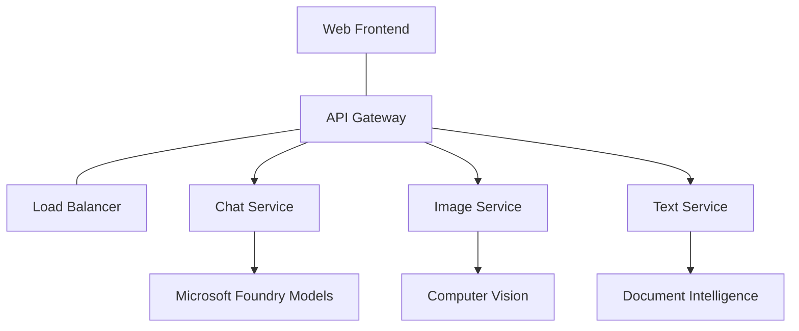

# Melhores Práticas para Cargas de Trabalho de IA em Produção com AZD

**Navegação pelo Capítulo:**
- **📚 Início do Curso**: [AZD Para Iniciantes](../../README.md)
- **📖 Capítulo Atual**: Capítulo 8 - Padrões de Produção & Empresariais
- **⬅️ Capítulo Anterior**: [Capítulo 7: Solução de Problemas](../chapter-07-troubleshooting/debugging.md)
- **⬅️ Também Relacionado**: [Laboratório AI Workshop](../chapter-02-ai-development/ai-workshop-lab.md)
- **🎯 Curso Completo**: [AZD Para Iniciantes](../../README.md)

## Visão Geral

Este guia explica padrões de design para IA em produção usando Azure Developer CLI (AZD). É uma referência de design, não uma aplicação implantável nem uma certificação de produção.

**Limites do exemplo:** A menos que explicitamente descritos como completos, fragmentos Bicep assumem parâmetros e recursos referenciados de um template contêiner. Eles omitem imagens/planos de host, identidades, atribuições de função, DNS, saídas e outras integrações necessárias. Caminhos de serviço YAML e scripts de gancho/teste são arquivos ilustrativos para criar em **sua própria aplicação**; não são fornecidos por este curso. Use uma amostra AZD funcional como base, compile a infraestrutura completa e teste em ambiente isolado antes da produção.

## Desafios Chave Abordados

Preocupações comuns em produção incluem implantações multi-serviço, gerenciamento de identidade e segredos, dimensionamento, controle de custos e monitoramento. Não é declarada nenhuma prevalência medida aqui.

## Padrões de Arquitetura para IA em Produção

### Padrão 1: Arquitetura de Microserviços para IA

**Quando usar**: Aplicações complexas de IA com múltiplas capacidades



**Implementação AZD**:

```yaml
# azure.yaml
name: enterprise-ai-platform
services:
  web:
    project: ./web
    host: staticwebapp
  api-gateway:
    project: ./api-gateway
    host: containerapp
  chat-service:
    project: ./services/chat
    host: containerapp
  vision-service:
    project: ./services/vision
    host: containerapp
  text-service:
    project: ./services/text
    host: containerapp
```

### Padrão 2: Processamento de IA Orientado a Eventos

**Quando usar**: Processamento em lote, análise de documentos, fluxos de trabalho assíncronos

```bicep
// Event Hub for AI processing pipeline
resource eventHub 'Microsoft.EventHub/namespaces@2024-01-01' = {
  name: eventHubNamespaceName
  location: location
  sku: {
    name: 'Standard'
    tier: 'Standard'
    capacity: 1
  }
}

// Service Bus for reliable message processing
resource serviceBus 'Microsoft.ServiceBus/namespaces@2024-01-01' = {
  name: serviceBusNamespaceName
  location: location
  sku: {
    name: 'Premium'
    tier: 'Premium'
    capacity: 1
  }
}

// Function App for processing
resource functionApp 'Microsoft.Web/sites@2023-01-01' = {
  name: functionAppName
  location: location
  kind: 'functionapp,linux'
  properties: {
    siteConfig: {
      appSettings: [
        {
          name: 'FUNCTIONS_EXTENSION_VERSION'
          value: '~4'
        }
        {
          name: 'AZURE_OPENAI_ENDPOINT'
          value: '@Microsoft.KeyVault(VaultName=${keyVault.name};SecretName=openai-endpoint)'
        }
      ]
    }
  }
}
```

Isto cria fragmentos de namespace, não hubs, filas, assinaturas ou gatilhos de Função. Uma Função executável também precisa de um plano de hospedagem, configuração de runtime/armazenamento, identidade anexada, RBAC e acesso de rede. A referência ao Key Vault precisa de permissão para ler o segredo; um URL de endpoint em si não é uma credencial.

## Pensando sobre a Saúde do Agente de IA

Quando um aplicativo web tradicional falha, os sintomas são familiares: uma página não carrega, uma API retorna erro ou uma implantação falha. Aplicações com IA podem falhar de todas essas maneiras — mas também podem apresentar comportamentos sutis que não geram mensagens de erro óbvias.

Esta seção ajuda a construir um modelo mental para monitorar cargas de trabalho de IA, para que você saiba onde olhar quando algo parecer errado.

### Como a Saúde do Agente Difere da Saúde de Aplicações Tradicionais

Aplicações tradicionais também podem ter falhas sutis de correção. Um agente de IA adiciona qualidade de resposta não determinística às preocupações habituais de disponibilidade e correção. Pense na saúde do agente em duas camadas:

| Camada | O que Observar | Onde Olhar |
|-------|--------------|---------------|
| **Saúde da infraestrutura** | O serviço está rodando? Recursos estão provisionados? Endpoints estão acessíveis? | `azd monitor`, saúde do recurso no Portal Azure, logs de container/aplicação |
| **Saúde do comportamento** | O agente responde com precisão? As respostas são pontuais? O modelo está sendo chamado corretamente? | Rastreamentos do Application Insights, métricas de latência de chamada do modelo, logs de qualidade da resposta |

A saúde da infraestrutura é familiar — é a mesma para qualquer app azd. A saúde do comportamento é a nova camada que cargas de trabalho de IA introduzem.

### Onde Olhar Quando Aplicações de IA Não Se Comportam Como Esperado

Se sua aplicação de IA não está produzindo os resultados esperados, aqui está uma lista conceitual para verificação:

1. **Comece pelo básico.** O aplicativo está executando? Pode acessar suas dependências? Verifique `azd monitor` e a saúde do recurso da mesma forma que faria para qualquer aplicativo.
2. **Verifique a conexão com o modelo.** Sua aplicação está chamando o modelo de IA com sucesso? Chamadas ao modelo com falhas ou timeout são a causa mais comum de problemas em apps de IA e aparecerão nos seus logs de aplicação.
3. **Inspecione entrada e fundamentação com segurança.** Respostas incorretas podem resultar de recuperação, instruções, limitações do modelo ou execução de ferramentas. Use dados diagnósticos redigidos e controlados por acesso; não habilite o registro indiscriminado de prompt/resposta em produção.
4. **Revise a latência da resposta.** Chamadas ao modelo de IA são mais lentas que chamadas típicas de API. Se seu app parecer lento, verifique se os tempos de resposta do modelo aumentaram — isso pode indicar limitação de taxa, limites de capacidade ou congestionamento regional.
5. **Fique atento a sinais de custo.** Picos inesperados no uso de tokens ou chamadas à API podem indicar um loop, prompt mal configurado ou tentativas excessivas.

Você não precisa dominar ferramentas de observabilidade imediatamente. A principal lição é que aplicações de IA têm uma camada extra de comportamento para monitorar, e o monitoramento integrado do azd (`azd monitor`) fornece um ponto de partida para investigar ambas as camadas.

---

## Melhores Práticas de Segurança

### 1. Modelo de Segurança Zero-Trust

**Estratégia de Implementação**:
- Comunicação entre serviços somente com autenticação
- Todas as chamadas API usam identidades gerenciadas
- Isolamento de rede com endpoints privados
- Controles de acesso com privilégios mínimos

```bicep
// Managed Identity for each service
resource chatServiceIdentity 'Microsoft.ManagedIdentity/userAssignedIdentities@2023-01-31' = {
  name: 'chat-service-identity'
  location: location
}

// Role assignments with minimal permissions
resource openAIUserRole 'Microsoft.Authorization/roleAssignments@2022-04-01' = {
  scope: openAIAccount
  name: guid(openAIAccount.id, chatServiceIdentity.id, '5e0bd9bd-7b93-4f28-af87-19fc36ad61bd')
  properties: {
    roleDefinitionId: subscriptionResourceId('Microsoft.Authorization/roleDefinitions', '5e0bd9bd-7b93-4f28-af87-19fc36ad61bd')
    principalId: chatServiceIdentity.properties.principalId
    principalType: 'ServicePrincipal'
  }
}
```

### 2. Gerenciamento Seguro de Segredos

**Padrão de Integração com Key Vault**:

```bicep
// Key Vault with proper access policies
resource keyVault 'Microsoft.KeyVault/vaults@2023-02-01' = {
  name: keyVaultName
  location: location
  properties: {
    tenantId: tenant().tenantId
    sku: {
      family: 'A'
      name: 'standard' // Premium is needed for HSM-backed keys, not ordinary secrets
    }
    enableRbacAuthorization: true  // Use RBAC instead of access policies
    enablePurgeProtection: true    // Prevent accidental deletion
    enableSoftDelete: true
    softDeleteRetentionInDays: 90
  }
}

// Optional legacy key-auth alternative; omit when using Entra ID.
resource openAIKeySecret 'Microsoft.KeyVault/vaults/secrets@2023-02-01' = {
  parent: keyVault
  name: 'openai-api-key'
  properties: {
    value: openAIAccount.listKeys().key1
    attributes: {
      enabled: true
    }
  }
}
```

Atribua a identidade de runtime `Key Vault Secrets User` no escopo apropriado e a anexe ao host; `enableRbacAuthorization` sozinho não concede acesso. Prefira a autenticação por identidade gerenciada OpenAI com `disableLocalAuth: true`. O segredo de chave opcional só faz sentido para uma conta habilitada intencionalmente para chave, e o principal de provisionamento também precisa de permissão para gravar segredos.

### 3. Segurança de Rede

**Configuração de Endpoint Privado**:

```bicep
// Virtual Network for AI services
resource virtualNetwork 'Microsoft.Network/virtualNetworks@2023-04-01' = {
  name: vnetName
  location: location
  properties: {
    addressSpace: {
      addressPrefixes: ['10.0.0.0/16']
    }
    subnets: [
      {
        name: 'ai-services-subnet'
        properties: {
          addressPrefix: '10.0.1.0/24'
          privateEndpointNetworkPolicies: 'Disabled'
        }
      }
      {
        name: 'app-services-subnet'
        properties: {
          addressPrefix: '10.0.2.0/24'
          delegations: [
            {
              name: 'Microsoft.Web/serverFarms'
              properties: {
                serviceName: 'Microsoft.Web/serverFarms'
              }
            }
          ]
        }
      }
    ]
  }
}

// Private endpoints for all AI services
resource openAIPrivateEndpoint 'Microsoft.Network/privateEndpoints@2023-04-01' = {
  name: '${openAIAccountName}-pe'
  location: location
  properties: {
    subnet: {
      id: virtualNetwork.properties.subnets[0].id
    }
    privateLinkServiceConnections: [
      {
        name: 'openai-connection'
        properties: {
          privateLinkServiceId: openAIAccount.id
          groupIds: ['account']
        }
      }
    ]
  }
}
```

Endpoints privados também requerem grupos de zona DNS privada/links VNet e integração VNet de aplicativo. Eles não bloqueiam automaticamente o acesso público: desative explicitamente o acesso público da conta AI após validar conectividade privada e acesso à implantação.

## Desempenho e Dimensionamento

### 1. Estratégias de Auto-Scaling

**Auto-scaling para Container Apps**:

```bicep
resource containerApp 'Microsoft.App/containerApps@2023-05-01' = {
  name: containerAppName
  location: location
  properties: {
    configuration: {
      ingress: {
        external: true
        targetPort: 8000
        transport: 'http'
      }
    }
    template: {
      scale: {
        minReplicas: 2  // Always have 2 instances minimum
        maxReplicas: 50 // Scale up to 50 for high load
        rules: [
          {
            name: 'http-scaling'
            http: {
              metadata: {
                concurrentRequests: '20'  // Scale when >20 concurrent requests
              }
            }
          }
          {
            name: 'cpu-scaling'
            custom: {
              type: 'cpu'
              metadata: {
                type: 'Utilization'
                value: '70'  // Scale when CPU >70%
              }
            }
          }
        ]
      }
    }
  }
}
```

### 2. Estratégias de Cache

**Cache Redis para Respostas de IA**:

```bicep
// Legacy Azure Cache for Redis example (not recommended for new deployments)
resource redisCache 'Microsoft.Cache/redis@2023-04-01' = {
  name: redisCacheName
  location: location
  properties: {
    sku: {
      name: 'Premium'
      family: 'P'
      capacity: 1
    }
    enableNonSslPort: false
    minimumTlsVersion: '1.2'
    redisConfiguration: {
      'maxmemory-policy': 'allkeys-lru'
    }
    // Sharding distributes data; replication/failover provides availability.
    shardCount: 2
  }
}

// Cache configuration in application
var cacheConnectionString = '${redisCache.properties.hostName}:6380,password=${redisCache.listKeys().primaryKey},ssl=True,abortConnect=False'
```

Azure Cache para Redis Basic/Standard/Premium está em [processo de descontinuação](https://learn.microsoft.com/azure/azure-cache-for-redis/retirement-faq). Use Azure Managed Redis para novos designs e sua configuração documentada de SKU, identidade e TLS, em vez de copiar este recurso legado para um novo sistema de produção. A linha de connection-string é um placeholder não funcional, não uma credencial. Particione chaves de cache por autorização, modelo/instruções e versão de recuperação, com expiração; um cache somente para consulta compartilhado pode expor dados de outro usuário.

### 3. Balanceamento de Carga e Gerenciamento de Tráfego

**Application Gateway com WAF**:

```bicep
// Application Gateway with Web Application Firewall
resource applicationGateway 'Microsoft.Network/applicationGateways@2023-04-01' = {
  name: appGatewayName
  location: location
  properties: {
    sku: {
      name: 'WAF_v2'
      tier: 'WAF_v2'
      capacity: 2
    }
    webApplicationFirewallConfiguration: {
      enabled: true
      firewallMode: 'Prevention'
      ruleSetType: 'OWASP'
      ruleSetVersion: '3.2'
    }
    // Backend pools for AI services
    backendAddressPools: [
      {
        name: 'ai-services-pool'
        properties: {
          backendAddresses: [
            {
              fqdn: '${containerApp.properties.configuration.ingress.fqdn}'
            }
          ]
        }
      }
    ]
  }
}
```

Este é um recurso parcial de gateway: uma implantação real também precisa de configuração de subnet/IP do gateway, IPs e portas frontend, listeners/certificados TLS, configurações/sondas HTTP de backend, regras e prioridades de roteamento, e política WAF revisada. Hostname/SNI TLS e autenticação devem corresponder ao backend do Container App.

## 💰 Otimização de Custos

### 1. Dimensionamento Correto de Recursos

**Configurações Específicas do Ambiente**:

Estes nomes são **entradas ilustrativas para template customizado**, não configurações automáticas do AZD. Mapeie cada um para `infra/main.parameters.json`/Bicep e configuração do host primeiro. Por exemplo, a amostra RAG usa `AZURE_SEARCH_SERVICE_SKU` e `AZURE_OPENAI_CHATGPT_DEPLOYMENT_CAPACITY`, não os nomes genéricos abaixo. Forneça memória para Container Apps numa unidade suportada como `1Gi` na resource real. Aplique mudanças de infraestrutura com `azd up` ou `azd provision`; `azd deploy` sozinho não aplica mudanças Bicep.

```bash
# Development environment
azd env new development
azd env set AZURE_OPENAI_SKU "S0"
azd env set AZURE_OPENAI_CAPACITY 10
azd env set AZURE_SEARCH_SKU "basic"
azd env set CONTAINER_CPU 0.5
azd env set CONTAINER_MEMORY 1.0

# Production environment  
azd env new production
azd env set AZURE_OPENAI_SKU "S0"
azd env set AZURE_OPENAI_CAPACITY 100
azd env set AZURE_SEARCH_SKU "standard"
azd env set CONTAINER_CPU 2.0
azd env set CONTAINER_MEMORY 4.0
```

### 2. Monitoramento de Custos e Orçamentos

```bicep
// Supply the first day of the current UTC month, e.g. 2026-11-01T00:00:00Z.
param budgetStartDate string

// Cost management and budgets
resource budget 'Microsoft.Consumption/budgets@2024-08-01' = {
  name: 'ai-workload-budget'
  properties: {
    timePeriod: {
      startDate: budgetStartDate
    }
    timeGrain: 'Monthly'
    amount: 2000  // In the billing currency, not necessarily USD
    category: 'Cost'
    notifications: {
      warning: {
        enabled: true
        operator: 'GreaterThan'
        threshold: 80
        contactEmails: [
          'finance@company.com'
          'engineering@company.com'
        ]
        contactRoles: [
          'Owner'
          'Contributor'
        ]
      }
      critical: {
        enabled: true
        operator: 'GreaterThan'
        threshold: 95
        contactEmails: [
          'cto@company.com'
        ]
      }
    }
  }
}
```

Substitua os destinatários de exemplo e verifique escopo/permissões. Alertas de orçamento usam dados de cobrança atrasados e não impõem limite de gasto.

### 3. Otimização do Uso de Tokens

**Gerenciamento de Custos com OpenAI**:

Isto é apenas uma heurística baseada em caracteres para uma pré-visualização UI, **não** um validador de limite de token do modelo. Código de produção deve usar um tokenizador apropriado para o modelo implantado e contabilizar instruções de sistema, esquemas de ferramentas, histórico e orçamento de saída. Rejeite uma mensagem do usuário que exceda o tamanho ao invés de truncá-la silenciosamente.

```typescript
// Application-level token optimization
class TokenOptimizer {
  private readonly maxTokens = 4000;
  private readonly reserveTokens = 500;
  
  optimizePrompt(userInput: string, context: string): string {
    const availableTokens = this.maxTokens - this.reserveTokens;
    if (this.estimateTokens(userInput) + 8 >= availableTokens) {
      throw new Error("User input exceeds the illustrative prompt budget");
    }
    const estimatedTokens = this.estimateTokens(userInput + context) + 8;
    
    if (estimatedTokens > availableTokens) {
      // Truncate context, not user input
      context = this.truncateContext(context, Math.max(0, availableTokens - this.estimateTokens(userInput) - 8));
    }
    
    return `${context}\n\nUser: ${userInput}`;
  }
  
  private estimateTokens(text: string): number {
    // Rough estimation: 1 token ≈ 4 characters
    return Math.ceil(text.length / 4);
  }

  private truncateContext(text: string, estimatedBudget: number): string {
    return text.slice(0, Math.max(0, estimatedBudget) * 4);
  }
}
```

## Monitoramento e Observabilidade

### 1. Application Insights Abrangente

```bicep
// Application Insights with advanced features
resource applicationInsights 'Microsoft.Insights/components@2020-02-02' = {
  name: applicationInsightsName
  location: location
  kind: 'web'
  properties: {
    Application_Type: 'web'
    WorkspaceResourceId: logAnalyticsWorkspace.id
    SamplingPercentage: 100  // Ingestion setting; review cost and SDK sampling separately
    DisableIpMasking: false  // Retain IP masking
  }
}

// Custom metrics for AI operations
resource aiMetricAlerts 'Microsoft.Insights/metricAlerts@2018-03-01' = {
  name: 'ai-high-error-rate'
  location: 'global'
  properties: {
    description: 'Alert when failed request count exceeds 10 in five minutes'
    severity: 2
    enabled: true
    scopes: [
      applicationInsights.id
    ]
    evaluationFrequency: 'PT1M'
    windowSize: 'PT5M'
    criteria: {
      'odata.type': 'Microsoft.Azure.Monitor.SingleResourceMultipleMetricCriteria'
      allOf: [
        {
          name: 'high-error-rate'
          metricName: 'requests/failed'
          operator: 'GreaterThan'
          threshold: 10
          timeAggregation: 'Count'
        }
      ]
    }
  }
}
```

### 2. Monitoramento Específico para IA

**Dashboards Customizados para Métricas de IA**:

```json
{
  "dashboard": {
    "name": "AI Application Monitoring",
    "tiles": [
      {
        "name": "OpenAI Request Volume",
        "query": "dependencies | where target contains 'openai' | summarize count() by bin(timestamp, 5m)"
      },
      {
        "name": "AI Response Latency",
        "query": "dependencies | where target contains 'openai' | summarize avg(duration) by bin(timestamp, 5m)"
      },
      {
        "name": "Token Usage",
        "query": "customMetrics | where name == 'openai_tokens_used' | summarize sum(value) by bin(timestamp, 1h)"
      },
      {
        "name": "Cost per Hour",
        "query": "customMetrics | where name == 'openai_cost' | summarize sum(value) by bin(timestamp, 1h)"
      }
    ]
  }
}
```

Este JSON é um esboço definido pela aplicação, não um esquema de dashboard importável do portal Azure. As queries de token/custo requerem que seu app emita exatamente essas métricas customizadas; elas não são criadas pelo AZD. Adapte filtros de dependência para seus nomes reais de endpoint/span do modelo.

### 3. Verificações de Saúde e Monitoramento de Tempo Ativo

```bicep
// Application Insights availability tests
resource availabilityTest 'Microsoft.Insights/webtests@2022-06-15' = {
  name: 'ai-app-availability-test'
  location: location
  tags: {
    'hidden-link:${applicationInsights.id}': 'Resource'
  }
  properties: {
    SyntheticMonitorId: 'ai-app-availability-test'
    Name: 'AI Application Availability Test'
    Description: 'Tests AI application endpoints'
    Enabled: true
    Frequency: 300  // 5 minutes
    Timeout: 120    // 2 minutes
    Kind: 'standard'
    Locations: [
      {
        Id: 'us-east-2-azr'
      }
      {
        Id: 'us-west-2-azr'
      }
    ]
    Request: {
      RequestUrl: 'https://${webApp.properties.defaultHostName}/health'
      HttpVerb: 'GET'
      FollowRedirects: true
      ParseDependentRequests: false
    }
    ValidationRules: {
      ExpectedHttpStatusCode: 200
      SSLCheck: true
      SSLCertRemainingLifetimeCheck: 7
    }
  }
}
```

## Recuperação de Desastres e Alta Disponibilidade

O teste anterior assume um App Service existente `webApp` e recurso Application Insights. Testes padrão de disponibilidade são cobrados e requerem endpoint acessível; apps somente privados precisam de design adequado de monitoramento privado. Testes de ping URL estão obsoletos; use [testes padrão de disponibilidade](https://learn.microsoft.com/azure/azure-monitor/app/availability).

### 1. Implantação Multi-Região

```yaml
# azure.yaml - Multi-region configuration
name: ai-app-multiregion
services:
  api-primary:
    project: ./api
    host: containerapp
    env:
      AZURE_REGION: eastus
  api-secondary:
    project: ./api
    host: containerapp
    env:
      AZURE_REGION: westus2
```

```bicep
// Separate App Service topology, not the Container Apps declarations above
resource trafficManager 'Microsoft.Network/trafficManagerProfiles@2022-04-01' = {
  name: trafficManagerProfileName
  location: 'global'
  properties: {
    profileStatus: 'Enabled'
    trafficRoutingMethod: 'Priority'
    dnsConfig: {
      relativeName: trafficManagerProfileName
      ttl: 30
    }
    monitorConfig: {
      protocol: 'HTTPS'
      port: 443
      path: '/health'
      intervalInSeconds: 30
      toleratedNumberOfFailures: 3
      timeoutInSeconds: 10
    }
    endpoints: [
      {
        name: 'primary-endpoint'
        type: 'Microsoft.Network/trafficManagerProfiles/azureEndpoints'
        properties: {
          targetResourceId: primaryAppService.id
          endpointStatus: 'Enabled'
          priority: 1
        }
      }
      {
        name: 'secondary-endpoint'
        type: 'Microsoft.Network/trafficManagerProfiles/azureEndpoints'
        properties: {
          targetResourceId: secondaryAppService.id
          endpointStatus: 'Enabled'
          priority: 2
        }
      }
    ]
  }
}
```

Variáveis de ambiente não escolhem localizações de recursos. IaC deve provisionar hosts regionais distintos e vincular cada serviço com tags `resourceName` ou `azd-service-name`. O exemplo Traffic Manager é uma **topologia separada de App Service** (`primaryAppService`/`secondaryAppService`), não roteamento para as declarações Container Apps. Container Apps requer endpoint externo/front door configurado adequadamente, roteamento TLS/domínio customizado e sondas de saúde.

### 2. Backup e Recuperação de Dados

```bicep
// Backup configuration for critical data
resource backupVault 'Microsoft.DataProtection/backupVaults@2023-05-01' = {
  name: backupVaultName
  location: location
  identity: {
    type: 'SystemAssigned'
  }
  properties: {
    storageSettings: [
      {
        datastoreType: 'VaultStore'
        type: 'LocallyRedundant'
      }
    ]
  }
}

```

O cofre sozinho não faz backup de nada. Configure uma **política suportada específica da carga de trabalho e instância de backup**, permissões de origem, retenção e testes de restauração usando [matrizes de suporte do Azure Backup](https://learn.microsoft.com/azure/backup/backup-support-matrix). Não existe política genérica Azure Backup para implantações de modelos Azure OpenAI hospedados. Mantenha definições de implantação de infraestrutura/modelo em controle de versão; proteja documentos carregados, dados de aplicação e artefatos de fine-tuning usando recursos de backup/exportação suportados de cada serviço subjacente. Defina e teste RPO/RTO explicitamente.

## DevOps e Integração CI/CD

### 1. Workflow GitHub Actions

```yaml
# .github/workflows/deploy-ai-app.yml
name: Deploy AI Application

on:
  push:
    branches: [main]
  pull_request:
    branches: [main]

jobs:
  test:
    runs-on: ubuntu-latest
    steps:
      - uses: actions/checkout@v4
      
      - name: Setup Python
        uses: actions/setup-python@v4
        with:
          python-version: '3.11'
          
      - name: Install dependencies
        run: |
          pip install -r requirements.txt
          pip install pytest
          
      - name: Run tests
        run: pytest tests/
        
      - name: AI Safety Tests
        run: |
          python scripts/test_ai_safety.py
          python scripts/validate_prompts.py

```

Esta é a **parte apenas para teste** de um workflow e assume que você criou `requirements.txt`, `tests/` e os dois scripts de segurança. Adicione os jobs autenticados de provisão/implantação OIDC de [Configuração de Pipeline CI/CD](#cicd-pipeline-configuration), com `needs: test`, um gatilho confiável push/manual e ambientes protegidos GitHub. Não faça deploy de código pull-request não confiável com credenciais de nuvem. Um runner novo não tem ambiente local AZD selecionado; forneça inputs environment/subscription/location e use `azd auth login`, não só `azure/login`.

### 2. Validação de Infraestrutura

```bash
# scripts/validate_infrastructure.sh
#!/bin/bash
set -euo pipefail

echo "Validating AI infrastructure deployment..."

# Requires Azure CLI login and the resource group selected explicitly.
: "${AZURE_RESOURCE_GROUP:?Set AZURE_RESOURCE_GROUP}"
: "${AZURE_OPENAI_NAME:?Set AZURE_OPENAI_NAME}"
: "${AZURE_OPENAI_CHAT_DEPLOYMENT:?Set the actual deployment name}"

# A successful empty list is not proof that resources exist.
types=("Microsoft.CognitiveServices/accounts" "Microsoft.Search/searchServices"
       "Microsoft.Storage/storageAccounts" "Microsoft.KeyVault/vaults")
for resource_type in "${types[@]}"; do
    count=$(az resource list --resource-group "$AZURE_RESOURCE_GROUP" \
        --resource-type "$resource_type" --query "length(@)" -o tsv)
    if [[ "$count" -lt 1 ]]; then
        echo "ERROR: No $resource_type found in $AZURE_RESOURCE_GROUP"
        exit 1
    fi
done

# Validate OpenAI model deployments
echo "Validating OpenAI model deployments..."
state=$(az cognitiveservices account deployment show \
  --name "$AZURE_OPENAI_NAME" --resource-group "$AZURE_RESOURCE_GROUP" \
  --deployment-name "$AZURE_OPENAI_CHAT_DEPLOYMENT" \
  --query "properties.provisioningState" -o tsv)
if [[ "$state" != "Succeeded" ]]; then
    echo "ERROR: Required model deployment is not provisioned successfully"
    exit 1
fi

echo "Infrastructure validation completed successfully!"
```

Esperado: saída zero e mensagem de conclusão somente quando todos os tipos esperados existem e o modelo nomeado está provisionado. Isso verifica inventário/estado de provisionamento, **não** saúde de recurso, topologia exata, RBAC, alcance de rede ou comportamento do modelo. Adapte os tipos esperados para sua arquitetura, depois execute um teste separado autenticado de prontidão da aplicação.

## Lista de Verificação para Prontidão de Produção

### Segurança ✅
- [ ] Todos os serviços usam identidades gerenciadas
- [ ] Segredos armazenados no Key Vault
- [ ] Endpoints privados configurados
- [ ] Grupos de segurança de rede implementados
- [ ] RBAC com privilégio mínimo
- [ ] WAF habilitado nos endpoints públicos

### Desempenho ✅
- [ ] Auto-scaling configurado
- [ ] Cache implementado
- [ ] Balanceamento de carga configurado
- [ ] CDN para conteúdo estático
- [ ] Pool de conexões de banco de dados
- [ ] Otimização do uso de tokens

### Monitoramento ✅
- [ ] Application Insights configurado
- [ ] Métricas customizadas definidas
- [ ] Regras de alerta configuradas
- [ ] Dashboard criado
- [ ] Verificações de saúde implementadas
- [ ] Políticas de retenção de logs

### Confiabilidade ✅
- [ ] Implantação multi-região
- [ ] Plano de backup e recuperação
- [ ] Circuit breakers implementados
- [ ] Políticas de retry configuradas
- [ ] Degradação graciosa
- [ ] Endpoints para checagem de saúde

### Gestão de Custos ✅
- [ ] Alertas de orçamento configurados
- [ ] Dimensionamento correto de recursos
- [ ] Descontos para desenvolvimento/teste aplicados
- [ ] Instâncias reservadas adquiridas
- [ ] Dashboard de monitoramento de custos
- [ ] Revisões regulares de custos

### Conformidade ✅
- [ ] Requisitos de residência de dados atendidos
- [ ] Logs de auditoria habilitados
- [ ] Políticas de conformidade aplicadas
- [ ] Baselines de segurança implementados
- [ ] Avaliações regulares de segurança
- [ ] Plano de resposta a incidentes

## Benchmarks de Desempenho

### Metas Ilustrativas de Produção

Estes são exemplos de SLOs para negociação e teste de carga, não benchmarks medidos nem garantias. Latência de resposta depende do modelo/tamanho da saída; gasto mensal em tokens depende do tráfego e preços, não só da contagem de tokens.

| Métrica | Meta | Monitoramento |
|--------|--------|------------|
| **Tempo de Resposta** | < 2 segundos | Application Insights |
| **Disponibilidade** | 99.9% | Monitoramento de uptime |
| **Taxa de Erro** | < 0.1% | Logs da aplicação |
| **Gasto com Modelo** | < $500/mês (exemplo de orçamento) | Gerenciamento de custos |
| **Usuários Concorrentes** | 1000+ | Teste de carga |
| **Tempo de Recuperação** | < 1 hora | Testes de recuperação de desastre |

### Teste de Carga

O seguinte é um esboço de interface para um script de teste de carga **que você deve implementar**; este repositório não fornece `scripts/load_test.py`. Defina cargas úteis de solicitação, autenticação, cargas representativas, asserções de latência/erro percentílicos e um limite de gastos na ferramenta de teste de carga escolhida antes de executá-la:

```bash
# Load testing script for AI applications
python scripts/load_test.py \
  --endpoint https://your-ai-app.azurewebsites.net \
  --concurrent-users 100 \
  --duration 300 \
  --ramp-up 60
```

## 🤝 Melhores Práticas da Comunidade

Baseado no feedback da comunidade Microsoft Foundry Discord:

### Principais Recomendações da Comunidade:

1. **Comece Pequeno, Escale Gradualmente**: Comece com SKUs básicos e escale conforme o uso real
2. **Monitore Tudo**: Configure monitoramento abrangente desde o primeiro dia
3. **Automatize a Segurança**: Use infraestrutura como código para segurança consistente
4. **Teste Cuidadosamente**: Inclua testes específicos para IA em seu pipeline
5. **Planeje os Custos**: Monitore o uso de tokens e configure alertas de orçamento cedo

### Armadilhas Comuns para Evitar:

- ❌ Codificar chaves de API no código
- ❌ Não configurar monitoramento adequado
- ❌ Ignorar otimização de custos
- ❌ Não testar cenários de falha
- ❌ Implantar sem verificações de saúde

## Comandos e Extensões AZD AI CLI

AZD inclui um conjunto crescente de comandos e extensões específicas para IA que simplificam fluxos de trabalho de IA em produção. Essas ferramentas fazem a ponte entre o desenvolvimento local e a implantação em produção para cargas de trabalho de IA.

> **Revisão da versão (2026-11-04):** A orientação da CLI abaixo foi verificada contra as versões publicadas do `azd` **1.37.2**, `azure.ai.agents` **1.0.0-beta.23**, e `azure.ai.evaluations` **1.0.0-beta.2**. Agentes beta.23 requer `azd >= 1.37.0`; avaliações beta.2 requer `azd >= 1.33.0`. Use ao menos 1.37.0 para o fluxo de trabalho combinado. Esta é uma revisão de documentação/fonte, não uma validação de implantação ao vivo no Azure.

### Extensões AZD para IA

AZD usa um sistema de extensão para adicionar capacidades específicas de IA. Instale e gerencie extensões com:

```bash
# List all available extensions (including AI)
azd extension list

# Inspect installed extension details
azd version
azd extension show azure.ai.agents

# Install the Foundry agents extension
azd extension install azure.ai.agents

# Install the separate Foundry evaluations extension
azd extension install azure.ai.evaluations

# Install the fine-tuning extension
azd extension install azure.ai.finetune

# Install the custom models extension
azd extension install azure.ai.models

# Upgrade all installed extensions
azd extension upgrade --all
```

**Extensões de IA disponíveis:**

| Extensão | Propósito | Status |
|-----------|---------|--------|
| `azure.ai.agents` | Gerenciamento do Serviço Foundry Agent | Preview |
| `azure.ai.evaluations` | Conjuntos de dados de avaliação, avaliadores, grupos de avaliação e execuções | Preview |
| `azure.ai.skills` | Habilidades reutilizáveis de agente | Preview |
| `azure.ai.connections` | Conexões Foundry (fontes de dados, ferramentas) | Preview |
| `azure.ai.finetune` | Ajuste fino de modelos Foundry | Preview |
| `azure.ai.models` | Modelos personalizados Foundry | Preview |
| `azure.coding-agent` | Configuração de agentes de codificação | Disponível |

> Execute `azd extension list --installed` e `azd extension show azure.ai.evaluations` para inspecionar versões instaladas. Atualize o núcleo CLI primeiro seguindo as [instruções de instalação/atualização](https://learn.microsoft.com/azure/developer/azure-developer-cli/install-azd) (para instalação Windows com winget: `winget upgrade Microsoft.Azd`), depois execute `azd extension upgrade --all`. Não existe comando `azd upgrade` no núcleo. Revise alterações incompatíveis antes de atualizar a automação de produção; não presuma que uma atualização de extensão preserve formatos antigos de comando ou configuração.

### Mudanças e Correções Recentes em Releases

| Release | O que muda para este curso |
|---------|------------------------------|
| `azd 1.37.0` | Adiciona APIs estáveis para deployment-preview e corrige edições de extensão que reescreviam configurações `azure.yaml` não relacionadas. |
| `azd 1.37.1` | Corrige propagação do Ctrl+C entre extensões e distingue cancelamentos/tempos limite de falhas genéricas. |
| `azd 1.37.2` | Melhora validação de provisionamento: avisos críticos padrão para **Não**, falha sem confirmação em execuções não assistidas e cancelamento pula ganchos pós-provisionamento. Também corrige valores de ambiente não resolvidos em listas de negação do Deployment Stacks quando a funcionalidade alpha está ativada. |
| Agents `beta.22` | Migra avaliação para `azd ai eval`, muda otimização para a API GA v1, requer plural `toolboxes`, e separa opt-ins de managed-harness, voz e execução longa em preview. Corrige seleção de modelo específica de ambiente e autenticação de toolbox. |
| Agents `beta.23` | Expõe `init --harness`; corrige saída de respostas A2A 0.3, caminhos/módulos de prompt-agent inválidos entre camadas de infraestrutura, diagnósticos de timeout de ativação, e avisos persistentes de RBAC de desenvolvedor. |
| Evaluations `beta.2` | Requer configuração de avaliação em camelCase, adiciona autoria estática/simulação de conversação e fontes explícitas de arquivo local, além de corrigir manipulação de identidade/versão de dataset, contagem de quality-gate e diagnóstico de execuções com falha. |

Timeout de ativação de agente **não** prova falha na implantação: inspecione a versão e estado tentados antes de tentar novamente. Avisos de RBAC de desenvolvedor podem permanecer mesmo quando o provisionamento é bem-sucedido; resolva o acesso ausente antes de invocar como esse desenvolvedor.

Fontes: [Releases AZD](https://github.com/Azure/azure-dev/releases), [release agents beta.23](https://github.com/Azure/azure-dev/releases/tag/azd-ext-azure-ai-agents_1.0.0-beta.23), [migração agents beta.22](https://github.com/Azure/azure-dev/releases/tag/azd-ext-azure-ai-agents_1.0.0-beta.22), e [release evaluations beta.2](https://github.com/Azure/azure-dev/releases/tag/azd-ext-azure-ai-evaluations_1.0.0-beta.2).

**O que são as extensões mais recentes `skills` e `connections`?**

Duas extensões em preview surgiram junto com as ferramentas de agentes e valem a pena ser compreendidas mesmo por iniciantes:

- **`azure.ai.skills`** — Uma **habilidade** é uma capacidade reutilizável (uma ferramenta ou comportamento empacotado) que você pode anexar a um ou mais agentes em vez de reimplementar toda vez. Pense nisso como um bloco de construção compartilhado: defina uma habilidade "buscar na documentação" ou "consultar um pedido" uma vez, e reutilize entre agentes. Isso mantém sistemas multi-agentes (Capítulo 5) consistentes e evita copiar-colar.
- **`azure.ai.connections`** — Uma **conexão** é um link gerenciado do seu projeto Foundry a um recurso externo que seus agentes precisam — uma fonte de dados (como Azure AI Search), um endpoint de ferramenta, ou outro serviço. Conexões centralizam *onde* e *como* agentes acessam dados, de modo que credenciais e endpoints ficam num lugar governado em vez de espalhados pelo código.

Você não precisa disso para implantar seus primeiros agentes — fique com `azure.ai.agents` enquanto aprende. Use `skills` quando se perceber duplicando a mesma ferramenta em múltiplos agentes, e `connections` quando vários agentes compartilharem a mesma fonte de dados.

### Inicializando Projetos de Agentes com `azd ai agent init`

O comando `azd ai agent init` scaffolda um projeto agente Microsoft Foundry. Use um template `azure.yaml` atual, não um manifesto legado implícito:

```bash
# Initialize a new agent project from a local project template
azd ai agent init --template ./templates/support-agent/azure.yaml

# Initialize and target a specific Foundry project
azd ai agent init --template ./templates/support-agent/azure.yaml --project-id <foundry-project-id>

# Adopt the template into a different directory
azd ai agent init --template ./templates/support-agent/azure.yaml --src ./agents/my-agent
```

**Flags-chave:**

| Flag | Descrição |
|------|-------------|
| `-t, --template` | Caminho ou URI GitHub suportado para um documento de projeto `azure.yaml` |
| `-p, --project-id` | ID de Projeto Microsoft Foundry existente para seu ambiente azd |
| `-s, --src` | Diretório fonte para agentes gerados ou diretório alvo ao adotar um projeto |
| `--kind` | Inicializa um agente `hosted`, `prompt` ou preview `prompt-voice` |
| `--harness` | Harness de execução opcional para `--kind prompt`; requer opt-in em preview |
| `-e, --environment` | Ambiente azd a ser usado |

`--manifest`/`-m` é um alias obsoleto para `--template`/`-t`; renomear a flag não converte um manifesto antigo em um documento de projeto atual. `--host containerapp` não é uma flag agent-init atual. Para uma aplicação comum Container Apps, use `azd init --template` com um template declarando `host: containerapp`.

Para um projeto existente com exatamente um serviço `azure.ai.project`, `azd ai agent add support-agent --file ./agents/support-agent.yaml` adiciona ou atualiza uma definição direta de agente sem provisionar nem implantar. Comandos em runtime rejeitam definições legadas implícitas `agent.yaml`/AgentManifest e definições de serviço aninhadas `config:`; migre-as para serviço `azure.ai.agent` atual. Quando init imprimir uma próxima etapa `cd`, execute-a antes de `azd up`: init não muda seu diretório shell.

**Dica de produção**: Use `--project-id` para conectar diretamente a um projeto Foundry existente, mantendo seu código de agente e recursos na nuvem vinculados desde o início.

#### Recursos Preview Opcionais

Harness gerenciado, voz, e invocação longa são desativados por padrão independentemente. Ative apenas o switch para a funcionalidade que você precisa no **ambiente de processo shell/CI**, não via `azd env set`:

| Funcionalidade | Variável de ambiente do processo |
|---------|------------------------------|
| Harness gerenciado (`init --kind prompt --harness ...`) | `AZD_ALPHA_ENABLE_AGENTS_MANAGED_HARNESS=true` |
| Voz (`init --kind prompt-voice`) | `AZD_ALPHA_ENABLE_AGENTS_VOICE=true` |
| Invocação longa | `AZD_ALPHA_ENABLE_AGENTS_LONG_RUNNING=true` |

Por exemplo, use `export AZD_ALPHA_ENABLE_AGENTS_MANAGED_HARNESS=true` em Bash ou `$env:AZD_ALPHA_ENABLE_AGENTS_MANAGED_HARNESS = "true"` no PowerShell antes de rodar o comando relevante. Um switch não habilita os outros. Veja o [README dos agentes lançados](https://github.com/Azure/azure-dev/blob/azd-ext-azure-ai-agents_1.0.0-beta.23/cli/azd/extensions/azure.ai.agents/README.md) para todos os switches e limitações preview.

### Gerenciando o Ciclo de Vida do Agente

Use `azure.ai.agents` para testar, inspecionar, otimizar e aposentar agentes, e a extensão separada `azure.ai.evaluations` para medir qualidade:

```bash
# Invoke a deployed agent and view server response timing
# (total latency and time to first byte)
azd ai agent invoke

# Show the live endpoint configuration before changing it
azd ai agent endpoint show

# Download the deployed source of a code-based hosted agent
# (with SHA-256 verification)
azd ai agent code download

# Delete a hosted agent and all of its versions
# (--force terminates active sessions)
azd ai agent delete --force
```

**Ciclo de vida em resumo:**

| Etapa | Comando | Uso em produção |
|-------|---------|----------------|
| Testar | `azd ai agent invoke` | Validar respostas e medir latência antes do lançamento |
| Inspecionar | `azd ai agent endpoint show` | Revisar autenticação/configuração de endpoint; detectar mudanças incompatíveis cedo |
| Medir | `azd ai eval init`, `generate`, `run start` | Definir, implantar e executar avaliações repetíveis |
| Melhorar | `azd ai agent optimize --eval <evaluation-name> --optimize-model <optimizer-deployment>` | Reutilizar avaliação compatível para otimizar agente |
| Recuperar | `azd ai agent code download` | Recuperar fonte implantada exata para auditoria/rollback |
| Aposentar | `azd ai agent delete --force` | Desmontar um agente e suas versões limpidamente |

> Estes são comandos preview e podem mudar entre versões da extensão. Execute `azd ai agent --help` para ver os subcomandos exatos na sua versão instalada.

`endpoint show` suporta agentes hospedados, prompt e voz, mas atualizações de endpoint são apenas hospedadas; agentes de workflow não são suportados. Download de código e o exemplo de aposentadoria de agentes hospedados acima não são operações genéricas para todos os tipos de agentes.

#### Migração de Avaliações e Verificações de Qualidade

A partir dos agentes **1.0.0-beta.22 (2026-10-23)**, comandos legados `azd ai agent eval` fornecem orientação de migração em vez do fluxo de avaliação anterior. Não copie exemplos antigos `eval generate --dataset ...`: avaliação agora está sob **`azd ai eval`**.

Em um projeto agente inicializado, autentique-se com `azd auth login`, confirme ambiente/projeto Foundry selecionado, e instale `azure.ai.evaluations`. Uma implantação de modelo juiz é necessária para pontuação baseada em modelo; geração e simulação de conversação podem requerer seleções de modelo separadas e implicar custos adicionais.

```bash
# Scaffold evals/ and wire an azure.ai.eval service into azure.yaml
azd ai eval init

# Optionally synthesize a rubric and dataset from the agent
azd ai eval generate

# Review generated files, then register datasets, evaluators, and eval groups
azd up

# Start an evaluation and wait for its results
azd ai eval run start --wait

# Inspect runs and available test-case output
azd ai eval run list
azd ai eval run show <run-id>
azd ai eval run output list <run-id>
```

Siga as seleções interativas e etapas impressas em vez de presumir que ativos gerados já estão registrados. Configuração de avaliação normalmente fica em `evals/azure.eval.yaml`, referenciada pelo serviço `azure.ai.eval` em `azure.yaml`. Chaves são **camelCase** (`evaluationLevel`, `maxSamples`, `initializationParameters`, `dataMapping`); chaves antigas snake_case são rejeitadas. Caminhos dentro de configuração referenciada resolvem relativos a esse arquivo, não à raiz do repositório.

Para avaliações de conversação, escolha **estático** para pontuar transcrições concluídas sem invocar agente, ou **simulação** para gerar conversações a partir de cenários semente. Simulação precisa de um alvo agente, um modelo simulador, e uma seleção separada de modelo juiz. Para comandos não assistidos, forneça entradas listadas por `azd ai eval init --help` e `azd ai eval generate --help`; não presuma que modelo gerador é também juiz ou simulador.

Para CI, configure uma política de qualidade explícita usando `azd ai eval run start --help` (`--fail-on`) e trate saída diferente de zero do host como falha. Uma execução completa não é automaticamente aprovação de qualidade. Revise linhas falhadas/erro e diagnósticos; contagens faltantes ou inconsistentes não provam sucesso. Datasets registrados mantêm identidade/versão do serviço; `--max-samples` não pode subdefinir um dataset registrado. Publique um dataset menor deliberadamente, ou use fonte local suportada.

```bash
# Example CI policy: at least 90% of all test cases must pass
azd ai eval run start --wait --fail-on "pass-rate=0.9"
```

O gate de taxa de aprovação usa casos de teste passados divididos pelo total; linhas falhadas, com erro, puladas ou não aprovadas contam contra ele. Não combine um gate com `--no-wait`, que retorna antes de um veredito estar disponível.

#### Migração de Configuração de Otimização

Otimização agora usa a API GA v1. Para reutilizar uma avaliação compatível **no nível de turno, respaldada por dataset** do novo fluxo de trabalho:

```bash
# Replace placeholders with the evaluation name and optimizer model deployment
azd ai agent optimize --eval-config ./evals/azure.eval.yaml --eval <evaluation-name> --optimize-model <optimizer-deployment>
```

`--eval` seleciona uma avaliação; `--eval-config` seleciona seu arquivo de configuração (incluindo definições baseadas em arquivo). `--config`, em vez disso, recebe uma **requisição de API de otimização autônoma** em YAML ou JSON. Não passe um `eval.yaml` antigo do agente nem o novo `azure.eval.yaml` para `--config`, e não combine `--config` com `--eval`/`--eval-config`. Avaliações baseadas em conversa, rastreamento ou simulação não são intercambiáveis com o atalho de otimização baseado em conjunto de dados; use o formato de requisição de otimização suportado para esses cenários. Revise os candidatos antes de aplicá-los ou implantá-los.

Consulte a [referência de avaliações para a versão revisada](https://github.com/Azure/azure-dev/blob/azd-ext-azure-ai-evaluations_1.0.0-beta.2/cli/azd/extensions/azure.ai.evaluations/README.md) e a [fonte do comando de otimização para a versão revisada](https://github.com/Azure/azure-dev/blob/azd-ext-azure-ai-agents_1.0.0-beta.23/cli/azd/extensions/azure.ai.agents/internal/cmd/optimize.go) para opções exatas.

#### Visualização da Implantação do Agente Hospedado Somente Leitura

Para um ambiente existente vinculado ao Foundry com um serviço unificado `azure.ai.agent` de `kind: hosted`, compare a configuração suportada antes de implantar:

```bash
azd deploy <service-name> --preview --no-prompt
```

Esta visualização não implanta o agente. Não é um diff completo de infraestrutura/segurança: agentes de prompt/voz/workflow, layouts de configuração legados e algumas configurações hospedadas estão fora de seu escopo. Um resultado `unknown` não é aprovação para implantação. Não existe comando autônomo `azd ai agent deploy` ou agente `--dry-run`; use o fluxo de implantação principal.

### Protocolo de Contexto do Modelo (MCP) com `azd mcp`

AZD inclui suporte interno para servidor MCP (Alpha), permitindo que agentes e ferramentas de IA interajam com seus recursos Azure através de um protocolo padronizado:

```bash
# Start the MCP server for your project
azd mcp start

# Review current Copilot consent rules for tool execution
azd copilot consent list
```

O servidor MCP expõe o contexto do seu projeto azd — ambientes, serviços e recursos Azure — para ferramentas de desenvolvimento assistidas por IA. Isso possibilita:

- **Implantação assistida por IA**: Permita que agentes de codificação consultem o estado do seu projeto e acionem implantações
- **Descoberta de recursos**: Ferramentas IA podem descobrir quais recursos do Azure seu projeto usa
- **Gerenciamento de ambientes**: Agentes podem alternar entre ambientes de desenvolvimento/homologação/produção

### Geração de Infraestrutura com `azd infra generate`

Para cargas de trabalho de IA em produção, você pode gerar e personalizar Infraestrutura como Código ao invés de depender do provisionamento automático:

```bash
# Generate supported infrastructure for this project type
azd infra generate
```

O suporte depende do projeto/host e provedores instalados; isto não é um comando geral de engenharia reversa para recursos Azure arbitrários ou uma promessa de gerar tanto Bicep quanto Terraform. Execute `azd infra generate --help` e inspecione o formato gerado. Onde suportado, escrever IaC no disco permite:
- Revisar e auditar a infraestrutura antes da implantação
- Adicionar políticas de segurança personalizadas (regras de rede, endpoints privados)
- Integrar com processos existentes de revisão de IaC
- Controlar versões das mudanças na infraestrutura separadamente do código da aplicação

### Hooks de Ciclo de Vida de Produção

Hooks AZD permitem injetar lógica personalizada em cada estágio do ciclo de vida da implantação — crítico para fluxos de trabalho de IA em produção:

```yaml
# azure.yaml - Production hooks example
name: ai-production-app
hooks:
  preprovision:
    shell: sh
    run: scripts/validate-quotas.sh    # Check AI model quota before provisioning
  postprovision:
    shell: sh
    run: scripts/verify-networking.sh  # Verify IaC-provisioned private connectivity
  predeploy:
    shell: sh
    run: scripts/run-ai-safety-tests.sh  # Run prompt safety checks
  postdeploy:
    shell: sh
    run: scripts/smoke-test.sh           # Verify agent responses post-deploy
services:
  agent-api:
    project: ./src/agent
    host: containerapp
    hooks:
      predeploy:
        shell: sh
        run: scripts/validate-model-access.sh  # Per-service hook
```

```bash
# Run a specific hook manually during development
azd hooks run predeploy
```

**Hooks recomendados para produção em cargas de trabalho de IA:**

| Hook | Caso de Uso |
|------|----------|
| `preprovision` | Validar cotas da assinatura para capacidade do modelo de IA |
| `postprovision` | Verificar conectividade privada e outputs de recursos necessários |
| `predeploy` | Executar testes de segurança de IA, validar templates de prompt |
| `postdeploy` | Teste rápido de respostas do agente, verificar conectividade do modelo |

### Configuração de Pipeline CI/CD

Use `azd pipeline config` para conectar seu projeto ao GitHub Actions ou Azure Pipelines com autenticação segura do Azure:

```bash
# Configure CI/CD pipeline (interactive)
azd pipeline config

# Configure with a specific provider
azd pipeline config --provider github
```

Este comando:
- Cria ou configura uma identidade do pipeline; revise seu escopo/papéis gerados ao invés de assumir privilégio mínimo
- Configura credenciais federadas (sem segredos armazenados)
- Gera ou atualiza seu arquivo de definição de pipeline
- Define variáveis de ambiente necessárias no seu sistema CI/CD

#### Passo a passo: seu primeiro pipeline GitHub Actions

Aqui está o walkthrough completo desde um projeto azd funcional até implantações automáticas a cada push.

**1. Certifique-se de que seu projeto esteja no GitHub**

```bash
git init
git add .
git commit -m "Initial azd project"
gh repo create my-ai-app --private --source=. --push
```

**2. Execute a configuração do pipeline**

```bash
azd pipeline config --provider github
```

azd irá, interativamente:
- Perguntar qual assinatura Azure e ambiente direcionar
- Criar um registro de aplicativo + principal de serviço Entra para o pipeline
- Configurar credenciais federadas (OIDC) — para que o GitHub autentique com Azure usando tokens temporários e **nenhum segredo seja armazenado**
- Enviar as **variáveis** necessárias ao seu repositório GitHub (`AZURE_CLIENT_ID`, `AZURE_TENANT_ID`, `AZURE_SUBSCRIPTION_ID`, `AZURE_ENV_NAME`, `AZURE_LOCATION`)

**3. Entenda o workflow gerado**

Para um template suportado, configure/reveja `.github/workflows/azure-dev.yml`. As partes principais são assim (o template deve fornecer a cadeia de ferramentas do aplicativo e parâmetros de ambiente):

```yaml
# .github/workflows/azure-dev.yml
on:
  push:
    branches: [ main ]
  workflow_dispatch:        # lets you run it manually too

permissions:
  id-token: write           # required for OIDC federated login
  contents: read

jobs:
  build:
    runs-on: ubuntu-latest
    env:
      AZURE_CLIENT_ID: ${{ vars.AZURE_CLIENT_ID }}
      AZURE_TENANT_ID: ${{ vars.AZURE_TENANT_ID }}
      AZURE_SUBSCRIPTION_ID: ${{ vars.AZURE_SUBSCRIPTION_ID }}
      AZURE_ENV_NAME: ${{ vars.AZURE_ENV_NAME }}
      AZURE_LOCATION: ${{ vars.AZURE_LOCATION }}
    steps:
      - uses: actions/checkout@v4
      - name: Install azd
        uses: Azure/setup-azd@v2
      - name: Log in with OIDC
        run: azd auth login --client-id "$AZURE_CLIENT_ID" --federated-credential-provider "github" --tenant-id "$AZURE_TENANT_ID"
      - name: Provision infrastructure
        run: azd provision --no-prompt
      - name: Deploy application
        run: azd deploy --no-prompt
```

**4. Verifique se funciona**

```bash
# Push a change to trigger the pipeline
git commit -am "Trigger pipeline" --allow-empty
git push
```

Abra a aba **Actions** no seu repositório GitHub e observe o workflow executar `azd provision` e `azd deploy` automaticamente.

> **Por que as credenciais federadas importam:** pipelines antigos armazenavam um segredo de cliente no GitHub. Credenciais federadas OIDC eliminam esse segredo por completo — o GitHub solicita um token temporário em tempo de execução, que é mais seguro e não precisa ser rotacionado ou pode vazar. Isto é o padrão configurado por `azd pipeline config`.

> **Segredos vs. variáveis:** identificadores não sensíveis (`AZURE_CLIENT_ID`, etc.) vão em **variáveis** do repositório. Se seu app realmente precisar de um segredo em build time, adicione como **segredo GitHub** e faça referência via `${{ secrets.NAME }}` — mas prefira Key Vault + identidade gerenciada em runtime (veja [Capítulo 3](../chapter-03-configuration/authsecurity.md)).

**Workflow de produção com configuração de pipeline:**

```bash
# 1. Set up production environment
azd env new production
azd env set AZURE_OPENAI_CAPACITY 100

# 2. Configure the pipeline
azd pipeline config --provider github

# 3. Review the generated trigger, provisioning/deployment steps, and approvals
```

#### Passo a passo: Azure DevOps Pipelines

Prefere Azure DevOps ao invés de GitHub Actions? azd suporta nativamente o provedor `azdo`. O fluxo é quase idêntico — azd gera o arquivo de pipeline, cria uma conexão de serviço e configura a autenticação.

**1. Certifique-se de ter um projeto Azure DevOps**

Você precisa de uma organização e um projeto em `https://dev.azure.com/<your-org>`. Gere um Token de Acesso Pessoal (PAT) com escopos **Build (Leitura & execução)**, **Código (Leitura & escrita)** e **Conexões de Serviço (Leitura, consulta & gerenciamento)** — azd irá solicitá-lo.

**2. Configure o pipeline**

```bash
azd pipeline config --provider azdo
```

azd irá:
- Perguntar pela organização e projeto Azure DevOps
- Criar (ou reutilizar) uma **conexão de serviço** para Azure usando um principal de serviço
- Configurar **federação de identidade de workload (OIDC)** para que nenhum segredo de cliente seja armazenado
- Configurar uma definição de pipeline (comumente `.azdo/pipelines/azure-dev.yml`) do template de pipeline do projeto

**3. Reveja o pipeline gerado**

Use o pipeline gerado pelo projeto, incluindo sua **conexão de serviço Azure e etapas de autenticação AZD**. O guia oficial [Configuração do Azure Pipelines](https://learn.microsoft.com/azure/developer/azure-developer-cli/pipeline-azure-pipelines) mostra o fragmento de instalador abaixo; isto é **apenas instalação**, não um workflow de implantação autenticado e executável:

```yaml
# .azdo/pipelines/azure-dev.yml (installer fragment only)
trigger:
  - main

pool:
  vmImage: ubuntu-latest

steps:
  - task: setup-azd@0
    displayName: Install azd
```

Instale a extensão AZD Azure DevOps se essa tarefa não estiver disponível na sua organização. Não copie comandos `azd provision`/`azd deploy` simples sem autenticação: ter uma conexão de serviço configurada não faz automaticamente todo processo logar no AZD. Siga o login OIDC e contexto autorizado do template gerado, e forneça o ambiente/assinatura/localização selecionados.

**4. De onde vêm as variáveis**

azd armazena os valores de ambiente (`AZURE_ENV_NAME`, `AZURE_LOCATION`, `AZURE_SUBSCRIPTION_ID`) como **grupo de variáveis** no Azure DevOps para que o pipeline possa lê-los. Você pode visualizá-los e editá-los em **Pipelines → Library**.

> **Mesma vantagem OIDC do GitHub:** o provedor `azdo` também configura federação de identidade de workload por padrão, então nenhum segredo de cliente é armazenado na conexão de serviço — Azure DevOps troca um token temporário em tempo de execução. Passe `--auth-type client-credentials` somente se sua organização ainda não puder usar OIDC.

**5. Execute**

```bash
git commit -am "Add Azure DevOps pipeline" --allow-empty
git push
```

Abra **Pipelines** no Azure DevOps para assistir `azd provision` e `azd deploy` executarem.

### Adicionando Componentes com `azd add`

Adicione serviços Azure incrementalmente a um projeto existente:

```bash
# Add a new service component interactively
azd add
```

Isso é particularmente útil para expandir aplicações de IA em produção — por exemplo, adicionar um serviço de busca vetorial, um novo endpoint de agente ou um componente de monitoramento a uma implantação existente.

## Recursos Adicionais

- **Azure Well-Architected Framework**: [Orientações para cargas de trabalho de IA](https://learn.microsoft.com/azure/well-architected/ai/)
- **Documentação Microsoft Foundry**: [Docs oficiais](https://learn.microsoft.com/azure/ai-studio/)
- **Templates da Comunidade**: [Exemplos Azure](https://github.com/Azure-Samples)
- **Comunidade Discord**: [canal #Azure](https://discord.gg/microsoft-azure)
- **Habilidades de Agente para Azure**: [microsoft/github-copilot-for-azure em skills.sh](https://skills.sh/microsoft/github-copilot-for-azure) - Habilidades reutilizáveis de agente para Azure AI, Foundry, implantação, otimização de custo e diagnóstico. Instale no seu editor:
  ```bash
  npx skills add microsoft/github-copilot-for-azure
  ```

---

**Navegação do Capítulo:**
- **📚 Página Inicial do Curso**: [AZD Para Iniciantes](../../README.md)
- **📖 Capítulo Atual**: Capítulo 8 - Padrões de Produção & Empresariais
- **⬅️ Capítulo Anterior**: [Capítulo 7: Solução de Problemas](../chapter-07-troubleshooting/debugging.md)
- **⬅️ Também Relacionado**: [Laboratório Workshop de IA](../chapter-02-ai-development/ai-workshop-lab.md)
- **🎯 Curso Completo**: [AZD Para Iniciantes](../../README.md)

**Lembre-se**: cargas de trabalho de IA em produção requerem planejamento cuidadoso, monitoramento e otimização contínua. Comece com esses padrões e adapte-os aos seus requisitos específicos.

---

<!-- CO-OP TRANSLATOR DISCLAIMER START -->
**Aviso Legal**:
Este documento foi traduzido usando o serviço de tradução por IA [Co-op Translator](https://github.com/Azure/co-op-translator). Embora nos esforcemos pela precisão, por favor, esteja ciente de que traduções automatizadas podem conter erros ou imprecisões. O documento original em seu idioma nativo deve ser considerado a fonte autorizada. Para informações críticas, recomenda-se tradução profissional humana. Não nos responsabilizamos por quaisquer mal-entendidos ou interpretações incorretas decorrentes do uso desta tradução.
<!-- CO-OP TRANSLATOR DISCLAIMER END -->