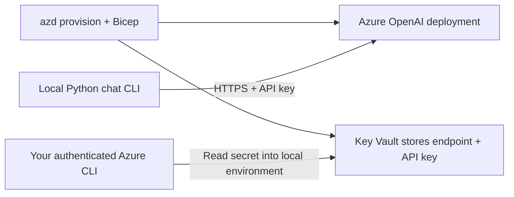

# Azure OpenAI Chat — CLI local e infraestrutura AZD

**Nível:** Intermediário · **Tempo:** 35–60 minutos incluindo configuração

Este exemplo provisiona um **recurso Azure OpenAI e Key Vault**, então executa um
CLI de chat interativo em Python **na sua máquina**. Ele não hospeda uma aplicação web
ou um Container App. O modelo padrão é `gpt-4.1`, versão `2025-04-14`, com
capacidade de implantação `GlobalStandard` 20. Verifique a disponibilidade e cota atuais na
região selecionada antes de provisionar; datas de ciclo de vida do modelo podem mudar.

## Objetivos de aprendizado

- Provisionar infraestrutura de modelo com Bicep e azd.
- Recuperar uma chave API do Key Vault sem colocá-la nas saídas de implantação.
- Enviar solicitações de Chat Completions e manter o histórico da conversa.
- Interpretar contagens de tokens e as limitações das estimativas de custo.



Não há integração de runtime com identidade gerenciada, failover em múltiplas regiões, limitador
de taxa personalizado, modo streaming ou computação hospedada neste exemplo. O SDK OpenAI
realiza até duas tentativas para falhas passíveis de retry; o CLI reporta erros restantes.

## Pré-requisitos

- Uma versão estável atual do [azd](https://learn.microsoft.com/azure/developer/azure-developer-cli/install-azd)
  (versão publicada no momento da revisão: 1.37.2).
- [Azure CLI](https://learn.microsoft.com/cli/azure/install-azure-cli).
- Python **3.10+** (3.11 recomendado) e um ambiente virtual.
- Uma assinatura Azure com permissão para criar recursos de Cognitive Services e Key Vault,
  implantar modelos e ler os segredos do cofre.
- Disponibilidade regional e cota `GlobalStandard` para `gpt-4.1`. Os requisitos de acesso
  dependem da assinatura e do recurso; não há prazo garantido para aprovação.

```bash
azd version
az version
python --version
azd auth login
az login
```

Estas são sessões de autenticação separadas. Selecione a mesma assinatura em ambas
ferramentas antes de executar os comandos abaixo.

## Início rápido (Bash)

Execute a partir da raiz do repositório:

```bash
cd examples/azure-openai-chat
azd env new myopenai
azd provision
```

Escolha uma região suportada. O provisionamento cria um grupo de recursos, conta OpenAI,
implantação de modelo, Key Vault e os segredos `openai-endpoint`/`openai-api-key`.
Não há **serviços para implantar** em `azure.yaml`.

Carregue as saídas não secretas e busque o segredo no seu shell atual:

```bash
export AZURE_OPENAI_ENDPOINT="$(azd env get-value AZURE_OPENAI_ENDPOINT)"
export AZURE_OPENAI_MODEL="$(azd env get-value AZURE_OPENAI_MODEL)"
KV_NAME="$(azd env get-value AZURE_KEY_VAULT_NAME)"
export AZURE_OPENAI_API_KEY="$(az keyvault secret show \
  --vault-name "$KV_NAME" --name openai-api-key --query value --output tsv)"

python -m venv .venv
source .venv/bin/activate
python -m pip install -r src/requirements.txt
python src/chat.py
```

No PowerShell, ative com `.\.venv\Scripts\Activate.ps1` e atribua variáveis de ambiente
com `$env:AZURE_OPENAI_ENDPOINT = azd env get-value AZURE_OPENAI_ENDPOINT`
(e de forma similar para o modelo). Recupere a chave da API usando
`$env:AZURE_OPENAI_API_KEY = az keyvault secret show --vault-name $KV_NAME --name openai-api-key --query value -o tsv`.
Defina `$KV_NAME = azd env get-value AZURE_KEY_VAULT_NAME` primeiro.

Não imprima, faça commit ou cole a chave da API em relatórios de problemas. O CLI lê variáveis de ambiente do processo;
ele **não** obtém segredos do Key Vault nem carrega arquivos `.env`.
`config.py` valida endpoint, limite de token e temperatura na inicialização.

Saída esperada (conteúdo e uso variam):

```text
Azure OpenAI Chat Application
Model: gpt-4.1
...
You: Say hello in one sentence.
Assistant: Hello! How can I help you today?
[Tokens: ... | Cost: $...]
```

Comandos: `stats` mostra totais, `clear` limpa o histórico da conversa, e
`quit`/`exit` encerra a sessão. Não existem comandos `--stream`, `--show-tokens`, `tokens`,
ou `cost`.

## Verifique a implantação

Depois de carregar as variáveis do shell acima:

```bash
curl --fail-with-body \
  "${AZURE_OPENAI_ENDPOINT%/}/openai/deployments/${AZURE_OPENAI_MODEL}/chat/completions?api-version=2024-10-21" \
  -H "Content-Type: application/json" \
  -H "api-key: $AZURE_OPENAI_API_KEY" \
  -d '{"messages":[{"role":"user","content":"Say hello!"}],"max_tokens":50}'

az keyvault secret list --vault-name "$KV_NAME" --query "[].name" -o table
```

Sucesso: a API retorna HTTP 200 com `choices[0].message.content` e `usage`;
o cofre lista `openai-api-key` e `openai-endpoint`. Uma implantação ARM bem-sucedida
sozinha não verifica a inferência.

## Arquivos e configuração

```text
azure.yaml                         # Infrastructure-only AZD project
infra/main.bicep                   # Subscription deployment
infra/main.parameters.json         # Environment, location, principal ID
infra/resources/openai.bicep       # Account + model
infra/resources/keyvault.bicep     # Vault + deploying user's secret access policy
infra/resources/secrets.bicep      # Writes secrets, no key output
src/chat.py                        # Interactive CLI
src/config.py                      # Environment validation
src/requirements.txt               # Python packages
```

Para alterar o modelo/versão/capacidade provisionado, edite os padrões em
`infra/main.bicep` e execute `azd provision`. Definir `AZURE_OPENAI_MODEL` em seu
shell apenas seleciona um **nome de implantação existente**; não implanta outro modelo.

| Variável de tempo de execução | Padrão / origem |
|---|---|
| `AZURE_OPENAI_ENDPOINT` | Obrigatório; saída não secreta do azd |
| `AZURE_OPENAI_API_KEY` | Obrigatório; recuperar do Key Vault |
| `AZURE_OPENAI_MODEL` | `gpt-4.1`; nome da implantação Azure |
| `AZURE_OPENAI_MAX_TOKENS` | 800 (intervalo de validação 1–4096) |
| `AZURE_OPENAI_TEMPERATURE` | 0.7 (intervalo 0–2) |
| `AZURE_OPENAI_INPUT_PRICE_PER_1K` | 0.002 USD; taxa ilustrativa de entrada não armazenada em cache |
| `AZURE_OPENAI_OUTPUT_PRICE_PER_1K` | 0.008 USD; taxa ilustrativa de saída |

## Custos e limitações de segurança

A exibição de custos é uma **estimativa**, não um faturamento da Azure. Multiplica o uso do token da API
pelas taxas configuradas e não considera descontos por entrada em cache,
diferenças regionais/SKU, impostos, mudanças de preço ou chamadas falhadas/retentativas.
Substitua **ambas as taxas** ao usar outro modelo ou SKU e verifique os
[preços do Azure OpenAI](https://azure.microsoft.com/pricing/details/cognitive-services/openai-service/).

Para ilustração, 100 solicitações usando 500 tokens de entrada não em cache e 200 de saída cada
nas taxas padrão custam `100 × (500/1000 × .002 + 200/1000 × .008) = $0.26`.
Operações/armazenamento do Key Vault geram cobranças separadas. Não há cobrança fixa de $50/mês
para este CLI local e não há computação hospedada no modelo.

O cofre usa uma política de acesso para o principal que faz a implantação; não é um exemplo de RBAC ou
aplicação com identidade gerenciada. Endpoints públicos e autenticação por chave de API
são usados para ensino. Limite permissões e adicione controles apropriados de identidade/rede
antes de adaptá-lo para produção.

## Exercícios práticos

### 1. Verificar o contexto e redefini-lo

**Início:** executando CLI. **Objetivo:** observar histórico.
Diga "Lembre-se da palavra cedro", depois pergunte "Qual palavra eu pedi para você lembrar?"
Execute `stats`; duas interações bem-sucedidas devem contar como duas mensagens trocadas.
Execute `clear` e `stats`; mensagens trocadas devem ser zero (totais de tokens permanecem).
A redação exata do modelo não é determinística.

### 2. Alterar o limite de resposta

**Início:** saia do CLI, mantendo o mesmo shell.
Execute `export AZURE_OPENAI_MAX_TOKENS=100`, reinicie `python src/chat.py` e peça
uma explicação curta de azd. Verifique se o banner mostra 100.
Restaure com `unset AZURE_OPENAI_MAX_TOKENS`. Um limite de resposta menor não
reduz tokens de histórico já enviados.

### Problemas comuns

- **Variáveis de ambiente ausentes:** o provisionamento não exporta valores do shell;
  repita as etapas de exportação. Um terminal novo precisa delas novamente.
- **403 ao ler Key Vault:** verifique a assinatura/login do Azure CLI e o principal
  na política de acesso do cofre. Alterações na política podem demorar para propagar.
- **404 inferência:** verifique o nome da implantação, endpoint e status da implantação.
- **429 inferência:** aguarde o reset dos limites de taxa; verifique a cota do modelo regional.
  O CLI remove interações falhas do histórico para que tentativas não se dupliquem.
- **Comprimento do contexto:** o exemplo não trunca conversas longas; use `clear`.
- **Modelo indisponível/aposentado:** consulte a disponibilidade atual do modelo e atualize
  modelo/versão/SKU juntos; a versão da API e a da versão do modelo são configurações diferentes.

## Limpeza e próximos passos

```bash
azd down
unset AZURE_OPENAI_API_KEY
```

A retenção de exclusão suave do Key Vault é de sete dias; purge requer permissões separadas.
Não há uma suíte de testes comprometida; não execute um comando `pytest tests/` inexistente.
Adicione testes de API simulados antes de estender o código.

[Exemplos de contêiner](../../../../examples/container-app) · [Projeto da arquitetura de varejo](../retail-scenario.md) ·
[Página inicial do curso](../../README.md) · [Reportar um problema](https://github.com/microsoft/AZD-for-beginners/issues)

---

<!-- CO-OP TRANSLATOR DISCLAIMER START -->
**Aviso Legal**:
Este documento foi traduzido usando o serviço de tradução por IA [Co-op Translator](https://github.com/Azure/co-op-translator). Embora nos esforcemos pela precisão, por favor, esteja ciente de que traduções automatizadas podem conter erros ou imprecisões. O documento original em seu idioma nativo deve ser considerado a fonte autorizada. Para informações críticas, recomenda-se tradução profissional humana. Não nos responsabilizamos por quaisquer mal-entendidos ou interpretações incorretas decorrentes do uso desta tradução.
<!-- CO-OP TRANSLATOR DISCLAIMER END -->