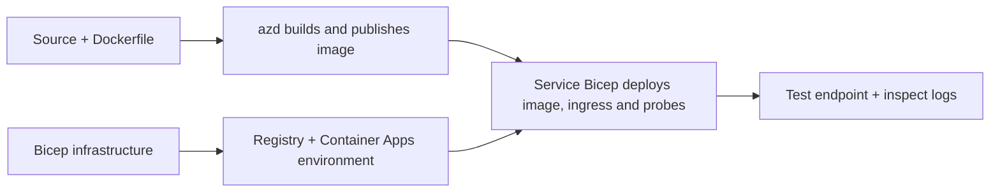

# Exemplos de Implantação de Container App com AZD

Este diretório contém dois exemplos de aprendizado com código-fonte, Dockerfiles,
infraestrutura Bicep e `azure.yaml`. Nenhum deles é preparado para produção.

## Escolha um exemplo

| Exemplo | O que é implementado | Pré-requisito |
|---|---|---|
| [API Flask Simples](../../../../examples/container-app/simple-flask-api) | API CRUD Python simples, itens em memória, sondas de integridade, escala HTTP | Conhecimentos básicos de CLI e HTTP |
| [Microsserviços com dois serviços](../../../../examples/container-app/microservices) | Gateway Node.js, serviço de produto Python somente leitura interno, telemetria e escalabilidade | Completar primeiro o exemplo de serviço único |

Reserve de 30 a 60 minutos incluindo configuração e verificação. O tempo para provisionar Azure varia.

## Pré-requisitos

- [Azure Developer CLI](https://learn.microsoft.com/azure/developer/azure-developer-cli/install-azd)
- [Azure CLI](https://learn.microsoft.com/cli/azure/install-azure-cli) para comandos de verificação
- Docker com seu daemon em execução para construir essas imagens de container
- Uma assinatura Azure com permissões para criação de recursos e cota regional suficiente
- Bash para os exemplos de shell, ou comandos PowerShell equivalentes

```bash
azd version
az version
docker info
azd auth login
az login
```

As duas ferramentas possuem sessões de login separadas. Use uma versão estável atual do azd; a versão
publicada no momento da revisão é 1.37.2. Versões mínimas mais antigas não garantem
compatibilidade.

## Início rápido

A partir da raiz do repositório:

```bash
cd examples/container-app/simple-flask-api
azd env new flask-demo
azd up
API_URL=$(azd env get-value API_ENDPOINT)
curl --fail-with-body "${API_URL}/health"
```

Esperado: HTTP 200 com `"status": "healthy"`. Siga o README de exemplo para criar,
ler, atualizar e excluir um item, e para inspecionar logs.



O provisionamento inicial usa uma imagem pública hello-world na porta 80. Específico do serviço
Os arquivos de parâmetro Bicep permitem que `azd deploy` substitua por ele a imagem do aplicativo compilado
e a porta/probes correta do app (8000 para Flask/produto, 8080 para o gateway).
Mantenha esses arquivos com suas configurações `azure.yaml` `module`.

## Configuração: o que altera o quê

`azure.yaml` seleciona diretórios de origem, idiomas, hosts e módulos de implantação.
CPU/memória do contêiner, ingressos, sondagens, contagem de réplicas e regras de escalonamento são definidos
em **Bicep**, não em propriedades arbitrárias de serviço `resources`, `scale` ou `regions`.

`azd env set SOME_VALUE ...` armazena um valor localmente. Ele só altera um recurso implantado
quando um parâmetro, mapeamento de ambiente ou hook consome explicitamente esse
valor. Esses exemplos não consomem `MAX_REPLICAS`, `SCALE_TO_ZERO_TIMEOUT`,
`CONTAINER_APP_REPLICA_TYPE` ou configurações personalizadas de canário a partir dos valores de ambiente do azd.
Edite o Bicep relevante e execute `azd up` para reprovisionar e implantar.

Não coloque o código-fonte do aplicativo sob `infra/`. `project` deve apontar para o diretório de origem que contém o Dockerfile e o manifesto de dependências.


## Monitoramento e custos

- `azd monitor --logs` abre uma visualização no portal; não é um fluxo de log terminal.
  Use `az containerapp logs show --follow` com o nome real do recurso.
- A API simples grava logs stdout coletados por meio dos Container Apps/Log Analytics.
  Seu recurso Application Insights provisionado não é instrumentado automaticamente.
- O gateway de microsserviços usa o SDK Application Insights do Node.js; o serviço Python
  exporta rastreamentos de logs de aplicação. O rastreamento completo de requisição/dependência em Python
  não está configurado.
- Scale-to-zero pode reduzir custos de computação, mas registro e ingestão/armazenamento de logs
  ainda podem gerar custos. Os padrões dos microsserviços mantêm réplicas em execução.
  Estime sua região e uso na
  [calculadora de preços do Azure](https://azure.microsoft.com/pricing/calculator/).

## Padrões avançados — implementações não incluídas

Estas são direções de design, não projetos locais adicionais ou trechos para copiar e executar:

- **Dados persistentes e autenticação:** substitua armazenamentos em memória e adicione
  autenticação/autorização Microsoft Entra ID antes da produção.
- **Blue-green/canary:** use o modo de múltiplas revisões do Container Apps, rótulos de revisão,
  pesos de tráfego, verificação de integridade e procedimentos de rollback.
  Não há `deploymentStrategy: canary` configuração do azd nestes exemplos.
  Veja [gerenciamento de revisões](https://learn.microsoft.com/azure/container-apps/revisions).
- **Multirregião:** crie ambientes e aplicativos separados no Bicep e planeje
  roteamento global e consistência de dados. Uma lista de serviços `regions` não é um
  mecanismo de implantação do azd.
- **Trabalhadores de fila:** adicione fonte do trabalhador, dependências, recursos de fila,
  uma identidade gerenciada com papéis no plano de dados, e uma regra de escala autenticada.
  Não copie um caminho vazio `src/worker` e espere um projeto executável.
- **Dapr:** provisione componentes, configure o sidecar, instale o SDK correspondente,
  e implemente tratamento de erros de estado/pub-sub.
- **Segredos:** use identidade gerenciada e atribuições de função sempre que possível. Apenas
  criar um Key Vault não concede acesso às aplicações nem carrega segredos.

## Limpeza

Do diretório de amostras:

```bash
azd down
```

Revise os prompts de exclusão e confirme que o grupo de recursos dedicado foi removido.
Não use essas amostras como base para produção sem um design e testes adicionais.

[Índice de exemplos](../README.md) · [Página inicial do curso](../../README.md) ·
[Documentação do Container Apps](https://learn.microsoft.com/azure/container-apps/) ·
[Reportar um problema](https://github.com/microsoft/AZD-for-beginners/issues)

---

<!-- CO-OP TRANSLATOR DISCLAIMER START -->
**Aviso Legal**:
Este documento foi traduzido usando o serviço de tradução por IA [Co-op Translator](https://github.com/Azure/co-op-translator). Embora nos esforcemos pela precisão, por favor, esteja ciente de que traduções automatizadas podem conter erros ou imprecisões. O documento original em seu idioma nativo deve ser considerado a fonte autorizada. Para informações críticas, recomenda-se tradução profissional humana. Não nos responsabilizamos por quaisquer mal-entendidos ou interpretações incorretas decorrentes do uso desta tradução.
<!-- CO-OP TRANSLATOR DISCLAIMER END -->