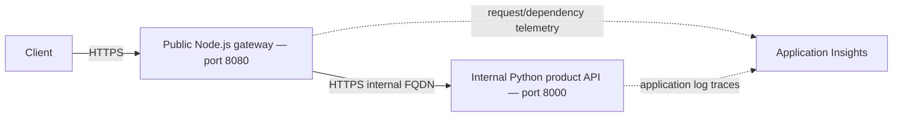

# Microsserviços de Dois Serviços — Azure Container Apps

**Nível:** Intermediário · **Tempo:** 45–60 minutos incluindo configuração

Este exemplo de aprendizado implementa um **API Gateway Node.js** e um **Serviço de Produto Python apenas leitura**. O código-fonte, Dockerfiles, Bicep e configuração azd estão incluídos.
Não é um sistema preparado para produção.


- Usar um FQDN backend interno via HTTPS.
- Verificar respostas de sucesso, não encontrado e serviço indisponível.
- Entender telemetria e limites de escalonamento independentes.




O catálogo de produtos contém cinco produtos fixos em memória. Não há **manipuladores POST,
PUT ou DELETE**, banco de dados, Service Bus, serviço de pedido/usuário/notificação,
C# ou código Go. Essas são ideias para desenvolvimento futuro, não recursos incluídos.
O gateway não autentica usuários; o ingresso interno não substitui
a autorização da aplicação.

## Pré-requisitos

Complete primeiro a [API Flask única](../../../../../examples/container-app/simple-flask-api).
Instale um azd estável atual (versão publicada na revisão: 1.37.2), Azure CLI,
e Docker com o daemon em execução. Você precisa de uma assinatura do Azure, permissões
para criação de recursos e cota regional para Container Apps.

```bash
azd version
az version
docker info
azd auth login
az login
```

Use a mesma assinatura em ambas as ferramentas CLI. Os comandos abaixo usam Bash.

## Implantar e verificar

A partir da raiz do repositório:

```bash
cd examples/container-app/microservices
azd env new microservices-demo
azd up
GATEWAY_URL=$(azd env get-value API_GATEWAY_URL)
RG_NAME=$(azd env get-value AZURE_RESOURCE_GROUP)
GATEWAY_NAME=$(azd env get-value API_GATEWAY_NAME)
PRODUCT_NAME=$(azd env get-value PRODUCT_SERVICE_NAME)

curl --fail-with-body "${GATEWAY_URL}/health"
curl --fail-with-body "${GATEWAY_URL}/api/products"
curl --fail-with-body "${GATEWAY_URL}/api/products/1"
curl -i "${GATEWAY_URL}/api/products/999"
```

**Sucesso:** health 200; list 200 com **cinco** produtos; produto 1 é um Laptop
com preço 999,99 e estoque 50; produto desconhecido retorna 404.
Descrições são incluídas nas respostas; timestamps variam.

A provisão inicial usa imagens públicas hello-world na porta 80, então não tenta
puxar imagens inexistentes de um registro vazio. Módulos Bicep específicos do serviço
e arquivos de parâmetro os substituem por imagens construídas e portas/probes do app durante
`azd deploy`. Parâmetros principais preservam nomes das imagens publicadas para provisão futura.

## Serviços e rede

| Serviço | Endpoints expostos | Recursos padrão |
|---|---|---|
| Gateway | GET `/`, `/health`, `/api/products`, `/api/products/:id` | 1 vCPU, 2 GiB, 2–20 réplicas |
| Produto | GET `/`, `/health`, `/products`, `/products/<id>` | 0.5 vCPU, 1 GiB, 1–10 réplicas |

O ingresso do produto tem `external: false` e `allowInsecure: false`. O Bicep injeta
`PRODUCT_SERVICE_URL=https://<actual-internal-fqdn>` no gateway. HTTP iria
redirect; HTTPS corresponde ao ingress configurado. Um nome DNS curto deve corresponder ao
**nome real do Container App**, não à chave lógica do serviço `product-service`.
Não tente chamar a URL interna diretamente do seu laptop.

O gateway tem um tempo limite de cinco segundos para chamadas de produto. IDs de produto ausentes
propagam como 404; falhas de transporte/outras falhas do backend retornam 503. O gateway
`/health` verifica apenas o gateway, não a disponibilidade do backend.

## Arquivos e configuração

```text
azure.yaml
infra/main.bicep
infra/main.parameters.json
infra/abbreviations.json
infra/core/container-apps-environment.bicep
infra/core/monitor.bicep
infra/app/api-gateway.bicep
infra/app/api-gateway.parameters.json
infra/app/product-service.bicep
infra/app/product-service.parameters.json
src/api-gateway/{app.js,package.json,Dockerfile}
src/product-service/{main.py,requirements.txt,Dockerfile}
```

Escalonamento, CPU/memória, portas e sondas são definidos em `infra/app/*.bicep`. Altere esses
arquivos e execute `azd up` para aplicar a infraestrutura e redistribuir. Não há
parâmetro de variável de ambiente `GATEWAY_MAX_REPLICAS` neste exemplo.

Para alterações apenas de código:

```bash
azd deploy product-service
azd deploy api-gateway
```

A imagem Node usa Node 22; a imagem Python usa Python 3.11. Ambas vinculam a
`0.0.0.0`. Ingress/sondas usam as portas 8080 (gateway) e 8000 (produto), respectivamente.

## Desenvolvimento local com Docker

Execute a partir deste diretório de exemplo. Use uma rede definida pelo usuário, **não `localhost`
para um contêiner alcançar o outro**:

```bash
docker network create azd-microservices-demo
docker build -t local-product ./src/product-service
docker build -t local-gateway ./src/api-gateway
docker run -d --name azd-product --network azd-microservices-demo local-product
docker run -d --name azd-gateway --network azd-microservices-demo \
  -p 8080:8080 -e PRODUCT_SERVICE_URL=http://azd-product:8000 local-gateway
curl --fail-with-body http://localhost:8080/api/products
```

Esperado: cinco produtos. HTTP é usado apenas para esta rede local do Docker.

```bash
docker stop azd-product azd-gateway
docker rm azd-product azd-gateway
docker network rm azd-microservices-demo
```

## Monitoramento

```bash
az containerapp logs show --name "$GATEWAY_NAME" --resource-group "$RG_NAME" --follow
# In a separate terminal:
az containerapp logs show --name "$PRODUCT_NAME" --resource-group "$RG_NAME" --tail 100
```

`azd monitor --logs` abre uma visualização do portal; ele não transmite logs do terminal.
O SDK Node coleta solicitações/dependências do gateway. O `AzureLogHandler` do Python
exporta **rastreamentos de log**, não solicitações Flask automáticas, dependências SQL ou rastreamentos distribuídos completos.
OpenCensus é um SDK legado; prefira o Azure Monitor OpenTelemetry
ao estender este exemplo.

No Application Insights Logs, gere solicitações e inspecione:

```kusto
requests
| where timestamp > ago(1h)
| where name contains "products"
| summarize RequestCount=count(), AvgDuration=avg(duration) by bin(timestamp, 5m)
```

Para mensagens de aplicação Python:

```kusto
traces
| where timestamp > ago(1h)
| where message contains "products"
| project timestamp, message, severityLevel
```

Permita atraso na ingestão e amostragem; não espere uma contagem exata de requisições ou uma
latência garantida. Nenhum alerta ou painel personalizado está configurado.

## Exercícios Práticos

### Exercício 1: Modificar o catálogo

**Ponto de partida:** `src/product-service/main.py`.
**Objetivo:** verificar o deploy independente do serviço.
Altere o estoque de Laptop de 50 para 49 na lista fixa `products`, execute
`azd deploy product-service`, depois solicite `${GATEWAY_URL}/api/products/1`.

**Critério de sucesso / solução:** HTTP 200 com `"stock":49`. Restaure 50 e redeploy.
**Problema comum:** editar o gateway em vez do serviço que possui o catálogo.
Isso altera os dados de origem, não um banco de dados de inventário persistente.

### Exercício 2: Verificar configuração de réplicas

**Ponto de partida:** `infra/app/product-service.bicep`.
**Objetivo:** observar uma mudança na infraestrutura sem adivinhar a autoscaling.
Altere `minReplicas: 1` para `minReplicas: 2`, execute `azd up`, então:

```bash
az containerapp show --name "$PRODUCT_NAME" --resource-group "$RG_NAME" \
  --query properties.template.scale -o json
```

**Critério de sucesso:** mínimo configurado é 2 e máximo permanece 10.
Restaure mínimo 1 e execute `azd up`.
**Problema comum:** `azd deploy` sozinho não aplica mudanças em infraestrutura compartilhada não relacionada.
Não defina `maxReplicas` para zero como simulação de falha.
Isso verifica a configuração, não um teste de carga ou contagem instantânea garantida de réplicas.

### Exercício 3: Testar tratamento de serviço indisponível localmente

**Ponto de partida:** ambos os contêineres Docker locais acima estão rodando.
**Objetivo:** distinguir falha de backend de produto ausente.
Pare apenas o contêiner do produto:

```bash
docker stop azd-product
curl -i http://localhost:8080/api/products
docker start azd-product
curl --fail-with-body http://localhost:8080/api/products
```

**Critério de sucesso:** enquanto parado, o gateway retorna 503 com
`"error":"Product service unavailable"`; após reiniciar, a lista retorna 200.
Tente novamente após um curto atraso de inicialização, se necessário.
**Problema comum:** parar o gateway testa uma falha diferente (sem resposta HTTP).

## Custos e lacunas em produção

Réplicas mínimas padrão mantêm o processamento ativo. Registro e monitoramento também geram
cobranças. Não há um total fixo validado de $50/mês: estime CPU/memória regional,
horas de réplica, requisições, registro e retenção de logs na
[calculadora de preços Azure](https://azure.microsoft.com/pricing/calculator/).
Apague os recursos de aprendizagem prontamente.

Trabalho em produção inclui autenticação/autorização, identidades gerenciadas com escopo,
dados persistentes, validação de entrada/resposta, instrumentação observável suportada,
testes de carga/falha, CI/CD, alertas e procedimentos de recuperação. Adicionar um serviço de pedido,
fila ou banco de dados é uma tarefa de implementação separada, não um exercício finalizado
ou um recurso já disponível aqui.

## Solução de problemas e limpeza

- **Imagem não encontrada durante a primeira provisão:** a inicialização deve usar a imagem pública;
  verifique os padrões de parâmetro da imagem principal e os mapeamentos do módulo de implantação.
- **503 produtos:** verifique os logs do produto, revisão da imagem e URL HTTPS interno injetado.
- **404 caminho inesperado:** a API do produto é somente leitura; verifique a rota, não um manipulador CRUD inexistente.
- **Sem telemetria:** inspecione strings de conexão em tempo de execução sem expô-las e
  permita atraso na ingestão. Tabelas de requisições Python não são populadas pelo seu manipulador de logs.

A partir deste diretório de amostra:

```bash
azd down
```

Reveja os prompts de exclusão e verifique se o grupo de recursos dedicado foi removido.

[Anterior: Flask API](../../../../../examples/container-app/simple-flask-api) · [Próximo: aplicativo de Banco de Dados](../../../../../examples/database-app) ·
[Desenvolvimento de IA](../../../docs/chapter-02-ai-development/README.md) ·
[Página inicial do curso](../../../README.md) · [Reportar um problema](https://github.com/microsoft/AZD-for-beginners/issues)

---

<!-- CO-OP TRANSLATOR DISCLAIMER START -->
**Aviso Legal**:
Este documento foi traduzido usando o serviço de tradução por IA [Co-op Translator](https://github.com/Azure/co-op-translator). Embora nos esforcemos pela precisão, por favor, esteja ciente de que traduções automatizadas podem conter erros ou imprecisões. O documento original em seu idioma nativo deve ser considerado a fonte autorizada. Para informações críticas, recomenda-se tradução profissional humana. Não nos responsabilizamos por quaisquer mal-entendidos ou interpretações incorretas decorrentes do uso desta tradução.
<!-- CO-OP TRANSLATOR DISCLAIMER END -->