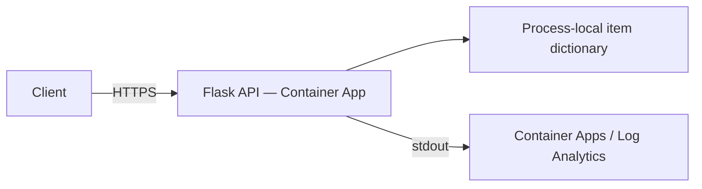

# API Simples Flask — Azure Container Apps

**Nível:** Iniciante · **Tempo:** 30–45 minutos incluindo a configuração

Implante uma API CRUD Python Flask com Azure Developer CLI (azd). Código-fonte, Dockerfile,
Bicep e parâmetros de implantação estão incluídos. Este é um **exemplo para aprendizado**, não
uma API pronta para produção.

## O que você vai aprender

- Construir e publicar um container através do azd.
- Configurar ingress e sondas de liveness/readiness.
- Verificar respostas CRUD e inspecionar logs da aplicação.
- Entender por que dados em memória são inadequados para aplicações duráveis.



**Importante:** os itens ficam em um processo. O padrão é **um worker Gunicorn,
0–1 réplicas**, intencionalmente evitando dados inconsistentes entre workers/replicas.
Os itens são perdidos ao reiniciar, alterar revisão ou escalar para zero. Aumentar réplicas
exige armazenamento persistente compartilhado. A API não possui autenticação ou autorização.

## Pré-requisitos

- [azd estável atual](https://learn.microsoft.com/azure/developer/azure-developer-cli/install-azd)
  (versão publicada na revisão: 1.37.2).
- [Azure CLI](https://learn.microsoft.com/cli/azure/install-azure-cli) para verificação.
- Docker com daemon ativo; necessário para a construção padrão da imagem local.
- Assinatura Azure, permissões para criação de recursos e cota regional de Container Apps.
- Bash para os comandos abaixo (ou PowerShell equivalente).
- Python 3.11 para desenvolvimento local opcional.

```bash
azd version
az version
docker info
azd auth login
az login
```

As ferramentas CLI têm sessões de login separadas. Use a mesma assinatura em ambas.

## Início rápido

A partir da raiz do repositório:

```bash
cd examples/container-app/simple-flask-api
azd env new flask-demo
azd up
API_URL=$(azd env get-value API_ENDPOINT)
RG_NAME=$(azd env get-value AZURE_RESOURCE_GROUP)
API_NAME=$(azd env get-value API_NAME)
curl --fail-with-body "${API_URL}/health"
```

Esperado: HTTP 200 e JSON com `"status":"healthy"`,
`"service":"simple-flask-api"`, e um timestamp UTC atual.
Provisionamento e construção de imagem normalmente levam vários minutos; o tempo varia.

O provisionamento inicial usa uma imagem pública hello-world ouvindo na porta 80.
`azure.yaml` seleciona `infra/app/api.bicep` e seu arquivo de parâmetros correspondente para
implantação do serviço, que troca imagem, ingress e sondas para a porta 8000.
Não exclua esses parâmetros de implantação.

## Verifique CRUD

Execute o seguinte em sequência enquanto a mesma réplica permanece ativa:

```bash
# Create: HTTP 201; note the returned id (1 for a fresh process).
curl -i -X POST "${API_URL}/api/items" \
  -H "Content-Type: application/json" \
  -d '{"name":"Test Item","description":"My first item"}'

# Read list: HTTP 200, total 1 in a fresh process.
curl --fail-with-body "${API_URL}/api/items"

# Replace 1 if your create response returned another id.
curl --fail-with-body "${API_URL}/api/items/1"
curl -i -X PUT "${API_URL}/api/items/1" \
  -H "Content-Type: application/json" -d '{"name":"Updated Item"}'
curl -i -X DELETE "${API_URL}/api/items/1"
curl -i "${API_URL}/api/items/1"
```

Sucesso: POST 201, leituras/PUT 200, DELETE 204 sem corpo, depois item ausente 404.
JSON malformado/não-objeto ou nome vazio retorna 400.
Se um item desaparecer entre requisições, verifique reinício ou escala para zero;
essa é uma limitação intencional em memória, não persistência.

| Endpoint | Métodos |
|---|---|
| `/` | GET — informações do serviço |
| `/health` | GET — liveness/readiness |
| `/api/items` | GET, POST |
| `/api/items/{id}` | GET, PUT, DELETE |

## Logs e configuração

```bash
az containerapp logs show --name "$API_NAME" --resource-group "$RG_NAME" --follow
```

Esperado: inicialização do Gunicorn, logs de acesso a requisições e mensagens da aplicação.
`azd monitor --logs` abre uma visualização portal; não transmite para o terminal.
Application Insights é provisionado mas **não é instrumentado por este código Flask**;
use Container Apps/Log Analytics para logs stdout.

Edite `infra/app/api.bicep` para CPU/memória, limites de réplica ou regras de escala, então
execute `azd up`. Padrões são 0.5 vCPU, 1 GiB, mínimo 0 / máximo 1 réplica, e um
limite HTTP de 50 requisições concorrentes. Escalar para zero pode adicionar latência de cold-start.

Valores arbitrários `azd env set MAX_REPLICAS`, `API_KEY`, `LOG_LEVEL`, ou
`SCALE_TO_ZERO_TIMEOUT` não são **conectados a este template ou app**.
Definir um valor não o torna automaticamente uma variável de ambiente em tempo de execução.
A imagem vincula a porta 8000 explicitamente; atualize Dockerfile, ingress do Bicep e sondas
juntos se mudar a porta.

## Arquivos

```text
azure.yaml
infra/main.bicep
infra/main.parameters.json
infra/app/container-apps.bicep       # Environment, registry, monitoring
infra/app/api.bicep                  # App, ingress, probes, scale settings
infra/app/api.parameters.json        # Image and resource values for azd deploy
src/app.py
src/Dockerfile
src/requirements.txt
```

## Desenvolvimento local

A partir deste diretório de exemplo:

```bash
python -m venv .venv
source .venv/bin/activate  # PowerShell: .\.venv\Scripts\Activate.ps1
python -m pip install -r src/requirements.txt
python src/app.py
```

Em outro terminal, teste `http://localhost:8000/health` e os endpoints CRUD.
Ou construa e execute a imagem real:

```bash
docker build -t flask-api:local ./src
docker run --rm -p 8000:8000 flask-api:local
```

Para mudanças só de código após o primeiro deployment, execute `azd deploy api`.
Para mudanças no Bicep, execute `azd up` para reprovisionar e implantar.

## Exercícios práticos

### 1. Validar rejeição de entrada

**Ponto de partida:** API implantada, `API_URL` acima.
**Objetivo:** verificar se a API rejeita formatos JSON inválidos e nomes ausentes.

```bash
curl -i -X POST "${API_URL}/api/items" \
  -H "Content-Type: application/json" -d '[]'
curl -i -X POST "${API_URL}/api/items" \
  -H "Content-Type: application/json" -d '{"name":""}'
```

**Critérios de sucesso / solução:** ambos retornam 400 com erro JSON, não 500.
**Problema comum:** omissão do cabeçalho content-type JSON.

### 2. Adicionar endpoint de versão somente leitura

**Ponto de partida:** `src/app.py`. **Objetivo:** estender e reimplantar a API.
Adicione isto antes do bloco `if __name__ == '__main__':`:

```python
@app.route('/version', methods=['GET'])
def version():
    return jsonify({'version': '1.0.0'})
```

Execute `azd deploy api`, depois `curl --fail-with-body "${API_URL}/version"`.
**Critérios de sucesso:** HTTP 200 e `{"version":"1.0.0"}`.
**Problema comum:** colocar a rota depois da chamada bloqueante `app.run()` ao
testar com `python src/app.py`.

### Ponto de verificação de conhecimento

Por que um worker é insuficiente para dados duráveis? Porque mesmo um processo perde
seu dicionário ao reiniciar. Uma versão para produção precisa de armazenamento persistente compartilhado,
autenticação, autorização, migrações, testes e monitoramento operacional.

## Custos e solução de problemas

Esta não é uma implantação garantida $0: o registro Básico e o armazenamento/ingestão de logs
podem gerar custos mesmo com compute da app em zero. Use a
[calculadora de preços](https://azure.microsoft.com/pricing/calculator/) para sua região.

- **Falha na build Docker:** confirme `docker info`, acesso à rede e dependências.
- **App não saudável:** inspecione logs de console/sistema e verifique porta da imagem, ingress,
  e sondas estarem corretos. Um placeholder não deve ser sondado na porta do Flask.
- **403/permissões:** confirme permissões de assinatura e criação de recursos.
- **Itens desaparecem:** estado em memória é resetado no reinício/escala para zero; adicione um banco de dados
  para comportamento durável.

## Limpeza e próximos passos

```bash
azd down
```

Revise o prompt de exclusão e confirme que o grupo de recursos dedicado foi removido.
Não utilize limpeza destrutiva em grupos de recursos que contenham dados não relacionados.

[Próximo: Aplicativo de banco de dados](../../../../../examples/database-app) · [Microsserviços](../../../../../examples/container-app/microservices) ·
[Visão geral do container](../README.md) · [Página inicial do curso](../../../README.md) ·
[Reportar um problema](https://github.com/microsoft/AZD-for-beginners/issues)

---

<!-- CO-OP TRANSLATOR DISCLAIMER START -->
**Aviso Legal**:
Este documento foi traduzido usando o serviço de tradução por IA [Co-op Translator](https://github.com/Azure/co-op-translator). Embora nos esforcemos pela precisão, por favor, esteja ciente de que traduções automatizadas podem conter erros ou imprecisões. O documento original em seu idioma nativo deve ser considerado a fonte autorizada. Para informações críticas, recomenda-se tradução profissional humana. Não nos responsabilizamos por quaisquer mal-entendidos ou interpretações incorretas decorrentes do uso desta tradução.
<!-- CO-OP TRANSLATOR DISCLAIMER END -->