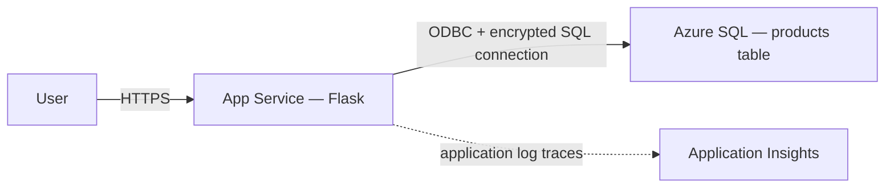

# Flask e Azure SQL no App Service

**Nível:** Intermediário · **Tempo:** 30–60 minutos incluindo pré-requisitos

Este exemplo implanta uma API de leitura Python Flask no **Linux App Service** e um banco de dados Azure SQL Basic.
Código-fonte, Bicep e configuração azd estão incluídos. É uma
aplicação de aprendizado, não uma arquitetura de banco de dados pronta para produção.

## O que você aprenderá

- Provisionar recursos do App Service, SQL e monitoramento com Bicep.
- Configurar conectividade SQL criptografada sem comprometer credenciais.
- Inicializar um schema antes de iniciar os workers Gunicorn.
- Verificar dados semeados, respostas de não encontrado e saúde do banco de dados.



Recursos: grupo de recursos dedicado, plano B1 Linux App Service, Aplicativo Web Python 3.11,
servidor SQL e banco de dados Básico de 2 GB, Application Insights e Log Analytics.
O Aplicativo Web usa **implantação por source/ZIP e instalação de dependência Oryx**;
`azd deploy` não compila ou implanta o Dockerfile opcional.

## Pré-requisitos

- Versão estável atual do [azd](https://learn.microsoft.com/azure/developer/azure-developer-cli/install-azd)
  (versão publicada na época da revisão: 1.37.2).
- [Azure CLI](https://learn.microsoft.com/cli/azure/install-azure-cli) para verificação.
- Assinatura do Azure, permissões para criar os recursos listados e cota regional.
- Python **3.11** para desenvolvimento local; o `pyodbc==5.0.1` comprometido pode requerer
  ferramentas de compilação nativas em versões mais recentes do Python.
- Microsoft ODBC Driver 18 (ou 17) para SQL Server em máquinas locais. `pip install
  pyodbc` não instala o driver do sistema. Veja
  [instalação do ODBC](https://learn.microsoft.com/sql/connect/odbc/download-odbc-driver-for-sql-server).
- Docker somente se for testar o contêiner opcional localmente.

```bash
azd version
az version
azd auth login
az login
```

Use a mesma assinatura em ambas as ferramentas. Os comandos abaixo usam Bash.

## Implantar

A partir da raiz do repositório:

```bash
cd examples/database-app
azd env new sql-demo
azd provision
azd deploy
WEB_URL=$(azd env get-value WEB_APP_URI)
WEB_NAME=$(azd env get-value WEB_APP_NAME)
RG_NAME=$(azd env get-value AZURE_RESOURCE_GROUP)
```

Escolha uma região suportada. `sqlAdminLogin` assume como padrão `sqladmin`; a
`sqlAdminPassword` requerida é um parâmetro seguro. Forneça uma senha forte quando solicitado.
Mantenha as credenciais de implantação fora do Git e dos relatórios de erros. A conexão atual
a interpolação de string espera uma senha sem delimitadores de string de conexão como
`;`; adapte a escape antes de usar esses valores.

O Bicep define um comando de inicialização que executa `init_database()` **antes** dos
workers do Gunicorn iniciarem. Isso é necessário porque importar `app:app` não executa
o bloco `if __name__ == '__main__'` do Python. Em um banco de dados novo, a inicialização
cria `products` e insere cinco linhas. É uma semente didática simples, não uma
estrutura de migração concorrente; utilize migrações apropriadas antes de escalar instâncias.

O aplicativo seleciona o Microsoft ODBC Driver 18 instalado, depois o 17, caso a string de conexão
não nomeie explicitamente um driver. Se nenhum existir, a inicialização falha com
um erro de instalação que pode ser resolvido. Verifique a disponibilidade do driver em seu
tempo de execução do App Service selecionado em vez de presumir que está disponível.

## Verificar

```bash
curl --fail-with-body "${WEB_URL}/"
curl --fail-with-body "${WEB_URL}/health"
curl --fail-with-body "${WEB_URL}/products"
curl --fail-with-body "${WEB_URL}/products/1"
curl -i "${WEB_URL}/products/999"
```

Esperado:

- `/` retorna informações do endpoint.
- `/health` retorna 200 com `{"status":"healthy","database":"connected"}`.
- `/products` retorna cinco produtos pré-carregados em um banco de dados novo.
- `/products/1` retorna Laptop com preço 1299.99.
- Um produto inexistente retorna 404 com `{"error":"Product not found"}`.

A API é somente leitura. Não há rotas POST/PUT/DELETE nem interface de navegador.
Falha na conexão com o banco de dados retorna 503 de `/health`; não é sucesso.

## Arquivos e configuração

```text
azure.yaml                         # Python App Service source deployment
infra/main.bicep
infra/main.parameters.json
infra/abbreviations.json
infra/resources/sql-server.bicep
infra/resources/sql-database.bicep
infra/resources/app-service-plan.bicep
infra/resources/web-app.bicep       # Settings + initialization/startup command
infra/resources/app-insights.bicep
src/web/app.py
src/web/requirements.txt
src/web/Dockerfile                 # Optional local container, not the azd target
.env.sample
```

`SQL_CONNECTION_STRING` é passado como parâmetro Bicep seguro para o módulo Web App
e armazenado nas configurações do App Service, não nas saídas de implantação.
`APPLICATIONINSIGHTS_CONNECTION_STRING` configura a exportação de logs.
`SCM_DO_BUILD_DURING_DEPLOYMENT=true` habilita a instalação de dependências no lado do servidor.
Definir valores arbitrários de `azd env` não altera automaticamente as configurações do app.

A regra `0.0.0.0` do firewall SQL permite conexões de **serviços Azure,
incluindo assinaturas de outros clientes**, sujeitas à autenticação SQL. Não está
restrito a este app ou assinatura. O acesso à rede pública SQL está ativado.
Use redes com escopo restrito e identidade de aplicação não administrativa antes da produção.

## Desenvolvimento local

Use Python 3.11 e um driver Microsoft SQL ODBC instalado:

```bash
python -m venv .venv
source .venv/bin/activate  # PowerShell: .\.venv\Scripts\Activate.ps1
python -m pip install -r src/web/requirements.txt
export SQL_CONNECTION_STRING='Server=tcp:YOUR_SERVER.database.windows.net,1433;Database=YOUR_DATABASE;UID=YOUR_USER;PWD=YOUR_PASSWORD;Encrypt=yes;TrustServerCertificate=no;Connection Timeout=30;'
python src/web/app.py
```

Substitua os espaços reservados com segurança. Um arquivo `.env` copiado **não é carregado automaticamente**
por esta aplicação. Exporte variáveis no shell atual em vez disso.
Para Azure SQL a partir de um laptop, permita temporariamente apenas seu próprio IP público:

```bash
SQL_SERVER=$(azd env get-value SQL_SERVER_NAME)
MY_IP=YOUR_PUBLIC_IP
az sql server firewall-rule create -g "$RG_NAME" -s "$SQL_SERVER" \
  -n AllowMyLearningIP --start-ip-address "$MY_IP" --end-ip-address "$MY_IP"
```

Remova a regra após os testes:

```bash
az sql server firewall-rule delete -g "$RG_NAME" -s "$SQL_SERVER" -n AllowMyLearningIP
```

Teste opcional de container a partir deste diretório de exemplo:

```bash
docker build -t sql-flask:local src/web
docker run --rm -p 8000:8000 -e SQL_CONNECTION_STRING sql-flask:local
```

Esta imagem instala o Driver 18 usando o repositório de pacotes Debian 12 correspondente à base
Bookworm, inicializa o banco de dados uma vez e então inicia o Gunicorn.

## Monitoramento e solução de problemas

Ative/visualize logs de aplicação do sistema de arquivos do App Service ao diagnosticar a inicialização:

```bash
az webapp log config --name "$WEB_NAME" --resource-group "$RG_NAME" \
  --application-logging filesystem --level information
az webapp log tail --name "$WEB_NAME" --resource-group "$RG_NAME"
```

Este código exporta **rastros de logs** da aplicação através de um handler legado OpenCensus.
Não configura rastreamento automático de requisições/dependências Flask, Live Metrics,
auditoria SQL, configurações diagnósticas ou alertas. Estes requerem configuração separada.
Para nova instrumentação, prefira Azure Monitor OpenTelemetry.

No Application Insights Logs, após fazer requisições API:

```kusto
traces
| where timestamp > ago(1h)
| where message contains "products" or message contains "Health check"
| project timestamp, message, severityLevel
```

Permita atraso na ingestão. Atividade na tabela de requisições ou Live Metrics não
é critério de conclusão para esta instrumentação apenas de logs.

- **Driver ausente:** inspecione `pyodbc.drivers()` no runtime e instale um
  driver Microsoft ODBC suportado. Um pacote Python sozinho não é suficiente.
- **Falha na conexão:** verifique configurações SQL, credenciais, firewall e assinatura
  selecionada. Não desabilite a criptografia para contornar um erro.
- **Tabela de produtos ausente:** confirme que o comando de inicialização Bicep foi implantado;
  iniciar apenas `gunicorn app:app` ignora a inicialização.
- **Falha na construção do pacote:** use Python 3.11 ou forneça pré-requisitos de build nativos.
- **Dados com preço zero:** zero é um preço decimal válido; deve ser serializado como 0.0,
  não `null`.

## Exercícios práticos

### Exercício 1: Verificar comportamento de produto ausente

**Ponto de partida:** API implantada e `WEB_URL` acima.
**Objetivo:** distinguir uma linha ausente de um banco de dados quebrado.
Requisitar `/health` e `/products/999` usando os comandos acima.
**Critérios de sucesso/resposta:** status 200 de saúde, produto inexistente com 404 (não 500 ou 503).
**Problema comum:** assumir que resposta não encontrada comprova conexão SQL quebrada.

### Exercício 2: Alterar um valor pré-carregado

**Ponto de partida:** Editor de Consultas Azure SQL, conectado ao banco de dados de exemplo.
**Objetivo:** mostrar que dados da API são armazenados em SQL e não na memória do processo.

```sql
UPDATE products SET price = 0 WHERE id = 1;
SELECT id, name, price FROM products WHERE id = 1;
```

Requisitar `${WEB_URL}/products/1`. **Critério de sucesso:** preço é `0.0`, não `null`.
Restaure o valor:

```sql
UPDATE products SET price = 1299.99 WHERE id = 1;
```

**Problema comum:** editar a lista seed do Python não atualiza linhas já no SQL.
Não execute exercícios de esquema/dados contra banco de dados de produção.

### Exercício 3: Adicionar um endpoint de contagem somente leitura

**Ponto de partida:** `src/web/app.py`.
**Objetivo:** estender a API usando uma consulta agregada sem parâmetros.
Adicione isto antes do bloco `if __name__ == '__main__':`:

```python
@app.route('/product-count')
def product_count():
    from contextlib import closing
    with closing(get_db_connection()) as conn, closing(conn.cursor()) as cursor:
        cursor.execute("SELECT COUNT(*) FROM products")
        return jsonify({'count': cursor.fetchone()[0]})
```

Rode `azd deploy web`, depois faça requisição `${WEB_URL}/product-count`.
**Critério de sucesso:** 200 com `{"count":5}` no banco de dados com seed intacto.
**Problema comum:** mudar a rota mas esquecer de reimplantar.
Para produção, adicione tratamento de erros/testes; este exercício curto foca na consulta.

## Custos, lacunas para produção e limpeza

O App Service B1 e o banco de dados Basic são cobrados enquanto provisionados. Parar o
Web App **não** para a cobrança do plano App Service. Logs e armazenamento podem gerar custos.
Use a [calculadora de preços Azure](https://azure.microsoft.com/pricing/calculator/)
para preços regionais atuais. Mudar para F1 também requer desabilitar `alwaysOn`;
não é uma troca simples. O SQL serverless não é automaticamente gratuito.

Trabalho para produção inclui identidade de app com privilégios mínimos (não admin SQL),
autenticação/autorização, rede privada, migrações seguras, revisão de pooling/ciclo de conexão,
telemetria, auditoria, alertas, testes e procedimentos de recuperação.
Cache Redis e tabelas adicionais são ideias para desenvolvimento, não exercícios implementados.

A partir deste diretório de exemplo:

```bash
azd down
```

Revise o prompt de exclusão e verifique que o grupo de recursos dedicado foi removido.
Não exclua grupos contendo dados não relacionados.

[Exemplos de container](../../../../examples/container-app) ·
[Desenvolvimento de IA](../../docs/chapter-02-ai-development/README.md) ·
[Página do curso](../../README.md) · [Reportar um problema](https://github.com/microsoft/AZD-for-beginners/issues)

---

<!-- CO-OP TRANSLATOR DISCLAIMER START -->
**Aviso Legal**:
Este documento foi traduzido usando o serviço de tradução por IA [Co-op Translator](https://github.com/Azure/co-op-translator). Embora nos esforcemos pela precisão, por favor, esteja ciente de que traduções automatizadas podem conter erros ou imprecisões. O documento original em seu idioma nativo deve ser considerado a fonte autorizada. Para informações críticas, recomenda-se tradução profissional humana. Não nos responsabilizamos por quaisquer mal-entendidos ou interpretações incorretas decorrentes do uso desta tradução.
<!-- CO-OP TRANSLATOR DISCLAIMER END -->