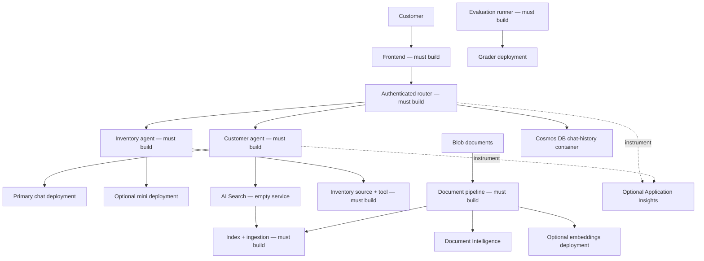

# Suporte ao Cliente Multiagente — Blueprint de Arquitetura para Varejo

**Capítulo 5: Soluções de IA Multiagente**

- [Página inicial do curso](../README.md)
- [Capítulo 5](../docs/chapter-05-multi-agent/README.md)
- [Pré-requisito: Integração de IA](../docs/chapter-02-ai-development/microsoft-foundry-integration.md)
- [Próximo: Planejamento de capacidade](../docs/chapter-06-pre-deployment/capacity-planning.md)
- [Estrutura de infraestrutura ARM](retail-multiagent-arm-template/README.md)

> **Guia de arquitetura, não uma aplicação funcional.** Os únicos arquivos de implementação no varejo
> são `azuredeploy.json`, `azuredeploy.parameters.json` e `deploy.sh` em
> `retail-multiagent-arm-template/`. Os containers de roteador/frontend são marcadores de espaço hello-world.
> Nenhum agente de varejo, UI, pipeline de ingestão, avaliador, scanner ou
> suíte de testes de aplicação existe localmente.

## Visão Geral

**Objetivo:** projetar um sistema de suporte ao cliente com um agente de atendimento e um agente de inventário,
identificar o que a infraestrutura oferece e planejar os contratos de aplicação pendentes e a verificação.


**Público:** desenvolvedores que completaram o local
[exemplo de chat](../../../examples/azure-openai-chat) e [exemplo de contêiner com dois serviços](../../../examples/container-app/microservices).
Reserve 2–3 horas para estudo arquitetônico. Construir a aplicação é um projeto separado:
80–120 horas de desenvolvimento é uma estimativa ilustrativa de planejamento para
desenvolvedores experientes, **não uma promessa de entrega**; hardening de produção, testes,
revisão de segurança e operações requerem trabalho adicional.

### Resultados de aprendizado

- Explicar roteamento, grounding, permissões de ferramentas e propriedade da conversa.
- Distinguir identificadores de modelo, nomes de implantação, versões de API e versões ARM.
- Projetar ingestão e recuperação de documentos com dimensões vetoriais correspondentes.
- Definir requisitos funcionais verificáveis, de avaliação e recuperação de falhas.
- Separar objetivos opcionais de arquitetura dos recursos realmente provisionados.

## Arquitetura da Solução



Esta é uma **arquitetura-alvo da aplicação**, não um diagrama dos serviços agentes em execução.
O scaffold ARM cria os serviços subjacentes e apenas dois contêineres placeholder.
Front Door, registro, identidades gerenciadas, atribuições de funções,
endpoints privados, failover, instrumentação da aplicação e alertas não estão incluídos.

### Responsabilidades e contratos

| Componente | Comportamento exigido | Evidência antes de considerar concluído |
|---|---|---|
| Frontend | Autenticar usuários, renderizar chat, enviar documentos com segurança | Testes de UI e upload, erros acessíveis |
| Roteador | Autorizar solicitações, escolher agente, limitar chamadas/tempo das ferramentas | Testes de roteamento, verificações de autorização, testes de falha |
| Agente do cliente | Basear respostas de política/produto em fontes aprovadas | Citações corretas, abstenção quando dados ausentes |
| Ferramenta de inventário | Ler estoque autoritário com permissões delimitadas | Testes determinísticos de estoque; sem disponibilidade inventada |
| Pipeline de documentos | Extrair, dividir, embutir, indexar, atualizar/excluir | Fixtures indexadas e comportamento de retry/dead-letter |
| Armazenamento de conversa | Isolar usuários, aplicar retenção | Testes de autorização cruzada e TTL entre usuários |
| Executor de avaliação | Comparar saídas com verdade básica e rubrica | Cobertura, contagem de falhas, relatórios reproduzíveis |

Pense no roteador como uma recepção e nas ferramentas como sistemas internos restritos:
escolher um especialista não é autorização para acessar todos os registros de clientes.
Aplique identidade e permissões no código da aplicação e nos serviços de dados, não nos prompts.

## Infraestrutura versus Aplicação

Leia o [README do scaffold](retail-multiagent-arm-template/README.md) antes de
provisionar. Ele lista recursos exatos, modos, custos e limitações.

| Uso lógico | Nome de implantação ARM | Modelo / versão | Região padrão |
|---|---|---|---|
| Chat do cliente | `gpt-4.1-chat` | `gpt-4.1` / `2025-04-14` | `eastus2` |
| Inventário | `gpt-4.1-mini-inventory` | `gpt-4.1-mini` / `2025-04-14` | `westus2`, opcional |
| Embeddings | `text-embedding-ada-002` | `text-embedding-ada-002` / `2` | `francecentral`, opcional |
| Avaliação | `gpt-4.1-grader` | `gpt-4.1` / `2025-04-14` | Região primária por padrão |

Verifique disponibilidade de modelo/versão/SKU e cota em **cada região**. Chat/mini/grader
usam `GlobalStandard`; embeddings usam `Standard`. Mapeamentos de unidade de capacidade para TPM são
específicos do modelo. Não adicione unidades de capacidade diferentes como garantia universal de cota.

O argumento `model` de uma requisição Azure OpenAI é o **nome da implantação**, não
necessariamente o identificador do modelo do catálogo. A versão da API do data-plane `2024-10-21`
é distinta da versão do modelo `2025-04-14` e do recurso ARM `apiVersion`.
Não é possível corrigir um modelo indisponível alterando apenas a versão da API do data-plane.

`--no-multi-region` ignora contas secundárias e de embeddings. Permanecem uma conta primária de chat e
outra independente de grader. Contas separadas de modelo não oferecem failover automático;
isso requer roteamento na aplicação, implantações compatíveis, verificações de saúde,
limites de retry e revisão de residência de dados.

## Roteiro de Implementação

### 1. Comece com uma interação testada

Antes de provisionar o scaffold grande, use o exemplo local de chat para estabelecer
conectividade de inferência. Defina uma pergunta representativa do cliente, a fonte de respostas
aprovada, citação esperada e comportamento de falha quando a fonte estiver ausente.

### 2. Defina limites de roteamento e ferramentas

Crie seu próprio código-fonte de roteador, manifesto de dependência, Dockerfile e testes. Um
contrato ilustrativo poderia ser `POST /chat` com `{"message":"...","conversation_id":"..."}`.
**Este endpoint é uma proposta de design; não é implementado pelo template ARM.**

Valide tipos/limites dos corpos, obtenha identidade do usuário pela autenticação, aplique
propriedade da conversa, limite tempos de requisição e retorne códigos de erro significativos.
Não trate falhas HTTP ou respostas vazias como resultados de agente bem-sucedidos.

### 3. Implemente grounding e ingestão

O template ARM não cria um índice de busca. Isto é um **fragmento JSON de referência
para adaptar em sua própria definição de índice**, não um arquivo já presente no repositório:

```json
{
  "name": "retail-product-index",
  "fields": [
    {"name": "id", "type": "Edm.String", "key": true},
    {"name": "title", "type": "Edm.String", "searchable": true},
    {"name": "content", "type": "Edm.String", "searchable": true},
    {"name": "category", "type": "Edm.String", "filterable": true},
    {
      "name": "content_vector",
      "type": "Collection(Edm.Single)",
      "searchable": true,
      "dimensions": 1536,
      "vectorSearchProfile": "retail-profile"
    }
  ],
  "vectorSearch": {
    "algorithms": [{"name": "retail-hnsw", "kind": "hnsw"}],
    "profiles": [{"name": "retail-profile", "algorithm": "retail-hnsw"}]
  }
}
```

O perfil vincula o campo vetorial ao seu algoritmo. Dimensões devem corresponder à
saída real do embedding (1536 para esta implantação `ada-002`). Para recuperação em Python,
use `azure.search.documents.models.VectorizedQuery` ao invés de um
dicionário incompleto sem o tipo da consulta vetorial:

```python
# Reference function only: supply an authenticated async SearchClient and an embedding.
from azure.search.documents.models import VectorizedQuery

async def retrieve(search_client, embedding):
    results = await search_client.search(
        search_text=None,
        vector_queries=[VectorizedQuery(
            vector=embedding,
            k_nearest_neighbors=5,
            fields="content_vector"
        )],
        select=["id", "title", "content"]
    )
    return [document async for document in results]
```

Crie uma implementação separada de ingestão que:

1. Autorize acesso de upload e valide tipo e tamanho do conteúdo.
2. Leia blobs privados usando chamadas SDK autenticadas. Uma URL de blob privado isoladamente
   **não é** uma entrada legível para Document Intelligence; envie bytes baixados com
   `AnalyzeDocumentRequest(bytes_source=...)` ou use um SAS apropriado,
   com escopo limitado e curta duração após revisar os requisitos de acesso.
3. Extraia texto, divida em blocos para caber nos limites de embedding e gere embeddings.
4. Crie chaves estáveis e válidas para documentos e faça upload de blocos com vetores correspondentes.
5. Verifique resultados de indexação por documento, gerencie tentativas e atualize/exclua dados obsoletos.

Não interpole chaves/valores arbitrários do usuário em filtros OData. Liste os campos permitidos,
valide os tipos de valor e escape aspas em strings. Filtros booleanos e numéricos precisam
de literais tipados, não strings entre aspas.

### 4. Grounding web

**Bing Search v7 foi aposentado em 11 de agosto de 2025.** O antigo recurso `Microsoft.Bing/accounts`
e exemplos `api.bing.microsoft.com/v7.0/search` não são um caminho de implementação suportado.
Avalie uma integração de grounding atualmente suportada no Microsoft Foundry e seu SDK,
permissões, cobrança e requisitos de citação; nenhuma está implementada aqui. Não é um substituto
direto para o endpoint aposentado.

### 5. Adicione telemetria e avaliação

Criar Application Insights não instrumenta o código. Use a instrumentação OpenTelemetry suportada do Azure Monitor
ao construir uma aplicação nova, propague contexto de rastreamento entre serviços e evite registrar prompts,
documentos ou segredos do cliente.
Truncar uma consulta **não** a anonimiza.

Meça duração de requisição, falhas de roteamento/ferramenta, relevância da recuperação, correção de citação,
uso de tokens e abstenção. Armazene fatos reais de inventário/política
junto com casos de avaliação: um avaliador não pode determinar a precisão factual
apenas com a pergunta e a resposta.

Uma implantação de avaliador não é um executor de avaliação. Implemente uma rubrica versionada,
saída estruturada/validação de esquema, verificações de faixa de pontuação,
contagens de falhas de transporte e casos revisados por humanos. Relate casos incompletos/com erro separadamente;
não os converta em notas bem-sucedidas nem os inclua silenciosamente como respostas de modelo de qualidade zero.

Da mesma forma, algumas verificações de palavras-chave não são uma certificação de segurança. Uma falha HTTP
requisição, estratégia de teste ausente ou resposta vazia devem tornar um teste **inconclusivo ou
fracassado**, não produzir uma pontuação de “100% seguro”. Realize testes autorizados com ferramentas apropriadas
e revisão humana antes de qualquer reivindicação de prontidão para produção.

### 6. Implante sua aplicação

Crie seus próprios diretórios de origem, manifestos, testes, registro e permissões de pull de imagem.
Substitua os espaços reservados por imagens construídas e atualize ingress/probes para
corresponder à porta de escuta de cada app. Configure variáveis de ambiente em tempo de execução no Bicep
ou em um mapeamento explícito de ambiente azd suportado.

Não existe um dicionário genérico `config` sob um serviço azd que crie automaticamente
variáveis de ambiente em tempo de execução. `azd env set` altera apenas recursos que
consomem explicitamente esses valores. Nenhum canário, lista de regiões ou gancho de ajuste fino está
implementado neste esqueleto.

## Exercícios práticos de design

Estes são **exercícios de arquitetura**, não reivindicações de código inicial executável pronto para varejo.

### Exercício 1: Verifique o limite

**Ponto de partida:** os três arquivos em `retail-multiagent-arm-template/`.
**Objetivo:** distinguir provisionamento de funcionalidade de aplicação.
Abra `azuredeploy.json`, localize as duas imagens de contêiner e os valores `targetPort`,
depois liste os componentes da aplicação ausentes no repositório.

**Critérios de sucesso / resposta:** ambas as imagens são espaços reservados hello-world escutando
na porta 80; agentes, UI de chat, manipuladores de roteador, indexação/ingestão, avaliador e scanner
estão ausentes. Uma solicitação bem-sucedida de raiz de espaço reservado não valida `/chat`.
**Problema comum:** interpretar nomes de recursos como `retail-router` como código funcional.

### Exercício 2: Trace a configuração do vetor

**Ponto de partida:** JSON do índice acima.
**Objetivo:** entender a relação campo → perfil → algoritmo.
Identifique quais valores precisam mudar ao trocar para um modelo de embedding com
dimensão de saída diferente, então inspecione a função `retrieve`.

**Critérios de sucesso / resposta:** altere o campo `dimensions` para o comprimento real do vetor;
mantenha `vectorSearchProfile` alinhado com um perfil declarado e seu algoritmo;
a consulta `fields` deve nomear o campo do vetor. Regere os vetores de documentos existentes
quando o modelo de embedding mudar.
**Problema comum:** mudar apenas o nome do modelo mantendo vetores incompatíveis.

### Exercício 3: Defina um teste de falha

**Ponto de partida:** tabela de responsabilidades.
**Objetivo:** prevenir sucesso falso.
Escreva o comportamento esperado para uma API de inventário indisponível, um índice de busca sem
documentos correspondentes e uma solicitação de avaliação retornando HTTP 503.

**Critérios de sucesso / resposta:** nenhum valor de inventário inventado; abstenção explícita ou
escalonamento quando o contexto estiver ausente; avaliação reporta falha de transporte em vez de
aprovação de qualidade ou segurança. Adicione testes executáveis ao construir a aplicação.
**Problema comum:** capturar toda exceção e continuar com resposta vazia.

## Custos, solução de problemas e limpeza

- Infraestrutura tem cobranças contínuas mesmo com índices de busca vazios e apps de espaço reservado.
  Use os preços regionais atuais; nem “mínimo” nem multirregional implica gratuidade.
- Custos de token dependem do modelo, entrada em cache/não em cache, saída e SKU de implantação.
  O roteamento pode economizar dinheiro somente se a carga medida e os resultados de qualidade o justificarem;
  uma economia fixa de 60–80% não é garantida.
- Verifique a disponibilidade e cota do modelo antes do provisionamento; distinga erros de permissão,
  nome da implantação, região, versão do modelo e versão da API.
- Não execute `setup-data.sh` ausentes, CLIs do avaliador, ou comandos `pytest tests/`.
  Suas implementações fazem parte do seu backlog de desenvolvimento.
- O esqueleto é somente ARM: siga suas
  [instruções de verificação e limpeza](retail-multiagent-arm-template/README.md).
  `azd down` não gerencia esses recursos.

## Recursos relacionados

- [Exemplo funcional de chat local](../../../examples/azure-openai-chat)
- [Exemplo funcional de dois serviços em contêiner](../../../examples/container-app/microservices)
- [Índices vetoriais AI Search](https://learn.microsoft.com/azure/search/vector-search-how-to-create-index)
- [Documentação Container Apps](https://learn.microsoft.com/azure/container-apps/)
- [Solução de problemas](../docs/chapter-07-troubleshooting/common-issues.md)
- [Reportar um problema](https://github.com/microsoft/AZD-for-beginners/issues)

---

<!-- CO-OP TRANSLATOR DISCLAIMER START -->
**Aviso Legal**:
Este documento foi traduzido usando o serviço de tradução por IA [Co-op Translator](https://github.com/Azure/co-op-translator). Embora nos esforcemos pela precisão, por favor, esteja ciente de que traduções automatizadas podem conter erros ou imprecisões. O documento original em seu idioma nativo deve ser considerado a fonte autorizada. Para informações críticas, recomenda-se tradução profissional humana. Não nos responsabilizamos por quaisquer mal-entendidos ou interpretações incorretas decorrentes do uso desta tradução.
<!-- CO-OP TRANSLATOR DISCLAIMER END -->