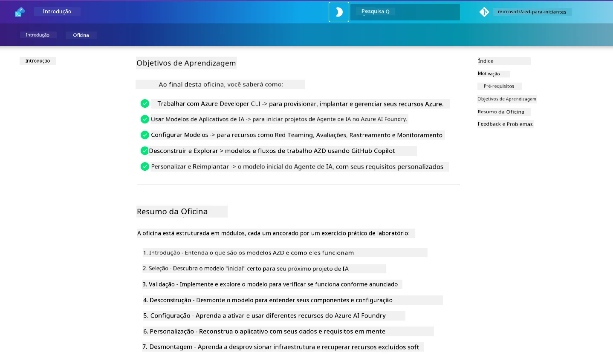

<div align="center">
  <div style="background: linear-gradient(135deg, #0078d4, #106ebe); border-radius: 10px; padding: 20px; margin: 20px 0; box-shadow: 0 4px 15px rgba(0, 120, 212, 0.3); border: 2px solid #005a9e;">
    <h2 style="color: white; margin: 0; font-size: 24px; text-shadow: 1px 1px 2px rgba(0,0,0,0.3);">
      🎯 Oficina AZD para Desenvolvedores de IA
    </h2>
    <p style="color: white; margin: 10px 0 0 0; font-size: 16px; text-shadow: 1px 1px 2px rgba(0,0,0,0.3);">
      <strong>Uma oficina prática para construir aplicações de IA com o Azure Developer CLI.</strong><br>
      Complete 7 módulos para dominar templates AZD e fluxos de implantação de IA.
    </p>
    <div style="margin-top: 15px;">
      <span style="background: rgba(255,255,255,0.2); padding: 5px 10px; border-radius: 15px; color: white; font-size: 14px;">
        📅 Orientação da fonte revisada: Novembro de 2026
      </span>
    </div>
  </div>
</div>

# Oficina AZD para Desenvolvedores de IA

Bem-vindo à oficina prática para aprender Azure Developer CLI (AZD) com foco na implantação de aplicações de IA. Esta oficina ajuda você a obter um entendimento aplicado dos templates AZD em 3 passos:

1. **Descoberta** - encontre o template certo para você.
1. **Implantação** - implante e valide que funciona
1. **Personalização** - modifique e itere para tornar seu!

Ao longo desta oficina, você também será apresentado a ferramentas e fluxos de trabalho essenciais para desenvolvedores, para ajudar a otimizar sua jornada de desenvolvimento de ponta a ponta.

<br/>

## Guia Baseado no Navegador

As lições da oficina estão em Markdown. Você pode navegá-las diretamente no GitHub - ou lançar uma visualização baseada em navegador como mostrado no screenshot abaixo.



Para usar essa opção - faça um fork do repositório para seu perfil, e inicie o GitHub Codespaces. Uma vez que o terminal do VS Code estiver ativo, digite este comando:

Esta visualização no navegador funciona no GitHub Codespaces, contêineres de desenvolvimento ou um clone local com Python e MkDocs instalados.

```bash title="" linenums="0"
python -m pip install -r requirements-dev.txt
python -m mkdocs serve --config-file workshop/mkdocs.yml
```

Execute esses comandos a partir da **raiz do repositório do curso**, não do exemplo de IA inicializado separadamente. Mantenha a visualização em primeiro plano para que erros permaneçam visíveis; pare com Ctrl+C. Para verificar o site sem servi-lo, execute `python -m mkdocs build --strict --config-file workshop/mkdocs.yml`.

Em alguns segundos, você verá um diálogo pop-up. Selecione a opção para `Open in browser`. O guia baseado na web abrirá em uma nova aba do navegador. Alguns benefícios desta visualização:

1. **Busca embutida** - encontre palavras-chave ou lições rapidamente.
1. **Ícone de copiar** - passe o mouse sobre blocos de código para ver esta opção
1. **Alternar tema** - mude entre temas escuro e claro
1. **Obtenha ajuda** - clique no ícone do Discord no rodapé para participar!

<br/>

## Visão Geral da Oficina

**Duração:** 3-4 horas  
**Nível:** Iniciante a Intermediário  
**Pré-requisitos:** Familiaridade com Azure, conceitos de IA, VS Code e ferramentas de linha de comando.

Esta é uma oficina prática onde você aprende fazendo. Após completar os exercícios, recomendamos revisar o currículo AZD Para Iniciantes para continuar sua jornada de aprendizado em melhores práticas de Segurança e Produtividade.

| Tempo| Módulo  | Objetivo |
|:---|:---|:---|
| 15 min | [Introdução](docs/instructions/0-Introduction.md) | Preparar o cenário, entender os objetivos |
| 30 min | [Selecionar Template de IA](docs/instructions/1-Select-AI-Template.md) | Explorar opções e escolher o inicial | 
| 30 min | [Validar Template de IA](docs/instructions/2-Validate-AI-Template.md) | Implantar solução padrão no Azure |
| 30 min | [Desconstruir Template de IA](docs/instructions/3-Deconstruct-AI-Template.md) | Explorar estrutura e configurações |
| 30 min | [Configurar Template de IA](docs/instructions/4-Configure-AI-Template.md) | Ativar e testar recursos disponíveis |
| 30 min | [Personalizar Template de IA](docs/instructions/5-Customize-AI-Template.md) | Adaptar o template às suas necessidades |
| 30 min | [Desmontar Infraestrutura](docs/instructions/6-Teardown-Infrastructure.md) | Limpar e liberar recursos |
| 15 min | [Conclusão & Próximos Passos](docs/instructions/7-Wrap-up.md) | Recursos de aprendizado, desafio da oficina |

<br/>

## O Que Você Vai Aprender

Pense no Template AZD como um sandbox de aprendizado para explorar várias capacidades e ferramentas para desenvolvimento de ponta a ponta na Microsoft Foundry. Ao final desta oficina, você deverá ter uma sensação intuitiva para várias ferramentas e conceitos neste contexto.

| Conceito  | Objetivo |
|:---|:---|
| **Azure Developer CLI** | Entender comandos e fluxos de trabalho da ferramenta|
| **Templates AZD**| Entender estrutura do projeto e configuração|
| **Agente Azure AI**| Provisionar & implantar projeto Microsoft Foundry  |
| **Pesquisa Azure AI**| Habilitar engenharia de contexto com agentes |
| **Observabilidade**| Explorar rastreamento, monitoramento e avaliações |
| **Red Teaming**| Explorar testes adversariais e mitigações |

<br/>

## Estrutura da Oficina

A oficina é estruturada para levá-lo numa jornada da descoberta do template, à implantação, desconstrução e personalização - usando o template oficial [Introdução a Agentes de IA](https://github.com/Azure-Samples/get-started-with-ai-agents) como base.

### [Módulo 1: Selecionar Template de IA](docs/instructions/1-Select-AI-Template.md) (30 min)

- O que são Templates de IA?
- Onde posso encontrar Templates de IA?
- Como posso começar a construir Agentes de IA?
- **Laboratório**: Início rápido em Codespaces ou contêiner de desenvolvimento

### [Módulo 2: Validar Template de IA](docs/instructions/2-Validate-AI-Template.md) (30 min)

- Qual é a Arquitetura do Template de IA?
- Qual é o Fluxo de Desenvolvimento AZD?
- Como posso obter ajuda com Desenvolvimento AZD?
- **Laboratório**: Implantar & Validar template de Agentes de IA

### [Módulo 3: Desconstruir Template de IA](docs/instructions/3-Deconstruct-AI-Template.md) (30 min)

- Explore seu ambiente em `.azure/` 
- Explore sua configuração de recursos em `infra/` 
- Explore sua configuração AZD em `azure.yaml`s
- **Laboratório**: Modificar Variáveis de Ambiente & Reimplantar

### [Módulo 4: Configurar Template de IA](docs/instructions/4-Configure-AI-Template.md) (30 min)
- Explore: Geração Aumentada por Recuperação
- Explore: Avaliação de Agente & Red Teaming
- Explore: Rastreamento & Monitoramento
- **Laboratório**: Explore Agente de IA + Observabilidade 

### [Módulo 5: Personalizar Template de IA](docs/instructions/5-Customize-AI-Template.md) (30 min)
- Defina: PRD com Requisitos de Cenário
- Configure: Variáveis de Ambiente para AZD
- Implemente: Hooks de Ciclo de Vida para tarefas adicionais
- **Laboratório**: Personalizar template para meu cenário

### [Módulo 6: Desmontar Infraestrutura](docs/instructions/6-Teardown-Infrastructure.md) (30 min)
- Recapitule: O que são Templates AZD?
- Recapitule: Por que usar Azure Developer CLI?
- Próximos Passos: Experimente um template diferente!
- **Laboratório**: Desprovisionar infraestrutura & limpar

<br/>

## Desafio da Oficina

Quer se desafiar a fazer mais? Aqui estão algumas sugestões de projetos - ou compartilhe suas ideias conosco!!

| Projeto | Descrição |
|:---|:---|
|1. **Desconstruir Um Template Complexo de IA** | Use o fluxo de trabalho e ferramentas que delineamos e veja se consegue implantar, validar e personalizar um template diferente de solução de IA. _O que você aprendeu?_|
|2. **Personalizar Com Seu Cenário**  | Tente escrever um PRD (Documento de Requisitos do Produto) para um cenário diferente. Depois use o GitHub Copilot no seu repositório de template no Modelo de Agente - e peça para ele gerar um fluxo de trabalho de personalização para você. _O que você aprendeu? Como poderia melhorar essas sugestões?_|
| | |

## Tem feedback?

1. Poste uma issue neste repositório - marque com `Workshop` para conveniência.
1. Junte-se ao Discord Microsoft Foundry - conecte-se com seus pares!


| | | 
|:---|:---|
| **📚 Início do Curso**| [AZD Para Iniciantes](../README.md)|
| **📖 Documentação** | [Comece com templates de IA](https://learn.microsoft.com/en-us/azure/ai-foundry/how-to/develop/ai-template-get-started)|
| **🛠️Templates de IA** | [Templates Microsoft Foundry](https://ai.azure.com/templates) |
|**🚀 Próximos Passos** | [Iniciar Oficina](#workshop-overview) |
| | |

<br/>

---

**Navegação:** [Curso Principal](../README.md) | [Introdução](docs/instructions/0-Introduction.md) | [Módulo 1: Selecionar Template](docs/instructions/1-Select-AI-Template.md)

**Pronto para começar a construir aplicações de IA com AZD?**

[Iniciar Oficina: Introdução →](docs/instructions/0-Introduction.md)

---

<!-- CO-OP TRANSLATOR DISCLAIMER START -->
**Aviso Legal**:
Este documento foi traduzido usando o serviço de tradução por IA [Co-op Translator](https://github.com/Azure/co-op-translator). Embora nos esforcemos pela precisão, por favor, esteja ciente de que traduções automatizadas podem conter erros ou imprecisões. O documento original em seu idioma nativo deve ser considerado a fonte autorizada. Para informações críticas, recomenda-se tradução profissional humana. Não nos responsabilizamos por quaisquer mal-entendidos ou interpretações incorretas decorrentes do uso desta tradução.
<!-- CO-OP TRANSLATOR DISCLAIMER END -->