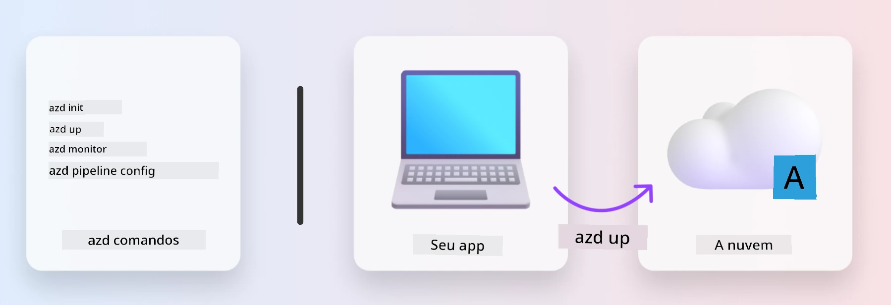
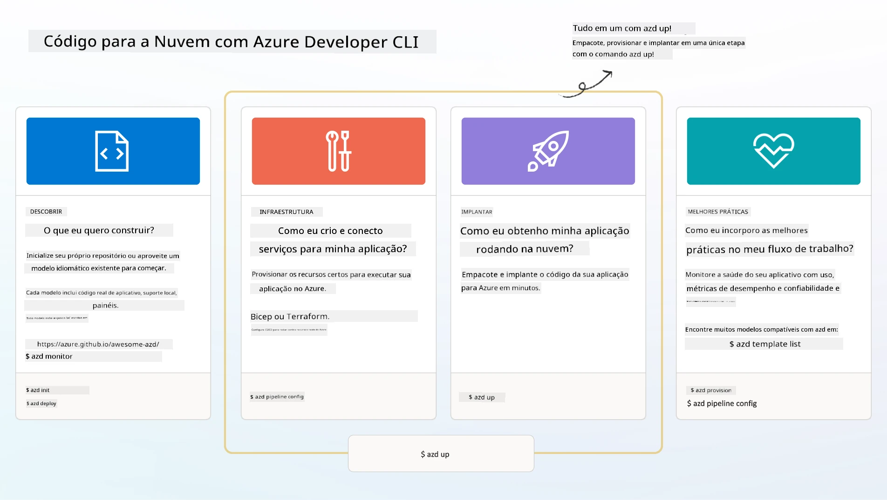

# 1. Selecione um Modelo

!!! tip "AO FINAL DESTE MÓDULO VOCÊ SERÁ CAPAZ DE"

    - [ ] Describe what AZD templates are
    - [ ] Discover and use AZD templates for AI
    - [ ] Get started with the AI Agents template
    - [ ] **Lab 1:** AZD Quickstart in Codespaces or a dev container

---

## 1. Uma Analogia de Construtor

Construir uma aplicação de IA moderna e pronta para empresas _do zero_ pode ser assustador. É um pouco como construir sua nova casa sozinho, tijolo por tijolo. Sim, é possível! Mas não é a forma mais eficaz de obter o resultado desejado!

Em vez disso, geralmente começamos com uma _planta arquitetônica_ existente e trabalhamos com um arquiteto para personalizá-la conforme nossas necessidades pessoais. E essa é exatamente a abordagem a ser adotada ao construir aplicações inteligentes. Primeiro, encontre uma boa arquitetura de design que se encaixe no seu espaço de problema. Em seguida, trabalhe com um arquiteto de soluções para customizar e desenvolver a solução para seu cenário específico.

Mas onde podemos encontrar essas plantas arquitetônicas? E como encontramos um arquiteto disposto a nos ensinar a customizar e implantar essas plantas sozinhos? Neste workshop, respondemos a essas perguntas apresentando três tecnologias:

1. [Azure Developer CLI](https://aka.ms/azd) - uma ferramenta open-source que acelera o caminho do desenvolvedor do desenvolvimento local (build) até a implantação em nuvem (ship).
1. [Microsoft Foundry Templates](https://ai.azure.com/templates) - repositórios padronizados open-source contendo código exemplo, arquivos de infraestrutura e configuração para implantar uma arquitetura de solução de IA.
1. [GitHub Copilot Agent Mode](https://code.visualstudio.com/docs/copilot/chat/chat-agent-mode) - um agente de codificação baseado no conhecimento do Azure, que pode nos guiar na navegação do código e fazer alterações - usando linguagem natural.

Com essas ferramentas em mãos, agora podemos _descobrir_ o modelo certo, _implantá-lo_ para validar que funciona e _customizá-lo_ para adequá-lo aos nossos cenários específicos. Vamos mergulhar e aprender como essas ferramentas funcionam.


---

## 2. Azure Developer CLI

O [Azure Developer CLI](https://learn.microsoft.com/en-us/azure/developer/azure-developer-cli/) (ou `azd`) é uma ferramenta de linha de comando open-source que pode acelerar sua jornada do código até a nuvem com um conjunto de comandos amigáveis ao desenvolvedor que funcionam de maneira consistente tanto no seu IDE (desenvolvimento) quanto nos ambientes CI/CD (devops).

Com `azd`, sua jornada de implantação pode ser tão simples quanto:

- `azd init` - Inicializa um novo projeto de IA a partir de um modelo AZD existente.
- `azd up` - Provê infraestrutura e implanta sua aplicação em um só passo.
- `azd monitor` - Obtenha monitoramento em tempo real e diagnósticos para sua aplicação implantada.
- `azd pipeline config` - Configure pipelines CI/CD para automatizar a implantação no Azure.

**🎯 | EXERCÍCIO**: <br/> Explore a ferramenta de linha de comando `azd` no seu ambiente atual do workshop agora. Isso pode ser GitHub Codespaces, um container de desenvolvimento, ou um clone local com os pré-requisitos instalados. Comece digitando este comando para ver o que a ferramenta pode fazer:

```bash title="" linenums="0"
azd help
```



---

## 3. O Modelo AZD

Para `azd` alcançar isso, ele precisa saber a infraestrutura a provisionar, as configurações para aplicar e a aplicação para implantar. É aí que entram os [modelos AZD](https://learn.microsoft.com/en-us/azure/developer/azure-developer-cli/azd-templates?tabs=csharp).

Modelos AZD são repositórios open-source que combinam código exemplo com arquivos de infraestrutura e configuração necessários para implantar a arquitetura da solução.
Usando uma abordagem de _Infraestrutura como Código_ (IaC), eles permitem que as definições de recursos do modelo e configurações sejam controladas por versões (assim como o código fonte da aplicação) - gerando fluxos de trabalho reutilizáveis e consistentes entre os usuários daquele projeto.

Ao criar ou reutilizar um modelo AZD para _seu_ cenário, considere estas perguntas:

1. O que você está construindo? → Existe um modelo que tenha o código inicial para esse cenário?
1. Como sua solução é arquitetada? → Existe um modelo que tenha os recursos necessários?
1. Como sua solução é implantada? → Pense em `azd deploy` com hooks de pré/pós-processamento!
1. Como você pode otimizá-la ainda mais? → Pense em monitoramento embutido e pipelines de automação!

**🎯 | EXERCÍCIO**: <br/> 
Visite a galeria [Awesome AZD](https://azure.github.io/awesome-azd/) e use os filtros para explorar os mais de 250 modelos atualmente disponíveis. Veja se consegue encontrar um que se alinhe aos requisitos do _seu_ cenário.



---

## 4. Modelos de Aplicações de IA

Para aplicações impulsionadas por IA, a Microsoft oferece modelos especializados com **Microsoft Foundry** e **Foundry Agents**. Estes modelos aceleram seu caminho para construir aplicações inteligentes prontas para produção.

### Modelos Microsoft Foundry & Foundry Agents

Selecione um modelo abaixo para implantar. Cada modelo está disponível no [Awesome AZD](https://azure.github.io/awesome-azd/) e pode ser inicializado com um único comando.

| Modelo | Descrição | Comando de Implantação |
|----------|-------------|----------------|
| **[AI Chat with RAG](https://github.com/Azure-Samples/azure-search-openai-demo)** | Aplicação de chat baseada em busca | `azd init -t Azure-Samples/azure-search-openai-demo .` |
| **[Get Started with AI Agents](https://github.com/Azure-Samples/get-started-with-ai-agents)** | Aplicação de chat com suporte de agentes; utilizada durante todo este workshop | `azd init -t Azure-Samples/get-started-with-ai-agents .` |
| **[Get Started with AI Chat](https://github.com/Azure-Samples/get-started-with-ai-chat)** | Aplicação inicial de chat com IA | `azd init -t Azure-Samples/get-started-with-ai-chat .` |

Estas são alternativas: inicialize **um** modelo em seu próprio diretório vazio. O `.` final seleciona esse diretório; omitindo-o nas versões atuais do AZD cria um subdiretório com o nome do modelo. A inicialização baixa um projeto; `azd up` realiza a implantação que gera custos após você revisar pré-requisitos, recursos, suporte de região e cotas.

### Início Rápido

1. **Navegue pelos modelos**: Visite [https://azure.github.io/awesome-azd/](https://azure.github.io/awesome-azd/) e filtre por `AI`, `Agents`, ou `Microsoft Foundry`
2. **Selecione seu modelo**: Escolha um que corresponda ao seu caso de uso
3. **Inicialize**: Execute o comando `azd init` para o modelo escolhido
4. **Implante**: Execute `azd up` para provisionar e implantar

**🎯 | EXERCÍCIO**: <br/>
Selecione um dos modelos acima baseado no seu cenário:

- **Continuando este workshop?** → Escolha **Get Started with AI Agents**
- **Construindo chat baseado em busca?** → Explore **AI Chat with RAG** separadamente
- **Precisa de outra arquitetura?** → Pesquise na galeria e verifique o repositório real, status da implementação e pré-requisitos

```bash title="Initialize the workshop template in an empty directory" linenums="0"
azd init -t Azure-Samples/get-started-with-ai-agents .
azd auth login
azd up
```

!!! info "Explore Mais Modelos"
    A [Galeria Awesome AZD](https://azure.github.io/awesome-azd/) contém mais de 250 modelos. Use os filtros para encontrar modelos que correspondam aos seus requisitos específicos para linguagem, framework e serviços Azure.

---

<!-- CO-OP TRANSLATOR DISCLAIMER START -->
**Aviso Legal**:
Este documento foi traduzido usando o serviço de tradução por IA [Co-op Translator](https://github.com/Azure/co-op-translator). Embora nos esforcemos pela precisão, por favor, esteja ciente de que traduções automatizadas podem conter erros ou imprecisões. O documento original em seu idioma nativo deve ser considerado a fonte autorizada. Para informações críticas, recomenda-se tradução profissional humana. Não nos responsabilizamos por quaisquer mal-entendidos ou interpretações incorretas decorrentes do uso desta tradução.
<!-- CO-OP TRANSLATOR DISCLAIMER END -->