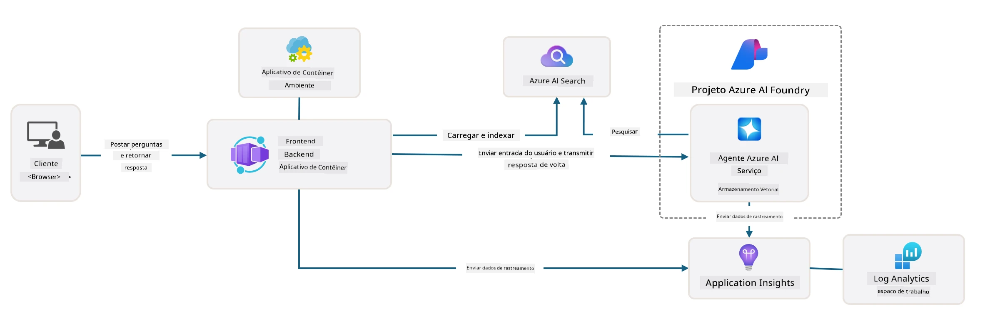
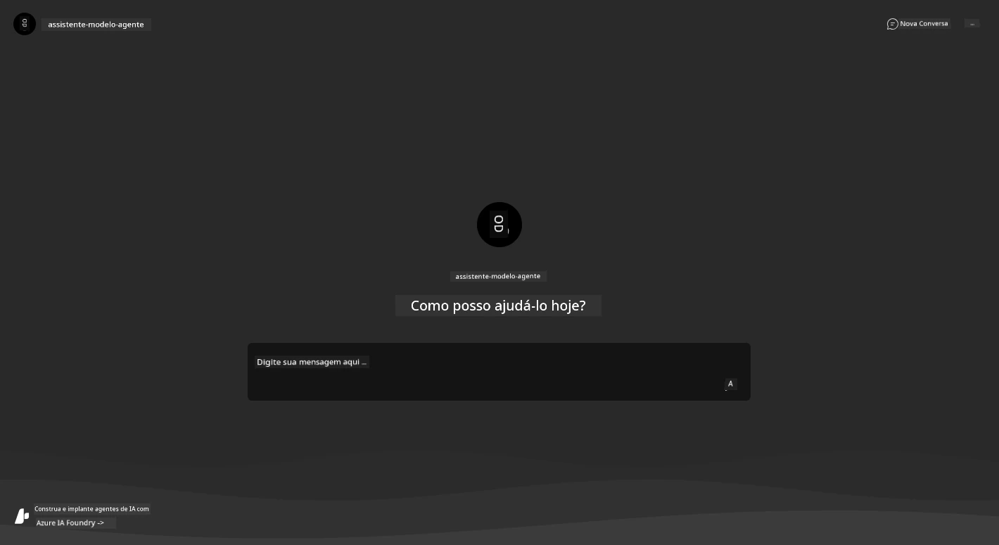

# 2. Validar um Modelo

> Orientação da fonte revisada com base no AZD 1.37.2 e na amostra atual em 4 de novembro de 2026. As capturas de tela são ilustrativas; a navegação no portal, os padrões de modelo e a disponibilidade dos serviços podem mudar. Esta revisão não realizou um deployment ativo no Azure.

!!! tip "AO FINAL DESTE MÓDULO VOCÊ SERÁ CAPAZ DE"

    - [ ] Identify the sample's prerequisites and intended resources
    - [ ] Deploy the selected template into an intentional environment
    - [ ] Verify the application and agent behavior separately from deployment success
    - [ ] **Lab 2:** Record evidence of a working baseline, or an actionable deployment blocker

---

## 1. Verificar pré-requisitos

O [Azure Developer CLI](https://learn.microsoft.com/azure/developer/azure-developer-cli/) gerencia o deploy de aplicações usando a configuração, infraestrutura e código do modelo. Verifique a versão instalada:

```bash
azd version
```

Use as [instruções atuais de instalação/atualização](https://learn.microsoft.com/azure/developer/azure-developer-cli/install-azd) se necessário. A amostra revisada declara AZD `>=1.14.0`, mas é recomendada uma versão suportada atual. As extensões opcionais de IA têm requisitos de versão separados; o fluxo normal `azd up` desta amostra não requer a extensão agents.

Antes do provisionamento, leia o [configuração da conta Azure](https://github.com/Azure-Samples/get-started-with-ai-agents/blob/main/docs/azure_account_setup.md) e o [guia de implantação](https://github.com/Azure-Samples/get-started-with-ai-agents/blob/main/docs/deployment.md) da amostra. Confirme sua assinatura, permissões, disponibilidade do modelo, cota regional e cobranças esperadas. Uma conta Azure gratuita não garante acesso ou uso gratuito para todos os serviços necessários.

## 2. Abrir a amostra selecionada

Use o repositório [Começando com AI Agents](https://github.com/Azure-Samples/get-started-with-ai-agents) inicializado no Módulo 1. Se não o inicializou, escolha uma destas alternativas:

- Abra um [Codespace para a amostra](https://github.com/codespaces/new/Azure-Samples/get-started-with-ai-agents).
- Clone a amostra e siga sua configuração local/contêiner de desenvolvimento.
- Em um **diretório vazio**, execute:

```bash
azd init --template Azure-Samples/get-started-with-ai-agents .
```

Não inicialize um segundo modelo sobre um projeto existente. Execute os comandos subsequentes na raiz da amostra contendo `azure.yaml`, não na raiz do repositório do curso.

A amostra hospeda um aplicativo de chat suportado por agente em Container Apps e provisiona recursos Foundry de suporte. Reveja a arquitetura atual e serviços opcionais em vez de tratar uma captura de tela antiga como inventário exato de recursos.



## 3. Implantar intencionalmente

```bash
azd auth login
azd up
```

Revise os prompts:

1. Escolha um nome único para o ambiente AZD.
2. Selecione a assinatura pretendida, não simplesmente a primeira oferta.
3. Selecione uma região suportada pelo modelo/versão/SKU requerido e sua cota.
4. Leia a saída do provisionamento, implantação e ganchos pós-implantação.

Os padrões revisados incluem `gpt-5-mini`, versão `2025-08-07` e `GlobalStandard`. Verifique seu modelo inicializado e as [combinações suportadas de modelo/região](https://learn.microsoft.com/azure/ai-services/agents/concepts/model-region-support). Nenhuma região é garantida universalmente.

A duração da implantação varia. Se o provisionamento falhar, preserve o erro e corrija a causa antes de tentar novamente. Não exclua a implantação ou exclua recursos permanentemente como passo genérico de solução.

## 4. Validar a aplicação

```bash
azd show
```

Abra o endpoint para `api_and_frontend` ou encontre o Container App no grupo de recursos da implantação no [portal Azure](https://portal.azure.com/). Siga as instruções de acesso/autenticação da amostra se o login for necessário; não desative a autenticação para passar em um teste rápido.



Experimente algumas [perguntas de amostra](https://github.com/Azure-Samples/get-started-with-ai-agents/blob/main/docs/sample_questions.md):

- Uma pergunta factual geral.
- Uma pergunta cuja resposta deve estar presente nos documentos enviados da amostra.
- Uma pergunta que não pode ser respondida a partir desses documentos.

Verifique se a interface carrega, a API responde, a recuperação usa os dados esperados, as citações correspondem ao conteúdo fonte e perguntas não suportadas são tratadas adequadamente. Uma mensagem `azd up` bem-sucedida sozinha não garante esses resultados.

## 5. Inspecionar o agente implantado

Abra seu projeto no [portal Foundry](https://ai.azure.com/). No fluxo do portal revisado, selecione **Build**, depois **Agents**, e localize o agente criado pela amostra. Os rótulos de navegação podem mudar.

Registre:

- O nome e versão do agente.
- O deployment de modelo configurado.
- As instruções reais e ferramentas ativadas.
- Quais arquivos ou índice de pesquisa estão conectados e se a configuração foi concluída com sucesso.

A amostra revisada usa um identificador de agente na forma `agent_name:agent_version` para seus testes de avaliação. Não copie um identificador clássico agente/thread de uma captura antiga para um fluxo de API mais novo.

Compare os documentos enviados com `src/files/` em sua revisão inicializada. Capturas anteriores mostraram 32 arquivos; esse número não é um padrão atual garantido. Verifique qualquer resposta sobre clientes/produtos da amostra contra os dados sintéticos reais, e não envie dados reais de clientes para este exercício.

## 6. Comparar com o playground

Abra o playground do agente selecionado no Foundry e faça a mesma pergunta de recuperação. Compare a versão do agente configurada, ferramentas, citações e qualidade da resposta com a aplicação implantada.

As respostas são probabilísticas; correspondência palavra por palavra não é o critério. Se os resultados diferirem substancialmente, verifique se o app e o playground usam o mesmo projeto, agente/versão e fonte do conhecimento.

## 7. Verificar pré-requisitos de observabilidade

O [guia de observabilidade](https://github.com/Azure-Samples/get-started-with-ai-agents/blob/main/docs/observability.md) da amostra é a fonte de verdade para rastreamento, avaliação e configuração de red-teaming.

Nos padrões de infraestrutura revisados, o Application Insights está habilitado, mas o **rastreamento do cliente está desativado** (`ENABLE_AZURE_MONITOR_TRACING=false`). Criar um recurso de monitoramento não prova que a aplicação está exportando rastreamentos. O Módulo 5 cobre habilitar rastreamento e gerar um pedido de teste.

Use os logs da aplicação do Container App para investigar erros de inicialização/API. No Foundry, inspecione as visualizações disponíveis de rastreamento e monitoramento do agente. Entradas de avaliação requerem a configuração relevante, avaliadores/região suportados e pedidos reais; não se garantem automaticamente para cada execução.

Mantenha a captura de conteúdo do prompt/resposta desativada a menos que seus requisitos de privacidade, retenção, acesso e redacção tenham sido revisados.

## 8. Entender valores do ambiente

AZD armazena o ambiente selecionado sob `.azure/<environment-name>/`. Entradas persistentes e saídas de implantação podem ser lidas com:

```bash
azd env list
azd env get-value AZURE_ENV_NAME
azd env get-value AZURE_LOCATION
```

`azd env get-values` lista todos os valores, que podem incluir configurações sensíveis. Não cole essa saída em issues públicas ou logs.

AZD usa o ambiente selecionado ao executar seus comandos/ganchos, enquanto variáveis de ambiente de processo também podem influenciar comandos e modelos. Isso **não** exporta valores para seu shell pai ou para todos os processos Python iniciados independentemente. Siga as [instruções de desenvolvimento local](https://github.com/Azure-Samples/get-started-with-ai-agents/blob/main/docs/local_development.md) da amostra.

Padrões de modelo podem ser aplicados em `infra/main.parameters.json` sem aparecer como valores locais explícitos. Definir uma variável arbitrária não altera infraestrutura a menos que o modelo a consuma.

Por exemplo, para selecionar explicitamente os padrões de modelo revisados:

```bash
azd env set AZURE_AI_AGENT_MODEL_NAME gpt-5-mini
azd env set AZURE_AI_AGENT_MODEL_VERSION 2025-08-07
azd env set AZURE_AI_AGENT_DEPLOYMENT_SKU GlobalStandard
azd provision --preview
azd up
```

Revise compatibilidade, capacidade, disponibilidade e as mudanças planejadas primeiro. Atualizações de infraestrutura requerem provisionamento; `azd deploy` sozinho não é suficiente. Mudanças suportadas de modelo normalmente não requerem destruir toda a aplicação.

`azd env refresh` recupera saídas da implantação para um ambiente acessível; não reconstrói todas entradas personalizadas, sincroniza segredos ou substitui gerenciamento de configuração.

## 9. Registrar sua linha de base

- [ ] Ambiente, assinatura, região e modelo corretos verificados.
- [ ] Provisionamento, implantação e ganchos necessários concluídos sem erros não resolvidos.
- [ ] Acesso à aplicação, chat, recuperação e citações verificadas.
- [ ] Agente/versão e fonte do conhecimento identificados.
- [ ] Pré-requisitos de observabilidade e quaisquer bloqueadores restantes documentados.

Continue para [Desconstruir um Modelo](3-Deconstruct-AI-Template.md).

---

<!-- CO-OP TRANSLATOR DISCLAIMER START -->
**Aviso Legal**:
Este documento foi traduzido usando o serviço de tradução por IA [Co-op Translator](https://github.com/Azure/co-op-translator). Embora nos esforcemos pela precisão, por favor, esteja ciente de que traduções automatizadas podem conter erros ou imprecisões. O documento original em seu idioma nativo deve ser considerado a fonte autorizada. Para informações críticas, recomenda-se tradução profissional humana. Não nos responsabilizamos por quaisquer mal-entendidos ou interpretações incorretas decorrentes do uso desta tradução.
<!-- CO-OP TRANSLATOR DISCLAIMER END -->