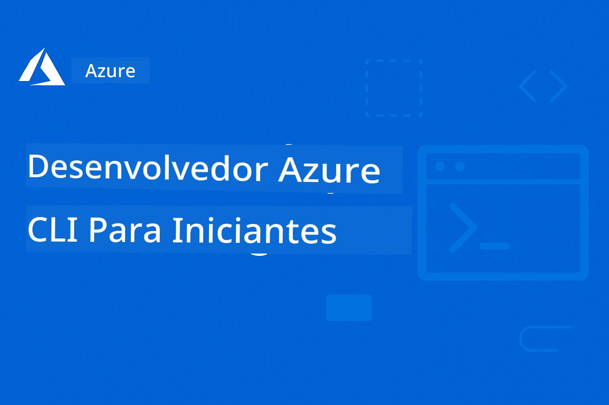

# AZD Para Iniciantes: Uma Jornada de Aprendizagem Estruturada

 

[](https://github.com/microsoft/AZD-for-beginners)
[](https://GitHub.com/microsoft/azd-for-beginners/network/)
[](https://github.com/microsoft/AZD-for-beginners)

[](https://discord.com/invite/nkVh3dp)
[](https://discord.gg/nTYy5BXMWG)

---

### Traduções Automáticas (Sempre Atualizadas)

<!-- CO-OP TRANSLATOR LANGUAGES TABLE START -->
[Árabe](../ar/README.md) | [Bengali](../bn/README.md) | [Búlgaro](../bg/README.md) | [Birmanês (Myanmar)](../my/README.md) | [Chinês (Simplificado)](../zh-CN/README.md) | [Chinês (Tradicional, Hong Kong)](../zh-HK/README.md) | [Chinês (Tradicional, Macau)](../zh-MO/README.md) | [Chinês (Tradicional, Taiwan)](../zh-TW/README.md) | [Croata](../hr/README.md) | [Checo](../cs/README.md) | [Dinamarquês](../da/README.md) | [Holandês](../nl/README.md) | [Estónio](../et/README.md) | [Finlandês](../fi/README.md) | [Francês](../fr/README.md) | [Alemão](../de/README.md) | [Grego](../el/README.md) | [Hebraico](../he/README.md) | [Hindi](../hi/README.md) | [Húngaro](../hu/README.md) | [Indonésio](../id/README.md) | [Italiano](../it/README.md) | [Japonês](../ja/README.md) | [Kannada](../kn/README.md) | [Khmer](../km/README.md) | [Coreano](../ko/README.md) | [Lituano](../lt/README.md) | [Malaio](../ms/README.md) | [Malaiala](../ml/README.md) | [Marata](../mr/README.md) | [Nepalês](../ne/README.md) | [Pidgin Nigeriano](../pcm/README.md) | [Norueguês](../no/README.md) | [Persa (Farsi)](../fa/README.md) | [Polaco](../pl/README.md) | [Português (Brasil)](../pt-BR/README.md) | [Português (Portugal)](./README.md) | [Punjabi (Gurmukhi)](../pa/README.md) | [Romeno](../ro/README.md) | [Russo](../ru/README.md) | [Sérvio (Cirílico)](../sr/README.md) | [Eslovaco](../sk/README.md) | [Esloveno](../sl/README.md) | [Espanhol](../es/README.md) | [Suaíli](../sw/README.md) | [Sueco](../sv/README.md) | [Tagalo (Filipino)](../tl/README.md) | [Tâmil](../ta/README.md) | [Telugu](../te/README.md) | [Tailandês](../th/README.md) | [Turco](../tr/README.md) | [Ucraniano](../uk/README.md) | [Urdu](../ur/README.md) | [Vietnamita](../vi/README.md)

> **Prefere Clonar Localmente?**
>
> Este repositório inclui traduções em mais de 50 idiomas, o que aumenta significativamente o tamanho do download. Para clonar sem traduções, use checkout seletivo:
>
> **Bash / macOS / Linux:**
> ```bash
> git clone --filter=blob:none --sparse https://github.com/microsoft/AZD-for-beginners.git
> cd AZD-for-beginners
> git sparse-checkout set --no-cone '/*' '!translations' '!translated_images'
> ```
>
> **CMD (Windows):**
> ```cmd
> git clone --filter=blob:none --sparse https://github.com/microsoft/AZD-for-beginners.git
> cd AZD-for-beginners
> git sparse-checkout set --no-cone "/*" "!translations" "!translated_images"
> ```
>
> Isto fornece tudo o que precisa para completar o curso com um download muito mais rápido.
<!-- CO-OP TRANSLATOR LANGUAGES TABLE END -->

## 🆕 Novidades no azd Hoje

> 📌 **Atualização Foundry GA (09-11-2026):** O **`microsoft.foundry` 1.0 está geralmente disponível**, anunciado a [5 de novembro de 2026](https://devblogs.microsoft.com/azure-sdk/microsoft-foundry-azure-developer-cli-ga/). Use **`azd >= 1.37.0`** e instale com `azd ext install microsoft.foundry`. Siga o [guia do agente hospedado](docs/chapter-02-ai-development/microsoft-foundry-integration.md#hosted-agent-walkthrough-ga) para configuração, teste local e implementação. Esta atualização baseia-se em orientações publicadas, não numa implementação ativa no Azure; o GA do pacote não torna todas as funcionalidades, extensões ou SDKs disponíveis para produção.

O Azure Developer CLI suporta muitos tipos de aplicações, incluindo aplicações web, APIs e agentes de IA, através de hosts, modelos e extensões suportados.

Eis o que isto significa para si:

- **Um pacote GA para desenvolvimento Foundry.** `microsoft.foundry` instala sete extensões principais, incluindo agentes, projetos e Agent Inspector. Código de agente e definições de implementação mantêm-se juntos em `azure.yaml`.
- **Teste localmente antes de implementar.** Use `azd ai agent init --deploy-mode code`, `azd provision`, e `azd ai agent run` para inspecionar pedidos e respostas locais. Depois use `azd deploy` para uma compilação remota no Foundry, sem a necessidade de uma compilação local em container.
- **Meça a qualidade separadamente.** Instale **`azure.ai.evaluations`** para `azd ai eval generate`, `init`, e `run start`; este não está incluído no pacote. Guarde os conjuntos de dados e rubricas revistos com o seu código. Projetos antigos devem seguir o [guia de migração para avaliação e otimização](docs/chapter-08-production/production-ai-practices.md#evaluation-migration-and-quality-checks).
- **Reutilize a configuração em CI/CD.** Após uma execução bem-sucedida de `azd up`, configure um pipeline com `azd pipeline config`. Instale o pacote no runner e mantenha as definições de autenticação e ambiente geradas.
- **Mais facilidades no dia a dia.** Atualizações recentes tornaram o `azd init` idempotente (seguro para reexecutar), fez o `azd auth login` limpar automaticamente tokens obsoletos, e adicionou um amigável prompt de configuração para a primeira execução `azd tool`.
- **O fluxo de trabalho principal mantém-se.** Quer implemente uma aplicação de tarefas, um microsserviço ou uma solução de IA multiagente, os comandos são os mesmos.

> **Nota para utilizadores Aspire:** A Microsoft passa a designar o produto simplesmente como **Aspire** (antes ".NET Aspire"). O suporte do azd ao Aspire mantém-se inalterado – só o nome foi atualizado.

Se já usou o azd antes, o suporte a IA é uma extensão natural – não uma ferramenta separada ou um percurso avançado. Se está a começar do zero, aprenderá um fluxo de trabalho que funciona para tudo.

---

## 🚀 O que é o Azure Developer CLI (azd)?

**Azure Developer CLI (azd)** é uma ferramenta de linha de comandos amigável para desenvolvedores que facilita implementar aplicações no Azure. Em vez de criar e ligar manualmente dezenas de recursos Azure, pode implementar aplicações inteiras com um único comando.

### A Magia do `azd up`

```bash
# This single command does everything:
# ✅ Creates all Azure resources  
# ✅ Configures networking and security
# ✅ Builds your application code
# ✅ Deploys to Azure
# ✅ Gives you a working URL
azd up
```

O modelo fornece a configuração da aplicação e da infraestrutura. Implementação bem-sucedida requer ainda serviços/modelos suportados, quota e permissões suficientes, entradas corretas e verificação da aplicação implementada. `azd up` não torna automaticamente um modelo seguro, conforme, ou pronto para produção.

---

## ❓ Azure Developer CLI vs Azure CLI: Qual é a Diferença?

Esta é a pergunta mais comum entre iniciantes. Aqui está a resposta simples:

| Recurso | **Azure CLI (`az`)** | **Azure Developer CLI (`azd`)** |
|---------|---------------------|--------------------------------|
| **Objetivo** | Gerir recursos individuais do Azure | Implementar aplicações completas |
| **Mentalidade** | Focado na infraestrutura | Focado na aplicação |
| **Exemplo** | `az webapp create --name myapp...` | `azd up` |
| **Curva de Aprendizagem** | Precisa conhecer os serviços Azure | Basta conhecer a sua aplicação |
| **Melhor para** | DevOps, Infraestrutura | Desenvolvedores, Protótipos |

### Analogia Simples

- **Azure CLI** é como ter todas as ferramentas para construir uma casa - martelos, serras, pregos. Pode construir qualquer coisa, mas precisa saber de construção.
- **Azure Developer CLI** é como contratar um empreiteiro - você descreve o que quer e eles tratam da construção.

### Quando Usar Cada Um

| Cenário | Use Este |
|----------|----------|
| "Quero implementar a minha app web rapidamente" | `azd up` |
| "Preciso criar apenas uma conta de armazenamento" | `az storage account create` |
| "Estou a construir uma aplicação completa de IA" | `azd init --template azure-search-openai-demo` |
| "Preciso de depurar um recurso Azure específico" | `az resource show` |
| "Quero implementar no meu ambiente de produção configurado" | Reveja configurações, acessos, custos e controlos operacionais antes de `azd up --environment production` |

### Funcionam Juntos!

AZD e Azure CLI têm autenticação e configuração separadas. Use `azd auth login` para AZD, e `az login` quando um comando de gancho ou diagnóstico explicitamente precisar do Azure CLI. Pode usar ambos:
```bash
# Deploy your app with AZD
azd up

# Then fine-tune specific resources with Azure CLI
az webapp config set --name myapp --always-on true
```

---

## 🌟 Encontre Modelos no Awesome AZD

Não comece do zero! **Awesome AZD** é a coleção comunitária de modelos prontos a implementar:

| Recurso | Descrição |
|----------|-------------|
| 🔗 [**Galeria Awesome AZD**](https://azure.github.io/awesome-azd/) | Explore mais de 200 modelos com implementação a um clique |
| 🔗 [**Submeter um Modelo**](https://github.com/Azure/awesome-azd/issues) | Contribua com o seu próprio modelo para a comunidade |
| 🔗 [**Repositório GitHub**](https://github.com/Azure/awesome-azd) | Estrele e explore o código-fonte |

### Modelos AI Populares do Awesome AZD

Escolha um modelo numa pasta vazia; os comandos abaixo são alternativas. O `.` final inicializa essa pasta.

```bash
# RAG Chat with Microsoft Foundry Models + AI Search
azd init --template azure-search-openai-demo .

# Quick AI Chat Application
azd init --template openai-chat-app-quickstart .

# AI Agents with Foundry Agents
azd init --template get-started-with-ai-agents .
```

---

## 🎯 Começar em 3 Passos

Antes de começar, certifique-se que a sua máquina está pronta para o modelo que quer implementar:

**Windows:**
```powershell
.\validate-setup.ps1
```

**macOS / Linux:**
```bash
bash ./validate-setup.sh
```

Se alguma verificação necessária falhar, corrija primeiro e só depois continue com o início rápido.

### Passo 1: Instalar o AZD (2 minutos)

**Windows:**
```powershell
winget install microsoft.azd
```

**macOS:**
```bash
brew tap azure/azd && brew install azd
```

**Linux:**
```bash
curl -fsSL https://aka.ms/install-azd.sh | bash
```

### Passo 2: Autenticar no AZD

```bash
# Optional if you plan to use Azure CLI commands directly in this course
az login

# Required for AZD workflows
azd auth login
```

Se não souber qual precisa, siga o fluxo completo na [Instalação & Configuração](docs/chapter-01-foundation/installation.md#authentication-setup).

### Passo 3: Implementar a Sua Primeira App

```bash
# Initialize from a template
azd init --template todo-nodejs-mongo .

# Deploy to Azure (creates everything!)
azd up
```

**🎉 É tudo!** A sua app está agora ativa no Azure.

### Limpar (Não Esqueça!)

```bash
# Remove all resources when done experimenting
azd down --force --purge
```

---

## 📚 Como Usar Este Curso

Este curso foi desenhado para **aprendizagem progressiva** - comece onde se sentir confortável e avance:

| A Sua Experiência | Comece Aqui |
|-----------------|------------|
| **Totalmente novo no Azure** | [Capítulo 1: Fundamentos](#-chapter-1-foundation--quick-start) |
| **Conhece o Azure, novo no AZD** | [Capítulo 1: Fundamentos](#-chapter-1-foundation--quick-start) |
| **Quer implementar apps de IA** | [Capítulo 2: Desenvolvimento centrado na IA](#-chapter-2-ai-first-development-recommended-for-ai-developers) |
| **Quer prática prática** | [🎓 Workshop Interativo](workshop/README.md) - laboratório guiado de 3-4 horas |
| **Precisa de padrões de produção** | [Capítulo 8: Produção & Empresa](#-chapter-8-production--enterprise-patterns) |

### Configuração Rápida

1. **Fork deste Repositório**: [](https://GitHub.com/microsoft/azd-for-beginners/fork)
2. **Clone-o**: `git clone https://github.com/YOUR-USERNAME/azd-for-beginners.git`
3. **Peça Ajuda**: [Comunidade Azure Discord](https://discord.com/invite/ByRwuEEgH4)

> **Prefere Clonar Localmente?**

> Este repositório inclui traduções para mais de 50 línguas, o que aumenta significativamente o tamanho da descarga. Para clonar sem traduções, use sparse checkout:
> ```bash
> git clone --filter=blob:none --sparse https://github.com/microsoft/AZD-for-beginners.git
> cd AZD-for-beginners
> git sparse-checkout set --no-cone '/*' '!translations' '!translated_images'
> ```
> Isto fornece-lhe tudo o que necessita para completar o curso com uma descarga muito mais rápida.


## Visão Geral do Curso

Domine o Azure Developer CLI (azd) através de capítulos estruturados concebidos para uma aprendizagem progressiva. **Foco especial no deployment de aplicações AI com integração Microsoft Foundry.**

### Porquê este Curso é Essencial para Desenvolvedores Modernos

Os desenvolvedores que fazem deployment de workloads AI frequentemente precisam de orientação sobre:
- Arquiteturas AI complexas multi-serviço
- Melhores práticas para deployment AI em produção  
- Integração e configuração de serviços Azure AI
- Otimização de custos para workloads AI
- Resolução de problemas específicos de deployment AI

### Objetivos de Aprendizagem

Ao completar este curso estruturado, irá:
- **Dominar os Fundamentos do AZD**: Conceitos principais, instalação e configuração
- **Deployar Aplicações AI**: Usar AZD com serviços Microsoft Foundry
- **Implementar InfrastrukturComoCódigo**: Gerir recursos Azure com templates Bicep
- **Resolver Problemas de Deployment**: Diagnosticar problemas comuns e debugar
- **Otimizar para Produção**: Segurança, escalabilidade, monitorização e gestão de custos
- **Construir Soluções Multi-Agente**: Deployar arquiteturas AI complexas

## Antes de Começar: Contas, Acesso, e Suposições

Antes de começar o Capítulo 1, assegure-se de que tem o seguinte preparado. Os passos de instalação mais adiante assumem que essas bases já estão resolvidas.

- **Uma subscrição Azure**: Pode usar uma subscrição existente do trabalho ou da sua conta pessoal, ou criar uma [trial gratuita](https://aka.ms/azurefreetrial) para começar.
- **Permissão para criar recursos Azure**: Para a maioria dos exercícios, deverá ter pelo menos acesso de **Contributor** na subscrição ou grupo de recursos alvo. Alguns capítulos também assumem que pode criar grupos de recursos, identidades geridas e atribuições RBAC.
- [**Uma conta GitHub**](https://github.com): Útil para fazer fork do repositório, acompanhar as suas próprias alterações, e usar GitHub Codespaces para o workshop.
- **Pré-requisitos de runtime dos templates**: Alguns templates precisam de ferramentas locais como Node.js, Python, Java, ou Docker. Execute o validador de setup antes de começar para detetar ausências cedo.
- **Familiaridade básica com terminal**: Não precisa ser especialista, mas deve sentir-se confortável a correr comandos como `git clone`, `azd auth login`, e `azd up`.

> **A trabalhar numa subscrição empresarial?**
> Se o seu ambiente Azure for gerido por um administrador, confirme antecipadamente se pode deployar recursos na subscrição ou grupo de recursos que planeia usar. Caso contrário, peça uma subscrição sandbox ou acesso de Contributor antes de começar.

> **Novo no Azure?**
> Comece com a sua própria trial Azure ou subscrição pay-as-you-go em https://aka.ms/azurefreetrial para poder completar os exercícios de ponta a ponta sem esperar por aprovações ao nível do tenant.

## 🗺️ Mapa do Curso: Navegação Rápida por Capítulo

Cada capítulo tem um README dedicado com objetivos de aprendizagem, quick starts, e exercícios:

| Capítulo | Tópico | Lições | Duração | Complexidade |
|---------|-------|---------|----------|------------|
| **[Cap 1: Fundação](docs/chapter-01-foundation/README.md)** | Introdução | [Noções Básicas AZD](docs/chapter-01-foundation/azd-basics.md) &#124; [Instalação](docs/chapter-01-foundation/installation.md) &#124; [Primeiro Projeto](docs/chapter-01-foundation/first-project.md) | 30-45 min | ⭐ |
| **[Cap 2: Desenvolvimento AI](docs/chapter-02-ai-development/README.md)** | Apps com AI | [Integração Foundry](docs/chapter-02-ai-development/microsoft-foundry-integration.md) &#124; [Agentes AI](docs/chapter-02-ai-development/agents.md) &#124; [Deployment Modelo](docs/chapter-02-ai-development/ai-model-deployment.md) &#124; [Workshop](docs/chapter-02-ai-development/ai-workshop-lab.md) | 1-2 hrs | ⭐⭐ |
| **[Cap 3: Configuração](docs/chapter-03-configuration/README.md)** | Autenticação & Segurança | [Configuração](docs/chapter-03-configuration/configuration.md) &#124; [Autenticação & Segurança](docs/chapter-03-configuration/authsecurity.md) | 45-60 min | ⭐⭐ |
| **[Cap 4: Infraestrutura](docs/chapter-04-infrastructure/README.md)** | IaC & Deployment | [Guia de Deployment](docs/chapter-04-infrastructure/deployment-guide.md) &#124; [Provisionamento](docs/chapter-04-infrastructure/provisioning.md) | 1-1.5 hrs | ⭐⭐⭐ |
| **[Cap 5: Multi-Agente](docs/chapter-05-multi-agent/README.md)** | Soluções AI Multi-Agente | [Cenário Retalho](examples/retail-scenario.md) &#124; [Padrões de Coordenação](docs/chapter-06-pre-deployment/coordination-patterns.md) | 2-3 hrs | ⭐⭐⭐⭐ |
| **[Cap 6: Pré-Deployment](docs/chapter-06-pre-deployment/README.md)** | Planeamento & Validação | [Verificações Preflight](docs/chapter-06-pre-deployment/preflight-checks.md) &#124; [Planeamento Capacidade](docs/chapter-06-pre-deployment/capacity-planning.md) &#124; [Seleção SKU](docs/chapter-06-pre-deployment/sku-selection.md) &#124; [App Insights](docs/chapter-06-pre-deployment/application-insights.md) | 1 hr | ⭐⭐ |
| **[Cap 7: Resolução de Problemas](docs/chapter-07-troubleshooting/README.md)** | Debug & Correção | [Problemas Comuns](docs/chapter-07-troubleshooting/common-issues.md) &#124; [Debugging](docs/chapter-07-troubleshooting/debugging.md) &#124; [Problemas AI](docs/chapter-07-troubleshooting/ai-troubleshooting.md) | 1-1.5 hrs | ⭐⭐ |
| **[Cap 8: Produção](docs/chapter-08-production/README.md)** | Padrões Empresariais | [Práticas de Produção](docs/chapter-08-production/production-ai-practices.md) | 2-3 hrs | ⭐⭐⭐⭐ |
| **[🎓 Workshop](workshop/README.md)** | Laboratório Prático | [Introdução](workshop/docs/instructions/0-Introduction.md) &#124; [Seleção](workshop/docs/instructions/1-Select-AI-Template.md) &#124; [Validação](workshop/docs/instructions/2-Validate-AI-Template.md) &#124; [Deconstrução](workshop/docs/instructions/3-Deconstruct-AI-Template.md) &#124; [Configuração](workshop/docs/instructions/4-Configure-AI-Template.md) &#124; [Personalização](workshop/docs/instructions/5-Customize-AI-Template.md) &#124; [Desmontagem](workshop/docs/instructions/6-Teardown-Infrastructure.md) &#124; [Conclusão](workshop/docs/instructions/7-Wrap-up.md) | 3-4 hrs | ⭐⭐ |

**Duração Total do Curso:** ~10-14 horas | **Progressão de Competências:** Iniciante → Preparado para Produção

---

## 📚 Capítulos de Aprendizagem

*Selecione o seu percurso de aprendizagem conforme o nível de experiência e objetivos*

### 🚀 Capítulo 1: Fundação & Início Rápido
**Pré-requisitos**: Subscrição Azure, conhecimentos básicos de linha de comando  
**Duração**: 30-45 minutos  
**Complexidade**: ⭐

#### O Que Vai Aprender
- Compreender os fundamentos do Azure Developer CLI
- Instalar o AZD na sua plataforma
- O seu primeiro deployment bem-sucedido

#### Recursos de Aprendizagem
- **🎯 Comece Aqui**: [O que é Azure Developer CLI?](#-what-is-azure-developer-cli-azd)
- **📖 Teoria**: [Noções Básicas AZD](docs/chapter-01-foundation/azd-basics.md) - Conceitos fulcrais e terminologia
- **⚙️ Setup**: [Instalação & Configuração](docs/chapter-01-foundation/installation.md) - Guias específicos de plataforma
- **🛠️ Prático**: [O Seu Primeiro Projeto](docs/chapter-01-foundation/first-project.md) - Tutorial passo a passo
- **📋 Referência Rápida**: [Cheat Sheet de Comandos](resources/cheat-sheet.md)

#### Exercícios Práticos
```bash
# Quick installation check
azd version

# Deploy your first application
azd init --template todo-nodejs-mongo .
azd up
```

**💡 Resultado do Capítulo**: Deployar com sucesso uma aplicação web simples para Azure usando AZD

**✅ Validação do Sucesso:**
```bash
# After completing Chapter 1, you should be able to:
azd version              # Shows installed version
azd init --template todo-nodejs-mongo  # Initializes project
azd up                  # Deploys to Azure
azd show                # Displays running app URL
# Application opens in browser and works
azd down --force --purge  # Cleans up resources
```

**📊 Investimento Temporal:** 30-45 minutos  
**📈 Nível de Competência Após:** Consegue deployar aplicações básicas de forma independente

---

### 🤖 Capítulo 2: Desenvolvimento AI-First (Recomendado para Desenvolvedores AI)
**Pré-requisitos**: Capítulo 1 completo  
**Duração**: 1-2 horas  
**Complexidade**: ⭐⭐

#### O Que Vai Aprender
- Integração Microsoft Foundry com AZD
- Deployar aplicações potenciadas por AI
- Compreender configurações de serviços AI

#### Recursos de Aprendizagem
- **🎯 Comece Aqui**: [Integração Microsoft Foundry](docs/chapter-02-ai-development/microsoft-foundry-integration.md)
- **🤖 Agentes AI**: [Guia de Agentes AI](docs/chapter-02-ai-development/agents.md) - Deployar agentes inteligentes com AZD
- **📖 Padrões**: [Deployment de Modelos AI](docs/chapter-02-ai-development/ai-model-deployment.md) - Deployar e gerir modelos AI
- **🛠️ Workshop**: [Laboratório AI Workshop](docs/chapter-02-ai-development/ai-workshop-lab.md) - Preparar soluções AI para AZD
- **🎥 Guia Interativo**: [Materiais do Workshop](workshop/README.md) - Aprendizagem no browser com MkDocs * Ambiente DevContainer
- **📋 Templates**: [Templates Microsoft Foundry](#featured-microsoft-foundry-templates)
- **📝 Exemplos**: [Exemplos de Deployment AZD](examples/README.md)

#### Exercícios Práticos
```bash
# Deploy your first AI application
azd init --template azure-search-openai-demo .
azd up

# Try additional AI templates
azd init --template openai-chat-app-quickstart .
azd init --template agent-openai-python-prompty .
```

**💡 Resultado do Capítulo**: Deployar e configurar uma aplicação chat AI com capacidades RAG

**✅ Validação do Sucesso:**
```bash
# After Chapter 2, you should be able to:
azd init --template azure-search-openai-demo .
azd up
# Test the AI chat interface
# Ask questions and get AI-powered responses with sources
# Verify search integration works
azd monitor  # Check Application Insights shows telemetry
azd down --force --purge
```

**📊 Investimento Temporal:** 1-2 horas  
**📈 Nível de Competência Após:** Capaz de deployar aplicações AI para aprendizagem e identificar requisitos adicionais para produção
**💰 Consciência de Custos:** Compreender custos de desenvolvimento de 80-150$/mês, custos de produção de 300-3500$/mês

#### 💰 Considerações de Custo para Deployments AI

**Ambiente de Desenvolvimento (Estimado 80-150$/mês):**
- Modelos Microsoft Foundry (Pay-as-you-go): 0-50$/mês (baseado em uso de tokens)
- AI Search (nível Básico): 75$/mês
- Container Apps (Consumo): 0-20$/mês
- Storage (Standard): 1-5$/mês

**Ambiente de Produção (Estimado 300-3,500+/mês):**
- Modelos Microsoft Foundry (PTU para performance consistente): 3,000+/mês OU Pay-as-you-go com alto volume
- AI Search (nível Standard): 250$/mês
- Container Apps (Dedicado): 50-100$/mês
- Application Insights: 5-50$/mês
- Storage (Premium): 10-50$/mês

**💡 Dicas para Otimização de Custos:**
- Verifique preços de inferência de modelos e créditos específicos da conta; Azure OpenAI não inclui uma franquia mensal universal de 50,000 tokens gratuitos
- Execute `azd down` para apagar recursos quando já não forem necessários, após rever o ambiente selecionado
- Comece com faturação por consumo, atualize para PTU só para produção
- Use `azd provision --preview` para inspeccionar a infraestrutura planeada e depois precificar os recursos resultantes com o Azure Pricing Calculator
- Ative o auto-escalamento: pague apenas pelo uso real

**Monitorização de Custos:**
```bash
# Inspect planned resources (this does not calculate prices)
azd provision --preview

# Monitor actual costs in Azure Portal
az consumption budget list --resource-group <your-rg>
```

---

### ⚙️ Capítulo 3: Configuração & Autenticação
**Pré-requisitos**: Capítulo 1 completo  
**Duração**: 45-60 minutos  
**Complexidade**: ⭐⭐

#### O Que Vai Aprender
- Configuração e gestão de ambiente
- Melhores práticas de autenticação e segurança
- Nomeação e organização de recursos

#### Recursos de Aprendizagem
- **📖 Configuração**: [Guia de Configuração](docs/chapter-03-configuration/configuration.md) - Configuração do ambiente
- **🔐 Segurança**: [Padrões de Autenticação e Identidade Gerida](docs/chapter-03-configuration/authsecurity.md) - Padrões de autenticação
- **📝 Exemplos**: [Exemplo de App Base de Dados](examples/database-app/README.md) - Exemplos AZD para bases de dados

#### Exercícios Práticos
- Configurar múltiplos ambientes (dev, staging, prod)
- Configurar autenticação com identidade gerida
- Implementar configurações específicas de ambiente

**💡 Resultado do Capítulo**: Gerir múltiplos ambientes com autenticação e segurança adequadas

---

### 🏗️ Capítulo 4: Infraestrutura como Código & Deployment
**Pré-requisitos**: Capítulos 1-3 completos  
**Duração**: 1-1.5 horas  
**Complexidade**: ⭐⭐⭐

#### O Que Vai Aprender
- Padrões avançados de deployment
- Infraestrutura como Código com Bicep
- Estratégias de provisão de recursos

#### Recursos de Aprendizagem
- **📖 Deployment**: [Guia de Deployment](docs/chapter-04-infrastructure/deployment-guide.md) - Workflows completos
- **🏗️ Provisionamento**: [Provisão de Recursos](docs/chapter-04-infrastructure/provisioning.md) - Gestão de recursos Azure
- **📝 Exemplos**: [Exemplo de Container App](../../examples/container-app) - Deployments conteinerizados

#### Exercícios Práticos
- Criar templates Bicep personalizados
- Deployar aplicações multi-serviço
- Implementar estratégias de deployment blue-green

**💡 Resultado do Capítulo**: Deployar aplicações multi-serviço complexas usando templates de infraestrutura personalizados

---

### 🎯 Capítulo 5: Soluções AI Multi-Agente (Avançado)
**Pré-requisitos**: Capítulos 1-2 completos  
**Duração**: 2-3 horas  
**Complexidade**: ⭐⭐⭐⭐

#### O Que Vai Aprender
- Padrões de arquitetura multi-agente
- Orquestração e coordenação de agentes
- Deployment AI pronto para produção

#### Recursos de Aprendizagem
- **🤖 Design em Destaque**: [Solução Multi-Agente para Retalho](examples/retail-scenario.md) - Projeto arquitetónico, não uma aplicação completa
- **🛠️ Templates ARM**: [Pacote de Templates ARM](../../examples/retail-multiagent-arm-template) - Estrutura de infraestrutura; rever pré-requisitos e componentes de aplicação em falta
- **📖 Arquitetura**: [Padrões de coordenação multi-agente](docs/chapter-06-pre-deployment/coordination-patterns.md) - Padrões

#### Exercícios Práticos
```bash
# Inspect the retail infrastructure scaffold before choosing to deploy it
cd examples/retail-multiagent-arm-template
cat README.md

# After an intentional deployment, inspect infrastructure state
az deployment group show --resource-group <rg-name> --name <deployment-name>
```

**💡 Resultado do Capítulo**: Compreender o design multi-agente e identificar o trabalho de implementação, validação e operacional necessário além da estrutura de infraestrutura

---

### 🔍 Capítulo 6: Validação e Planeamento Pré-Implementação
**Pré-requisitos**: Capítulo 4 concluído  
**Duração**: 1 hora  
**Complexidade**: ⭐⭐

#### O que Vai Aprender
- Planeamento de capacidade e validação de recursos
- Estratégias de seleção de SKU
- Verificações pré-implementação e automação

#### Recursos de Aprendizagem
- **📊 Planeamento**: [Planeamento de Capacidade](docs/chapter-06-pre-deployment/capacity-planning.md) - Validação de recursos
- **💰 Seleção**: [Seleção de SKU](docs/chapter-06-pre-deployment/sku-selection.md) - Escolhas económicas
- **✅ Validação**: [Verificações Pré-Implementação](docs/chapter-06-pre-deployment/preflight-checks.md) - Scripts automatizados

#### Exercícios Práticos
- Executar scripts de validação de capacidade
- Otimizar seleções de SKU para custo
- Implementar verificações pré-implementação automatizadas

**💡 Resultado do Capítulo**: Validar e otimizar implementações antes da execução

---

### 🚨 Capítulo 7: Resolução de Problemas e Depuração
**Pré-requisitos**: Qualquer capítulo de implementação concluído  
**Duração**: 1-1.5 horas  
**Complexidade**: ⭐⭐

#### O que Vai Aprender
- Abordagens sistemáticas de depuração
- Problemas comuns e soluções
- Resolução de problemas específica de IA

#### Recursos de Aprendizagem
- **🔧 Problemas Comuns**: [Problemas Comuns](docs/chapter-07-troubleshooting/common-issues.md) - FAQ e soluções
- **🕵️ Depuração**: [Guia de Depuração](docs/chapter-07-troubleshooting/debugging.md) - Estratégias passo a passo
- **🤖 Problemas de IA**: [Resolução de Problemas Específica de IA](docs/chapter-07-troubleshooting/ai-troubleshooting.md) - Problemas em serviços de IA

#### Exercícios Práticos
- Diagnosticar falhas de implementação
- Resolver problemas de autenticação
- Depurar conectividade de serviço de IA

**💡 Resultado do Capítulo**: Diagnosticar e resolver independentemente problemas comuns de implementação

---

### 🏢 Capítulo 8: Padrões de Produção e Empresariais
**Pré-requisitos**: Capitulos 1-4 concluídos  
**Duração**: 2-3 horas  
**Complexidade**: ⭐⭐⭐⭐

#### O que Vai Aprender
- Estratégias de implementação em produção
- Padrões de segurança empresarial
- Monitorização e otimização de custos

#### Recursos de Aprendizagem
- **🏭 Produção**: [Melhores Práticas para IA em Produção](docs/chapter-08-production/production-ai-practices.md) - Padrões empresariais
- **📝 Exemplos**: [Exemplo de Microservices](../../examples/microservices) - Arquiteturas complexas
- **📊 Monitorização**: [Integração Application Insights](docs/chapter-06-pre-deployment/application-insights.md) - Monitorização

#### Exercícios Práticos
- Implementar padrões de segurança empresarial
- Configurar monitorização abrangente
- Implementar em produção com governação adequada

**💡 Resultado do Capítulo**: Implementar aplicações prontas para produção com capacidades completas

---

## 🎓 Visão Geral do Workshop: Experiência de Aprendizagem Prática

> **⚠️ ESTADO DO WORKSHOP: Desenvolvimento Ativo**  
> Os materiais do workshop estão atualmente a ser desenvolvidos e refinados. Os módulos principais estão funcionais, mas algumas secções avançadas estão incompletas. Estamos a trabalhar para completar todo o conteúdo. [Acompanhar progresso →](workshop/README.md)

### Materiais Interativos do Workshop
**Aprendizagem prática abrangente com ferramentas baseadas no navegador e exercícios guiados**

Os nossos materiais para o workshop fornecem uma experiência de aprendizagem estruturada e interativa que complementa o currículo baseado em capítulos acima. O workshop destina-se tanto a aprendizagem ao ritmo próprio como a sessões lideradas por instrutor.

#### 🛠️ Características do Workshop
- **Interface Baseada no Navegador**: Workshop completo suportado por MkDocs com pesquisa, copiar e funcionalidades de tema
- **Integração GitHub Codespaces**: Configuração de ambiente de desenvolvimento com um clique
- **Caminho de Aprendizagem Estruturado**: Exercícios guiados em 8 módulos (3-4 horas no total)
- **Metodologia Progressiva**: Introdução → Seleção → Validação → Desconstrução → Configuração → Personalização → Desmontagem → Conclusão
- **Ambiente Interativo DevContainer**: Ferramentas e dependências pré-configuradas

#### 📚 Estrutura dos Módulos do Workshop
O workshop segue uma **metodologia progressiva de 8 módulos** que o leva da descoberta à mestria na implementação:

| Módulo | Tema | O que Vai Fazer | Duração |
|--------|-------|----------------|----------|
| **0. Introdução** | Visão Geral do Workshop | Compreender objetivos de aprendizagem, pré-requisitos e estrutura do workshop | 15 min |
| **1. Seleção** | Descoberta de Templates | Explorar templates AZD e selecionar o template AI certo para o seu cenário | 20 min |
| **2. Validação** | Implementar & Verificar | Implementar o template com `azd up` e validar que a infraestrutura funciona | 30 min |
| **3. Desconstrução** | Compreender a Estrutura | Usar GitHub Copilot para explorar arquitetura do template, ficheiros Bicep e organização de código | 30 min |
| **4. Configuração** | Exploração Profunda azure.yaml | Dominar a configuração `azure.yaml`, ganchos do ciclo de vida e variáveis de ambiente | 30 min |
| **5. Personalização** | Tornar Seu | Ativar AI Search, tracing, avaliação, e personalizar para o seu cenário | 45 min |
| **6. Desmontagem** | Limpar | Desprovisionar recursos com segurança usando `azd down --purge` | 15 min |
| **7. Conclusão** | Próximos Passos | Rever conquistas, conceitos-chave e continuar sua jornada de aprendizagem | 15 min |

**Fluxo do Workshop:**
```
Introduction → Selection → Validation → Deconstruction → Configuration → Customization → Teardown → Wrap-up
     ↓            ↓           ↓              ↓               ↓              ↓            ↓           ↓
  Overview    Find the     Deploy &      Explore        Master         Customize     Clean up    Review &
             right        verify        code &        azure.yaml      for your      resources   next steps
             template                   structure                     scenario
```

#### 🚀 Iniciar o Workshop
```bash
# Option 1: GitHub Codespaces (Recommended)
# Click "Code" → "Create codespace on main" in the repository

# Option 2: Local Development
git clone https://github.com/microsoft/azd-for-beginners.git
cd azd-for-beginners/workshop
# Follow the setup instructions in workshop/README.md
```

#### 🎯 Resultados da Aprendizagem no Workshop
Após completar o workshop, os participantes irão:
- **Implementar Aplicações de IA em Produção**: Usar AZD com serviços Microsoft Foundry
- **Dominar Arquiteturas Multi-Agente**: Implementar soluções coordenadas de agentes AI
- **Implementar Melhores Práticas de Segurança**: Configurar autenticação e controlo de acesso
- **Otimizar para Escala**: Projetar implementações económicas e com bom desempenho
- **Resolver Problemas de Implementação**: Diagnosticar problemas comuns de forma independente

#### 📖 Recursos do Workshop
- **🎥 Guia Interativo**: [Materiais do Workshop](workshop/README.md) - Ambiente de aprendizagem baseado em navegador
- **📋 Instruções Módulo-a-Módulo**:
  - [0. Introdução](workshop/docs/instructions/0-Introduction.md) - Visão geral e objetivos do workshop
  - [1. Seleção](workshop/docs/instructions/1-Select-AI-Template.md) - Encontrar e selecionar templates de AI
  - [2. Validação](workshop/docs/instructions/2-Validate-AI-Template.md) - Implementar e verificar templates
  - [3. Desconstrução](workshop/docs/instructions/3-Deconstruct-AI-Template.md) - Explorar arquitetura do template
  - [4. Configuração](workshop/docs/instructions/4-Configure-AI-Template.md) - Dominar azure.yaml
  - [5. Personalização](workshop/docs/instructions/5-Customize-AI-Template.md) - Personalizar para o seu cenário
  - [6. Desmontagem](workshop/docs/instructions/6-Teardown-Infrastructure.md) - Limpar recursos
  - [7. Conclusão](workshop/docs/instructions/7-Wrap-up.md) - Rever e próximos passos
- **🛠️ Laboratório AI Workshop**: [Laboratório AI Workshop](docs/chapter-02-ai-development/ai-workshop-lab.md) - Exercícios focados em AI
- **💡 Começo Rápido**: [Guia de Configuração do Workshop](workshop/README.md#browser-based-guide) - Configuração de ambiente

**Perfeito para**: Formação corporativa, cursos universitários, aprendizagem auto-didata, e bootcamps para programadores.

---

## 📖 Aprendizagem Detalhada: Capacidades do AZD

Para além do básico, o AZD oferece funcionalidades poderosas para implementações em produção:

- **Implementações baseadas em templates** - Usar templates pré-construídos para padrões comuns de aplicação
- **Infraestrutura como Código** - Gerir recursos Azure usando Bicep ou Terraform  
- **Fluxos de trabalho integrados** - Provisionar, implementar e monitorizar aplicações de forma fluida
- **Amigável para programadores** - Otimizado para produtividade e experiência do desenvolvedor

### **AZD + Microsoft Foundry: Perfeito para Implementações de IA**

**Porque escolher AZD para soluções IA?** O AZD aborda os principais desafios que os programadores de IA enfrentam:

- **Templates Prontos para IA** - Templates pré-configurados para Modelos Microsoft Foundry, Serviços Azure AI e cargas de trabalho de ML
- **Implementações Seguras de IA** - Padrões de segurança incorporados para serviços de IA, chaves API e endpoints de modelos  
- **Padrões de IA para Produção** - Melhores práticas para implementações de aplicações IA escaláveis e económicas
- **Fluxos de Trabalho de IA Fim a Fim** - Desde o desenvolvimento do modelo à implementação em produção com monitorização adequada
- **Otimização de Custos** - Estratégias inteligentes de alocação e escalonamento de recursos para cargas IA
- **Integração Microsoft Foundry** - Conexão fluida ao catálogo e endpoints de modelos Microsoft Foundry

---

## 🎯 Biblioteca de Templates & Exemplos

### Destaque: Templates Microsoft Foundry
**Comece aqui se vai implementar aplicações IA!**

> **Nota:** Estes templates demonstram vários padrões de IA. Alguns são exemplos externos Azure Samples, outros implementações locais.

| Template | Capítulo | Complexidade | Serviços | Tipo |
|----------|---------|------------|----------|------|
| [**Começar com chat IA**](https://github.com/Azure-Samples/get-started-with-ai-chat) | Capítulo 2 | ⭐⭐ | AzureOpenAI + Azure AI Model Inference API + Azure AI Search + Azure Container Apps + Application Insights | Externo |
| [**Começar com agentes IA**](https://github.com/Azure-Samples/get-started-with-ai-agents) | Capítulo 2 | ⭐⭐ | Foundry Agents + AzureOpenAI + Azure AI Search + Azure Container Apps + Application Insights| Externo |
| [**Demonstração Azure Search + OpenAI**](https://github.com/Azure-Samples/azure-search-openai-demo) | Capítulo 2 | ⭐⭐ | Azure OpenAI + Azure AI Search + Container Apps (default) + Storage | Externo |
| [**Início rápido App Chat OpenAI**](https://github.com/Azure-Samples/openai-chat-app-quickstart) | Capítulo 2 | ⭐ | AzureOpenAI + Container Apps + Application Insights | Externo |
| [**Agent OpenAI Python Prompty**](https://github.com/Azure-Samples/agent-openai-python-prompty) | Capítulo 5 | ⭐⭐⭐ | AzureOpenAI + Azure Functions + Prompty | Externo |
| [**Contoso Chat RAG**](https://github.com/Azure-Samples/contoso-chat) | Capítulo 8 | ⭐⭐⭐⭐ | AzureOpenAI + AI Search + Cosmos DB + Container Apps | Externo |
| [**Solução Multi-Agente para Retalho**](examples/retail-scenario.md) | Capítulo 5 | ⭐⭐⭐⭐ | Arquitetura proposta e estrutura de infraestrutura ARM; implementação da aplicação necessária | **Projeto local** |

### Destaque: Cenários de Aprendizagem Completos
**Templates de aplicação prontos para produção mapeados aos capítulos de aprendizagem**

| Template | Capítulo de Aprendizagem | Complexidade | Aprendizagem Principal |
|----------|------------------|------------|--------------|
| [**openai-chat-app-quickstart**](https://github.com/Azure-Samples/openai-chat-app-quickstart) | Capítulo 2 | ⭐ | Padrões básicos de implementação IA |
| [**azure-search-openai-demo**](https://github.com/Azure-Samples/azure-search-openai-demo) | Capítulo 2 | ⭐⭐ | Implementação RAG com Azure AI Search |
| [**get-started-with-ai-agents**](https://github.com/Azure-Samples/get-started-with-ai-agents) | Capítulo 2 | ⭐⭐ | Chat suportado por agentes e testes de avaliação específicos da amostra |
| [**agent-openai-python-prompty**](https://github.com/Azure-Samples/agent-openai-python-prompty) | Capítulo 5 | ⭐⭐⭐ | Framework de agentes e chamadas de função |
| [**contoso-chat**](https://github.com/Azure-Samples/contoso-chat) | Capítulo 8 | ⭐⭐⭐ | Orquestração IA empresarial |
| [**retail-multi-agent-solution**](examples/retail-scenario.md) | Capítulo 5 | ⭐⭐⭐⭐ | Arquitetura multi-agente com agentes de Cliente e Inventário |

### Aprender pelo Tipo de Exemplo

> **📌 Exemplos Locais vs. Externos:**  
> **Exemplos Locais** (neste repositório) = Verificar o README do exemplo para estado de implementação e pré-requisitos
> **Exemplos Externos** (Azure Samples) = Clonar de repositórios ligados

#### Exemplos Locais (Prontos a usar)
- [**Solução Multi-Agente para Retalho**](examples/retail-scenario.md) - Projeto arquitetónico com estrutura de infraestrutura ARM
  - Papéis propostos para agentes de Cliente e Inventário
  - Monitorização, avaliação e código da aplicação devem ser implementados e validados
  - Apenas provisionar recursos não produz uma aplicação de retalho funcional

#### Exemplos Locais - Aplicações de Container (Capítulos 2-5)
**Exemplos abrangentes de implementações containerizadas neste repositório:**
- [**Exemplos de App Container**](examples/container-app/README.md) - Guia completo para implementações containerizadas
  - [API Flask Simples](../../examples/container-app/simple-flask-api) - API REST básica com escala-para-zero
  - [Arquitetura de Microserviços](../../examples/container-app/microservices) - Amostra de aprendizagem com dois serviços; endurecimento para produção é trabalho adicional
  - Início rápido, produção e padrões avançados de implementação
  - Orientação para monitorização, segurança e otimização de custos

#### Exemplos Externos - Aplicações Simples (Capítulos 1-2)
**Clone estes repositórios Azure Samples para começar:**
- [Aplicação Web Simples - Node.js + MongoDB](https://github.com/Azure-Samples/todo-nodejs-mongo) - Padrões básicos de implementação
- [Website Estático - React SPA](https://github.com/Azure-Samples/todo-csharp-sql-swa-func) - Implementação de conteúdo estático
- [Aplicação Container - Python Flask](https://github.com/Azure-Samples/container-apps-store-api-microservice) - Implantação REST API

#### Exemplos Externos - Integração com Base de Dados (Capítulos 3-4)  
- [Aplicação Base de Dados - C# + SQL](https://github.com/Azure-Samples/todo-csharp-sql) - Padrões de conectividade a bases de dados
- [Funções + Cosmos DB](https://github.com/Azure-Samples/todo-python-mongo-swa-func) - Fluxo de trabalho serverless de dados

#### Exemplos Externos - Padrões Avançados (Capítulos 4-8)
- [Microserviços Java](https://github.com/Azure-Samples/java-microservices-aca-lab) - Arquiteturas multi-serviço
- [Tarefas em Aplicações Container](https://github.com/Azure-Samples/container-apps-jobs) - Processamento em segundo plano  
- [Pipeline ML Empresarial](https://github.com/Azure/mlops-v2) - Padrões de referência MLOps; não é um template AZD drop-in

### Coleções Externas de Templates
- [**Galeria Oficial de Templates AZD**](https://azure.github.io/awesome-azd/) - Coleção curada de templates oficiais e da comunidade
- [**Templates Azure Developer CLI**](https://learn.microsoft.com/en-us/azure/developer/azure-developer-cli/azd-templates) - Documentação de templates do Microsoft Learn
- [**Diretório de Exemplos**](examples/README.md) - Exemplos locais de aprendizagem com explicações detalhadas

---

## 📚 Recursos e Referências de Aprendizagem

### Referências Rápidas
- [**Ficha Rápida de Comandos**](resources/cheat-sheet.md) - Comandos azd essenciais organizados por capítulo
- [**Glossário**](resources/glossary.md) - Terminologia Azure e azd  
- [**Perguntas Frequentes**](resources/faq.md) - Perguntas comuns organizadas por capítulo de aprendizagem
- [**Guia de Estudo**](resources/study-guide.md) - Exercícios práticos abrangentes

### Workshops Práticos
- [**Laboratório de Workshop AI**](docs/chapter-02-ai-development/ai-workshop-lab.md) - Torne as suas soluções AI implantáveis com AZD (2-3 horas)
- [**Workshop Interativo**](workshop/README.md) - Exercícios guiados em 8 módulos com MkDocs e GitHub Codespaces
  - Segue a sequência: Introdução → Seleção → Validação → Desconstrução → Configuração → Customização → Encerramento → Resumo

### Recursos Externos de Aprendizagem
- [Documentação Azure Developer CLI](https://learn.microsoft.com/en-us/azure/developer/azure-developer-cli/)
- [Centro de Arquitetura Azure](https://learn.microsoft.com/en-us/azure/architecture/)
- [Calculadora de Preços Azure](https://azure.microsoft.com/pricing/calculator/)
- [Estado do Azure](https://status.azure.com/)

### Competências de Agente AI para o Seu Editor
- [**Competências Microsoft Azure em skills.sh**](https://skills.sh/microsoft/github-copilot-for-azure) - 37 competências abertas de agentes para Azure AI, Foundry, implantação, diagnósticos, otimização de custos e mais. Instale-as no GitHub Copilot, Cursor, Claude Code ou qualquer agente suportado:
  ```bash
  npx skills add microsoft/github-copilot-for-azure
  ```

---

## 🔧 Guia Rápido de Resolução de Problemas

**Problemas comuns que os iniciantes enfrentam e soluções imediatas:**

<details>
<summary><strong>❌ "azd: comando não encontrado"</strong></summary>

```bash
# Install AZD first
# Windows (PowerShell):
winget install microsoft.azd

# macOS:
brew tap azure/azd && brew install azd

# Linux:
curl -fsSL https://aka.ms/install-azd.sh | bash

# Verify installation
azd version
```
</details>

<details>
<summary><strong>❌ "Nenhuma subscrição encontrada" ou "Subscrição não definida"</strong></summary>

```bash
# List available subscriptions
az account list --output table

# Set default subscription
az account set --subscription "<subscription-id-or-name>"

# Set for AZD environment
azd env set AZURE_SUBSCRIPTION_ID "<subscription-id>"

# Verify
az account show
```
</details>

<details>
<summary><strong>❌ "Quota insuficiente" ou "Quota excedida"</strong></summary>

```bash
# Try different Azure region
azd env set AZURE_LOCATION "westus2"
azd up

# Or use smaller SKUs in development
# Edit infra/main.parameters.json:
{
  "sku": "B1"  // Instead of "P1V2"
}
```
</details>

<details>
<summary><strong>❌ "azd up" falha a meio do processo</strong></summary>

```bash
# Option 1: Inspect the error and retry after correcting its cause
azd show
azd up --debug

# Option 2: Just fix infrastructure
azd provision

# Option 3: Check detailed status
azd show

# Option 4: Check logs in Azure Monitor
azd monitor --logs
```
</details>

<details>
<summary><strong>❌ "Falha na autenticação" ou "Token expirado"</strong></summary>

```bash
# Re-authenticate for AZD
azd auth logout
azd auth login

# Optional: refresh Azure CLI too if you are running az commands
az logout
az login

# Verify authentication
az account show
```
</details>

<details>
<summary><strong>❌ "Recurso já existe" ou conflitos de nomenclatura</strong></summary>

```bash
# Inspect the conflicting resource before changing or deleting anything.
# For an isolated new deployment, create a separate environment:
azd env new dev-v2
azd up
```
</details>

<details>
<summary><strong>❌ Implantação de template a demorar demasiado</strong></summary>

**Tempos normais de espera:**
- Aplicação web simples: 5-10 minutos
- Aplicação com base de dados: 10-15 minutos
- Aplicações AI: 15-25 minutos (O provisionamento OpenAI é lento)

```bash
# Check progress
azd show

# If stuck >30 minutes, check Azure Portal:
azd monitor --overview
# Look for failed deployments
```
</details>

<details>
<summary><strong>❌ "Permissão negada" ou "Proibido"</strong></summary>

```bash
# Check your Azure role
az role assignment list --assignee $(az account show --query user.name -o tsv)

# You need at least "Contributor" role
# Ask your Azure admin to grant:
# - Contributor (for resources)
# - User Access Administrator (for role assignments)
```
</details>

<details>
<summary><strong>❌ Não consegue encontrar a URL da aplicação implantada</strong></summary>

```bash
# Show all service endpoints
azd show

# Or open Azure Portal
azd monitor

# Check specific service
azd env get-values
# Look for *_URL variables
```
</details>

### 📚 Recursos completos para resolução de problemas

- **Guia de Problemas Comuns:** [Soluções Detalhadas](docs/chapter-07-troubleshooting/common-issues.md)
- **Problemas específicos de AI:** [Resolução de problemas AI](docs/chapter-07-troubleshooting/ai-troubleshooting.md)
- **Guia de Depuração:** [Depuração passo-a-passo](docs/chapter-07-troubleshooting/debugging.md)
- **Obtenha ajuda:** [Azure Discord](https://discord.gg/microsoft-azure) #azure-developer-cli

---

## 🎓 Conclusão do Curso & Certificação

### Acompanhamento do progresso
Acompanhe o seu progresso de aprendizagem através de cada capítulo:

- [ ] **Capítulo 1**: Fundamentos e Início Rápido ✅
- [ ] **Capítulo 2**: Desenvolvimento AI-First ✅  
- [ ] **Capítulo 3**: Configuração e Autenticação ✅
- [ ] **Capítulo 4**: Infraestrutura como Código & Implantação ✅
- [ ] **Capítulo 5**: Soluções AI Multi-Agente ✅
- [ ] **Capítulo 6**: Validação & Planeamento Pré-Implantação ✅
- [ ] **Capítulo 7**: Resolução de Problemas & Depuração ✅
- [ ] **Capítulo 8**: Padrões de Produção & Empresariais ✅

### Verificação da aprendizagem
Após completar cada capítulo, verifique os seus conhecimentos através de:
1. **Exercício Prático**: Complete a implantação prática do capítulo
2. **Teste de Conhecimento**: Reveja a secção FAQ do seu capítulo
3. **Discussão Comunitária**: Partilhe a sua experiência no Azure Discord
4. **Próximo Capítulo**: Avance para o próximo nível de complexidade

### Benefícios da conclusão do curso
Depois de completar todos os capítulos, terá:
- **Experiência em Produção**: Aplicações AI reais implantadas no Azure
- **Competências Profissionais**: Capacidades de implantação empresariais  
- **Reconhecimento Comunitário**: Membro ativo da comunidade de desenvolvedores Azure
- **Avanço de Carreira**: Expertise em AZD e implantação AI em alta procura

---

## 🤝 Comunidade & Suporte

### Obtenha Ajuda & Suporte
- **Problemas Técnicos**: [Reporte erros e solicite funcionalidades](https://github.com/microsoft/azd-for-beginners/issues)
- **Dúvidas de Aprendizagem**: [Comunidade Microsoft Azure Discord](https://discord.gg/microsoft-azure) e [](https://discord.gg/nTYy5BXMWG)
- **Ajuda específica AI**: Junte-se ao [](https://discord.gg/nTYy5BXMWG)
- **Documentação**: [Documentação oficial do Azure Developer CLI](https://learn.microsoft.com/en-us/azure/developer/azure-developer-cli/)

### Insights da comunidade do Microsoft Foundry Discord

**Tópicos discutidos pela comunidade:**
- Implantações multi-serviço, gestão de credenciais e prontidão para produção
- Templates específicos AI, guias de resolução de problemas, e melhores práticas

**Junte-se à nossa comunidade para:**
- Partilhar as suas experiências com AZD + AI e obter ajuda
- Aceder a pré-visualizações de novos templates AI
- Contribuir para melhores práticas de implantação AI
- Influenciar o desenvolvimento futuro de funcionalidades AI + AZD

### Contribuição para o Curso
Agradecemos contribuições! Por favor leia o nosso [Guia de Contribuição](CONTRIBUTING.md) para detalhes sobre:
- **Melhorias de Conteúdo**: Aperfeiçoar capítulos e exemplos existentes
- **Novos Exemplos**: Adicionar cenários e templates do mundo real  
- **Tradução**: Ajudar a manter suporte multilíngue
- **Relatórios de Erros**: Melhorar precisão e clareza
- **Normas Comunitárias**: Seguir as nossas diretrizes inclusivas da comunidade

---

## 📄 Informações do Curso

### Licença
Este projeto está licenciado sob a Licença MIT - veja o ficheiro [LICENSE](../../LICENSE) para detalhes.

### Recursos de Aprendizagem Microsoft Relacionados

A nossa equipa produz outros cursos de aprendizagem abrangentes:

<!-- CO-OP TRANSLATOR OTHER COURSES START -->
### LangChain
[](https://aka.ms/langchain4j-for-beginners)
[](https://aka.ms/langchainjs-for-beginners?WT.mc_id=m365-94501-dwahlin)
[](https://github.com/microsoft/langchain-for-beginners?WT.mc_id=m365-94501-dwahlin)
---

### Azure / Edge / MCP / Agentes
[](https://github.com/microsoft/AZD-for-beginners?WT.mc_id=academic-105485-koreyst)
[](https://github.com/microsoft/edgeai-for-beginners?WT.mc_id=academic-105485-koreyst)
[](https://github.com/microsoft/mcp-for-beginners?WT.mc_id=academic-105485-koreyst)
[](https://github.com/microsoft/ai-agents-for-beginners?WT.mc_id=academic-105485-koreyst)

---
 
### Série AI Generativa
[](https://github.com/microsoft/generative-ai-for-beginners?WT.mc_id=academic-105485-koreyst)
[-9333EA?style=for-the-badge&labelColor=E5E7EB&color=9333EA)](https://github.com/microsoft/Generative-AI-for-beginners-dotnet?WT.mc_id=academic-105485-koreyst)
[-C084FC?style=for-the-badge&labelColor=E5E7EB&color=C084FC)](https://github.com/microsoft/generative-ai-for-beginners-java?WT.mc_id=academic-105485-koreyst)
[-E879F9?style=for-the-badge&labelColor=E5E7EB&color=E879F9)](https://github.com/microsoft/generative-ai-with-javascript?WT.mc_id=academic-105485-koreyst)

---
 
### Aprendizagem Central
[](https://aka.ms/ml-beginners?WT.mc_id=academic-105485-koreyst)
[](https://aka.ms/datascience-beginners?WT.mc_id=academic-105485-koreyst)
[](https://aka.ms/ai-beginners?WT.mc_id=academic-105485-koreyst)
[](https://github.com/microsoft/Security-101?WT.mc_id=academic-96948-sayoung)
[](https://aka.ms/webdev-beginners?WT.mc_id=academic-105485-koreyst)
[](https://aka.ms/iot-beginners?WT.mc_id=academic-105485-koreyst)
[](https://github.com/microsoft/xr-development-for-beginners?WT.mc_id=academic-105485-koreyst)

---
 
### Série Copilot
[](https://aka.ms/GitHubCopilotAI?WT.mc_id=academic-105485-koreyst)
[](https://github.com/microsoft/mastering-github-copilot-for-dotnet-csharp-developers?WT.mc_id=academic-105485-koreyst)
[](https://github.com/microsoft/CopilotAdventures?WT.mc_id=academic-105485-koreyst)
<!-- CO-OP TRANSLATOR OTHER COURSES END -->

---

## 🗺️ Navegação no Curso

**🚀 Pronto para Começar a Aprender?**

**Iniciantes**: Comece com [Capítulo 1: Fundamentos & Início Rápido](#-chapter-1-foundation--quick-start)  
**Desenvolvedores AI**: Passe para [Capítulo 2: Desenvolvimento AI-First](#-chapter-2-ai-first-development-recommended-for-ai-developers)  
**Desenvolvedores Experientes**: Comece com [Capítulo 3: Configuração & Autenticação](#️-chapter-3-configuration--authentication)

**Próximos Passos**: [Iniciar Capítulo 1 - Básicos AZD](docs/chapter-01-foundation/azd-basics.md) →

---

<!-- CO-OP TRANSLATOR DISCLAIMER START -->
**Aviso Legal**:
Este documento foi traduzido utilizando o serviço de tradução automática [Co-op Translator](https://github.com/Azure/co-op-translator). Embora nos esforcemos pela precisão, esteja ciente de que traduções automáticas podem conter erros ou imprecisões. O documento original na sua língua nativa deve ser considerado a fonte autorizada. Para informações críticas, recomenda-se tradução profissional humana. Não nos responsabilizamos por quaisquer mal-entendidos ou interpretações incorretas resultantes da utilização desta tradução.
<!-- CO-OP TRANSLATOR DISCLAIMER END -->