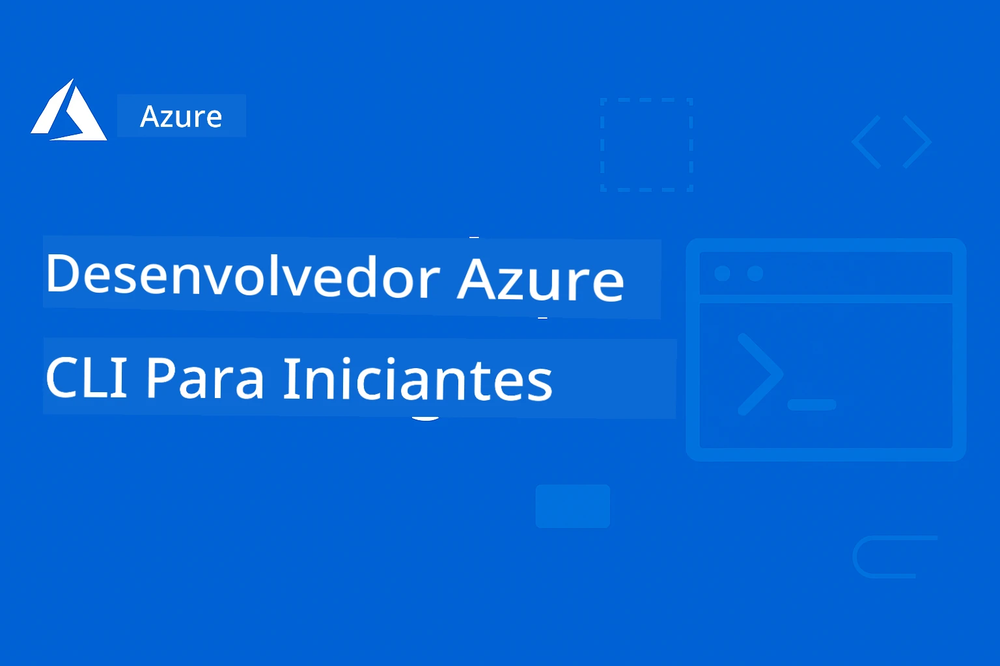

# AZD Para Iniciantes: Uma Jornada de Aprendizagem Estruturada

 

[](https://GitHub.com/microsoft/azd-for-beginners/watchers/)
[](https://GitHub.com/microsoft/azd-for-beginners/network/)
[](https://GitHub.com/microsoft/azd-for-beginners/stargazers/)

[](https://discord.com/invite/nkVh3dp)
[](https://discord.gg/nTYy5BXMWG)

---

### Traduções Automáticas (Sempre Atualizadas)

<!-- CO-OP TRANSLATOR LANGUAGES TABLE START -->
[Árabe](../ar/README.md) | [Bengali](../bn/README.md) | [Búlgaro](../bg/README.md) | [Birmanês (Myanmar)](../my/README.md) | [Chinês (Simplificado)](../zh-CN/README.md) | [Chinês (Tradicional, Hong Kong)](../zh-HK/README.md) | [Chinês (Tradicional, Macau)](../zh-MO/README.md) | [Chinês (Tradicional, Taiwan)](../zh-TW/README.md) | [Croata](../hr/README.md) | [Checo](../cs/README.md) | [Dinamarquês](../da/README.md) | [Holandês](../nl/README.md) | [Estónio](../et/README.md) | [Finlandês](../fi/README.md) | [Francês](../fr/README.md) | [Alemão](../de/README.md) | [Grego](../el/README.md) | [Hebraico](../he/README.md) | [Hindi](../hi/README.md) | [Húngaro](../hu/README.md) | [Indonésio](../id/README.md) | [Italiano](../it/README.md) | [Japonês](../ja/README.md) | [Canarês](../kn/README.md) | [Khmer](../km/README.md) | [Coreano](../ko/README.md) | [Lituano](../lt/README.md) | [Malaio](../ms/README.md) | [Malaialam](../ml/README.md) | [Manipuri (Meitei Mayek)](../mni/README.md) | [Marata](../mr/README.md) | [Nepali](../ne/README.md) | [Pidgin Nigeriano](../pcm/README.md) | [Norueguês](../no/README.md) | [Persa (Farsi)](../fa/README.md) | [Polaco](../pl/README.md) | [Português (Brasil)](../pt-BR/README.md) | [Português (Portugal)](./README.md) | [Punjabi (Gurmukhi)](../pa/README.md) | [Romeno](../ro/README.md) | [Russo](../ru/README.md) | [Sérvio (Cirílico)](../sr/README.md) | [Eslovaco](../sk/README.md) | [Esloveno](../sl/README.md) | [Espanhol](../es/README.md) | [Suaíli](../sw/README.md) | [Sueco](../sv/README.md) | [Tagalo (Filipino)](../tl/README.md) | [Tamil](../ta/README.md) | [Telugo](../te/README.md) | [Tailandês](../th/README.md) | [Turco](../tr/README.md) | [Ucraniano](../uk/README.md) | [Urdu](../ur/README.md) | [Vietnamita](../vi/README.md)

> **Prefere Clonar Localmente?**
>
> Este repositório inclui traduções em mais de 50 idiomas, o que aumenta significativamente o tamanho para download. Para clonar sem traduções, use o sparse checkout:
>
> **Bash / macOS / Linux:**
> ```bash
> git clone --filter=blob:none --sparse https://github.com/microsoft/AZD-for-beginners.git
> cd AZD-for-beginners
> git sparse-checkout set --no-cone '/*' '!translations' '!translated_images'
> ```
>
> **CMD (Windows):**
> ```cmd
> git clone --filter=blob:none --sparse https://github.com/microsoft/AZD-for-beginners.git
> cd AZD-for-beginners
> git sparse-checkout set --no-cone "/*" "!translations" "!translated_images"
> ```
>
> Isto dá-lhe tudo o que precisa para completar o curso com um download muito mais rápido.
<!-- CO-OP TRANSLATOR LANGUAGES TABLE END -->

## 🆕 Novidades no azd Hoje

> 📌 Este curso está validado contra **`azd 1.27.1`** (julho de 2026). Execute `azd version` para verificar a sua build, e `azd upgrade` para obter a mais recente.

O Azure Developer CLI cresceu para além das aplicações web tradicionais e APIs. Hoje, azd é a ferramenta única para implementar **qualquer** aplicação no Azure — incluindo aplicações alimentadas por IA e agentes inteligentes.

Eis o que isto significa para si:

- **Agentes de IA são agora cargas de trabalho azd de primeira classe.** Pode inicializar, implementar e gerir projetos de agentes de IA usando o mesmo fluxo de trabalho `azd init` → `azd up` que já conhece.
- **Um ciclo de vida completo de agente a partir da CLI.** A extensão `azure.ai.agents` cobre agora toda a jornada — `azd ai agent init` para scaffolding, `azd ai agent invoke` para testes (com saída de temporização de resposta), `azd ai agent eval generate` e `azd ai agent optimize` para medir e melhorar a qualidade, e `azd ai agent delete` para limpeza.
- **Mais blocos de construção de IA.** Novas extensões preview — `azure.ai.skills` e `azure.ai.connections` — permitem gerir skills reutilizáveis de agentes e ligações Foundry diretamente com azd.
- **Integração Microsoft Foundry** traz deployment de modelos, hospedagem de agentes e configuração de serviços de IA diretamente para o ecossistema de templates azd.
- **Rotinas diárias mais suaves.** Lançamentos recentes tornaram `azd init` idempotente (seguro para re-executar), fizeram com que `azd auth login` limpasse tokens obsoletos automaticamente, e adicionaram um amigável prompt de configuração inicial `azd tool`.
- **O fluxo de trabalho principal não mudou.** Quer esteja a implementar uma app de tarefas, um microsserviço, ou uma solução de IA multi-agente, os comandos são os mesmos.

> **Nota para utilizadores Aspire:** A Microsoft agora refere-se ao produto simplesmente como **Aspire** (anteriormente ".NET Aspire"). O suporte azd para Aspire mantém-se inalterado — só foi atualizado o nome.

Se já usou azd antes, o suporte a IA é uma extensão natural — não uma ferramenta separada nem uma via avançada. Se está a começar do zero, vai aprender um fluxo de trabalho que funciona para tudo.

---

## 🚀 O que é o Azure Developer CLI (azd)?

**Azure Developer CLI (azd)** é uma ferramenta de linha de comandos amigável para programadores que facilita a implementação de aplicações no Azure. Em vez de criar e conectar manualmente dezenas de recursos Azure, pode implementar aplicações inteiras com um só comando.

### A Magia do `azd up`

```bash
# This single command does everything:
# ✅ Creates all Azure resources  
# ✅ Configures networking and security
# ✅ Builds your application code
# ✅ Deploys to Azure
# ✅ Gives you a working URL
azd up
```

**É tudo!** Sem clicar no Portal Azure, sem aprender templates ARM complexos primeiro, sem configuração manual - apenas aplicações a funcionar no Azure.

---

## ❓ Azure Developer CLI vs Azure CLI: Qual a Diferença?

Esta é a pergunta mais comum dos principiantes. Aqui está a resposta simples:

| Característica | **Azure CLI (`az`)** | **Azure Developer CLI (`azd`)** |
|---------|---------------------|--------------------------------|
| **Propósito** | Gerir recursos individuais Azure | Implementar aplicações completas |
| **Mentalidade** | Focado em infraestrutura | Focado em aplicação |
| **Exemplo** | `az webapp create --name myapp...` | `azd up` |
| **Curva de Aprendizagem** | Deve conhecer serviços Azure | Só precise conhecer a sua app |
| **Mais adequado para** | DevOps, Infraestrutura | Programadores, Prototipagem |

### Analogia Simples

- **Azure CLI** é como ter todas as ferramentas para construir uma casa — martelos, serras, pregos. Pode construir qualquer coisa, mas precisa de saber construção.
- **Azure Developer CLI** é como contratar um empreiteiro — você descreve o que quer, e eles tratam da construção.

### Quando Usar Cada Um

| Cenário | Use Isto |
|----------|----------|
| "Quero implementar a minha app web rapidamente" | `azd up` |
| "Preciso de criar apenas uma conta de armazenamento" | `az storage account create` |
| "Estou a construir uma aplicação de IA completa" | `azd init --template azure-search-openai-demo` |
| "Preciso de debugar um recurso Azure específico" | `az resource show` |
| "Quero deployment pronto para produção em minutos" | `azd up --environment production` |

### Funcionam em Conjunto!

AZD usa Azure CLI no fundo. Pode usar ambos:
```bash
# Deploy your app with AZD
azd up

# Then fine-tune specific resources with Azure CLI
az webapp config set --name myapp --always-on true
```

---

## 🌟 Encontre Templates no Awesome AZD

Não comece do zero! **Awesome AZD** é a coleção da comunidade de templates prontos para implementar:

| Recurso | Descrição |
|----------|-------------|
| 🔗 [**Galeria Awesome AZD**](https://azure.github.io/awesome-azd/) | Navegue por mais de 200 templates com deploy de um clique |
| 🔗 [**Submeta um Template**](https://github.com/Azure/awesome-azd/issues) | Contribua com o seu próprio template para a comunidade |
| 🔗 [**Repositório GitHub**](https://github.com/Azure/awesome-azd) | Dê estrela e explore o código fonte |

### Templates Populares de IA do Awesome AZD

```bash
# RAG Chat with Microsoft Foundry Models + AI Search
azd init --template azure-search-openai-demo

# Quick AI Chat Application
azd init --template openai-chat-app-quickstart

# AI Agents with Foundry Agents
azd init --template get-started-with-ai-agents
```

---

## 🎯 Começar em 3 Passos

Antes de começar, certifique-se que a sua máquina está pronta para o template que deseja implementar:

**Windows:**
```powershell
.\validate-setup.ps1
```

**macOS / Linux:**
```bash
bash ./validate-setup.sh
```

Se alguma verificação obrigatória falhar, corrija-a primeiro e depois continue com o início rápido.

### Passo 1: Instalar AZD (2 minutos)

**Windows:**
```powershell
winget install microsoft.azd
```

**macOS:**
```bash
brew tap azure/azd && brew install azd
```

**Linux:**
```bash
curl -fsSL https://aka.ms/install-azd.sh | bash
```

### Passo 2: Autenticar-se para AZD

```bash
# Optional if you plan to use Azure CLI commands directly in this course
az login

# Required for AZD workflows
azd auth login
```

Se não tiver a certeza de qual precisa, siga o fluxo completo de configuração em [Instalação & Configuração](docs/chapter-01-foundation/installation.md#authentication-setup).

### Passo 3: Implemente a Sua Primeira App

```bash
# Initialize from a template
azd init --template todo-nodejs-mongo

# Deploy to Azure (creates everything!)
azd up
```

**🎉 É tudo!** A sua app está agora online no Azure.

### Limpar (Não se esqueça!)

```bash
# Remove all resources when done experimenting
azd down --force --purge
```

---

## 📚 Como Usar Este Curso

Este curso é desenhado para **aprendizagem progressiva** — comece onde se sentir confortável e avance:

| A Sua Experiência | Comece Aqui |
|-----------------|------------|
| **Novo no Azure** | [Capítulo 1: Fundamentos](#-chapter-1-foundation--quick-start) |
| **Conhece Azure, novo no AZD** | [Capítulo 1: Fundamentos](#-chapter-1-foundation--quick-start) |
| **Quer implementar apps de IA** | [Capítulo 2: Desenvolvimento Focado em IA](#-chapter-2-ai-first-development-recommended-for-ai-developers) |
| **Quer prática hands-on** | [🎓 Workshop Interativo](workshop/README.md) - laboratório guiado de 3-4 horas |
| **Precisa de padrões para produção** | [Capítulo 8: Produção & Empresa](#-chapter-8-production--enterprise-patterns) |

### Configuração Rápida

1. **Fork deste Repositório**: [](https://GitHub.com/microsoft/azd-for-beginners/fork)
2. **Clone-o**: `git clone https://github.com/YOUR-USERNAME/azd-for-beginners.git`
3. **Obtenha Ajuda**: [Comunidade Azure Discord](https://discord.com/invite/ByRwuEEgH4)

> **Prefere Clonar Localmente?**

> Este repositório inclui traduções em mais de 50 idiomas, o que aumenta significativamente o tamanho para download. Para clonar sem traduções, use o sparse checkout:
> ```bash
> git clone --filter=blob:none --sparse https://github.com/microsoft/AZD-for-beginners.git
> cd AZD-for-beginners
> git sparse-checkout set --no-cone '/*' '!translations' '!translated_images'
> ```
> Isto dá-lhe tudo o que precisa para completar o curso com um download muito mais rápido.


## Visão Geral do Curso

Domine o Azure Developer CLI (azd) através de capítulos estruturados desenhados para aprendizagem progressiva. **Foco especial na implementação de aplicações de IA com integração Microsoft Foundry.**

### Porque Este Curso é Essencial para Programadores Modernos

Baseado em insights da comunidade Microsoft Foundry Discord, **45% dos programadores querem usar AZD para cargas de trabalho de IA** mas encontram desafios com:
- Arquiteturas complexas de IA multi-serviço
- Melhores práticas para deployment de IA em produção  
- Integração e configuração de serviços Azure IA
- Otimização de custos para cargas de trabalho IA
- Resolução de problemas específicos de deployment de IA

### Objetivos de Aprendizagem

Ao concluir este curso estruturado, você irá:
- **Dominar os Fundamentos do AZD**: Conceitos centrais, instalação, e configuração
- **Implementar Aplicações de IA**: Usar AZD com serviços Microsoft Foundry
- **Implementar Infraestrutura como Código**: Gerir recursos Azure com templates Bicep
- **Resolver Problemas de Implantação**: Solucionar problemas comuns e depurar questões
- **Otimizar para Produção**: Segurança, escalabilidade, monitorização e gestão de custos
- **Construir Soluções Multi-Agente**: Implantar arquiteturas complexas de IA

## Antes de Começar: Contas, Acessos e Pressupostos

Antes de iniciar o Capítulo 1, certifique-se de que tem o seguinte preparado. Os passos de instalação mais à frente neste guia assumem que estes fundamentos já estão resolvidos.

- **Uma subscrição Azure**: Pode usar uma subscrição existente do trabalho ou da sua conta pessoal, ou criar uma [versão de teste gratuita](https://aka.ms/azurefreetrial) para começar.
- **Permissão para criar recursos Azure**: Para a maioria dos exercícios, deverá ter, pelo menos, acesso de **Contribuidor** à subscrição ou grupo de recursos alvo. Alguns capítulos também assumem que pode criar grupos de recursos, identidades geridas e atribuições de RBAC.
- [**Uma conta GitHub**](https://github.com): Útil para fazer fork do repositório, acompanhar as suas próprias alterações e usar GitHub Codespaces para o workshop.
- **Pré-requisitos para execução de templates**: Alguns templates necessitam de ferramentas locais como Node.js, Python, Java ou Docker. Execute o validador de configuração antes de começar para detetar ferramentas em falta antecipadamente.
- **Familiaridade básica com terminal**: Não é preciso ser especialista, mas deve sentir-se confortável a executar comandos como `git clone`, `azd auth login` e `azd up`.

> **A trabalhar numa subscrição empresarial?**
> Se o seu ambiente Azure é gerido por um administrador, confirme previamente se pode implantar recursos na subscrição ou grupo de recursos que planeia usar. Caso contrário, peça uma subscrição sandbox ou acesso de Contribuidor antes de começar.

> **Novo no Azure?**
> Comece com a sua própria subscrição de avaliação Azure ou de pagamento conforme o uso em https://aka.ms/azurefreetrial para poder completar os exercícios do início ao fim sem esperar por aprovações a nível de tenant.

## 🗺️ Mapa do Curso: Navegação Rápida por Capítulo

Cada capítulo tem um README dedicado com objetivos de aprendizagem, inícios rápidos e exercícios:

| Capítulo | Tema | Aulas | Duração | Complexidade |
|---------|-------|---------|----------|------------|
| **[Cap 1: Fundamentação](docs/chapter-01-foundation/README.md)** | Começar | [Noções Básicas AZD](docs/chapter-01-foundation/azd-basics.md) &#124; [Instalação](docs/chapter-01-foundation/installation.md) &#124; [Primeiro Projeto](docs/chapter-01-foundation/first-project.md) | 30-45 min | ⭐ |
| **[Cap 2: Desenvolvimento IA](docs/chapter-02-ai-development/README.md)** | Aplicações AI-First | [Integração Foundry](docs/chapter-02-ai-development/microsoft-foundry-integration.md) &#124; [Agentes AI](docs/chapter-02-ai-development/agents.md) &#124; [Deploy de Modelos](docs/chapter-02-ai-development/ai-model-deployment.md) &#124; [Workshop](docs/chapter-02-ai-development/ai-workshop-lab.md) | 1-2 hrs | ⭐⭐ |
| **[Cap 3: Configuração](docs/chapter-03-configuration/README.md)** | Autenticação & Segurança | [Configuração](docs/chapter-03-configuration/configuration.md) &#124; [Autenticação & Segurança](docs/chapter-03-configuration/authsecurity.md) | 45-60 min | ⭐⭐ |
| **[Cap 4: Infraestrutura](docs/chapter-04-infrastructure/README.md)** | IaC & Implantação | [Guia de Implantação](docs/chapter-04-infrastructure/deployment-guide.md) &#124; [Provisionamento](docs/chapter-04-infrastructure/provisioning.md) | 1-1.5 hrs | ⭐⭐⭐ |
| **[Cap 5: Multi-Agente](docs/chapter-05-multi-agent/README.md)** | Soluções Agentes AI | [Cenário Retalho](examples/retail-scenario.md) &#124; [Padrões de Coordenação](docs/chapter-06-pre-deployment/coordination-patterns.md) | 2-3 hrs | ⭐⭐⭐⭐ |
| **[Cap 6: Pré-Implantação](docs/chapter-06-pre-deployment/README.md)** | Planeamento & Validação | [Checks Preflight](docs/chapter-06-pre-deployment/preflight-checks.md) &#124; [Planeamento Capacidade](docs/chapter-06-pre-deployment/capacity-planning.md) &#124; [Seleção SKU](docs/chapter-06-pre-deployment/sku-selection.md) &#124; [App Insights](docs/chapter-06-pre-deployment/application-insights.md) | 1 hr | ⭐⭐ |
| **[Cap 7: Resolução de Problemas](docs/chapter-07-troubleshooting/README.md)** | Debug & Correção | [Problemas Comuns](docs/chapter-07-troubleshooting/common-issues.md) &#124; [Debugging](docs/chapter-07-troubleshooting/debugging.md) &#124; [Problemas AI](docs/chapter-07-troubleshooting/ai-troubleshooting.md) | 1-1.5 hrs | ⭐⭐ |
| **[Cap 8: Produção](docs/chapter-08-production/README.md)** | Padrões Empresariais | [Práticas de Produção](docs/chapter-08-production/production-ai-practices.md) | 2-3 hrs | ⭐⭐⭐⭐ |
| **[🎓 Workshop](workshop/README.md)** | Laboratório Prático | [Introdução](workshop/docs/instructions/0-Introduction.md) &#124; [Seleção](workshop/docs/instructions/1-Select-AI-Template.md) &#124; [Validação](workshop/docs/instructions/2-Validate-AI-Template.md) &#124; [Desconstrução](workshop/docs/instructions/3-Deconstruct-AI-Template.md) &#124; [Configuração](workshop/docs/instructions/4-Configure-AI-Template.md) &#124; [Personalização](workshop/docs/instructions/5-Customize-AI-Template.md) &#124; [Derrube](workshop/docs/instructions/6-Teardown-Infrastructure.md) &#124; [Encerramento](workshop/docs/instructions/7-Wrap-up.md) | 3-4 hrs | ⭐⭐ |

**Duração Total do Curso:** ~10-14 horas | **Progressão de Competência:** Iniciante → Pronto para Produção

---

## 📚 Capítulos de Aprendizagem

*Selecione o seu percurso de aprendizagem consoante o nível de experiência e objetivos*

### 🚀 Capítulo 1: Fundamentação & Início Rápido
**Pré-requisitos**: Subscrição Azure, conhecimento básico de linha de comandos  
**Duração**: 30-45 minutos  
**Complexidade**: ⭐

#### O que Vai Aprender
- Compreensão dos fundamentos do Azure Developer CLI
- Instalar o AZD na sua plataforma
- A sua primeira implantação com sucesso

#### Recursos de Aprendizagem
- **🎯 Comece Aqui**: [O que é o Azure Developer CLI?](#what-is-azure-developer-cli)
- **📖 Teoria**: [Noções Básicas AZD](docs/chapter-01-foundation/azd-basics.md) - Conceitos principais e terminologia
- **⚙️ Configuração**: [Instalação & Configuração](docs/chapter-01-foundation/installation.md) - Guias específicos para plataforma
- **🛠️ Prático**: [O Seu Primeiro Projeto](docs/chapter-01-foundation/first-project.md) - Tutorial passo a passo
- **📋 Referência Rápida**: [Folha de Comandos](resources/cheat-sheet.md)

#### Exercícios Práticos
```bash
# Quick installation check
azd version

# Deploy your first application
azd init --template todo-nodejs-mongo
azd up
```

**💡 Resultado do Capítulo**: Implantar com sucesso uma aplicação web simples no Azure usando AZD

**✅ Validação de Sucesso:**
```bash
# After completing Chapter 1, you should be able to:
azd version              # Shows installed version
azd init --template todo-nodejs-mongo  # Initializes project
azd up                  # Deploys to Azure
azd show                # Displays running app URL
# Application opens in browser and works
azd down --force --purge  # Cleans up resources
```

**📊 Investimento de Tempo:** 30-45 minutos  
**📈 Nível de Competência Após:** Capaz de implantar aplicações básicas de forma autónoma
**📈 Nível de Competência Após:** Capaz de implantar aplicações básicas de forma autónoma

---

### 🤖 Capítulo 2: Desenvolvimento AI-First (Recomendado para Desenvolvedores de IA)
**Pré-requisitos**: Capítulo 1 concluído  
**Duração**: 1-2 horas  
**Complexidade**: ⭐⭐

#### O que Vai Aprender
- Integração Microsoft Foundry com AZD
- Implantação de aplicações potenciadas por IA
- Compreensão da configuração de serviços AI

#### Recursos de Aprendizagem
- **🎯 Comece Aqui**: [Integração Microsoft Foundry](docs/chapter-02-ai-development/microsoft-foundry-integration.md)
- **🤖 Agentes AI**: [Guia de Agentes AI](docs/chapter-02-ai-development/agents.md) - Implantar agentes inteligentes com AZD
- **📖 Padrões**: [Implantação de Modelos AI](docs/chapter-02-ai-development/ai-model-deployment.md) - Implantar e gerir modelos AI
- **🛠️ Workshop**: [Laboratório AI](docs/chapter-02-ai-development/ai-workshop-lab.md) - Prepare as suas soluções AI para AZD
- **🎥 Guia Interativo**: [Materiais do Workshop](workshop/README.md) - Aprendizagem no browser com MkDocs * Ambiente DevContainer
- **📋 Templates**: [Templates Microsoft Foundry](#featured-microsoft-foundry-templates)
- **📝 Exemplos**: [Exemplos de Implantação AZD](examples/README.md)

#### Exercícios Práticos
```bash
# Deploy your first AI application
azd init --template azure-search-openai-demo
azd up

# Try additional AI templates
azd init --template openai-chat-app-quickstart
azd init --template agent-openai-python-prompty
```

**💡 Resultado do Capítulo**: Implantar e configurar uma aplicação de chat AI com capacidades RAG

**✅ Validação de Sucesso:**
```bash
# After Chapter 2, you should be able to:
azd init --template azure-search-openai-demo
azd up
# Test the AI chat interface
# Ask questions and get AI-powered responses with sources
# Verify search integration works
azd monitor  # Check Application Insights shows telemetry
azd down --force --purge
```

**📊 Investimento de Tempo:** 1-2 horas  
**📈 Nível de Competência Após:** Capaz de implantar e configurar aplicações AI prontas para produção  
**💰 Consciência de Custos:** Compreender custos de desenvolvimento $80-150/mês, custos de produção $300-3500/mês

#### 💰 Considerações de Custo para Implantação AI

**Ambiente de Desenvolvimento (Estimado $80-150/mês):**
- Modelos Microsoft Foundry (Pagamento conforme uso): $0-50/mês (baseado no uso de tokens)
- AI Search (nível básico): $75/mês
- Container Apps (Consumo): $0-20/mês
- Armazenamento (Standard): $1-5/mês

**Ambiente de Produção (Estimado $300-3,500+/mês):**
- Modelos Microsoft Foundry (PTU para desempenho consistente): $3,000+/mês OU pagamento conforme uso com volume elevado
- AI Search (nível standard): $250/mês
- Container Apps (Dedicado): $50-100/mês
- Application Insights: $5-50/mês
- Armazenamento (Premium): $10-50/mês

**💡 Dicas para Otimização de Custos:**
- Use os Modelos Microsoft Foundry no **Nível Gratuito** para aprendizagem (Azure OpenAI inclui 50,000 tokens/mês)
- Execute `azd down` para desalocar recursos quando não estiver a desenvolver ativamente
- Comece com faturação por consumo, faça upgrade para PTU apenas em produção
- Use `azd provision --preview` para estimar custos antes da implantação
- Ative o auto-scaling: pague apenas pelo uso real

**Monitorização de Custos:**
```bash
# Check estimated monthly costs
azd provision --preview

# Monitor actual costs in Azure Portal
az consumption budget list --resource-group <your-rg>
```

---

### ⚙️ Capítulo 3: Configuração & Autenticação
**Pré-requisitos**: Capítulo 1 concluído  
**Duração**: 45-60 minutos  
**Complexidade**: ⭐⭐

#### O que Vai Aprender
- Configuração e gestão de ambiente
- Melhores práticas de autenticação e segurança
- Nomeação e organização de recursos

#### Recursos de Aprendizagem
- **📖 Configuração**: [Guia de Configuração](docs/chapter-03-configuration/configuration.md) - Configuração de ambiente
- **🔐 Segurança**: [Padrões de autenticação e identidade gerida](docs/chapter-03-configuration/authsecurity.md) - Padrões de autenticação
- **📝 Exemplos**: [Exemplo de aplicação de base de dados](examples/database-app/README.md) - Exemplos de bases de dados AZD

#### Exercícios Práticos
- Configurar múltiplos ambientes (dev, staging, prod)
- Configurar autenticação com identidade gerida
- Implementar configurações específicas de ambiente

**💡 Resultado do Capítulo**: Gerir múltiplos ambientes com autenticação e segurança adequadas

---

### 🏗️ Capítulo 4: Infraestrutura como Código & Implantação
**Pré-requisitos**: Capítulos 1-3 concluídos  
**Duração**: 1-1.5 horas  
**Complexidade**: ⭐⭐⭐

#### O que Vai Aprender
- Padrões avançados de implantação
- Infraestrutura como Código com Bicep
- Estratégias de provisionamento de recursos

#### Recursos de Aprendizagem
- **📖 Implantação**: [Guia de Implantação](docs/chapter-04-infrastructure/deployment-guide.md) - Fluxos de trabalho completos
- **🏗️ Provisionamento**: [Provisionamento de Recursos](docs/chapter-04-infrastructure/provisioning.md) - Gestão de recursos Azure
- **📝 Exemplos**: [Exemplo de Aplicação em Container](../../examples/container-app) - Implantações conteinerizadas

#### Exercícios Práticos
- Criar templates Bicep personalizados
- Implantar aplicações multi-serviço
- Implementar estratégias de implantação blue-green

**💡 Resultado do Capítulo**: Implantar aplicações multi-serviço complexas usando templates de infraestrutura personalizados

---

### 🎯 Capítulo 5: Soluções Multi-Agente AI (Avançado)
**Pré-requisitos**: Capítulos 1-2 concluídos  
**Duração**: 2-3 horas  
**Complexidade**: ⭐⭐⭐⭐

#### O que Vai Aprender
- Padrões de arquitetura multi-agente
- Orquestração e coordenação de agentes
- Implantações AI prontas para produção

#### Recursos de Aprendizagem
- **🤖 Projeto em Destaque**: [Solução Multi-Agente Retalho](examples/retail-scenario.md) - Implementação completa
- **🛠️ Templates ARM**: [Pacote de Template ARM](../../examples/retail-multiagent-arm-template) - Implantação com um clique
- **📖 Arquitetura**: [Padrões de coordenação multi-agente](docs/chapter-06-pre-deployment/coordination-patterns.md) - Padrões

#### Exercícios Práticos
```bash
# Deploy the complete retail multi-agent solution
cd examples/retail-multiagent-arm-template
./deploy.sh

# Explore agent configurations
az deployment group show --resource-group <rg-name> --name <deployment-name>
```

**💡 Resultado do Capítulo**: Implantar e gerir uma solução AI multi-agente pronta para produção com agentes de Cliente e Inventário

---

### 🔍 Capítulo 6: Validação & Planeamento Pré-Implantação
**Pré-requisitos**: Capítulo 4 concluído  
**Duração**: 1 hora  
**Complexidade**: ⭐⭐

#### O que Vai Aprender
- Planeamento da capacidade e validação de recursos
- Estratégias de seleção SKU
- Checks preflight e automatização

#### Recursos de Aprendizagem
- **📊 Planeamento**: [Planeamento de Capacidade](docs/chapter-06-pre-deployment/capacity-planning.md) - Validação de recursos
- **💰 Seleção**: [Seleção de SKU](docs/chapter-06-pre-deployment/sku-selection.md) - Escolhas rentáveis
- **✅ Validação**: [Verificações prévias](docs/chapter-06-pre-deployment/preflight-checks.md) - Scripts automatizados

#### Exercícios Práticos
- Execute scripts de validação de capacidade
- Otimize seleções de SKU para custo
- Implemente verificações automáticas pré-desdobramento

**💡 Resultado do Capítulo**: Validar e otimizar implementações antes da execução

---

### 🚨 Capítulo 7: Resolução de Problemas e Depuração
**Pré-requisitos**: Qualquer capítulo de implementação concluído  
**Duração**: 1-1,5 horas  
**Complexidade**: ⭐⭐

#### O que Vai Aprender
- Abordagens sistemáticas para depuração
- Problemas comuns e soluções
- Resolução de problemas específica de IA

#### Recursos de Aprendizagem
- **🔧 Problemas Comuns**: [Problemas Comuns](docs/chapter-07-troubleshooting/common-issues.md) - FAQ e soluções
- **🕵️ Depuração**: [Guia de Depuração](docs/chapter-07-troubleshooting/debugging.md) - Estratégias passo a passo
- **🤖 Problemas de IA**: [Resolução de Problemas Específica de IA](docs/chapter-07-troubleshooting/ai-troubleshooting.md) - Problemas de serviços de IA

#### Exercícios Práticos
- Diagnosticar falhas de implementação
- Resolver problemas de autenticação
- Depurar conectividade de serviços de IA

**💡 Resultado do Capítulo**: Diagnosticar e resolver independentemente problemas comuns de implementação

---

### 🏢 Capítulo 8: Padrões de Produção e Empresariais
**Pré-requisitos**: Capítulos 1-4 concluídos  
**Duração**: 2-3 horas  
**Complexidade**: ⭐⭐⭐⭐

#### O que Vai Aprender
- Estratégias de implementação em produção
- Padrões de segurança empresariais
- Monitorização e otimização de custos

#### Recursos de Aprendizagem
- **🏭 Produção**: [Melhores Práticas de IA em Produção](docs/chapter-08-production/production-ai-practices.md) - Padrões empresariais
- **📝 Exemplos**: [Exemplo de Microserviços](../../examples/microservices) - Arquiteturas complexas
- **📊 Monitorização**: [Integração Application Insights](docs/chapter-06-pre-deployment/application-insights.md) - Monitorização

#### Exercícios Práticos
- Implemente padrões de segurança empresariais
- Configure monitorização abrangente
- Implemente em produção com governança adequada

**💡 Resultado do Capítulo**: Implementar aplicações prontas para produção com capacidades empresariais completas

---

## 🎓 Visão Geral do Workshop: Experiência de Aprendizagem Prática

> **⚠️ ESTADO DO WORKSHOP: Desenvolvimento Ativo**  
> Os materiais do workshop estão atualmente a ser desenvolvidos e refinados. Os módulos principais são funcionais, mas algumas secções avançadas estão incompletas. Estamos a trabalhar ativamente para concluir todo o conteúdo. [Acompanhe o progresso →](workshop/README.md)

### Materiais Interativos do Workshop
**Aprendizagem prática abrangente com ferramentas baseadas no navegador e exercícios guiados**

Os materiais do workshop oferecem uma experiência de aprendizagem estruturada e interativa que complementa o currículo por capítulos acima. O workshop está desenhado tanto para aprendizagem autónoma como para sessões conduzidas por instrutores.

#### 🛠️ Características do Workshop
- **Interface Baseada no Navegador**: Workshop completo alimentado por MkDocs com pesquisa, copiar e funcionalidades de tema
- **Integração GitHub Codespaces**: Configuração do ambiente de desenvolvimento com um clique
- **Caminho de Aprendizagem Estruturado**: 8 módulos de exercícios guiados (3-4 horas no total)
- **Metodologia Progressiva**: Introdução → Seleção → Validação → Desconstrução → Configuração → Personalização → Fecho → Conclusão
- **Ambiente DevContainer Interativo**: Ferramentas e dependências pré-configuradas

#### 📚 Estrutura do Módulo do Workshop
O workshop segue uma **metodologia progressiva de 8 módulos** que o leva da descoberta ao domínio da implementação:

| Módulo | Tema | O que Vai Fazer | Duração |
|--------|-------|----------------|----------|
| **0. Introdução** | Visão Geral do Workshop | Compreender objetivos de aprendizagem, pré-requisitos e estrutura do workshop | 15 min |
| **1. Seleção** | Descoberta de Templates | Explorar templates AZD e selecionar o template certo para o seu cenário de IA | 20 min |
| **2. Validação** | Implementar & Verificar | Implementar o template com `azd up` e validar o funcionamento da infraestrutura | 30 min |
| **3. Desconstrução** | Compreender a Estrutura | Usar GitHub Copilot para explorar arquitetura do template, ficheiros Bicep e organização do código | 30 min |
| **4. Configuração** | Análise Profunda do azure.yaml | Dominar configuração `azure.yaml`, hooks de ciclo de vida e variáveis de ambiente | 30 min |
| **5. Personalização** | Torne-o Seu | Ativar AI Search, rastreamento, avaliação e personalizar para o seu cenário | 45 min |
| **6. Fecho** | Limpeza | Desprovisionar recursos em segurança com `azd down --purge` | 15 min |
| **7. Conclusão** | Próximos Passos | Rever conquistas, conceitos chave e continuar a sua trajetória de aprendizagem | 15 min |

**Fluxo do Workshop:**
```
Introduction → Selection → Validation → Deconstruction → Configuration → Customization → Teardown → Wrap-up
     ↓            ↓           ↓              ↓               ↓              ↓            ↓           ↓
  Overview    Find the     Deploy &      Explore        Master         Customize     Clean up    Review &
             right        verify        code &        azure.yaml      for your      resources   next steps
             template                   structure                     scenario
```

#### 🚀 Começar com o Workshop
```bash
# Option 1: GitHub Codespaces (Recommended)
# Click "Code" → "Create codespace on main" in the repository

# Option 2: Local Development
git clone https://github.com/microsoft/azd-for-beginners.git
cd azd-for-beginners/workshop
# Follow the setup instructions in workshop/README.md
```

#### 🎯 Resultados de Aprendizagem do Workshop
Ao concluir o workshop, os participantes irão:
- **Implementar Aplicações de IA em Produção**: Usar AZD com serviços Microsoft Foundry
- **Dominar Arquiteturas Multi-Agente**: Implementar soluções coordenadas de agentes de IA
- **Implementar Melhores Práticas de Segurança**: Configurar autenticação e controlo de acesso
- **Otimizar para Escala**: Desenhar implementações rentáveis e eficientes
- **Resolver Problemas de Implementação**: Solucionar problemas comuns de forma independente

#### 📖 Recursos do Workshop
- **🎥 Guia Interativo**: [Materiais do Workshop](workshop/README.md) - Ambiente de aprendizagem baseado no navegador
- **📋 Instruções por Módulo**:
  - [0. Introdução](workshop/docs/instructions/0-Introduction.md) - Visão geral e objetivos do workshop
  - [1. Seleção](workshop/docs/instructions/1-Select-AI-Template.md) - Encontrar e selecionar templates de IA
  - [2. Validação](workshop/docs/instructions/2-Validate-AI-Template.md) - Implementar e verificar templates
  - [3. Desconstrução](workshop/docs/instructions/3-Deconstruct-AI-Template.md) - Explorar arquitetura do template
  - [4. Configuração](workshop/docs/instructions/4-Configure-AI-Template.md) - Dominar azure.yaml
  - [5. Personalização](workshop/docs/instructions/5-Customize-AI-Template.md) - Personalizar para o seu cenário
  - [6. Fecho](workshop/docs/instructions/6-Teardown-Infrastructure.md) - Limpar recursos
  - [7. Conclusão](workshop/docs/instructions/7-Wrap-up.md) - Revisão e próximos passos
- **🛠️ Laboratório do Workshop de IA**: [Laboratório do Workshop de IA](docs/chapter-02-ai-development/ai-workshop-lab.md) - Exercícios focados em IA
- **💡 Início Rápido**: [Guia de Configuração do Workshop](workshop/README.md#quick-start) - Configuração do ambiente

**Perfeito para**: Formação empresarial, cursos universitários, aprendizagem autónoma e bootcamps para programadores.

---

## 📖 Mergulho Profundo: Capacidades do AZD

Para além do básico, o AZD oferece funcionalidades poderosas para implementações em produção:

- **Implementações baseadas em templates** - Use templates pré-construídos para padrões comuns de aplicação
- **Infraestrutura como Código** - Gerir recursos Azure usando Bicep ou Terraform  
- **Workflows integrados** - Provisione, implemente e monitorize aplicações de forma fluida
- **Amigável para desenvolvedores** - Otimizado para produtividade e experiência do desenvolvedor

### **AZD + Microsoft Foundry: Perfeito para Implementações de IA**

**Porquê AZD para Soluções de IA?** AZD responde aos principais desafios enfrentados por desenvolvedores de IA:

- **Templates Prontos para IA** - Templates pré-configurados para Microsoft Foundry Models, Serviços Azure AI e cargas de trabalho ML
- **Implementações Seguras de IA** - Padrões de segurança incorporados para serviços de IA, chaves API e endpoints de modelos  
- **Padrões de IA em Produção** - Melhores práticas para implementações escaláveis e rentáveis de aplicações de IA
- **Workflows de IA de Ponta a Ponta** - Desde desenvolvimento de modelos a implementação em produção com monitorização adequada
- **Otimização de Custos** - Alocação inteligente de recursos e estratégias de escalabilidade para cargas de trabalho de IA
- **Integração Microsoft Foundry** - Ligação contínua ao catálogo e endpoints de modelos Microsoft Foundry

---

## 🎯 Biblioteca de Templates & Exemplos

### Em Destaque: Templates Microsoft Foundry
**Comece aqui se estiver a implementar aplicações de IA!**

> **Nota:** Estes templates demonstram vários padrões de IA. Alguns são Azure Samples externos, outros implementações locais.

| Template | Capítulo | Complexidade | Serviços | Tipo |
|----------|---------|------------|----------|------|
| [**Começar com chat IA**](https://github.com/Azure-Samples/get-started-with-ai-chat) | Capítulo 2 | ⭐⭐ | AzureOpenAI + Azure AI Model Inference API + Azure AI Search + Azure Container Apps + Application Insights | Externo |
| [**Começar com agentes IA**](https://github.com/Azure-Samples/get-started-with-ai-agents) | Capítulo 2 | ⭐⭐ | Foundry Agents + AzureOpenAI + Azure AI Search + Azure Container Apps + Application Insights| Externo |
| [**Demonstração Azure Search + OpenAI**](https://github.com/Azure-Samples/azure-search-openai-demo) | Capítulo 2 | ⭐⭐ | AzureOpenAI + Azure AI Search + App Service + Storage | Externo |
| [**Início rápido OpenAI Chat App**](https://github.com/Azure-Samples/openai-chat-app-quickstart) | Capítulo 2 | ⭐ | AzureOpenAI + Container Apps + Application Insights | Externo |
| [**Agent OpenAI Python Prompty**](https://github.com/Azure-Samples/agent-openai-python-prompty) | Capítulo 5 | ⭐⭐⭐ | AzureOpenAI + Azure Functions + Prompty | Externo |
| [**Contoso Chat RAG**](https://github.com/Azure-Samples/contoso-chat) | Capítulo 8 | ⭐⭐⭐⭐ | AzureOpenAI + AI Search + Cosmos DB + Container Apps | Externo |
| [**Solução Multi-Agente Varejo**](examples/retail-scenario.md) | Capítulo 5 | ⭐⭐⭐⭐ | AzureOpenAI + AI Search + Storage + Container Apps + Cosmos DB | **Local** |

### Em Destaque: Cenários de Aprendizagem Completos
**Templates de aplicações prontas para produção mapeados para capítulos de aprendizagem**

| Template | Capítulo de Aprendizagem | Complexidade | Aprendizagem Principal |
|----------|------------------|------------|--------------|
| [**openai-chat-app-quickstart**](https://github.com/Azure-Samples/openai-chat-app-quickstart) | Capítulo 2 | ⭐ | Padrões básicos de implementação de IA |
| [**azure-search-openai-demo**](https://github.com/Azure-Samples/azure-search-openai-demo) | Capítulo 2 | ⭐⭐ | Implementação RAG com Azure AI Search |
| [**processamento-documentos-ia**](https://github.com/Azure-Samples/ai-document-processing) | Capítulo 4 | ⭐⭐ | Integração de Inteligência de Documentos |
| [**agent-openai-python-prompty**](https://github.com/Azure-Samples/agent-openai-python-prompty) | Capítulo 5 | ⭐⭐⭐ | Framework de agente e chamadas de função |
| [**contoso-chat**](https://github.com/Azure-Samples/contoso-chat) | Capítulo 8 | ⭐⭐⭐ | Orquestração empresarial de IA |
| [**retail-multi-agent-solution**](examples/retail-scenario.md) | Capítulo 5 | ⭐⭐⭐⭐ | Arquitetura multi-agente com agentes Cliente e Inventário |

### Aprender por Tipo de Exemplo

> **📌 Exemplos Locais vs. Externos:**  
> **Exemplos Locais** (neste repositório) = Prontos a usar imediatamente  
> **Exemplos Externos** (Azure Samples) = Clonar de repositórios indicados

#### Exemplos Locais (Prontos a Usar)
- [**Solução Multi-Agente Varejo**](examples/retail-scenario.md) - Implementação completa pronta para produção com templates ARM
  - Arquitetura multi-agente (agentes Cliente + Inventário)
  - Monitorização e avaliação abrangentes
  - Implementação com um clique via template ARM

#### Exemplos Locais - Aplicações em Container (Capítulos 2-5)
**Exemplos completos de implementação de containers neste repositório:**
- [**Exemplos de Container App**](examples/container-app/README.md) - Guia completo para implementações em containers
  - [API Flask Simples](../../examples/container-app/simple-flask-api) - API REST básica com escala a zero
  - [Arquitetura de Microserviços](../../examples/container-app/microservices) - Implementação multi-serviço pronta para produção
  - Padrões de início rápido, produção e avançados
  - Orientações para monitorização, segurança e otimização de custos

#### Exemplos Externos - Aplicações Simples (Capítulos 1-2)
**Clone estes repositórios Azure Samples para começar:**
- [Aplicação Web Simples - Node.js + MongoDB](https://github.com/Azure-Samples/todo-nodejs-mongo) - Padrões básicos de implementação
- [Website Estático - React SPA](https://github.com/Azure-Samples/todo-csharp-sql-swa-func) - Implementação de conteúdo estático
- [Container App - Python Flask](https://github.com/Azure-Samples/container-apps-store-api-microservice) - Implementação de API REST

#### Exemplos Externos - Integração com Bases de Dados (Capítulo 3-4)  
- [Aplicação Base de Dados - C# + SQL](https://github.com/Azure-Samples/todo-csharp-sql) - Padrões de conectividade de base de dados
- [Functions + Cosmos DB](https://github.com/Azure-Samples/todo-python-mongo-swa-func) - Workflow de dados serverless

#### Exemplos Externos - Padrões Avançados (Capítulos 4-8)
- [Microserviços em Java](https://github.com/Azure-Samples/java-microservices-aca-lab) - Arquiteturas multi-serviço
- [Jobs Container Apps](https://github.com/Azure-Samples/container-apps-jobs) - Processamento em segundo plano  
- [Pipeline ML Empresarial](https://github.com/Azure-Samples/mlops-v2) - Padrões ML prontos para produção

### Coleções de Templates Externos
- [**Galeria Oficial de Templates AZD**](https://azure.github.io/awesome-azd/) - Coleção selecionada de templates oficiais e comunitários
- [**Templates Azure Developer CLI**](https://learn.microsoft.com/en-us/azure/developer/azure-developer-cli/azd-templates) - Documentação de templates Microsoft Learn
- [**Directório de Exemplos**](examples/README.md) - Exemplos locais de aprendizagem com explicações detalhadas

---

## 📚 Recursos e Referências de Aprendizagem

### Referências Rápidas
- [**Folha de Comandos**](resources/cheat-sheet.md) - Comandos essenciais do azd organizados por capítulo
- [**Glossário**](resources/glossary.md) - Terminologia do Azure e azd  
- [**FAQ**](resources/faq.md) - Perguntas comuns organizadas por capítulo de aprendizagem
- [**Guia de Estudo**](resources/study-guide.md) - Exercícios práticos abrangentes

### Workshops Práticos
- [**Laboratório de Workshop de IA**](docs/chapter-02-ai-development/ai-workshop-lab.md) - Torne as suas soluções de IA implantáveis com AZD (2-3 horas)
- [**Workshop Interativo**](workshop/README.md) - Exercícios guiados de 8 módulos com MkDocs e GitHub Codespaces
  - Segue: Introdução → Seleção → Validação → Desconstrução → Configuração → Personalização → Desmontagem → Conclusão

### Recursos Externos de Aprendizagem
- [Documentação Azure Developer CLI](https://learn.microsoft.com/en-us/azure/developer/azure-developer-cli/)
- [Centro de Arquitectura Azure](https://learn.microsoft.com/en-us/azure/architecture/)
- [Calculadora de Preços Azure](https://azure.microsoft.com/pricing/calculator/)
- [Estado do Azure](https://status.azure.com/)

### Competências de Agentes de IA para o Seu Editor
- [**Competências Microsoft Azure em skills.sh**](https://skills.sh/microsoft/github-copilot-for-azure) - 37 competências abertas de agentes para Azure AI, Foundry, implantação, diagnóstico, otimização de custos e mais. Instale-os no GitHub Copilot, Cursor, Claude Code ou qualquer agente suportado:
  ```bash
  npx skills add microsoft/github-copilot-for-azure
  ```

---

## 🔧 Guia Rápido de Resolução de Problemas

**Problemas comuns enfrentados por iniciantes e soluções imediatas:**

<details>
<summary><strong>❌ "azd: comando não encontrado"</strong></summary>

```bash
# Install AZD first
# Windows (PowerShell):
winget install microsoft.azd

# macOS:
brew tap azure/azd && brew install azd

# Linux:
curl -fsSL https://aka.ms/install-azd.sh | bash

# Verify installation
azd version
```
</details>

<details>
<summary><strong>❌ "Nenhuma subscrição encontrada" ou "Subscrição não definida"</strong></summary>

```bash
# List available subscriptions
az account list --output table

# Set default subscription
az account set --subscription "<subscription-id-or-name>"

# Set for AZD environment
azd env set AZURE_SUBSCRIPTION_ID "<subscription-id>"

# Verify
az account show
```
</details>

<details>
<summary><strong>❌ "QuotaInsuficiente" ou "Quota excedida"</strong></summary>

```bash
# Try different Azure region
azd env set AZURE_LOCATION "westus2"
azd up

# Or use smaller SKUs in development
# Edit infra/main.parameters.json:
{
  "sku": "B1"  // Instead of "P1V2"
}
```
</details>

<details>
<summary><strong>❌ "azd up" falha a meio do processo</strong></summary>

```bash
# Option 1: Clean and retry
azd down --force --purge
azd up

# Option 2: Just fix infrastructure
azd provision

# Option 3: Check detailed status
azd show

# Option 4: Check logs in Azure Monitor
azd monitor --logs
```
</details>

<details>
<summary><strong>❌ "Autenticação falhou" ou "Token expirado"</strong></summary>

```bash
# Re-authenticate for AZD
azd auth logout
azd auth login

# Optional: refresh Azure CLI too if you are running az commands
az logout
az login

# Verify authentication
az account show
```
</details>

<details>
<summary><strong>❌ "Recurso já existe" ou conflitos de nomes</strong></summary>

```bash
# AZD generates unique names, but if conflict:
azd down --force --purge

# Then retry with fresh environment
azd env new dev-v2
azd up
```
</details>

<details>
<summary><strong>❌ Implantação do template a demorar demasiado</strong></summary>

**Tempos normais de espera:**
- Aplicação web simples: 5-10 minutos
- Aplicação com base de dados: 10-15 minutos
- Aplicações de IA: 15-25 minutos (o provisionamento do OpenAI é lento)

```bash
# Check progress
azd show

# If stuck >30 minutes, check Azure Portal:
azd monitor --overview
# Look for failed deployments
```
</details>

<details>
<summary><strong>❌ "Permissão negada" ou "Proibido"</strong></summary>

```bash
# Check your Azure role
az role assignment list --assignee $(az account show --query user.name -o tsv)

# You need at least "Contributor" role
# Ask your Azure admin to grant:
# - Contributor (for resources)
# - User Access Administrator (for role assignments)
```
</details>

<details>
<summary><strong>❌ Não consegue encontrar a URL da aplicação implantada</strong></summary>

```bash
# Show all service endpoints
azd show

# Or open Azure Portal
azd monitor

# Check specific service
azd env get-values
# Look for *_URL variables
```
</details>

### 📚 Recursos Completos de Resolução de Problemas

- **Guia de Problemas Comuns:** [Soluções Detalhadas](docs/chapter-07-troubleshooting/common-issues.md)
- **Problemas Específicos de IA:** [Resolução de Problemas de IA](docs/chapter-07-troubleshooting/ai-troubleshooting.md)
- **Guia de Depuração:** [Depuração passo a passo](docs/chapter-07-troubleshooting/debugging.md)
- **Obter Ajuda:** [Azure Discord](https://discord.gg/microsoft-azure) #azure-developer-cli

---

## 🎓 Conclusão de Curso & Certificação

### Monitorização de Progresso
Acompanhe o seu progresso de aprendizagem em cada capítulo:

- [ ] **Capítulo 1**: Fundamentos & Início Rápido ✅
- [ ] **Capítulo 2**: Desenvolvimento com IA em Primeiro Lugar ✅  
- [ ] **Capítulo 3**: Configuração & Autenticação ✅
- [ ] **Capítulo 4**: Infraestrutura como Código & Implantação ✅
- [ ] **Capítulo 5**: Soluções Multi-Agentes de IA ✅
- [ ] **Capítulo 6**: Validação & Planeamento Pré-Implantação ✅
- [ ] **Capítulo 7**: Resolução de Problemas & Depuração ✅
- [ ] **Capítulo 8**: Padrões de Produção & Empresariais ✅

### Verificação de Aprendizagem
Após completar cada capítulo, verifique o seu conhecimento por:
1. **Exercício Prático**: Complete a implantação prática do capítulo
2. **Verificação de Conhecimento**: Reveja a seção FAQ do seu capítulo
3. **Discussão na Comunidade**: Partilhe a sua experiência no Azure Discord
4. **Próximo Capítulo**: Avance para o próximo nível de complexidade

### Benefícios da Conclusão do Curso
Ao concluir todos os capítulos, terá:
- **Experiência de Produção**: Aplicações reais de IA implantadas no Azure
- **Competências Profissionais**: Capacidades de implantação preparadas para ambiente empresarial  
- **Reconhecimento na Comunidade**: Membro ativo da comunidade de desenvolvedores Azure
- **Avanço na Carreira**: Conhecimentos procurados em AZD e implantação de IA

---

## 🤝 Comunidade & Suporte

### Obter Ajuda & Suporte
- **Questões Técnicas**: [Reportar bugs e solicitar funcionalidades](https://github.com/microsoft/azd-for-beginners/issues)
- **Questões de Aprendizagem**: [Comunidade Microsoft Azure Discord](https://discord.gg/microsoft-azure) e [](https://discord.gg/nTYy5BXMWG)
- **Ajuda Específica para IA**: Junte-se ao [](https://discord.gg/nTYy5BXMWG)
- **Documentação**: [Documentação oficial do Azure Developer CLI](https://learn.microsoft.com/en-us/azure/developer/azure-developer-cli/)

### Insights da Comunidade do Microsoft Foundry Discord

**Resultados recentes da sondagem no canal #Azure:**
- **45%** dos desenvolvedores querem utilizar AZD para cargas de trabalho de IA
- **Principais desafios**: Implantação multi-serviço, gestão de credenciais, prontidão para produção  
- **Mais requisitados**: Templates específicos de IA, guias de resolução de problemas, melhores práticas

**Junte-se à nossa comunidade para:**
- Partilhar as suas experiências com AZD + IA e obter ajuda
- Aceder a prévias antecipadas de novos templates de IA
- Contribuir para as melhores práticas de implantação de IA
- Influenciar o desenvolvimento futuro de funcionalidades de IA + AZD

### Contribuindo para o Curso
Agradecemos contribuições! Por favor, leia o nosso [Guia de Contribuição](CONTRIBUTING.md) para detalhes sobre:
- **Melhorias de Conteúdo**: Melhorar capítulos e exemplos existentes
- **Novos Exemplos**: Adicionar cenários e templates do mundo real  
- **Tradução**: Ajudar a manter suporte multilíngue
- **Relatórios de Bugs**: Melhorar precisão e clareza
- **Normas da Comunidade**: Seguir as nossas diretrizes de comunidade inclusiva

---

## 📄 Informações do Curso

### Licença
Este projeto está licenciado sob a Licença MIT - veja o ficheiro [LICENSE](../../LICENSE) para detalhes.

### Recursos de Aprendizagem Relacionados da Microsoft

A nossa equipa produz outros cursos de aprendizagem abrangentes:

<!-- CO-OP TRANSLATOR OTHER COURSES START -->
### LangChain
[](https://aka.ms/langchain4j-for-beginners)
[](https://aka.ms/langchainjs-for-beginners?WT.mc_id=m365-94501-dwahlin)
[](https://github.com/microsoft/langchain-for-beginners?WT.mc_id=m365-94501-dwahlin)
---

### Azure / Edge / MCP / Agentes
[](https://github.com/microsoft/AZD-for-beginners?WT.mc_id=academic-105485-koreyst)
[](https://github.com/microsoft/edgeai-for-beginners?WT.mc_id=academic-105485-koreyst)
[](https://github.com/microsoft/mcp-for-beginners?WT.mc_id=academic-105485-koreyst)
[](https://github.com/microsoft/ai-agents-for-beginners?WT.mc_id=academic-105485-koreyst)

---
 
### Série de IA Generativa
[](https://github.com/microsoft/generative-ai-for-beginners?WT.mc_id=academic-105485-koreyst)
[-9333EA?style=for-the-badge&labelColor=E5E7EB&color=9333EA)](https://github.com/microsoft/Generative-AI-for-beginners-dotnet?WT.mc_id=academic-105485-koreyst)
[-C084FC?style=for-the-badge&labelColor=E5E7EB&color=C084FC)](https://github.com/microsoft/generative-ai-for-beginners-java?WT.mc_id=academic-105485-koreyst)
[-E879F9?style=for-the-badge&labelColor=E5E7EB&color=E879F9)](https://github.com/microsoft/generative-ai-with-javascript?WT.mc_id=academic-105485-koreyst)

---
 
### Aprendizagem Fundamental
[](https://aka.ms/ml-beginners?WT.mc_id=academic-105485-koreyst)
[](https://aka.ms/datascience-beginners?WT.mc_id=academic-105485-koreyst)
[](https://aka.ms/ai-beginners?WT.mc_id=academic-105485-koreyst)
[](https://github.com/microsoft/Security-101?WT.mc_id=academic-96948-sayoung)
[](https://aka.ms/webdev-beginners?WT.mc_id=academic-105485-koreyst)
[](https://aka.ms/iot-beginners?WT.mc_id=academic-105485-koreyst)
[](https://github.com/microsoft/xr-development-for-beginners?WT.mc_id=academic-105485-koreyst)

---
 
### Série Copilot
[](https://aka.ms/GitHubCopilotAI?WT.mc_id=academic-105485-koreyst)
[](https://github.com/microsoft/mastering-github-copilot-for-dotnet-csharp-developers?WT.mc_id=academic-105485-koreyst)
[](https://github.com/microsoft/CopilotAdventures?WT.mc_id=academic-105485-koreyst)
<!-- CO-OP TRANSLATOR OTHER COURSES END -->

---

## 🗺️ Navegação do Curso

**🚀 Pronto para Começar a Aprender?**

**Iniciantes**: Comece pelo [Capítulo 1: Fundamentos & Início Rápido](#-chapter-1-foundation--quick-start)  
**Desenvolvedores de IA**: Passe para o [Capítulo 2: Desenvolvimento com IA em Primeiro Lugar](#-chapter-2-ai-first-development-recommended-for-ai-developers)  
**Desenvolvedores Experientes**: Comece com o [Capítulo 3: Configuração & Autenticação](#️-chapter-3-configuration--authentication)

**Próximos Passos**: [Iniciar Capítulo 1 - Noções Básicas AZD](docs/chapter-01-foundation/azd-basics.md) →

---

<!-- CO-OP TRANSLATOR DISCLAIMER START -->
**Aviso Legal**:
Este documento foi traduzido utilizando o serviço de tradução automática [Co-op Translator](https://github.com/Azure/co-op-translator). Embora nos esforcemos pela precisão, esteja ciente de que traduções automáticas podem conter erros ou imprecisões. O documento original na sua língua nativa deve ser considerado a fonte autorizada. Para informações críticas, recomenda-se tradução profissional humana. Não nos responsabilizamos por quaisquer mal-entendidos ou interpretações incorretas resultantes da utilização desta tradução.
<!-- CO-OP TRANSLATOR DISCLAIMER END -->