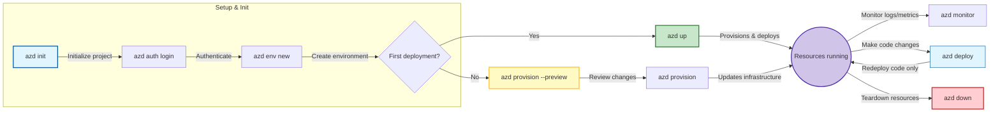
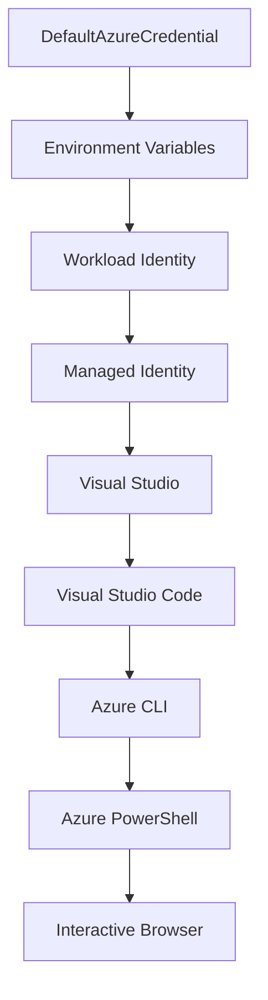

# Noções Básicas do AZD - Conceitos e Fundamentos Essenciais

**Navegação do Capítulo:**
- **📚 Início do Curso**: [AZD Para Iniciantes](../../README.md)
- **📖 Capítulo Atual**: Capítulo 1 - Fundamentos & Início Rápido
- **⬅️ Anterior**: [Visão Geral do Curso](../../README.md#-chapter-1-foundation--quick-start)
- **➡️ Seguinte**: [Instalação & Configuração](installation.md)
- **🚀 Próximo Capítulo**: [Capítulo 2: Desenvolvimento Centrado em IA](../chapter-02-ai-development/microsoft-foundry-integration.md)

## Introdução

> Revisado em relação a `azd 1.37.2` (novembro de 2026). Os comandos Bash usam espaços reservados entre aspas que deve substituir. Os workflows modelo usam `.` para inicializar o diretório atual; sem argumento de diretório, a inicialização do modelo cria um subdiretório e não altera o diretório de trabalho do seu shell. Os snippets avançados são ilustrativos, não projetos completos.

Esta lição apresenta-lhe o Azure Developer CLI (azd), uma poderosa ferramenta de linha de comando que acelera a sua jornada desde o desenvolvimento local até à implantação no Azure. Vai aprender os conceitos fundamentais, as principais funcionalidades e entender como o azd simplifica a implantação de aplicações nativas para a cloud.

## Objetivos de Aprendizagem

No final desta lição, você vai:
- Compreender o que é o Azure Developer CLI e o seu propósito principal
- Aprender os conceitos centrais de modelos, ambientes e serviços
- Explorar funcionalidades principais, incluindo desenvolvimento baseado em modelos e Infraestrutura como Código
- Entender a estrutura do projeto azd e o fluxo de trabalho
- Estar preparado para instalar e configurar o azd no seu ambiente de desenvolvimento

## Resultados da Aprendizagem

Após completar esta lição, será capaz de:
- Explicar o papel do azd nos workflows modernos de desenvolvimento cloud
- Identificar os componentes da estrutura de um projeto azd
- Descrever como modelos, ambientes e serviços funcionam em conjunto
- Entender os benefícios da Infraestrutura como Código com azd
- Reconhecer diferentes comandos azd e os seus propósitos

## O que é o Azure Developer CLI (azd)?

O Azure Developer CLI (azd) é uma ferramenta de linha de comandos projetada para acelerar a sua transição do desenvolvimento local para a implantação no Azure. Simplifica o processo de construção, implantação e gestão de aplicações nativas para a cloud no Azure.

### O que pode implantar com azd?

O azd suporta uma ampla variedade de cargas de trabalho — e a lista continua a crescer. Hoje, pode usar o azd para implantar:

| Tipo de Carga de Trabalho | Exemplos | Mesmo Workflow? |
|-------------------------|----------|------------------|
| **Aplicações tradicionais** | Aplicações web, APIs REST, sites estáticos | ✅ `azd up` |
| **Serviços e microsserviços** | Container Apps, Function Apps, backends multi-serviço | ✅ `azd up` |
| **Aplicações potenciadas por IA** | Apps de chat com Microsoft Foundry Models, soluções RAG com AI Search | ✅ `azd up` |
| **Agentes inteligentes** | Agentes hospedados no Foundry, orquestrações multi-agentes | ✅ `azd up` |

O insight chave é que **o ciclo de vida do azd mantém-se o mesmo independentemente do que está a implantar**. Inicializa um projeto, provisiona a infraestrutura, implanta o seu código, monitoriza a aplicação e faz a limpeza — seja um website simples ou um agente de IA sofisticado.

Esta continuidade é intencional. O azd trata as capacidades de IA como outro tipo de serviço que a sua aplicação pode usar, não como algo fundamentalmente diferente. Um endpoint de chat suportado pelos Microsoft Foundry Models é, do ponto de vista do azd, apenas mais um serviço para configurar e implantar.

### 🎯 Porque Usar o AZD? Uma Comparação Prática

Vamos comparar a implantação de uma aplicação web simples com base de dados:

#### ❌ SEM AZD: Implantação Manual no Azure (mais de 30 minutos)

**Comparação ilustrativa em Bash, não um iniciador de aplicação executável.** Assume código de aplicação existente, nomes de recursos únicos, autenticação com Azure CLI e quaisquer extensões CLI necessárias. Use o exercício do template abaixo para o caminho suportado fim a fim.

```bash
# Step 1: Create resource group
az group create --name myapp-rg --location eastus

# Step 2: Create App Service Plan
az appservice plan create --name myapp-plan \
  --resource-group myapp-rg \
  --sku B1 --is-linux

# Step 3: Create Web App
az webapp create --name myapp-web-unique123 \
  --resource-group myapp-rg \
  --plan myapp-plan \
  --runtime "NODE:22-lts"

# Step 4: Create Cosmos DB account (10-15 minutes)
az cosmosdb create --name myapp-cosmos-unique123 \
  --resource-group myapp-rg \
  --kind MongoDB

# Step 5: Create database
az cosmosdb mongodb database create \
  --account-name myapp-cosmos-unique123 \
  --resource-group myapp-rg \
  --name tododb

# Step 6: Create collection
az cosmosdb mongodb collection create \
  --account-name myapp-cosmos-unique123 \
  --resource-group myapp-rg \
  --database-name tododb \
  --name todos

# Step 7: Get connection string
CONN_STR=$(az cosmosdb keys list \
  --name myapp-cosmos-unique123 \
  --resource-group myapp-rg \
  --type connection-strings \
  --query "connectionStrings[0].connectionString" -o tsv)

# Step 8: Configure app settings
az webapp config appsettings set \
  --name myapp-web-unique123 \
  --resource-group myapp-rg \
  --settings MONGODB_URI="$CONN_STR"

# Step 9: Enable logging
az webapp log config --name myapp-web-unique123 \
  --resource-group myapp-rg \
  --application-logging filesystem \
  --detailed-error-messages true

# Step 10: Set up Application Insights
az monitor app-insights component create \
  --app myapp-insights \
  --location eastus \
  --resource-group myapp-rg

# Step 11: Link App Insights to Web App
INSTRUMENTATION_KEY=$(az monitor app-insights component show \
  --app myapp-insights \
  --resource-group myapp-rg \
  --query "instrumentationKey" -o tsv)

az webapp config appsettings set \
  --name myapp-web-unique123 \
  --resource-group myapp-rg \
  --settings APPINSIGHTS_INSTRUMENTATIONKEY="$INSTRUMENTATION_KEY"

# Step 12: Build application locally
npm install
npm run build

# Step 13: Create deployment package
zip -r app.zip . -x "*.git*" "node_modules/*"

# Step 14: Deploy application
az webapp deployment source config-zip \
  --resource-group myapp-rg \
  --name myapp-web-unique123 \
  --src app.zip

# Step 15: Wait and pray it works 🙏
# (No automated validation, manual testing required)
```

**Problemas:**
- ❌ Mais de 15 comandos para memorizar e executar por ordem
- ❌ 30-45 minutos de trabalho manual
- ❌ Fácil cometer erros (erros de digitação, parâmetros incorretos)
- ❌ As credenciais requerem manuseio explícito; logs de debug e rastreamento do shell podem expô-las
- ❌ Sem rollback automático se algo falhar
- ❌ Difícil de replicar por membros da equipa
- ❌ Diferente em cada vez (não reprodutível)

#### ✅ COM AZD: Implantação Automatizada (5 comandos, 10-15 minutos)

```bash
# Step 1: Initialize from template
azd init --template todo-nodejs-mongo .

# Step 2: Authenticate
azd auth login

# Step 3: Select the environment created during init
azd env select dev

# Step 4: Preview changes (optional but recommended)
azd provision --preview

# Step 5: Deploy everything
azd up

# ✨ Done! Everything is deployed, configured, and monitored
```

**Benefícios:**
- ✅ **5 comandos** vs. mais de 15 passos manuais
- ✅ **10-15 minutos** no total (principalmente à espera do Azure)
- ✅ **Menos erros manuais** - fluxo consistente, orientado por modelos
- ✅ **Gestão segura de segredos** - muitos modelos usam armazenamento de segredos gerido pelo Azure
- ✅ **Implantações repetíveis** - mesmo workflow todas as vezes
- ✅ **Definições de infraestrutura repetíveis** - sujeitas a quotas, disponibilidade regional e versões do modelo
- ✅ **Pronto para equipas** - qualquer pessoa pode implantar com os mesmos comandos
- ✅ **Infraestrutura como Código** - templates Bicep controlados por versão
- ✅ **Monitorização definida por modelos** - Application Insights quando incluído no template

### Tempo e Fiabilidade

Os tempos acima são estimativas, não benchmarks. O azd reduz os comandos que deve coordenar, mas não garante a duração da implantação, elimina erros ou providencia rollback automático da aplicação/base de dados. Mantenha versões funcionais no controlo de código e teste os procedimentos de recuperação.

## Conceitos Essenciais

### Modelos
Os modelos são a base do azd. Eles contêm:
- **Código da aplicação** - O seu código-fonte e dependências
- **Definições de infraestrutura** - Recursos Azure definidos em Bicep ou Terraform
- **Ficheiros de configuração** - Definições e variáveis ambientais
- **Scripts de implantação** - Workflows automatizados de implantação

### Ambientes
Os ambientes representam diferentes destinos de implantação:
- **Desenvolvimento** - Para testes e desenvolvimento
- **Staging** - Ambiente pré-produção
- **Produção** - Ambiente de produção em direto

Cada ambiente mantém o seu próprio:
- Nome e valores do ambiente; isolamento de recursos depende do modelo de infraestrutura
- Configurações
- Estado da implantação

### Serviços
Os serviços em `azure.yaml` descrevem componentes da aplicação que podem ser implantados:
- **Frontend** - Aplicações web, SPAs
- **Backend** - APIs, microsserviços

Bases de dados e armazenamento são normalmente provisionados como recursos de infraestrutura, não serviços inventados como `host: postgres`.

## Funcionalidades Principais

### 1. Desenvolvimento Orientado por Modelos
```bash
# Browse available templates
azd template list

# Initialize from a template
azd init --template "<template-name>" .
```

### 2. Infraestrutura como Código
- **Bicep** - Linguagem específica do domínio da Azure
- **Terraform** - Ferramenta de infraestrutura multi-cloud
- O Bicep compila para templates ARM; JSON ARM puro não é um `infra.provider` incorporado separado.

### 3. Workflows Integrados
```bash
# Complete deployment workflow
azd up            # Provision + Deploy this is hands off for first time setup

# 🧪 NEW: Preview infrastructure changes before deployment (SAFE)
azd provision --preview    # Simulate infrastructure deployment without making changes

azd provision     # Create Azure resources if you update the infrastructure use this
azd deploy        # Deploy application code or redeploy application code once update
azd down          # Clean up resources
```

#### 🛡️ Planeamento Seguro de Infraestrutura com Preview
O comando `azd provision --preview` é um divisor de águas para implantações seguras:
- **Análise Dry-run** - Mostra o que será criado, modificado ou apagado
- **Sem aplicação de infraestrutura** - Revisa alterações do fornecedor; inspecione os ganchos do projeto primeiro, pois eles podem executar comandos com efeitos secundários
- **Colaboração em equipa** - Partilhe os resultados do preview antes da implantação
- **Planeamento de custos** - Inspecione SKUs propostos, depois estime-os com a Calculadora de Preços Azure; o preview não calcula preços

```bash
# Example preview workflow
azd provision --preview           # See what will change
# Review the output, discuss with team
azd provision                     # Apply changes with confidence
```

### 📊 Visual: Fluxo de Trabalho de Desenvolvimento AZD



**Explicação do Workflow:**
1. **Init** - Começar com template ou novo projeto
2. **Auth** - Autenticar-se no Azure
3. **Environment** - Criar ambiente de implantação isolado
4. **Preview** - 🆕 Sempre preview das alterações de infraestrutura primeiro (prática segura)
5. **Provision** - Criar/atualizar recursos Azure
6. **Deploy** - Fazer push do código da aplicação
7. **Monitor** - Observar desempenho da aplicação
8. **Iterate** - Fazer alterações e redeploy do código
9. **Cleanup** - Remover recursos quando terminado

### 4. Gestão de Ambientes
```bash
# Create and manage environments
azd env new "<environment-name>"
azd env select "<environment-name>"
azd env list
```

### 5. Extensões e Comandos de IA

O azd usa um sistema de extensões para adicionar capacidades para além da CLI principal. Isto é especialmente útil para cargas de trabalho IA:

```bash
# List available extensions
azd extension list

# Install the Foundry agents extension
azd extension install azure.ai.agents

# Initialize an AI agent project interactively
azd ai agent init

# Test a deployed agent (shows latency and time-to-first-byte)
azd ai agent invoke

# Start the MCP server for AI-assisted development (Alpha)
azd mcp start
```

**O ciclo de vida do agente, ponta a ponta.** Use `azure.ai.agents` para operações do ciclo de vida do agente e instale `azure.ai.evaluations` separadamente para avaliação. Use `azd >= 1.37.0` para o workflow combinado. Não precisa de todos estes desde o primeiro dia:

| Fase | Comando | O que faz |
|-------|---------|----------|
| **Scaffold** | `azd ai agent init --template <path-to-azure.yaml>` | Adotar um template de projeto de agente atual |
| **Teste** | `azd ai agent invoke` | Chamar o agente e ver o tempo de resposta |
| **Medir** | `azd ai eval init`, `generate`, `run start` | Configurar, implantar e executar avaliações usando a extensão separada |
| **Melhorar** | `azd ai agent optimize --eval <evaluation-name> --optimize-model <optimizer-deployment>` | Reutilizar uma avaliação compatível para otimizar o agente |
| **Inspecionar** | `azd ai agent endpoint show` | Ver a configuração do endpoint ao vivo |
| **Limpar** | `azd ai agent delete` | Apagar um agente alojado e todas as suas versões |

> As extensões são abordadas detalhadamente em [Capítulo 2: Desenvolvimento Centrado em IA](../chapter-02-ai-development/agents.md) e na referência [Comandos CLI IA AZD](../chapter-08-production/production-ai-practices.md#azd-ai-cli-commands-and-extensions).

## 📁 Estrutura do Projeto

Estrutura típica de projeto azd:
```
my-app/
├── .azure/                  # Local environments and selected-environment config
│   ├── config.json
│   └── dev/.env
├── .devcontainer/          # Development container config
├── .github/workflows/      # GitHub Actions
├── .vscode/               # VS Code settings
├── infra/                 # Infrastructure code
│   ├── main.bicep        # Main infrastructure template
│   ├── main.parameters.json
│   └── modules/          # Reusable modules
├── src/                  # Application source code
│   ├── api/             # Backend services
│   └── web/             # Frontend application
├── azure.yaml           # azd project configuration
└── README.md
```

## 🔧 Ficheiros de Configuração

### azure.yaml
Ficheiro principal de configuração do projeto:
```yaml
name: my-awesome-app
metadata:
  template: my-template@1.0.0

services:
  web:
    project: ./src/web
    language: js
    host: appservice
  api:
    project: ./src/api
    language: js
    host: appservice

hooks:
  preprovision:
    shell: pwsh
    run: echo "Preparing to provision..."
```

### .azure/config.json
Seleção local do projeto do ambiente predefinido (ilustrativo; gerido pelo azd):
```json
{
  "defaultEnvironment": "dev"
}
```

## 🎪 Workflows Comuns com Exercícios Práticos

> **💡 Dica de Aprendizagem:** Siga estes exercícios por ordem para construir progressivamente as suas competências AZD.

### 🎯 Exercício 1: Inicialize o Seu Primeiro Projeto

**Objetivo:** Criar um projeto AZD e explorar a sua estrutura

**Passos:**
```bash
# Use a proven template
mkdir azd-basics-practice
cd azd-basics-practice
# Choose "dev" for the environment name when prompted
azd init --template todo-nodejs-mongo .

# Explore the generated files
ls -la  # View all files including hidden ones

# Key files created:
# - azure.yaml (main config)
# - infra/ (infrastructure code)
# - src/ (application code)
```

**✅ Sucesso:** Tem azure.yaml, infra/ e src/ diretórios

---

### 🎯 Exercício 2: Implantar no Azure

**Objetivo:** Completar implantação fim a fim

**Passos:**
```bash
# 1. Authenticate
azd auth login

# 2. Select the dev environment created in Exercise 1
azd env select dev
azd env set AZURE_LOCATION eastus

# 3. Preview changes (RECOMMENDED)
azd provision --preview

# 4. Deploy everything
azd up

# 5. Verify deployment
azd show    # View your app URL
```

**Tempo Esperado:** 10-15 minutos  
**✅ Sucesso:** URL da aplicação abre no navegador

---

### 🎯 Exercício 3: Múltiplos Ambientes

**Objetivo:** Implantar em dev e staging

**Passos:**
```bash
# Already have dev, create staging
azd env new staging
azd env set AZURE_LOCATION westus2
azd up

# Switch between them
azd env list
azd env select dev
```

**✅ Sucesso:** Dois grupos de recursos separados no Portal Azure

**Limpeza:** O exercício 3 cria uma segunda implantação faturável. Apague ambos quando terminar:

```bash
azd down --environment dev
azd down --environment staging
```

---

### 🛡️ Limpeza Destrutiva: `azd down --force --purge`

Quando quiser apagar intencionalmente os recursos Azure do ambiente selecionado:

```bash
azd down --force --purge
```

**O que faz:**
- `--force`: Sem pedidos de confirmação
- `--purge`: Apaga permanentemente recursos suportados com exclusão suave (por exemplo, Key Vaults), onde a proteção contra purga permite. Não apaga o diretório local `.azure/`.

**Use quando:** terminar com um ambiente descartável. Não use a limpeza destrutiva como primeira resposta a um erro de autenticação, quota ou configuração.

---

## 🎪 Referência Original do Workflow

### Iniciando um Novo Projeto
```bash
# Method 1: Use existing template
azd init --template todo-nodejs-mongo .

# Method 2: Start from scratch
azd init

# Method 3: Use current directory
azd init .
```

### Ciclo de Desenvolvimento
```bash
# Set up development environment
azd auth login
azd env new dev
azd env select dev

# Deploy everything
azd up

# Make changes and redeploy
azd deploy

# Clean up when done
azd down --force --purge # Deletes this environment's discovered Azure resources; review before forcing deletion.
```

## Entendendo `azd down --force --purge`
O comando `azd down --force --purge` é uma forma poderosa de destruir completamente o seu ambiente azd e todos os recursos associados. Aqui está uma explicação do que cada sinalizador faz:
```
--force
```
- Evita pedidos de confirmação.
- Útil para automação ou scripts onde a entrada manual não é viável.
- Não ignora permissões, proteção contra purga ou falhas de exclusão.

```
--purge
```
Elimina permanentemente recursos Azure suportados que foram eliminados soft sem uma confirmação adicional. A proteção contra eliminação e as permissões ainda se aplicam. **Não** remove ambientes locais nem a pasta `.azure/`.


### Porque usar ambos?
Use ambos apenas quando pretender eliminar os recursos Azure do ambiente selecionado e eliminar permanentemente os recursos recuperáveis. Esta é uma limpeza destrutiva, não uma reparação geral ou reinicialização do estado local.

É especialmente útil após eliminações manuais de recursos no portal Azure ou quando se trocam templates, ambientes ou convenções de nomenclatura de grupos de recursos.


### Gestão de Múltiplos Ambientes
```bash
# Create staging environment
azd env new staging
azd env select staging
azd up

# Switch back to dev
azd env select dev

# Compare environments
azd env list
```

## 🔐 Autenticação e Credenciais

Distinga a autenticação de deployment (`azd auth login`) da autenticação do SDK da aplicação (`DefaultAzureCredential`). São separadas. azd não usa por defeito as credenciais do Azure CLI.

### Autenticação Azure CLI (`az login`)

Execute `azd auth login` para azd. Os seguintes comandos Azure CLI são opcionais e autenticam os comandos `az` separadamente:

```bash
# Interactive login (opens browser)
az login

# Login with specific tenant
az login --tenant "<tenant-id>"

# Login with service principal
az login --service-principal -u "<app-id>" -p "<password>" --tenant "<tenant-id>"

# Check current login status
az account show

# List available subscriptions
az account list --output table

# Set default subscription
az account set --subscription "<subscription-id>"
```

### Fluxo de Autenticação
1. **Login Interativo**: Abre o seu browser padrão para autenticação
2. **Fluxo de Código de Dispositivo**: Para ambientes sem acesso a browser
3. **Service Principal**: Para automação e cenários de CI/CD
4. **Identidade Gerida**: Para aplicações hospedadas no Azure

### Cadeia DefaultAzureCredential

`DefaultAzureCredential` é um tipo de credencial que fornece uma experiência de autenticação simplificada ao tentar automaticamente múltiplas fontes de credenciais numa ordem específica:

#### Cadeia de Credenciais do SDK de Aplicação

A cadeia exata depende da linguagem do SDK Azure Identity, versão, plugins instalados e opções. Este diagrama é conceptual, não uma sequência fixa de autenticação azd; SDKs recentes podem também incluir credenciais do Azure Developer CLI.


#### 1. Variáveis de Ambiente
```bash
# Set environment variables for service principal
export AZURE_CLIENT_ID="<app-id>"
export AZURE_CLIENT_SECRET="<password>"
export AZURE_TENANT_ID="<tenant-id>"
```

#### 2. Identidade de Carga de Trabalho (Kubernetes/GitHub Actions)
Utilizado automaticamente em:
- Azure Kubernetes Service (AKS) com Identidade de Carga de Trabalho
- GitHub Actions com federação OIDC
- Outros cenários de identidade federada

#### 3. Identidade Gerida
Para recursos Azure como:
- Máquinas Virtuais
- App Service
- Azure Functions
- Container Instances

```bash
# Inspect a deployed Container App's configured identity (requires az login)
az containerapp show --name "<app-name>" --resource-group "<rg-name>" --query identity
```

#### 4. Integração com Ferramentas de Desenvolvimento
- **Visual Studio**: Usa automaticamente a conta iniciada
- **VS Code**: Suporte depende do SDK e configuração do broker/plugin suportada
- **Azure CLI**: Usa credenciais `az login` (mais comum para desenvolvimento local)

### Configuração de Autenticação AZD

```bash
# Method 1: Direct azd authentication (recommended)
azd auth login

# Method 2: Direct azd authentication
azd auth login --use-device-code  # For headless environments

# Method 3: Check authentication status
azd auth login --check-status

# Method 4: Logout and re-authenticate
azd auth logout
azd auth login
```

### Melhores Práticas de Autenticação

#### Para Desenvolvimento Local
```bash
# 1. Log in to azd
azd auth login

# 2. Select the subscription for this initialized environment
azd env set AZURE_SUBSCRIPTION_ID "<subscription-id>"

# 3. Check azd sign-in details (read the status message)
azd auth login --check-status
```

#### Para Pipelines CI/CD
```yaml
# Partial GitHub Actions steps: assumes checkout, azd installation,
# required AZURE_* environment values, and pipeline secret configuration.
- name: Deploy with azd
  run: |
    azd auth login --client-id ${{ secrets.AZURE_CLIENT_ID }} \
                    --client-secret ${{ secrets.AZURE_CLIENT_SECRET }} \
                    --tenant-id ${{ secrets.AZURE_TENANT_ID }}
    azd up --no-prompt
```

#### Para Ambientes de Produção
- Use **Identidade Gerida** quando executar em recursos Azure
- Use **Service Principal** para cenários de automação
- Evite armazenar credenciais em código ou ficheiros de configuração
- Use **Azure Key Vault** para configuração sensível

### Problemas Comuns de Autenticação e Soluções

#### Problema: "Nenhuma subscrição encontrada"
```bash
# Solution: Set default subscription
az account list --output table
az account set --subscription "<subscription-id>"
azd env set AZURE_SUBSCRIPTION_ID "<subscription-id>"
```

#### Problema: "Permissões insuficientes"
```bash
# Solution: Check and assign required roles
az role assignment list --assignee $(az account show --query user.name --output tsv)

# Common required roles:
# - Contributor (for resource management)
# - User Access Administrator (for role assignments)
```

#### Problema: "Token expirado"
```bash
# Solution: Re-authenticate
az logout
az login
azd auth logout
azd auth login
```

### Autenticação em Diferentes Cenários

#### Desenvolvimento Local
```bash
# Personal development account
az login
azd auth login
```

#### Desenvolvimento em Equipa
```bash
# Use specific tenant for organization
az login --tenant contoso.onmicrosoft.com
azd auth login --tenant-id "<tenant-id>"
```

#### Cenários Multi-inquilino
```bash
# Switch between tenants
az login --tenant tenant1.onmicrosoft.com
azd auth login --tenant-id "<tenant-1-id>"
# Select an environment configured with tenant 1's subscription
azd env select tenant1-dev
# Deploy to tenant 1
azd up

az login --tenant tenant2.onmicrosoft.com  
azd auth login --tenant-id "<tenant-2-id>"
azd env select tenant2-dev
# Deploy to tenant 2
azd up
```

### Considerações de Segurança

1. **Armazenamento de Credenciais**: Nunca armazene credenciais no código-fonte
2. **Limitação de Escopo**: Use o princípio do menor privilégio para service principals
3. **Rotação de Tokens**: Rode regularmente os segredos do service principal
4. **Rastreamento de Auditoria**: Monitorize atividades de autenticação e implantação
5. **Segurança de Rede**: Utilize endpoints privados sempre que possível

### Resolução de Problemas de Autenticação

```bash
# Debug authentication issues
azd auth login --check-status
az account show
az account get-access-token

# Common diagnostic commands
whoami                          # Current user context
az ad signed-in-user show      # Microsoft Entra ID user details
az group list                  # Test resource access
```

## Descoberta de Comandos

### Descoberta
```bash
azd template list              # Browse templates
azd template list --help       # Template discovery options
azd init --help               # Initialization options
```

### Gestão de Projetos
```bash
azd show                     # Project overview
azd env list                # Available environments and selected default
azd config show            # Configuration settings
```

### Monitorização
```bash
azd monitor                  # Open Azure portal monitoring
azd monitor --logs           # View application logs
azd monitor --live           # View live metrics
azd pipeline config          # Set up CI/CD
```

## Melhores Práticas

### 1. Use Nomes Significativos
```bash
# Good
azd env new production-east
azd init --template todo-nodejs-mongo .

# Avoid
azd env new env1
azd init --template template1 .
```

### 2. Aproveite Modelos
- Comece com modelos existentes
- Personalize para as suas necessidades
- Crie modelos reutilizáveis para a sua organização

### 3. Isolamento de Ambiente
- Utilize ambientes separados para dev/staging/prod
- Nunca faça deploy diretamente para produção a partir da máquina local
- Use pipelines CI/CD para implantações em produção

### 4. Gestão de Configuração
- Use identidade gerida e Key Vault para segredos; valores `azd env set` comuns são texto simples local
- Mantenha a configuração em controlo de versões
- Documente configurações específicas de ambiente

## Progressão de Aprendizagem

### Iniciante (Semana 1-2)
1. Instale azd e autentique-se
2. Implemente um modelo simples
3. Compreenda a estrutura do projeto
4. Aprenda comandos básicos (up, down, deploy)

### Intermédio (Semana 3-4)
1. Personalize modelos
2. Gestão de múltiplos ambientes
3. Compreender infraestrutura como código
4. Configure pipelines CI/CD

### Avançado (Semana 5+)
1. Crie modelos personalizados
2. Padrões avançados de infraestrutura
3. Implantações multi-região
4. Configurações de nível empresarial

## Próximos Passos

**📖 Continue o Capítulo 1 de Aprendizagem:**
- [Instalação & Configuração](installation.md) - Instale e configure azd
- [O Seu Primeiro Projeto](first-project.md) - Completar tutorial prático
- [Guia de Configuração](../chapter-03-configuration/configuration.md) - Opções avançadas de configuração

**🎯 Pronto para o Próximo Capítulo?**
- [Capítulo 2: Desenvolvimento com Prioridade para IA](../chapter-02-ai-development/microsoft-foundry-integration.md) - Comece a construir aplicações de IA

## Recursos Adicionais

- [Visão Geral do Azure Developer CLI](https://learn.microsoft.com/en-us/azure/developer/azure-developer-cli/)
- [Galeria de Modelos](https://azure.github.io/awesome-azd/)
- [Exemplos da Comunidade](https://github.com/Azure-Samples)

---

## 🙋 Perguntas Frequentes

### Questões Gerais

**P: Qual a diferença entre AZD e Azure CLI?**

R: Azure CLI (`az`) é para gerir recursos individuais Azure. AZD (`azd`) é para gerir aplicações inteiras:

```bash
# Azure CLI - Low-level resource management
az webapp create --name myapp --resource-group rg
az sql server create --name myserver --resource-group rg
# ...many more commands needed

# AZD - Application-level management
azd up  # Deploys entire app with all resources
```

**Pense desta forma:**
- `az` = Operar em peças Lego individuais
- `azd` = Trabalhar com conjuntos completos de Lego

---

**P: Preciso saber Bicep ou Terraform para usar AZD?**

R: Não! Comece com modelos:
```bash
# Use existing template - no IaC knowledge needed
azd init --template todo-nodejs-mongo .
azd up
```

Pode aprender Bicep mais tarde para personalizar infraestrutura. Os modelos fornecem exemplos práticos para aprender.

---

**P: Quanto custa executar modelos AZD?**

R: Os custos variam por região, SKU, tempo ativo, modo de base de dados e uso do modelo. Um ambiente de desenvolvimento pode incorrer custos mensais substanciais mesmo quando inativo; não assuma um intervalo universal de 50-150$:

```bash
# Preview resource changes (not prices)
azd provision --preview

# Always cleanup when not using
azd down --force --purge  # Removes all resources
```

**Dica profissional:** Use níveis gratuitos quando disponíveis:
- App Service: nível F1 (Gratuito)
- Azure OpenAI: sem concessão geral garantida de tokens mensais gratuitos; verifique preços do modelo e oferta atual
- Cosmos DB: contas provisionadas elegíveis podem optar por nível gratuito; modelos serverless não qualificam automaticamente

---

**P: Posso usar AZD com recursos Azure existentes?**

R: Sim, mas é mais fácil começar do zero. AZD funciona melhor quando gere todo o ciclo de vida. Para recursos existentes:

```bash
# Option 1: Import existing resources (advanced)
azd init
# Then modify infra/ to reference existing resources

# Option 2: Start fresh (recommended)
azd init --template "<verified-template-name>" .
azd up  # Creates new environment
```

---

**P: Como partilho o meu projeto com colegas?**

R: Faça commit do projeto AZD para Git (mas NÃO a pasta .azure):

```bash
# Already in .gitignore by default
.azure/        # Contains secrets and environment data
*.env          # Environment variables

# Team members then:
git clone "<your-repo>"
# Change into the cloned repository before running the remaining commands.
azd auth login
azd env new "<their-name>-dev"
azd up
```

Todos têm infraestrutura idêntica a partir dos mesmos modelos.

---

### Perguntas de Resolução de Problemas

**P: O comando "azd up" falhou a meio. O que faço?**

R: Verifique o erro, corrija, e tente novamente:

```bash
# Capture detailed diagnostics (redact sensitive values before sharing)
azd up --debug

# Common fixes:

# 1. If quota exceeded:
azd env set AZURE_LOCATION "westus2"  # Try different region

# 2. If resource name conflict:
azd down --force --purge  # Clean slate
azd up  # Retry

# 3. If auth expired:
az login
azd auth login
azd up
```

**Problema mais comum:** Subscripção Azure incorreta selecionada
```bash
az account list --output table
az account set --subscription "<correct-subscription>"
azd env set AZURE_SUBSCRIPTION_ID "<correct-subscription-id>"
```

---

**P: Como implanto apenas alterações de código sem reprovisionar?**

R: Use `azd deploy` em vez do `azd up`:

```bash
azd up          # First time: provision + deploy (slow)

# Make code changes...

azd deploy      # Subsequent times: deploy only (fast)
```

Comparação de velocidade:
- `azd up`: 10-15 minutos (provisiona infraestrutura)
- `azd deploy`: 2-5 minutos (apenas código)

---

**P: Posso personalizar os modelos de infraestrutura?**

R: Sim! Edite os ficheiros Bicep em `infra/`:

```bash
# After azd init
cd infra/
code main.bicep  # Edit in VS Code

# Preview changes
azd provision --preview

# Apply changes
azd provision
```

**Dica:** Comece pequeno - altere SKUs primeiro:
```bicep
// infra/main.bicep
sku: {
  name: 'B1'  // Change to 'P1V2' for production
}
```

---

**P: Como apago tudo o que o AZD criou?**

R: Um comando remove todos os recursos:

```bash
azd down --force --purge

# This deletes:
# - Azure resources/resource groups discovered for the selected environment
# - Supported soft-deleted resources, if purge protection allows
# Local .azure files remain; shared/external resources may remain too.
```

**Execute sempre quando:**
- Terminar de testar um modelo
- Mudar para projeto diferente
- Querer começar do zero

**Verificação de custos:** Confirme a eliminação no Azure e verifique recursos retidos/partilhados. Encargos anteriores ainda se aplicam.

---

**P: E se apagar recursos acidentalmente no Portal Azure?**

R: O estado AZD pode ficar fora de sincronização. Abordagem de limpeza:

```bash
# 1. Delete remaining resources only if that is your intent
azd down --force --purge

# 2. Start fresh
azd up

# Alternative: Let AZD detect and fix
azd provision  # Will create missing resources
```

---

### Perguntas Avançadas

**P: Posso usar AZD em pipelines CI/CD?**

R: Sim! Exemplo GitHub Actions:

```yaml
# .github/workflows/deploy.yml
name: Deploy with AZD

on:
  push:
    branches: [main]

jobs:
  deploy:
    runs-on: ubuntu-latest
    steps:
      - uses: actions/checkout@v4
      
      - name: Install azd
        run: curl -fsSL https://aka.ms/install-azd.sh | bash
      
      - name: Azure Login
        run: |
          azd auth login \
            --client-id ${{ secrets.AZURE_CLIENT_ID }} \
            --client-secret ${{ secrets.AZURE_CLIENT_SECRET }} \
            --tenant-id ${{ secrets.AZURE_TENANT_ID }}
      
      - name: Deploy
        env:
          AZURE_ENV_NAME: dev
          AZURE_LOCATION: ${{ vars.AZURE_LOCATION }}
          AZURE_SUBSCRIPTION_ID: ${{ vars.AZURE_SUBSCRIPTION_ID }}
        run: azd up --no-prompt
```

---

**P: Como gerir segredos e dados sensíveis?**

R: Use explicitamente Key Vault. `azd env set` escreve valores comuns no ficheiro local do ambiente; não cria automaticamente um cofre, nem atribui funções ou injeta segredos na aplicação.

```bash
# Interactive: create/select a Key Vault secret and save its reference
azd env set-secret DATABASE_PASSWORD
```

Precisa de permissões apropriadas do cofre. A sua infraestrutura/aplicação deve ainda ligar o segredo ao consumidor e conceder acesso à identidade de runtime. Não imprima valores secretos resolvidos em logs.

**Nunca faça commit:**
- Pasta `.azure/` (contém dados de ambiente)
- Ficheiros `.env` (segredos locais)
- Strings de conexão

---

**P: Posso fazer deploy para múltiplas regiões?**

R: Sim, crie um ambiente por região:

```bash
# East US environment
azd env new prod-eastus
azd env set AZURE_LOCATION eastus
azd up

# West Europe environment
azd env new prod-westeurope
azd env set AZURE_LOCATION westeurope
azd up

# Each environment is independent
azd env list
```

Para aplicações verdadeiramente multi-região, personalize os modelos Bicep para implantar para várias regiões simultaneamente.

---

**P: Onde posso obter ajuda se ficar bloqueado?**

1. **Documentação AZD:** https://learn.microsoft.com/azure/developer/azure-developer-cli/
2. **Problemas no GitHub:** https://github.com/Azure/azure-dev/issues
3. **Discord:** [Azure Discord](https://discord.gg/microsoft-azure) - canal #azure-developer-cli
4. **Stack Overflow:** Tag `azure-developer-cli`
5. **Este Curso:** [Guia de Resolução de Problemas](../chapter-07-troubleshooting/common-issues.md)

**Dica profissional:** Antes de perguntar, execute:
```bash
azd show       # Shows current state
azd version    # Shows your version
```
Inclua esta informação na sua questão para ajuda mais rápida.

---

## 🎓 O Que Vem a Seguir?

Agora compreende os fundamentos do AZD. Escolha o seu caminho:

### 🎯 Para Iniciantes:
1. **Próximo:** [Instalação & Configuração](installation.md) - Instale AZD na sua máquina
2. **Depois:** [O Seu Primeiro Projeto](first-project.md) - Implemente a sua primeira app
3. **Pratique:** Complete os 3 exercícios desta lição

### 🚀 Para Desenvolvedores AI:
1. **Ir para:** [Capítulo 2: Desenvolvimento com Prioridade para IA](../chapter-02-ai-development/microsoft-foundry-integration.md)
2. **Implante:** Num diretório de projeto vazio, comece com `azd init --template get-started-with-ai-chat .`
3. **Aprenda:** Construa enquanto faz deploy

### 🏗️ Para Desenvolvedores Experientes:
1. **Revise:** [Guia de Configuração](../chapter-03-configuration/configuration.md) - Configurações avançadas
2. **Explore:** [Infraestrutura como Código](../chapter-04-infrastructure/provisioning.md) - Exploração aprofundada do Bicep
3. **Construa:** Crie modelos personalizados para a sua stack

---

**Navegação do Capítulo:**
- **📚 Início do Curso**: [AZD Para Iniciantes](../../README.md)
- **📖 Capítulo Atual**: Capítulo 1 - Fundamentos & Início Rápido  
- **⬅️ Anterior**: [Visão Geral do Curso](../../README.md#-chapter-1-foundation--quick-start)
- **➡️ Próximo**: [Instalação & Configuração](installation.md)
- **🚀 Próximo Capítulo**: [Capítulo 2: Desenvolvimento com Prioridade para IA](../chapter-02-ai-development/microsoft-foundry-integration.md)

---

<!-- CO-OP TRANSLATOR DISCLAIMER START -->
**Aviso Legal**:
Este documento foi traduzido utilizando o serviço de tradução automática [Co-op Translator](https://github.com/Azure/co-op-translator). Embora nos esforcemos pela precisão, esteja ciente de que traduções automáticas podem conter erros ou imprecisões. O documento original na sua língua nativa deve ser considerado a fonte autorizada. Para informações críticas, recomenda-se tradução profissional humana. Não nos responsabilizamos por quaisquer mal-entendidos ou interpretações incorretas resultantes da utilização desta tradução.
<!-- CO-OP TRANSLATOR DISCLAIMER END -->