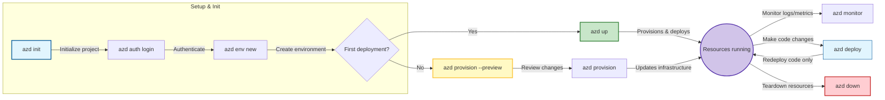
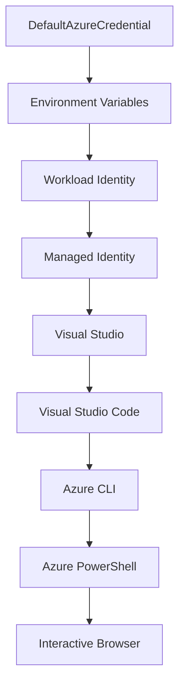

# Noções Básicas do AZD - Conceitos e Fundamentos Principais

**Navegação do Capítulo:**
- **📚 Página Inicial do Curso**: [AZD Para Iniciantes](../../README.md)
- **📖 Capítulo Atual**: Capítulo 1 - Fundamentos & Arranque Rápido
- **⬅️ Anterior**: [Visão Geral do Curso](../../README.md#-chapter-1-foundation--quick-start)
- **➡️ Seguinte**: [Instalação & Configuração](installation.md)
- **🚀 Próximo Capítulo**: [Capítulo 2: Desenvolvimento com Foco em IA](../chapter-02-ai-development/microsoft-foundry-integration.md)

## Introdução

> Revisto contra `azd 1.37.2` (novembro de 2026). Os comandos Bash usam espaços reservados entre aspas que deve substituir. Os fluxos de trabalho do modelo usam `.` para inicializar o diretório atual; sem um argumento de diretório, a inicialização do modelo cria um subdiretório e não altera o diretório de trabalho da sua shell. Os excertos avançados são ilustrativos, não projetos completos.

Esta lição apresenta o Azure Developer CLI (azd), uma poderosa ferramenta de linha de comandos que acelera a sua jornada do desenvolvimento local à implantação no Azure. Aprenderá os conceitos fundamentais, funcionalidades principais e perceberá como o azd simplifica o deployment de aplicações cloud-native.

## Objetivos de Aprendizagem

No final desta lição, irá:
- Compreender o que é o Azure Developer CLI e o seu propósito principal
- Aprender os conceitos centrais de modelos, ambientes e serviços
- Explorar as funcionalidades principais incluindo desenvolvimento guiado por modelos e Infraestrutura como Código
- Compreender a estrutura e fluxo de trabalho de um projeto azd
- Estar preparado para instalar e configurar o azd para o seu ambiente de desenvolvimento

## Resultados de Aprendizagem

Após completar esta lição, será capaz de:
- Explicar o papel do azd nos workflows modernos de desenvolvimento na cloud
- Identificar os componentes da estrutura de um projeto azd
- Descrever como modelos, ambientes e serviços funcionam em conjunto
- Compreender os benefícios da Infraestrutura como Código com azd
- Reconhecer os diferentes comandos azd e os seus propósitos

## O que é o Azure Developer CLI (azd)?

O Azure Developer CLI (azd) é uma ferramenta de linha de comando desenhada para acelerar a sua jornada do desenvolvimento local até à implantação no Azure. Simplifica o processo de construir, implantar e gerir aplicações cloud-native no Azure.

### O que Pode Implantar com o azd?

O azd suporta uma vasta gama de cargas de trabalho — e a lista continua a crescer. Hoje, pode usar o azd para implantar:

| Tipo de Carga de Trabalho | Exemplos | Mesmo Fluxo de Trabalho? |
|--------------------------|----------|-------------------------|
| **Aplicações tradicionais** | Aplicações web, APIs REST, sites estáticos | ✅ `azd up` |
| **Serviços e microsserviços** | Container Apps, Function Apps, backends multi-serviço | ✅ `azd up` |
| **Aplicações com IA** | Apps de chat com Microsoft Foundry Models, soluções RAG com AI Search | ✅ `azd up` |
| **Agentes inteligentes** | Agentes hospedados no Foundry, orquestrações multiagente | ✅ `azd up` |

A perceção chave é que **o ciclo de vida do azd mantém-se igual independentemente do que está a implantar**. Inicializa um projeto, provisiona infraestruturas, implanta o seu código, monitoriza a aplicação e limpa — seja um simples website ou um agente de IA sofisticado.

Esta continuidade é intencional. O azd trata as capacidades de IA como outro tipo de serviço que a aplicação pode usar, não como algo fundamentalmente diferente. Um endpoint de chat suportado por Microsoft Foundry Models é, do ponto de vista do azd, apenas mais um serviço a configurar e implantar.

### 🎯 Porque Usar AZD? Uma Comparação Real

Vamos comparar implantar uma aplicação web simples com base de dados:

#### ❌ SEM AZD: Implantação Manual no Azure (mais de 30 minutos)

**Comparação ilustrativa em Bash, não um arranque de aplicação exequível.** Assume código de aplicação existente, nomes únicos de recursos, autenticação no Azure CLI e quaisquer extensões CLI necessárias. Use o exercício do modelo abaixo para o caminho suportado de ponta a ponta.

```bash
# Step 1: Create resource group
az group create --name myapp-rg --location eastus

# Step 2: Create App Service Plan
az appservice plan create --name myapp-plan \
  --resource-group myapp-rg \
  --sku B1 --is-linux

# Step 3: Create Web App
az webapp create --name myapp-web-unique123 \
  --resource-group myapp-rg \
  --plan myapp-plan \
  --runtime "NODE:22-lts"

# Step 4: Create Cosmos DB account (10-15 minutes)
az cosmosdb create --name myapp-cosmos-unique123 \
  --resource-group myapp-rg \
  --kind MongoDB

# Step 5: Create database
az cosmosdb mongodb database create \
  --account-name myapp-cosmos-unique123 \
  --resource-group myapp-rg \
  --name tododb

# Step 6: Create collection
az cosmosdb mongodb collection create \
  --account-name myapp-cosmos-unique123 \
  --resource-group myapp-rg \
  --database-name tododb \
  --name todos

# Step 7: Get connection string
CONN_STR=$(az cosmosdb keys list \
  --name myapp-cosmos-unique123 \
  --resource-group myapp-rg \
  --type connection-strings \
  --query "connectionStrings[0].connectionString" -o tsv)

# Step 8: Configure app settings
az webapp config appsettings set \
  --name myapp-web-unique123 \
  --resource-group myapp-rg \
  --settings MONGODB_URI="$CONN_STR"

# Step 9: Enable logging
az webapp log config --name myapp-web-unique123 \
  --resource-group myapp-rg \
  --application-logging filesystem \
  --detailed-error-messages true

# Step 10: Set up Application Insights
az monitor app-insights component create \
  --app myapp-insights \
  --location eastus \
  --resource-group myapp-rg

# Step 11: Link App Insights to Web App
INSTRUMENTATION_KEY=$(az monitor app-insights component show \
  --app myapp-insights \
  --resource-group myapp-rg \
  --query "instrumentationKey" -o tsv)

az webapp config appsettings set \
  --name myapp-web-unique123 \
  --resource-group myapp-rg \
  --settings APPINSIGHTS_INSTRUMENTATIONKEY="$INSTRUMENTATION_KEY"

# Step 12: Build application locally
npm install
npm run build

# Step 13: Create deployment package
zip -r app.zip . -x "*.git*" "node_modules/*"

# Step 14: Deploy application
az webapp deployment source config-zip \
  --resource-group myapp-rg \
  --name myapp-web-unique123 \
  --src app.zip

# Step 15: Wait and pray it works 🙏
# (No automated validation, manual testing required)
```

**Problemas:**
- ❌ Mais de 15 comandos para lembrar e executar por ordem
- ❌ 30-45 minutos de trabalho manual
- ❌ Fácil cometer erros (erro de digitação, parâmetros errados)
- ❌ As credenciais requerem gestão explícita; logs de depuração e rastreio da shell podem expô-las
- ❌ Sem rollback automático se algo falhar
- ❌ Difícil de replicar para membros da equipa
- ❌ Diferente todas as vezes (não reprodutível)

#### ✅ COM AZD: Implantação Automatizada (5 comandos, 10-15 minutos)

```bash
# Step 1: Initialize from template
azd init --template todo-nodejs-mongo .

# Step 2: Authenticate
azd auth login

# Step 3: Select the environment created during init
azd env select dev

# Step 4: Preview changes (optional but recommended)
azd provision --preview

# Step 5: Deploy everything
azd up

# ✨ Done! Everything is deployed, configured, and monitored
```

**Benefícios:**
- ✅ **5 comandos** vs. 15+ passos manuais
- ✅ **10-15 minutos** tempo total (maioritariamente à espera do Azure)
- ✅ **Menos erros manuais** - fluxo consistente guiado por modelos
- ✅ **Gestão segura de segredos** - muitos modelos usam armazenamento de segredos gerido pelo Azure
- ✅ **Implantações repetíveis** - mesmo fluxo todas as vezes
- ✅ **Definições de infraestruturas repetíveis** - sujeitas a quotas, disponibilidade regional e versões dos modelos
- ✅ **Pronto para equipa** - qualquer pessoa pode implantar com os mesmos comandos
- ✅ **Infraestrutura como Código** - modelos Bicep controlados por versão
- ✅ **Monitorização definida pelo modelo** - Application Insights quando incluído no modelo

### Tempo e Fiabilidade

Os tempos acima são estimativas, não benchmarks. O azd reduz os comandos que deve coordenar, mas não garante duração da implantação, elimina erros ou providencia rollback automático da aplicação/base de dados. Mantenha versões de trabalho no controlo de código e teste procedimentos de recuperação.

## Conceitos Centrais

### Modelos
Os modelos são a base do azd. Contêm:
- **Código da aplicação** - O seu código-fonte e dependências
- **Definições de infraestrutura** - Recursos Azure definidos em Bicep ou Terraform
- **Ficheiros de configuração** - Definições e variáveis de ambiente
- **Scripts de implantação** - Fluxos de trabalho automatizados de implantação

### Ambientes
Os ambientes representam diferentes destinos de implantação:
- **Desenvolvimento** - Para testes e desenvolvimento
- **Staging** - Ambiente pré-produção
- **Produção** - Ambiente de produção ao vivo

Cada ambiente mantém o seu:
- Nome do ambiente e valores; isolamento de recursos depende do modelo de infraestrutura
- Definições de configuração
- Estado da implantação

### Serviços
Os serviços no `azure.yaml` descrevem componentes aplicacionais implantáveis:
- **Frontend** - Aplicações web, SPAs
- **Backend** - APIs, microsserviços

Bases de dados e armazenamento são normalmente providenciados como recursos de infraestrutura, não hosts de serviços inventados como `host: postgres`.

## Funcionalidades Principais

### 1. Desenvolvimento Guiado por Modelos
```bash
# Browse available templates
azd template list

# Initialize from a template
azd init --template "<template-name>" .
```

### 2. Infraestrutura como Código
- **Bicep** - Linguagem específica do domínio do Azure
- **Terraform** - Ferramenta multi-cloud de infraestrutura
- Bicep compila para modelos ARM; ARM JSON cru não é uma `infra.provider` integrada separada.

### 3. Fluxos de Trabalho Integrados
```bash
# Complete deployment workflow
azd up            # Provision + Deploy this is hands off for first time setup

# 🧪 NEW: Preview infrastructure changes before deployment (SAFE)
azd provision --preview    # Simulate infrastructure deployment without making changes

azd provision     # Create Azure resources if you update the infrastructure use this
azd deploy        # Deploy application code or redeploy application code once update
azd down          # Clean up resources
```

#### 🛡️ Planeamento Seguro de Infraestrutura com Preview
O comando `azd provision --preview` é uma revolução para implantações seguras:
- **Análise Dry-run** - Mostra o que será criado, modificado ou eliminado
- **Sem aplicar infraestrutura** - Revê alterações ao provider; inspecione hooks do projeto primeiro, pois hooks podem correr comandos com efeitos secundários
- **Colaboração em equipa** - Partilhe resultados de preview antes da implantação
- **Input para planeamento de custos** - Inspecione SKUs propostos, depois calcule preços com o Azure Pricing Calculator; o preview não calcula preços

```bash
# Example preview workflow
azd provision --preview           # See what will change
# Review the output, discuss with team
azd provision                     # Apply changes with confidence
```

### 📊 Visual: Fluxo de Trabalho de Desenvolvimento AZD



**Explicação do Fluxo:**
1. **Init** - Começar com modelo ou novo projeto
2. **Auth** - Autenticar com Azure
3. **Environment** - Criar ambiente de implantação isolado
4. **Preview** - 🆕 Sempre pré-visualize alterações de infraestrutura primeiro (boa prática)
5. **Provision** - Criar/atualizar recursos Azure
6. **Deploy** - Enviar o código da aplicação
7. **Monitor** - Observar desempenho da aplicação
8. **Iterate** - Fazer alterações e voltar a implantar código
9. **Cleanup** - Remover recursos quando terminar

### 4. Gestão de Ambientes
```bash
# Create and manage environments
azd env new "<environment-name>"
azd env select "<environment-name>"
azd env list
```

### 5. Extensões e Comandos de IA

O azd usa um sistema de extensões para adicionar capacidades para além da CLI principal. Isto é especialmente útil para cargas de trabalho de IA:

```bash
# List available extensions
azd extension list

# Install the GA Foundry bundle (requires azd >= 1.37.0)
azd ext install microsoft.foundry

# Initialize an AI agent project interactively
azd ai agent init

# Test a deployed agent (shows latency and time-to-first-byte)
azd ai agent invoke

# Start the MCP server for AI-assisted development (Alpha)
azd mcp start
```

**O ciclo de vida do agente, de ponta a ponta.** O pacote GA `microsoft.foundry` inclui `azure.ai.agents` e outras seis extensões principais. Instale `azure.ai.evaluations` separadamente para avaliação. Use `azd >= 1.37.0` para este fluxo de trabalho. Não necessita de todos no primeiro dia:

| Etapa | Comando | O que faz |
|-------|---------|-----------|
| **Scaffold** | `azd ai agent init --template <path-to-azure.yaml>` | Adota um modelo atual de projeto de agente |
| **Executar localmente** | `azd ai agent run`, depois `azd ai agent invoke --local "Test prompt"` noutro terminal | Inspeciona atividade local no Agent Inspector; chamadas de modelo continuam a usar Azure |
| **Implantar** | `azd deploy` | Para agentes hospedados em modo código, submete o código-fonte para build remota no Foundry |
| **Testar** | `azd ai agent invoke` | Chama o agente e vê o tempo de resposta |
| **Medir** | `azd ai eval init`, `generate`, `run start` | Configura, implanta e executa avaliações usando a extensão separada |
| **Melhorar** | `azd ai agent optimize --eval <evaluation-name> --optimize-model <optimizer-deployment>` | Reutiliza uma avaliação compatível para otimizar o agente |
| **Inspecionar** | `azd ai agent endpoint show` | Vê a configuração do endpoint em direto |
| **Limpar** | `azd ai agent delete` | Elimina um agente hospedado e todas as suas versões |

> Comece com o [tutorial do agente hospedado GA](../chapter-02-ai-development/microsoft-foundry-integration.md#hosted-agent-walkthrough-ga), que cobre pré-requisitos, provisionamento e limpeza segura. As extensões são abordadas mais detalhadamente na referência [Comandos CLI de IA do AZD](../chapter-08-production/production-ai-practices.md#azd-ai-cli-commands-and-extensions).

## 📁 Estrutura do Projeto

Uma estrutura típica de projeto azd:
```
my-app/
├── .azure/                  # Local environments and selected-environment config
│   ├── config.json
│   └── dev/.env
├── .devcontainer/          # Development container config
├── .github/workflows/      # GitHub Actions
├── .vscode/               # VS Code settings
├── infra/                 # Infrastructure code
│   ├── main.bicep        # Main infrastructure template
│   ├── main.parameters.json
│   └── modules/          # Reusable modules
├── src/                  # Application source code
│   ├── api/             # Backend services
│   └── web/             # Frontend application
├── azure.yaml           # azd project configuration
└── README.md
```

## 🔧 Ficheiros de Configuração

### azure.yaml
O ficheiro principal de configuração do projeto:
```yaml
name: my-awesome-app
metadata:
  template: my-template@1.0.0

services:
  web:
    project: ./src/web
    language: js
    host: appservice
  api:
    project: ./src/api
    language: js
    host: appservice

hooks:
  preprovision:
    shell: pwsh
    run: echo "Preparing to provision..."
```

### .azure/config.json
Seleção local do projeto do ambiente por defeito (ilustrativo; gerido pelo azd):
```json
{
  "defaultEnvironment": "dev"
}
```

## 🎪 Fluxos de Trabalho Comuns com Exercícios Práticos

> **💡 Dica de Aprendizagem:** Siga estes exercícios pela ordem para desenvolver progressivamente as suas competências em AZD.

### 🎯 Exercício 1: Inicializar o Seu Primeiro Projeto

**Objetivo:** Criar um projeto AZD e explorar a sua estrutura

**Passos:**
```bash
# Use a proven template
mkdir azd-basics-practice
cd azd-basics-practice
# Choose "dev" for the environment name when prompted
azd init --template todo-nodejs-mongo .

# Explore the generated files
ls -la  # View all files including hidden ones

# Key files created:
# - azure.yaml (main config)
# - infra/ (infrastructure code)
# - src/ (application code)
```

**✅ Sucesso:** Tem azure.yaml, infra/ e os diretórios src/

---

### 🎯 Exercício 2: Implantar no Azure

**Objetivo:** Completar a implantação de ponta a ponta

**Passos:**
```bash
# 1. Authenticate
azd auth login

# 2. Select the dev environment created in Exercise 1
azd env select dev
azd env set AZURE_LOCATION eastus

# 3. Preview changes (RECOMMENDED)
azd provision --preview

# 4. Deploy everything
azd up

# 5. Verify deployment
azd show    # View your app URL
```

**Tempo Estimado:** 10-15 minutos  
**✅ Sucesso:** URL da aplicação abre no navegador

---

### 🎯 Exercício 3: Múltiplos Ambientes

**Objetivo:** Implantar em dev e staging

**Passos:**
```bash
# Already have dev, create staging
azd env new staging
azd env set AZURE_LOCATION westus2
azd up

# Switch between them
azd env list
azd env select dev
```

**✅ Sucesso:** Dois grupos de recursos separados no Portal Azure

**Limpeza:** O exercício 3 cria uma segunda implantação faturável. Elimine ambas quando terminar:

```bash
azd down --environment dev
azd down --environment staging
```

---

### 🛡️ Limpeza Destrutiva: `azd down --force --purge`

Quando intencionalmente quer eliminar os recursos Azure do ambiente selecionado:

```bash
azd down --force --purge
```

**O que faz:**
- `--force`: Sem pedidos de confirmação
- `--purge`: Também elimina permanentemente recursos suportados como soft-deleted (por exemplo Key Vaults), onde a proteção de purge o permite. Não elimina o diretório local `.azure/`.

**Utilize quando:** terminar com um ambiente descartável. Não trate a limpeza destrutiva como a primeira resposta para um erro de autenticação, quota ou configuração.

---

## 🎪 Referência do Fluxo de Trabalho Original

### Iniciar um Novo Projeto
```bash
# Method 1: Use existing template
azd init --template todo-nodejs-mongo .

# Method 2: Start from scratch
azd init

# Method 3: Use current directory
azd init .
```

### Ciclo de Desenvolvimento
```bash
# Set up development environment
azd auth login
azd env new dev
azd env select dev

# Deploy everything
azd up

# Make changes and redeploy
azd deploy

# Clean up when done
azd down --force --purge # Deletes this environment's discovered Azure resources; review before forcing deletion.
```

## Compreender `azd down --force --purge`
O comando `azd down --force --purge` é uma forma poderosa de destruir completamente o seu ambiente azd e todos os recursos associados. Eis uma explicação do que cada sinalizador faz:
```
--force
```
- Ignora pedidos de confirmação.
- Útil para automação ou scripting onde a entrada manual não é viável.
- Não contorna permissões, proteção de purge ou falhas de eliminação.

```
--purge
```
Elimina permanentemente os recursos Azure soft-deleted suportados sem uma confirmação adicional. A proteção de purge e permissões continuam a aplicar-se. **Não** remove ambientes locais nem a pasta `.azure/`.


### Porque usar ambos?
Use ambos somente quando pretende eliminar os recursos Azure do ambiente selecionado e purgar recursos recuperáveis. Esta é uma limpeza destrutiva, não uma reparação geral ou reset do estado local.

É especialmente útil após eliminações manuais de recursos no portal Azure ou quando muda de modelos, ambientes ou convenções de nomeação de grupos de recursos.


### Gestão de Múltiplos Ambientes
```bash
# Create staging environment
azd env new staging
azd env select staging
azd up

# Switch back to dev
azd env select dev

# Compare environments
azd env list
```

## 🔐 Autenticação e Credenciais

Distinga autenticação de implantação (`azd auth login`) da autenticação do SDK da aplicação (`DefaultAzureCredential`). São separadas. O azd não usa por defeito credenciais do Azure CLI.

### Autenticação Azure CLI (`az login`)

Execute `azd auth login` para o azd. Os seguintes comandos do Azure CLI são opcionais e autenticam `az` comandos separadamente:

```bash
# Interactive login (opens browser)
az login

# Login with specific tenant
az login --tenant "<tenant-id>"

# Login with service principal
az login --service-principal -u "<app-id>" -p "<password>" --tenant "<tenant-id>"

# Check current login status
az account show

# List available subscriptions
az account list --output table

# Set default subscription
az account set --subscription "<subscription-id>"
```

### Fluxo de Autenticação
1. **Login Interativo**: Abre o seu navegador padrão para autenticação
2. **Fluxo de Código de Dispositivo**: Para ambientes sem acesso a browser
3. **Principal de Serviço**: Para cenários de automatização e CI/CD
4. **Identidade Gerida**: Para aplicações alojadas na Azure

### Cadeia DefaultAzureCredential

`DefaultAzureCredential` é um tipo de credencial que oferece uma experiência de autenticação simplificada ao tentar automaticamente várias fontes de credenciais numa ordem específica:

#### Cadeia de Credenciais do SDK da Aplicação

A cadeia exata depende da linguagem do SDK Azure Identity, versão, plugins instalados e opções. Este diagrama é conceptual, não uma sequência fixa de autenticação azd; SDKs recentes podem também incluir credenciais Azure Developer CLI.


#### 1. Variáveis de Ambiente
```bash
# Set environment variables for service principal
export AZURE_CLIENT_ID="<app-id>"
export AZURE_CLIENT_SECRET="<password>"
export AZURE_TENANT_ID="<tenant-id>"
```

#### 2. Identidade de Workload (Kubernetes/GitHub Actions)
Usado automaticamente em:
- Azure Kubernetes Service (AKS) com Workload Identity
- GitHub Actions com federação OIDC
- Outros cenários de identidade federada

#### 3. Identidade Gerida
Para recursos Azure como:
- Máquinas Virtuais
- App Service
- Azure Functions
- Instâncias de Contentor

```bash
# Inspect a deployed Container App's configured identity (requires az login)
az containerapp show --name "<app-name>" --resource-group "<rg-name>" --query identity
```

#### 4. Integração em Ferramentas para Desenvolvedores
- **Visual Studio**: Usa automaticamente a conta com sessão iniciada
- **VS Code**: O suporte depende do SDK e da configuração suportada do broker/plugin
- **Azure CLI**: Usa credenciais `az login` (mais comum para desenvolvimento local)

### Configuração de Autenticação AZD

```bash
# Method 1: Direct azd authentication (recommended)
azd auth login

# Method 2: Direct azd authentication
azd auth login --use-device-code  # For headless environments

# Method 3: Check authentication status
azd auth login --check-status

# Method 4: Logout and re-authenticate
azd auth logout
azd auth login
```

### Boas Práticas de Autenticação

#### Para Desenvolvimento Local
```bash
# 1. Log in to azd
azd auth login

# 2. Select the subscription for this initialized environment
azd env set AZURE_SUBSCRIPTION_ID "<subscription-id>"

# 3. Check azd sign-in details (read the status message)
azd auth login --check-status
```

#### Para Pipelines CI/CD
```yaml
# Partial GitHub Actions steps: assumes checkout, azd installation,
# required AZURE_* environment values, and pipeline secret configuration.
- name: Deploy with azd
  run: |
    azd auth login --client-id ${{ secrets.AZURE_CLIENT_ID }} \
                    --client-secret ${{ secrets.AZURE_CLIENT_SECRET }} \
                    --tenant-id ${{ secrets.AZURE_TENANT_ID }}
    azd up --no-prompt
```

#### Para Ambientes de Produção
- Use **Identidade Gerida** quando executar em recursos Azure
- Use **Principal de Serviço** para cenários de automatização
- Evite armazenar credenciais no código ou ficheiros de configuração
- Use **Azure Key Vault** para configurações sensíveis

### Problemas e Soluções Comuns de Autenticação

#### Problema: "Nenhuma subscrição encontrada"
```bash
# Solution: Set default subscription
az account list --output table
az account set --subscription "<subscription-id>"
azd env set AZURE_SUBSCRIPTION_ID "<subscription-id>"
```

#### Problema: "Permissões insuficientes"
```bash
# Solution: Check and assign required roles
az role assignment list --assignee $(az account show --query user.name --output tsv)

# Common required roles:
# - Contributor (for resource management)
# - User Access Administrator (for role assignments)
```

#### Problema: "Token expirado"
```bash
# Solution: Re-authenticate
az logout
az login
azd auth logout
azd auth login
```

### Autenticação em Diferentes Cenários

#### Desenvolvimento Local
```bash
# Personal development account
az login
azd auth login
```

#### Desenvolvimento em Equipa
```bash
# Use specific tenant for organization
az login --tenant contoso.onmicrosoft.com
azd auth login --tenant-id "<tenant-id>"
```

#### Cenários Multi-inquilino
```bash
# Switch between tenants
az login --tenant tenant1.onmicrosoft.com
azd auth login --tenant-id "<tenant-1-id>"
# Select an environment configured with tenant 1's subscription
azd env select tenant1-dev
# Deploy to tenant 1
azd up

az login --tenant tenant2.onmicrosoft.com  
azd auth login --tenant-id "<tenant-2-id>"
azd env select tenant2-dev
# Deploy to tenant 2
azd up
```

### Considerações de Segurança

1. **Armazenamento de Credenciais**: Nunca guarde credenciais no código fonte
2. **Limitação de Escopo**: Use o princípio do menor privilégio para principais de serviço
3. **Rotação de Token**: Rode regularmente os segredos do principal de serviço
4. **Rastreio de Auditoria**: Monitore atividades de autenticação e deploy
5. **Segurança de Rede**: Use endpoints privados sempre que possível

### Resolução de Problemas de Autenticação

```bash
# Debug authentication issues
azd auth login --check-status
az account show
az account get-access-token

# Common diagnostic commands
whoami                          # Current user context
az ad signed-in-user show      # Microsoft Entra ID user details
az group list                  # Test resource access
```

## Descoberta de Comandos

### Descoberta
```bash
azd template list              # Browse templates
azd template list --help       # Template discovery options
azd init --help               # Initialization options
```

### Gestão de Projetos
```bash
azd show                     # Project overview
azd env list                # Available environments and selected default
azd config show            # Configuration settings
```

### Monitorização
```bash
azd monitor                  # Open Azure portal monitoring
azd monitor --logs           # View application logs
azd monitor --live           # View live metrics
azd pipeline config          # Set up CI/CD
```

## Melhores Práticas

### 1. Use Nomes Significativos
```bash
# Good
azd env new production-east
azd init --template todo-nodejs-mongo .

# Avoid
azd env new env1
azd init --template template1 .
```

### 2. Aproveite Templates
- Comece com templates existentes
- Personalize conforme as suas necessidades
- Crie templates reutilizáveis para a sua organização

### 3. Isolamento do Ambiente
- Use ambientes separados para dev/staging/prod
- Nunca faça deploy diretamente para produção a partir da máquina local
- Use pipelines CI/CD para deploy em produção

### 4. Gestão de Configuração
- Use identidade gerida e Key Vault para segredos; valores `azd env set` ordinários são texto simples local
- Mantenha configuração sob controlo de versão
- Documente configurações específicas de ambiente

## Progressão de Aprendizagem

### Iniciante (Semana 1-2)
1. Instale azd e autentique-se
2. Faça deploy de um template simples
3. Compreenda a estrutura do projeto
4. Aprenda comandos básicos (up, down, deploy)

### Intermédio (Semana 3-4)
1. Personalize templates
2. Gerencie múltiplos ambientes
3. Entenda código de infraestrutura
4. Configure pipelines CI/CD

### Avançado (Semana 5+)
1. Crie templates personalizados
2. Padrões avançados de infraestrutura
3. Deployments multi-região
4. Configurações de nível empresarial

## Próximos Passos

**📖 Continue o Capítulo 1 a Aprender:**
- [Instalação & Configuração](installation.md) - Obtenha azd instalado e configurado
- [O Seu Primeiro Projeto](first-project.md) - Complete o tutorial prático
- [Guia de Configuração](../chapter-03-configuration/configuration.md) - Opções avançadas de configuração

**🎯 Pronto para o Próximo Capítulo?**
- [Capítulo 2: Desenvolvimento AI-First](../chapter-02-ai-development/microsoft-foundry-integration.md) - Comece a construir aplicações AI

## Recursos Adicionais

- [Visão Geral Azure Developer CLI](https://learn.microsoft.com/en-us/azure/developer/azure-developer-cli/)
- [Galeria de Templates](https://azure.github.io/awesome-azd/)
- [Exemplos da Comunidade](https://github.com/Azure-Samples)

---

## 🙋 Perguntas Frequentes

### Perguntas Gerais

**P: Qual a diferença entre AZD e Azure CLI?**

R: Azure CLI (`az`) serve para gerir recursos individuais do Azure. AZD (`azd`) gere aplicações inteiras:

```bash
# Azure CLI - Low-level resource management
az webapp create --name myapp --resource-group rg
az sql server create --name myserver --resource-group rg
# ...many more commands needed

# AZD - Application-level management
azd up  # Deploys entire app with all resources
```

**Pense assim:**
- `az` = Operar em blocos de Lego individuais
- `azd` = Trabalhar com conjuntos completos de Lego

---

**P: Preciso de conhecer Bicep ou Terraform para usar AZD?**

R: Não! Comece com templates:
```bash
# Use existing template - no IaC knowledge needed
azd init --template todo-nodejs-mongo .
azd up
```

Pode aprender Bicep depois para personalizar a infraestrutura. Templates fornecem exemplos funcionais para aprender.

---

**P: Quanto custa executar templates AZD?**

R: Os custos variam por região, SKU, tempo de atividade, modo de base de dados e uso de modelo. Um ambiente de desenvolvimento pode implicar encargos mensais substanciais mesmo em repouso; não assuma um intervalo universal de $50-150:

```bash
# Preview resource changes (not prices)
azd provision --preview

# Always cleanup when not using
azd down --force --purge  # Removes all resources
```

**Dica profissional:** Use níveis gratuitos quando disponíveis:
- App Service: nível F1 (Gratuito)
- Azure OpenAI: sem franquia mensal garantida geral de tokens grátis; verifique preços atuais do modelo e oferta
- Cosmos DB: contas com débito provisionado elegíveis podem aderir a nível gratuito; templates serverless não qualificam automaticamente

---

**P: Posso usar AZD com recursos Azure existentes?**

R: Sim, mas é mais fácil começar do zero. AZD funciona melhor quando gere o ciclo completo. Para recursos existentes:

```bash
# Option 1: Import existing resources (advanced)
azd init
# Then modify infra/ to reference existing resources

# Option 2: Start fresh (recommended)
azd init --template "<verified-template-name>" .
azd up  # Creates new environment
```

---

**P: Como partilho meu projeto com colegas?**

R: Faça commit do projeto AZD para Git (mas NÃO a pasta .azure):

```bash
# Already in .gitignore by default
.azure/        # Contains secrets and environment data
*.env          # Environment variables

# Team members then:
git clone "<your-repo>"
# Change into the cloned repository before running the remaining commands.
azd auth login
azd env new "<their-name>-dev"
azd up
```

Todos obtêm infraestrutura idêntica a partir dos mesmos templates.

---

### Perguntas de Resolução de Problemas

**P: "azd up" falhou a meio. O que faço?**

R: Verifique o erro, corrija-o e tente novamente:

```bash
# Capture detailed diagnostics (redact sensitive values before sharing)
azd up --debug

# Common fixes:

# 1. If quota exceeded:
azd env set AZURE_LOCATION "westus2"  # Try different region

# 2. If resource name conflict:
azd down --force --purge  # Clean slate
azd up  # Retry

# 3. If auth expired:
az login
azd auth login
azd up
```

**Problema mais comum:** Assinatura Azure errada selecionada
```bash
az account list --output table
az account set --subscription "<correct-subscription>"
azd env set AZURE_SUBSCRIPTION_ID "<correct-subscription-id>"
```

---

**P: Como faço deploy só das mudanças de código sem reprovisionar?**

R: Use `azd deploy` em vez de `azd up`:

```bash
azd up          # First time: provision + deploy (slow)

# Make code changes...

azd deploy      # Subsequent times: deploy only (fast)
```

Comparação de velocidade:
- `azd up`: 10-15 minutos (provisiona infraestrutura)
- `azd deploy`: 2-5 minutos (apenas código)

---

**P: Posso personalizar os templates de infraestrutura?**

R: Sim! Edite os ficheiros Bicep em `infra/`:

```bash
# After azd init
cd infra/
code main.bicep  # Edit in VS Code

# Preview changes
azd provision --preview

# Apply changes
azd provision
```

**Dica:** Comece pequeno - altere primeiro SKUs:
```bicep
// infra/main.bicep
sku: {
  name: 'B1'  // Change to 'P1V2' for production
}
```

---

**P: Como apago tudo o que AZD criou?**

R: Um comando remove todos os recursos:

```bash
azd down --force --purge

# This deletes:
# - Azure resources/resource groups discovered for the selected environment
# - Supported soft-deleted resources, if purge protection allows
# Local .azure files remain; shared/external resources may remain too.
```

**Execute sempre quando:**
- Terminar de testar um template
- Mudar para um projeto diferente
- Querer começar de novo

**Verificação de custos:** Confirme a eliminação no Azure e verifique recursos retidos/partilhados. Encargos previamente incorridos ainda aplicam-se.

---

**P: E se eu apagar acidentalmente recursos no Portal Azure?**

R: O estado AZD pode desincronizar. Abordagem de limpeza total:

```bash
# 1. Delete remaining resources only if that is your intent
azd down --force --purge

# 2. Start fresh
azd up

# Alternative: Let AZD detect and fix
azd provision  # Will create missing resources
```

---

### Perguntas Avançadas

**P: Posso usar AZD em pipelines CI/CD?**

R: Sim! Exemplo GitHub Actions:

```yaml
# .github/workflows/deploy.yml
name: Deploy with AZD

on:
  push:
    branches: [main]

jobs:
  deploy:
    runs-on: ubuntu-latest
    steps:
      - uses: actions/checkout@v4
      
      - name: Install azd
        run: curl -fsSL https://aka.ms/install-azd.sh | bash
      
      - name: Azure Login
        run: |
          azd auth login \
            --client-id ${{ secrets.AZURE_CLIENT_ID }} \
            --client-secret ${{ secrets.AZURE_CLIENT_SECRET }} \
            --tenant-id ${{ secrets.AZURE_TENANT_ID }}
      
      - name: Deploy
        env:
          AZURE_ENV_NAME: dev
          AZURE_LOCATION: ${{ vars.AZURE_LOCATION }}
          AZURE_SUBSCRIPTION_ID: ${{ vars.AZURE_SUBSCRIPTION_ID }}
        run: azd up --no-prompt
```

---

**P: Como gerencio segredos e dados sensíveis?**

R: Use Key Vault explicitamente. `azd env set` escreve valores comuns no ficheiro de ambiente local; não cria automaticamente um vault, nem atribui papéis ou injeta segredos na aplicação.

```bash
# Interactive: create/select a Key Vault secret and save its reference
azd env set-secret DATABASE_PASSWORD
```

Precisa de permissões adequadas no vault. A sua infraestrutura/aplicação deve fazer a ligação do segredo ao consumidor e conceder acesso à identidade em runtime. Não imprima valores resolvidos de segredos nos logs.

**Nunca faça commit de:**
- Pasta `.azure/` (contém dados de ambiente)
- Ficheiros `.env` (segredos locais)
- Strings de ligação

---

**P: Posso fazer deploy para múltiplas regiões?**

R: Sim, crie um ambiente por região:

```bash
# East US environment
azd env new prod-eastus
azd env set AZURE_LOCATION eastus
azd up

# West Europe environment
azd env new prod-westeurope
azd env set AZURE_LOCATION westeurope
azd up

# Each environment is independent
azd env list
```

Para aplicações verdadeiramente multi-região, personalize templates Bicep para fazer deploy para múltiplas regiões simultaneamente.

---

**P: Onde posso obter ajuda se ficar bloqueado?**

1. **Documentação AZD:** https://learn.microsoft.com/azure/developer/azure-developer-cli/
2. **Problemas no GitHub:** https://github.com/Azure/azure-dev/issues
3. **Discord:** [Azure Discord](https://discord.gg/microsoft-azure) - canal #azure-developer-cli
4. **Stack Overflow:** Tag `azure-developer-cli`
5. **Este Curso:** [Guia de Resolução de Problemas](../chapter-07-troubleshooting/common-issues.md)

**Dica profissional:** Antes de perguntar, execute:
```bash
azd show       # Shows current state
azd version    # Shows your version
```
Inclua esta informação na sua pergunta para ajuda mais rápida.

---

## 🎓 O Que Vem a Seguir?

Agora compreende os fundamentos do AZD. Escolha o seu percurso:

### 🎯 Para Iniciantes:
1. **Próximo:** [Instalação & Configuração](installation.md) - Instale AZD na sua máquina
2. **Depois:** [O Seu Primeiro Projeto](first-project.md) - Faça deploy da sua primeira aplicação
3. **Pratique:** Complete os 3 exercícios desta lição

### 🚀 Para Desenvolvedores AI:
1. **Avance para:** [Capítulo 2: Desenvolvimento AI-First](../chapter-02-ai-development/microsoft-foundry-integration.md)
2. **Faça deploy:** Numa diretoria de projeto vazia, comece com `azd init --template get-started-with-ai-chat .`
3. **Aprenda:** Construa enquanto faz deploy

### 🏗️ Para Desenvolvedores Experientes:
1. **Revise:** [Guia de Configuração](../chapter-03-configuration/configuration.md) - Configurações avançadas
2. **Explore:** [Infraestrutura como Código](../chapter-04-infrastructure/provisioning.md) - Aprovação aprofundada em Bicep
3. **Construa:** Crie templates personalizados para a sua stack

---

**Navegação do Capítulo:**
- **📚 Início do Curso**: [AZD Para Iniciantes](../../README.md)
- **📖 Capítulo Atual**: Capítulo 1 - Fundamentos & Início Rápido  
- **⬅️ Anterior**: [Visão Geral do Curso](../../README.md#-chapter-1-foundation--quick-start)
- **➡️ Seguinte**: [Instalação & Configuração](installation.md)
- **🚀 Próximo Capítulo**: [Capítulo 2: Desenvolvimento AI-First](../chapter-02-ai-development/microsoft-foundry-integration.md)

---

<!-- CO-OP TRANSLATOR DISCLAIMER START -->
**Aviso Legal**:
Este documento foi traduzido utilizando o serviço de tradução automática [Co-op Translator](https://github.com/Azure/co-op-translator). Embora nos esforcemos pela precisão, esteja ciente de que traduções automáticas podem conter erros ou imprecisões. O documento original na sua língua nativa deve ser considerado a fonte autorizada. Para informações críticas, recomenda-se tradução profissional humana. Não nos responsabilizamos por quaisquer mal-entendidos ou interpretações incorretas resultantes da utilização desta tradução.
<!-- CO-OP TRANSLATOR DISCLAIMER END -->