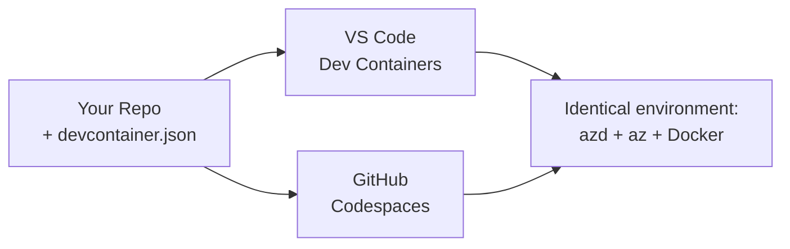

# Contentores de Desenvolvimento & GitHub Codespaces para azd

**Navegação do Capítulo:**
- **📚 Página Inicial do Curso**: [AZD Para Iniciantes](../../README.md)
- **📖 Capítulo Atual**: Capítulo 1 - Fundamentos & Arranque Rápido
- **⬅️ Anterior**: [Traga a Sua Própria App](bring-your-own-app.md)
- **🚀 Próximo Capítulo**: [Capítulo 2: Desenvolvimento AI-First](../chapter-02-ai-development/README.md)

> Revisão do comando e configuração alvo: `azd 1.37.2` (Novembro 2026). As construções de contentores e implementações no Azure não foram executadas como parte desta revisão.

## Introdução

Instalar o azd, o runtime da linguagem correto, Docker, e a Azure CLI em cada máquina é um incómodo — e é a principal razão pela qual um tutorial que "funciona na minha máquina" falha para outra pessoa. Um **contentor de desenvolvimento** resolve isto ao descrever toda a sua cadeia de ferramentas num ficheiro. Qualquer pessoa que abra o projeto no VS Code ou GitHub Codespaces tem exatamente o mesmo ambiente, com o azd já instalado. Esta lição mostra-lhe como adicionar um.

## Objetivos de Aprendizagem

No final desta lição, irá:
- Compreender o que é um contentor de desenvolvimento e porque ajuda com o azd
- Adicionar um `.devcontainer/devcontainer.json` minimalista a um projeto
- Incluir azd, a Azure CLI e Docker via *funcionalidades* do Contentor de Desenvolvimento
- Abrir o projeto no GitHub Codespaces ou VS Code

## Resultados de Aprendizagem

Após concluir esta lição, será capaz de:
- Criar um `devcontainer.json` para um projeto azd
- Adicionar azd e ferramentas Azure sem instalações manuais
- Executar `azd up` a partir do interior de um contentor ou Codespace

---

## O Que É Um Contentor de Desenvolvimento?

Um contentor de desenvolvimento é um ambiente de desenvolvimento baseado em Docker definido por um ficheiro `.devcontainer/devcontainer.json` no seu repositório. Quando abre o projeto:

- **VS Code** (com a extensão Dev Containers) constrói o contentor e conecta-se a ele.
- **GitHub Codespaces** constrói o mesmo contentor na cloud e fornece-lhe um editor baseado no navegador.

De qualquer forma, todos os colaboradores obtêm ferramentas idênticas — sem o problema de "instalaste o azd?".



---

## Passo 1: Criar o Ficheiro devcontainer

Crie `.devcontainer/devcontainer.json` na raiz do seu projeto:

```json
{
  "name": "azd-project",
  "image": "mcr.microsoft.com/devcontainers/base:bookworm",
  "features": {
    "ghcr.io/devcontainers/features/azure-cli:1": {},
    "ghcr.io/azure/azure-dev/azd:0": { "version": "1.37.2" },
    "ghcr.io/devcontainers/features/docker-in-docker:2": {},
    "ghcr.io/devcontainers/features/node:1": {}
  },
  "customizations": {
    "vscode": {
      "extensions": [
        "ms-azuretools.azure-dev",
        "ms-azuretools.vscode-bicep"
      ]
    }
  },
  "forwardPorts": [3000],
  "postCreateCommand": "azd version"
}
```

O que cada parte faz:

| Chave | Propósito |
|-----|---------|
| `image` | O SO base para o contentor |
| `features` | Instaladores pré-construídos — aqui: Azure CLI, **azd**, Docker e Node.js |
| `customizations.vscode.extensions` | Instala automaticamente as extensões azd e Bicep para VS Code |
| `forwardPorts` | Expõe a porta da sua app para o navegador |
| `postCreateCommand` | Executa uma vez após o contentor ser construído (aqui, uma verificação de sanidade) |

> A versão da funcionalidade (`azd:0`) e a versão instalada da CLI são diferentes. Defina a opção `version` da funcionalidade para `"1.37.2"` para fixar a CLI; não use uma versão da CLI como etiqueta da funcionalidade.

---

## Passo 2: Adequar a Funcionalidade à Linguagem da Sua App

Substitua a funcionalidade `node` pela que a sua app usa:

```jsonc
// Python project
"ghcr.io/devcontainers/features/python:1": {},

// .NET project
"ghcr.io/devcontainers/features/dotnet:2": {},

// Java project
"ghcr.io/devcontainers/features/java:1": {},

// Go project
"ghcr.io/devcontainers/features/go:1": {}
```

Mantenha `docker-in-docker` ao construir imagens localmente. Uma construção remota configurada do ACR (`docker.remoteBuild: true`) é uma alternativa; o tipo de host sozinho nem sempre requer Docker local.

---

## Passo 3: Abrir o Contentor

**No VS Code:**
1. Instale a extensão **Dev Containers**.
2. Abra a pasta do projeto.
3. Clique em **Reabrir no Contentor** quando solicitado (ou execute *Dev Containers: Reopen in Container*).

**No GitHub Codespaces:**
1. Faça push do repositório para o GitHub.
2. Clique em **Code → Codespaces → Create codespace on main**.
3. Aguarde a construção do contentor — azd estará pronto no terminal.

---

## Passo 4: Implementar a Partir do Interior do Contentor

O contentor tem o azd pré-instalado, por isso o fluxo de trabalho normal simplesmente funciona:

```bash
azd auth login --use-device-code   # device code is handy inside Codespaces
azd up
```

> **Porque `--use-device-code`?** Num contentor remoto ou Codespace não há navegador local para redirecionar, por isso o login por código de dispositivo é o caminho fiável. Vai colar um código numa aba do navegador para completar o login.

---

## Armadilhas Comuns

| Armadilha | Solução |
|---------|-----|
| `azd up` não consegue construir uma imagem | Adicione a funcionalidade `docker-in-docker` |
| O login no navegador bloqueia nos Codespaces | Use `azd auth login --use-device-code` |
| Ferramentas diferem entre colegas | Fixe a CLI através da opção `version` da funcionalidade azd e fixe os runtimes de linguagem |
| App não acessível no navegador | Adicione a porta a `forwardPorts` |

---

## Resumo

- Um contentor de desenvolvimento torna a sua cadeia de ferramentas azd reproduzível para todos.
- Adicione azd, a Azure CLI e Docker através das *funcionalidades* do Contentor de Desenvolvimento.
- Adeque a funcionalidade da linguagem à sua app e mantenha `docker-in-docker` para hosts de contentores.
- Use login por código de dispositivo quando executar dentro de Codespaces.

---

## 🔗 Navegação

| Direção | Recurso |
|-----------|----------|
| **Anterior** | [Traga a Sua Própria App](bring-your-own-app.md) |
| **Página Inicial do Capítulo** | [Capítulo 1: Fundamentos & Arranque Rápido](README.md) |
| **Próximo Capítulo** | [Capítulo 2: Desenvolvimento AI-First](../chapter-02-ai-development/README.md) |

## 📖 Recursos Relacionados

- [Instalação & Configuração](installation.md)
- [Folha de Comandos de Comandos](../../resources/cheat-sheet.md)
- [Especificação Oficial dos Contentores de Desenvolvimento](https://containers.dev/)
- [Funcionalidade de Contentor de Desenvolvimento azd](https://github.com/Azure/azure-dev/tree/main/ext/devcontainer)

---

<!-- CO-OP TRANSLATOR DISCLAIMER START -->
**Aviso Legal**:
Este documento foi traduzido utilizando o serviço de tradução automática [Co-op Translator](https://github.com/Azure/co-op-translator). Embora nos esforcemos pela precisão, esteja ciente de que traduções automáticas podem conter erros ou imprecisões. O documento original na sua língua nativa deve ser considerado a fonte autorizada. Para informações críticas, recomenda-se tradução profissional humana. Não nos responsabilizamos por quaisquer mal-entendidos ou interpretações incorretas resultantes da utilização desta tradução.
<!-- CO-OP TRANSLATOR DISCLAIMER END -->