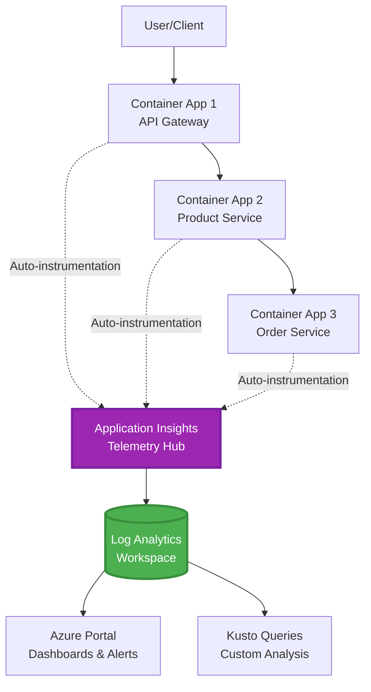
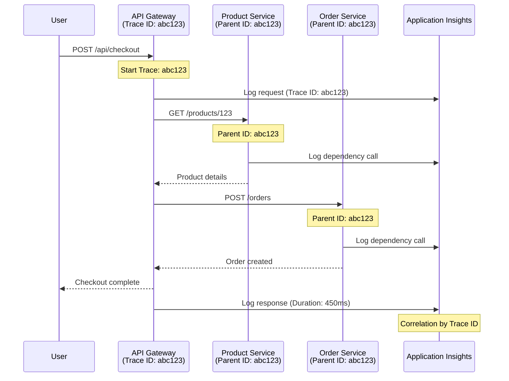

# Integração do Application Insights com AZD

⏱️ **Tempo Estimado**: 40-50 minutos | 💰 **Impacto no Custo**: ~$5-15/mês | ⭐ **Complexidade**: Intermédio

**📚 Caminho de Aprendizagem:**
- ← Anterior: [Verificações Preliminares](preflight-checks.md) - Validação pré-implantação
- 🎯 **Está Aqui**: Integração do Application Insights (Monitorização, telemetria, depuração)
- → Seguinte: [Guia de Implantação](../chapter-04-infrastructure/deployment-guide.md) - Implantar no Azure
- 🏠 [Página Inicial do Curso](../../README.md)

---

## O que Vai Aprender

Ao completar esta lição, irá:
- Declarar **Application Insights** na infraestrutura AZD e configurar a instrumentação SDK
- Configurar **rastreamento distribuído** para microsserviços
- Implementar **telemetria personalizada** (métricas, eventos, dependências)
- Configurar **métricas ao vivo** para monitorização em tempo real
- Criar **alertas e dashboards** a partir das implantações AZD
- Depurar problemas em produção com **queries de telemetria**
- Otimizar **custos e estratégias de amostragem**
- Monitorizar **aplicações AI/LLM** (tokens, latência, custos)

## Porquê o Application Insights com AZD é Importante

### O Desafio: Observabilidade em Produção

**Sem Application Insights:**
```
❌ No visibility into production behavior
❌ Manual log aggregation across services
❌ Reactive debugging (wait for customer complaints)
❌ No performance metrics
❌ Cannot trace requests across services
❌ Unknown failure rates and bottlenecks
```

**Com Application Insights + AZD:**
```
✅ Automatic telemetry collection
✅ Centralized logs from all services
✅ Proactive issue detection
✅ End-to-end request tracing
✅ Performance metrics and insights
✅ Real-time dashboards
✅ AZD provisions the monitoring declared in your templates
```

**Analogia**: O Application Insights é como ter uma "caixa preta" e painel de controlo da cabine de voo para a sua aplicação. Vê tudo o que acontece em tempo real e pode reproduzir qualquer incidente.

---

## Visão Geral da Arquitetura

### Application Insights na Arquitetura AZD



### O Que é Monitorizado Automaticamente

A instrumentação automática suportada captura pedidos/dependências para bibliotecas instrumentadas. Eventos e métricas personalizados requerem código da aplicação; testes de disponibilidade devem ser configurados separadamente. Não recolhe todas as linhas abaixo só porque o recurso existe.

| Tipo de Telemetria | O Que Captura | Caso de Uso |
|----------------|------------------|----------|
| **Pedidos** | Pedidos HTTP, códigos de estado, duração | Monitorização de desempenho da API |
| **Dependências** | Chamadas externas (BD, APIs, armazenamento) | Identificar gargalos |
| **Exceções** | Erros não tratados com rastos de pilha | Depuração de falhas |
| **Eventos Personalizados** | Eventos de negócio (registo, compra) | Análise e funis |
| **Métricas** | Contadores de desempenho, métricas personalizadas | Planeamento de capacidade |
| **Rastos** | Mensagens de registo com severidade | Depuração e auditoria |
| **Disponibilidade** | Testes de uptime e tempo de resposta | Monitorização de SLA |

---

## Pré-requisitos

### Ferramentas Necessárias

```bash
# Verify Azure Developer CLI
azd version
# Command reference baseline: azd 1.37.2

# Verify Azure CLI
az --version
# ✅ Expected: azure-cli 2.50.0 or higher
```

### Requisitos Azure

- Subscrição Azure ativa
- Permissões para criar:
  - Recursos Application Insights
  - Workspaces Log Analytics
  - Container Apps
  - Grupos de recursos

### Conhecimentos Pré-requisitos

Deve ter completado:
- [Noções Básicas do AZD](../chapter-01-foundation/azd-basics.md) - Conceitos principais do AZD
- [Configuração](../chapter-03-configuration/configuration.md) - Configuração do ambiente
- [Primeiro Projeto](../chapter-01-foundation/first-project.md) - Implantação básica

---

## Lição 1: Application Insights Automático com AZD

### Como o AZD Provisiona Application Insights

O AZD provisiona o Application Insights **apenas quando a infraestrutura do projeto o declara**. `azure.yaml` por si só não cria monitorização nem instrumenta código da aplicação.

> **Exemplo de alcance:** Esta lição contém fragmentos de integração, não um projeto `monitored-app` completo neste repositório. Forneça um template principal e mapeamento de parâmetros, ambiente Container Apps, configuração de registry/imagem e identidade, Dockerfile e tags de serviço antes de implantar. Lições posteriores mostram fragmentos alternativos/extensões, não ficheiros que podem ser colados todos juntos sem alterações. Comece com um [exemplo de microsserviços](../../../../examples/microservices) funcional se precisar de uma base executável.

### Estrutura do Projeto

```
monitored-app/
├── azure.yaml                     # AZD configuration
├── infra/
│   ├── main.bicep                # Main infrastructure
│   ├── core/
│   │   └── monitoring.bicep      # Application Insights + Log Analytics
│   └── app/
│       └── api.bicep             # Container App with monitoring
└── src/
    ├── app.py                    # Application with telemetry
    ├── requirements.txt
    └── Dockerfile
```

---

### Passo 1: Configurar AZD (azure.yaml)

**Ficheiro: `azure.yaml`**

```yaml
name: monitored-app
metadata:
  template: monitored-app@1.0.0

services:
  api:
    project: ./src
    language: python
    host: containerapp

# Monitoring must be declared in infra/ and enabled in application code.
```

Isto declara o serviço implantável. A configuração Bicep e SDK seguintes fornecem a monitorização; o azd não as adiciona implicitamente.

---

### Passo 2: Infraestrutura de Monitorização (Bicep)

**Ficheiro: `infra/core/monitoring.bicep`**

```bicep
param logAnalyticsName string
param applicationInsightsName string
param location string = resourceGroup().location
param tags object = {}

// Log Analytics Workspace (required for Application Insights)
resource logAnalytics 'Microsoft.OperationalInsights/workspaces@2022-10-01' = {
  name: logAnalyticsName
  location: location
  tags: tags
  properties: {
    sku: {
      name: 'PerGB2018'  // Pay-as-you-go pricing
    }
    retentionInDays: 30  // Keep logs for 30 days
    features: {
      enableLogAccessUsingOnlyResourcePermissions: true
    }
  }
}

// Application Insights
resource applicationInsights 'Microsoft.Insights/components@2020-02-02' = {
  name: applicationInsightsName
  location: location
  tags: tags
  kind: 'web'
  properties: {
    Application_Type: 'web'
    WorkspaceResourceId: logAnalytics.id
    IngestionMode: 'LogAnalytics'
    publicNetworkAccessForIngestion: 'Enabled'
    publicNetworkAccessForQuery: 'Enabled'
  }
}

// Outputs for Container Apps
output logAnalyticsWorkspaceId string = logAnalytics.id
output logAnalyticsWorkspaceName string = logAnalytics.name
output applicationInsightsConnectionString string = applicationInsights.properties.ConnectionString
output applicationInsightsInstrumentationKey string = applicationInsights.properties.InstrumentationKey
output applicationInsightsName string = applicationInsights.name
output applicationInsightsId string = applicationInsights.id
```

---

### Passo 3: Ligar a Container App ao Application Insights

**Ficheiro: `infra/app/api.bicep`**

```bicep
param name string
param location string
param tags object = {}
param containerAppsEnvironmentId string
param containerImage string
param applicationInsightsConnectionString string

resource containerApp 'Microsoft.App/containerApps@2023-05-01' = {
  name: name
  location: location
  tags: tags
  properties: {
    managedEnvironmentId: containerAppsEnvironmentId
    configuration: {
      ingress: {
        external: true
        targetPort: 8000
      }
      secrets: [
        {
          name: 'appinsights-connection-string'
          value: applicationInsightsConnectionString
        }
      ]
    }
    template: {
      containers: [
        {
          name: 'api'
          image: containerImage // Supply an accessible image and registry authentication
          resources: {
            cpu: json('0.5')
            memory: '1Gi'
          }
          env: [
            {
              name: 'APPLICATIONINSIGHTS_CONNECTION_STRING'
              secretRef: 'appinsights-connection-string'
            }
            {
              name: 'APPLICATIONINSIGHTS_ENABLED'
              value: 'true'
            }
          ]
        }
      ]
    }
  }
}

output uri string = 'https://${containerApp.properties.configuration.ingress.fqdn}'
```

---

### Passo 4: Código da Aplicação com Telemetria

**Ficheiro: `src/app.py`**

```python
from flask import Flask, request, jsonify
from azure.monitor.opentelemetry import configure_azure_monitor
import logging
import os

app = Flask(__name__)

# Get Application Insights connection string
connection_string = os.environ.get('APPLICATIONINSIGHTS_CONNECTION_STRING')

if connection_string:
    # Azure Monitor OpenTelemetry instruments supported libraries, including Flask.
    configure_azure_monitor(
        connection_string=connection_string,
        logger_name=__name__,
        enable_live_metrics=True
    )
    logger = logging.getLogger(__name__)
    logger.setLevel(logging.INFO)
    
    print("✅ Application Insights enabled")
else:
    logger = logging.getLogger(__name__)
    logger.setLevel(logging.INFO)
    print("⚠️ Application Insights not configured")

@app.route('/health')
def health():
    logger.info('Health check endpoint called')
    return jsonify({'status': 'healthy', 'monitoring': 'enabled' if connection_string else 'disabled'})

@app.route('/api/products')
def get_products():
    logger.info('Fetching products')
    
    # In-memory fixture: this is not a database dependency call.
    products = [
        {'id': 1, 'name': 'Laptop', 'price': 999.99},
        {'id': 2, 'name': 'Mouse', 'price': 29.99},
        {'id': 3, 'name': 'Keyboard', 'price': 79.99}
    ]
    
    logger.info(f'Returned {len(products)} products')
    return jsonify(products)

@app.route('/api/error-test')
def error_test():
    """Test error tracking"""
    logger.error('Testing error tracking')
    try:
        raise ValueError('This is a test exception')
    except Exception as e:
        logger.exception('Exception occurred in error-test endpoint')
        return jsonify({'error': str(e)}), 500

@app.route('/api/slow')
def slow_endpoint():
    """Test performance tracking"""
    import time
    logger.info('Slow endpoint called')
    time.sleep(3)  # Simulate slow operation
    logger.warning('Endpoint took 3 seconds to respond')
    return jsonify({'message': 'Slow operation completed'})

if __name__ == '__main__':
    app.run(host='0.0.0.0', port=8000)
```

**Ficheiro: `src/requirements.txt`**

```txt
Flask
azure-monitor-opentelemetry
gunicorn
requests
openai
```

Resolva estas dependências no seu projeto, teste-as em conjunto e fixe as versões resultantes. Novos projetos devem usar Azure Monitor OpenTelemetry, não os exportadores Python OpenCensus descontinuados.

---

### Passo 5: Implantar e Verificar

```bash
# Deploy only after completing and wiring the infrastructure fragments above
azd up

# Get app URL
APP_URL=$(azd env get-value API_URL) # Requires this output in main.bicep

# Generate telemetry
curl $APP_URL/health
curl $APP_URL/api/products
curl $APP_URL/api/error-test
curl $APP_URL/api/slow
```

**✅ Saída esperada:**
```json
{
  "status": "healthy",
  "monitoring": "enabled"
}
```

---

### Passo 6: Ver Telemetria no Portal Azure

```bash
# Get Application Insights details
azd env get-values | grep APPLICATIONINSIGHTS

# Open in Azure Portal
az monitor app-insights component show \
  --app $(azd env get-values | grep APPLICATIONINSIGHTS_NAME | cut -d '=' -f2 | tr -d '"') \
  --resource-group $(azd env get-values | grep AZURE_RESOURCE_GROUP | cut -d '=' -f2 | tr -d '"') \
  --query "appId" -o tsv
```

**Navegue para Portal Azure → Application Insights → Pesquisa de Transações**

Deve ver:
- ✅ Pedidos HTTP com códigos de estado
- ✅ Duração do pedido (3+ segundos para `/api/slow`)
- ✅ Detalhes de exceções de `/api/error-test`
- ✅ Mensagens de log personalizadas

---

## Lição 2: Telemetria e Eventos Personalizados

### Acompanhar Eventos de Negócio

Vamos adicionar telemetria personalizada para eventos críticos de negócio.

**Ficheiro: `src/telemetry.py`**

```python
from contextlib import contextmanager
from azure.monitor.opentelemetry import configure_azure_monitor
from opentelemetry import metrics, trace
from opentelemetry.trace import SpanKind
import logging
import os

class TelemetryClient:
    """Custom telemetry client for Application Insights"""
    
    def __init__(self, connection_string=None):
        self.connection_string = connection_string or os.environ.get('APPLICATIONINSIGHTS_CONNECTION_STRING')
        
        # Configure once per process. If app.py already calls this, keep only
        # one configure_azure_monitor call and use logger_name='telemetry'.
        if self.connection_string:
            configure_azure_monitor(
                connection_string=self.connection_string,
                logger_name=__name__,
                enable_live_metrics=True
            )
        self.logger = logging.getLogger(__name__)
        self.logger.setLevel(logging.INFO)
        self.tracer = trace.get_tracer(__name__)
        self.meter = metrics.get_meter(__name__)
        self.instruments = {}
    
    def track_event(self, event_name: str, properties: dict = None):
        """Track custom business event"""
        properties = properties or {}
        self.logger.info(
            f"CustomEvent: {event_name}",
            extra={
                # OTel log attributes become customDimensions in App Insights.
                    'event_name': event_name,
                    **properties
            }
        )
    
    def track_metric(self, metric_name: str, value: float, properties: dict = None):
        """Track custom metric"""
        properties = properties or {}
        if metric_name not in self.instruments:
            self.instruments[metric_name] = self.meter.create_histogram(metric_name)
        self.instruments[metric_name].record(value, attributes=properties)
    
    @contextmanager
    def track_dependency(self, name: str):
        """Time the real operation inside a client span; exceptions mark failure."""
        with self.tracer.start_as_current_span(name, kind=SpanKind.CLIENT) as span:
            yield span

# Global telemetry client
telemetry = TelemetryClient()
```

### Atualizar Aplicação com Eventos Personalizados

**Ficheiro: `src/app.py` (melhorado)**

Adicione estas rotas à aplicação Flask existente; mantenha as rotas anteriores de saúde/teste. O bloco abreviado abaixo mostra uma app separada para clareza. A inicialização da telemetria agora está em `telemetry.py`—não inicialize exportadores duas vezes.

```python
from flask import Flask, request, jsonify
from telemetry import telemetry
import time
import random
import os

app = Flask(__name__)

@app.route('/api/purchase', methods=['POST'])
def purchase():
    """Track purchase event with custom telemetry"""
    data = request.get_json(silent=True) or {}
    product_id = data.get('product_id')
    quantity = data.get('quantity', 1)
    price = data.get('price', 0)
    if not isinstance(quantity, int) or quantity < 1 or \
       not isinstance(price, (int, float)) or price < 0:
        return jsonify({'error': 'quantity and price must be non-negative numbers; quantity >= 1'}), 400
    
    # Track business event
    telemetry.track_event('Purchase', {
        'product_id': product_id,
        'quantity': quantity,
        'total_amount': price * quantity,
        'user_id': request.headers.get('X-User-Id', 'anonymous')
    })
    
    # Track revenue metric
    telemetry.track_metric('Revenue', price * quantity, {
        'product_id': product_id,
        'currency': 'USD'
    })
    
    return jsonify({
        'order_id': f'ORD-{random.randint(1000, 9999)}',
        'status': 'confirmed',
        'total': price * quantity
    })

@app.route('/api/search')
def search():
    """Track search queries"""
    query = request.args.get('q', '')
    
    start_time = time.time()
    
    # Simulate search (would be real database query)
    results = [{'id': 1, 'name': f'Result for {query}'}]
    
    duration = (time.time() - start_time) * 1000  # Convert to ms
    
    # Track search event
    telemetry.track_event('Search', {
        'query': query,
        'results_count': len(results),
        'duration_ms': duration
    })
    
    # Track search performance metric
    telemetry.track_metric('SearchDuration', duration, {
        'query_length': len(query)
    })
    
    return jsonify({'results': results, 'count': len(results)})

@app.route('/api/external-call')
def external_call():
    """Track external API dependency"""
    import requests
    
    try:
        # Set an actual test endpoint; api.example.com is not a working API.
        with telemetry.track_dependency('ExternalAPI'):
            response = requests.get(os.environ['EXTERNAL_API_URL'], timeout=5)
            response.raise_for_status()
            result = response.json()
    except Exception as e:
        return jsonify({'error': 'External dependency failed'}), 502
    
    return jsonify(result)

if __name__ == '__main__':
    app.run(host='0.0.0.0', port=8000)
```

### Testar Telemetria Personalizada

```bash
# Track purchase event
curl -X POST $APP_URL/api/purchase \
  -H "Content-Type: application/json" \
  -H "X-User-Id: user123" \
  -d '{"product_id": 1, "quantity": 2, "price": 29.99}'

# Track search event
curl "$APP_URL/api/search?q=laptop"

# Track external dependency
curl $APP_URL/api/external-call
```

**Ver no Portal Azure:**

Navegue para Application Insights → Logs, depois execute:

```kusto
// View purchase events
traces
| where customDimensions.event_name == "Purchase"
| project 
    timestamp,
    product_id = tostring(customDimensions.product_id),
    total_amount = todouble(customDimensions.total_amount),
    user_id = tostring(customDimensions.user_id)
| order by timestamp desc

// Revenue recorded in Purchase events (not a billing ledger)
traces
| where customDimensions.event_name == "Purchase"
| summarize TotalRevenue = sum(todouble(customDimensions.total_amount)) by bin(timestamp, 1h)
| render timechart

// View search performance
traces
| where customDimensions.event_name == "Search"
| summarize 
    AvgDuration = avg(todouble(customDimensions.duration_ms)),
    SearchCount = count()
  by bin(timestamp, 5m)
| render timechart
```

---

## Lição 3: Rastreamento Distribuído para Microsserviços

### Ativar Rastreamento Inter-Serviços

Com instrumentação compatível e propagação do W3C trace-context, o Application Insights correlaciona pedidos entre serviços. Partilhar só uma cadeia de conexão não estabelece spans pai-filho. O fragmento arquitetónico seguinte referencia módulos que deve implementar.

**Ficheiro: `infra/main.bicep`**

```bicep
targetScope = 'subscription'

param environmentName string
param location string = 'eastus'

var tags = { 'azd-env-name': environmentName }

resource rg 'Microsoft.Resources/resourceGroups@2021-04-01' = {
  name: 'rg-${environmentName}'
  location: location
  tags: tags
}

// Monitoring (shared by all services)
module monitoring './core/monitoring.bicep' = {
  name: 'monitoring'
  scope: rg
  params: {
    logAnalyticsName: 'log-${environmentName}'
    applicationInsightsName: 'appi-${environmentName}'
    location: location
    tags: tags
  }
}

// API Gateway
module apiGateway './app/api-gateway.bicep' = {
  name: 'api-gateway'
  scope: rg
  params: {
    name: 'ca-gateway-${environmentName}'
    location: location
    tags: union(tags, { 'azd-service-name': 'gateway' })
    applicationInsightsConnectionString: monitoring.outputs.applicationInsightsConnectionString
  }
}

// Product Service
module productService './app/product-service.bicep' = {
  name: 'product-service'
  scope: rg
  params: {
    name: 'ca-products-${environmentName}'
    location: location
    tags: union(tags, { 'azd-service-name': 'products' })
    applicationInsightsConnectionString: monitoring.outputs.applicationInsightsConnectionString
  }
}

// Order Service
module orderService './app/order-service.bicep' = {
  name: 'order-service'
  scope: rg
  params: {
    name: 'ca-orders-${environmentName}'
    location: location
    tags: union(tags, { 'azd-service-name': 'orders' })
    applicationInsightsConnectionString: monitoring.outputs.applicationInsightsConnectionString
  }
}

output APPLICATIONINSIGHTS_CONNECTION_STRING string = monitoring.outputs.applicationInsightsConnectionString
output GATEWAY_URL string = apiGateway.outputs.uri
```

### Ver Transação de Ponta a Ponta



**Consultar rasto de ponta a ponta:**

```kusto
// Find complete request flow
let traceId = "abc123...";  // Copy operation_Id from a request in Application Insights
dependencies
| union requests
| where operation_Id == traceId
| project 
    timestamp,
    type = itemType,
    name,
    duration,
    success,
    cloud_RoleName
| order by timestamp asc
```

---

## Lição 4: Métricas ao Vivo e Monitorização em Tempo Real

### Ativar Stream de Métricas ao Vivo

Métricas ao Vivo fornece telemetria quase em tempo real quando suportado e ativado pelo SDK. Não é um SLA de latência. A configuração Python OpenTelemetry acima opta por `enable_live_metrics=True`.

**Aceder às Métricas ao Vivo:**

```bash
# Get Application Insights resource
APPI_NAME=$(azd env get-values | grep APPLICATIONINSIGHTS_NAME | cut -d '=' -f2 | tr -d '"')

# Get resource group
RG_NAME=$(azd env get-values | grep AZURE_RESOURCE_GROUP | cut -d '=' -f2 | tr -d '"')

echo "Navigate to: Azure Portal → Resource Groups → $RG_NAME → $APPI_NAME → Live Metrics"
```

**O que vê em tempo real:**
- ✅ Taxa de pedidos recebidos (pedidos/segundo)
- ✅ Chamadas de dependência externas
- ✅ Contagem de exceções
- ✅ Uso de CPU e memória
- ✅ Contagem de servidores ativos
- ✅ Telemetria amostrada

### Gerar Carga para Testes

```bash
# Generate load to see live metrics
for i in {1..100}; do
  curl --silent --max-time 10 "$APP_URL/api/products"
  curl --silent --max-time 10 "$APP_URL/api/search?q=test$i"
done

# Watch live metrics in Azure Portal
# You should see request rate spike
```

---

## Exercícios Práticos

### Exercício 1: Configurar Alertas ⭐⭐ (Intermédio)

**Objetivo**: Criar alertas para taxas elevadas de erros e respostas lentas.

**Passos:**

1. **Criar alerta para taxa de erros:**

```bash
# Get Application Insights resource ID
APPI_ID=$(az monitor app-insights component show \
  --app $APPI_NAME \
  --resource-group $RG_NAME \
  --query "id" -o tsv)

# Create metric alert for failed requests
az monitor metrics alert create \
  --name "High-Error-Rate" \
  --resource-group $RG_NAME \
  --scopes $APPI_ID \
  --condition "count requests/failed > 10" \
  --window-size 5m \
  --evaluation-frequency 1m \
  --description "Alert when failed request count exceeds 10 per 5 minutes"
```

2. **Criar alerta para respostas lentas:**

```bash
az monitor metrics alert create \
  --name "Slow-Responses" \
  --resource-group $RG_NAME \
  --scopes $APPI_ID \
  --condition "avg requests/duration > 3000" \
  --window-size 5m \
  --evaluation-frequency 1m \
  --description "Alert when average response time exceeds 3 seconds"
```

3. **Criar alerta via Bicep (preferido no AZD):**

**Ficheiro: `infra/core/alerts.bicep`**

```bicep
param applicationInsightsId string
param actionGroupId string = ''
param location string = resourceGroup().location

// High error rate alert
resource errorRateAlert 'Microsoft.Insights/metricAlerts@2018-03-01' = {
  name: 'high-error-rate'
  location: 'global'
  properties: {
    description: 'Alert when error rate exceeds threshold'
    severity: 2
    enabled: true
    scopes: [
      applicationInsightsId
    ]
    evaluationFrequency: 'PT1M'
    windowSize: 'PT5M'
    criteria: {
      'odata.type': 'Microsoft.Azure.Monitor.SingleResourceMultipleMetricCriteria'
      allOf: [
        {
          name: 'Error rate'
          metricName: 'requests/failed'
          operator: 'GreaterThan'
          threshold: 10
          timeAggregation: 'Count'
        }
      ]
    }
    actions: actionGroupId != '' ? [
      {
        actionGroupId: actionGroupId
      }
    ] : []
  }
}

// Slow response alert
resource slowResponseAlert 'Microsoft.Insights/metricAlerts@2018-03-01' = {
  name: 'slow-responses'
  location: 'global'
  properties: {
    description: 'Alert when response time is too high'
    severity: 3
    enabled: true
    scopes: [
      applicationInsightsId
    ]
    evaluationFrequency: 'PT1M'
    windowSize: 'PT5M'
    criteria: {
      'odata.type': 'Microsoft.Azure.Monitor.SingleResourceMultipleMetricCriteria'
      allOf: [
        {
          name: 'Response duration'
          metricName: 'requests/duration'
          operator: 'GreaterThan'
          threshold: 3000
          timeAggregation: 'Average'
        }
      ]
    }
  }
}

output errorAlertId string = errorRateAlert.id
output slowResponseAlertId string = slowResponseAlert.id
```

4. **Testar alertas:**

```bash
# Generate errors
for i in {1..20}; do
  curl $APP_URL/api/error-test
done

# Generate slow responses
for i in {1..10}; do
  curl $APP_URL/api/slow
done

# Check rule configuration (not fired/resolved alert-instance history)
az monitor metrics alert list \
  --resource-group $RG_NAME \
  --query "[].{Name:name, Enabled:enabled}" \
  --output table
```

**✅ Critérios de Sucesso:**
- ✅ Alertas criados com sucesso
- ✅ Alertas disparam quando os limites são excedidos
- ✅ É possível ver histórico de alertas no Portal Azure
- ✅ Integrado com implantação AZD

**Tempo**: 20-25 minutos

---

### Exercício 2: Criar Dashboard Personalizado ⭐⭐ (Intermédio)

**Objetivo**: Construir um dashboard mostrando métricas chave da aplicação.

**Passos:**

1. **Criar dashboard via Portal Azure:**

Navegue para: Portal Azure → Dashboards → Novo Dashboard

2. **Adicionar blocos para métricas chave:**

- Contagem de pedidos (últimas 24 horas)
- Tempo médio de resposta
- Taxa de erros
- Top 5 operações mais lentas
- Distribuição geográfica dos utilizadores

3. **Criar dashboard via Bicep:**

**Ficheiro: `infra/core/dashboard.bicep`**

```bicep
param dashboardName string
param applicationInsightsId string
param location string = resourceGroup().location

resource dashboard 'Microsoft.Portal/dashboards@2020-09-01-preview' = {
  name: dashboardName
  location: location
  properties: {
    lenses: [
      {
        order: 0
        parts: [
          // Request count
          {
            position: {
              x: 0
              y: 0
              rowSpan: 4
              colSpan: 6
            }
            metadata: {
              type: 'Extension/Microsoft_OperationsManagementSuite_Workspace/PartType/LogsDashboardPart'
              inputs: [
                {
                  name: 'resourceId'
                  value: applicationInsightsId
                }
                {
                  name: 'query'
                  value: '''
                    requests
                    | summarize RequestCount = count() by bin(timestamp, 1h)
                    | render timechart
                  '''
                }
              ]
            }
          }
          // Error rate
          {
            position: {
              x: 6
              y: 0
              rowSpan: 4
              colSpan: 6
            }
            metadata: {
              type: 'Extension/Microsoft_OperationsManagementSuite_Workspace/PartType/LogsDashboardPart'
              inputs: [
                {
                  name: 'resourceId'
                  value: applicationInsightsId
                }
                {
                  name: 'query'
                  value: '''
                    requests
                    | summarize 
                        Total = count(),
                        Failed = countif(success == false)
                    | extend ErrorRate = (Failed * 100.0) / Total
                    | project ErrorRate
                  '''
                }
              ]
            }
          }
        ]
      }
    ]
  }
}

output dashboardId string = dashboard.id
```

4. **Implantar dashboard:**

```bicep
// Add to a subscription-scoped main.bicep with rg and monitoring declared
module dashboard './core/dashboard.bicep' = {
  name: 'dashboard'
  scope: rg
  params: {
    dashboardName: 'dashboard-${environmentName}'
    applicationInsightsId: monitoring.outputs.applicationInsightsId
    location: location
  }
}
```

```bash
# Deploy
azd up
```

**✅ Critérios de Sucesso:**
- ✅ Dashboard mostra métricas chave
- ✅ Pode ser fixado na página inicial do Portal Azure
- ✅ Atualizações em tempo real
- ✅ Implantável via AZD

**Tempo**: 25-30 minutos

---

### Exercício 3: Monitorizar Aplicação AI/LLM ⭐⭐⭐ (Avançado)

**Objetivo**: Acompanhar uso dos Modelos Microsoft Foundry (tokens, custos, latência).

**Passos:**

1. **Criar wrapper de monitorização AI:**

**Ficheiro: `src/ai_telemetry.py`**

```python
from telemetry import telemetry
from openai import AzureOpenAI
import time

class MonitoredAzureOpenAI:
    """Microsoft Foundry Models client with automatic telemetry"""
    
    def __init__(self, api_key, endpoint, input_usd_per_million,
                 output_usd_per_million, api_version="2024-10-21"):
        self.client = AzureOpenAI(
            api_key=api_key,
            api_version=api_version,
            azure_endpoint=endpoint
        )
        self.input_rate = input_usd_per_million
        self.output_rate = output_usd_per_million
    
    def chat_completion(self, model: str, messages: list, **kwargs):
        """Track chat completion with telemetry"""
        start_time = time.time()
        
        try:
            # Call Microsoft Foundry Models
            response = self.client.chat.completions.create(
                model=model,
                messages=messages,
                **kwargs
            )
            
            duration = (time.time() - start_time) * 1000  # ms
            
            # Extract usage
            usage = response.usage
            prompt_tokens = usage.prompt_tokens
            completion_tokens = usage.completion_tokens
            total_tokens = usage.total_tokens
            
            # Approximation: supply actual deployment/region/contract rates.
            # Cached input, batch, provisioned and other charges need separate accounting.
            prompt_cost = (prompt_tokens / 1_000_000) * self.input_rate
            completion_cost = (completion_tokens / 1_000_000) * self.output_rate
            total_cost = prompt_cost + completion_cost
            
            # Track custom event
            telemetry.track_event('OpenAI_Request', {
                'model': model,
                'prompt_tokens': prompt_tokens,
                'completion_tokens': completion_tokens,
                'total_tokens': total_tokens,
                'duration_ms': duration,
                'cost_usd': total_cost,
                'success': True
            })
            
            # Track metrics
            telemetry.track_metric('OpenAI_Tokens', total_tokens, {
                'model': model,
                'type': 'total'
            })
            
            telemetry.track_metric('OpenAI_Cost', total_cost, {
                'model': model,
                'currency': 'USD'
            })
            
            telemetry.track_metric('OpenAI_Duration', duration, {
                'model': model
            })
            
            return response
            
        except Exception as e:
            duration = (time.time() - start_time) * 1000
            
            telemetry.track_event('OpenAI_Request', {
                'model': model,
                'duration_ms': duration,
                'success': False,
                'error': str(e)
            })
            
            raise
```

2. **Usar cliente monitorizado:**

```python
from flask import Flask, request, jsonify
from ai_telemetry import MonitoredAzureOpenAI
import os

app = Flask(__name__)

# Initialize monitored OpenAI client
openai_client = MonitoredAzureOpenAI(
    api_key=os.environ['AZURE_OPENAI_API_KEY'],
    endpoint=os.environ['AZURE_OPENAI_ENDPOINT'],
    input_usd_per_million=float(os.environ['INPUT_USD_PER_MILLION']),
    output_usd_per_million=float(os.environ['OUTPUT_USD_PER_MILLION'])
)

@app.route('/api/chat', methods=['POST'])
def chat():
    data = request.json
    user_message = data.get('message')
    
    # Call with automatic monitoring
    response = openai_client.chat_completion(
        model=os.environ['AZURE_OPENAI_DEPLOYMENT'], # Deployment name, not catalog ID
        messages=[
            {'role': 'user', 'content': user_message}
        ]
    )
    
    return jsonify({
        'response': response.choices[0].message.content,
        'tokens': response.usage.total_tokens
    })
```

3. **Consultar métricas AI:**

```kusto
// Total AI spend over time
traces
| where customDimensions.event_name == "OpenAI_Request"
| where tobool(customDimensions.success) == true
| summarize TotalCost = sum(todouble(customDimensions.cost_usd)) by bin(timestamp, 1h)
| render timechart

// Token usage by model
traces
| where customDimensions.event_name == "OpenAI_Request"
| summarize 
    TotalTokens = sum(toint(customDimensions.total_tokens)),
    RequestCount = count()
  by Model = tostring(customDimensions.model)

// Average latency
traces
| where customDimensions.event_name == "OpenAI_Request"
| summarize AvgDuration = avg(todouble(customDimensions.duration_ms))
| project AvgDurationSeconds = AvgDuration / 1000

// Cost per request
traces
| where customDimensions.event_name == "OpenAI_Request"
| extend Cost = todouble(customDimensions.cost_usd)
| summarize 
    TotalCost = sum(Cost),
    RequestCount = count(),
    AvgCostPerRequest = avg(Cost)
```

**✅ Critérios de Sucesso:**
- ✅ Cada chamada OpenAI seguida automaticamente
- ✅ Uso de tokens e custos visíveis
- ✅ Latência monitorizada
- ✅ Pode configurar alertas de orçamento

**Tempo**: 35-45 minutos

---

## Otimização de Custos

### Estratégias de Amostragem

Controle os custos por amostragem da telemetria:

```python
import os

# Configure before the one configure_azure_monitor() call in your process.
os.environ["OTEL_TRACES_SAMPLER"] = "microsoft.fixed_percentage"
os.environ["OTEL_TRACES_SAMPLER_ARG"] = "0.1" # 10% trace sampling
```

A amostragem de rasto não reduz 90% de cada categoria de telemetria. Métricas e logs emitidos independentemente precisam do seu próprio controlo de volume. Escolha a taxa usando as necessidades de observabilidade, não uma proibição geral em produção.

Defina amostragem no SDK explicitamente; a propriedade `SamplingPercentage` do componente não substitui a configuração do sampler Python OpenTelemetry.

### Retenção de Dados

```bicep
resource logAnalytics 'Microsoft.OperationalInsights/workspaces@2022-10-01' = {
  name: logAnalyticsName
  properties: {
    retentionInDays: 30  // Minimum (cheapest)
    // Options: 30, 31, 60, 90, 120, 180, 270, 365, 550, 730
  }
}
```

### Estimativas Mensais de Custo

| Volume de Dados | Retenção | Custo Mensal |
|-------------|-----------|--------------|
| 1 GB/mês | 30 dias | ~$2-5 |
| 5 GB/mês | 30 dias | ~$10-15 |
| 10 GB/mês | 90 dias | ~$25-40 |
| 50 GB/mês | 90 dias | ~$100-150 |

Estes valores são ilustrativos, não orçamentos. Verifique os preços de ingestão, retenção, alerta e teste na sua região e contrato; as franquias gratuitas são partilhadas/escalonadas segundo o preço do Azure Monitor, não é garantida uma SKU gratuita por recurso Application Insights.

---

## Ponto de Verificação de Conhecimento

### 1. Integração Básica ✓

Teste o seu entendimento:

- [ ] **Q1**: Como o AZD provisiona o Application Insights?
  - **R**: Implanta os recursos de monitorização explicitamente declarados pelos templates Bicep/Terraform do projeto.

- [ ] **Q2**: Qual variável de ambiente ativa o Application Insights?
  - **R**: `APPLICATIONINSIGHTS_CONNECTION_STRING`

- [ ] **Q3**: Quais são os três principais tipos de telemetria?
  - **R**: Pedidos (chamadas HTTP), Dependências (chamadas externas), Exceções (erros)

**Verificação Prática:**
```bash
# Check if Application Insights is configured
azd env get-values | grep APPLICATIONINSIGHTS

# Verify telemetry is flowing
az monitor app-insights metrics show \
  --app $APPI_NAME \
  --resource-group $RG_NAME \
  --metric "requests/count"
```

---

### 2. Telemetria Personalizada ✓

Teste o seu entendimento:

- [ ] **Q1**: Como faz o tracking de eventos de negócio personalizados?
  - **R**: O wrapper desta lição escreve logs OTel estruturados com atributos `event_name`, consultáveis em `traces`; estes não são automaticamente `customEvents`.

- [ ] **Q2**: Qual é a diferença entre eventos e métricas?
  - **R**: Eventos são ocorrências discretas, métricas são medições numéricas

- [ ] **Q3**: Como correlaciona telemetria entre serviços?
  - **R**: O Application Insights usa automaticamente `operation_Id` para correlação

**Verificação Prática:**
```kusto
// Verify custom events
traces
| where customDimensions.event_name != ""
| summarize count() by tostring(customDimensions.event_name)
```

---

### 3. Monitorização em Produção ✓

Teste o seu entendimento:

- [ ] **Q1**: O que é amostragem e por que usar?
  - **R**: Amostragem reduz volume de dados (e custo) capturando apenas uma percentagem da telemetria

- [ ] **Q2**: Como configura alertas?
  - **R**: Use alertas de métricas em Bicep ou Portal Azure baseados em métricas do Application Insights

- [ ] **Q3**: Qual é a diferença entre Log Analytics e Application Insights?
  - **R**: Application Insights armazena dados em workspace Log Analytics; App Insights fornece vistas específicas da aplicação

**Verificação Prática:**
```bash
# Check the sampler configured for the running application, not only the ARM component.
az containerapp show --name "$APP_NAME" --resource-group "$RG_NAME" \
  --query "properties.template.containers[].env[?starts_with(name, 'OTEL_TRACES_SAMPLER')]"
```

---

## Boas Práticas

### ✅ FAÇA:

1. **Use IDs de correlação**
   ```python
   logger.info('Processing order', extra={
           'order_id': order_id,
           'user_id': user_id
   })
   ```

2. **Configure alertas para métricas críticas**
   ```bicep
   // Error rate, slow responses, availability
   ```

3. **Use logging estruturado**
   ```python
   # ✅ GOOD: Structured
   logger.info('User signup', extra={'user_id': 'pseudonymous-id'})
   
   # ❌ BAD: Unstructured
   logger.info(f'User 123 signed up')
   ```

4. **Monitorize dependências**
   ```python
   # Automatically track database calls, HTTP requests, etc.
   ```

5. **Use Métricas ao Vivo durante implantações**

### ❌ NÃO FAÇA:

1. **Não registe dados sensíveis**
   ```python
   # ❌ BAD
   logger.info(f'Login: {username}:{password}')
   
   # ✅ GOOD
   logger.info('Login attempt', extra={'result': 'failed'})
   ```

2. **Não escolha a amostragem sem medir o volume e as necessidades de diagnóstico**
   ```python
   # ❌ Expensive
   # 100% traces may be appropriate for a small workload or investigation.
   
   # ✅ Cost-effective
   # A lower trace rate reduces visibility; validate coverage before enabling.
   ```

3. **Não ignore as filas de cartas mortas**

4. **Não se esqueça de definir limites de retenção de dados**

---

## Resolução de problemas

### Problema: Nenhuma telemetria aparece

**Diagnóstico:**
```bash
# Check connection string is set
azd env get-values | grep APPLICATIONINSIGHTS

# Check application logs via Azure Monitor
azd monitor --logs

# Or use Azure CLI for Container Apps:
az containerapp logs show --name $APP_NAME --resource-group $RG_NAME --tail 50
```

**Solução:**
```bash
# Verify connection string in Container App
az containerapp show \
  --name $APP_NAME \
  --resource-group $RG_NAME \
  --query "properties.template.containers[0].env" \
  | grep -i applicationinsights
```

---

### Problema: Custos elevados

**Diagnóstico:**
```bash
# Query ingestion volume in the linked Log Analytics workspace.
# WORKSPACE_ID is the workspace customer ID (GUID), not its ARM resource ID.
az monitor log-analytics query --workspace "$WORKSPACE_ID" \
  --analytics-query "Usage | where TimeGenerated > ago(30d) | where IsBillable == true | summarize IngestedMB=sum(Quantity) by DataType"
```

**Solução:**
- Reduzir a taxa de amostragem
- Diminuir o período de retenção
- Remover registos detalhados

---

## Saiba Mais

### Documentação Oficial
- [Visão geral do Application Insights](https://learn.microsoft.com/azure/azure-monitor/app/app-insights-overview)
- [Configuração do Azure Monitor OpenTelemetry](https://learn.microsoft.com/azure/azure-monitor/app/opentelemetry-enable?tabs=python)
- [Linguagem de Consulta Kusto](https://learn.microsoft.com/azure/data-explorer/kusto/query/)
- [Monitorização AZD](https://learn.microsoft.com/azure/developer/azure-developer-cli/monitor-your-app)

### Próximos Passos neste Curso
- ← Anterior: [Verificações Pré-voo](preflight-checks.md)
- → Seguinte: [Guia de Implementação](../chapter-04-infrastructure/deployment-guide.md)
- 🏠 [Início do Curso](../../README.md)

### Exemplos Relacionados
- [Exemplo de Modelos Microsoft Foundry](../../../../examples/azure-openai-chat) - Telemetria de IA
- [Exemplo de Microservices](../../../../examples/microservices) - Rastreamento distribuído

---

## Resumo

**Você aprendeu:**
- ✅ Provisão automática do Application Insights com AZD
- ✅ Telemetria personalizada (eventos, métricas, dependências)
- ✅ Rastreamento distribuído entre microserviços
- ✅ Métricas em direto e monitorização em tempo real
- ✅ Alertas e painéis
- ✅ Monitorização de aplicações AI/LLM
- ✅ Estratégias de otimização de custos

**Principais Conclusões:**
1. **Declare a monitorização explicitamente** - AZD implementa os seus templates; a instrumentação SDK envia telemetria
2. **Use registos estruturados** - Facilita as consultas
3. **Acompanhe eventos de negócio** - Não apenas métricas técnicas
4. **Monitorize custos de IA** - Acompanhe tokens e despesas
5. **Configure alertas** - Seja proativo, não reativo
6. **Otimize custos** - Use amostragem e limites de retenção

**Próximos Passos:**
1. Complete os exercícios práticos
2. Adicione Application Insights aos seus projetos AZD
3. Crie painéis personalizados para a sua equipa
4. Aprenda o [Guia de Implementação](../chapter-04-infrastructure/deployment-guide.md)

---

<!-- CO-OP TRANSLATOR DISCLAIMER START -->
**Aviso Legal**:
Este documento foi traduzido utilizando o serviço de tradução automática [Co-op Translator](https://github.com/Azure/co-op-translator). Embora nos esforcemos pela precisão, esteja ciente de que traduções automáticas podem conter erros ou imprecisões. O documento original na sua língua nativa deve ser considerado a fonte autorizada. Para informações críticas, recomenda-se tradução profissional humana. Não nos responsabilizamos por quaisquer mal-entendidos ou interpretações incorretas resultantes da utilização desta tradução.
<!-- CO-OP TRANSLATOR DISCLAIMER END -->