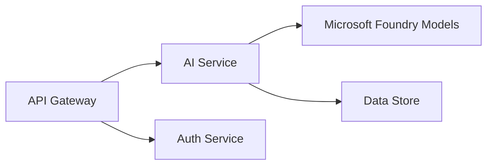
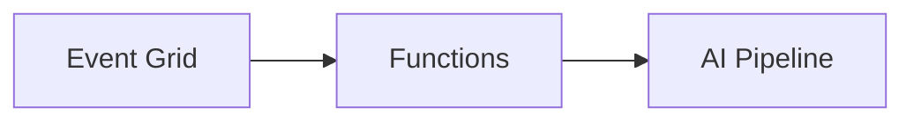

# Capítulo 8: Padrões de Produção & Empresariais

**📚 Curso**: [AZD Para Iniciantes](../../README.md) | **⏱️ Duração**: 2-3 horas | **⭐ Complexidade**: Avançado

---

## Visão Geral

Este capítulo cobre padrões de implementação prontos para empresas, reforço de segurança, monitorização e otimização de custos para workloads de IA em produção.

Esta é uma referência arquitetural, não um template completo para produção. Os exemplos omittem detalhes de integração que devem ser fornecidos e testados na sua própria aplicação; ler a lista de verificação não certifica a prontidão para produção.

> **Revisão da versão (2026-11-04):** A orientação da CLI de IA foi verificada contra a documentação/fonte de `azd 1.37.2`, agentes `1.0.0-beta.23`, e avaliações `1.0.0-beta.2`. Veja [alterações e correções da versão](production-ai-practices.md#recent-release-changes-and-fixes) para requisitos de compatibilidade e detalhes da migração; isto não é uma validação de implementação ao vivo.

## Objectivos de Aprendizagem

Ao completar este capítulo, você irá:
- Implementar aplicações resilientes multi-regionais
- Implementar padrões de segurança empresariais
- Configurar monitorização abrangente
- Otimizar custos em escala
- Configurar pipelines CI/CD com AZD

---

## 📚 Lições

| # | Lição | Descrição | Tempo |
|---|--------|-------------|------|
| 1 | [Práticas de IA em Produção](production-ai-practices.md) | Padrões de implementação empresarial | 90 min |

---

## 🚀 Lista de Verificação para Produção

- [ ] Implementação multi-region para resiliência
- [ ] Identidade gerida para autenticação (sem chaves)
- [ ] Application Insights para monitorização
- [ ] Orçamentos de custos e alertas configurados
- [ ] Verificação de segurança ativada
- [ ] Integração de pipeline CI/CD
- [ ] Plano de recuperação de desastres

---

## 🏗️ Padrões de Arquitetura

### Padrão 1: Microserviços AI



### Padrão 2: AI Orientada a Eventos



---

## 🔐 Melhores práticas de segurança

```bicep
// Illustrative properties from different resources, NOT a standalone Bicep file.
// Attach identity to the application host:
identity: {
  type: 'SystemAssigned'
}

// AI account properties (also require private endpoints, DNS and app connectivity):
properties: {
  publicNetworkAccess: 'Disabled'
  networkAcls: {
    defaultAction: 'Deny'
  }
}
```

---

## 💰 Otimização de custos

| Estratégia | Principal restrição |
|----------|---------|
| Escalar a zero (Apps de Contentores) | Requer um trigger adequado; outros serviços ainda geram custos |
| Usar níveis de consumo para dev | Comparar preços do serviço selecionado e carga de trabalho |
| Escalonamento programado | Escalar através da infraestrutura/automação suportada |
| Reservas/capacidade provisionada | Apenas quando suportado; compromissos podem aumentar custos em ócio |

Utilize o [padrão completo de recurso de orçamento](production-ai-practices.md#2-cost-monitoring-and-budgets) com uma data de início válida, âmbito de faturação, destinatários e permissões. Um orçamento envia alertas; não limita gastos. As poupanças dependem da utilização medida e não são percentagens garantidas.

---

## 📊 Configuração de Monitorização

```bash
# Open the Application Insights logs view (requires configured monitoring)
azd monitor --logs

# Check Application Insights
azd monitor --overview

# View metrics
az monitor metrics list --resource <resource-id>
```

---

## 🔗 Navegação

| Direção | Capítulo |
|-----------|---------|
| **Anterior** | [Capítulo 7: Resolução de Problemas](../chapter-07-troubleshooting/README.md) |
| **Curso Completo** | [Início do Curso](../../README.md) |

---

## 📖 Recursos Relacionados

- [Guia de Agentes AI](../chapter-02-ai-development/agents.md)
- [Application Insights](../chapter-06-pre-deployment/application-insights.md)
- [Soluções Multi-Agente](../chapter-05-multi-agent/README.md)
- [Exemplo de Microserviços](../../examples/microservices/README.md)

---

<!-- CO-OP TRANSLATOR DISCLAIMER START -->
**Aviso Legal**:
Este documento foi traduzido utilizando o serviço de tradução automática [Co-op Translator](https://github.com/Azure/co-op-translator). Embora nos esforcemos pela precisão, esteja ciente de que traduções automáticas podem conter erros ou imprecisões. O documento original na sua língua nativa deve ser considerado a fonte autorizada. Para informações críticas, recomenda-se tradução profissional humana. Não nos responsabilizamos por quaisquer mal-entendidos ou interpretações incorretas resultantes da utilização desta tradução.
<!-- CO-OP TRANSLATOR DISCLAIMER END -->