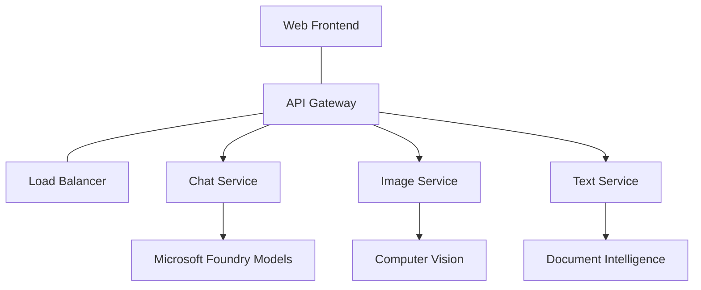

# Melhores Práticas para Cargas de Trabalho de IA em Produção com AZD

**Navegação do Capítulo:**
- **📚 Página Inicial do Curso**: [AZD Para Iniciantes](../../README.md)
- **📖 Capítulo Atual**: Capítulo 8 - Padrões de Produção e Empresariais
- **⬅️ Capítulo Anterior**: [Capítulo 7: Resolução de Problemas](../chapter-07-troubleshooting/debugging.md)
- **⬅️ Também Relacionado**: [Laboratório de Workshop IA](../chapter-02-ai-development/ai-workshop-lab.md)
- **🎯 Curso Completo**: [AZD Para Iniciantes](../../README.md)

## Visão Geral

Este guia explica padrões de design de IA para produção usando Azure Developer CLI (AZD). É uma referência de design, não uma aplicação para implantação nem uma certificação de produção.

**Limites do exemplo:** A menos que explicitamente descritos como completos, fragmentos Bicep assumem parâmetros e recursos referenciados de um modelo contenente. Eles omitem imagens/plano do host, identidades, atribuições de funções, DNS, outputs e outras integrações necessárias. Os caminhos YAML de serviço e scripts de gancho/teste são arquivos ilustrativos para criar na **sua própria aplicação**; não são fornecidos por este curso. Use uma amostra AZD funcional como base, compile a infraestrutura completa e teste-a num ambiente isolado antes da produção.

## Desafios Principais Abordados

Preocupações comuns em produção incluem implantações multi-serviço, gestão de identidade e segredos, escalabilidade, controlo de custos e monitorização. Não se reivindica prevalência mensurada aqui.

## Padrões de Arquitetura para IA em Produção

### Padrão 1: Arquitetura de IA com Microserviços

**Quando usar**: Aplicações de IA complexas com múltiplas capacidades



**Implementação AZD**:

```yaml
# azure.yaml
name: enterprise-ai-platform
services:
  web:
    project: ./web
    host: staticwebapp
  api-gateway:
    project: ./api-gateway
    host: containerapp
  chat-service:
    project: ./services/chat
    host: containerapp
  vision-service:
    project: ./services/vision
    host: containerapp
  text-service:
    project: ./services/text
    host: containerapp
```

### Padrão 2: Processamento de IA Orientado a Eventos

**Quando usar**: Processamento em lote, análise de documentos, fluxos de trabalho assíncronos

```bicep
// Event Hub for AI processing pipeline
resource eventHub 'Microsoft.EventHub/namespaces@2024-01-01' = {
  name: eventHubNamespaceName
  location: location
  sku: {
    name: 'Standard'
    tier: 'Standard'
    capacity: 1
  }
}

// Service Bus for reliable message processing
resource serviceBus 'Microsoft.ServiceBus/namespaces@2024-01-01' = {
  name: serviceBusNamespaceName
  location: location
  sku: {
    name: 'Premium'
    tier: 'Premium'
    capacity: 1
  }
}

// Function App for processing
resource functionApp 'Microsoft.Web/sites@2023-01-01' = {
  name: functionAppName
  location: location
  kind: 'functionapp,linux'
  properties: {
    siteConfig: {
      appSettings: [
        {
          name: 'FUNCTIONS_EXTENSION_VERSION'
          value: '~4'
        }
        {
          name: 'AZURE_OPENAI_ENDPOINT'
          value: '@Microsoft.KeyVault(VaultName=${keyVault.name};SecretName=openai-endpoint)'
        }
      ]
    }
  }
}
```

Isto cria fragmentos de namespace, não hubs, filas, assinaturas ou triggers de Function. Uma Function executável também precisa de um plano de hospedagem, configuração de runtime/armazenamento, uma identidade anexada, RBAC e acesso à rede. A referência do Key Vault precisa de permissão para ler o segredo; uma URL de endpoint não é uma credencial.

## Pensando na Saúde do Agente de IA

Quando uma aplicação web tradicional quebra, os sintomas são familiares: uma página não carrega, uma API retorna um erro, ou uma implantação falha. Aplicações alimentadas por IA podem quebrar de todas essas mesmas formas — mas também podem comportar-se mal de maneiras mais subtis que não produzem mensagens de erro óbvias.

Esta secção ajuda a construir um modelo mental para monitorizar cargas de IA para saber onde procurar quando as coisas não parecem estar certas.

### Como a Saúde do Agente Difere da Saúde de Aplicações Tradicionais

Aplicações tradicionais podem também ter falhas de correção subtis. Um agente de IA adiciona qualidade de resposta não determinística às habituais preocupações de disponibilidade e correção. Pense na saúde do agente em duas camadas:

| Camada | O Que Vigiar | Onde Procurar |
|-------|--------------|---------------|
| **Saúde da infraestrutura** | O serviço está em execução? Os recursos estão provisionados? Os endpoints estão acessíveis? | `azd monitor`, saúde do recurso no Portal Azure, logs de containers/aplicação |
| **Saúde do comportamento** | O agente está a responder com precisão? As respostas são atempadas? O modelo está a ser chamado corretamente? | traços do Application Insights, métricas de latência de chamadas ao modelo, logs de qualidade de resposta |

A saúde da infraestrutura é familiar — é a mesma para qualquer app azd. A saúde do comportamento é a nova camada que cargas de IA introduzem.

### Onde Procurar Quando Aplicações de IA Não Comportam como Esperado

Se a sua aplicação de IA não está a produzir os resultados esperados, aqui está uma lista conceptual:

1. **Comece pelo básico.** A aplicação está a correr? Pode alcançar as suas dependências? Verifique `azd monitor` e a saúde do recurso tal como faria para qualquer aplicação.
2. **Verifique a ligação ao modelo.** A sua aplicação está a chamar o modelo de IA com sucesso? Chamadas falhadas ou com timeout ao modelo são a causa mais comum de problemas e aparecerão nos logs da aplicação.
3. **Inspecione a entrada e o grounding com segurança.** Respostas erradas podem resultar de recuperação, instruções, limitações do modelo ou execução de ferramentas. Use dados diagnósticos com controlo de acesso e redigidos; não ative registos indiscriminados de prompts/respostas em produção.
4. **Revise a latência da resposta.** Chamadas ao modelo de IA são mais lentas que chamadas API típicas. Se a aplicação parecer lenta, verifique se os tempos de resposta do modelo aumentaram — isto pode indicar limitação, limites de capacidade ou congestionamento regional.
5. **Atente em sinais de custo.** Picos inesperados no uso de tokens ou chamadas API podem indicar um ciclo, um prompt mal configurado ou tentativas excessivas.

Não precisa dominar imediatamente as ferramentas de observabilidade. A principal conclusão é que aplicações de IA têm uma camada extra de comportamento para monitorizar, e a monitorização integrada do azd (`azd monitor`) dá um ponto de partida para investigar ambas as camadas.

---

## Melhores Práticas de Segurança

### 1. Modelo de Segurança Zero-Trust

**Estratégia de Implementação**:
- Sem comunicação serviço-a-serviço sem autenticação
- Todas as chamadas API usam identidades geridas
- Isolamento de rede com endpoints privados
- Controlo de acesso com menor privilégio

```bicep
// Managed Identity for each service
resource chatServiceIdentity 'Microsoft.ManagedIdentity/userAssignedIdentities@2023-01-31' = {
  name: 'chat-service-identity'
  location: location
}

// Role assignments with minimal permissions
resource openAIUserRole 'Microsoft.Authorization/roleAssignments@2022-04-01' = {
  scope: openAIAccount
  name: guid(openAIAccount.id, chatServiceIdentity.id, '5e0bd9bd-7b93-4f28-af87-19fc36ad61bd')
  properties: {
    roleDefinitionId: subscriptionResourceId('Microsoft.Authorization/roleDefinitions', '5e0bd9bd-7b93-4f28-af87-19fc36ad61bd')
    principalId: chatServiceIdentity.properties.principalId
    principalType: 'ServicePrincipal'
  }
}
```

### 2. Gestão Segura de Segredos

**Padrão de Integração com Key Vault**:

```bicep
// Key Vault with proper access policies
resource keyVault 'Microsoft.KeyVault/vaults@2023-02-01' = {
  name: keyVaultName
  location: location
  properties: {
    tenantId: tenant().tenantId
    sku: {
      family: 'A'
      name: 'standard' // Premium is needed for HSM-backed keys, not ordinary secrets
    }
    enableRbacAuthorization: true  // Use RBAC instead of access policies
    enablePurgeProtection: true    // Prevent accidental deletion
    enableSoftDelete: true
    softDeleteRetentionInDays: 90
  }
}

// Optional legacy key-auth alternative; omit when using Entra ID.
resource openAIKeySecret 'Microsoft.KeyVault/vaults/secrets@2023-02-01' = {
  parent: keyVault
  name: 'openai-api-key'
  properties: {
    value: openAIAccount.listKeys().key1
    attributes: {
      enabled: true
    }
  }
}
```

Atribua a identidade de runtime `Key Vault Secrets User` no âmbito apropriado e anexe-a ao host; `enableRbacAuthorization` sozinho não concede acesso. Prefira autenticação de identidade gerida OpenAI com `disableLocalAuth: true`. O segredo de chave opcional só faz sentido para uma conta deliberadamente habilitada por chave, e a entidade que faz o provisionamento também precisa de permissão para escrever segredos.

### 3. Segurança de Rede

**Configuração de Endpoint Privado**:

```bicep
// Virtual Network for AI services
resource virtualNetwork 'Microsoft.Network/virtualNetworks@2023-04-01' = {
  name: vnetName
  location: location
  properties: {
    addressSpace: {
      addressPrefixes: ['10.0.0.0/16']
    }
    subnets: [
      {
        name: 'ai-services-subnet'
        properties: {
          addressPrefix: '10.0.1.0/24'
          privateEndpointNetworkPolicies: 'Disabled'
        }
      }
      {
        name: 'app-services-subnet'
        properties: {
          addressPrefix: '10.0.2.0/24'
          delegations: [
            {
              name: 'Microsoft.Web/serverFarms'
              properties: {
                serviceName: 'Microsoft.Web/serverFarms'
              }
            }
          ]
        }
      }
    ]
  }
}

// Private endpoints for all AI services
resource openAIPrivateEndpoint 'Microsoft.Network/privateEndpoints@2023-04-01' = {
  name: '${openAIAccountName}-pe'
  location: location
  properties: {
    subnet: {
      id: virtualNetwork.properties.subnets[0].id
    }
    privateLinkServiceConnections: [
      {
        name: 'openai-connection'
        properties: {
          privateLinkServiceId: openAIAccount.id
          groupIds: ['account']
        }
      }
    ]
  }
}
```

Endpoints privados também requerem grupos de zonas DNS privadas/ligação VNet e integração da aplicação com VNet. Não bloqueiam automaticamente o acesso público: desative explicitamente o acesso à rede pública da conta AI após validar conectividade privada e acesso à implantação.

## Desempenho e Escalonamento

### 1. Estratégias de Autoescalonamento

**Autoescalonamento de Container Apps**:

```bicep
resource containerApp 'Microsoft.App/containerApps@2023-05-01' = {
  name: containerAppName
  location: location
  properties: {
    configuration: {
      ingress: {
        external: true
        targetPort: 8000
        transport: 'http'
      }
    }
    template: {
      scale: {
        minReplicas: 2  // Always have 2 instances minimum
        maxReplicas: 50 // Scale up to 50 for high load
        rules: [
          {
            name: 'http-scaling'
            http: {
              metadata: {
                concurrentRequests: '20'  // Scale when >20 concurrent requests
              }
            }
          }
          {
            name: 'cpu-scaling'
            custom: {
              type: 'cpu'
              metadata: {
                type: 'Utilization'
                value: '70'  // Scale when CPU >70%
              }
            }
          }
        ]
      }
    }
  }
}
```

### 2. Estratégias de Cache

**Cache Redis para Respostas de IA**:

```bicep
// Legacy Azure Cache for Redis example (not recommended for new deployments)
resource redisCache 'Microsoft.Cache/redis@2023-04-01' = {
  name: redisCacheName
  location: location
  properties: {
    sku: {
      name: 'Premium'
      family: 'P'
      capacity: 1
    }
    enableNonSslPort: false
    minimumTlsVersion: '1.2'
    redisConfiguration: {
      'maxmemory-policy': 'allkeys-lru'
    }
    // Sharding distributes data; replication/failover provides availability.
    shardCount: 2
  }
}

// Cache configuration in application
var cacheConnectionString = '${redisCache.properties.hostName}:6380,password=${redisCache.listKeys().primaryKey},ssl=True,abortConnect=False'
```

Azure Cache for Redis Basic/Standard/Premium está num [caminho de descontinuação](https://learn.microsoft.com/azure/azure-cache-for-redis/retirement-faq). Use Azure Managed Redis para novos designs e a sua configuração documentada de SKU, identidade e TLS, em vez de copiar este recurso legado para um novo sistema de produção. A linha da connection-string é um espaço reservado não funcional, não uma credencial. Particione chaves de cache por autorização, modelo/instruções e versão de recuperação, com expiração; um cache partilhado apenas para consulta pode expor dados de outro utilizador.

### 3. Balanceamento de Carga e Gestão de Tráfego

**Application Gateway com WAF**:

```bicep
// Application Gateway with Web Application Firewall
resource applicationGateway 'Microsoft.Network/applicationGateways@2023-04-01' = {
  name: appGatewayName
  location: location
  properties: {
    sku: {
      name: 'WAF_v2'
      tier: 'WAF_v2'
      capacity: 2
    }
    webApplicationFirewallConfiguration: {
      enabled: true
      firewallMode: 'Prevention'
      ruleSetType: 'OWASP'
      ruleSetVersion: '3.2'
    }
    // Backend pools for AI services
    backendAddressPools: [
      {
        name: 'ai-services-pool'
        properties: {
          backendAddresses: [
            {
              fqdn: '${containerApp.properties.configuration.ingress.fqdn}'
            }
          ]
        }
      }
    ]
  }
}
```

Este é um recurso parcial do gateway: uma implantação real também precisa de configuração de subnet/IP do gateway, IPs e portas frontend, listeners/certificados TLS, definições/probes HTTP backend, regras de routing e prioridades, e uma política WAF revista. O hostname/SNI TLS e autenticação devem corresponder ao backend da Container App.

## 💰 Otimização de Custos

### 1. Dimensionamento Correto de Recursos

**Configurações Específicas do Ambiente**:

Estes nomes são **entradas ilustrativas de templates personalizados**, não configurações automáticas do AZD. Mapeie cada um para `infra/main.parameters.json`/Bicep e configuração do host primeiro. Por exemplo, a amostra RAG usa `AZURE_SEARCH_SERVICE_SKU` e `AZURE_OPENAI_CHATGPT_DEPLOYMENT_CAPACITY`, não os nomes genéricos abaixo. Dê memória aos Container Apps numa unidade suportada como `1Gi` no recurso real. Aplique alterações à infraestrutura com `azd up` ou `azd provision`; `azd deploy` sozinho não aplica alterações Bicep.

```bash
# Development environment
azd env new development
azd env set AZURE_OPENAI_SKU "S0"
azd env set AZURE_OPENAI_CAPACITY 10
azd env set AZURE_SEARCH_SKU "basic"
azd env set CONTAINER_CPU 0.5
azd env set CONTAINER_MEMORY 1.0

# Production environment  
azd env new production
azd env set AZURE_OPENAI_SKU "S0"
azd env set AZURE_OPENAI_CAPACITY 100
azd env set AZURE_SEARCH_SKU "standard"
azd env set CONTAINER_CPU 2.0
azd env set CONTAINER_MEMORY 4.0
```

### 2. Monitorização de Custos e Orçamentos

```bicep
// Supply the first day of the current UTC month, e.g. 2026-11-01T00:00:00Z.
param budgetStartDate string

// Cost management and budgets
resource budget 'Microsoft.Consumption/budgets@2024-08-01' = {
  name: 'ai-workload-budget'
  properties: {
    timePeriod: {
      startDate: budgetStartDate
    }
    timeGrain: 'Monthly'
    amount: 2000  // In the billing currency, not necessarily USD
    category: 'Cost'
    notifications: {
      warning: {
        enabled: true
        operator: 'GreaterThan'
        threshold: 80
        contactEmails: [
          'finance@company.com'
          'engineering@company.com'
        ]
        contactRoles: [
          'Owner'
          'Contributor'
        ]
      }
      critical: {
        enabled: true
        operator: 'GreaterThan'
        threshold: 95
        contactEmails: [
          'cto@company.com'
        ]
      }
    }
  }
}
```

Substitua os destinatários do exemplo e verifique escopo/permissões. Alertas de orçamento usam dados de faturação atrasados e não impõem um limite de despesa.

### 3. Otimização do Uso de Tokens

**Gestão de Custos OpenAI**:

Este é apenas um heurístico baseado em caracteres para pré-visualização UI, **não** um validador de limite de tokens do modelo. Código de produção deve usar um tokenizer apropriado ao modelo implantado e considerar instruções do sistema, esquemas de ferramentas, histórico e orçamento de output. Rejeite uma mensagem do utilizador demasiado grande em vez de truncá-la silenciosamente.

```typescript
// Application-level token optimization
class TokenOptimizer {
  private readonly maxTokens = 4000;
  private readonly reserveTokens = 500;
  
  optimizePrompt(userInput: string, context: string): string {
    const availableTokens = this.maxTokens - this.reserveTokens;
    if (this.estimateTokens(userInput) + 8 >= availableTokens) {
      throw new Error("User input exceeds the illustrative prompt budget");
    }
    const estimatedTokens = this.estimateTokens(userInput + context) + 8;
    
    if (estimatedTokens > availableTokens) {
      // Truncate context, not user input
      context = this.truncateContext(context, Math.max(0, availableTokens - this.estimateTokens(userInput) - 8));
    }
    
    return `${context}\n\nUser: ${userInput}`;
  }
  
  private estimateTokens(text: string): number {
    // Rough estimation: 1 token ≈ 4 characters
    return Math.ceil(text.length / 4);
  }

  private truncateContext(text: string, estimatedBudget: number): string {
    return text.slice(0, Math.max(0, estimatedBudget) * 4);
  }
}
```

## Monitorização e Observabilidade

### 1. Application Insights Abrangente

```bicep
// Application Insights with advanced features
resource applicationInsights 'Microsoft.Insights/components@2020-02-02' = {
  name: applicationInsightsName
  location: location
  kind: 'web'
  properties: {
    Application_Type: 'web'
    WorkspaceResourceId: logAnalyticsWorkspace.id
    SamplingPercentage: 100  // Ingestion setting; review cost and SDK sampling separately
    DisableIpMasking: false  // Retain IP masking
  }
}

// Custom metrics for AI operations
resource aiMetricAlerts 'Microsoft.Insights/metricAlerts@2018-03-01' = {
  name: 'ai-high-error-rate'
  location: 'global'
  properties: {
    description: 'Alert when failed request count exceeds 10 in five minutes'
    severity: 2
    enabled: true
    scopes: [
      applicationInsights.id
    ]
    evaluationFrequency: 'PT1M'
    windowSize: 'PT5M'
    criteria: {
      'odata.type': 'Microsoft.Azure.Monitor.SingleResourceMultipleMetricCriteria'
      allOf: [
        {
          name: 'high-error-rate'
          metricName: 'requests/failed'
          operator: 'GreaterThan'
          threshold: 10
          timeAggregation: 'Count'
        }
      ]
    }
  }
}
```

### 2. Monitorização Específica de IA

**Dashboards Personalizados para Métricas de IA**:

```json
{
  "dashboard": {
    "name": "AI Application Monitoring",
    "tiles": [
      {
        "name": "OpenAI Request Volume",
        "query": "dependencies | where target contains 'openai' | summarize count() by bin(timestamp, 5m)"
      },
      {
        "name": "AI Response Latency",
        "query": "dependencies | where target contains 'openai' | summarize avg(duration) by bin(timestamp, 5m)"
      },
      {
        "name": "Token Usage",
        "query": "customMetrics | where name == 'openai_tokens_used' | summarize sum(value) by bin(timestamp, 1h)"
      },
      {
        "name": "Cost per Hour",
        "query": "customMetrics | where name == 'openai_cost' | summarize sum(value) by bin(timestamp, 1h)"
      }
    ]
  }
}
```

Este JSON é um esboço definido pela aplicação, não um esquema de dashboard importável do portal Azure. As consultas de token/custo requerem que a sua aplicação emita essas métricas personalizadas exatas; não são criadas pelo AZD. Adapte filtros de dependência para os nomes reais do seu endpoint de modelo/span.

### 3. Verificações de Saúde e Monitorização de Uptime

```bicep
// Application Insights availability tests
resource availabilityTest 'Microsoft.Insights/webtests@2022-06-15' = {
  name: 'ai-app-availability-test'
  location: location
  tags: {
    'hidden-link:${applicationInsights.id}': 'Resource'
  }
  properties: {
    SyntheticMonitorId: 'ai-app-availability-test'
    Name: 'AI Application Availability Test'
    Description: 'Tests AI application endpoints'
    Enabled: true
    Frequency: 300  // 5 minutes
    Timeout: 120    // 2 minutes
    Kind: 'standard'
    Locations: [
      {
        Id: 'us-east-2-azr'
      }
      {
        Id: 'us-west-2-azr'
      }
    ]
    Request: {
      RequestUrl: 'https://${webApp.properties.defaultHostName}/health'
      HttpVerb: 'GET'
      FollowRedirects: true
      ParseDependentRequests: false
    }
    ValidationRules: {
      ExpectedHttpStatusCode: 200
      SSLCheck: true
      SSLCertRemainingLifetimeCheck: 7
    }
  }
}
```

## Recuperação de Desastres e Alta Disponibilidade

O teste anterior assume um App Service `webApp` e recurso Application Insights existentes. Testes de disponibilidade padrão são faturáveis e requerem um endpoint alcançável; apps apenas privados precisam de um design de monitorização privada apropriado. Testes ping de URL estão obsoletos; use [testes de disponibilidade padrão](https://learn.microsoft.com/azure/azure-monitor/app/availability).

### 1. Implantação Multi-Região

```yaml
# azure.yaml - Multi-region configuration
name: ai-app-multiregion
services:
  api-primary:
    project: ./api
    host: containerapp
    env:
      AZURE_REGION: eastus
  api-secondary:
    project: ./api
    host: containerapp
    env:
      AZURE_REGION: westus2
```

```bicep
// Separate App Service topology, not the Container Apps declarations above
resource trafficManager 'Microsoft.Network/trafficManagerProfiles@2022-04-01' = {
  name: trafficManagerProfileName
  location: 'global'
  properties: {
    profileStatus: 'Enabled'
    trafficRoutingMethod: 'Priority'
    dnsConfig: {
      relativeName: trafficManagerProfileName
      ttl: 30
    }
    monitorConfig: {
      protocol: 'HTTPS'
      port: 443
      path: '/health'
      intervalInSeconds: 30
      toleratedNumberOfFailures: 3
      timeoutInSeconds: 10
    }
    endpoints: [
      {
        name: 'primary-endpoint'
        type: 'Microsoft.Network/trafficManagerProfiles/azureEndpoints'
        properties: {
          targetResourceId: primaryAppService.id
          endpointStatus: 'Enabled'
          priority: 1
        }
      }
      {
        name: 'secondary-endpoint'
        type: 'Microsoft.Network/trafficManagerProfiles/azureEndpoints'
        properties: {
          targetResourceId: secondaryAppService.id
          endpointStatus: 'Enabled'
          priority: 2
        }
      }
    ]
  }
}
```

Variáveis ambientais não escolhem localizações dos recursos. IaC deve providenciar hosts regionais distintos e ligar cada serviço com tags `resourceName` ou `azd-service-name`. O exemplo do Traffic Manager é uma **topologia separada do App Service** (`primaryAppService`/`secondaryAppService`), não roteamento para as declarações de Container Apps. Container Apps requer um endpoint externo/front door configurado adequadamente, routing TLS/domínio personalizado, e probes de saúde.

### 2. Backup e Recuperação de Dados

```bicep
// Backup configuration for critical data
resource backupVault 'Microsoft.DataProtection/backupVaults@2023-05-01' = {
  name: backupVaultName
  location: location
  identity: {
    type: 'SystemAssigned'
  }
  properties: {
    storageSettings: [
      {
        datastoreType: 'VaultStore'
        type: 'LocallyRedundant'
      }
    ]
  }
}

```

O vault sozinho não faz backup de nada. Configure uma **política e instância de backup suportadas específicas de carga**, permissões da fonte, retenção e testes de restauração usando [matrizes de suporte do Azure Backup](https://learn.microsoft.com/azure/backup/backup-support-matrix). Não há política genérica do Azure Backup para implantações de modelos Azure OpenAI hospedados. Mantenha definições de infraestrutura/implantação de modelos no controlo de código-fonte; proteja documentos carregados, dados da aplicação e artefatos de fine-tuning usando características suportadas de backup/exportação de cada serviço de apoio. Defina e teste RPO/RTO explicitamente.

## DevOps e Integração CI/CD

### 1. Workflow GitHub Actions

```yaml
# .github/workflows/deploy-ai-app.yml
name: Deploy AI Application

on:
  push:
    branches: [main]
  pull_request:
    branches: [main]

jobs:
  test:
    runs-on: ubuntu-latest
    steps:
      - uses: actions/checkout@v4
      
      - name: Setup Python
        uses: actions/setup-python@v4
        with:
          python-version: '3.11'
          
      - name: Install dependencies
        run: |
          pip install -r requirements.txt
          pip install pytest
          
      - name: Run tests
        run: pytest tests/
        
      - name: AI Safety Tests
        run: |
          python scripts/test_ai_safety.py
          python scripts/validate_prompts.py

```

Esta é a **parte apenas de teste** de um workflow e assume que criou `requirements.txt`, `tests/`, e os dois scripts de segurança. Adicione os trabalhos autenticados OIDC de provisionamento/implantação de [Configuração da Pipeline CI/CD](#cicd-pipeline-configuration), com `needs: test`, um trigger confiável push/manual, e ambientes GitHub protegidos. Não implante código PR não confiável com credenciais de cloud. Um runner novo não tem ambiente AZD local selecionado; forneça as entradas de ambiente/assinatura/localização e use `azd auth login`, não apenas `azure/login`.

### 2. Validação da Infraestrutura

```bash
# scripts/validate_infrastructure.sh
#!/bin/bash
set -euo pipefail

echo "Validating AI infrastructure deployment..."

# Requires Azure CLI login and the resource group selected explicitly.
: "${AZURE_RESOURCE_GROUP:?Set AZURE_RESOURCE_GROUP}"
: "${AZURE_OPENAI_NAME:?Set AZURE_OPENAI_NAME}"
: "${AZURE_OPENAI_CHAT_DEPLOYMENT:?Set the actual deployment name}"

# A successful empty list is not proof that resources exist.
types=("Microsoft.CognitiveServices/accounts" "Microsoft.Search/searchServices"
       "Microsoft.Storage/storageAccounts" "Microsoft.KeyVault/vaults")
for resource_type in "${types[@]}"; do
    count=$(az resource list --resource-group "$AZURE_RESOURCE_GROUP" \
        --resource-type "$resource_type" --query "length(@)" -o tsv)
    if [[ "$count" -lt 1 ]]; then
        echo "ERROR: No $resource_type found in $AZURE_RESOURCE_GROUP"
        exit 1
    fi
done

# Validate OpenAI model deployments
echo "Validating OpenAI model deployments..."
state=$(az cognitiveservices account deployment show \
  --name "$AZURE_OPENAI_NAME" --resource-group "$AZURE_RESOURCE_GROUP" \
  --deployment-name "$AZURE_OPENAI_CHAT_DEPLOYMENT" \
  --query "properties.provisioningState" -o tsv)
if [[ "$state" != "Succeeded" ]]; then
    echo "ERROR: Required model deployment is not provisioned successfully"
    exit 1
fi

echo "Infrastructure validation completed successfully!"
```

Esperado: saída zero e mensagem de conclusão somente quando todos os tipos esperados existem e o deployment nomeado do modelo está provisionado. Isto verifica estado de inventário/provisionamento, **não** saúde do recurso, topologia exata, RBAC, acessibilidade de rede ou comportamento do modelo. Adapte os tipos esperados à sua arquitetura, depois realize um teste separado autenticado de prontidão da aplicação.

## Lista de Verificação para Preparação para Produção

### Segurança ✅
- [ ] Todos os serviços usam identidades geridas
- [ ] Segredos armazenados no Key Vault
- [ ] Endpoints privados configurados
- [ ] Grupos de segurança de rede implementados
- [ ] RBAC com menor privilégio
- [ ] WAF ativado nos endpoints públicos

### Desempenho ✅
- [ ] Autoescalonamento configurado
- [ ] Cache implementada
- [ ] Balanceamento de carga configurado
- [ ] CDN para conteúdo estático
- [ ] Pooling de conexões de base de dados
- [ ] Otimização de uso de tokens

### Monitorização ✅
- [ ] Application Insights configurado
- [ ] Métricas personalizadas definidas
- [ ] Regras de alerta configuradas
- [ ] Dashboard criado
- [ ] Verificações de saúde implementadas
- [ ] Políticas de retenção de logs

### Confiabilidade ✅
- [ ] Implantação multi-região
- [ ] Plano de backup e recuperação
- [ ] Circuit breakers implementados
- [ ] Políticas de retry configuradas
- [ ] Degradação graciosa
- [ ] Endpoints para verificações de saúde

### Gestão de Custos ✅
- [ ] Alertas de orçamento configurados
- [ ] Dimensionamento correto de recursos
- [ ] Descontos para dev/test aplicados
- [ ] Instâncias reservadas adquiridas
- [ ] Dashboard de monitorização de custos
- [ ] Revisões regulares de custos

### Conformidade ✅
- [ ] Requisitos de residência de dados cumpridos
- [ ] Logs de auditoria ativados
- [ ] Políticas de conformidade aplicadas
- [ ] Linhas de base de segurança implementadas
- [ ] Avaliações regulares de segurança
- [ ] Plano de resposta a incidentes

## Metas de Desempenho

### Metas de Produção Ilustrativas

Estes são exemplos de SLOs para negociar e testar carga, não benchmarks medidos ou garantias. Latência de resposta depende do modelo/comprimento do output; gasto mensal de tokens depende do tráfego e preços, não apenas do número de tokens.

| Métrica | Meta | Monitorização |
|--------|--------|------------|
| **Tempo de Resposta** | < 2 segundos | Application Insights |
| **Disponibilidade** | 99.9% | Monitorização de uptime |
| **Taxa de Erro** | < 0.1% | Logs da aplicação |
| **Gasto com Modelo** | < $500/mês (orçamento exemplo) | Gestão de custos |
| **Utilizadores Concorrentes** | 1000+ | Teste de carga |
| **Tempo de Recuperação** | < 1 hora | Testes de recuperação de desastre |

### Teste de Carga

O seguinte é um esboço de interface para um script de teste de carga **que deve implementar**; este repositório não fornece `scripts/load_test.py`. Defina cargas úteis de pedidos, autenticação, cargas de trabalho representativas, asserções de latência/erro percentil e um limite de gastos na ferramenta de teste de carga escolhida antes de a executar:

```bash
# Load testing script for AI applications
python scripts/load_test.py \
  --endpoint https://your-ai-app.azurewebsites.net \
  --concurrent-users 100 \
  --duration 300 \
  --ramp-up 60
```

## 🤝 Melhores Práticas da Comunidade

Baseado no feedback da comunidade Discord Microsoft Foundry:

### Principais Recomendações da Comunidade:

1. **Começar Pequeno, Escalar Gradualmente**: Comece com SKUs básicas e escale conforme o uso real
2. **Monitorizar Tudo**: Configure monitorização abrangente desde o primeiro dia
3. **Automatizar a Segurança**: Utilize infraestrutura como código para segurança consistente
4. **Testar Cuidadosamente**: Inclua testes específicos de IA no seu pipeline
5. **Planear os Custos**: Monitorize o uso de tokens e defina alertas de orçamento cedo

### Armadilhas Comuns a Evitar:

- ❌ Codificar chaves de API no código
- ❌ Não configurar uma monitorização adequada
- ❌ Ignorar a otimização de custos
- ❌ Não testar cenários de falha
- ❌ Implementar sem verificações de saúde

## Comandos e Extensões AZD AI CLI

O AZD inclui um conjunto crescente de comandos e extensões específicos de IA que simplificam fluxos de trabalho de IA em produção. Estas ferramentas fazem a ponte entre o desenvolvimento local e a implantação em produção para cargas de trabalho de IA.

> **Revisão de lançamento (2026-11-04):** As orientações CLI abaixo foram verificadas contra as versões publicadas do `azd` **1.37.2**, `azure.ai.agents` **1.0.0-beta.23**, e `azure.ai.evaluations` **1.0.0-beta.2**. O agents beta.23 requer `azd >= 1.37.0`; o evaluations beta.2 requer `azd >= 1.33.0`. Use pelo menos a 1.37.0 para o fluxo de trabalho combinado. Isto é uma revisão da documentação/fonte, não uma validação de implantação ao vivo no Azure.

### Extensões AZD para IA

O AZD usa um sistema de extensões para adicionar capacidades específicas de IA. Instale e gerencie extensões com:

```bash
# List all available extensions (including AI)
azd extension list

# Inspect installed extension details
azd version
azd extension show azure.ai.agents

# Install the Foundry agents extension
azd extension install azure.ai.agents

# Install the separate Foundry evaluations extension
azd extension install azure.ai.evaluations

# Install the fine-tuning extension
azd extension install azure.ai.finetune

# Install the custom models extension
azd extension install azure.ai.models

# Upgrade all installed extensions
azd extension upgrade --all
```

**Extensões AI disponíveis:**

| Extensão | Propósito | Estado |
|-----------|---------|--------|
| `azure.ai.agents` | Gestão do Serviço Foundry Agent | Pré-visualização |
| `azure.ai.evaluations` | Conjuntos de dados, avaliadores, grupos de avaliação e execuções | Pré-visualização |
| `azure.ai.skills` | Habilidades reutilizáveis para agentes | Pré-visualização |
| `azure.ai.connections` | Conexões Foundry (fontes de dados, ferramentas) | Pré-visualização |
| `azure.ai.finetune` | Ajuste fino de modelos Foundry | Pré-visualização |
| `azure.ai.models` | Modelos personalizados Foundry | Pré-visualização |
| `azure.coding-agent` | Configuração de agente de codificação | Disponível |

> Execute `azd extension list --installed` e `azd extension show azure.ai.evaluations` para inspecionar as versões instaladas. Atualize o core CLI primeiro usando as [instruções de instalação/atualização](https://learn.microsoft.com/azure/developer/azure-developer-cli/install-azd) (para instalação Windows winget: `winget upgrade Microsoft.Azd`), depois execute `azd extension upgrade --all`. Não existe um comando core `azd upgrade`. Reveja alterações disruptivas antes de atualizar a automação em produção; não assuma que uma atualização da extensão preserva antigos formatos de comando ou configuração.

### Alterações e Correções Recentes no Lançamento

| Lançamento | O que muda para este curso |
|---------|------------------------------|
| `azd 1.37.0` | Adiciona APIs estáveis de preview de implantação e corrige edições de extensão que reescreviam configurações `azure.yaml` não relacionadas. |
| `azd 1.37.1` | Corrige propagação do Ctrl+C através das extensões e distingue cancelamentos/timeouts de falhas genéricas. |
| `azd 1.37.2` | Melhora validação de provisionamento: avisos críticos padrão para **Não**, falha sem confirmação em execuções não assistidas, e cancelamento pula hooks pós-provisionamento. Também corrige valores de ambiente não resolvidos em listas de negação de Deployment Stacks com essa funcionalidade alfa ativada. |
| Agents `beta.22` | Migra avaliação para `azd ai eval`, altera otimização para API GA v1, exige plurais `toolboxes`, e separa opt-ins para managed-harness, voice e preview de longa duração. Corrige seleção de modelo específica do ambiente e autenticação da toolbox. |
| Agents `beta.23` | Expõe `init --harness`; corrige saída de resposta A2A 0.3, caminhos/módulos prompt-agent inválidos em camadas de infraestrutura, diagnósticos de timeout de ativação e avisos RBAC de desenvolvedor retidos. |
| Evaluations `beta.2` | Requer configuração de avaliação camelCase, adiciona criação estática/simulada de conversações e fontes locais explícitas, e corrige tratamento de identidade/versão de dataset, contagem de quality-gate, e diagnósticos de execuções falhadas. |

Um timeout de ativação de agente **não** prova falha na implantação: inspecione a versão tentada e seu estado antes de tentar novamente. Avisos RBAC de desenvolvedor podem permanecer mesmo quando o provisionamento é bem-sucedido; resolva o acesso em falta antes de invocar como esse desenvolvedor.

Fontes: [lançamentos AZD](https://github.com/Azure/azure-dev/releases), [lançamento agents beta.23](https://github.com/Azure/azure-dev/releases/tag/azd-ext-azure-ai-agents_1.0.0-beta.23), [migração agents beta.22](https://github.com/Azure/azure-dev/releases/tag/azd-ext-azure-ai-agents_1.0.0-beta.22), e [lançamento evaluations beta.2](https://github.com/Azure/azure-dev/releases/tag/azd-ext-azure-ai-evaluations_1.0.0-beta.2).

**O que são as extensões mais recentes `skills` e `connections`?**

Duas extensões de pré-visualização surgiram junto com o tooling do agente e valem a pena conhecerem-se mesmo como principiante:

- **`azure.ai.skills`** — Uma **habilidade** é uma capacidade reutilizável (uma ferramenta ou comportamento empacotado) que pode ser atribuída a um ou mais agentes em vez de ser implementada repetidamente. Pense nela como um bloco de construção compartilhado: defina uma habilidade "pesquisar na documentação" ou "consultar uma encomenda" uma vez e reutilize-a em vários agentes. Isto mantém sistemas multi-agentes (Capítulo 5) consistentes e evita cópia e cola.
- **`azure.ai.connections`** — Uma **conexão** é um link gerido do seu projeto Foundry a um recurso externo necessário aos seus agentes — uma fonte de dados (como Azure AI Search), um endpoint de ferramenta ou outro serviço. As conexões centralizam *onde* e *como* os agentes acedem aos dados, por isso credenciais e endpoints vivem num local governado em vez de espalhados pelo código.

Não precisa destas para implementar os seus primeiros agentes — use `azure.ai.agents` enquanto aprende. Recorra ao `skills` quando se encontrar a duplicar a mesma ferramenta em agentes diferentes, e ao `connections` quando vários agentes partilharem a mesma fonte de dados.

### Inicializar Projetos de Agente com `azd ai agent init`

O comando `azd ai agent init` cria a estrutura de um projeto de agente Microsoft Foundry. Use um template atual `azure.yaml`, não um manifesto de agente legado implícito:

```bash
# Initialize a new agent project from a local project template
azd ai agent init --template ./templates/support-agent/azure.yaml

# Initialize and target a specific Foundry project
azd ai agent init --template ./templates/support-agent/azure.yaml --project-id <foundry-project-id>

# Adopt the template into a different directory
azd ai agent init --template ./templates/support-agent/azure.yaml --src ./agents/my-agent
```

**Flags chave:**

| Flag | Descrição |
|------|-------------|
| `-t, --template` | Caminho ou URI GitHub suportado para um documento de projeto `azure.yaml` |
| `-p, --project-id` | ID do projeto Microsoft Foundry existente para o seu ambiente azd |
| `-s, --src` | Diretório fonte para agentes gerados, ou diretório de destino ao adotar um projeto |
| `--kind` | Inicializa um agente `hosted`, `prompt`, ou preview `prompt-voice` |
| `--harness` | Harness opcional para execução `--kind prompt`; requer opt-in de preview |
| `-e, --environment` | O ambiente azd a usar |

`--manifest`/`-m` é um alias obsoleto para `--template`/`-t`; renomear a flag não converte um manifesto antigo em documento de projeto atual. `--host containerapp` não é uma flag atual agent-init. Para uma aplicação Container Apps comum, use `azd init --template` com um template declarando `host: containerapp`.

Para um projeto existente com exatamente um serviço `azure.ai.project`, `azd ai agent add support-agent --file ./agents/support-agent.yaml` adiciona ou atualiza uma definição direta de agente sem provisionar ou implementar. Comandos de runtime rejeitam manifestos implícitos antigos `agent.yaml`/AgentManifest e definições de serviço aninhadas `config:`; migre-os para um serviço atual `azure.ai.agent`. Quando o init imprime um próximo passo `cd`, execute-o antes do `azd up`: o init não altera o diretório do shell.

**Dica para produção**: Use `--project-id` para ligar diretamente a um projeto Foundry existente, mantendo o código do agente e recursos cloud ligados desde o início.

#### Funcionalidades de Pré-visualização Opcionais

Managed harness, voice, e invocação de longa duração estão desativadas por defeito de modo independente. Defina apenas o switch da funcionalidade necessária no **ambiente do processo shell/CI**, não com `azd env set`:

| Funcionalidade | Variável de ambiente do processo |
|---------|------------------------------|
| Managed harness (`init --kind prompt --harness ...`) | `AZD_ALPHA_ENABLE_AGENTS_MANAGED_HARNESS=true` |
| Voice (`init --kind prompt-voice`) | `AZD_ALPHA_ENABLE_AGENTS_VOICE=true` |
| Invocação de longa duração | `AZD_ALPHA_ENABLE_AGENTS_LONG_RUNNING=true` |

Por exemplo, use `export AZD_ALPHA_ENABLE_AGENTS_MANAGED_HARNESS=true` em Bash ou `$env:AZD_ALPHA_ENABLE_AGENTS_MANAGED_HARNESS = "true"` no PowerShell antes de executar o comando relevante. Um switch não ativa os outros. Veja o [README dos agentes lançados](https://github.com/Azure/azure-dev/blob/azd-ext-azure-ai-agents_1.0.0-beta.23/cli/azd/extensions/azure.ai.agents/README.md) para todos os switches e limitações de preview.

### Gerindo o Ciclo de Vida dos Agentes

Use `azure.ai.agents` para testar, inspecionar, otimizar e retirar agentes, e a extensão separada `azure.ai.evaluations` para medir a qualidade:

```bash
# Invoke a deployed agent and view server response timing
# (total latency and time to first byte)
azd ai agent invoke

# Show the live endpoint configuration before changing it
azd ai agent endpoint show

# Download the deployed source of a code-based hosted agent
# (with SHA-256 verification)
azd ai agent code download

# Delete a hosted agent and all of its versions
# (--force terminates active sessions)
azd ai agent delete --force
```

**Ciclo de vida em resumo:**

| Fase | Comando | Uso em produção |
|-------|---------|----------------|
| Testar | `azd ai agent invoke` | Validar respostas e medir latência antes do lançamento |
| Inspecionar | `azd ai agent endpoint show` | Rever autenticação/configuração do endpoint; detectar mudanças disruptivas cedo |
| Medir | `azd ai eval init`, `generate`, `run start` | Definir, implementar e executar avaliações repetíveis |
| Melhorar | `azd ai agent optimize --eval <evaluation-name> --optimize-model <optimizer-deployment>` | Reutilizar uma avaliação compatível para otimizar o agente |
| Recuperar | `azd ai agent code download` | Recuperar o código-fonte exato implementado para auditoria/reversão |
| Retirar | `azd ai agent delete --force` | Desmantelar um agente e suas versões de forma limpa |

> Estes são comandos em preview e podem mudar entre versões das extensões. Execute `azd ai agent --help` para ver os subcomandos exatos disponíveis na sua versão instalada.

`endpoint show` suporta agentes hospedados, de prompt e voice, mas atualizações de endpoint são apenas para hospedados; agentes de workflow não são suportados. Download de código e o exemplo de aposentação de agente hospedado acima não são operações genéricas para cada tipo de agente.

#### Migração de Avaliação e Verificações de Qualidade

A partir dos agentes **1.0.0-beta.22 (2026-10-23)**, os comandos legados `azd ai agent eval` fornecem orientação para migração em vez do fluxo de avaliação anterior. Não copie exemplos antigos `eval generate --dataset ...`: a avaliação agora reside sob **`azd ai eval`**.

Num projeto de agente inicializado, autentique com `azd auth login`, confirme o ambiente/projeto Foundry selecionado, e instale `azure.ai.evaluations`. É necessário um deployment de modelo de juiz para pontuação baseada em modelo; geração e simulação de conversação podem requerer suas próprias seleções de modelo e acarretar custos adicionais.

```bash
# Scaffold evals/ and wire an azure.ai.eval service into azure.yaml
azd ai eval init

# Optionally synthesize a rubric and dataset from the agent
azd ai eval generate

# Review generated files, then register datasets, evaluators, and eval groups
azd up

# Start an evaluation and wait for its results
azd ai eval run start --wait

# Inspect runs and available test-case output
azd ai eval run list
azd ai eval run show <run-id>
azd ai eval run output list <run-id>
```

Siga as seleções interativas e os próximos passos impressos em vez de assumir que ativos gerados estão já registados. A configuração de avaliação normalmente fica em `evals/azure.eval.yaml`, referenciada pelo serviço `azure.ai.eval` em `azure.yaml`. As chaves são **camelCase** (`evaluationLevel`, `maxSamples`, `initializationParameters`, `dataMapping`); chaves antigas em snake_case são rejeitadas. Caminhos dentro de uma configuração referenciada resolvem em relação a esse ficheiro, não à raiz do repositório.

Para avaliações de conversação, escolha **estático** para pontuar transcrições completas sem invocar um agente, ou **simulação** para gerar conversações a partir de cenários. A simulação precisa de um alvo agente, modelo simulador, e seleção separada do modelo juiz. Para comandos não assistidos, forneça as entradas listadas por `azd ai eval init --help` e `azd ai eval generate --help`; não assuma que o modelo de geração é também o juiz ou simulador.

Para CI, configure uma política de qualidade explícita usando `azd ai eval run start --help` (`--fail-on`) e trate uma saída de host diferente de zero como falha. Uma execução concluída não é automaticamente aprovação de qualidade. Reveja linhas falhadas/com erro e diagnósticos; contagens de resultados ausentes ou inconsistentes não são evidência de sucesso. Conjuntos de dados registados mantêm sua identidade/versão do serviço; `--max-samples` não pode subdefinir um conjunto registado. Publique um conjunto menor de forma intencional ou use uma fonte local suportada.

```bash
# Example CI policy: at least 90% of all test cases must pass
azd ai eval run start --wait --fail-on "pass-rate=0.9"
```

O quality gate usa taxa de aprovação como casos de teste passados divididos pelos casos totais; falhados, erro, pulados e outros não aprovados contam contra ele. Não combine um gate com `--no-wait`, que retorna antes de estar disponível o veredicto.

#### Migração de Configuração de Otimização

A otimização usa agora a API GA v1. Para reutilizar uma avaliação compatível **ao nível de turno, suportada por dataset** do novo workflow:

```bash
# Replace placeholders with the evaluation name and optimizer model deployment
azd ai agent optimize --eval-config ./evals/azure.eval.yaml --eval <evaluation-name> --optimize-model <optimizer-deployment>
```

`--eval` seleciona uma avaliação; `--eval-config` seleciona o seu ficheiro de configuração (incluindo definições suportadas por ficheiro). `--config` em vez disso aceita um **pedido de API de otimização autónomo** em YAML ou JSON. Não passe um antigo agente `eval.yaml` nem o novo `azure.eval.yaml` para `--config`, e não combine `--config` com `--eval`/`--eval-config`. Avaliações de conversação, baseadas em traços, ou simulações não são intercambiáveis com o atalho de otimização baseado em conjuntos de dados; utilize o formato de pedido de otimização suportado para esses cenários. Revise os candidatos antes de os aplicar ou implementar.

Veja a [referência de avaliações para a versão revista](https://github.com/Azure/azure-dev/blob/azd-ext-azure-ai-evaluations_1.0.0-beta.2/cli/azd/extensions/azure.ai.evaluations/README.md) e a [fonte do comando de otimização para a versão revista](https://github.com/Azure/azure-dev/blob/azd-ext-azure-ai-agents_1.0.0-beta.23/cli/azd/extensions/azure.ai.agents/internal/cmd/optimize.go) para opções exatas.

#### Pré-visualização de Implementação de Agente Hospedado em Somente Leitura

Para um ambiente existente vinculado ao Foundry com um serviço `azure.ai.agent` unificado de `kind: hosted`, compare a configuração suportada antes de implementar:

```bash
azd deploy <service-name> --preview --no-prompt
```

Esta pré-visualização não implementa o agente. Não é uma comparação completa de infraestruturas/segurança: agentes de prompt/voz/workflow, layouts de configuração legados, e algumas definições hospedadas estão fora do seu âmbito. Um resultado `unknown` não constitui aprovação para implementar. Não existe comando autónomo `azd ai agent deploy` nem comando `--dry-run` de agente; utilize o fluxo de trabalho principal de implementação.

### Protocolo de Contexto do Modelo (MCP) com `azd mcp`

O AZD inclui suporte embutido para servidor MCP (Alpha), permitindo que agentes e ferramentas de IA interajam com os seus recursos Azure através de um protocolo padronizado:

```bash
# Start the MCP server for your project
azd mcp start

# Review current Copilot consent rules for tool execution
azd copilot consent list
```

O servidor MCP expõe o contexto do seu projeto azd — ambientes, serviços e recursos Azure — para ferramentas de desenvolvimento com IA. Isto permite:

- **Implementação assistida por IA**: Permitir que agentes de codificação consultem o estado do seu projeto e desencadeiem implementações
- **Descoberta de recursos**: As ferramentas de IA podem descobrir que recursos Azure o seu projeto utiliza
- **Gestão de ambientes**: Agentes podem alternar entre ambientes de desenvolvimento/testes/produção

### Geração de Infraestrutura com `azd infra generate`

Para cargas de trabalho de IA em produção, pode gerar e personalizar Infrastructure as Code em vez de depender do provisionamento automático:

```bash
# Generate supported infrastructure for this project type
azd infra generate
```

O suporte depende do projeto/anfitrião e dos fornecedores instalados; este não é um comando geral de engenharia reversa para recursos arbitrários do Azure nem uma promessa para gerar tanto Bicep como Terraform. Execute `azd infra generate --help` e inspecione o formato gerado. Onde suportado, escrever IaC no disco permite-lhe:
- Rever e auditar a infraestrutura antes de implementar
- Adicionar políticas de segurança customizadas (regras de rede, pontos finais privados)
- Integrar com processos de revisão de IaC existentes
- Controlar versões das alterações de infraestrutura separadamente do código da aplicação

### Ganchos de Ciclo de Vida de Produção

Os ganchos AZD permitem-lhe injetar lógica personalizada em cada etapa do ciclo de vida de implementação — crítico para fluxos de trabalho de IA em produção:

```yaml
# azure.yaml - Production hooks example
name: ai-production-app
hooks:
  preprovision:
    shell: sh
    run: scripts/validate-quotas.sh    # Check AI model quota before provisioning
  postprovision:
    shell: sh
    run: scripts/verify-networking.sh  # Verify IaC-provisioned private connectivity
  predeploy:
    shell: sh
    run: scripts/run-ai-safety-tests.sh  # Run prompt safety checks
  postdeploy:
    shell: sh
    run: scripts/smoke-test.sh           # Verify agent responses post-deploy
services:
  agent-api:
    project: ./src/agent
    host: containerapp
    hooks:
      predeploy:
        shell: sh
        run: scripts/validate-model-access.sh  # Per-service hook
```

```bash
# Run a specific hook manually during development
azd hooks run predeploy
```

**Ganchos recomendados para produção em cargas de trabalho de IA:**

| Gancho | Caso de Utilização |
|------|----------|
| `preprovision` | Validar quotas de subscrição para capacidade de modelos IA |
| `postprovision` | Verificar conectividade privada e outputs de recursos necessários |
| `predeploy` | Executar testes de segurança IA, validar templates de prompt |
| `postdeploy` | Testar respostas do agente, verificar conectividade do modelo |

### Configuração de Pipeline CI/CD

Utilize `azd pipeline config` para ligar o seu projeto ao GitHub Actions ou Azure Pipelines com autenticação segura na Azure:

```bash
# Configure CI/CD pipeline (interactive)
azd pipeline config

# Configure with a specific provider
azd pipeline config --provider github
```

Este comando:
- Cria ou configura uma identidade de pipeline; reveja o âmbito de funções/permissões gerado em vez de assumir o princípio do privilégio mínimo
- Configura credenciais federadas (sem segredos armazenados)
- Gera ou atualiza o ficheiro de definição do pipeline
- Define variáveis de ambiente necessárias no seu sistema CI/CD

#### Passo a passo: o seu primeiro pipeline GitHub Actions

Aqui está o percurso completo desde um projeto azd funcional até implementações automáticas a cada push.

**1. Certifique-se que o seu projeto está no GitHub**

```bash
git init
git add .
git commit -m "Initial azd project"
gh repo create my-ai-app --private --source=. --push
```

**2. Execute a configuração do pipeline**

```bash
azd pipeline config --provider github
```

azd irá, interativamente:
- Perguntar qual subscrição Azure e ambiente direcionar
- Criar um registo de aplicação Entra **+ principal de serviço** para o pipeline
- Configurar **credenciais federadas (OIDC)** — para que o GitHub autentique no Azure com tokens de curta duração e **nenhum segredo seja armazenado**
- Enviar as **variáveis** necessárias para o seu repositório GitHub (`AZURE_CLIENT_ID`, `AZURE_TENANT_ID`, `AZURE_SUBSCRIPTION_ID`, `AZURE_ENV_NAME`, `AZURE_LOCATION`)

**3. Compreender o workflow gerado**

Para um template suportado, configure/reveja `.github/workflows/azure-dev.yml`. As partes principais parecem assim (o template deve fornecer a toolchain da app e parâmetros de ambiente):

```yaml
# .github/workflows/azure-dev.yml
on:
  push:
    branches: [ main ]
  workflow_dispatch:        # lets you run it manually too

permissions:
  id-token: write           # required for OIDC federated login
  contents: read

jobs:
  build:
    runs-on: ubuntu-latest
    env:
      AZURE_CLIENT_ID: ${{ vars.AZURE_CLIENT_ID }}
      AZURE_TENANT_ID: ${{ vars.AZURE_TENANT_ID }}
      AZURE_SUBSCRIPTION_ID: ${{ vars.AZURE_SUBSCRIPTION_ID }}
      AZURE_ENV_NAME: ${{ vars.AZURE_ENV_NAME }}
      AZURE_LOCATION: ${{ vars.AZURE_LOCATION }}
    steps:
      - uses: actions/checkout@v4
      - name: Install azd
        uses: Azure/setup-azd@v2
      - name: Log in with OIDC
        run: azd auth login --client-id "$AZURE_CLIENT_ID" --federated-credential-provider "github" --tenant-id "$AZURE_TENANT_ID"
      - name: Provision infrastructure
        run: azd provision --no-prompt
      - name: Deploy application
        run: azd deploy --no-prompt
```

**4. Verifique se funciona**

```bash
# Push a change to trigger the pipeline
git commit -am "Trigger pipeline" --allow-empty
git push
```

Abra o separador **Actions** no seu repositório GitHub e veja o workflow executar `azd provision` e `azd deploy` automaticamente.

> **Por que as credenciais federadas são importantes:** pipelines mais antigas armazenavam um segredo do cliente no GitHub. As credenciais federadas OIDC removem esse segredo completamente — o GitHub solicita um token de curta duração em tempo de execução, o que é mais seguro e não exige rotação ou risco de fuga. Esta é a configuração padrão que o `azd pipeline config` define.

> **Segredos vs variáveis:** identificadores não sensíveis (`AZURE_CLIENT_ID`, etc.) vão como **variáveis** no repositório. Se a sua app realmente precisar de um segredo na compilação, adicione-o como **segredo** GitHub e referencie com `${{ secrets.NAME }}` — mas prefira Key Vault + identidade gerida em tempo de execução (veja [Capítulo 3](../chapter-03-configuration/authsecurity.md)).

**Workflow de produção com configuração de pipeline:**

```bash
# 1. Set up production environment
azd env new production
azd env set AZURE_OPENAI_CAPACITY 100

# 2. Configure the pipeline
azd pipeline config --provider github

# 3. Review the generated trigger, provisioning/deployment steps, and approvals
```

#### Passo a passo: Azure DevOps Pipelines

Prefere Azure DevOps ao GitHub Actions? azd suporta nativamente com o fornecedor `azdo`. O processo é quase idêntico — o azd gera o ficheiro do pipeline, cria uma ligação de serviço e liga a autenticação.

**1. Certifique-se que tem um projeto Azure DevOps**

Precisa de uma organização e um projeto no `https://dev.azure.com/<your-org>`. Gere um Token de Acesso Pessoal (PAT) com escopos **Build (Ler & executar)**, **Code (Ler & escrever)**, e **Service Connections (Ler, consultar & gerir)** — o azd irá solicitá-lo.

**2. Configure o pipeline**

```bash
azd pipeline config --provider azdo
```

azd irá:
- Perguntar pela organização e projeto Azure DevOps
- Criar (ou reutilizar) uma **ligação de serviço** para Azure usando um principal de serviço
- Configurar **federação de identidade de carga de trabalho (OIDC)** para que não seja armazenado segredo de cliente
- Configurar definição do pipeline (normalmente `.azdo/pipelines/azure-dev.yml`) a partir do template do projeto

**3. Reveja o pipeline gerado**

Utilize o pipeline gerado do projeto, incluindo a sua **ligação de serviço Azure e passos de autenticação AZD**. O [guia oficial de configuração do Azure Pipelines](https://learn.microsoft.com/azure/developer/azure-developer-cli/pipeline-azure-pipelines) mostra o fragmento do instalador abaixo; isto é **apenas instalação**, não um workflow de implementação autenticado executável:

```yaml
# .azdo/pipelines/azure-dev.yml (installer fragment only)
trigger:
  - main

pool:
  vmImage: ubuntu-latest

steps:
  - task: setup-azd@0
    displayName: Install azd
```

Instale a extensão AZD Azure DevOps se essa tarefa não estiver disponível na sua organização. Não copie passos shell `azd provision`/`azd deploy` secos sem autenticação: ter uma ligação de serviço configurada não autentica automaticamente todos os processos no AZD. Siga o login OIDC do template gerado e o contexto de tarefa autorizado, e forneça o ambiente/subscrição/localização selecionados.

**4. De onde vêm as variáveis**

azd armazena os valores de ambiente (`AZURE_ENV_NAME`, `AZURE_LOCATION`, `AZURE_SUBSCRIPTION_ID`) como um **grupo de variáveis** no Azure DevOps para que o pipeline os possa ler. Pode vê-los e editá-los em **Pipelines → Biblioteca**.

> **Mesma vantagem OIDC que GitHub:** o fornecedor `azdo` também configura federação de identidade de carga de trabalho por padrão, por isso não há segredo de cliente armazenado na ligação de serviço — o Azure DevOps troca um token de curta duração em tempo de execução. Passe `--auth-type client-credentials` só se a sua organização ainda não puder usar OIDC.

**5. Execute-o**

```bash
git commit -am "Add Azure DevOps pipeline" --allow-empty
git push
```

Abra **Pipelines** no Azure DevOps para ver `azd provision` e `azd deploy` correrem.

### Adicionando Componentes com `azd add`

Adicione incrementalmente serviços Azure a um projeto existente:

```bash
# Add a new service component interactively
azd add
```

Isto é particularmente útil para expandir aplicações IA em produção — por exemplo, adicionar um serviço de pesquisa vetorial, um novo endpoint de agente, ou um componente de monitorização a uma implementação existente.

## Recursos Adicionais

- **Azure Well-Architected Framework**: [Orientação para cargas de trabalho IA](https://learn.microsoft.com/azure/well-architected/ai/)
- **Documentação Microsoft Foundry**: [Documentação oficial](https://learn.microsoft.com/azure/ai-studio/)
- **Templates da Comunidade**: [Exemplos Azure](https://github.com/Azure-Samples)
- **Comunidade Discord**: [canal #Azure](https://discord.gg/microsoft-azure)
- **Competências de Agentes para Azure**: [microsoft/github-copilot-for-azure no skills.sh](https://skills.sh/microsoft/github-copilot-for-azure) - Competências reutilizáveis para agentes IA Azure, Foundry, implementação, otimização de custos e diagnóstico. Instale no seu editor:
  ```bash
  npx skills add microsoft/github-copilot-for-azure
  ```

---

**Navegação do Capítulo:**
- **📚 Página Inicial do Curso**: [AZD Para Iniciantes](../../README.md)
- **📖 Capítulo Atual**: Capítulo 8 - Padrões de Produção & Empresariais
- **⬅️ Capítulo Anterior**: [Capítulo 7: Resolução de Problemas](../chapter-07-troubleshooting/debugging.md)
- **⬅️ Também Relacionado**: [Laboratório de Workshop IA](../chapter-02-ai-development/ai-workshop-lab.md)
- **🎯 Curso Completo**: [AZD Para Iniciantes](../../README.md)

**Lembre-se**: Cargas de trabalho de IA em produção requerem planeamento cuidadoso, monitorização e otimização contínua. Comece com estes padrões e adapte-os aos seus requisitos específicos.

---

<!-- CO-OP TRANSLATOR DISCLAIMER START -->
**Aviso Legal**:
Este documento foi traduzido utilizando o serviço de tradução automática [Co-op Translator](https://github.com/Azure/co-op-translator). Embora nos esforcemos pela precisão, esteja ciente de que traduções automáticas podem conter erros ou imprecisões. O documento original na sua língua nativa deve ser considerado a fonte autorizada. Para informações críticas, recomenda-se tradução profissional humana. Não nos responsabilizamos por quaisquer mal-entendidos ou interpretações incorretas resultantes da utilização desta tradução.
<!-- CO-OP TRANSLATOR DISCLAIMER END -->