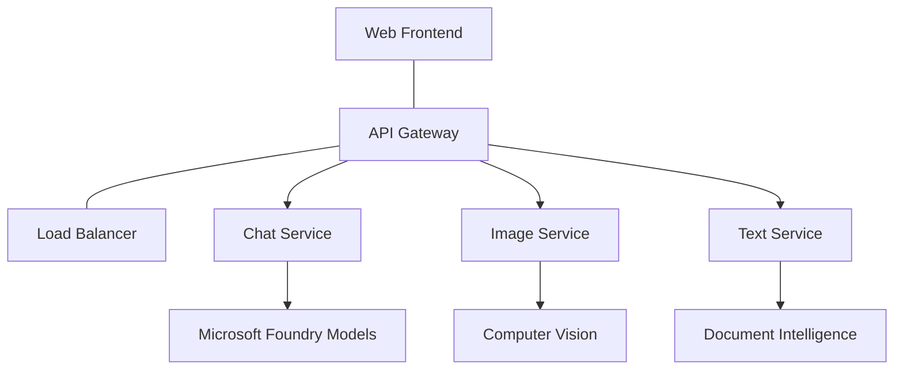

# Melhores Práticas para Cargas de Trabalho de IA em Produção com AZD

**Navegação do Capítulo:**
- **📚 Página Inicial do Curso**: [AZD Para Iniciantes](../../README.md)
- **📖 Capítulo Atual**: Capítulo 8 - Padrões de Produção e Empresariais
- **⬅️ Capítulo Anterior**: [Capítulo 7: Resolução de Problemas](../chapter-07-troubleshooting/debugging.md)
- **⬅️ Também Relacionado**: [Laboratório do Workshop de IA](../chapter-02-ai-development/ai-workshop-lab.md)
- **🎯 Curso Completo**: [AZD Para Iniciantes](../../README.md)

## Visão Geral

Este guia explica padrões de design de IA para produção usando o Azure Developer CLI (AZD). É uma referência de design, não uma aplicação implantável nem uma certificação de produção.

**Limites do exemplo:** A menos que descrito explicitamente como completo, fragmentos Bicep assumem parâmetros e recursos referenciados de um modelo maior. Omitimos imagens/plans hospeiros, identidades, atribuições de função, DNS, outputs e outras integrações necessárias. Os caminhos de serviço YAML e scripts de hook/teste são arquivos ilustrativos para criar **na sua própria aplicação**; não são fornecidos por este curso. Use um exemplo AZD funcional como base, compile toda a infraestrutura e teste-a num ambiente isolado antes da produção.

## Principais Desafios Abordados

Preocupações comuns em produção incluem implementações multi-serviço, gestão de identidades e segredos, escalabilidade, controlo de custos e monitorização. Não se reivindica prevalência medida aqui.

## Padrões Arquitetónicos para IA em Produção

### Padrão 1: Arquitetura de Microserviços para IA

**Quando usar**: Aplicações IA complexas com múltiplas capacidades



**Implementação AZD:**

```yaml
# azure.yaml
name: enterprise-ai-platform
services:
  web:
    project: ./web
    host: staticwebapp
  api-gateway:
    project: ./api-gateway
    host: containerapp
  chat-service:
    project: ./services/chat
    host: containerapp
  vision-service:
    project: ./services/vision
    host: containerapp
  text-service:
    project: ./services/text
    host: containerapp
```

### Padrão 2: Processamento de IA Orientado por Eventos

**Quando usar**: Processamento batch, análise de documentos, fluxos asincrónicos

```bicep
// Event Hub for AI processing pipeline
resource eventHub 'Microsoft.EventHub/namespaces@2024-01-01' = {
  name: eventHubNamespaceName
  location: location
  sku: {
    name: 'Standard'
    tier: 'Standard'
    capacity: 1
  }
}

// Service Bus for reliable message processing
resource serviceBus 'Microsoft.ServiceBus/namespaces@2024-01-01' = {
  name: serviceBusNamespaceName
  location: location
  sku: {
    name: 'Premium'
    tier: 'Premium'
    capacity: 1
  }
}

// Function App for processing
resource functionApp 'Microsoft.Web/sites@2023-01-01' = {
  name: functionAppName
  location: location
  kind: 'functionapp,linux'
  properties: {
    siteConfig: {
      appSettings: [
        {
          name: 'FUNCTIONS_EXTENSION_VERSION'
          value: '~4'
        }
        {
          name: 'AZURE_OPENAI_ENDPOINT'
          value: '@Microsoft.KeyVault(VaultName=${keyVault.name};SecretName=openai-endpoint)'
        }
      ]
    }
  }
}
```

Isto cria fragmentos de namespace, não hubs, filas, subscrições ou triggers de Function. Uma Function executável também necessita de plano de alojamento, configuração runtime/armazenamento, identidade associada, RBAC e acesso à rede. A referência do Key Vault precisa de permissão para ler o segredo; a própria URL do endpoint não é uma credencial.

## Pensando sobre a Saúde do Agente de IA

Quando uma aplicação web tradicional quebra, os sintomas são familiares: uma página não carrega, uma API retorna erro ou uma implantação falha. Aplicações com IA podem quebrar de todas essas formas — mas também podem comportar-se de forma mais subtil, sem mensagens de erro óbvias.

Esta secção ajuda a construir um modelo mental para monitorizar cargas de IA para saber onde olhar quando algo não parecer certo.

### Como a Saúde do Agente Difere da Saúde de Aplicações Tradicionais

Aplicações tradicionais podem ter falhas subtis de corretude também. Um agente de IA acrescenta qualidade de resposta não determinística às habituais preocupações de disponibilidade e corretude. Pense na saúde do agente em duas camadas:

| Camada | O que Observar | Onde Olhar |
|-------|--------------|---------------|
| **Saúde da infraestrutura** | O serviço está a correr? Os recursos estão provisionados? Os endpoints estão acessíveis? | `azd monitor`, saúde de recursos no Azure Portal, logs de container/app |
| **Saúde do comportamento** | O agente responde com precisão? As respostas são oportunas? O modelo está a ser chamado corretamente? | rastos do Application Insights, métricas de latência da chamada ao modelo, logs de qualidade da resposta |

Saúde da infraestrutura é familiar — é igual para qualquer app azd. Saúde do comportamento é a nova camada que cargas IA introduzem.

### Onde Olhar Quando Apps IA Não Se Comportam Como Esperado

Se a sua aplicação IA não está a produzir os resultados esperados, aqui está uma lista de verificação conceptual:

1. **Comece pelo básico.** A aplicação está a correr? Consegue alcançar as suas dependências? Verifique `azd monitor` e a saúde dos recursos tal como faria para qualquer aplicação.
2. **Verifique a ligação ao modelo.** A sua aplicação está a chamar com sucesso o modelo de IA? Chamadas ao modelo com falha ou timeouts são a causa mais comum de problemas em apps IA e aparecem nos logs da aplicação.
3. **Inspecione a entrada e o grounding com segurança.** Respostas erradas podem resultar da recuperação, instruções, limitações do modelo ou execução de ferramentas. Use dados diagnósticos com acesso controlado e redigido; não ative logging indiscriminado de prompt/resposta em produção.
4. **Revise a latência das respostas.** Chamadas ao modelo de IA são mais lentas do que chamadas API típicas. Se a aplicação parecer lenta, verifique se os tempos de resposta do modelo aumentaram — isso pode indicar limitação de taxa, limites de capacidade ou congestionamento ao nível da região.
5. **Fique atento a sinais de custo.** Picos inesperados no uso de tokens ou chamadas de API podem indicar um ciclo, prompt mal configurado ou retries excessivos.

Não precisa dominar a ferramenta de observabilidade de imediato. O fundamental é que aplicações IA têm uma camada extra de comportamento para monitorizar, e a monitorização incorporada do azd (`azd monitor`) dá um ponto de partida para investigar ambas as camadas.

---

## Melhores Práticas de Segurança

### 1. Modelo de Segurança Zero-Trust

**Estratégia de Implementação**:
- Não comunicação serviço-a-serviço sem autenticação
- Todas chamadas API usam identidades geridas
- Isolamento de rede com endpoints privados
- Controlo de acesso com privilégios mínimos

```bicep
// Managed Identity for each service
resource chatServiceIdentity 'Microsoft.ManagedIdentity/userAssignedIdentities@2023-01-31' = {
  name: 'chat-service-identity'
  location: location
}

// Role assignments with minimal permissions
resource openAIUserRole 'Microsoft.Authorization/roleAssignments@2022-04-01' = {
  scope: openAIAccount
  name: guid(openAIAccount.id, chatServiceIdentity.id, '5e0bd9bd-7b93-4f28-af87-19fc36ad61bd')
  properties: {
    roleDefinitionId: subscriptionResourceId('Microsoft.Authorization/roleDefinitions', '5e0bd9bd-7b93-4f28-af87-19fc36ad61bd')
    principalId: chatServiceIdentity.properties.principalId
    principalType: 'ServicePrincipal'
  }
}
```

### 2. Gestão Segura de Segredos

**Padrão de Integração Key Vault**:

```bicep
// Key Vault with proper access policies
resource keyVault 'Microsoft.KeyVault/vaults@2023-02-01' = {
  name: keyVaultName
  location: location
  properties: {
    tenantId: tenant().tenantId
    sku: {
      family: 'A'
      name: 'standard' // Premium is needed for HSM-backed keys, not ordinary secrets
    }
    enableRbacAuthorization: true  // Use RBAC instead of access policies
    enablePurgeProtection: true    // Prevent accidental deletion
    enableSoftDelete: true
    softDeleteRetentionInDays: 90
  }
}

// Optional legacy key-auth alternative; omit when using Entra ID.
resource openAIKeySecret 'Microsoft.KeyVault/vaults/secrets@2023-02-01' = {
  parent: keyVault
  name: 'openai-api-key'
  properties: {
    value: openAIAccount.listKeys().key1
    attributes: {
      enabled: true
    }
  }
}
```

Atribua a identidade de runtime `Key Vault Secrets User` no âmbito adequado e associe-a ao host; `enableRbacAuthorization` sozinho não concede acesso. Prefira autenticação com identidade gerida OpenAI usando `disableLocalAuth: true`. O segredo opcional da chave faz sentido apenas para uma conta deliberadamente habilitada com chave, e o principal de provisionamento também precisa de permissão para escrever segredos.

### 3. Segurança de Rede

**Configuração de Endpoint Privado**:

```bicep
// Virtual Network for AI services
resource virtualNetwork 'Microsoft.Network/virtualNetworks@2023-04-01' = {
  name: vnetName
  location: location
  properties: {
    addressSpace: {
      addressPrefixes: ['10.0.0.0/16']
    }
    subnets: [
      {
        name: 'ai-services-subnet'
        properties: {
          addressPrefix: '10.0.1.0/24'
          privateEndpointNetworkPolicies: 'Disabled'
        }
      }
      {
        name: 'app-services-subnet'
        properties: {
          addressPrefix: '10.0.2.0/24'
          delegations: [
            {
              name: 'Microsoft.Web/serverFarms'
              properties: {
                serviceName: 'Microsoft.Web/serverFarms'
              }
            }
          ]
        }
      }
    ]
  }
}

// Private endpoints for all AI services
resource openAIPrivateEndpoint 'Microsoft.Network/privateEndpoints@2023-04-01' = {
  name: '${openAIAccountName}-pe'
  location: location
  properties: {
    subnet: {
      id: virtualNetwork.properties.subnets[0].id
    }
    privateLinkServiceConnections: [
      {
        name: 'openai-connection'
        properties: {
          privateLinkServiceId: openAIAccount.id
          groupIds: ['account']
        }
      }
    ]
  }
}
```

Endpoints privados também requerem grupos de zona DNS privada/links VNet e integração da VNet da aplicação. Não bloqueiam automaticamente acesso público: desative explicitamente o acesso público da conta IA após validar a conectividade privada e acesso à implantação.

## Desempenho e Escalamento

### 1. Estratégias de Auto-escalamento

**Auto-escalamento em Container Apps**:

```bicep
resource containerApp 'Microsoft.App/containerApps@2023-05-01' = {
  name: containerAppName
  location: location
  properties: {
    configuration: {
      ingress: {
        external: true
        targetPort: 8000
        transport: 'http'
      }
    }
    template: {
      scale: {
        minReplicas: 2  // Always have 2 instances minimum
        maxReplicas: 50 // Scale up to 50 for high load
        rules: [
          {
            name: 'http-scaling'
            http: {
              metadata: {
                concurrentRequests: '20'  // Scale when >20 concurrent requests
              }
            }
          }
          {
            name: 'cpu-scaling'
            custom: {
              type: 'cpu'
              metadata: {
                type: 'Utilization'
                value: '70'  // Scale when CPU >70%
              }
            }
          }
        ]
      }
    }
  }
}
```

### 2. Estratégias de Cache

**Cache Redis para Respostas IA**:

```bicep
// Legacy Azure Cache for Redis example (not recommended for new deployments)
resource redisCache 'Microsoft.Cache/redis@2023-04-01' = {
  name: redisCacheName
  location: location
  properties: {
    sku: {
      name: 'Premium'
      family: 'P'
      capacity: 1
    }
    enableNonSslPort: false
    minimumTlsVersion: '1.2'
    redisConfiguration: {
      'maxmemory-policy': 'allkeys-lru'
    }
    // Sharding distributes data; replication/failover provides availability.
    shardCount: 2
  }
}

// Cache configuration in application
var cacheConnectionString = '${redisCache.properties.hostName}:6380,password=${redisCache.listKeys().primaryKey},ssl=True,abortConnect=False'
```

Azure Cache para Redis Basic/Standard/Premium está numa [fase de descontinuação](https://learn.microsoft.com/azure/azure-cache-for-redis/retirement-faq). Use Azure Managed Redis para novos designs e sua configuração documentada de SKU, identidade e TLS, ao invés de copiar este recurso legado para um novo sistema de produção. A linha da cadeia de conexão é um marcador de lugar não funcional, não uma credencial. Particione chaves de cache por autorização, modelo/instruções e versão da recuperação, com expiração; um cache apenas para consulta partilhada pode expor dados de outro utilizador.

### 3. Balanceamento de Carga e Gestão de Tráfego

**Application Gateway com WAF**:

```bicep
// Application Gateway with Web Application Firewall
resource applicationGateway 'Microsoft.Network/applicationGateways@2023-04-01' = {
  name: appGatewayName
  location: location
  properties: {
    sku: {
      name: 'WAF_v2'
      tier: 'WAF_v2'
      capacity: 2
    }
    webApplicationFirewallConfiguration: {
      enabled: true
      firewallMode: 'Prevention'
      ruleSetType: 'OWASP'
      ruleSetVersion: '3.2'
    }
    // Backend pools for AI services
    backendAddressPools: [
      {
        name: 'ai-services-pool'
        properties: {
          backendAddresses: [
            {
              fqdn: '${containerApp.properties.configuration.ingress.fqdn}'
            }
          ]
        }
      }
    ]
  }
}
```

Este é um recurso parcial de gateway: uma implantação real também precisa de subnet/IP de gateway, IPs e portas frontend, listeners/certificados TLS, configurações/probes HTTP backend, regras e prioridades de roteamento, e política WAF revista. Hostname/SNI TLS e autenticação devem coincidir com backend do Container App.

## 💰 Otimização de Custos

### 1. Dimensionamento Correto dos Recursos

**Configurações Específicas para Ambiente**:

Estes nomes são **entradas ilustrativas de template personalizado**, não definições automáticas AZD. Mapeie cada um para `infra/main.parameters.json`/Bicep e configuração de host primeiro. Por exemplo, o exemplo RAG usa `AZURE_SEARCH_SERVICE_SKU` e `AZURE_OPENAI_CHATGPT_DEPLOYMENT_CAPACITY`, não os nomes genéricos abaixo. Dê memória aos Container Apps numa unidade suportada, como `1Gi`, no recurso final. Aplique mudanças de infraestrutura com `azd up` ou `azd provision`; `azd deploy` sozinho não aplica mudanças Bicep.

```bash
# Development environment
azd env new development
azd env set AZURE_OPENAI_SKU "S0"
azd env set AZURE_OPENAI_CAPACITY 10
azd env set AZURE_SEARCH_SKU "basic"
azd env set CONTAINER_CPU 0.5
azd env set CONTAINER_MEMORY 1.0

# Production environment  
azd env new production
azd env set AZURE_OPENAI_SKU "S0"
azd env set AZURE_OPENAI_CAPACITY 100
azd env set AZURE_SEARCH_SKU "standard"
azd env set CONTAINER_CPU 2.0
azd env set CONTAINER_MEMORY 4.0
```

### 2. Monitorização de Custos e Orçamentos

```bicep
// Supply the first day of the current UTC month, e.g. 2026-11-01T00:00:00Z.
param budgetStartDate string

// Cost management and budgets
resource budget 'Microsoft.Consumption/budgets@2024-08-01' = {
  name: 'ai-workload-budget'
  properties: {
    timePeriod: {
      startDate: budgetStartDate
    }
    timeGrain: 'Monthly'
    amount: 2000  // In the billing currency, not necessarily USD
    category: 'Cost'
    notifications: {
      warning: {
        enabled: true
        operator: 'GreaterThan'
        threshold: 80
        contactEmails: [
          'finance@company.com'
          'engineering@company.com'
        ]
        contactRoles: [
          'Owner'
          'Contributor'
        ]
      }
      critical: {
        enabled: true
        operator: 'GreaterThan'
        threshold: 95
        contactEmails: [
          'cto@company.com'
        ]
      }
    }
  }
}
```

Substitua os recipientes de exemplo e verifique âmbito/permissões. Alertas de orçamento usam dados de facturação atrasados e não impõem um limite de gasto.

### 3. Otimização do Uso de Tokens

**Gestão de Custos OpenAI**:

Isto é apenas uma heurística baseada em caracteres para pré-visualização UI, **não** um validador oficial do limite de tokens do modelo. Código de produção deve usar um tokenizador apropriado ao modelo implantado, considerando instruções de sistema, esquemas de ferramentas, histórico e orçamento de output. Rejeite uma mensagem do utilizador demasiado grande em vez de truncá-la silenciosamente.

```typescript
// Application-level token optimization
class TokenOptimizer {
  private readonly maxTokens = 4000;
  private readonly reserveTokens = 500;
  
  optimizePrompt(userInput: string, context: string): string {
    const availableTokens = this.maxTokens - this.reserveTokens;
    if (this.estimateTokens(userInput) + 8 >= availableTokens) {
      throw new Error("User input exceeds the illustrative prompt budget");
    }
    const estimatedTokens = this.estimateTokens(userInput + context) + 8;
    
    if (estimatedTokens > availableTokens) {
      // Truncate context, not user input
      context = this.truncateContext(context, Math.max(0, availableTokens - this.estimateTokens(userInput) - 8));
    }
    
    return `${context}\n\nUser: ${userInput}`;
  }
  
  private estimateTokens(text: string): number {
    // Rough estimation: 1 token ≈ 4 characters
    return Math.ceil(text.length / 4);
  }

  private truncateContext(text: string, estimatedBudget: number): string {
    return text.slice(0, Math.max(0, estimatedBudget) * 4);
  }
}
```

## Monitorização e Observabilidade

### 1. Application Insights Abrangente

```bicep
// Application Insights with advanced features
resource applicationInsights 'Microsoft.Insights/components@2020-02-02' = {
  name: applicationInsightsName
  location: location
  kind: 'web'
  properties: {
    Application_Type: 'web'
    WorkspaceResourceId: logAnalyticsWorkspace.id
    SamplingPercentage: 100  // Ingestion setting; review cost and SDK sampling separately
    DisableIpMasking: false  // Retain IP masking
  }
}

// Custom metrics for AI operations
resource aiMetricAlerts 'Microsoft.Insights/metricAlerts@2018-03-01' = {
  name: 'ai-high-error-rate'
  location: 'global'
  properties: {
    description: 'Alert when failed request count exceeds 10 in five minutes'
    severity: 2
    enabled: true
    scopes: [
      applicationInsights.id
    ]
    evaluationFrequency: 'PT1M'
    windowSize: 'PT5M'
    criteria: {
      'odata.type': 'Microsoft.Azure.Monitor.SingleResourceMultipleMetricCriteria'
      allOf: [
        {
          name: 'high-error-rate'
          metricName: 'requests/failed'
          operator: 'GreaterThan'
          threshold: 10
          timeAggregation: 'Count'
        }
      ]
    }
  }
}
```

### 2. Monitorização Específica para IA

**Dashboards Personalizados para Métricas IA**:

```json
{
  "dashboard": {
    "name": "AI Application Monitoring",
    "tiles": [
      {
        "name": "OpenAI Request Volume",
        "query": "dependencies | where target contains 'openai' | summarize count() by bin(timestamp, 5m)"
      },
      {
        "name": "AI Response Latency",
        "query": "dependencies | where target contains 'openai' | summarize avg(duration) by bin(timestamp, 5m)"
      },
      {
        "name": "Token Usage",
        "query": "customMetrics | where name == 'openai_tokens_used' | summarize sum(value) by bin(timestamp, 1h)"
      },
      {
        "name": "Cost per Hour",
        "query": "customMetrics | where name == 'openai_cost' | summarize sum(value) by bin(timestamp, 1h)"
      }
    ]
  }
}
```

Este JSON é um esboço definido pela aplicação, não um esquema importável de dashboard do portal Azure. As consultas de tokens/custo requerem que a sua app emita essas métricas personalizadas exatas; não são criadas pelo AZD. Adapte filtros de dependências para nomes reais de endpoints/span de modelo.

### 3. Verificações de Saúde e Monitorização de Uptime

```bicep
// Application Insights availability tests
resource availabilityTest 'Microsoft.Insights/webtests@2022-06-15' = {
  name: 'ai-app-availability-test'
  location: location
  tags: {
    'hidden-link:${applicationInsights.id}': 'Resource'
  }
  properties: {
    SyntheticMonitorId: 'ai-app-availability-test'
    Name: 'AI Application Availability Test'
    Description: 'Tests AI application endpoints'
    Enabled: true
    Frequency: 300  // 5 minutes
    Timeout: 120    // 2 minutes
    Kind: 'standard'
    Locations: [
      {
        Id: 'us-east-2-azr'
      }
      {
        Id: 'us-west-2-azr'
      }
    ]
    Request: {
      RequestUrl: 'https://${webApp.properties.defaultHostName}/health'
      HttpVerb: 'GET'
      FollowRedirects: true
      ParseDependentRequests: false
    }
    ValidationRules: {
      ExpectedHttpStatusCode: 200
      SSLCheck: true
      SSLCertRemainingLifetimeCheck: 7
    }
  }
}
```

## Recuperação de Desastres e Alta Disponibilidade

O teste anterior assume um App Service `webApp` existente e recurso Application Insights. Testes de disponibilidade padrão são faturáveis e exigem um endpoint acessível; apps apenas privados precisam de design apropriado para monitorização privada. Testes de ping URL estão obsoletos; use os [testes padrão de disponibilidade](https://learn.microsoft.com/azure/azure-monitor/app/availability).

### 1. Implantação Multi-região

```yaml
# azure.yaml - Multi-region configuration
name: ai-app-multiregion
services:
  api-primary:
    project: ./api
    host: containerapp
    env:
      AZURE_REGION: eastus
  api-secondary:
    project: ./api
    host: containerapp
    env:
      AZURE_REGION: westus2
```

```bicep
// Separate App Service topology, not the Container Apps declarations above
resource trafficManager 'Microsoft.Network/trafficManagerProfiles@2022-04-01' = {
  name: trafficManagerProfileName
  location: 'global'
  properties: {
    profileStatus: 'Enabled'
    trafficRoutingMethod: 'Priority'
    dnsConfig: {
      relativeName: trafficManagerProfileName
      ttl: 30
    }
    monitorConfig: {
      protocol: 'HTTPS'
      port: 443
      path: '/health'
      intervalInSeconds: 30
      toleratedNumberOfFailures: 3
      timeoutInSeconds: 10
    }
    endpoints: [
      {
        name: 'primary-endpoint'
        type: 'Microsoft.Network/trafficManagerProfiles/azureEndpoints'
        properties: {
          targetResourceId: primaryAppService.id
          endpointStatus: 'Enabled'
          priority: 1
        }
      }
      {
        name: 'secondary-endpoint'
        type: 'Microsoft.Network/trafficManagerProfiles/azureEndpoints'
        properties: {
          targetResourceId: secondaryAppService.id
          endpointStatus: 'Enabled'
          priority: 2
        }
      }
    ]
  }
}
```

Variáveis de ambiente não escolhem localizações de recurso. IaC deve provisionar hosts regionais distintos e vincular cada serviço com tags `resourceName` ou `azd-service-name`. O exemplo Traffic Manager é uma **topologia separada App Service** (`primaryAppService`/`secondaryAppService`), não roteamento para declarações Container Apps. Container Apps requer endpoint externo/frontal apropriado, TLS/roteamento de domínio personalizado e probes de saúde.

### 2. Backup e Recuperação de Dados

```bicep
// Backup configuration for critical data
resource backupVault 'Microsoft.DataProtection/backupVaults@2023-05-01' = {
  name: backupVaultName
  location: location
  identity: {
    type: 'SystemAssigned'
  }
  properties: {
    storageSettings: [
      {
        datastoreType: 'VaultStore'
        type: 'LocallyRedundant'
      }
    ]
  }
}

```

O cofre sozinho não faz backup de nada. Configure uma **política suportada e instância de backup específica para a carga de trabalho**, permissões de origem, retenção e testes de restauração usando as [matrizes de suporte do Azure Backup](https://learn.microsoft.com/azure/backup/backup-support-matrix). Não existe política genérica Azure Backup para implantações de modelo Azure OpenAI hospedado. Mantenha definições de infraestrutura/modelo no controlo de versão; proteja documentos carregados, dados da aplicação e artefactos de fine-tuning usando as funcionalidades suportadas de backup/exportação de cada serviço backend. Defina e teste RPO/RTO explicitamente.

## Integração DevOps e CI/CD

### 1. Workflow GitHub Actions

```yaml
# .github/workflows/deploy-ai-app.yml
name: Deploy AI Application

on:
  push:
    branches: [main]
  pull_request:
    branches: [main]

jobs:
  test:
    runs-on: ubuntu-latest
    steps:
      - uses: actions/checkout@v4
      
      - name: Setup Python
        uses: actions/setup-python@v4
        with:
          python-version: '3.11'
          
      - name: Install dependencies
        run: |
          pip install -r requirements.txt
          pip install pytest
          
      - name: Run tests
        run: pytest tests/
        
      - name: AI Safety Tests
        run: |
          python scripts/test_ai_safety.py
          python scripts/validate_prompts.py

```

Esta é a **parte de teste apenas** de um workflow e assume que criou `requirements.txt`, `tests/` e os dois scripts de segurança. Acrescente os jobs autenticados OIDC de provisionamento/implantação de [Configuração Pipeline CI/CD](#cicd-pipeline-configuration), com `needs: test`, um trigger confiável push/manual e ambientes GitHub protegidos. Não implante código pull-request não confiável com credenciais cloud. Um runner novo não tem ambiente AZD local selecionado; forneça os inputs ambiente/subscrição/local e use `azd auth login`, não apenas `azure/login`.

### 2. Validação da Infraestrutura

```bash
# scripts/validate_infrastructure.sh
#!/bin/bash
set -euo pipefail

echo "Validating AI infrastructure deployment..."

# Requires Azure CLI login and the resource group selected explicitly.
: "${AZURE_RESOURCE_GROUP:?Set AZURE_RESOURCE_GROUP}"
: "${AZURE_OPENAI_NAME:?Set AZURE_OPENAI_NAME}"
: "${AZURE_OPENAI_CHAT_DEPLOYMENT:?Set the actual deployment name}"

# A successful empty list is not proof that resources exist.
types=("Microsoft.CognitiveServices/accounts" "Microsoft.Search/searchServices"
       "Microsoft.Storage/storageAccounts" "Microsoft.KeyVault/vaults")
for resource_type in "${types[@]}"; do
    count=$(az resource list --resource-group "$AZURE_RESOURCE_GROUP" \
        --resource-type "$resource_type" --query "length(@)" -o tsv)
    if [[ "$count" -lt 1 ]]; then
        echo "ERROR: No $resource_type found in $AZURE_RESOURCE_GROUP"
        exit 1
    fi
done

# Validate OpenAI model deployments
echo "Validating OpenAI model deployments..."
state=$(az cognitiveservices account deployment show \
  --name "$AZURE_OPENAI_NAME" --resource-group "$AZURE_RESOURCE_GROUP" \
  --deployment-name "$AZURE_OPENAI_CHAT_DEPLOYMENT" \
  --query "properties.provisioningState" -o tsv)
if [[ "$state" != "Succeeded" ]]; then
    echo "ERROR: Required model deployment is not provisioned successfully"
    exit 1
fi

echo "Infrastructure validation completed successfully!"
```

Esperado: saída zero e mensagem de conclusão apenas quando todos os tipos esperados existirem e a implantação do modelo nomeado estiver provisionada. Isto verifica inventário/estado de provisionamento, **não** saúde dos recursos, topologia exata, RBAC, acessibilidade de rede ou comportamento do modelo. Adapte os tipos esperados à sua arquitetura e depois faça um teste separado autenticado de prontidão da aplicação.

## Lista de Verificação para Prontidão de Produção

### Segurança ✅
- [ ] Todos os serviços usam identidades geridas
- [ ] Segredos guardados no Key Vault
- [ ] Endpoints privados configurados
- [ ] Grupos de segurança de rede implementados
- [ ] RBAC com privilégios mínimos
- [ ] WAF ativado nos endpoints públicos

### Desempenho ✅
- [ ] Auto-escalamento configurado
- [ ] Cache implementada
- [ ] Balanceamento de carga configurado
- [ ] CDN para conteúdo estático
- [ ] Pooling de conexões de base de dados
- [ ] Otimização do uso de tokens

### Monitorização ✅
- [ ] Application Insights configurado
- [ ] Métricas personalizadas definidas
- [ ] Regras de alerta configuradas
- [ ] Dashboard criado
- [ ] Verificações de saúde implementadas
- [ ] Políticas de retenção de logs

### Fiabilidade ✅
- [ ] Implantação multi-região
- [ ] Plano de backup e recuperação
- [ ] Circuit breakers implementados
- [ ] Políticas de retry configuradas
- [ ] Degradação controlada
- [ ] Endpoints de verificação de saúde

### Gestão de Custos ✅
- [ ] Alertas de orçamento configurados
- [ ] Dimensionamento correto dos recursos
- [ ] Descontos de desenvolvimento/teste aplicados
- [ ] Instâncias reservadas adquiridas
- [ ] Dashboard de monitorização de custos
- [ ] Revisões regulares de custos

### Conformidade ✅
- [ ] Requisitos de residência de dados cumpridos
- [ ] Logging de auditoria ativado
- [ ] Políticas de conformidade aplicadas
- [ ] Bases de segurança implementadas
- [ ] Avaliações regulares de segurança
- [ ] Plano de resposta a incidentes

## Benchmarks de Desempenho

### Objetivos Ilustrativos de Produção

Estes são exemplos de SLOs para negociar e testar carga, não benchmarks medidos ou garantias. Latência de resposta depende do modelo/tamanho do output; gasto mensal de tokens depende do tráfego e preços, não apenas do número de tokens.

| Métrica | Objetivo | Monitorização |
|--------|--------|------------|
| **Tempo de Resposta** | < 2 segundos | Application Insights |
| **Disponibilidade** | 99,9% | Monitorização de uptime |
| **Taxa de Erro** | < 0,1% | Logs da aplicação |
| **Gasto com Modelo** | < $500/mês (exemplo de orçamento) | Gestão de custos |
| **Utilizadores Concorrentes** | 1000+ | Testes de carga |
| **Tempo de Recuperação** | < 1 hora | Testes de recuperação de desastre |

### Testes de Carga

O seguinte é um esboço de interface para um script de teste de carga **que deve implementar**; este repositório não fornece `scripts/load_test.py`. Defina cargas de pedido, autenticação, cargas de trabalho representativas, asserções percentis de latência/erro e um limite de gastos na sua ferramenta de teste de carga escolhida antes de a executar:

```bash
# Load testing script for AI applications
python scripts/load_test.py \
  --endpoint https://your-ai-app.azurewebsites.net \
  --concurrent-users 100 \
  --duration 300 \
  --ramp-up 60
```

## 🤝 Melhores Práticas da Comunidade

Baseado no feedback da comunidade Microsoft Foundry no Discord:

### Principais Recomendações da Comunidade:

1. **Comece Pequeno, Escale Gradualmente**: Comece com SKUs básicos e escale conforme o uso real
2. **Monitore Tudo**: Configure monitorização abrangente desde o primeiro dia
3. **Automatize a Segurança**: Use infraestrutura como código para segurança consistente
4. **Teste Cuidadosamente**: Inclua testes específicos para IA no seu pipeline
5. **Planeie os Custos**: Monitore o uso de tokens e defina alertas de orçamento cedo

### Armadilhas Comuns a Evitar:

- ❌ Codificar chaves de API diretamente no código
- ❌ Não configurar monitorização adequada
- ❌ Ignorar a otimização de custos
- ❌ Não testar cenários de falha
- ❌ Implantar sem verificações de integridade

## Comandos AZD AI CLI e Extensões

AZD inclui um conjunto crescente de comandos e extensões específicas para IA que agilizam os fluxos de trabalho de IA em produção. Estas ferramentas fazem a ponte entre o desenvolvimento local e a implantação em produção para cargas de trabalho de IA.

> **Atualização Foundry GA (2026-11-09):** O pacote `microsoft.foundry` alcançou **1.0 / disponibilidade geral** em [5 de novembro de 2026](https://devblogs.microsoft.com/azure-sdk/microsoft-foundry-azure-developer-cli-ga/). Use **`azd >= 1.37.0`** para este fluxo de trabalho. A revisão anterior de `azd 1.37.2`, agentes beta.23 e avaliações beta.2 permanece abaixo como histórico de migração, não como a versão atual do pacote. Isto é uma revisão da documentação/fonte, não uma validação de implantação ao vivo nem uma declaração de que todas as extensões opcionais, APIs ou funcionalidades em pré-visualização são GA.

### Extensões AZD para IA

AZD usa um sistema de extensões para adicionar capacidades específicas de IA. Instale e gerencie extensões com:

```bash
# List all available extensions (including AI)
azd extension list

# Inspect installed versions
azd version
azd ext list --installed

# Install the GA Foundry bundle
azd ext install microsoft.foundry

# Install the separate Foundry evaluations extension
azd extension install azure.ai.evaluations

# Install the fine-tuning extension
azd extension install azure.ai.finetune

# Install the custom models extension
azd extension install azure.ai.models

# Upgrade the Foundry bundle
azd ext upgrade microsoft.foundry
```

**Extensões IA disponíveis:**

| Extensão | Propósito | Estado |
|-----------|---------|--------|
| `microsoft.foundry` | Meta-pacote que instala as sete extensões principais abaixo; sem grupo de comando próprio | pacote GA 1.0 |
| `azure.ai.agents` | `azd ai agent`: configuração de agentes, execução local e operações | Incluído; versionado independentemente |
| `azure.ai.connections` | `azd ai connection`: ligações de projetos | Incluído; versionado independentemente |
| `azure.ai.inspector` | `azd ai inspector`: interface local do Inspetor de Agentes | Incluído; versionado independentemente |
| `azure.ai.projects` | `azd ai project`: recursos de projeto e implantações de modelos | Incluído; versionado independentemente |
| `azure.ai.routines` | `azd ai routine`: agendas e gatilhos | Incluído; versionado independentemente |
| `azure.ai.skills` | `azd ai skill`: diretrizes comportamentais reutilizáveis | Incluído; versionado independentemente |
| `azure.ai.toolboxes` | `azd ai toolbox`: coleções de ferramentas versionadas | Incluído; versionado independentemente |
| `azure.ai.evaluations` | Conjuntos de dados de avaliação, avaliadores, grupos de avaliação e execuções | Instalação/liberação separada |
| `azure.ai.dataset` | Registo e versionamento de conjuntos de dados | Instalação/liberação separada |
| `azure.ai.finetune` | Ajuste fino de modelos Foundry | Instalação/liberação separada |
| `azure.ai.models` | Modelos personalizados Foundry | Instalação/liberação separada |

A instalação individual de `azure.ai.agents` continua suportada e instala as suas dependências; o pacote é o predefinido do curso para o fluxo de trabalho GA. O GA do pacote não é uma garantia geral de estado de versão para funcionalidades opcionais dos seus componentes. Veja [empacotamento e verificação de extensões](https://learn.microsoft.com/azure/foundry/agents/how-to/install-cli-foundry-extensions) e inspeccione a ajuda do comando instalado antes de usar.

> Atualize primeiro a CLI principal com `azd update` ou o [método de instalação/atualização](https://learn.microsoft.com/azure/developer/azure-developer-cli/install-azd) apropriado, depois execute `azd ext upgrade microsoft.foundry`. Atualize avaliações instaladas separadamente conforme necessário com `azd ext upgrade azure.ai.evaluations`. Não existe comando principal `azd upgrade`. Registe e reveja as extensões versionadas independentemente na automação de produção; uma atualização não migra automaticamente a configuração antiga.

### Alterações e Correções Recentes das Versões

| Versão | O que muda para este curso |
|---------|------------------------------|
| `microsoft.foundry` 1.0 GA (2026-11-05) | Predefinir o pacote das sete extensões, manter configurações de agente/implantação em `azure.yaml`, testar localmente com o Inspetor de Agentes, e carregar código para construção remota Foundry. Instalar avaliações separadamente e instalar novamente as extensões necessárias em runners CI. |
| `azd 1.37.0` | Adiciona APIs estáveis de visualização de implantação e corrige edições de extensão que reescreviam configurações não relacionadas de `azure.yaml`. |
| `azd 1.37.1` | Corrige propagação de Ctrl+C através de extensões e distingue cancelamentos/timeouts de falhas genéricas. |
| `azd 1.37.2` | Melhora validação de provisionamento: avisos críticos predefinidos para **Não**, falha sem confirmação em execuções não assistidas, e cancelamento pula ganchos pós-provisionamento. Também corrige valores de ambiente por resolver em listas de negação de Pilhas de Implantação quando essa funcionalidade alfa está ativada. |
| Agentes `beta.22` | Migra avaliação para `azd ai eval`, altera otimização para a API GA v1, requer plural `toolboxes`, e separa opt-ins geridos de harness, voz e invocações longas. Corrige seleção de modelo específica de ambiente e autenticação da toolbox. |
| Agentes `beta.23` | Exponibiliza `init --harness`; corrige saída de resposta A2A 0.3, caminhos/módulos de prompt-agent inválidos através de camadas de infraestrutura, diagnósticos de timeout na ativação, e avisos RBAC retidos de desenvolvedor. |
| Avaliações `beta.2` | Requer configuração de avaliação em camelCase, adiciona autoria estática/simulada de conversação e fontes de ficheiro local explícitas, e corrige gestão de identidade/versão de conjunto de dados, contagem de qualidade gate e diagnósticos de falha de execução. |

Um timeout de ativação de agente **não** prova falha de implantação: inspecione a versão tentada e o seu estado antes de tentar novamente. Avisos RBAC de desenvolvedor podem permanecer mesmo quando o provisionamento é bem-sucedido; resolva o acesso em falta antes de invocar como esse desenvolvedor.

As linhas beta acima descrevem correções anteriores e fronteiras de migração, não um requisito para fixar novos projetos nessas versões.

Fontes: [anúncio Foundry GA](https://devblogs.microsoft.com/azure-sdk/microsoft-foundry-azure-developer-cli-ga/), [lançamentos AZD](https://github.com/Azure/azure-dev/releases), [lançamento agenets beta.23](https://github.com/Azure/azure-dev/releases/tag/azd-ext-azure-ai-agents_1.0.0-beta.23), [migração agents beta.22](https://github.com/Azure/azure-dev/releases/tag/azd-ext-azure-ai-agents_1.0.0-beta.22), e [lançamento avaliações beta.2](https://github.com/Azure/azure-dev/releases/tag/azd-ext-azure-ai-evaluations_1.0.0-beta.2).

**O que são as extensões `skills` e `connections` incluídas?**

Estas são instaladas com o pacote principal mas têm propósitos diferentes:

- **`azure.ai.skills`** — Uma **skill** que pacotes diretrizes comportamentais reutilizáveis para agentes. Partilhe instruções revistas entre agentes em vez de as copiar. Uma skill não implementa por si só uma ferramenta nem concede acesso a dados; use toolboxes e código de aplicação para execução de ferramentas.
- **`azure.ai.connections`** — Uma **ligação** é uma ligação gerida do seu projeto Foundry a um recurso externo que os seus agentes precisam—uma fonte de dados (como Azure AI Search), um endpoint de ferramenta, ou outro serviço. As ligações centralizam *onde* e *como* os agentes acedem a dados, para que credenciais e endpoints vivam num lugar governado em vez de espalhados pelo código.

Não precisa de configurar todas as capacidades incluídas para implantar o seu primeiro agente. Use skills quando agentes partilham diretrizes comportamentais e ligações quando partilham recursos externos.

### Inicializar Projetos de Agentes com `azd ai agent init`

O comando `azd ai agent init` estrutura um projeto de agente Microsoft Foundry. Para um exemplo operacional de implantação de código com Python 3.13+ e uv atual, siga o [tutorial de agente hospedado GA](../chapter-02-ai-development/microsoft-foundry-integration.md#hosted-agent-walkthrough-ga). Os comandos abaixo ilustram adotar **o seu próprio** modelo de projeto `azure.yaml` atual; o modelo local nomeado não é fornecido por este curso:

```bash
# Initialize a new agent project from a local project template
azd ai agent init --template ./templates/support-agent/azure.yaml

# Initialize and target a specific Foundry project
azd ai agent init --template ./templates/support-agent/azure.yaml --project-id <foundry-project-id>

# Adopt the template into a different directory
azd ai agent init --template ./templates/support-agent/azure.yaml --src ./agents/my-agent
```

**Flags chave:**

| Flag | Descrição |
|------|-------------|
| `-t, --template` | Caminho ou URI GitHub suportado para um documento de projeto `azure.yaml` |
| `-p, --project-id` | ID do projeto Microsoft Foundry existente para o seu ambiente azd |
| `-s, --src` | Diretório fonte para agentes gerados, ou diretório de destino ao adotar um projeto |
| `--deploy-mode code` | Carregar fonte para construção remota Foundry ao invés de construir um contentor local |
| `--model-deployment` | Reutilizar uma implantação de modelo existente nomeada durante a inicialização |
| `--kind` | Inicializar um agente `hosted`, `prompt`, ou de pré-visualização `prompt-voice` |
| `--harness` | Harness de execução opcional para `--kind prompt`; requer a sua opt-in de pré-visualização |
| `-e, --environment` | O ambiente azd a usar |

`--manifest`/`-m` é um alias obsoleto para `--template`/`-t`; renomear a flag não converte um manifesto antigo num documento de projeto atual. `--host containerapp` não é uma flag atual de agent-init. Para uma aplicação Container Apps ordinária, use `azd init --template` com um modelo declarando `host: containerapp`.

Para um projeto existente com exatamente um serviço `azure.ai.project`, `azd ai agent add support-agent --file ./agents/support-agent.yaml` adiciona ou atualiza uma definição direta de agente sem provisionar ou implantar. Comandos de runtime rejeitam definições herdadas de `agent.yaml`/AgentManifest e definições de serviço aninhado `config:`; migre-as para um serviço `azure.ai.agent` atual. Quando init imprime um próximo passo `cd`, execute-o antes de `azd up`: init não altera o seu diretório shell.

**Dica de produção**: Use `--project-id` para se ligar diretamente a um projeto Foundry existente, mantendo o seu código de agente e recursos cloud ligados desde o início.

#### Funcionalidades de Pré-visualização Opcionais

Harness gerido, voz e invocação de longa duração são desativados independentemente por padrão. Configure apenas o botão para a funcionalidade que precisa no **ambiente do processo shell/CI**, não com `azd env set`:

| Funcionalidade | Variável de ambiente do processo |
|---------|------------------------------|
| Harness gerido (`init --kind prompt --harness ...`) | `AZD_ALPHA_ENABLE_AGENTS_MANAGED_HARNESS=true` |
| Voz (`init --kind prompt-voice`) | `AZD_ALPHA_ENABLE_AGENTS_VOICE=true` |
| Invocação de longa duração | `AZD_ALPHA_ENABLE_AGENTS_LONG_RUNNING=true` |

Por exemplo, use `export AZD_ALPHA_ENABLE_AGENTS_MANAGED_HARNESS=true` em Bash ou `$env:AZD_ALPHA_ENABLE_AGENTS_MANAGED_HARNESS = "true"` em PowerShell antes de executar o comando relevante. Um botão não ativa os outros. Veja o [README dos agentes lançados](https://github.com/Azure/azure-dev/blob/azd-ext-azure-ai-agents_1.0.0-beta.23/cli/azd/extensions/azure.ai.agents/README.md) para todos os botões e limitações de pré-visualização.

### Gerir o Ciclo de Vida do Agente

A extensão `azure.ai.agents` do pacote suporta testes locais e operações de agente implantado. Instale `azure.ai.evaluations` separadamente para medir qualidade:

```bash
# Start the local agent and Agent Inspector (leave running)
azd ai agent run

# From a second terminal in the project directory
azd ai agent invoke --local "Explain how this agent is deployed."

# Invoke a deployed agent and view server response timing
# (total latency and time to first byte)
azd ai agent invoke

# Show the live endpoint configuration before changing it
azd ai agent endpoint show

# Download the deployed source of a code-based hosted agent
# (with SHA-256 verification)
azd ai agent code download

# Delete a hosted agent and all of its versions
# (--force terminates active sessions)
azd ai agent delete --force
```

**Ciclo de vida de um vistazo:**

| Fase | Comando | Uso em produção |
|-------|---------|----------------|
| Teste local | `azd ai agent run`, depois `azd ai agent invoke --local "Test prompt"` | Inspecionar pedidos e respostas antes da implantação; chamadas a modelos Azure ainda geram custos |
| Implantar | `azd deploy` | Em modo código, constrói a fonte carregada remotamente no Foundry |
| Testar | `azd ai agent invoke` | Validar respostas e medir latência antes da versão |
| Diagnosticar | `azd ai agent doctor`, `azd ai agent monitor --follow` | Verificar configuração/permissões e transmitir logs do agente |
| Inspecionar | `azd ai agent endpoint show` | Rever autenticação/configuração do endpoint; detetar alterações disruptivas cedo |
| Medir | `azd ai eval init`, `generate`, `run start` | Definir, implantar e executar avaliações repetíveis |
| Melhorar | `azd ai agent optimize --eval <evaluation-name> --optimize-model <optimizer-deployment>` | Reutilizar uma avaliação compatível para otimizar o agente |
| Recuperar | `azd ai agent code download` | Recuperar o código exato implantado para auditoria/reversão |
| Reformar | `azd ai agent delete --force` | Desmantelar um agente e as suas versões de forma limpa |

> Execute `azd ai agent --help` para inspecionar comandos na sua versão instalada. O pacote é GA; funcionalidades em pré-visualização gateadas independentemente continuam opt-in. Antes da limpeza, distinga eliminação de agente de eliminação de projeto: `azd down` elimina o grupo de recursos de um projeto recém-criado, mas mantém recursos de projeto reutilizado. Siga as [orientações de limpeza](../chapter-02-ai-development/microsoft-foundry-integration.md#7-clean-up-deliberately).

`endpoint show` suporta agentes hospedados, de prompt e voz, mas atualizações de endpoint são só para hospedados; agentes de workflow não são suportados. Download de código e o exemplo de reformar agente hospedado acima não são operações genéricas para todos os tipos de agente.

#### Migração de Avaliação e Verificações de Qualidade

A partir da versão agentes **1.0.0-beta.22 (2026-10-23)**, comandos legados `azd ai agent eval` fornecem orientação de migração em vez do fluxo de trabalho de avaliação anterior. Não copie exemplos `eval generate --dataset ...` antigos: avaliação agora vive sob **`azd ai eval`**.

Num projeto de agente inicializado, autentique-se com `azd auth login`, confirme o ambiente/projeto Foundry selecionado e instale `azure.ai.evaluations`. É necessária uma implementação de modelo de árbitro para pontuação baseada em modelo; a geração e a simulação de conversação podem exigir as suas próprias seleções de modelo e acarretar custos adicionais.

```bash
# Generate a draft rubric and dataset from the deployed agent
azd ai eval generate

# After reviewing the assets, configure a named evaluation
azd ai eval init --name quality

# Review generated files, then register datasets, evaluators, and eval groups
azd up

# Start an evaluation and wait for its results
azd ai eval run start --eval quality --wait

# Inspect runs and available test-case output
azd ai eval run list
azd ai eval run show <run-id>
azd ai eval run output list <run-id>
```

Para o exemplo do anúncio GA, selecione **Dataset and evaluator** e **Turn** durante a geração, depois selecione esses ativos revistos e um modelo árbitro durante a inicialização. Siga os passos impressos seguintes em vez de assumir que os ativos gerados já estão registados. Também pode inicializar com base num conjunto de dados/rubrica revista existente sem gerar novos dados. A configuração de avaliação normalmente reside em `evals/azure.eval.yaml`, referenciada pelo serviço `azure.ai.eval` em `azure.yaml`. As chaves são em **camelCase** (`evaluationLevel`, `maxSamples`, `initializationParameters`, `dataMapping`); as antigas chaves em snake_case são rejeitadas. Os caminhos num ficheiro de configuração referenciado resolvem relativamente a esse ficheiro, não à raiz do repositório.

Para avaliações de conversação, escolha **static** para pontuar transcrições concluídas sem invocar um agente, ou **simulation** para gerar conversas a partir de sementes de cenário. A simulação necessita de um agente alvo, um modelo simulador e uma seleção separada do modelo árbitro. Para comandos não assistidos, forneça os inputs listados por `azd ai eval init --help` e `azd ai eval generate --help`; não assuma que o modelo de geração é também o árbitro ou simulador.

Para CI, configure uma política de qualidade explícita usando `azd ai eval run start --help` (`--fail-on`) e trate uma saída do host diferente de zero como falha. Uma execução concluída não é automaticamente uma aprovação de qualidade. Reveja linhas falhadas/erro e diagnósticos; contagens de resultados em falta ou inconsistentes não são prova de sucesso. Dataset registados mantêm a sua identidade/versão de serviço; `--max-samples` não pode subconjuntar um dataset registado. Publique um dataset menor de forma deliberada ou use uma fonte de ficheiro local suportada.

```bash
# Example CI policy: at least 90% of all test cases must pass
azd ai eval run start --eval quality --wait --no-prompt --fail-on "pass-rate=0.9"
```

A porta de taxa de passagem utiliza os casos de teste passados divididos pelo total de casos de teste; linhas falhadas, com erro, ignoradas e outras que não passaram contam contra ela. Não combine uma porta com `--no-wait`, que retorna antes que o veredicto esteja disponível.

#### Migração de Configuração de Otimização

A otimização utiliza agora a API GA v1. Para reutilizar uma avaliação compatível **ao nível do turno, suportada por dataset** do novo fluxo de trabalho:

```bash
# Replace placeholders with the evaluation name and optimizer model deployment
azd ai agent optimize --eval-config ./evals/azure.eval.yaml --eval <evaluation-name> --optimize-model <optimizer-deployment>
```

`--eval` seleciona uma avaliação; `--eval-config` seleciona o seu ficheiro de configuração (incluindo definições suportadas por ficheiro). `--config` aceita em vez disso uma **requisição de otimização da API independente** em YAML ou JSON. Não passe um `eval.yaml` antigo de agente nem o novo `azure.eval.yaml` para `--config`, e não combine `--config` com `--eval`/`--eval-config`. Avaliações de conversação, suportadas por trace ou simulação não são intercambiáveis com o atalho de otimização suportado por dataset; use o formato de pedido de otimização suportado para esses cenários. Reveja candidatos antes de os aplicar ou implementar.

Veja a [referência de avaliações para a release revista](https://github.com/Azure/azure-dev/blob/azd-ext-azure-ai-evaluations_1.0.0-beta.2/cli/azd/extensions/azure.ai.evaluations/README.md) e a [fonte do comando de otimização para a release revista](https://github.com/Azure/azure-dev/blob/azd-ext-azure-ai-agents_1.0.0-beta.23/cli/azd/extensions/azure.ai.agents/internal/cmd/optimize.go) para opções exatas.

#### Pré-visualização da Implantação de Hosted-Agent Apenas de Leitura

Para um ambiente existente vinculado ao Foundry com um serviço unificado `azure.ai.agent` de `kind: hosted`, compare a configuração suportada antes de implementar:

```bash
azd deploy <service-name> --preview --no-prompt
```

Esta pré-visualização não implementa o agente. Não é uma diferença completa de infraestruturas/segurança: agentes de prompt/voz/fluxo de trabalho, disposições legadas e algumas configurações hospedadas estão fora do seu âmbito. Um resultado `unknown` não é aprovação para implementar. Não há comando independente `azd ai agent deploy` ou agente `--dry-run`; use o fluxo de trabalho central de implantação.

### Protocolo de Contexto de Modelo (MCP) com `azd mcp`

O AZD inclui suporte incorporado ao servidor MCP (Alpha), permitindo que agentes e ferramentas de IA interajam com os seus recursos Azure através de um protocolo padronizado:

```bash
# Start the MCP server for your project
azd mcp start

# Review current Copilot consent rules for tool execution
azd copilot consent list
```

O servidor MCP expõe o contexto do seu projeto azd — ambientes, serviços e recursos Azure — a ferramentas de desenvolvimento assistidas por IA. Isto possibilita:

- **Implementação assistida por IA**: Permita que agentes de codificação consultem o estado do seu projeto e desencadeiem implementações
- **Descoberta de recursos**: Ferramentas de IA podem descobrir quais recursos Azure o seu projeto utiliza
- **Gestão do ambiente**: Agentes podem alternar entre ambientes dev/staging/produção

### Geração de Infraestrutura com `azd infra generate`

Para cargas de trabalho de IA em produção, pode gerar e personalizar Infraestrutura como Código em vez de depender do provisionamento automático:

```bash
# Generate supported infrastructure for this project type
azd infra generate
```

O suporte depende do projeto/host e dos fornecedores instalados; isto não é um comando geral de engenharia reversa para recursos arbitrários do Azure nem uma promessa de gerar tanto Bicep quanto Terraform. Execute `azd infra generate --help` e inspecione o formato gerado. Quando suportado, escrever IaC para disco permite:
- Rever e auditar a infraestrutura antes de implementar
- Adicionar políticas de segurança personalizadas (regras de rede, endpoints privados)
- Integrar com processos existentes de revisão de IaC
- Controlar as alterações de infraestrutura separadamente do código da aplicação

### Hooks do Ciclo de Vida de Produção

Os hooks AZD permitem-lhe injetar lógica personalizada em cada fase do ciclo de vida da implantação — crítico para fluxos de trabalho de IA em produção:

```yaml
# azure.yaml - Production hooks example
name: ai-production-app
hooks:
  preprovision:
    shell: sh
    run: scripts/validate-quotas.sh    # Check AI model quota before provisioning
  postprovision:
    shell: sh
    run: scripts/verify-networking.sh  # Verify IaC-provisioned private connectivity
  predeploy:
    shell: sh
    run: scripts/run-ai-safety-tests.sh  # Run prompt safety checks
  postdeploy:
    shell: sh
    run: scripts/smoke-test.sh           # Verify agent responses post-deploy
services:
  agent-api:
    project: ./src/agent
    host: containerapp
    hooks:
      predeploy:
        shell: sh
        run: scripts/validate-model-access.sh  # Per-service hook
```

```bash
# Run a specific hook manually during development
azd hooks run predeploy
```

**Hooks recomendados para produção em cargas de trabalho de IA:**

| Hook | Caso de Uso |
|------|----------|
| `preprovision` | Validar quotas de subscrição para capacidade de modelo de IA |
| `postprovision` | Verificar conectividade privada e outputs de recursos necessários |
| `predeploy` | Executar testes de segurança de IA, validar templates de prompt |
| `postdeploy` | Teste básico das respostas do agente, verificar conectividade do modelo |

### Configuração da Pipeline CI/CD

Primeiro valide o projeto localmente e complete um `azd up` com sucesso. Depois use `azd pipeline config` para o ligar ao GitHub Actions ou Azure Pipelines com autenticação Azure segura:

```bash
# Configure CI/CD pipeline (interactive)
azd pipeline config

# Configure with a specific provider
azd pipeline config --provider github
```

Este comando:
- Cria ou configura uma identidade de pipeline; reveja o âmbito/permissões do papel gerado em vez de assumir o menor privilégio
- Configura credenciais federadas (sem segredos armazenados)
- Gera ou atualiza o seu ficheiro de definição de pipeline
- Define as variáveis de ambiente necessárias no seu sistema CI/CD

#### Passo a passo: a sua primeira pipeline GitHub Actions

Aqui está o percurso completo desde um projeto azd a funcionar até implementações automatizadas a cada push.

**1. Certifique-se que o seu projeto está no GitHub**

```bash
git init
git add .
git commit -m "Initial azd project"
gh repo create my-ai-app --private --source=. --push
```

**2. Execute a configuração da pipeline**

```bash
azd pipeline config --provider github
```

O azd irá, interativamente:
- Perguntar qual subscrição Azure e ambiente visa
- Criar um **registo de app + principal de serviço** Entra para a pipeline
- Configurar **credenciais federadas (OIDC)** — para que o GitHub autentique ao Azure com tokens de curta duração e **nenhum segredo seja armazenado**
- Enviar as **variáveis** necessárias para o seu repositório GitHub (`AZURE_CLIENT_ID`, `AZURE_TENANT_ID`, `AZURE_SUBSCRIPTION_ID`, `AZURE_ENV_NAME`, `AZURE_LOCATION`)

**3. Compreenda o workflow gerado**

Para um template suportado, configure/reveja `.github/workflows/azure-dev.yml`. O exemplo Foundry seguinte mantém checkout, início de sessão OIDC e definições do ambiente alvo e instala o bundle GA mais avaliações no runner. Adicione as exigências da cadeia de ferramentas e do fornecedor de infraestrutura da sua app; para Terraform, mantenha a configuração gerada, estado remoto e passos de autenticação. Escolha e fixe uma versão AZD revista a partir da 1.37.0; este excerto usa o mínimo do anúncio.

```yaml
# .github/workflows/azure-dev.yml
on:
  push:
    branches: [ main ]
  workflow_dispatch:        # lets you run it manually too

permissions:
  id-token: write           # required for OIDC federated login
  contents: read

concurrency:
  group: foundry-production-deployment
  cancel-in-progress: false

jobs:
  build:
    runs-on: ubuntu-latest
    env:
      AZURE_CLIENT_ID: ${{ vars.AZURE_CLIENT_ID }}
      AZURE_TENANT_ID: ${{ vars.AZURE_TENANT_ID }}
      AZURE_SUBSCRIPTION_ID: ${{ vars.AZURE_SUBSCRIPTION_ID }}
      AZURE_ENV_NAME: ${{ vars.AZURE_ENV_NAME }}
      AZURE_LOCATION: ${{ vars.AZURE_LOCATION }}
    steps:
      - uses: actions/checkout@v4
      - name: Install azd
        uses: Azure/setup-azd@v2
        with:
          version: 1.37.0
      - name: Install Foundry extensions
        run: azd ext install microsoft.foundry azure.ai.evaluations
      - name: Log in with OIDC
        run: azd auth login --client-id "$AZURE_CLIENT_ID" --federated-credential-provider "github" --tenant-id "$AZURE_TENANT_ID"
      - name: Provision infrastructure
        run: azd provision --no-prompt
      - name: Deploy application
        run: azd deploy --no-prompt
      - name: Evaluate deployed agent
        run: azd ai eval run start --eval quality --wait --no-prompt --fail-on "pass-rate=0.9"
```

O passo de avaliação exige um `evals/azure.eval.yaml` comitado, sua referência de serviço em `azure.yaml`, ativos de teste não secretos revistos e acesso da pipeline aos datasets, avaliadores e implementações de modelo referenciados. Configure a avaliação `quality` antes de ativar este passo; omita tanto o passo como a instalação das avaliações se o seu projeto não o usar. Uma execução concluída por si só não é uma porta de qualidade: este exemplo requer passagem em pelo menos 90 % de todos os casos.

Use um ambiente AZD separado e autorizações apropriadas para cada etapa. O grupo de concorrência serialize apenas este workflow, não outras ferramentas ou repositórios que atualizem o mesmo agente. Conceda permissões de recurso e Foundry necessárias à identidade da pipeline e armazene quaisquer credenciais em segredo, não em configuração comitada. Veja o [guia completo de Foundry CI/CD](https://learn.microsoft.com/azure/foundry/agents/how-to/set-up-ci-cd-cli) para requisitos específicos do fornecedor.

**4. Verifique que funciona**

```bash
# Push a change to trigger the pipeline
git commit -am "Trigger pipeline" --allow-empty
git push
```

Abra a aba **Actions** no seu repositório GitHub e observe o workflow executar `azd provision` e `azd deploy` automaticamente.

> **Porque as credenciais federadas são importantes:** pipelines antigas armazenavam um segredo de cliente no GitHub. Credenciais federadas OIDC removem esse segredo completamente—o GitHub solicita um token de curta duração em runtime, o que é mais seguro e não requer rotação nem risco de fuga. Isto é o que o `azd pipeline config` configura por defeito.

> **Segredos vs. variáveis:** identificadores não sensíveis (`AZURE_CLIENT_ID`, etc.) vão em **variáveis** do repositório. Se a sua app realmente precisar de um segredo em tempo de compilação, adicione como **segredo** GitHub e refira com `${{ secrets.NAME }}` — mas prefira Key Vault + identidade gerida em runtime (veja o [Capítulo 3](../chapter-03-configuration/authsecurity.md)).

**Workflow de produção com configuração de pipeline:**

```bash
# 1. Set up production environment
azd env new production
azd env set AZURE_OPENAI_CAPACITY 100

# 2. Configure the pipeline
azd pipeline config --provider github

# 3. Review the generated trigger, provisioning/deployment steps, and approvals
```

#### Passo a passo: Azure DevOps Pipelines

Prefere Azure DevOps em vez de GitHub Actions? O azd suporta nativamente o fornecedor `azdo`. O fluxo é quase idêntico — o azd gera o ficheiro da pipeline, cria uma ligação de serviço e configura a autenticação.

**1. Certifique-se que tem um projeto Azure DevOps**

Precisa de uma organização e um projeto em `https://dev.azure.com/<your-org>`. Gere um Token de Acesso Pessoal (PAT) com os scopes **Build (Read & execute)**, **Code (Read & write)** e **Service Connections (Read, query & manage)** — o azd irá solicitar-lhe.

**2. Configure a pipeline**

```bash
azd pipeline config --provider azdo
```

O azd irá:
- Perguntar pela sua organização Azure DevOps e projeto
- Criar (ou reutilizar) uma **ligação de serviço** para Azure usando um principal de serviço
- Configurar **federação de identidade de carga de trabalho (OIDC)** para não armazenar segredo do cliente
- Configurar uma definição de pipeline (normalmente `.azdo/pipelines/azure-dev.yml`) a partir do template do projeto

**3. Reveja a pipeline gerada**

Use a pipeline gerada do projeto, incluindo os seus **conexões de serviço Azure e passos de autenticação AZD**. O [guia oficial de configuração Azure Pipelines](https://learn.microsoft.com/azure/developer/azure-developer-cli/pipeline-azure-pipelines) mostra o fragmento do instalador abaixo; isto é **apenas instalação**, não um workflow de implantação autenticado executável:

```yaml
# .azdo/pipelines/azure-dev.yml (installer fragment only)
trigger:
  - main

pool:
  vmImage: ubuntu-latest

steps:
  - task: setup-azd@0
    displayName: Install azd
```

Instale a extensão AZD Azure DevOps se essa tarefa não estiver disponível na sua organização. Para trabalhos Foundry, verifique o AZD 1.37.0+ e instale `microsoft.foundry` no runner, mais `azure.ai.evaluations` quando avaliações forem necessárias. Não copie passos `azd provision`/`azd deploy` de shell simples sem autenticação: ter uma ligação de serviço configurada não autentica automaticamente cada processo no AZD. Siga o login OIDC e o contexto de tarefa autorizado do template gerado, e forneça ambiente/subscrição/localização selecionados.

**4. De onde vêm as variáveis**

O azd armazena os valores de ambiente (`AZURE_ENV_NAME`, `AZURE_LOCATION`, `AZURE_SUBSCRIPTION_ID`) como um **grupo de variáveis** no Azure DevOps para que a pipeline possa lê-los. Pode visualizá-los e editá-los em **Pipelines → Library**.

> **Mesma vantagem OIDC que no GitHub:** o fornecedor `azdo` também configura federação de identidade de carga por defeito, para que não haja segredo do cliente armazenado na ligação de serviço—o Azure DevOps troca um token de curta duração em runtime. Passe `--auth-type client-credentials` apenas se a sua organização ainda não puder usar OIDC.

**5. Execute**

```bash
git commit -am "Add Azure DevOps pipeline" --allow-empty
git push
```

Abra **Pipelines** no Azure DevOps para ver `azd provision` e `azd deploy` a correr.

### Adicionar Componentes com `azd add`

Adicione progressivamente serviços Azure a um projeto existente:

```bash
# Add a new service component interactively
azd add
```

Isto é particularmente útil para ampliar aplicações AI em produção — por exemplo, adicionar um serviço de busca vetorial, um novo endpoint de agente ou um componente de monitorização a uma implantação existente.

## Recursos Adicionais

- **Azure Well-Architected Framework**: [Orientação para cargas de trabalho AI](https://learn.microsoft.com/azure/well-architected/ai/)
- **Documentação Microsoft Foundry**: [Documentação oficial](https://learn.microsoft.com/azure/ai-studio/)
- **Templates da Comunidade**: [Azure Samples](https://github.com/Azure-Samples)
- **Comunidade no Discord**: [canal #Azure](https://discord.gg/microsoft-azure)
- **Competências de Agente para Azure**: [microsoft/github-copilot-for-azure em skills.sh](https://skills.sh/microsoft/github-copilot-for-azure) - Competências reutilizáveis para Azure AI, Foundry, implantação, otimização de custos e diagnóstico. Instale no seu editor:
  ```bash
  npx skills add microsoft/github-copilot-for-azure
  ```

---

**Navegação do Capítulo:**
- **📚 Página inicial do curso**: [AZD Para Iniciantes](../../README.md)
- **📖 Capítulo atual**: Capítulo 8 - Padrões de Produção e Empresariais
- **⬅️ Capítulo Anterior**: [Capítulo 7: Resolução de Problemas](../chapter-07-troubleshooting/debugging.md)
- **⬅️ Também Relacionado**: [Workshop de IA](../chapter-02-ai-development/ai-workshop-lab.md)
- **🎯 Curso Completo**: [AZD Para Iniciantes](../../README.md)

**Lembre-se**: As cargas de trabalho de IA para produção requerem planeamento cuidadoso, monitorização e otimização contínua. Comece com estes padrões e adapte-os aos seus requisitos específicos.

---

<!-- CO-OP TRANSLATOR DISCLAIMER START -->
**Aviso Legal**:
Este documento foi traduzido utilizando o serviço de tradução automática [Co-op Translator](https://github.com/Azure/co-op-translator). Embora nos esforcemos pela precisão, esteja ciente de que traduções automáticas podem conter erros ou imprecisões. O documento original na sua língua nativa deve ser considerado a fonte autorizada. Para informações críticas, recomenda-se tradução profissional humana. Não nos responsabilizamos por quaisquer mal-entendidos ou interpretações incorretas resultantes da utilização desta tradução.
<!-- CO-OP TRANSLATOR DISCLAIMER END -->