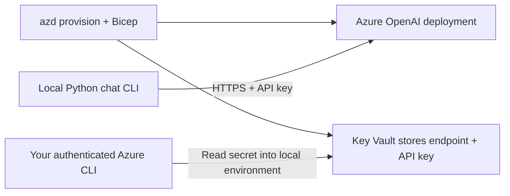

# Azure OpenAI Chat — CLI local e infraestrutura AZD

**Nível:** Intermédio · **Duração:** 35–60 minutos incluindo configuração

Este exemplo cria um **recurso Azure OpenAI e um Key Vault**, depois executa um
CLI interativo de chat Python **na sua máquina**. Não hospeda uma aplicação web
ou uma Container App. O modelo predefinido é `gpt-4.1`, versão `2025-04-14`, com
capacidade de implantação `GlobalStandard` 20. Verifique a disponibilidade e a quota atuais na
região selecionada antes da criação; as datas do ciclo de vida do modelo podem mudar.

## Objetivos de aprendizagem

- Provisionar infraestrutura para o modelo com Bicep e azd.
- Obter uma chave API do Key Vault sem colocá-la nas saídas da implantação.
- Enviar pedidos de Chat Completions e manter o histórico da conversa.
- Interpretar contagens de tokens e as limitações das estimativas de custo.



Este exemplo não inclui integração com managed identity em runtime, failover multi-região, limitador
personalizado, modo streaming, ou computação hospedada. O SDK do OpenAI
realiza até duas tentativas para falhas recuperáveis; o CLI reporta os erros restantes.

## Pré-requisitos

- Uma versão estável atual [azd](https://learn.microsoft.com/azure/developer/azure-developer-cli/install-azd)
  (versão publicada na altura da revisão: 1.37.2).
- [Azure CLI](https://learn.microsoft.com/cli/azure/install-azure-cli).
- Python **3.10+** (3.11 recomendado) e um ambiente virtual.
- Uma subscrição Azure com permissão para criar serviços cognitivos e recursos Key Vault,
  implantar modelos e ler os segredos do cofre.
- Disponibilidade regional e quota `GlobalStandard` para `gpt-4.1`. Os requisitos de acesso
  dependem da subscrição e da funcionalidade; não há prazo garantido para aprovação.

```bash
azd version
az version
python --version
azd auth login
az login
```

Estas são sessões de autenticação separadas. Seleccione a mesma subscrição em ambas as
ferramentas antes de executar os comandos abaixo.

## Início rápido (Bash)

Execute a partir da raiz do repositório:

```bash
cd examples/azure-openai-chat
azd env new myopenai
azd provision
```

Escolha uma região suportada. O provisionamento cria um grupo de recursos, conta OpenAI,
implantação do modelo, Key Vault e os segredos `openai-endpoint`/`openai-api-key`.
Não há **serviços para implantar** em `azure.yaml`.

Carregue as saídas não secretas e obtenha o segredo para o seu shell atual:

```bash
export AZURE_OPENAI_ENDPOINT="$(azd env get-value AZURE_OPENAI_ENDPOINT)"
export AZURE_OPENAI_MODEL="$(azd env get-value AZURE_OPENAI_MODEL)"
KV_NAME="$(azd env get-value AZURE_KEY_VAULT_NAME)"
export AZURE_OPENAI_API_KEY="$(az keyvault secret show \
  --vault-name "$KV_NAME" --name openai-api-key --query value --output tsv)"

python -m venv .venv
source .venv/bin/activate
python -m pip install -r src/requirements.txt
python src/chat.py
```

No PowerShell, ative com `.\.venv\Scripts\Activate.ps1` e atribua variáveis de ambiente
com `$env:AZURE_OPENAI_ENDPOINT = azd env get-value AZURE_OPENAI_ENDPOINT`
(e de forma semelhante para o modelo). Obtenha a chave da API usando
`$env:AZURE_OPENAI_API_KEY = az keyvault secret show --vault-name $KV_NAME --name openai-api-key --query value -o tsv`.
Defina `$KV_NAME = azd env get-value AZURE_KEY_VAULT_NAME` primeiro.

Não imprima, envie commits nem cole a chave da API em relatórios de issues. A CLI lê variáveis de
ambiente do processo; **não** recupera segredos do Key Vault nem carrega ficheiros `.env`.
`config.py` valida o endpoint, limite de tokens e temperatura ao arrancar.

Saída esperada (conteúdo e uso variam):

```text
Azure OpenAI Chat Application
Model: gpt-4.1
...
You: Say hello in one sentence.
Assistant: Hello! How can I help you today?
[Tokens: ... | Cost: $...]
```

Comandos: `stats` mostra totais, `clear` limpa o histórico da conversa, e
`quit`/`exit` termina a sessão. Não existem comandos `--stream`, `--show-tokens`, `tokens`,
ou `cost`.

## Verificar o deployment

Após carregar as variáveis shell acima:

```bash
curl --fail-with-body \
  "${AZURE_OPENAI_ENDPOINT%/}/openai/deployments/${AZURE_OPENAI_MODEL}/chat/completions?api-version=2024-10-21" \
  -H "Content-Type: application/json" \
  -H "api-key: $AZURE_OPENAI_API_KEY" \
  -d '{"messages":[{"role":"user","content":"Say hello!"}],"max_tokens":50}'

az keyvault secret list --vault-name "$KV_NAME" --query "[].name" -o table
```

Sucesso: a API retorna HTTP 200 com `choices[0].message.content` e `usage`;
o vault lista `openai-api-key` e `openai-endpoint`. Um deployment ARM bem-sucedido
sozinho não verifica a inferência.

## Ficheiros e configuração

```text
azure.yaml                         # Infrastructure-only AZD project
infra/main.bicep                   # Subscription deployment
infra/main.parameters.json         # Environment, location, principal ID
infra/resources/openai.bicep       # Account + model
infra/resources/keyvault.bicep     # Vault + deploying user's secret access policy
infra/resources/secrets.bicep      # Writes secrets, no key output
src/chat.py                        # Interactive CLI
src/config.py                      # Environment validation
src/requirements.txt               # Python packages
```

Para alterar o modelo/versão/capacidade provisionados, edite os defaults em
`infra/main.bicep` e execute `azd provision`. Definir `AZURE_OPENAI_MODEL` no seu
shell apenas seleciona um **nome de deployment existente**; não implementa outro modelo.

| Variável de runtime | Padrão / fonte |
|---|---|
| `AZURE_OPENAI_ENDPOINT` | Obrigatório; saída não secreta do azd |
| `AZURE_OPENAI_API_KEY` | Obrigatório; obter do Key Vault |
| `AZURE_OPENAI_MODEL` | `gpt-4.1`; nome da implementação Azure |
| `AZURE_OPENAI_MAX_TOKENS` | 800 (intervalo de validação 1–4096) |
| `AZURE_OPENAI_TEMPERATURE` | 0.7 (intervalo 0–2) |
| `AZURE_OPENAI_INPUT_PRICE_PER_1K` | 0.002 USD; taxa ilustrativa de entrada não cacheada |
| `AZURE_OPENAI_OUTPUT_PRICE_PER_1K` | 0.008 USD; taxa ilustrativa de saída |

## Custos e limitações de segurança

A exibição de custos é uma **estimativa**, não a faturação do Azure. Multiplica o uso de tokens
da API pelos preços configurados e não contabiliza descontos por entrada em cache,
diferenças regionais/SKU, impostos, alterações de preços ou chamadas falhadas/retentativas.
Substitua **ambas as taxas** ao usar outro modelo ou SKU e verifique a atual
[preços do Azure OpenAI](https://azure.microsoft.com/pricing/details/cognitive-services/openai-service/).

Para ilustração, 100 pedidos usando 500 tokens de entrada não cacheada e 200 de saída cada
às taxas padrão custam `100 × (500/1000 × .002 + 200/1000 × .008) = $0.26`.
As operações/armazenamento do Key Vault implicam encargos separados. Não há uma taxa fixa de $50/mês
para esta CLI local nem há computação alojada no modelo.

O cofre utiliza uma política de acesso para o principal que realiza a implementação; não é um exemplo de aplicação RBAC ou
de identidade gerida. São usados pontos finais públicos e autenticação por chave API
para fins pedagógicos. Limite permissões e adicione controles de identidade/rede
apropriados antes de adaptá-lo para produção.

## Exercícios práticos

### 1. Verificar o contexto e reiniciá-lo

**Início:** executar CLI. **Objetivo:** observar o histórico.
Diga "Lembra-te da palavra cedro", depois pergunte "Que palavra te pedi para lembrar?"
Execute `stats`; dois turnos bem-sucedidos devem contar como duas mensagens trocadas.
Execute `clear` e `stats`; as mensagens trocadas devem ser zero (o total de tokens permanece).
A formulação exata do modelo não é determinista.

### 2. Alterar o limite de resposta

**Início:** sair da CLI, mantendo o mesmo shell.
Execute `export AZURE_OPENAI_MAX_TOKENS=100`, reinicie `python src/chat.py`, e peça para
uma breve explicação do azd. Verifique se o banner mostra 100.
Restaurar com `unset AZURE_OPENAI_MAX_TOKENS`. Um limite de resposta menor não
reduz os tokens de histórico já enviados.

### Problemas comuns

- **Variáveis de ambiente em falta:** o provisionamento não exporta valores para o shell;
  repita os passos de exportação. Um novo terminal precisa deles de novo.
- **403 a ler Key Vault:** verifique a subscrição/login do Azure CLI e o principal
  na política de acesso do cofre. As alterações na política podem demorar a propagar-se.
- **404 inferência:** verifique o nome do deployment, o endpoint e o estado do deployment.
- **429 inferência:** espere que os limites de taxa sejam repostos; verifique a quota regional do modelo.
  O CLI remove as tentativas falhadas do histórico para que reintentar não as duplique.
- **Comprimento do contexto:** o exemplo não corta conversas longas; use `clear`.
- **Modelo indisponível/descontinuado:** consulte a disponibilidade atual do modelo e atualize
  o modelo/versão/SKU em conjunto; a versão da API e a versão do modelo são configurações diferentes.

## Limpeza e próximos passos

```bash
azd down
unset AZURE_OPENAI_API_KEY
```

A retenção por soft-delete do Key Vault é de sete dias; a eliminação completa requer permissões separadas.
Não existe um conjunto de testes comitados; não execute um comando `pytest tests/` inexistente.
Adicione testes de API simulados antes de expandir o código.

[Exemplos de contentor](../../../../examples/container-app) · [Plano arquitetónico de retalho](../retail-scenario.md) ·
[Página inicial do curso](../../README.md) · [Reportar um problema](https://github.com/microsoft/AZD-for-beginners/issues)

---

<!-- CO-OP TRANSLATOR DISCLAIMER START -->
**Aviso Legal**:
Este documento foi traduzido utilizando o serviço de tradução automática [Co-op Translator](https://github.com/Azure/co-op-translator). Embora nos esforcemos pela precisão, esteja ciente de que traduções automáticas podem conter erros ou imprecisões. O documento original na sua língua nativa deve ser considerado a fonte autorizada. Para informações críticas, recomenda-se tradução profissional humana. Não nos responsabilizamos por quaisquer mal-entendidos ou interpretações incorretas resultantes da utilização desta tradução.
<!-- CO-OP TRANSLATOR DISCLAIMER END -->