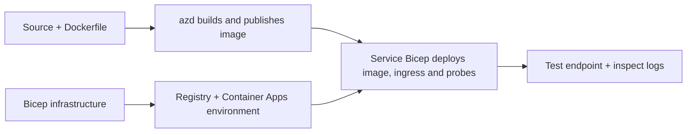

# Exemplos de Deployment de Container App com AZD

Esta diretoria contém dois exemplos de aprendizagem com código fonte, Dockerfiles,
infraestrutura Bicep e `azure.yaml`. Nenhum deles está preparado para produção.

## Escolha um exemplo

| Exemplo | O que está implementado | Pré-requisito |
|---|---|---|
| [API Flask Simples](../../../../examples/container-app/simple-flask-api) | API CRUD simples em Python, itens em memória, sondas de integridade, escalabilidade HTTP | Conhecimentos básicos de CLI e HTTP |
| [Microsserviços de dois serviços](../../../../examples/container-app/microservices) | Gateway Node.js, serviço interno de produto Python apenas leitura, telemetria e escalabilidade | Completar primeiro o exemplo de serviço único |

Reserve 30–60 minutos incluindo configuração e verificação. Os tempos de provisão do Azure variam.

## Pré-requisitos

- [Azure Developer CLI](https://learn.microsoft.com/azure/developer/azure-developer-cli/install-azd)
- [Azure CLI](https://learn.microsoft.com/cli/azure/install-azure-cli) para comandos de verificação
- Docker com o seu daemon a correr para construir estas imagens de container
- Uma subscrição Azure com permissões de criação de recursos e quota regional suficiente
- Bash para os exemplos de shell, ou comandos equivalentes em PowerShell

```bash
azd version
az version
docker info
azd auth login
az login
```

As duas ferramentas têm sessões de login separadas. Use um azd estável e atual; a versão
publicada mais recente à data da revisão é a 1.37.2. Declarações de versões mínimas anteriores
não são uma garantia de compatibilidade.

## Início rápido

A partir da raiz do repositório:

```bash
cd examples/container-app/simple-flask-api
azd env new flask-demo
azd up
API_URL=$(azd env get-value API_ENDPOINT)
curl --fail-with-body "${API_URL}/health"
```

Esperado: HTTP 200 com `"status": "healthy"`. Siga o README de exemplo para criar,
ler, atualizar e eliminar um item, e para inspecionar logs.



O provisionamento inicial usa uma imagem pública hello-world na porta 80. Os ficheiros
de parâmetros Bicep específicos do serviço permitem que `azd deploy` substitua
por uma imagem da aplicação construída e pela porta/probes corretas da aplicação (8000 para Flask/produto, 8080 para o gateway).
Mantenha estes ficheiros com as suas definições `azure.yaml` `module`.

## Configuração: o que altera o quê

`azure.yaml` seleciona diretórios de origem, linguagens, hosts e módulos de implantação.
CPU/memória do contentor, ingress, probes, contagens de réplicas e regras de escala são definidas
em **Bicep**, e não em propriedades arbitrárias de serviço `resources`, `scale` ou `regions`.

`azd env set SOME_VALUE ...` guarda um valor localmente. Altera um recurso implantado
apenas quando um parâmetro, mapeamento de ambiente ou hook consome explicitamente esse valor.
valor. Estes exemplos não consomem `MAX_REPLICAS`, `SCALE_TO_ZERO_TIMEOUT`,
`CONTAINER_APP_REPLICA_TYPE`, ou definições canária personalizadas dos valores do ambiente azd.
Edite o Bicep relevante e execute `azd up` para reprovisionar e implantar.

Não coloque o código da aplicação sob `infra/`. `project` deve apontar para o diretório fonte
que contém o Dockerfile e o manifesto de dependências.

## Monitorização e custos

- `azd monitor --logs` abre uma vista no portal; não é um fluxo de logs do terminal.
  Use `az containerapp logs show --follow` com o nome real do recurso.
- A API simples escreve logs stdout coletados por Container Apps/Log Analytics.
  O recurso Application Insights provisionado não é automaticamente instrumentado.
- O gateway dos microsserviços usa o SDK Node.js do Application Insights; o serviço Python
  exporta tracejos de logs de aplicação. A rastreabilidade completa de pedidos/dependências em Python
  não está configurada.
- O scale-to-zero pode reduzir encargos de computação, mas o registro e ingestão/armazenamento de logs
  ainda podem ter custos. Os padrões dos microsserviços mantêm réplicas em execução.
  Estime na sua região e uso no
  [calculador de preços Azure](https://azure.microsoft.com/pricing/calculator/).

## Padrões avançados — implementações não incluídas

Estas são direções de design, não projetos locais adicionais ou trechos para copiar e correr:

- **Dados persistentes e autenticação:** substituir armazenamentos em memória e adicionar
  autenticação/autorização Microsoft Entra ID antes da produção.
- **Blue-green/canary:** usar modo de múltiplas revisões em Container Apps, etiquetas de revisão,
  pesos de tráfego, verificação de saúde e procedimentos de rollback.
  Não existe configuração `deploymentStrategy: canary` azd nestes exemplos.
  Veja [gestão de revisões](https://learn.microsoft.com/azure/container-apps/revisions).
- **Multi-região:** criar ambientes e apps separados em Bicep e desenhar
  encaminhamento global e consistência de dados. Uma lista de serviços `regions` não é um mecanismo de
  implementação azd.
- **Trabalhadores de fila:** adicionar código do trabalhador, dependências, recursos de fila, uma identidade gerida
  com funções no plano de dados, e uma regra de escala autenticada. Não copie
  um caminho `src/worker` vazio e espere um projeto funcional.
- **Dapr:** provisionar componentes, configurar o sidecar, instalar o SDK correspondente,
  e implementar tratamento de erros de estado/pub-sub.
- **Segredos:** usar identidade gerida e atribuições de funções sempre que possível. Apenas
  criar um Key Vault não concede acesso às aplicações nem carrega segredos.

## Limpeza

A partir do diretório do exemplo:

```bash
azd down
```

Reveja os avisos de eliminação e confirme que o grupo de recursos dedicado foi removido.
Não use estes exemplos como base de produção sem design e testes adicionais.

[Índice de exemplos](../README.md) · [Página inicial do curso](../../README.md) ·
[Documentação de Container Apps](https://learn.microsoft.com/azure/container-apps/) ·
[Reportar um problema](https://github.com/microsoft/AZD-for-beginners/issues)

---

<!-- CO-OP TRANSLATOR DISCLAIMER START -->
**Aviso Legal**:
Este documento foi traduzido utilizando o serviço de tradução automática [Co-op Translator](https://github.com/Azure/co-op-translator). Embora nos esforcemos pela precisão, esteja ciente de que traduções automáticas podem conter erros ou imprecisões. O documento original na sua língua nativa deve ser considerado a fonte autorizada. Para informações críticas, recomenda-se tradução profissional humana. Não nos responsabilizamos por quaisquer mal-entendidos ou interpretações incorretas resultantes da utilização desta tradução.
<!-- CO-OP TRANSLATOR DISCLAIMER END -->