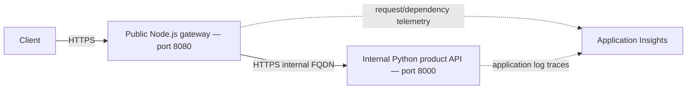

# Microserviços de Dois Serviços — Azure Container Apps

**Nível:** Intermédio · **Duração:** 45–60 minutos incluindo configuração

Este exemplo de aprendizagem implementa um **API Gateway em Node.js** e um **Serviço de Produtos em Python apenas de leitura**. O código-fonte, Dockerfiles, Bicep, e configuração azd estão incluídos.
Não é um sistema preparado para produção.


- Usar um FQDN interno do backend via HTTPS.
- Verificar respostas de sucesso, não encontrado, e serviço indisponível.
- Compreender telemetria e limites de escalabilidade independentes.




O catálogo de produtos contém cinco produtos fixos na memória. Não existem **manipuladores POST, 
PUT, ou DELETE**, base de dados, Service Bus, serviço de encomendas/utilizadores/notificações,
C# ou código Go. Essas são ideias futuras de desenvolvimento, não funcionalidades incluídas.
O gateway não autentica utilizadores; o ingresso interno não substitui a autorização da aplicação.


## Pré-requisitos

Complete primeiro o [single Flask API](../../../../../examples/container-app/simple-flask-api).
Instale o azd estável atual (versão publicada na revisão: 1.37.2), Azure CLI,
e Docker com o daemon em execução. Precisa de uma subscrição Azure, permissões para criar recursos,
e quota regional para Container Apps.

```bash
azd version
az version
docker info
azd auth login
az login
```

Utilize a mesma subscrição em ambas as ferramentas CLI. Os comandos abaixo usam Bash.

## Desplegar e verificar

A partir da raiz do repositório:

```bash
cd examples/container-app/microservices
azd env new microservices-demo
azd up
GATEWAY_URL=$(azd env get-value API_GATEWAY_URL)
RG_NAME=$(azd env get-value AZURE_RESOURCE_GROUP)
GATEWAY_NAME=$(azd env get-value API_GATEWAY_NAME)
PRODUCT_NAME=$(azd env get-value PRODUCT_SERVICE_NAME)

curl --fail-with-body "${GATEWAY_URL}/health"
curl --fail-with-body "${GATEWAY_URL}/api/products"
curl --fail-with-body "${GATEWAY_URL}/api/products/1"
curl -i "${GATEWAY_URL}/api/products/999"
```

**Sucesso:** estado 200; lista 200 com **cinco** produtos; o produto 1 é um Portátil
com preço 999,99 e stock 50; produto desconhecido retorna 404.
As descrições são incluídas nas respostas; os carimbos de tempo variam.

A provisão inicial usa imagens públicas hello-world na porta 80 para não tentar
puxar imagens inexistentes de um registo vazio. Os módulos Bicep específicos para o serviço
e os ficheiros de parâmetros substituem-nas por imagens construídas e portas/probes da app durante
`azd deploy`. Os parâmetros principais preservam os nomes das imagens publicadas para provisão posterior.

## Serviços e rede

| Serviço | Endpoints expostos | Recursos por defeito |
|---|---|---|
| Gateway | GET `/`, `/health`, `/api/products`, `/api/products/:id` | 1 vCPU, 2 GiB, 2–20 réplicas |
| Produto | GET `/`, `/health`, `/products`, `/products/<id>` | 0,5 vCPU, 1 GiB, 1–10 réplicas |

O ingresso do produto tem `external: false` e `allowInsecure: false`. O Bicep injeta
`PRODUCT_SERVICE_URL=https://<actual-internal-fqdn>` no gateway. HTTP faria
redirecionamento; HTTPS corresponde ao ingresso configurado. Um nome DNS curto deve coincidir com o
**nome real do Container App**, não com a chave do serviço lógica `product-service`.
Não tente chamar diretamente o URL interno a partir do seu portátil.

O gateway tem um timeout de cinco segundos para chamadas de produto. IDs de produto em falta
propagam como 404; falhas de transporte/outras falhas no backend retornam 503. O gateway
`/health` verifica apenas o gateway, não a disponibilidade do backend.

## Ficheiros e configuração

```text
azure.yaml
infra/main.bicep
infra/main.parameters.json
infra/abbreviations.json
infra/core/container-apps-environment.bicep
infra/core/monitor.bicep
infra/app/api-gateway.bicep
infra/app/api-gateway.parameters.json
infra/app/product-service.bicep
infra/app/product-service.parameters.json
src/api-gateway/{app.js,package.json,Dockerfile}
src/product-service/{main.py,requirements.txt,Dockerfile}
```

Ajustes de escala, CPU/memória, portas e probes estão definidos em `infra/app/*.bicep`. Altere esses
ficheiros e execute `azd up` para aplicar a infraestrutura e redesplegar. Não existe
`GATEWAY_MAX_REPLICAS` parâmetro de variável de ambiente neste exemplo.

Para alterações só de código:

```bash
azd deploy product-service
azd deploy api-gateway
```

A imagem Node usa Node 22; a imagem Python usa Python 3.11. Ambas escutam em
`0.0.0.0`. Ingress/probes usam a porta 8080 (gateway) e 8000 (produto), respetivamente.

## Desenvolvimento local com Docker

Execute a partir deste diretório de exemplo. Use uma rede definida pelo utilizador, **não `localhost`
de um contentor para o outro**:

```bash
docker network create azd-microservices-demo
docker build -t local-product ./src/product-service
docker build -t local-gateway ./src/api-gateway
docker run -d --name azd-product --network azd-microservices-demo local-product
docker run -d --name azd-gateway --network azd-microservices-demo \
  -p 8080:8080 -e PRODUCT_SERVICE_URL=http://azd-product:8000 local-gateway
curl --fail-with-body http://localhost:8080/api/products
```

Esperado: cinco produtos. HTTP é usado apenas para esta rede local Docker.

```bash
docker stop azd-product azd-gateway
docker rm azd-product azd-gateway
docker network rm azd-microservices-demo
```

## Monitorização

```bash
az containerapp logs show --name "$GATEWAY_NAME" --resource-group "$RG_NAME" --follow
# In a separate terminal:
az containerapp logs show --name "$PRODUCT_NAME" --resource-group "$RG_NAME" --tail 100
```

`azd monitor --logs` abre uma vista do portal; não transmite logs do terminal.
O SDK Node recolhe pedidos/dependências do gateway. O `AzureLogHandler` do Python
exporta **rastreios de logs**, não pedidos automáticos Flask, dependências SQL, ou rastreios
distribuídos completos. OpenCensus é um SDK legado; prefira Azure Monitor OpenTelemetry
ao expandir este exemplo.

Em Application Insights Logs, gere pedidos e inspecione:

```kusto
requests
| where timestamp > ago(1h)
| where name contains "products"
| summarize RequestCount=count(), AvgDuration=avg(duration) by bin(timestamp, 5m)
```

Para mensagens da aplicação Python:

```kusto
traces
| where timestamp > ago(1h)
| where message contains "products"
| project timestamp, message, severityLevel
```

Considere atraso de ingestão e amostragem; não espere uma contagem exata de pedidos ou latência garantida.
Nenhum alerta ou painel personalizado está configurado.

## Exercícios Práticos

### Exercício 1: Modificar o catálogo

**Ponto de partida:** `src/product-service/main.py`.
**Objetivo:** verificar implantação de serviço independente.
Altere o stock do Portátil de 50 para 49 na lista fixa `products`, execute
`azd deploy product-service`, depois solicite `${GATEWAY_URL}/api/products/1`.

**Critérios de sucesso / solução:** HTTP 200 com `"stock":49`. Restaure 50 e redesplegue.
**Problema comum:** editar o gateway em vez do serviço que possui o catálogo.
Isso altera dados fonte, não uma base de dados persistente de inventário.

### Exercício 2: Verificar configuração das réplicas

**Ponto de partida:** `infra/app/product-service.bicep`.
**Objetivo:** observar uma modificação da infraestrutura sem adivinhar a autoscalagem.
Altere `minReplicas: 1` para `minReplicas: 2`, execute `azd up`, depois:

```bash
az containerapp show --name "$PRODUCT_NAME" --resource-group "$RG_NAME" \
  --query properties.template.scale -o json
```

**Critérios de sucesso:** mínimo configurado é 2 e o máximo permanece 10.
Restaure o mínimo para 1 e execute `azd up`.
**Problema comum:** `azd deploy` sozinho não aplica alterações à infraestrutura partilhada não relacionada.
Não defina `maxReplicas` para zero como simulação de falha.
Isso verifica configuração, não é um teste de carga ou uma quantidade garantida de réplicas instantâneas.

### Exercício 3: Testar manipulação de serviço indisponível localmente

**Ponto de partida:** ambos os contentores locais Docker acima estão a correr.
**Objetivo:** distinguir falha backend de produto em falta.
Pare apenas o contentor do produto:

```bash
docker stop azd-product
curl -i http://localhost:8080/api/products
docker start azd-product
curl --fail-with-body http://localhost:8080/api/products
```

**Critérios de sucesso:** enquanto parado, o gateway retorna 503 com
`"error":"Product service unavailable"`; após reinício, a lista retorna 200.
Tente novamente após breve atraso de arranque se necessário.
**Problema comum:** parar o gateway testa uma falha diferente (sem resposta HTTP).

## Custos e lacunas em produção

As réplicas mínimas por defeito mantêm os recursos de computação ativos. Registo e monitorização também geram
encargos. Não existe um custo fixo validado de 50 $/mês: estime CPU/memória regional,
horas de réplicas, pedidos, registo, e retenção de logs na
[calculadora de preços Azure](https://azure.microsoft.com/pricing/calculator/).
Apague os recursos de aprendizagem prontamente.

O trabalho de produção inclui autenticação/autorização, identidades geridas com escopo,
dados persistentes, validação de entrada/resposta, instrumentação observável suportada,
testes de carga/falha, CI/CD, alertas, e procedimentos de recuperação. Adicionar um serviço de encomendas,
fila, ou base de dados é uma tarefa de implementação separada, não um exercício concluído
ou funcionalidade já disponível aqui.

## Solução de problemas e limpeza

- **Imagem não encontrada durante a primeira provisão:** o bootstrap deve usar a imagem pública;
  verifique os padrões dos parâmetros de imagem principal e os mapeamentos dos módulos de implantação.
- **503 produtos:** verifique logs do produto, revisão da imagem e URL interno HTTPS injetado.
- **404 caminho inesperado:** a API de produto é só leitura; verifique a rota, não um manipulador CRUD inexistente.
- **Sem telemetria:** inspecione strings de ligação em runtime sem as expor e
  permita atraso de ingestão. As tabelas de pedidos do Python não são preenchidas pelo seu manipulador de logs.

A partir deste diretório de exemplo:

```bash
azd down
```

Reveja as confirmações de eliminação e verifique se o grupo de recursos dedicado foi removido.

[Anterior: Flask API](../../../../../examples/container-app/simple-flask-api) · [Seguinte: aplicação de base de dados](../../../../../examples/database-app) ·
[Desenvolvimento IA](../../../docs/chapter-02-ai-development/README.md) ·
[Página inicial do curso](../../../README.md) · [Reportar um problema](https://github.com/microsoft/AZD-for-beginners/issues)

---

<!-- CO-OP TRANSLATOR DISCLAIMER START -->
**Aviso Legal**:
Este documento foi traduzido utilizando o serviço de tradução automática [Co-op Translator](https://github.com/Azure/co-op-translator). Embora nos esforcemos pela precisão, esteja ciente de que traduções automáticas podem conter erros ou imprecisões. O documento original na sua língua nativa deve ser considerado a fonte autorizada. Para informações críticas, recomenda-se tradução profissional humana. Não nos responsabilizamos por quaisquer mal-entendidos ou interpretações incorretas resultantes da utilização desta tradução.
<!-- CO-OP TRANSLATOR DISCLAIMER END -->