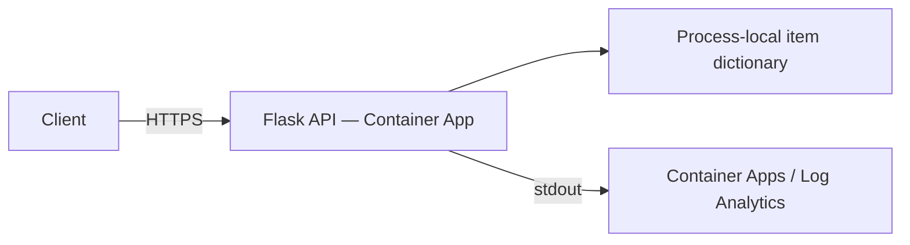

# API Flask Simples — Azure Container Apps

**Nível:** Iniciante · **Tempo:** 30–45 minutos incluindo configuração

Desdobre uma API Python Flask CRUD com Azure Developer CLI (azd). Código-fonte, Dockerfile,
Bicep, e parâmetros de desdobramento estão incluídos. Este é um **exemplo de aprendizagem**, não
uma API pronta para produção.

## O que vai aprender

- Construir e publicar um contentor através do azd.
- Configurar ingress e sondas de liveliness/readiness.
- Verificar respostas CRUD e inspecionar os registos da aplicação.
- Compreender porque é que dados em memória são inadequados para aplicações duradouras.



**Importante:** os itens são mantidos num único processo. O padrão é **um trabalhador Gunicorn,
0–1 réplicas**, intencionalmente evitando dados inconsistentes entre trabalhadores/replicas.
Os itens perdem-se ao reiniciar, alterar a versão, ou escalar para zero. Aumentar réplicas
requer armazenamento persistente partilhado. A API não tem autenticação nem autorização.

## Pré-requisitos

- [azd estável atual](https://learn.microsoft.com/azure/developer/azure-developer-cli/install-azd)
  (versão publicada na altura da revisão: 1.37.2).
- [Azure CLI](https://learn.microsoft.com/cli/azure/install-azure-cli) para verificação.
- Docker com o daemon a correr; é necessário para a construção local da imagem por padrão.
- Subscrição Azure, permissões para criar recursos, e quota regional do Container Apps.
- Bash para os comandos abaixo (ou PowerShell equivalente).
- Python 3.11 para desenvolvimento local opcional.

```bash
azd version
az version
docker info
azd auth login
az login
```

As ferramentas CLI têm sessões de login separadas. Use a mesma subscrição em ambas.

## Início rápido

Na raiz do repositório:

```bash
cd examples/container-app/simple-flask-api
azd env new flask-demo
azd up
API_URL=$(azd env get-value API_ENDPOINT)
RG_NAME=$(azd env get-value AZURE_RESOURCE_GROUP)
API_NAME=$(azd env get-value API_NAME)
curl --fail-with-body "${API_URL}/health"
```

Esperado: HTTP 200 e JSON com `"status":"healthy"`,
`"service":"simple-flask-api"`, e um timestamp UTC atual.
O provisionamento e construção da imagem tipicamente levam alguns minutos; os tempos variam.

O provisionamento inicial usa uma imagem pública hello-world a ouvir na porta 80.
`azure.yaml` seleciona `infra/app/api.bicep` e o seu ficheiro de parâmetros correspondente para
o desdobramento do serviço, que alterna a imagem, ingress e sondas para a porta 8000.
Não elimine esses parâmetros do desdobramento.

## Verificar CRUD

Execute o seguinte sequencialmente enquanto a mesma réplica permanecer ativa:

```bash
# Create: HTTP 201; note the returned id (1 for a fresh process).
curl -i -X POST "${API_URL}/api/items" \
  -H "Content-Type: application/json" \
  -d '{"name":"Test Item","description":"My first item"}'

# Read list: HTTP 200, total 1 in a fresh process.
curl --fail-with-body "${API_URL}/api/items"

# Replace 1 if your create response returned another id.
curl --fail-with-body "${API_URL}/api/items/1"
curl -i -X PUT "${API_URL}/api/items/1" \
  -H "Content-Type: application/json" -d '{"name":"Updated Item"}'
curl -i -X DELETE "${API_URL}/api/items/1"
curl -i "${API_URL}/api/items/1"
```

Sucesso: POST 201, leituras/PUT 200, DELETE 204 sem corpo, depois item em falta 404.
JSON malformado/não-objeto ou um nome vazio devolvem 400.
Se um item desaparecer entre pedidos, verifique se houve reinício ou escala para zero;
esta é uma limitação intencional em memória, não persistência.

| Endpoint | Métodos |
|---|---|
| `/` | GET — informação do serviço |
| `/health` | GET — liveness/readiness |
| `/api/items` | GET, POST |
| `/api/items/{id}` | GET, PUT, DELETE |

## Registos e configuração

```bash
az containerapp logs show --name "$API_NAME" --resource-group "$RG_NAME" --follow
```

Esperado: arranque do Gunicorn, registos de aceso a pedidos, e mensagens da aplicação.
`azd monitor --logs` abre uma vista do portal; não faz streaming para o terminal.
O Application Insights está provisionado mas **não instrumentado por este código Flask**;
use Container Apps/Log Analytics para registos stdout.

Edite `infra/app/api.bicep` para CPU/memória, limites de réplica, ou regras de escala, depois
execute `azd up`. Os padrões são 0.5 vCPU, 1 GiB, mínimo 0 / máximo 1 réplica, e um
limiar HTTP de 50 pedidos concorrentes. Escalar para zero pode adicionar latência de cold-start.

Arbitrário `azd env set MAX_REPLICAS`, `API_KEY`, `LOG_LEVEL`, ou
Os valores `SCALE_TO_ZERO_TIMEOUT` **não estão ligados a este template ou aplicação**.
Definir um valor não o torna automaticamente uma variável de ambiente em tempo de execução.
A imagem liga explicitamente a porta 8000; atualize o Dockerfile, ingress do Bicep e sondas
em conjunto se alterar a porta.

## Ficheiros

```text
azure.yaml
infra/main.bicep
infra/main.parameters.json
infra/app/container-apps.bicep       # Environment, registry, monitoring
infra/app/api.bicep                  # App, ingress, probes, scale settings
infra/app/api.parameters.json        # Image and resource values for azd deploy
src/app.py
src/Dockerfile
src/requirements.txt
```

## Desenvolvimento local

A partir deste diretório de exemplo:

```bash
python -m venv .venv
source .venv/bin/activate  # PowerShell: .\.venv\Scripts\Activate.ps1
python -m pip install -r src/requirements.txt
python src/app.py
```

Noutro terminal, teste `http://localhost:8000/health` e os endpoints CRUD.
Ou construa e execute a imagem real:

```bash
docker build -t flask-api:local ./src
docker run --rm -p 8000:8000 flask-api:local
```

Para alterações apenas de código após o primeiro deployment, execute `azd deploy api`.
Para alterações no Bicep, execute `azd up` para reprovisionar e fazer o deployment.

## Exercícios práticos

### 1. Validar rejeição de input

**Ponto de partida:** API implementada, `API_URL` acima.
**Objetivo:** verificar que a API rejeita formatos JSON inválidos e nomes em falta.

```bash
curl -i -X POST "${API_URL}/api/items" \
  -H "Content-Type: application/json" -d '[]'
curl -i -X POST "${API_URL}/api/items" \
  -H "Content-Type: application/json" -d '{"name":""}'
```

**Critérios de sucesso / solução:** ambos retornam 400 com um erro JSON, não 500.
**Problema comum:** omitir o cabeçalho content-type JSON.

### 2. Adicionar um endpoint de versão somente leitura

**Ponto de partida:** `src/app.py`. **Objetivo:** estender e voltar a implementar a API.
Adicione isto antes do bloco `if __name__ == '__main__':`:

```python
@app.route('/version', methods=['GET'])
def version():
    return jsonify({'version': '1.0.0'})
```

Execute `azd deploy api`, depois `curl --fail-with-body "${API_URL}/version"`.
**Critérios de sucesso:** HTTP 200 e `{"version":"1.0.0"}`.
**Problema comum:** colocar a rota após a chamada bloqueante `app.run()` quando
testar com `python src/app.py`.

### Ponto de verificação de conhecimento

Porque é que um único trabalhador é insuficiente para dados duráveis? Porque mesmo um processo perde
o seu dicionário na reinicialização. Uma versão de produção precisa de armazenamento partilhado persistente,
autenticação, autorização, migrações, testes e monitorização operacional.

## Custos e resolução de problemas

Esta não é uma implementação garantida a $0: o registo Basic e o armazenamento/ingestão de logs
podem ter custos mesmo quando o compute da aplicação estiver a zero. Use a
[calculadora de preços](https://azure.microsoft.com/pricing/calculator/) para a sua região.

- **Falha no build Docker:** confirme `docker info`, acesso à rede e dependências.
- **Aplicação não saudável:** verifique os logs da consola/sistema e confirme que a porta da imagem, ingress,
  e sondas estão consistentes. Um placeholder não deve ser sondado na porta Flask.
- **403/permissões:** confirme permissões de subscrição e criação de recursos.
- **Itens desaparecem:** o estado em memória reinicia na reinicialização/escala para zero; adicione uma base de dados
  para comportamento durável.

## Limpeza e próximos passos

```bash
azd down
```

Reveja o pedido de eliminação e confirme que o grupo de recursos dedicado foi removido.
Não utilize limpeza destrutiva contra um grupo de recursos que contenha dados não relacionados.

[Seguinte: Aplicação de base de dados](../../../../../examples/database-app) · [Microsserviços](../../../../../examples/container-app/microservices) ·
[Visão geral do contentor](../README.md) · [Início do curso](../../../README.md) ·
[Reportar um problema](https://github.com/microsoft/AZD-for-beginners/issues)

---

<!-- CO-OP TRANSLATOR DISCLAIMER START -->
**Aviso Legal**:
Este documento foi traduzido utilizando o serviço de tradução automática [Co-op Translator](https://github.com/Azure/co-op-translator). Embora nos esforcemos pela precisão, esteja ciente de que traduções automáticas podem conter erros ou imprecisões. O documento original na sua língua nativa deve ser considerado a fonte autorizada. Para informações críticas, recomenda-se tradução profissional humana. Não nos responsabilizamos por quaisquer mal-entendidos ou interpretações incorretas resultantes da utilização desta tradução.
<!-- CO-OP TRANSLATOR DISCLAIMER END -->