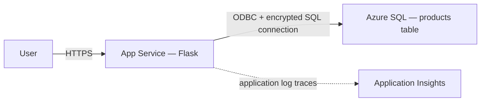

# Flask e Azure SQL no App Service

**Nível:** Intermédio · **Tempo:** 30–60 minutos incluindo pré-requisitos

Este exemplo implementa uma API de leitura Python Flask no **Linux App Service** e numa base de dados Azure SQL Basic. Código-fonte, Bicep e configuração azd estão incluídos. É uma aplicação de aprendizagem, não uma arquitetura de base de dados pronta para produção.
Azure SQL database. Source, Bicep, and azd configuration are included. It is a
learning application, not a production-ready database architecture.

## O que irá aprender

- Provisionar os recursos de App Service, SQL e monitorização com Bicep.
- Configurar conectividade SQL encriptada sem registar credenciais.
- Inicializar um esquema antes de iniciar os workers Gunicorn.
- Verificar dados inicializados, respostas de não encontrado e a saúde da base de dados.



Recursos: grupo de recursos dedicado, plano de serviço Linux App Service B1, Web App Python 3.11,
servidor SQL e base de dados Basic de 2 GB, Application Insights e Log Analytics.
A Web App utiliza **implantação por código-fonte/ZIP e instalação de dependências Oryx**;
`azd deploy` não constrói nem implanta o Dockerfile opcional.

## Pré-requisitos

- Versão estável atual do [azd](https://learn.microsoft.com/azure/developer/azure-developer-cli/install-azd)
  (versão publicada no momento da revisão: 1.37.2).
- [Azure CLI](https://learn.microsoft.com/cli/azure/install-azure-cli) para verificação.
- Assinatura Azure, permissões para criar os recursos listados e quota regional.
- Python **3.11** para desenvolvimento local; o `pyodbc==5.0.1` comprometido pode requerer
  ferramentas de construção nativas em versões mais recentes do Python.
- Controlador Microsoft ODBC 18 (ou 17) para SQL Server em máquinas locais. `pip install
  pyodbc` não instala o controlador do sistema. Veja
  [instalação ODBC](https://learn.microsoft.com/sql/connect/odbc/download-odbc-driver-for-sql-server).
- Docker apenas se testar o contentor opcional localmente.

```bash
azd version
az version
azd auth login
az login
```

Use a mesma subscrição em ambas as ferramentas. Os comandos abaixo usam Bash.

## Implantar

A partir da raiz do repositório:

```bash
cd examples/database-app
azd env new sql-demo
azd provision
azd deploy
WEB_URL=$(azd env get-value WEB_APP_URI)
WEB_NAME=$(azd env get-value WEB_APP_NAME)
RG_NAME=$(azd env get-value AZURE_RESOURCE_GROUP)
```

Escolha uma região suportada. `sqlAdminLogin` tem como padrão `sqladmin`; o necessário
`sqlAdminPassword` é um parâmetro seguro. Forneça uma palavra-passe forte quando solicitado.
Mantenha as credenciais de implantação fora do Git e relatórios de problemas. A interpolação
atual da cadeia de conexão espera uma palavra-passe sem delimitadores de cadeia de conexão, tais como
`;`; adapte o escape antes de usar tais valores.

O Bicep define um comando de arranque que executa `init_database()` **antes** de os trabalhadores Gunicorn
iniciarem. Isto é necessário porque importar `app:app` não executa o bloco
`if __name__ == '__main__'` do Python. Numa base de dados fresca, a inicialização
cria `products` e insere cinco linhas. É uma semente simples para ensino, não
um framework de migrações concorrente; use migrações apropriadas antes de escalar instâncias.

A aplicação seleciona o controlador Microsoft ODBC 18 instalado, depois o 17, se a cadeia de conexão
não nomear explicitamente um controlador. Se nenhum existir, o arranque falha com
um erro de instalação acionável. Verifique a disponibilidade do controlador no ambiente de runtime
do App Service selecionado em vez de assumir isso.

## Verificar

```bash
curl --fail-with-body "${WEB_URL}/"
curl --fail-with-body "${WEB_URL}/health"
curl --fail-with-body "${WEB_URL}/products"
curl --fail-with-body "${WEB_URL}/products/1"
curl -i "${WEB_URL}/products/999"
```

Esperado:

- `/` devolve informação do endpoint.
- `/health` devolve 200 com `{"status":"healthy","database":"connected"}`.
- `/products` devolve cinco produtos semeados numa base de dados fresca.
- `/products/1` devolve Laptop com preço 1299,99.
- Um produto inexistente devolve 404 com `{"error":"Product not found"}`.

A API é apenas de leitura. Não há rota POST/PUT/DELETE nem interface de navegador.
Falha de conectividade à base de dados devolve 503 de `/health`; não é sucesso.

## Ficheiros e configuração

```text
azure.yaml                         # Python App Service source deployment
infra/main.bicep
infra/main.parameters.json
infra/abbreviations.json
infra/resources/sql-server.bicep
infra/resources/sql-database.bicep
infra/resources/app-service-plan.bicep
infra/resources/web-app.bicep       # Settings + initialization/startup command
infra/resources/app-insights.bicep
src/web/app.py
src/web/requirements.txt
src/web/Dockerfile                 # Optional local container, not the azd target
.env.sample
```

`SQL_CONNECTION_STRING` é passado como parâmetro seguro Bicep ao módulo da Web App
e armazenado nas definições do App Service, não nas saídas de implantação.
`APPLICATIONINSIGHTS_CONNECTION_STRING` configura a exportação de registos.
`SCM_DO_BUILD_DURING_DEPLOYMENT=true` ativa a instalação dependente do servidor.
Definir valores arbitrários `azd env` não altera automaticamente as definições da app.

A regra `0.0.0.0` do firewall SQL permite conexões de **serviços Azure,
incluindo subscrições de outros clientes**, sujeitas a autenticação SQL. Não está
restringida a esta app ou subscrição. O acesso público à rede SQL está ativado.
Use rede com escopo e uma identidade de aplicação sem privilégios administrativos antes da produção.

## Desenvolvimento local

Use Python 3.11 e um controlador Microsoft SQL ODBC instalado:

```bash
python -m venv .venv
source .venv/bin/activate  # PowerShell: .\.venv\Scripts\Activate.ps1
python -m pip install -r src/web/requirements.txt
export SQL_CONNECTION_STRING='Server=tcp:YOUR_SERVER.database.windows.net,1433;Database=YOUR_DATABASE;UID=YOUR_USER;PWD=YOUR_PASSWORD;Encrypt=yes;TrustServerCertificate=no;Connection Timeout=30;'
python src/web/app.py
```

Substitua os espaços reservados de forma segura. Um ficheiro `.env` copiado **não é automaticamente carregado**
por esta aplicação. Exporte variáveis na sua shell atual em vez disso.
Para Azure SQL a partir de um portátil, permita temporariamente apenas o seu endereço IP público:

```bash
SQL_SERVER=$(azd env get-value SQL_SERVER_NAME)
MY_IP=YOUR_PUBLIC_IP
az sql server firewall-rule create -g "$RG_NAME" -s "$SQL_SERVER" \
  -n AllowMyLearningIP --start-ip-address "$MY_IP" --end-ip-address "$MY_IP"
```

Remova a regra após o teste:

```bash
az sql server firewall-rule delete -g "$RG_NAME" -s "$SQL_SERVER" -n AllowMyLearningIP
```

Teste de contentor opcional deste diretório de exemplo:

```bash
docker build -t sql-flask:local src/web
docker run --rm -p 8000:8000 -e SQL_CONNECTION_STRING sql-flask:local
```

Esta imagem instala o Driver 18 usando o repositório de pacotes Debian 12 correspondente à sua
base Bookworm, inicializa a base de dados uma vez e depois inicia Gunicorn.

## Monitorização e resolução de problemas

Ative/siga os registos da aplicação no sistema de ficheiros do App Service ao diagnosticar o arranque:

```bash
az webapp log config --name "$WEB_NAME" --resource-group "$RG_NAME" \
  --application-logging filesystem --level information
az webapp log tail --name "$WEB_NAME" --resource-group "$RG_NAME"
```

Este código exporta **rastos de registos** da aplicação através de um handler legado OpenCensus.
Não configura rastreio automático de pedidos/dependências Flask, Live Metrics,
auditoria SQL, definições de diagnóstico ou alertas. Esses requerem configuração separada.
Para nova instrumentação, prefira Azure Monitor OpenTelemetry.

Nos registos do Application Insights, após fazer pedidos à API:

```kusto
traces
| where timestamp > ago(1h)
| where message contains "products" or message contains "Health check"
| project timestamp, message, severityLevel
```

Permita atraso de ingestão. A atividade na tabela de pedidos ou Live Metrics não é critério
de conclusão para esta instrumentação só de registos.

- **Controlador em falta:** inspecione `pyodbc.drivers()` no runtime e instale um
  controlador Microsoft ODBC suportado. Um pacote Python por si só é insuficiente.
- **Falha de conexão:** verifique definições SQL, credenciais, firewall e subscrição selecionada.
  Não desative a encriptação para evitar um erro.
- **Tabela de produtos em falta:** confirme que o comando de arranque do Bicep foi implantado;
  iniciar apenas `gunicorn app:app` ignora a inicialização.
- **Falha na construção do pacote:** use Python 3.11 ou forneça pré-requisitos de compilação nativos.
- **Dados com preço zero:** zero é um preço decimal válido; deve serializar-se como 0.0,
  não `null`.

## Exercícios Práticos

### Exercício 1: Verificar comportamento de produto em falta

**Ponto de partida:** API implantada e `WEB_URL` acima.
**Objetivo:** distinguir uma linha em falta de uma base de dados avariada.
Peça `/health` e `/products/999` usando os comandos acima.
**Critérios de sucesso / resposta:** estado 200, produto inexistente 404 (não 500 ou 503).
**Problema comum:** assumir que uma resposta de não encontrado prova que a conexão SQL está avariada.

### Exercício 2: Alterar um valor semeado

**Ponto de partida:** Editor de Consultas Azure SQL, ligado à base de dados de exemplo.
**Objetivo:** mostrar que os dados da API são armazenados no SQL em vez da memória do processo.

```sql
UPDATE products SET price = 0 WHERE id = 1;
SELECT id, name, price FROM products WHERE id = 1;
```

Peça `${WEB_URL}/products/1`. **Critérios de sucesso:** preço é `0.0`, não `null`.
Restaure o valor:

```sql
UPDATE products SET price = 1299.99 WHERE id = 1;
```

**Problema comum:** editar a lista de semente Python não atualiza linhas já no SQL.
Não execute exercícios de esquema/dados numa base de dados de produção.

### Exercício 3: Adicionar um endpoint de contagem só de leitura

**Ponto de partida:** `src/web/app.py`.
**Objetivo:** estender a API usando uma consulta agregada sem parâmetros.
Adicione isto antes do bloco `if __name__ == '__main__':`:

```python
@app.route('/product-count')
def product_count():
    from contextlib import closing
    with closing(get_db_connection()) as conn, closing(conn.cursor()) as cursor:
        cursor.execute("SELECT COUNT(*) FROM products")
        return jsonify({'count': cursor.fetchone()[0]})
```

Execute `azd deploy web`, depois peça `${WEB_URL}/product-count`.
**Critérios de sucesso:** status 200 com `{"count":5}` na base de dados semeada intocada.
**Problema comum:** mudar a rota mas esquecer de reimplantar.
Para produção, adicione tratamento/testes de erro; este exercício curto foca-se na consulta.

## Custos, lacunas de produção e limpeza

O App Service B1 e a base de dados Basic são faturados enquanto provisionados. Parar a
Web App **não** para a faturação do plano App Service. Registos e armazenamento podem adicionar custos.
Use a [calculadora de preços Azure](https://azure.microsoft.com/pricing/calculator/)
para preços regionais atuais. Passar para F1 também requer desativar `alwaysOn`;
não é um substituto simples de uma linha. O SQL serverless não é automaticamente gratuito.

O trabalho de produção inclui uma identidade de app com privilégios mínimos (não admin SQL),
autenticação/autorização, rede privada, migrações seguras, revisão do ciclo de vida/pool de conexão,
telemetria, auditoria, alertas, testes e procedimentos de recuperação.
Cache Redis e tabelas adicionais são ideias de desenvolvimento, não exercícios implementados.

A partir deste diretório de exemplo:

```bash
azd down
```

Reveja o pedido de eliminação e verifique se o grupo de recursos dedicado foi removido.
Não elimine grupos contendo dados não relacionados.

[Exemplos de contentores](../../../../examples/container-app) ·
[Desenvolvimento AI](../../docs/chapter-02-ai-development/README.md) ·
[Página do curso](../../README.md) · [Reportar um problema](https://github.com/microsoft/AZD-for-beginners/issues)

---

<!-- CO-OP TRANSLATOR DISCLAIMER START -->
**Aviso Legal**:
Este documento foi traduzido utilizando o serviço de tradução automática [Co-op Translator](https://github.com/Azure/co-op-translator). Embora nos esforcemos pela precisão, esteja ciente de que traduções automáticas podem conter erros ou imprecisões. O documento original na sua língua nativa deve ser considerado a fonte autorizada. Para informações críticas, recomenda-se tradução profissional humana. Não nos responsabilizamos por quaisquer mal-entendidos ou interpretações incorretas resultantes da utilização desta tradução.
<!-- CO-OP TRANSLATOR DISCLAIMER END -->