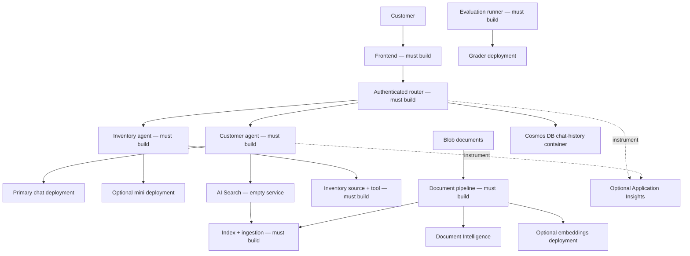

# Suporte ao Cliente Multi-Agente — Modelo de Arquitetura para Retalho

**Capítulo 5: Soluções de IA Multi-Agente**

- [Página inicial do curso](../README.md)
- [Capítulo 5](../docs/chapter-05-multi-agent/README.md)
- [Pré-requisito: integração de IA](../docs/chapter-02-ai-development/microsoft-foundry-integration.md)
- [Seguinte: planeamento de capacidade](../docs/chapter-06-pre-deployment/capacity-planning.md)
- [Estrutura da infraestrutura ARM](retail-multiagent-arm-template/README.md)

> **Guia de arquitectura, não uma aplicação funcional.** Os únicos ficheiros de implementação para retalho
> são `azuredeploy.json`, `azuredeploy.parameters.json` e `deploy.sh` em
> `retail-multiagent-arm-template/`. Os contentores router/frontend são espaços reservados hello-world.
> Não existe nenhum agente de retalho, interface de utilizador, pipeline de ingestão, avaliador, scanner,
> nem conjunto de testes de aplicação localmente.

## Visão Geral

**Objetivo:** desenhar um sistema de suporte ao cliente com um agente para o cliente e um agente
para o inventário, identificar o que a infraestrutura fornece e planear os contratos de aplicação em falta e a
verificação.

**Público-alvo:** programadores que tenham concluído o
[exemplo de chat](../../../examples/azure-openai-chat) local e o [exemplo de contentor com dois serviços](../../../examples/container-app/microservices).
Reserve 2–3 horas para estudar a arquitetura. A construção da aplicação é um projeto separado:
80–120 horas de desenvolvimento são uma estimativa ilustrativa para
programadores experientes, **não uma promessa de entrega**; produção, testes,
revisão de segurança e operações requerem trabalho adicional.

### Resultados da aprendizagem

- Explicar o encaminhamento, aterramento, permissões das ferramentas e propriedade da conversa.
- Distinguir identificadores de modelo, nomes de implantação, versões da API e versões ARM.
- Projetar ingestão e recuperação de documentos com dimensões vetoriais correspondentes.
- Definir requisitos verificáveis funcionais, de avaliação e de recuperação de falhas.
- Separar objetivos opcionais da arquitetura dos recursos realmente provisionados.

## Arquitetura da Solução



Esta é uma **arquitetura de aplicação alvo**, não um diagrama dos serviços do agente em execução.
O modelo ARM cria os serviços subjacentes e apenas dois contentores placeholder.
Front Door, registo, identidades geridas, atribuições de funções,
pontos de extremidade privados, failover, instrumentação da aplicação e alertas não estão incluídos.

### Responsabilidades e contratos

| Componente | Comportamento obrigatório | Evidência antes de considerar completo |
|---|---|---|
| Interface | Autenticar utilizadores, renderizar chat, carregar documentos de forma segura | Testes UI e de carregamento, erros acessíveis |
| Encaminhador | Autorizar pedidos, escolher agente, limitar chamadas/falhas de tempo da ferramenta | Testes de encaminhamento, verificações de autorização, testes de falha |
| Agente do cliente | Aterrar respostas de política/produto em fontes aprovadas | Citações corretas, abster-se quando dados estão ausentes |
| Ferramenta de inventário | Ler stock autoritativo com permissões específicas | Testes determinísticos de stock; sem disponibilidade inventada |
| Pipeline de documentos | Extrair, fragmentar, incorporar, indexar, atualizar/apagar | Fixtures indexados e comportamento de retentativa/dead-letter |
| Armazenamento de conversas | Isolar utilizadores, aplicar retenção | Testes de autorização cruzada e TTL |
| Executor de avaliação | Comparar saídas com a verdade básica e rubrica | Cobertura, contagem de falhas, relatórios reproduzíveis |

Considere o encaminhador como uma recepção e as ferramentas como sistemas internos restritos:
escolher um especialista não é autorização para aceder a todos os registos dos clientes.
Aplique identidade e permissões no código da aplicação e nos serviços de dados, não nos prompts.

## Infraestrutura vs. Aplicação

Leia o [README do modelo](retail-multiagent-arm-template/README.md) antes
de provisionar. Lista os recursos exatos, modos, custos e limitações.

| Uso lógico | Nome de implantação ARM | Modelo / versão | Região padrão |
|---|---|---|---|
| Chat do cliente | `gpt-4.1-chat` | `gpt-4.1` / `2025-04-14` | `eastus2` |
| Inventário | `gpt-4.1-mini-inventory` | `gpt-4.1-mini` / `2025-04-14` | `westus2`, opcional |
| Embeddings | `text-embedding-ada-002` | `text-embedding-ada-002` / `2` | `francecentral`, opcional |
| Avaliação | `gpt-4.1-grader` | `gpt-4.1` / `2025-04-14` | Região primária por defeito |

Verifique disponibilidade e cota de modelo/versão/SKU em **cada região**. Chat/mini/grader
usam `GlobalStandard`; embeddings usam `Standard`. Mapeamentos de unidade de capacidade para TPM são
específicos do modelo. Não adicione unidades de capacidade diferentes como garantia universal de cota.

O argumento `model` de um pedido Azure OpenAI é o **nome da implantação**, não
necessariamente o identificador do modelo do catálogo. A versão da API do plano de dados `2024-10-21`
é distinta da versão do modelo `2025-04-14` e do recurso ARM `apiVersion`.
Não é possível corrigir um modelo indisponível alterando apenas a versão da API do plano de dados.

`--no-multi-region` ignora contas secundárias e de embeddings. Uma conta primária de chat e
uma conta de avaliador independente permanecem. Contas separadas de modelo não proporcionam failover automático;
isso requer encaminhamento da aplicação, implantações compatíveis, verificações de saúde,
limites de retentativa, e revisão da residência dos dados.

## Roteiro de Implementação

### 1. Comece com uma interação testada

Antes de provisionar o modelo grande, utilize o exemplo de chat local para estabelecer
conectividade de inferência. Defina uma pergunta representativa do cliente, a fonte de resposta aprovada,
a citação esperada e o comportamento de falha quando essa fonte estiver ausente.

### 2. Defina o encaminhamento e limites das ferramentas

Crie seu próprio código fonte do encaminhador, manifesto de dependência, Dockerfile, e testes. Um
contrato ilustrativo poderia ser `POST /chat` com `{"message":"...","conversation_id":"..."}`.
**Esse endpoint é uma proposta de design; não está implementado pelo template ARM.**

Valide tipos/limites do corpo, derive a identidade do utilizador da autenticação, aplique
propriedade da conversa, aplique tempos limite aos pedidos, e retorne códigos de erro significativos.
Não trate falhas HTTP ou respostas vazias como resultados bem-sucedidos do agente.

### 3. Implemente aterramento e ingestão

O template ARM não cria um índice de pesquisa. Este é um **fragmento JSON de referência
para adaptar na sua própria definição de índice**, não um ficheiro já no repositório:

```json
{
  "name": "retail-product-index",
  "fields": [
    {"name": "id", "type": "Edm.String", "key": true},
    {"name": "title", "type": "Edm.String", "searchable": true},
    {"name": "content", "type": "Edm.String", "searchable": true},
    {"name": "category", "type": "Edm.String", "filterable": true},
    {
      "name": "content_vector",
      "type": "Collection(Edm.Single)",
      "searchable": true,
      "dimensions": 1536,
      "vectorSearchProfile": "retail-profile"
    }
  ],
  "vectorSearch": {
    "algorithms": [{"name": "retail-hnsw", "kind": "hnsw"}],
    "profiles": [{"name": "retail-profile", "algorithm": "retail-hnsw"}]
  }
}
```

O perfil liga o campo vetorial ao seu algoritmo. As dimensões devem corresponder à
saída real do embedding (1536 para esta implantação `ada-002`). Para recuperação em Python,
utilize `azure.search.documents.models.VectorizedQuery` em vez de um
dicionário incompleto sem o tipo da consulta vetorial:

```python
# Reference function only: supply an authenticated async SearchClient and an embedding.
from azure.search.documents.models import VectorizedQuery

async def retrieve(search_client, embedding):
    results = await search_client.search(
        search_text=None,
        vector_queries=[VectorizedQuery(
            vector=embedding,
            k_nearest_neighbors=5,
            fields="content_vector"
        )],
        select=["id", "title", "content"]
    )
    return [document async for document in results]
```

Crie uma implementação de ingestão separada que:

1. Autoriza o acesso para upload e valida o tipo e tamanho do conteúdo.
2. Lê blobs privados usando chamadas SDK autenticadas. Um URL de blob privado sozinho
   **não** é uma entrada legível para Document Intelligence; envie bytes descarregados com
   `AnalyzeDocumentRequest(bytes_source=...)` ou use um SAS com escopo apropriado,
   de curta duração, após rever os requisitos de acesso.
3. Extrai texto, fragmenta para caber nos limites de embedding e gera embeddings.
4. Cria chaves de documento estáveis e válidas e carrega fragmentos com vetores correspondentes.
5. Verifica resultados da indexação por documento, trata retentativas, e atualiza/apaga dados obsoletos.

Não interpolar chaves/valores arbitrários de utilizador em filtros OData. Liste campos permitidos,
valide tipos de valores, e escape aspas em strings. Filtros booleanos e numéricos precisam
de literais tipados, não strings entre aspas.

### 4. Aterramento web

**Bing Search v7 foi descontinuado em 11 de agosto de 2025.** O antigo recurso `Microsoft.Bing/accounts`
e os exemplos `api.bing.microsoft.com/v7.0/search` não são um caminho de implementação suportado.
Avalie uma integração de aterramento atualmente suportada no
Microsoft Foundry e seu SDK, permissões, faturação, e requisitos de citação;
nenhum está implementado aqui. Não é um substituto direto para o endpoint descontinuado.

### 5. Adicione telemetria e avaliação

Criar Application Insights não instrumenta o código. Use instrumentação OpenTelemetry suportada pelo Azure Monitor
ao construir uma aplicação nova, propague o contexto de rastreamento entre serviços, e evite registar prompts,
documentos ou segredos dos clientes.
Truncar uma consulta não a anonimiza.

Meça duração do pedido, falhas de encaminhamento/ferramenta, relevância da recuperação, correção da citação,
uso de tokens e abstenção. Armazene factos de inventário/política verdadeiros
junto com casos de avaliação: um avaliador não pode determinar confiavelmente precisão factual
apenas com uma pergunta e uma resposta.

Uma implantação de avaliador não é um executor de avaliação. Implemente uma rubrica versionada,
validação estruturada de saída/esquema, verificações de intervalo de pontuação, contagem de falhas de transporte,
e casos revistos por humanos. Reporte casos incompletos/erro separadamente; não os converta
em classificações bem-sucedidas ou os inclua silenciosamente como respostas de modelo de qualidade zero.

Da mesma forma, algumas verificações de palavras-chave não são uma certificação de segurança. Um pedido HTTP falhado,
uma estratégia de teste ausente, ou uma resposta vazia devem tornar o teste **inconclusivo ou
falhado**, não resultar numa pontuação de “100% seguro”. Realize testes autorizados com as ferramentas apropriadas
e revisão humana antes de qualquer afirmação de prontidão para produção.

### 6. Desenhe a sua aplicação

Crie os seus próprios diretórios de origem, manifestos, testes, registos e permissões de pull de imagem.
Substitua os espaços reservados por imagens construídas e atualize ingressos/sondas para
corresponder à porta de escuta de cada aplicação. Configure variáveis de ambiente de runtime em Bicep
ou numa mapeação explícita do ambiente azd suportado.

Não existe um dicionário genérico `config` sob um serviço azd que cria automaticamente
variáveis de ambiente de runtime. `azd env set` apenas altera recursos que
consomem explicitamente esses valores. Nenhum canário, lista de regiões ou gancho de afinação fina é
implementado neste esqueleto.

## Exercícios práticos de design

Estes são **exercícios de arquitetura**, não são códigos iniciais executáveis comerciais.

### Exercício 1: Verificar o limite

**Ponto de partida:** os três ficheiros em `retail-multiagent-arm-template/`.
**Objetivo:** distinguir provisão de funcionalidade da aplicação.
Abra `azuredeploy.json`, localize as imagens dos contentores e valores de `targetPort`,
depois liste os componentes da aplicação ausentes do repositório.

**Critérios de sucesso / resposta:** ambas as imagens são espaços reservados hello-world a escutar
na porta 80; agentes, interface de chat, manipuladores de router, índice/ingestão, avaliador e scanner
estão ausentes. Um pedido root de espaço reservado bem-sucedido não valida `/chat`.
**Problema comum:** interpretar nomes de recursos como `retail-router` como código funcional.

### Exercício 2: Acompanhar a configuração do vetor

**Ponto de partida:** índice JSON acima.
**Objetivo:** compreender a relação campo → perfil → algoritmo.
Identifique quais valores devem mudar ao mudar para um modelo de embedding com uma
dimensão de saída diferente, depois inspecione a função `retrieve`.

**Critérios de sucesso / resposta:** mudar o campo `dimensions` para o comprimento real do vetor;
manter `vectorSearchProfile` alinhado com um perfil declarado e seu algoritmo;
a consulta `fields` deve nomear o campo do vetor. Regenere vetores de documentos existentes
quando o modelo de embedding mudar.
**Problema comum:** mudar apenas o nome do modelo enquanto se mantêm vetores incompatíveis.

### Exercício 3: Definir um teste de falha

**Ponto de partida:** tabela de responsabilidades.
**Objetivo:** evitar falso sucesso.
Escreva comportamento esperado para uma API de inventário indisponível, um índice de pesquisa sem
documentos correspondentes e uma solicitação de avaliação que retorna HTTP 503.

**Critérios de sucesso / resposta:** nenhum valor inventado de inventário; abstenção explícita ou
escalonamento quando faltar contexto; a avaliação reporta uma falha de transporte em vez
de uma aprovação de qualidade ou segurança. Adicione testes executáveis quando construir a aplicação.
**Problema comum:** capturar toda a exceção e continuar com uma resposta vazia.

## Custos, resolução de problemas e limpeza

- A infraestrutura tem custos contínuos mesmo com índices de pesquisa vazios e aplicações espaço reservado.
  Use preços regionais atuais; nem “mínimo” nem multi-região implica gratuito.
- Os custos dos tokens dependem do modelo, entrada cacheada/não-cacheada, saída e SKU de implantação.
  O encaminhamento só poupa dinheiro se o trabalho medido e resultados de qualidade o justificarem;
  uma poupança fixa de 60–80% não é garantida.
- Verifique a disponibilidade do modelo e cota antes de provisionar; distinga erros de permissão,
  nome de implantação, região, versão do modelo e versão da API.
- Não execute `setup-data.sh` em falta, CLIs de avaliador ou comandos `pytest tests/`.
  As suas implementações fazem parte do seu backlog de desenvolvimento.
- O esqueleto é apenas ARM: siga as
  [instruções de verificação e limpeza](retail-multiagent-arm-template/README.md).
  `azd down` não gere esses recursos.

## Recursos relacionados

- [Exemplo local de chat funcional](../../../examples/azure-openai-chat)
- [Exemplo de dois serviços em contentores funcional](../../../examples/container-app/microservices)
- [Índices de vetores AI Search](https://learn.microsoft.com/azure/search/vector-search-how-to-create-index)
- [Documentação de Container Apps](https://learn.microsoft.com/azure/container-apps/)
- [Resolução de problemas](../docs/chapter-07-troubleshooting/common-issues.md)
- [Reportar um problema](https://github.com/microsoft/AZD-for-beginners/issues)

---

<!-- CO-OP TRANSLATOR DISCLAIMER START -->
**Aviso Legal**:
Este documento foi traduzido utilizando o serviço de tradução automática [Co-op Translator](https://github.com/Azure/co-op-translator). Embora nos esforcemos pela precisão, esteja ciente de que traduções automáticas podem conter erros ou imprecisões. O documento original na sua língua nativa deve ser considerado a fonte autorizada. Para informações críticas, recomenda-se tradução profissional humana. Não nos responsabilizamos por quaisquer mal-entendidos ou interpretações incorretas resultantes da utilização desta tradução.
<!-- CO-OP TRANSLATOR DISCLAIMER END -->