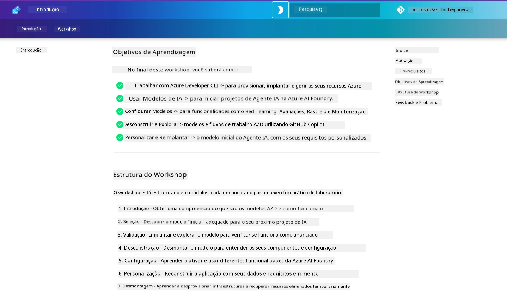

<div align="center">
  <div style="background: linear-gradient(135deg, #0078d4, #106ebe); border-radius: 10px; padding: 20px; margin: 20px 0; box-shadow: 0 4px 15px rgba(0, 120, 212, 0.3); border: 2px solid #005a9e;">
    <h2 style="color: white; margin: 0; font-size: 24px; text-shadow: 1px 1px 2px rgba(0,0,0,0.3);">
      🎯 Oficina AZD para Developers de IA
    </h2>
    <p style="color: white; margin: 10px 0 0 0; font-size: 16px; text-shadow: 1px 1px 2px rgba(0,0,0,0.3);">
      <strong>Uma oficina prática para construir aplicações de IA com a Azure Developer CLI.</strong><br>
      Complete 7 módulos para dominar os modelos AZD e fluxos de trabalho de implantação de IA.
    </p>
    <div style="margin-top: 15px;">
      <span style="background: rgba(255,255,255,0.2); padding: 5px 10px; border-radius: 15px; color: white; font-size: 14px;">
        📅 Orientação da fonte revista: Novembro de 2026
      </span>
    </div>
  </div>
</div>

# Oficina AZD para Developers de IA

Bem-vindo à oficina prática para aprender a Azure Developer CLI (AZD) com foco na implantação de aplicações de IA. Esta oficina ajuda-o a obter um conhecimento aplicado dos modelos AZD em 3 passos:

1. **Descoberta** - encontre o modelo que é certo para si.
1. **Implantação** - implante e valide que funciona
1. **Personalização** - modifique e itere para tornar seu!

Ao longo desta oficina, também será apresentado às principais ferramentas e fluxos de trabalho para developers, para o ajudar a simplificar a sua jornada de desenvolvimento de ponta a ponta.

<br/>

## Guia Baseado no Navegador

As lições da oficina estão em Markdown. Pode navegá-las diretamente no GitHub - ou lançar uma pré-visualização baseada no navegador como mostrado na captura de ecrã abaixo.



Para usar esta opção - faça um fork do repositório para o seu perfil, e lance o GitHub Codespaces. Assim que o terminal do VS Code estiver ativo, digite este comando:

Esta pré-visualização funciona no GitHub Codespaces, contentores de desenvolvimento, ou numa cópia local com Python e MkDocs instalados.

```bash title="" linenums="0"
python -m pip install -r requirements-dev.txt
python -m mkdocs serve --config-file workshop/mkdocs.yml
```

Execute estes comandos a partir da **raiz do repositório do curso**, não do exemplo de IA inicializado separadamente. Mantenha a pré-visualização em primeiro plano para que os erros permaneçam visíveis; pare-a com Ctrl+C. Para verificar o site sem o servir, execute `python -m mkdocs build --strict --config-file workshop/mkdocs.yml`.

Em alguns segundos, verá uma janela pop-up. Selecione a opção para `Open in browser`. O guia baseado na web abrir-se-á agora num novo separador do navegador. Alguns benefícios desta pré-visualização:

1. **Pesquisa integrada** - encontre palavras-chave ou lições rapidamente.
1. **Ícone de cópia** - passe o cursor sobre blocos de código para ver esta opção
1. **Alternância de tema** - alterne entre temas claros e escuros
1. **Obtenha ajuda** - clique no ícone do Discord no rodapé para participar!

<br/>

## Visão Geral da Oficina

**Duração:** 3-4 horas  
**Nível:** Iniciante a Intermédio  
**Pré-requisitos:** Familiaridade com Azure, conceitos de IA, VS Code e ferramentas de linha de comando.

Esta é uma oficina prática onde aprende fazendo. Depois de completar os exercícios, recomendamos rever o currículo AZD Para Iniciantes para continuar a sua jornada de aprendizagem sobre práticas recomendadas de Segurança e Produtividade.

| Tempo| Módulo  | Objetivo |
|:---|:---|:---|
| 15 mins | [Introdução](docs/instructions/0-Introduction.md) | Definir o contexto, compreender os objetivos |
| 30 mins | [Selecionar Modelo IA](docs/instructions/1-Select-AI-Template.md) | Explorar opções e escolher um início | 
| 30 mins | [Validar Modelo IA](docs/instructions/2-Validate-AI-Template.md) | Implantar solução padrão no Azure |
| 30 mins | [Desconstruir Modelo IA](docs/instructions/3-Deconstruct-AI-Template.md) | Explorar estrutura e configuração |
| 30 mins | [Configurar Modelo IA](docs/instructions/4-Configure-AI-Template.md) | Ativar e experimentar funcionalidades disponíveis |
| 30 mins | [Personalizar Modelo IA](docs/instructions/5-Customize-AI-Template.md) | Adaptar o modelo às suas necessidades |
| 30 mins | [Desmontar Infraestrutura](docs/instructions/6-Teardown-Infrastructure.md) | Limpar e libertar recursos |
| 15 mins | [Conclusão & Próximos Passos](docs/instructions/7-Wrap-up.md) | Recursos de aprendizagem, desafio da oficina |

<br/>

## O Que Vai Aprender

Pense no Modelo AZD como uma sandbox de aprendizagem para explorar várias capacidades e ferramentas para desenvolvimento end-to-end na Microsoft Foundry. No final desta oficina, deverá ter uma intuição para várias ferramentas e conceitos neste contexto.

| Conceito  | Objetivo |
|:---|:---|
| **Azure Developer CLI** | Compreender comandos e fluxos de trabalho da ferramenta|
| **Modelos AZD**| Compreender a estrutura do projeto e configuração|
| **Azure AI Agent**| Provisionar e implantar projeto Microsoft Foundry  |
| **Azure AI Search**| Permitir engenharia de contexto com agentes |
| **Observabilidade**| Explorar tracing, monitorização e avaliações |
| **Red Teaming**| Explorar testes adversariais e mitigação |

<br/>

## Estrutura da Oficina

A oficina está estruturada para o levar numa viagem desde a descoberta do modelo, até à implantação, desconstrução e personalização - usando o modelo inicial oficial [Getting Started with AI Agents](https://github.com/Azure-Samples/get-started-with-ai-agents) como base.

### [Módulo 1: Selecionar Modelo IA](docs/instructions/1-Select-AI-Template.md) (30 mins)

- O que são Modelos IA?
- Onde posso encontrar Modelos IA?
- Como posso começar a construir Agentes IA?
- **Laboratório**: Início rápido em Codespaces ou contentor de desenvolvimento

### [Módulo 2: Validar Modelo IA](docs/instructions/2-Validate-AI-Template.md) (30 mins)

- Qual é a arquitetura do Modelo IA?
- Qual é o Fluxo de Trabalho de Desenvolvimento AZD?
- Como posso obter ajuda com o desenvolvimento AZD?
- **Laboratório**: Implantar e validar modelo de Agentes IA

### [Módulo 3: Desconstruir Modelo IA](docs/instructions/3-Deconstruct-AI-Template.md) (30 mins)

- Explore o seu ambiente em `.azure/` 
- Explore a sua configuração de recursos em `infra/` 
- Explore a sua configuração AZD em `azure.yaml`s
- **Laboratório**: Modificar Variáveis de Ambiente e Reimplantar

### [Módulo 4: Configurar Modelo IA](docs/instructions/4-Configure-AI-Template.md) (30 mins)
- Explore: Geração Aumentada por Recuperação
- Explore: Avaliação de Agentes e Red Teaming
- Explore: Tracing e Monitorização
- **Laboratório**: Explore Agente IA + Observabilidade 

### [Módulo 5: Personalizar Modelo IA](docs/instructions/5-Customize-AI-Template.md) (30 mins)
- Defina: PRD com Requisitos do Cenário
- Configure: Variáveis de Ambiente para AZD
- Implemente: Lifecycle Hooks para tarefas adicionais
- **Laboratório**: Personalize o modelo para o meu cenário

### [Módulo 6: Desmontar Infraestrutura](docs/instructions/6-Teardown-Infrastructure.md) (30 mins)
- Recapitule: O que são Modelos AZD?
- Recapitule: Porque usar Azure Developer CLI?
- Próximos Passos: Experimente um modelo diferente!
- **Laboratório**: Desprovisionar infraestrutura e limpar

<br/>

## Desafio da Oficina

Quer desafiar-se a fazer mais? Aqui estão algumas sugestões de projetos - ou partilhe as suas ideias connosco!!

| Projeto | Descrição |
|:---|:---|
|1. **Desconstruir Um Modelo Complexo de IA** | Use o fluxo de trabalho e ferramentas que delineámos e veja se consegue implantar, validar e personalizar um modelo de solução IA diferente. _O que aprendeu?_|
|2. **Personalizar Com o Seu Cenário**  | Tente escrever um PRD (Documento de Requisitos do Produto) para um cenário diferente. Depois use o GitHub Copilot no seu repositório de modelo em Agent Model - e peça-lhe para gerar um fluxo de trabalho de personalização para si. _O que aprendeu? Como poderia melhorar estas sugestões?_|
| | |

## Tem algum feedback?

1. Publique um issue neste repositório - marque-o como `Workshop` para conveniência.
1. Junte-se ao Discord da Microsoft Foundry - conecte-se com os seus pares!


| | | 
|:---|:---|
| **📚 Página Inicial do Curso**| [AZD Para Iniciantes](../README.md)|
| **📖 Documentação** | [Começar com modelos IA](https://learn.microsoft.com/en-us/azure/ai-foundry/how-to/develop/ai-template-get-started)|
| **🛠️Modelos IA** | [Modelos Microsoft Foundry](https://ai.azure.com/templates) |
|**🚀 Próximos Passos** | [Iniciar Oficina](#workshop-overview) |
| | |

<br/>

---

**Navegação:** [Curso Principal](../README.md) | [Introdução](docs/instructions/0-Introduction.md) | [Módulo 1: Selecionar Modelo](docs/instructions/1-Select-AI-Template.md)

**Pronto para começar a construir aplicações de IA com AZD?**

[Iniciar Oficina: Introdução →](docs/instructions/0-Introduction.md)

---

<!-- CO-OP TRANSLATOR DISCLAIMER START -->
**Aviso Legal**:
Este documento foi traduzido utilizando o serviço de tradução automática [Co-op Translator](https://github.com/Azure/co-op-translator). Embora nos esforcemos pela precisão, esteja ciente de que traduções automáticas podem conter erros ou imprecisões. O documento original na sua língua nativa deve ser considerado a fonte autorizada. Para informações críticas, recomenda-se tradução profissional humana. Não nos responsabilizamos por quaisquer mal-entendidos ou interpretações incorretas resultantes da utilização desta tradução.
<!-- CO-OP TRANSLATOR DISCLAIMER END -->