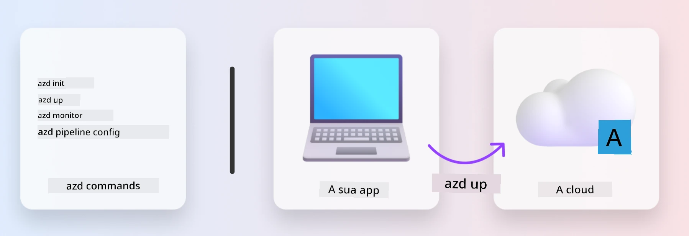
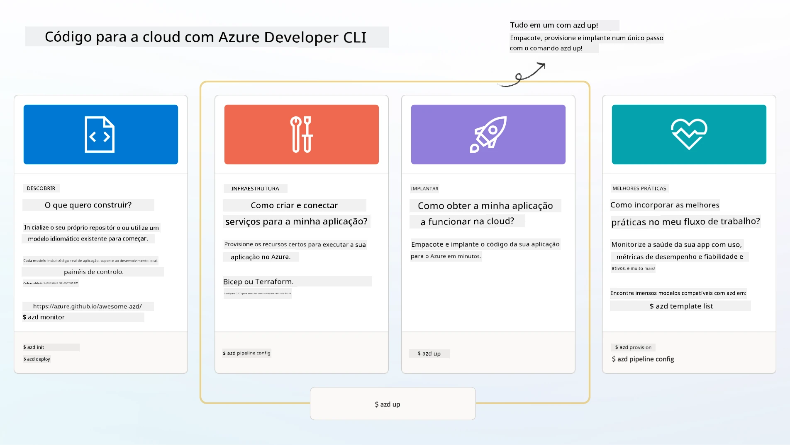

# 1. Selecionar um Modelo

!!! tip "NO FINAL DESTE MÓDULO SERÁS CAPAZ DE"

    - [ ] Describe what AZD templates are
    - [ ] Discover and use AZD templates for AI
    - [ ] Get started with the AI Agents template
    - [ ] **Lab 1:** AZD Quickstart in Codespaces or a dev container

---

## 1. Uma Analogia do Construtor

Construir uma aplicação de IA moderna pronta para produção _do zero_ pode ser assustador. É um pouco como construir a tua nova casa sozinho, tijolo a tijolo. Sim, é possível! Mas não é a forma mais eficaz de obter o resultado desejado! 

Em vez disso, normalmente começamos com uma _planta de design_ existente e trabalhamos com um arquiteto para a personalizar aos nossos requisitos pessoais. E é exatamente essa a abordagem a seguir para construir aplicações inteligentes. Primeiro, encontra uma boa arquitetura de design que se adeque ao teu problema. Depois, trabalha com um arquiteto de soluções para personalizar e desenvolver a solução para o teu cenário específico.

Mas onde podemos encontrar essas plantas de design? E como encontrar um arquiteto disposto a ensinar-nos a personalizar e a implementar essas plantas por nós mesmos? Neste workshop, respondemos a essas questões apresentando-te três tecnologias:

1. [Azure Developer CLI](https://aka.ms/azd) - uma ferramenta open-source que acelera o percurso do programador desde o desenvolvimento local (build) até à implementação na cloud (ship).
1. [Microsoft Foundry Templates](https://ai.azure.com/templates) - repositórios open-source padronizados que contêm código de exemplo, infraestrutura e ficheiros de configuração para implementar uma arquitetura de solução de IA.
1. [GitHub Copilot Agent Mode](https://code.visualstudio.com/docs/copilot/chat/chat-agent-mode) - um agente de codificação fundamentado no conhecimento Azure, que pode guiar-nos na navegação da base de código e fazer alterações - usando linguagem natural.

Com estas ferramentas em mãos, podemos agora _descobrir_ o modelo certo, _implementar_ para validar que funciona, e _personalizar_ para adaptar ao nosso cenário específico. Vamos mergulhar e aprender como funcionam.


---

## 2. Azure Developer CLI

O [Azure Developer CLI](https://learn.microsoft.com/en-us/azure/developer/azure-developer-cli/) (ou `azd`) é uma ferramenta de linha de comandos open-source que pode acelerar a tua jornada do código até à cloud com um conjunto de comandos amigáveis para programadores que funcionam consistentemente tanto no teu IDE (desenvolvimento) como nos ambientes CI/CD (devops).

Com o `azd`, a tua jornada de implementação pode ser tão simples como:

- `azd init` - Inicializa um novo projeto de IA a partir de um modelo AZD existente.
- `azd up` - Provisiona a infraestrutura e implementa a tua aplicação num único passo.
- `azd monitor` - Obtem monitorização em tempo real e diagnósticos para a tua aplicação implementada.
- `azd pipeline config` - Configura pipelines CI/CD para automatizar a implementação para Azure.

**🎯 | EXERCÍCIO**: <br/> Explora agora a ferramenta de linha de comandos `azd` no teu ambiente atual deste workshop. Pode ser GitHub Codespaces, um contentor de desenvolvimento, ou um clone local com os pré-requisitos instalados. Começa por digitar este comando para ver o que a ferramenta pode fazer:

```bash title="" linenums="0"
azd help
```



---

## 3. O Modelo AZD

Para o `azd` conseguir isso, ele precisa de saber a infraestrutura a provisionar, as configurações a aplicar, e a aplicação a implementar. É aqui que entram os [modelos AZD](https://learn.microsoft.com/en-us/azure/developer/azure-developer-cli/azd-templates?tabs=csharp). 

Os modelos AZD são repositórios open-source que combinam código de exemplo com ficheiros de infraestrutura e configuração necessários para implementar a arquitetura da solução.
Usando uma abordagem de _Infraestrutura como Código_ (IaC), permitem que as definições de recursos e configurações do modelo sejam controladas por versão (assim como o código da aplicação) - criando fluxos de trabalho reutilizáveis e consistentes entre os utilizadores desse projeto.

Quando crias ou reutilizas um modelo AZD para _o teu_ cenário, considera as seguintes questões:

1. O que estás a construir? → Existe um modelo que tenha código inicial para esse cenário?
1. Como está arquitetada a tua solução? → Existe um modelo que tenha os recursos necessários?
1. Como é implementada a tua solução? → Pensa em `azd deploy` com hooks de pré/pós-processamento!
1. Como podes otimizar ainda mais? → Pensa em monitorização integrada e pipelines automáticos!

**🎯 | EXERCÍCIO**: <br/> 
Visita a galeria [Awesome AZD](https://azure.github.io/awesome-azd/) e usa os filtros para explorares os mais de 250 modelos atualmente disponíveis. Vê se consegues encontrar um que se alinhe com os requisitos do _teu_ cenário.



---

## 4. Modelos de Aplicações de IA

Para aplicações alimentadas por IA, a Microsoft fornece modelos especializados que incluem **Microsoft Foundry** e **Foundry Agents**. Estes modelos aceleram o teu percurso para construir aplicações inteligentes e prontas para produção.

### Modelos Microsoft Foundry e Foundry Agents

Seleciona um modelo abaixo para implementar. Cada modelo está disponível na [Awesome AZD](https://azure.github.io/awesome-azd/) e pode ser inicializado com um único comando.

| Modelo | Descrição | Comando de Implementação |
|----------|-------------|----------------|
| **[AI Chat com RAG](https://github.com/Azure-Samples/azure-search-openai-demo)** | Aplicação de chat suportada por pesquisa | `azd init -t Azure-Samples/azure-search-openai-demo .` |
| **[Começar com Agentes de IA](https://github.com/Azure-Samples/get-started-with-ai-agents)** | Aplicação de chat com suporte de agentes; usada ao longo deste workshop | `azd init -t Azure-Samples/get-started-with-ai-agents .` |
| **[Começar com Chat IA](https://github.com/Azure-Samples/get-started-with-ai-chat)** | Aplicação de chat IA de arranque | `azd init -t Azure-Samples/get-started-with-ai-chat .` |

Estas são alternativas: inicializa **um** modelo num diretório vazio próprio. O `.` final seleciona esse diretório; omiti-lo nas versões atuais do AZD cria um subdiretório com o nome do modelo. A inicialização descarrega um projeto; `azd up` realiza a implementação faturável após a revisão dos pré-requisitos, recursos, suporte a regiões e quotas.

### Começo Rápido

1. **Explorar modelos**: Visita [https://azure.github.io/awesome-azd/](https://azure.github.io/awesome-azd/) e filtra por `AI`, `Agents` ou `Microsoft Foundry`
2. **Selecionar o teu modelo**: Escolhe aquele que corresponda ao teu caso de uso
3. **Inicializar**: Executa o comando `azd init` para o modelo escolhido
4. **Implementar**: Executa `azd up` para provisionar e implementar

**🎯 | EXERCÍCIO**: <br/>
Seleciona um dos modelos acima com base no teu cenário:

- **Continuar este workshop?** → Escolhe **Começar com Agentes de IA**
- **Construir chat suportado por pesquisa?** → Explora **AI Chat com RAG** separadamente
- **Precisas de outra arquitetura?** → Pesquisa na galeria e verifica o repositório real, estado da implementação e pré-requisitos

```bash title="Initialize the workshop template in an empty directory" linenums="0"
azd init -t Azure-Samples/get-started-with-ai-agents .
azd auth login
azd up
```

!!! info "Explora Mais Modelos"
    A [Awesome AZD Gallery](https://azure.github.io/awesome-azd/) contém mais de 250 modelos. Usa os filtros para encontrares modelos que correspondam especificamente aos teus requisitos de linguagem, framework e serviços Azure.

---

<!-- CO-OP TRANSLATOR DISCLAIMER START -->
**Aviso Legal**:
Este documento foi traduzido utilizando o serviço de tradução automática [Co-op Translator](https://github.com/Azure/co-op-translator). Embora nos esforcemos pela precisão, esteja ciente de que traduções automáticas podem conter erros ou imprecisões. O documento original na sua língua nativa deve ser considerado a fonte autorizada. Para informações críticas, recomenda-se tradução profissional humana. Não nos responsabilizamos por quaisquer mal-entendidos ou interpretações incorretas resultantes da utilização desta tradução.
<!-- CO-OP TRANSLATOR DISCLAIMER END -->