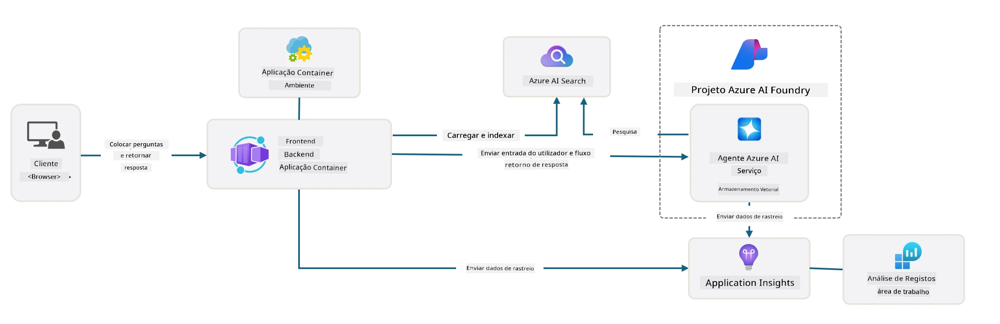
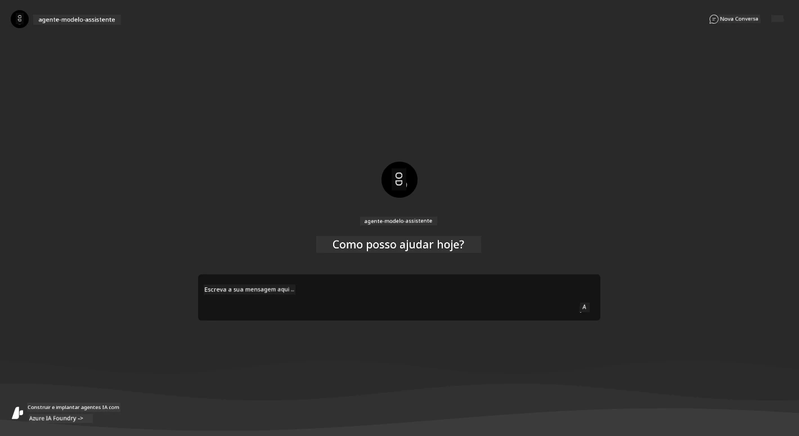

# 2. Validar um Modelo

> Orientação da fonte revista contra AZD 1.37.2 e a amostra atual em 4 de novembro de 2026. Capturas de ecrã são ilustrativas; navegação no portal, predefinições do modelo e disponibilidade do serviço podem mudar. Esta revisão não realizou uma implantação ao vivo no Azure.

!!! tip "NO FINAL DESTE MÓDULO IRÁ CONSEGUIR"

    - [ ] Identify the sample's prerequisites and intended resources
    - [ ] Deploy the selected template into an intentional environment
    - [ ] Verify the application and agent behavior separately from deployment success
    - [ ] **Lab 2:** Record evidence of a working baseline, or an actionable deployment blocker

---

## 1. Verificar pré-requisitos

O [Azure Developer CLI](https://learn.microsoft.com/azure/developer/azure-developer-cli/) gere a implantação de aplicação utilizando a configuração, infraestrutura e código do modelo. Verifique a sua versão instalada:

```bash
azd version
```

Utilize as [instruções atuais de instalação/atualização](https://learn.microsoft.com/azure/developer/azure-developer-cli/install-azd) se necessário. A amostra revista declara AZD `>=1.14.0`, mas é recomendada uma versão suportada atual. As extensões opcionais de IA têm requisitos de versão separados; o fluxo de trabalho normal `azd up` desta amostra não requer a extensão de agentes.

Antes do provisionamento, leia a [configuração de conta Azure](https://github.com/Azure-Samples/get-started-with-ai-agents/blob/main/docs/azure_account_setup.md) e o [guia de implantação](https://github.com/Azure-Samples/get-started-with-ai-agents/blob/main/docs/deployment.md) da amostra. Confirme a sua subscrição, permissões, disponibilidade do modelo, quota regional e custos esperados. Uma conta gratuita Azure não garante acesso ou uso gratuito de todos os serviços necessários.

## 2. Abrir a amostra selecionada

Utilize o repositório [Começar com Agentes de IA](https://github.com/Azure-Samples/get-started-with-ai-agents) inicializado no Módulo 1. Se não o tiver inicializado, escolha uma destas alternativas:

- Abrir um [Codespace para a amostra](https://github.com/codespaces/new/Azure-Samples/get-started-with-ai-agents).
- Clonar a amostra e seguir a sua configuração local/dev-container.
- Num **diretório vazio**, execute:

```bash
azd init --template Azure-Samples/get-started-with-ai-agents .
```

Não inicialize um segundo modelo sobre um projeto existente. Execute comandos subsequentes a partir da raiz da amostra que contém `azure.yaml`, e não da raiz do repositório do curso.

A amostra aloja uma aplicação de chat com agente em Container Apps e provisiona recursos Foundry de suporte. Reveja a arquitetura atual e serviços opcionais em vez de utilizar uma captura de ecrã antiga como inventário exato dos recursos.



## 3. Implementar intencionalmente

```bash
azd auth login
azd up
```

Reveja os prompts:

1. Escolha um nome único para o ambiente AZD.
2. Selecione a subscrição pretendida, não simplesmente a que for apresentada primeiro.
3. Selecione uma região suportada pelo modelo/versão/SKU requerido e pela sua quota.
4. Leia a saída do provisionamento, implantação e hooks pós-implantação.

As predefinições revistas incluem `gpt-5-mini`, versão `2025-08-07`, e `GlobalStandard`. Verifique o seu modelo inicializado e as [combinações suportadas de modelo/região](https://learn.microsoft.com/azure/ai-services/agents/concepts/model-region-support). Nenhuma região é garantida universalmente para funcionar.

A duração da implantação varia. Se o provisionamento falhar, preserve o erro e corrija a sua causa antes de tentar novamente. Não apague a implantação nem elimine recursos permanentemente como passo genérico de resolução de problemas.

## 4. Validar a aplicação

```bash
azd show
```

Abra o endpoint para `api_and_frontend`, ou localize o Container App no grupo de recursos da implantação no [portal Azure](https://portal.azure.com/). Siga as instruções de acesso/autenticação da amostra se for necessário iniciar sessão; não desative a autenticação para que um teste básico passe.



Experimente algumas [perguntas de exemplo](https://github.com/Azure-Samples/get-started-with-ai-agents/blob/main/docs/sample_questions.md):

- Uma pergunta factual geral.
- Uma pergunta cuja resposta deverá estar presente nos documentos carregados da amostra.
- Uma pergunta que não pode ser respondida a partir desses documentos.

Verifique que a UI carrega, a API responde, a recuperação utiliza os dados esperados, as citações coincidem com o conteúdo fonte, e questões não suportadas são tratadas adequadamente. Apenas uma mensagem `azd up` bem-sucedida não garante estes resultados.

## 5. Inspecionar o agente implantado

Abra o seu projeto no [portal Foundry](https://ai.azure.com/). No fluxo de portal revisto, selecione **Build**, depois **Agents**, e localize o agente criado pela amostra. Os rótulos de navegação podem mudar.

Registe:

- O nome e versão do agente.
- O deployment do modelo configurado.
- As instruções reais e ferramentas ativadas.
- Quais ficheiros ou índice de pesquisa estão ligados, e se a configuração concluiu com sucesso.

A amostra revista usa um identificador de agente na forma `agent_name:agent_version` para seus testes de avaliação. Não copie um identificador clássico de agente/thread de uma captura de ecrã antiga para um fluxo de trabalho API mais recente.

Compare os documentos carregados com `src/files/` na sua revisão inicializada. Capturas anteriores mostraram 32 ficheiros; essa contagem não é um padrão garantido atual. Verifique qualquer resposta sobre clientes/produtos da amostra contra os dados sintéticos reais, e não carregue dados reais de clientes para este exercício.

## 6. Comparar com o playground

Abra o playground do agente selecionado no Foundry e faça a mesma pergunta de recuperação. Compare a versão do agente configurada, ferramentas, citações e qualidade da resposta com a aplicação implantada.

As respostas são probabilísticas; a correspondência palavra por palavra não é o critério. Se os resultados diferirem substancialmente, verifique se a aplicação e o playground visam o mesmo projeto, agente/versão e fonte de conhecimento.

## 7. Verificar pré-requisitos de observabilidade

O [guia de observabilidade](https://github.com/Azure-Samples/get-started-with-ai-agents/blob/main/docs/observability.md) da amostra é a fonte de verdade para configuração de tracing, avaliação e red-teaming.

Nas predefinições de infraestrutura revistas, o Application Insights está ativado mas **o tracing do cliente está desativado** (`ENABLE_AZURE_MONITOR_TRACING=false`). Criar um recurso de monitorização não prova que a aplicação está a exportar traces. O Módulo 5 cobre a ativação do tracing e a geração de um pedido de teste.

Use os logs da aplicação do Container App para investigar erros de arranque/API. No Foundry, inspecione as vistas disponíveis de tracing e monitorização do agente. Entradas de avaliação requerem a configuração relevante, avaliadores/região suportados, e pedidos reais; não são garantidos aparecer automaticamente para cada execução.

Mantenha a captura de conteúdo de prompt/resposta desativada a menos que os seus requisitos de privacidade, retenção, acesso e redação tenham sido revistos.

## 8. Compreender os valores do ambiente

O AZD armazena o ambiente selecionado sob `.azure/<environment-name>/`. Entradas persistentes e outputs da implantação podem ser lidos com:

```bash
azd env list
azd env get-value AZURE_ENV_NAME
azd env get-value AZURE_LOCATION
```

`azd env get-values` lista todos os valores, que podem incluir configuração sensível. Não cole essa saída em issues públicos ou logs.

O AZD usa o ambiente selecionado ao executar seus comandos/hooks, enquanto as variáveis de ambiente de processo podem também influenciar comandos e modelos. Isto **não** exporta valores para o seu shell pai ou para cada processo Python iniciado independentemente. Siga as [instruções de desenvolvimento local](https://github.com/Azure-Samples/get-started-with-ai-agents/blob/main/docs/local_development.md) da amostra.

Predefinições de modelo podem ser aplicadas em `infra/main.parameters.json` sem aparecerem como valores locais explícitos. Definir uma variável arbitrária não altera a infraestrutura a menos que o modelo a consuma.

Por exemplo, para selecionar explicitamente os valores de modelo revistos:

```bash
azd env set AZURE_AI_AGENT_MODEL_NAME gpt-5-mini
azd env set AZURE_AI_AGENT_MODEL_VERSION 2025-08-07
azd env set AZURE_AI_AGENT_DEPLOYMENT_SKU GlobalStandard
azd provision --preview
azd up
```

Reveja compatibilidade, capacidade, disponibilidade e as mudanças planeadas primeiro. Atualizações de infraestrutura requerem provisionamento; apenas `azd deploy` não é suficiente. Mudanças suportadas de modelo normalmente não requerem desmontar toda a aplicação.

`azd env refresh` recupera outputs da implantação para um ambiente acessível; não reconstrói todas as entradas personalizadas, sincroniza segredos, nem substitui a gestão de configuração.

## 9. Registar a sua base de referência

- [ ] Ambiente, subscrição, região e modelo corretos verificados.
- [ ] Provisionamento, implantação e hooks de configuração requeridos concluídos sem erros não resolvidos.
- [ ] Acesso à aplicação, chat, recuperação e citações verificados.
- [ ] Agente/versão e fonte de conhecimento identificados.
- [ ] Pré-requisitos de observabilidade e quaisquer bloqueios remanescentes documentados.

Continue para [Desconstruir um Modelo](3-Deconstruct-AI-Template.md).

---

<!-- CO-OP TRANSLATOR DISCLAIMER START -->
**Aviso Legal**:
Este documento foi traduzido utilizando o serviço de tradução automática [Co-op Translator](https://github.com/Azure/co-op-translator). Embora nos esforcemos pela precisão, esteja ciente de que traduções automáticas podem conter erros ou imprecisões. O documento original na sua língua nativa deve ser considerado a fonte autorizada. Para informações críticas, recomenda-se tradução profissional humana. Não nos responsabilizamos por quaisquer mal-entendidos ou interpretações incorretas resultantes da utilização desta tradução.
<!-- CO-OP TRANSLATOR DISCLAIMER END -->