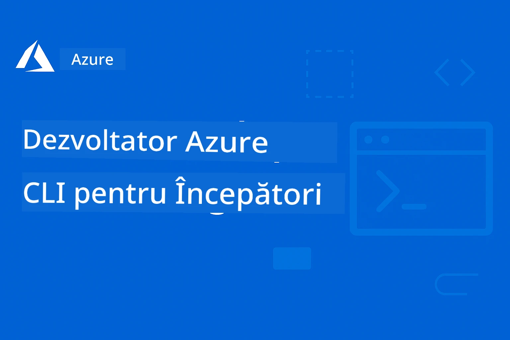

# AZD Pentru Începători: O Călătorie Structurată de Învățare

 

[](https://GitHub.com/microsoft/azd-for-beginners/watchers/)
[](https://GitHub.com/microsoft/azd-for-beginners/network/)
[](https://GitHub.com/microsoft/azd-for-beginners/stargazers/)

[](https://discord.com/invite/nkVh3dp)
[](https://discord.gg/nTYy5BXMWG)

---

### Traduceri Automate (Întotdeauna Actualizate)

<!-- CO-OP TRANSLATOR LANGUAGES TABLE START -->
[Arabic](../ar/README.md) | [Bengali](../bn/README.md) | [Bulgarian](../bg/README.md) | [Burmese (Myanmar)](../my/README.md) | [Chinese (Simplified)](../zh-CN/README.md) | [Chinese (Traditional, Hong Kong)](../zh-HK/README.md) | [Chinese (Traditional, Macau)](../zh-MO/README.md) | [Chinese (Traditional, Taiwan)](../zh-TW/README.md) | [Croatian](../hr/README.md) | [Czech](../cs/README.md) | [Danish](../da/README.md) | [Dutch](../nl/README.md) | [Estonian](../et/README.md) | [Finnish](../fi/README.md) | [French](../fr/README.md) | [German](../de/README.md) | [Greek](../el/README.md) | [Hebrew](../he/README.md) | [Hindi](../hi/README.md) | [Hungarian](../hu/README.md) | [Indonesian](../id/README.md) | [Italian](../it/README.md) | [Japanese](../ja/README.md) | [Kannada](../kn/README.md) | [Khmer](../km/README.md) | [Korean](../ko/README.md) | [Lithuanian](../lt/README.md) | [Malay](../ms/README.md) | [Malayalam](../ml/README.md) | [Manipuri (Meitei Mayek)](../mni/README.md) | [Marathi](../mr/README.md) | [Nepali](../ne/README.md) | [Nigerian Pidgin](../pcm/README.md) | [Norwegian](../no/README.md) | [Persian (Farsi)](../fa/README.md) | [Polish](../pl/README.md) | [Portuguese (Brazil)](../pt-BR/README.md) | [Portuguese (Portugal)](../pt-PT/README.md) | [Punjabi (Gurmukhi)](../pa/README.md) | [Romanian](./README.md) | [Russian](../ru/README.md) | [Serbian (Cyrillic)](../sr/README.md) | [Slovak](../sk/README.md) | [Slovenian](../sl/README.md) | [Spanish](../es/README.md) | [Swahili](../sw/README.md) | [Swedish](../sv/README.md) | [Tagalog (Filipino)](../tl/README.md) | [Tamil](../ta/README.md) | [Telugu](../te/README.md) | [Thai](../th/README.md) | [Turkish](../tr/README.md) | [Ukrainian](../uk/README.md) | [Urdu](../ur/README.md) | [Vietnamese](../vi/README.md)

> **Preferi să Clonezi Local?**
>
> Acest depozit include peste 50 de traduceri în limbi diferite, ceea ce crește semnificativ dimensiunea descărcării. Pentru a clona fără traduceri, folosește sparse checkout:
>
> **Bash / macOS / Linux:**
> ```bash
> git clone --filter=blob:none --sparse https://github.com/microsoft/AZD-for-beginners.git
> cd AZD-for-beginners
> git sparse-checkout set --no-cone '/*' '!translations' '!translated_images'
> ```
>
> **CMD (Windows):**
> ```cmd
> git clone --filter=blob:none --sparse https://github.com/microsoft/AZD-for-beginners.git
> cd AZD-for-beginners
> git sparse-checkout set --no-cone "/*" "!translations" "!translated_images"
> ```
>
> Aceasta îți oferă tot ce ai nevoie pentru a finaliza cursul cu o descărcare mult mai rapidă.
<!-- CO-OP TRANSLATOR LANGUAGES TABLE END -->

## 🆕 Ce e Nou în azd Astăzi

> 📌 Acest curs este validat pentru **`azd 1.27.1`** (iulie 2026). Rulează `azd version` pentru a verifica build-ul și `azd upgrade` pentru a obține cele mai recente versiuni.

Azure Developer CLI s-a extins dincolo de aplicațiile web tradiționale și API-uri. Astăzi, azd este unicul instrument pentru a implementa **orice** aplicație în Azure — inclusiv aplicații alimentate de AI și agenți inteligenți.

Ce înseamnă asta pentru tine:

- **Agenții AI sunt acum încărcături de lucru azd de primă clasă.** Poți inițializa, implementa și gestiona proiecte cu agenți AI folosind același flux de lucru `azd init` → `azd up` pe care îl cunoști deja.
- **Un ciclu complet de viață al agentului din CLI.** Extensia `azure.ai.agents` acoperă acum întregul parcurs — `azd ai agent init` pentru scaffold, `azd ai agent invoke` pentru testare (cu ieșire privind timpul de răspuns), `azd ai agent eval generate` și `azd ai agent optimize` pentru măsurarea și îmbunătățirea calității, și `azd ai agent delete` pentru curățare.
- **Mai multe blocuri de construcție AI.** Noi extensii în previzualizare — `azure.ai.skills` și `azure.ai.connections` — îți permit să gestionezi competențele reusable ale agenților și conexiunile Foundry direct cu azd.
- **Integrarea Microsoft Foundry** aduce implementarea modelelor, găzduirea agenților și configurarea serviciilor AI direct în ecosistemul de șabloane azd.
- **Bază zilnică mai lină.** Versiunile recente au făcut `azd init` idempotent (sigur de rulat repetat), au făcut `azd auth login` să elimine automat token-urile expirate și au adăugat un prompt prietenos de configurare la prima rulare `azd tool`.
- **Fluxul principal nu s-a schimbat.** Fie că implementezi o aplicație todo, un microserviciu sau o soluție AI multi-agent, comenzile sunt aceleași.

> **Notă pentru utilizatorii Aspire:** Microsoft se referă acum la produs pur și simplu ca **Aspire** (anterior ".NET Aspire"). Suportul azd pentru Aspire rămâne neschimbat — doar numele a fost actualizat.

Dacă ai folosit azd înainte, suportul AI este o extensie naturală — nu un instrument separat sau o cale avansată. Dacă începi de la zero, vei învăța un singur flux de lucru care merge pentru orice.

---

## 🚀 Ce este Azure Developer CLI (azd)?

**Azure Developer CLI (azd)** este un instrument prietenos pentru dezvoltatori, din linia de comandă, care face simplă implementarea aplicațiilor în Azure. În loc să creezi și să conectezi manual zeci de resurse Azure, poți implementa aplicații complete cu o singură comandă.

### Magia lui `azd up`

```bash
# This single command does everything:
# ✅ Creates all Azure resources  
# ✅ Configures networking and security
# ✅ Builds your application code
# ✅ Deploys to Azure
# ✅ Gives you a working URL
azd up
```

**Asta e tot!** Fără click-uri în Azure Portal, fără teme ARM complexe de învățat mai întâi, fără configurare manuală — doar aplicații funcționale în Azure.

---

## ❓ Azure Developer CLI vs Azure CLI: Care e Diferența?

Este cea mai frecventă întrebare pe care o pun începătorii. Iată răspunsul simplu:

| Caracteristică | **Azure CLI (`az`)** | **Azure Developer CLI (`azd`)** |
|---------|---------------------|--------------------------------|
| **Scop** | Gestionarea resurselor individuale Azure | Implementarea aplicațiilor complete |
| **Mentalitate** | Axat pe infrastructură | Axat pe aplicație |
| **Exemplu** | `az webapp create --name myapp...` | `azd up` |
| **Curba de învățare** | Trebuie să cunoști serviciile Azure | Trebuie să-ți cunoști aplicația |
| **Cel mai potrivit pentru** | DevOps, Infrastructură | Dezvoltatori, Prototipare |

### O Analogie Simplă

- **Azure CLI** este ca și cum ai avea toate uneltele pentru a construi o casă - ciocane, fierăstraie, cuie. Poți construi orice, dar trebuie să știi construcții.
- **Azure Developer CLI** este ca și cum ai angaja un antreprenor - îi descrii ce vrei și el se ocupă de construcție.

### Când să Folosești Fiecare

| Scenariu | Folosește Acesta |
|----------|----------|
| "Vreau să implementez rapid aplicația web" | `azd up` |
| "Trebuie să creez doar un cont de stocare" | `az storage account create` |
| "Construiesc o aplicație completă AI" | `azd init --template azure-search-openai-demo` |
| "Trebuie să depanez o resursă Azure specifică" | `az resource show` |
| "Vreau implementare pregătită pentru producție în câteva minute" | `azd up --environment production` |

### Ele Lucrează Împreună!

AZD folosește Azure CLI sub capotă. Poți folosi ambele:
```bash
# Deploy your app with AZD
azd up

# Then fine-tune specific resources with Azure CLI
az webapp config set --name myapp --always-on true
```

---

## 🌟 Găsește Șabloane în Awesome AZD

Nu începe de la zero! **Awesome AZD** este colecția comunității cu șabloane gata de implementare:

| Resursă | Descriere |
|----------|-------------|
| 🔗 [**Galerie Awesome AZD**](https://azure.github.io/awesome-azd/) | Răsfoiește peste 200 de șabloane cu implementare dintr-un click |
| 🔗 [**Trimite un Șablon**](https://github.com/Azure/awesome-azd/issues) | Contribuie cu propriul șablon către comunitate |
| 🔗 [**Depozitul GitHub**](https://github.com/Azure/awesome-azd) | Dă stele și explorează sursa |

### Șabloane AI Populare din Awesome AZD

```bash
# RAG Chat with Microsoft Foundry Models + AI Search
azd init --template azure-search-openai-demo

# Quick AI Chat Application
azd init --template openai-chat-app-quickstart

# AI Agents with Foundry Agents
azd init --template get-started-with-ai-agents
```

---

## 🎯 Începe în 3 Pași

Înainte să începi, asigură-te că mașina ta este pregătită pentru șablonul pe care vrei să-l implementezi:

**Windows:**
```powershell
.\validate-setup.ps1
```

**macOS / Linux:**
```bash
bash ./validate-setup.sh
```

Dacă vreuna dintre verificările necesare eșuează, rezolvă-o mai întâi, apoi continuă cu startul rapid.

### Pasul 1: Instalează AZD (2 minute)

**Windows:**
```powershell
winget install microsoft.azd
```

**macOS:**
```bash
brew tap azure/azd && brew install azd
```

**Linux:**
```bash
curl -fsSL https://aka.ms/install-azd.sh | bash
```

### Pasul 2: Autentifică-te pentru AZD

```bash
# Optional if you plan to use Azure CLI commands directly in this course
az login

# Required for AZD workflows
azd auth login
```

Dacă nu ești sigur ce ai nevoie, urmează fluxul complet de configurare în [Instalare & Configurare](docs/chapter-01-foundation/installation.md#authentication-setup).

### Pasul 3: Implementează Prima Ta Aplicație

```bash
# Initialize from a template
azd init --template todo-nodejs-mongo

# Deploy to Azure (creates everything!)
azd up
```

**🎉 Asta e tot!** Aplicația ta este acum live pe Azure.

### Curățare (Nu Uita!)

```bash
# Remove all resources when done experimenting
azd down --force --purge
```

---

## 📚 Cum să Folosești Acest Curs

Acest curs este conceput pentru **învățare progresivă** - începe de unde ești confortabil și avansează:

| Experiența Ta | Începe Aici |
|-----------------|------------|
| **Nou în Azure** | [Capitolul 1: Fundament](#-chapter-1-foundation--quick-start) |
| **Cunoști Azure, nou în AZD** | [Capitolul 1: Fundament](#-chapter-1-foundation--quick-start) |
| **Vrei să implementezi aplicații AI** | [Capitolul 2: Dezvoltare Prioritar AI](#-chapter-2-ai-first-development-recommended-for-ai-developers) |
| **Vrei practică hands-on** | [🎓 Atelier Interactiv](workshop/README.md) - laborator ghidat de 3-4 ore |
| **Ai nevoie de tipare pentru producție** | [Capitolul 8: Producție & Enterprise](#-chapter-8-production--enterprise-patterns) |

### Configurare Rapidă

1. **Fă Fork la Acest Depozit**: [](https://GitHub.com/microsoft/azd-for-beginners/fork)
2. **Clonează-l**: `git clone https://github.com/YOUR-USERNAME/azd-for-beginners.git`
3. **Cere Ajutor**: [Comunitatea Azure Discord](https://discord.com/invite/ByRwuEEgH4)

> **Preferi să Clonezi Local?**

> Acest depozit include peste 50 de traduceri în limbi diferite, ceea ce crește semnificativ dimensiunea descărcării. Pentru a clona fără traduceri, folosește sparse checkout:
> ```bash
> git clone --filter=blob:none --sparse https://github.com/microsoft/AZD-for-beginners.git
> cd AZD-for-beginners
> git sparse-checkout set --no-cone '/*' '!translations' '!translated_images'
> ```
> Aceasta îți oferă tot ce ai nevoie pentru a finaliza cursul cu o descărcare mult mai rapidă.


## Prezentare Generală a Cursului

Stăpânește Azure Developer CLI (azd) prin capitole structurate, concepute pentru învățare progresivă. **Accent special pe implementarea aplicațiilor AI cu integrarea Microsoft Foundry.**

### De ce Este Acest Curs Esențial pentru Dezvoltatorii Moderni

Pe baza perspectivelor comunității Microsoft Foundry Discord, **45% dintre dezvoltatori doresc să folosească AZD pentru workload-uri AI** dar întâmpină provocări legate de:
- Arhitecturi complexe multi-serviciu AI
- Cele mai bune practici pentru implementarea AI în producție  
- Integrarea și configurarea serviciilor AI în Azure
- Optimizarea costurilor pentru workload-uri AI
- Depanarea problemelor specifice implementării AI

### Obiective de Învățare

Prin finalizarea acestui curs structurat, vei:
- **Stăpâni Bazele AZD**: concepte de bază, instalare și configurare
- **Implementa Aplicații AI**: Folosește AZD împreună cu serviciile Microsoft Foundry
- **Implementați Infrastructure as Code**: Gestionați resursele Azure cu șabloane Bicep
- **Depanați Implementările**: Rezolvați probleme comune și depanați erorile
- **Optimizați pentru Producție**: Securitate, scalare, monitorizare și gestionarea costurilor
- **Construiți Soluții Multi-Agent**: Implementați arhitecturi AI complexe

## Înainte să începeți: Conturi, Acces și Presupuneri

Înainte de a începe Capitolul 1, asigurați-vă că aveți următoarele în ordine. Pașii de instalare din acest ghid presupun că aceste elemente de bază sunt deja rezolvate.

- **Un abonament Azure**: Puteți folosi un abonament existent de la serviciu sau contul propriu, sau puteți crea o [probă gratuită](https://aka.ms/azurefreetrial) pentru a începe.
- **Permisiunea de a crea resurse Azure**: Pentru majoritatea exercițiilor, ar trebui să aveți cel puțin acces de **Contributor** pe abonamentul sau grupul de resurse țintă. Unele capitole pot presupune și că puteți crea grupuri de resurse, identități gestionate și atribuiri RBAC.
- [**Un cont GitHub**](https://github.com): Este util pentru a copia depozitul, a urmări propriile modificări și a folosi GitHub Codespaces pentru atelier.
- **Prerechizite pentru rularea șabloanelor**: Unele șabloane necesită unelte locale precum Node.js, Python, Java sau Docker. Rulați validatorul de configurare înainte de a începe pentru a detecta lipsuri în unelte devreme.
- **Familiaritate de bază cu terminalul**: Nu trebuie să fiți expert, dar ar trebui să fiți confortabil să executați comenzi precum `git clone`, `azd auth login` și `azd up`.

> **Lucrați într-un abonament enterprise?**
> Dacă mediul dvs. Azure este gestionat de un administrator, confirmați în prealabil că puteți implementa resurse în abonamentul sau grupul de resurse pe care intenționați să îl folosiți. Dacă nu, cereți un abonament sandbox sau acces de Contributor înainte de a începe.

> **Sunteți nou în Azure?**
> Începeți cu propria probă Azure sau abonament pay-as-you-go la https://aka.ms/azurefreetrial pentru a putea finaliza exercițiile complet, fără a aștepta aprobări la nivel de tenant.

## 🗺️ Harta Cursului: Navigare Rapidă pe Capitole

Fiecare capitol are un README dedicat cu obiective de învățare, porniri rapide și exerciții:

| Capitol | Subiect | Lecții | Durată | Complexitate |
|---------|---------|--------|--------|--------------|
| **[Cap 1: Bază](docs/chapter-01-foundation/README.md)** | Început | [Bazele AZD](docs/chapter-01-foundation/azd-basics.md) &#124; [Instalare](docs/chapter-01-foundation/installation.md) &#124; [Primul Proiect](docs/chapter-01-foundation/first-project.md) | 30-45 min | ⭐ |
| **[Cap 2: Dezvoltare AI](docs/chapter-02-ai-development/README.md)** | Aplicații AI-First | [Integrare Foundry](docs/chapter-02-ai-development/microsoft-foundry-integration.md) &#124; [Agenți AI](docs/chapter-02-ai-development/agents.md) &#124; [Implementare Model](docs/chapter-02-ai-development/ai-model-deployment.md) &#124; [Atelier](docs/chapter-02-ai-development/ai-workshop-lab.md) | 1-2 ore | ⭐⭐ |
| **[Cap 3: Configurare](docs/chapter-03-configuration/README.md)** | Autentificare & Securitate | [Configurare](docs/chapter-03-configuration/configuration.md) &#124; [Autentificare & Securitate](docs/chapter-03-configuration/authsecurity.md) | 45-60 min | ⭐⭐ |
| **[Cap 4: Infrastructură](docs/chapter-04-infrastructure/README.md)** | IaC & Implementare | [Ghid de Implementare](docs/chapter-04-infrastructure/deployment-guide.md) &#124; [Provisionare](docs/chapter-04-infrastructure/provisioning.md) | 1-1.5 ore | ⭐⭐⭐ |
| **[Cap 5: Multi-Agent](docs/chapter-05-multi-agent/README.md)** | Soluții Agenți AI | [Scenariu Retail](examples/retail-scenario.md) &#124; [Modele de Coordonare](docs/chapter-06-pre-deployment/coordination-patterns.md) | 2-3 ore | ⭐⭐⭐⭐ |
| **[Cap 6: Pre-implementare](docs/chapter-06-pre-deployment/README.md)** | Planificare & Validare | [Verificări Preflight](docs/chapter-06-pre-deployment/preflight-checks.md) &#124; [Planificare Capacitate](docs/chapter-06-pre-deployment/capacity-planning.md) &#124; [Selectare SKU](docs/chapter-06-pre-deployment/sku-selection.md) &#124; [App Insights](docs/chapter-06-pre-deployment/application-insights.md) | 1 oră | ⭐⭐ |
| **[Cap 7: Depanare](docs/chapter-07-troubleshooting/README.md)** | Debug & Corectare | [Probleme Comune](docs/chapter-07-troubleshooting/common-issues.md) &#124; [Debugging](docs/chapter-07-troubleshooting/debugging.md) &#124; [Probleme AI](docs/chapter-07-troubleshooting/ai-troubleshooting.md) | 1-1.5 ore | ⭐⭐ |
| **[Cap 8: Producție](docs/chapter-08-production/README.md)** | Modele Enterprise | [Practici de Producție](docs/chapter-08-production/production-ai-practices.md) | 2-3 ore | ⭐⭐⭐⭐ |
| **[🎓 Atelier](workshop/README.md)** | Laborator Practic | [Introducere](workshop/docs/instructions/0-Introduction.md) &#124; [Selecție](workshop/docs/instructions/1-Select-AI-Template.md) &#124; [Validare](workshop/docs/instructions/2-Validate-AI-Template.md) &#124; [Dezmembrăre](workshop/docs/instructions/3-Deconstruct-AI-Template.md) &#124; [Configurare](workshop/docs/instructions/4-Configure-AI-Template.md) &#124; [Personalizare](workshop/docs/instructions/5-Customize-AI-Template.md) &#124; [Demontare](workshop/docs/instructions/6-Teardown-Infrastructure.md) &#124; [Încheiere](workshop/docs/instructions/7-Wrap-up.md) | 3-4 ore | ⭐⭐ |

**Durată Totală a Cursului:** ~10-14 ore | **Progresie Competente:** Începător → Pregătit pentru Producție

---

## 📚 Capitole de Învățare

*Selectați-vă calea de învățare bazată pe nivelul de experiență și obiective*

### 🚀 Capitolul 1: Bază & Pornire Rapidă
**Prerechizite**: Abonament Azure, cunoștințe de bază în linia de comandă  
**Durata**: 30-45 minute  
**Complexitate**: ⭐

#### Ce Veți Învăța
- Înțelegerea fundamentelor Azure Developer CLI
- Instalarea AZD pe platforma dvs.
- Prima implementare reușită

#### Resurse de Învățare
- **🎯 Începeți Aici**: [Ce este Azure Developer CLI?](#what-is-azure-developer-cli)
- **📖 Teorie**: [Bazele AZD](docs/chapter-01-foundation/azd-basics.md) - Concepte și terminologie de bază
- **⚙️ Configurare**: [Instalare & Setup](docs/chapter-01-foundation/installation.md) - Ghiduri specifice platformei
- **🛠️ Practic**: [Primul Proiect](docs/chapter-01-foundation/first-project.md) - Tutorial pas cu pas
- **📋 Referință Rapidă**: [Fișă de Comenzi](resources/cheat-sheet.md)

#### Exerciții Practice
```bash
# Quick installation check
azd version

# Deploy your first application
azd init --template todo-nodejs-mongo
azd up
```

**💡 Rezultatul Capitolului**: Implementați cu succes o aplicație web simplă pe Azure folosind AZD

**✅ Validare Succes:**
```bash
# After completing Chapter 1, you should be able to:
azd version              # Shows installed version
azd init --template todo-nodejs-mongo  # Initializes project
azd up                  # Deploys to Azure
azd show                # Displays running app URL
# Application opens in browser and works
azd down --force --purge  # Cleans up resources
```

**📊 Investiție de Timp:** 30-45 minute  
**📈 Nivel de Competentă După:** Poate implementa aplicații simple independent
**📈 Nivel de Competentă După:** Poate implementa aplicații simple independent

---

### 🤖 Capitolul 2: Dezvoltare AI-First (Recomandat pentru Dezvoltatori AI)
**Prerechizite**: Capitolul 1 finalizat  
**Durata**: 1-2 ore  
**Complexitate**: ⭐⭐

#### Ce Veți Învăța
- Integrarea Microsoft Foundry cu AZD
- Implementarea aplicațiilor AI
- Înțelegerea configurațiilor serviciilor AI

#### Resurse de Învățare
- **🎯 Începeți Aici**: [Integrare Microsoft Foundry](docs/chapter-02-ai-development/microsoft-foundry-integration.md)
- **🤖 Agenți AI**: [Ghid Agenți AI](docs/chapter-02-ai-development/agents.md) - Implementați agenți inteligenți cu AZD
- **📖 Modele**: [Implementare Model AI](docs/chapter-02-ai-development/ai-model-deployment.md) - Implementați și gestionați modele AI
- **🛠️ Atelier**: [Laborator AI](docs/chapter-02-ai-development/ai-workshop-lab.md) - Pregătiți soluțiile AI cu AZD
- **🎥 Ghid Interactiv**: [Materiale Atelier](workshop/README.md) - Învățare în browser cu MkDocs * Mediu DevContainer
- **📋 Șabloane**: [Șabloane Microsoft Foundry](#featured-microsoft-foundry-templates)
- **📝 Exemple**: [Exemple Implementare AZD](examples/README.md)

#### Exerciții Practice
```bash
# Deploy your first AI application
azd init --template azure-search-openai-demo
azd up

# Try additional AI templates
azd init --template openai-chat-app-quickstart
azd init --template agent-openai-python-prompty
```

**💡 Rezultatul Capitolului**: Implementați și configurați o aplicație chat AI cu capabilități RAG

**✅ Validare Succes:**
```bash
# After Chapter 2, you should be able to:
azd init --template azure-search-openai-demo
azd up
# Test the AI chat interface
# Ask questions and get AI-powered responses with sources
# Verify search integration works
azd monitor  # Check Application Insights shows telemetry
azd down --force --purge
```

**📊 Investiție de Timp:** 1-2 ore  
**📈 Nivel de Competentă După:** Poate implementa și configura aplicații AI gata pentru producție  
**💰 Conștientizare Costuri:** Înțelegeți costuri de dezvoltare $80-150/lună, costuri producție $300-3500/lună

#### 💰 Considerații despre Costuri pentru Implementări AI

**Mediu de Dezvoltare (Estimativ $80-150/lună):**
- Modele Microsoft Foundry (Pay-as-you-go): $0-50/lună (în funcție de utilizarea tokenilor)
- AI Search (nivel de bază): $75/lună
- Container Apps (Consum): $0-20/lună
- Stocare (Standard): $1-5/lună

**Mediu de Producție (Estimativ $300-3,500+/lună):**
- Modele Microsoft Foundry (PTU pentru performanță constantă): $3,000+/lună SAU Pay-as-you-go cu volum mare
- AI Search (nivel standard): $250/lună
- Container Apps (Dedicat): $50-100/lună
- Application Insights: $5-50/lună
- Stocare (Premium): $10-50/lună

**💡 Sfaturi pentru Optimizarea Costurilor:**
- Folosiți Modelele Microsoft Foundry din **Nivelul Gratuit** pentru învățare (Azure OpenAI include 50,000 tokeni/lună)
- Rulați `azd down` pentru a dealoca resurse când nu dezvoltați activ
- Începeți cu facturare pe consum, treceți la PTU doar pentru producție
- Folosiți `azd provision --preview` pentru a estima costurile înainte de implementare
- Activați auto-scalarea: plătiți doar pentru utilizarea efectivă

**Monitorizarea Costurilor:**
```bash
# Check estimated monthly costs
azd provision --preview

# Monitor actual costs in Azure Portal
az consumption budget list --resource-group <your-rg>
```

---

### ⚙️ Capitolul 3: Configurare & Autentificare
**Prerechizite**: Capitolul 1 finalizat  
**Durata**: 45-60 minute  
**Complexitate**: ⭐⭐

#### Ce Veți Învăța
- Configurarea și gestionarea mediului
- Cele mai bune practici de autentificare și securitate
- Denumirea și organizarea resurselor

#### Resurse de Învățare
- **📖 Configurare**: [Ghid de Configurare](docs/chapter-03-configuration/configuration.md) - Setarea mediului
- **🔐 Securitate**: [Modele de autentificare și identitate gestionată](docs/chapter-03-configuration/authsecurity.md) - Modele de autentificare
- **📝 Exemple**: [Exemplu Aplicație Bază de Date](examples/database-app/README.md) - Exemple AZD pentru baze de date

#### Exerciții Practice
- Configurați medii multiple (dev, staging, prod)
- Configurați autentificarea prin identitate gestionată
- Implementați configurații specifice mediului

**💡 Rezultatul Capitolului**: Gestionați multiple medii cu autentificare și securitate corespunzătoare

---

### 🏗️ Capitolul 4: Infrastructure as Code & Implementare
**Prerechizite**: Capitolele 1-3 finalizate  
**Durata**: 1-1.5 ore  
**Complexitate**: ⭐⭐⭐

#### Ce Veți Învăța
- Modele avansate de implementare
- Infrastructure as Code cu Bicep
- Strategii de provisionare a resurselor

#### Resurse de Învățare
- **📖 Implementare**: [Ghid de Implementare](docs/chapter-04-infrastructure/deployment-guide.md) - Fluxuri complete de lucru
- **🏗️ Provisionare**: [Provisionare Resurse](docs/chapter-04-infrastructure/provisioning.md) - Gestionarea resurselor Azure
- **📝 Exemple**: [Exemplu Container App](../../examples/container-app) - Implementări containerizate

#### Exerciții Practice
- Creați șabloane Bicep personalizate
- Implementați aplicații multi-serviciu
- Implementați strategii de implementare blue-green

**💡 Rezultatul Capitolului**: Implementați aplicații complexe multi-serviciu folosind șabloane de infrastructură personalizate

---

### 🎯 Capitolul 5: Soluții AI Multi-Agent (Avansat)
**Prerechizite**: Capitolele 1-2 finalizate  
**Durata**: 2-3 ore  
**Complexitate**: ⭐⭐⭐⭐

#### Ce Veți Învăța
- Modele arhitecturale multi-agent
- Orchestrarea și coordonarea agenților
- Implementări AI gata pentru producție

#### Resurse de Învățare
- **🤖 Proiect Recomandat**: [Soluție AI Multi-Agent pentru Retail](examples/retail-scenario.md) - Implementare completă
- **🛠️ Șabloane ARM**: [Pachet Șabloane ARM](../../examples/retail-multiagent-arm-template) - Implementare cu un singur clic
- **📖 Arhitectură**: [Modele de coordonare multi-agent](docs/chapter-06-pre-deployment/coordination-patterns.md) - Modele

#### Exerciții Practice
```bash
# Deploy the complete retail multi-agent solution
cd examples/retail-multiagent-arm-template
./deploy.sh

# Explore agent configurations
az deployment group show --resource-group <rg-name> --name <deployment-name>
```

**💡 Rezultatul Capitolului**: Implementați și gestionați o soluție AI multi-agent gata pentru producție cu agenți de client și inventar

---

### 🔍 Capitolul 6: Validare & Planificare Pre-Implementare
**Prerechizite**: Capitolul 4 finalizat  
**Durata**: 1 oră  
**Complexitate**: ⭐⭐

#### Ce Veți Învăța
- Planificarea capacității și validarea resurselor
- Strategii de selectare SKU
- Verificări și automatizări preflight

#### Resurse de Învățare
- **📊 Planificare**: [Planificare Capacitate](docs/chapter-06-pre-deployment/capacity-planning.md) - Validarea resurselor
- **💰 Selecție**: [Selecția SKU](docs/chapter-06-pre-deployment/sku-selection.md) - Alegeri eficiente din punct de vedere al costurilor
- **✅ Validare**: [Verificări Preliminare](docs/chapter-06-pre-deployment/preflight-checks.md) - Scripturi automate

#### Exerciții Practice
- Execută scripturi de validare a capacității
- Optimizează selecțiile SKU pentru costuri
- Implementează verificări automate înainte de implementare

**💡 Rezultat Capitol**: Validează și optimizează implementările înainte de execuție

---

### 🚨 Capitolul 7: Depanare & Debugging
**Prerechizite**: Orice capitol de implementare finalizat  
**Durată**: 1-1.5 ore  
**Complexitate**: ⭐⭐

#### Ce Vei Învăța
- Abordări sistematice de depanare
- Probleme comune și soluții
- Depanare specifică AI

#### Resurse pentru Învățare
- **🔧 Probleme Comune**: [Probleme Comune](docs/chapter-07-troubleshooting/common-issues.md) - Întrebări frecvente și soluții
- **🕵️ Depanare**: [Ghid de Debugging](docs/chapter-07-troubleshooting/debugging.md) - Strategii pas cu pas
- **🤖 Probleme AI**: [Depanare Specifică AI](docs/chapter-07-troubleshooting/ai-troubleshooting.md) - Probleme cu serviciile AI

#### Exerciții Practice
- Diagnostichează eșecurile de implementare
- Rezolvă problemele de autentificare
- Depanează conectivitatea serviciilor AI

**💡 Rezultat Capitol**: Diagnostichează și rezolvă independent probleme comune de implementare

---

### 🏢 Capitolul 8: Modele de Producție & Enterprise
**Prerechizite**: Capitolele 1-4 finalizate  
**Durată**: 2-3 ore  
**Complexitate**: ⭐⭐⭐⭐

#### Ce Vei Învăța
- Strategii de implementare în producție
- Modele de securitate enterprise
- Monitorizare și optimizare a costurilor

#### Resurse pentru Învățare
- **🏭 Producție**: [Cele Mai Bune Practici AI pentru Producție](docs/chapter-08-production/production-ai-practices.md) - Modele enterprise
- **📝 Exemple**: [Exemplu Microservicii](../../examples/microservices) - Arhitecturi complexe
- **📊 Monitorizare**: [Integrare Application Insights](docs/chapter-06-pre-deployment/application-insights.md) - Monitorizare

#### Exerciții Practice
- Implementează modele de securitate enterprise
- Configurează monitorizarea completă
- Implementare în producție cu guvernanță adecvată

**💡 Rezultat Capitol**: Implementează aplicații pregătite pentru producție cu toate capabilitățile necesare

---

## 🎓 Prezentare Generală Workshop: Experiență Practică de Învățare

> **⚠️ STARE WORKSHOP: Dezvoltare Activă**  
> Materialele workshop-ului sunt în curs de dezvoltare și rafinare. Modulele de bază sunt funcționale, însă unele secțiuni avansate nu sunt complete. Lucrăm activ pentru a finaliza tot conținutul. [Urmărește progresul →](workshop/README.md)

### Materiale Interactive Workshop
**Învățare practică cuprinzătoare cu instrumente bazate pe browser și exerciții ghidate**

Materialele workshop-ului oferă o experiență de învățare structurată și interactivă care completează curriculumul bazat pe capitole de mai sus. Workshop-ul este conceput atât pentru învățare pe cont propriu, cât și pentru sesiuni conduse de instructor.

#### 🛠️ Caracteristici Workshop
- **Interfață Bazată pe Browser**: Workshop complet bazat pe MkDocs cu funcții de căutare, copiere și tematică
- **Integrare GitHub Codespaces**: Configurare a mediului de dezvoltare cu un singur clic
- **Cale de Învățare Structurată**: 8 module cu exerciții ghidate (3-4 ore în total)
- **Metodologie Progresivă**: Introducere → Selecție → Validare → Deconstrucție → Configurare → Personalizare → Curățare → Încheiere
- **Mediu DevContainer Interactiv**: Instrumente și dependențe preconfigurate

#### 📚 Structura Modulelor Workshop
Workshop-ul urmează o **metodologie progresivă în 8 module** care te conduce de la descoperire la stăpânirea implementării:

| Modul | Subiect | Ce Vei Face | Durată |
|--------|-------|----------------|----------|
| **0. Introducere** | Prezentare Workshop | Înțelege obiectivele de învățare, prerechizitele și structura workshop-ului | 15 min |
| **1. Selecție** | Descoperirea Șabloanelor | Explorează șabloanele AZD și selectează șablonul AI potrivit pentru scenariul tău | 20 min |
| **2. Validare** | Implementare & Verificare | Implementează șablonul cu `azd up` și validează funcționarea infrastructurii | 30 min |
| **3. Deconstrucție** | Înțelegerea Structurii | Folosește GitHub Copilot pentru a explora arhitectura șablonului, fișierele Bicep și organizarea codului | 30 min |
| **4. Configurare** | Analiză azure.yaml | Stăpânește configurarea `azure.yaml`, hook-urile lifecycle și variabilele de mediu | 30 min |
| **5. Personalizare** | Fă-l al Tău | Activează AI Search, tracing, evaluare și personalizează pentru scenariul tău | 45 min |
| **6. Curățare** | Curățare | Deprovisionează resursele în siguranță cu `azd down --purge` | 15 min |
| **7. Încheiere** | Pași Următori | Revizuiește realizările, conceptele cheie și continuă-ți călătoria de învățare | 15 min |

**Fluxul Workshop-ului:**
```
Introduction → Selection → Validation → Deconstruction → Configuration → Customization → Teardown → Wrap-up
     ↓            ↓           ↓              ↓               ↓              ↓            ↓           ↓
  Overview    Find the     Deploy &      Explore        Master         Customize     Clean up    Review &
             right        verify        code &        azure.yaml      for your      resources   next steps
             template                   structure                     scenario
```

#### 🚀 Începe Workshop-ul
```bash
# Option 1: GitHub Codespaces (Recommended)
# Click "Code" → "Create codespace on main" in the repository

# Option 2: Local Development
git clone https://github.com/microsoft/azd-for-beginners.git
cd azd-for-beginners/workshop
# Follow the setup instructions in workshop/README.md
```

#### 🎯 Rezultatele Învățării Workshop-ului
Prin finalizarea workshop-ului, participanții vor:
- **Implementa Aplicații AI în Producție**: Folosește AZD cu serviciile Microsoft Foundry
- **Stăpâni Arhitecturi Multi-Agent**: Implementează soluții coordonate cu agenți AI
- **Implementează Cele Mai Bune Practici de Securitate**: Configurează autentificarea și controlul accesului
- **Optimizează pentru Scalabilitate**: Proiectează implementări eficiente din punct de vedere al costurilor și performanței
- **Depanează Implementările**: Rezolvă independent probleme comune

#### 📖 Resurse Workshop
- **🎥 Ghid Interactiv**: [Materiale Workshop](workshop/README.md) - Mediu de învățare bazat pe browser
- **📋 Instrucțiuni Modul cu Modul**:
  - [0. Introducere](workshop/docs/instructions/0-Introduction.md) - Prezentare generală și obiective
  - [1. Selecție](workshop/docs/instructions/1-Select-AI-Template.md) - Găsește și selectează șabloane AI
  - [2. Validare](workshop/docs/instructions/2-Validate-AI-Template.md) - Implementează și verifică șabloanele
  - [3. Deconstrucție](workshop/docs/instructions/3-Deconstruct-AI-Template.md) - Explorează arhitectura șabloanelor
  - [4. Configurare](workshop/docs/instructions/4-Configure-AI-Template.md) - Stăpânește azure.yaml
  - [5. Personalizare](workshop/docs/instructions/5-Customize-AI-Template.md) - Personalizează pentru scenariul tău
  - [6. Curățare](workshop/docs/instructions/6-Teardown-Infrastructure.md) - Curăță resursele
  - [7. Încheiere](workshop/docs/instructions/7-Wrap-up.md) - Revizuiește și următorii pași
- **🛠️ Laborator AI Workshop**: [Laborator AI Workshop](docs/chapter-02-ai-development/ai-workshop-lab.md) - Exerciții axate pe AI
- **💡 Pornire Rapidă**: [Ghid Configurare Workshop](workshop/README.md#quick-start) - Configurare mediu

**Potrivit pentru**: Training corporatist, cursuri universitare, învățare pe cont propriu și bootcamp-uri pentru dezvoltatori.

---

## 📖 Analiză Detaliată: Capabilități AZD

Dincolo de bază, AZD oferă funcționalități puternice pentru implementări în producție:

- **Implementări bazate pe șabloane** - Utilizează șabloane predefinite pentru modele comune de aplicații
- **Infrastructură ca și Cod** - Gestionează resursele Azure folosind Bicep sau Terraform  
- **Fluxuri de lucru integrate** - Provisionează, implementează și monitorizează aplicații fără întreruperi
- **Prietenos cu dezvoltatorii** - Optimizat pentru productivitatea și experiența dezvoltatorilor

### **AZD + Microsoft Foundry: Perfect pentru Implementări AI**

**De ce AZD pentru Soluții AI?** AZD răspunde celor mai mari provocări ale dezvoltatorilor AI:

- **Șabloane Pregătite pentru AI** - Șabloane preconfigurate pentru Microsoft Foundry Models, Azure AI Services și sarcini ML
- **Implementări AI Sigure** - Modele de securitate integrate pentru servicii AI, chei API și endpoint-uri modele  
- **Modele AI pentru Producție** - Cele mai bune practici pentru implementări AI scalabile și eficiente
- **Fluxuri de lucru AI End-to-End** - De la dezvoltarea modelului până la implementarea în producție cu monitorizare adecvată
- **Optimizare Costuri** - Alocare și scalare inteligentă a resurselor pentru sarcini AI
- **Integrare Microsoft Foundry** - Conexiune perfectă la catalogul și endpoint-urile modelelor Microsoft Foundry

---

## 🎯 Biblioteca de Șabloane & Exemple

### Recomandate: Șabloane Microsoft Foundry
**Începe aici dacă implementezi aplicații AI!**

> **Notă:** Aceste șabloane demonstrează diverse modele AI. Unele sunt exemple externe Azure, altele sunt implementări locale.

| Șablon | Capitol | Complexitate | Servicii | Tip |
|----------|---------|------------|----------|------|
| [**Începe cu AI chat**](https://github.com/Azure-Samples/get-started-with-ai-chat) | Capitol 2 | ⭐⭐ | AzureOpenAI + Azure AI Model Inference API + Azure AI Search + Azure Container Apps + Application Insights | Extern |
| [**Începe cu agenți AI**](https://github.com/Azure-Samples/get-started-with-ai-agents) | Capitol 2 | ⭐⭐ | Foundry Agents + AzureOpenAI + Azure AI Search + Azure Container Apps + Application Insights | Extern |
| [**Demo Azure Search + OpenAI**](https://github.com/Azure-Samples/azure-search-openai-demo) | Capitol 2 | ⭐⭐ | AzureOpenAI + Azure AI Search + App Service + Storage | Extern |
| [**Start rapid OpenAI Chat App**](https://github.com/Azure-Samples/openai-chat-app-quickstart) | Capitol 2 | ⭐ | AzureOpenAI + Container Apps + Application Insights | Extern |
| [**Agent OpenAI Python Prompty**](https://github.com/Azure-Samples/agent-openai-python-prompty) | Capitol 5 | ⭐⭐⭐ | AzureOpenAI + Azure Functions + Prompty | Extern |
| [**Contoso Chat RAG**](https://github.com/Azure-Samples/contoso-chat) | Capitol 8 | ⭐⭐⭐⭐ | AzureOpenAI + AI Search + Cosmos DB + Container Apps | Extern |
| [**Soluție Multi-Agent Retail**](examples/retail-scenario.md) | Capitol 5 | ⭐⭐⭐⭐ | AzureOpenAI + AI Search + Storage + Container Apps + Cosmos DB | **Local** |

### Recomandate: Scenarii Complete de Învățare
**Șabloane aplicații pregătite pentru producție mapate capitolelor de învățare**

| Șablon | Capitol Învățare | Complexitate | Învățare Cheie |
|----------|------------------|------------|--------------|
| [**openai-chat-app-quickstart**](https://github.com/Azure-Samples/openai-chat-app-quickstart) | Capitol 2 | ⭐ | Modele de bază pentru implementarea AI |
| [**azure-search-openai-demo**](https://github.com/Azure-Samples/azure-search-openai-demo) | Capitol 2 | ⭐⭐ | Implementare RAG cu Azure AI Search |
| [**ai-document-processing**](https://github.com/Azure-Samples/ai-document-processing) | Capitol 4 | ⭐⭐ | Integrare Document Intelligence |
| [**agent-openai-python-prompty**](https://github.com/Azure-Samples/agent-openai-python-prompty) | Capitol 5 | ⭐⭐⭐ | Framework agenți și apelare funcții |
| [**contoso-chat**](https://github.com/Azure-Samples/contoso-chat) | Capitol 8 | ⭐⭐⭐ | Orchestrare AI enterprise |
| [**retail-multi-agent-solution**](examples/retail-scenario.md) | Capitol 5 | ⭐⭐⭐⭐ | Arhitectură multi-agent cu agenți Clienți și Inventar |

### Învățare după Tipul Exemplului

> **📌 Exemple Locale vs. Externe:**  
> **Exemple Locale** (în acest repo) = Pregătite de utilizat imediat  
> **Exemple Externe** (Azure Samples) = Clonare din depozitele legate

#### Exemple Locale (Pregătite de Utilizat)
- [**Soluție Multi-Agent Retail**](examples/retail-scenario.md) - Implementare completă pregătită pentru producție cu șabloane ARM
  - Arhitectură multi-agent (agenți Clienți + Inventar)
  - Monitorizare și evaluare cuprinzătoare
  - Implementare cu un singur clic prin șablon ARM

#### Exemple Locale - Aplicații Container (Capitolele 2-5)
**Exemple cuprinzătoare de implementare container în acest depozit:**
- [**Exemple Aplicații Container**](examples/container-app/README.md) - Ghid complet pentru implementări containerizate
  - [API Flask Simplu](../../examples/container-app/simple-flask-api) - API REST de bază cu scalare la zero
  - [Arhitectură Microservicii](../../examples/container-app/microservices) - Implementare multi-servicii pregătită pentru producție
  - Modele de implementare Start rapid, Producție și Avansat
  - Ghid pentru monitorizare, securitate și optimizare costuri

#### Exemple Externe - Aplicații Simple (Capitolele 1-2)
**Clonează aceste depozite Azure Samples pentru a începe:**
- [Aplicație Web Simplă - Node.js + MongoDB](https://github.com/Azure-Samples/todo-nodejs-mongo) - Modele de implementare de bază
- [Website Static - React SPA](https://github.com/Azure-Samples/todo-csharp-sql-swa-func) - Implementare conținut static
- [Aplicație Container - Python Flask](https://github.com/Azure-Samples/container-apps-store-api-microservice) - Implementare API REST

#### Exemple Externe - Integrare Bază de Date (Capitolele 3-4)  
- [Aplicație Bază de Date - C# + SQL](https://github.com/Azure-Samples/todo-csharp-sql) - Modele de conectivitate bază de date
- [Funcții + Cosmos DB](https://github.com/Azure-Samples/todo-python-mongo-swa-func) - Flux de lucru date serverless

#### Exemple Externe - Modele Avansate (Capitolele 4-8)
- [Microservicii Java](https://github.com/Azure-Samples/java-microservices-aca-lab) - Arhitecturi multi-servicii
- [Job-uri Container Apps](https://github.com/Azure-Samples/container-apps-jobs) - Procesare în fundal  
- [Pipeline ML Enterprise](https://github.com/Azure-Samples/mlops-v2) - Modele ML pregătite pentru producție

### Colecții Șabloane Externe
- [**Galeria Oficială Șabloane AZD**](https://azure.github.io/awesome-azd/) - Colecție selectată de șabloane oficiale și comunitare
- [**Șabloane Azure Developer CLI**](https://learn.microsoft.com/en-us/azure/developer/azure-developer-cli/azd-templates) - Documentație șabloane Microsoft Learn
- [**Director Exemplu**](examples/README.md) - Exemple locale de învățare cu explicații detaliate

---

## 📚 Resurse & Referințe pentru Învățare

### Referințe Rapide
- [**Fișă de Comenzi**](resources/cheat-sheet.md) - Comenzi esențiale azd organizate pe capitole
- [**Glosar**](resources/glossary.md) - Terminologie Azure și azd  
- [**Întrebări Frecvente**](resources/faq.md) - Întrebări comune organizate pe capitole de învățare
- [**Ghid de Studii**](resources/study-guide.md) - Exerciții practice cuprinzătoare

### Ateliere Practice
- [**Laborator Atelier AI**](docs/chapter-02-ai-development/ai-workshop-lab.md) - Fă ca soluțiile tale AI să poată fi implementate cu AZD (2-3 ore)
- [**Atelier Interactiv**](workshop/README.md) - Exerciții ghidate în 8 module cu MkDocs și GitHub Codespaces
  - Urmează: Introducere → Selecție → Validare → Deconstrucție → Configurare → Personalizare → Închidere → Concluzii

### Resurse Externe de Învățare
- [Documentația Azure Developer CLI](https://learn.microsoft.com/en-us/azure/developer/azure-developer-cli/)
- [Centrul de Arhitectură Azure](https://learn.microsoft.com/en-us/azure/architecture/)
- [Calculatorul de Prețuri Azure](https://azure.microsoft.com/pricing/calculator/)
- [Status Azure](https://status.azure.com/)

### Abilități AI Agent pentru Editorul Tău
- [**Abilități Microsoft Azure pe skills.sh**](https://skills.sh/microsoft/github-copilot-for-azure) - 37 abilități open agent pentru Azure AI, Foundry, implementare, diagnosticare, optimizare costuri și altele. Instalează-le în GitHub Copilot, Cursor, Claude Code sau orice agent suportat:
  ```bash
  npx skills add microsoft/github-copilot-for-azure
  ```

---

## 🔧 Ghid Rapid de Remediere Probleme

**Probleme comune întâmpinate de începători și soluții imediate:**

<details>
<summary><strong>❌ "azd: comandă negăsită"</strong></summary>

```bash
# Install AZD first
# Windows (PowerShell):
winget install microsoft.azd

# macOS:
brew tap azure/azd && brew install azd

# Linux:
curl -fsSL https://aka.ms/install-azd.sh | bash

# Verify installation
azd version
```
</details>

<details>
<summary><strong>❌ "Nu a fost găsit niciun abonament" sau "Abonament neconfigurat"</strong></summary>

```bash
# List available subscriptions
az account list --output table

# Set default subscription
az account set --subscription "<subscription-id-or-name>"

# Set for AZD environment
azd env set AZURE_SUBSCRIPTION_ID "<subscription-id>"

# Verify
az account show
```
</details>

<details>
<summary><strong>❌ "InsufficientQuota" sau "Cota depășită"</strong></summary>

```bash
# Try different Azure region
azd env set AZURE_LOCATION "westus2"
azd up

# Or use smaller SKUs in development
# Edit infra/main.parameters.json:
{
  "sku": "B1"  // Instead of "P1V2"
}
```
</details>

<details>
<summary><strong>❌ "azd up" eșuează pe parcurs</strong></summary>

```bash
# Option 1: Clean and retry
azd down --force --purge
azd up

# Option 2: Just fix infrastructure
azd provision

# Option 3: Check detailed status
azd show

# Option 4: Check logs in Azure Monitor
azd monitor --logs
```
</details>

<details>
<summary><strong>❌ "Autentificare eșuată" sau "Token expirat"</strong></summary>

```bash
# Re-authenticate for AZD
azd auth logout
azd auth login

# Optional: refresh Azure CLI too if you are running az commands
az logout
az login

# Verify authentication
az account show
```
</details>

<details>
<summary><strong>❌ "Resursa există deja" sau conflicte de denumiri</strong></summary>

```bash
# AZD generates unique names, but if conflict:
azd down --force --purge

# Then retry with fresh environment
azd env new dev-v2
azd up
```
</details>

<details>
<summary><strong>❌ Implementarea șablonului durează prea mult</strong></summary>

**Timpuri normale de așteptare:**
- Aplicație web simplă: 5-10 minute
- Aplicație cu bază de date: 10-15 minute
- Aplicații AI: 15-25 minute (provisionarea OpenAI este lentă)

```bash
# Check progress
azd show

# If stuck >30 minutes, check Azure Portal:
azd monitor --overview
# Look for failed deployments
```
</details>

<details>
<summary><strong>❌ "Permisiune refuzată" sau "Interzis"</strong></summary>

```bash
# Check your Azure role
az role assignment list --assignee $(az account show --query user.name -o tsv)

# You need at least "Contributor" role
# Ask your Azure admin to grant:
# - Contributor (for resources)
# - User Access Administrator (for role assignments)
```
</details>

<details>
<summary><strong>❌ Nu se găsește URL-ul aplicației implementate</strong></summary>

```bash
# Show all service endpoints
azd show

# Or open Azure Portal
azd monitor

# Check specific service
azd env get-values
# Look for *_URL variables
```
</details>

### 📚 Resurse Complete de Remediere Probleme

- **Ghid pentru Probleme Comune:** [Soluții Detaliate](docs/chapter-07-troubleshooting/common-issues.md)
- **Probleme Specifice AI:** [Remediere Probleme AI](docs/chapter-07-troubleshooting/ai-troubleshooting.md)
- **Ghid de Debugging:** [Debugging pas cu pas](docs/chapter-07-troubleshooting/debugging.md)
- **Obține Ajutor:** [Azure Discord](https://discord.gg/microsoft-azure) #azure-developer-cli

---

## 🎓 Finalizarea Cursului & Certificare

### Urmărirea Progresului
Monitorizează-ți progresul învățării prin fiecare capitol:

- [ ] **Capitolul 1**: Fundamente & Pornire rapidă ✅
- [ ] **Capitolul 2**: Dezvoltare AI-First ✅  
- [ ] **Capitolul 3**: Configurare & Autentificare ✅
- [ ] **Capitolul 4**: Infrastructură ca Cod & Implementare ✅
- [ ] **Capitolul 5**: Soluții AI Multi-Agent ✅
- [ ] **Capitolul 6**: Validare & Planificare Pre-Implementare ✅
- [ ] **Capitolul 7**: Remediere Probleme & Debugging ✅
- [ ] **Capitolul 8**: Modele de Producție & Enterprise ✅

### Verificarea Învățării
După finalizarea fiecărui capitol, verifică-ți cunoștințele prin:
1. **Exercițiu Practic**: Completează implementarea practică a capitolului
2. **Verificare Cunoștințe**: Revizuiește secțiunea FAQ a capitolului tău
3. **Discuție Comunitară**: Împărtășește-ți experiența în Azure Discord
4. **Capitolul Următor**: Treci la următorul nivel de complexitate

### Beneficiile Finalizării Cursului
După finalizarea tuturor capitolelor, vei avea:
- **Experiență în Producție**: Aplicații AI reale implementate pe Azure
- **Abilități Profesionale**: Capacități de implementare pregătite pentru medii enterprise  
- **Recunoaștere în Comunitate**: Membru activ al comunității dezvoltatorilor Azure
- **Avansare în Carieră**: Expertiză căutată în implementarea AZD și AI

---

## 🤝 Comunitate & Suport

### Obține Ajutor & Suport
- **Probleme Tehnice**: [Raportează erori și solicită funcționalități](https://github.com/microsoft/azd-for-beginners/issues)
- **Întrebări de Învățare**: [Comunitatea Microsoft Azure Discord](https://discord.gg/microsoft-azure) și [](https://discord.gg/nTYy5BXMWG)
- **Ajutor Specific AI**: Alătură-te [](https://discord.gg/nTYy5BXMWG)
- **Documentație**: [Documentația oficială Azure Developer CLI](https://learn.microsoft.com/en-us/azure/developer/azure-developer-cli/)

### Perspective Comunitare de pe Microsoft Foundry Discord

**Rezultate recente sondaj din canalul #Azure:**
- **45%** dintre dezvoltatori vor să folosească AZD pentru sarcini AI
- **Provocări principale**: implementări multi-serviciu, gestionare credențiale, pregătire pentru producție  
- **Cele mai solicitate**: șabloane specifice AI, ghiduri de remediere probleme, bune practici

**Alătură-te comunității noastre pentru a:**
- Împărtăși experiențele tale AZD + AI și a primi ajutor
- Accesa previzualizări timpurii ale noilor șabloane AI
- Contribui la bune practici pentru implementarea AI
- Influența dezvoltarea viitoare de funcționalități AI + AZD

### Contribuția la Curs
Primim cu plăcere contribuții! Te rugăm să consulți [Ghidul de Contribuire](CONTRIBUTING.md) pentru detalii despre:
- **Îmbunătățiri de conținut**: Extinde capitolele și exemplele existente
- **Exemple noi**: Adaugă scenarii reale și șabloane  
- **Traducere**: Ajută la menținerea suportului multilingv
- **Raportare erori**: Îmbunătățește acuratețea și claritatea
- **Standarde Comunitare**: Respectă ghidurile noastre comunitare incluzive

---

## 📄 Informații despre curs

### Licență
Acest proiect este licențiat sub Licența MIT - vezi fișierul [LICENSE](../../LICENSE) pentru detalii.

### Resurse Microsoft Learning Asociate

Echipa noastră produce și alte cursuri de învățare cuprinzătoare:

<!-- CO-OP TRANSLATOR OTHER COURSES START -->
### LangChain
[](https://aka.ms/langchain4j-for-beginners)
[](https://aka.ms/langchainjs-for-beginners?WT.mc_id=m365-94501-dwahlin)
[](https://github.com/microsoft/langchain-for-beginners?WT.mc_id=m365-94501-dwahlin)
---

### Azure / Edge / MCP / Agenți
[](https://github.com/microsoft/AZD-for-beginners?WT.mc_id=academic-105485-koreyst)
[](https://github.com/microsoft/edgeai-for-beginners?WT.mc_id=academic-105485-koreyst)
[](https://github.com/microsoft/mcp-for-beginners?WT.mc_id=academic-105485-koreyst)
[](https://github.com/microsoft/ai-agents-for-beginners?WT.mc_id=academic-105485-koreyst)

---
 
### Seria AI Generativ
[](https://github.com/microsoft/generative-ai-for-beginners?WT.mc_id=academic-105485-koreyst)
[-9333EA?style=for-the-badge&labelColor=E5E7EB&color=9333EA)](https://github.com/microsoft/Generative-AI-for-beginners-dotnet?WT.mc_id=academic-105485-koreyst)
[-C084FC?style=for-the-badge&labelColor=E5E7EB&color=C084FC)](https://github.com/microsoft/generative-ai-for-beginners-java?WT.mc_id=academic-105485-koreyst)
[-E879F9?style=for-the-badge&labelColor=E5E7EB&color=E879F9)](https://github.com/microsoft/generative-ai-with-javascript?WT.mc_id=academic-105485-koreyst)

---
 
### Învățare Esențială
[](https://aka.ms/ml-beginners?WT.mc_id=academic-105485-koreyst)
[](https://aka.ms/datascience-beginners?WT.mc_id=academic-105485-koreyst)
[](https://aka.ms/ai-beginners?WT.mc_id=academic-105485-koreyst)
[](https://github.com/microsoft/Security-101?WT.mc_id=academic-96948-sayoung)
[](https://aka.ms/webdev-beginners?WT.mc_id=academic-105485-koreyst)
[](https://aka.ms/iot-beginners?WT.mc_id=academic-105485-koreyst)
[](https://github.com/microsoft/xr-development-for-beginners?WT.mc_id=academic-105485-koreyst)

---
 
### Seria Copilot
[](https://aka.ms/GitHubCopilotAI?WT.mc_id=academic-105485-koreyst)
[](https://github.com/microsoft/mastering-github-copilot-for-dotnet-csharp-developers?WT.mc_id=academic-105485-koreyst)
[](https://github.com/microsoft/CopilotAdventures?WT.mc_id=academic-105485-koreyst)
<!-- CO-OP TRANSLATOR OTHER COURSES END -->

---

## 🗺️ Navigarea Cursului

**🚀 Gata să începi să înveți?**

**Începători**: Începe cu [Capitolul 1: Fundamente & Pornire rapidă](#-chapter-1-foundation--quick-start)  
**Dezvoltatori AI**: Sari la [Capitolul 2: Dezvoltare AI-First](#-chapter-2-ai-first-development-recommended-for-ai-developers)  
**Dezvoltatori cu experiență**: Începe cu [Capitolul 3: Configurare & Autentificare](#️-chapter-3-configuration--authentication)

**Pașii următori**: [Începe Capitolul 1 - Bazele AZD](docs/chapter-01-foundation/azd-basics.md) →

---

<!-- CO-OP TRANSLATOR DISCLAIMER START -->
**Declinare a responsabilității**:
Acest document a fost tradus folosind serviciul de traducere AI [Co-op Translator](https://github.com/Azure/co-op-translator). În timp ce ne străduim pentru acuratețe, vă rugăm să rețineți că traducerile automate pot conține erori sau inexactități. Documentul original în limba sa nativă trebuie considerat sursa autorizată. Pentru informații critice, se recomandă traducerea profesională realizată de un om. Nu ne asumăm responsabilitatea pentru eventualele neînțelegeri sau interpretări greșite care decurg din utilizarea acestei traduceri.
<!-- CO-OP TRANSLATOR DISCLAIMER END -->