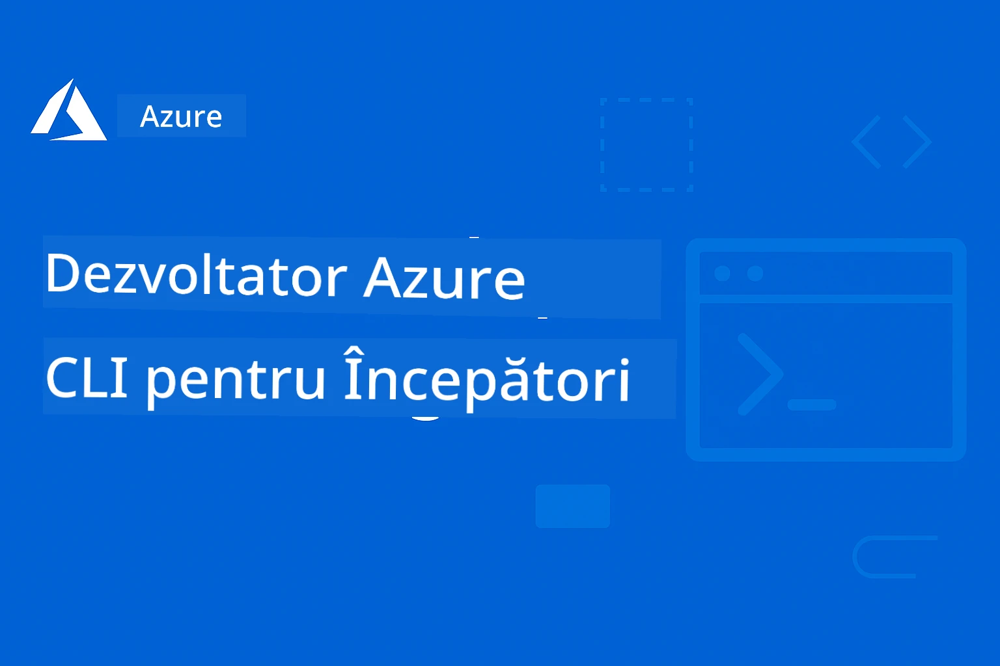

# AZD Pentru Începători: O Călătorie de Învățare Structurată

 

[](https://github.com/microsoft/AZD-for-beginners)
[](https://GitHub.com/microsoft/azd-for-beginners/network/)
[](https://github.com/microsoft/AZD-for-beginners)

[](https://discord.com/invite/nkVh3dp)
[](https://discord.gg/nTYy5BXMWG)

---

### Traduceri automate (Întotdeauna la zi)

<!-- CO-OP TRANSLATOR LANGUAGES TABLE START -->
[Arabă](../ar/README.md) | [Bengaleză](../bn/README.md) | [Bulgară](../bg/README.md) | [Burmese (Myanmar)](../my/README.md) | [Chineză (Simplificată)](../zh-CN/README.md) | [Chineză (Tradițională, Hong Kong)](../zh-HK/README.md) | [Chineză (Tradițională, Macau)](../zh-MO/README.md) | [Chineză (Tradițională, Taiwan)](../zh-TW/README.md) | [Croată](../hr/README.md) | [Cehă](../cs/README.md) | [Daneză](../da/README.md) | [Olandeză](../nl/README.md) | [Estonă](../et/README.md) | [Finlandeză](../fi/README.md) | [Franceză](../fr/README.md) | [Germană](../de/README.md) | [Greacă](../el/README.md) | [Ebraică](../he/README.md) | [Hindi](../hi/README.md) | [Maghiară](../hu/README.md) | [Indoneziană](../id/README.md) | [Italiană](../it/README.md) | [Japoneză](../ja/README.md) | [Kannada](../kn/README.md) | [Khmer](../km/README.md) | [Coreeană](../ko/README.md) | [Lituaniană](../lt/README.md) | [Malaeză](../ms/README.md) | [Malaialamă](../ml/README.md) | [Marathi](../mr/README.md) | [Nepaleză](../ne/README.md) | [Pidgin Nigerian](../pcm/README.md) | [Norvegiană](../no/README.md) | [Persană (Farsi)](../fa/README.md) | [Poloneză](../pl/README.md) | [Portugheză (Brazilia)](../pt-BR/README.md) | [Portugheză (Portugalia)](../pt-PT/README.md) | [Punjabi (Gurmukhi)](../pa/README.md) | [Română](./README.md) | [Rusă](../ru/README.md) | [Sârbă (Chirilic)](../sr/README.md) | [Slovacă](../sk/README.md) | [Slovenă](../sl/README.md) | [Spaniolă](../es/README.md) | [Swahili](../sw/README.md) | [Suedeză](../sv/README.md) | [Tagalog (Filipineză)](../tl/README.md) | [Tamil](../ta/README.md) | [Telugu](../te/README.md) | [Thailandeză](../th/README.md) | [Turcă](../tr/README.md) | [Ucraineană](../uk/README.md) | [Urdu](../ur/README.md) | [Vietnameză](../vi/README.md)

> **Preferi să clonezi local?**
>
> Acest depozit include traduceri în peste 50 de limbi, ceea ce crește semnificativ dimensiunea descărcării. Pentru a clona fără traduceri, folosește sparse checkout:
>
> **Bash / macOS / Linux:**
> ```bash
> git clone --filter=blob:none --sparse https://github.com/microsoft/AZD-for-beginners.git
> cd AZD-for-beginners
> git sparse-checkout set --no-cone '/*' '!translations' '!translated_images'
> ```
>
> **CMD (Windows):**
> ```cmd
> git clone --filter=blob:none --sparse https://github.com/microsoft/AZD-for-beginners.git
> cd AZD-for-beginners
> git sparse-checkout set --no-cone "/*" "!translations" "!translated_images"
> ```
>
> Acest lucru îți oferă tot ce ai nevoie pentru a termina cursul cu o descărcare mult mai rapidă.
<!-- CO-OP TRANSLATOR LANGUAGES TABLE END -->

## 🆕 Ce e Nou în azd Azi

> 📌 **Actualizarea Foundry GA (2026-11-09):** Pachetul **`microsoft.foundry` 1.0 este disponibil general**, anunțat pe [5 noiembrie 2026](https://devblogs.microsoft.com/azure-sdk/microsoft-foundry-azure-developer-cli-ga/). Folosește **`azd >= 1.37.0`** și instalează-l cu `azd ext install microsoft.foundry`. Urmează [tutorialul cu agent găzduit](docs/chapter-02-ai-development/microsoft-foundry-integration.md#hosted-agent-walkthrough-ga) pentru configurare, testare locală și implementare. Această actualizare se bazează pe ghiduri publicate, nu pe o implementare Azure în direct; pachetul GA nu face automat disponibile toate funcțiile opționale, extensiile sau SDK-urile.

Azure Developer CLI suportă multe tipuri de aplicații, inclusiv aplicații web, API-uri și agenți AI, prin gazde, șabloane și extensii suportate.

Iată ce înseamnă asta pentru tine:

- **Un pachet GA pentru dezvoltarea Foundry.** `microsoft.foundry` instalează șapte extensii principale, inclusiv agenți, proiecte și Agent Inspector. Codul agentului și setările de implementare rămân împreună în `azure.yaml`.
- **Testează local, apoi deployează codul tău.** Folosește `azd ai agent init --deploy-mode code`, `azd provision` și `azd ai agent run` pentru a inspecta cererile și răspunsurile locale. Apoi folosește `azd deploy` pentru o construire la distanță în Foundry, fără construire locală în container.
- **Măsoară calitatea separat.** Instalează **`azure.ai.evaluations`** pentru `azd ai eval generate`, `init` și `run start`; acesta nu este inclus în pachet. Păstrează seturile de date revizuite și rubricile împreună cu codul tău. Proiectele mai vechi ar trebui să urmeze [ghidul de migrare pentru evaluare și optimizare](docs/chapter-08-production/production-ai-practices.md#evaluation-migration-and-quality-checks).
- **Refolosește configurația în CI/CD.** După un `azd up` reușit, configurează un pipeline cu `azd pipeline config`. Instalează pachetul pe runner și păstrează setările generate de autentificare și mediu.
- **Baza zilnică mai lină.** Lansările recente au făcut `azd init` idempotent (sigur de rulat repetat), au clarificat automat `azd auth login` pentru a șterge token-urile învechite și au adăugat un prompt prietenos de configurare la prima rulare `azd tool`.
- **Fluxul principal neschimbat.** Indiferent dacă implementezi o aplicație todo, un microserviciu sau o soluție AI cu mai mulți agenți, comenzile sunt aceleași.

> **Notă pentru utilizatorii Aspire:** Microsoft se referă acum la produs simplu ca **Aspire** (fostul ".NET Aspire"). Suportul azd pentru Aspire este neschimbat — doar numele a fost actualizat.

Dacă ai folosit azd înainte, suportul AI este o extensie naturală — nu un instrument separat sau o cale avansată. Dacă începi de la zero, vei învăța un singur flux de lucru care funcționează pentru tot.

---

## 🚀 Ce este Azure Developer CLI (azd)?

**Azure Developer CLI (azd)** este un instrument prietenos pentru dezvoltatori în linia de comandă care face simplă implementarea aplicațiilor în Azure. În loc să creezi și să conectezi manual zeci de resurse Azure, poți implementa aplicații complete cu o singură comandă.

### Magia lui `azd up`

```bash
# This single command does everything:
# ✅ Creates all Azure resources  
# ✅ Configures networking and security
# ✅ Builds your application code
# ✅ Deploys to Azure
# ✅ Gives you a working URL
azd up
```

Șablonul furnizează configurația aplicației și infrastructurii. Implementarea cu succes necesită în continuare servicii/modeluri suportate, cotă și permisiuni suficiente, inputuri corecte și verificarea aplicației implementate. `azd up` nu face automat un șablon sigur, conform sau gata pentru producție.

---

## ❓ Azure Developer CLI vs Azure CLI: Care e diferența?

Aceasta este cea mai frecventă întrebare a începătorilor. Iată răspunsul simplu:

| Caracteristică | **Azure CLI (`az`)** | **Azure Developer CLI (`azd`)** |
|---------|---------------------|--------------------------------|
| **Scop** | Gestionarea resurselor Azure individuale | Implementarea aplicațiilor complete |
| **Mentalitate** | Focus pe infrastructură | Focus pe aplicație |
| **Exemplu** | `az webapp create --name myapp...` | `azd up` |
| **Curba de învățare** | Trebuie să cunoști serviciile Azure | Trebuie să cunoști aplicația ta |
| **Potrivit pentru** | DevOps, infrastructură | Dezvoltatori, prototipare |

### O analogie simplă

- **Azure CLI** este ca și cum ai avea toate uneltele pentru a construi o casă - ciocane, ferăstraie, cuie. Poți construi orice, dar trebuie să știi construcții.
- **Azure Developer CLI** este ca și cum ai angaja un antreprenor - descrii ce vrei și el se ocupă de construcție.

### Când să folosești fiecare

| Scenariu | Folosește asta |
|----------|----------|
| "Vreau să implementez rapid aplicația mea web" | `azd up` |
| "Trebuie să creez doar un cont de stocare" | `az storage account create` |
| "Construiesc o aplicație AI completă" | `azd init --template azure-search-openai-demo` |
| "Trebuie să depan specific o resursă Azure" | `az resource show` |
| "Vreau să implementez în mediul meu de producție configurat" | Revizuiește configurația, accesul, costul și porțile operaționale înainte de `azd up --environment production` |

### Funcționează împreună!

AZD și Azure CLI au autentificare și configurație separate. Folosește `azd auth login` pentru AZD și `az login` când un hook sau o comandă diagnostic necesită explicit Azure CLI. Le poți folosi pe amândouă:
```bash
# Deploy your app with AZD
azd up

# Then fine-tune specific resources with Azure CLI
az webapp config set --name myapp --always-on true
```

---

## 🌟 Găsește Șabloane în Awesome AZD

Nu începe de la zero! **Awesome AZD** este colecția comunității de șabloane gata de implementare:

| Resursă | Descriere |
|----------|-------------|
| 🔗 [**Awesome AZD Gallery**](https://azure.github.io/awesome-azd/) | Răsfoiește 200+ șabloane cu implementare dintr-un click |
| 🔗 [**Trimite un șablon**](https://github.com/Azure/awesome-azd/issues) | Contribuie cu propriul șablon în comunitate |
| 🔗 [**Depozitul GitHub**](https://github.com/Azure/awesome-azd) | Evaluează și explorează sursa |

### Șabloane AI populare din Awesome AZD

Alege un șablon într-un folder gol dedicat; comenzile de mai jos sunt alternative. Comanda finală `.` inițializează acel director.

```bash
# RAG Chat with Microsoft Foundry Models + AI Search
azd init --template azure-search-openai-demo .

# Quick AI Chat Application
azd init --template openai-chat-app-quickstart .

# AI Agents with Foundry Agents
azd init --template get-started-with-ai-agents .
```

---

## 🎯 Începe în 3 Pași

Înainte de a începe, asigură-te că mașina ta este pregătită pentru șablonul pe care vrei să îl implementezi:

**Windows:**
```powershell
.\validate-setup.ps1
```

**macOS / Linux:**
```bash
bash ./validate-setup.sh
```

Dacă vreo verificare necesară eșuează, remediază mai întâi și apoi continuă cu începutul rapid.

### Pasul 1: Instalează AZD (2 minute)

**Windows:**
```powershell
winget install microsoft.azd
```

**macOS:**
```bash
brew tap azure/azd && brew install azd
```

**Linux:**
```bash
curl -fsSL https://aka.ms/install-azd.sh | bash
```

### Pasul 2: Autentifică-te pentru AZD

```bash
# Optional if you plan to use Azure CLI commands directly in this course
az login

# Required for AZD workflows
azd auth login
```

Dacă nu ești sigur care-ți trebuie, urmează fluxul complet de configurare în [Instalare & Configurare](docs/chapter-01-foundation/installation.md#authentication-setup).

### Pasul 3: Implementă Prima Ta Aplicație

```bash
# Initialize from a template
azd init --template todo-nodejs-mongo .

# Deploy to Azure (creates everything!)
azd up
```

**🎉 Asta e tot!** Aplicația ta este acum live pe Azure.

### Curățare (Nu uita!)

```bash
# Remove all resources when done experimenting
azd down --force --purge
```

---

## 📚 Cum să folosești acest curs

Acest curs este conceput pentru **învățare progresivă** - începe de unde te simți confortabil și avansează:

| Experiența ta | Începe aici |
|-----------------|------------|
| **Nou-venit în Azure** | [Capitolul 1: Fundamente](#-chapter-1-foundation--quick-start) |
| **Cunoști Azure, nou în AZD** | [Capitolul 1: Fundamente](#-chapter-1-foundation--quick-start) |
| **Vrei să implementezi aplicații AI** | [Capitolul 2: Dezvoltare AI-First](#-chapter-2-ai-first-development-recommended-for-ai-developers) |
| **Vrei practică hands-on** | [🎓 Atelier Interactiv](workshop/README.md) - laborator ghidat de 3-4 ore |
| **Ai nevoie de modele de producție** | [Capitolul 8: Producție & Enterprise](#-chapter-8-production--enterprise-patterns) |

### Configurare rapidă

1. **Fork-uiește acest depozit**: [](https://GitHub.com/microsoft/azd-for-beginners/fork)
2. **Clonează-l**: `git clone https://github.com/YOUR-USERNAME/azd-for-beginners.git`
3. **Cere ajutor**: [Comunitatea Azure Discord](https://discord.com/invite/ByRwuEEgH4)

> **Preferi să clonezi local?**

> Acest depozit include traduceri în peste 50 de limbi, ceea ce mărește semnificativ dimensiunea descărcării. Pentru a clona fără traduceri, folosiți sparse checkout:
> ```bash
> git clone --filter=blob:none --sparse https://github.com/microsoft/AZD-for-beginners.git
> cd AZD-for-beginners
> git sparse-checkout set --no-cone '/*' '!translations' '!translated_images'
> ```
> Aceasta vă oferă tot ce aveți nevoie pentru a finaliza cursul cu o descărcare mult mai rapidă.


## Prezentare generală a cursului

Stăpâniți Azure Developer CLI (azd) prin capitole structurate, concepute pentru învățare progresivă. **Accent special pe implementarea aplicațiilor AI cu integrare Microsoft Foundry.**

### De ce este acest curs esențial pentru dezvoltatorii moderni

Dezvoltatorii care implementează sarcini AI au deseori nevoie de îndrumări privind:
- Arhitecturi AI complexe cu mai multe servicii
- Cele mai bune practici pentru implementarea AI în producție  
- Integrarea și configurarea serviciilor Azure AI
- Optimizarea costurilor pentru sarcinile AI
- Depanarea problemelor specifice implementării AI

### Obiective de învățare

Prin finalizarea acestui curs structurat, veți:
- **Stăpâni fundamentele AZD**: Concepute de bază, instalare și configurare
- **Implementa aplicații AI**: Folosiți AZD cu serviciile Microsoft Foundry
- **Implementa Infrastructure as Code**: Gestionați resursele Azure cu șabloane Bicep
- **Depana implementările**: Rezolvați probleme comune și identificați erori
- **Optimiza pentru producție**: Securitate, scalare, monitorizare și gestionare a costurilor
- **Construiți soluții multi-agent**: Implementați arhitecturi AI complexe

## Înainte să începeți: Conturi, Acces și Presupuneri

Înainte de a începe Capitolul 1, asigurați-vă că aveți următoarele pregătite. Pașii de instalare din acest ghid presupun că aceste elemente de bază sunt deja gestionate.

- **Un abonament Azure**: Puteți folosi un abonament existent de la locul de muncă sau contul propriu, sau creați o [probă gratuită](https://aka.ms/azurefreetrial) pentru a începe.
- **Permisiunea de a crea resurse Azure**: Pentru majoritatea exercițiilor, ar trebui să aveți cel puțin acces **Contributor** pe abonamentul sau grupul de resurse țintă. Unele capitole pot presupune și că puteți crea grupuri de resurse, identități administrate și alocări RBAC.
- [**Un cont GitHub**](https://github.com): Este util pentru a forka depozitul, urmări modificările personale și pentru a folosi GitHub Codespaces la atelier.
- **Precondiții de rulare pentru șabloane**: Unele șabloane necesită unelte locale precum Node.js, Python, Java sau Docker. Rulați validatorul de configurare înainte de începere pentru a detecta uneltele lipsă din timp.
- **Familiaritate de bază cu terminalul**: Nu trebuie să fiți expert, dar ar trebui să fiți confortabil să rulați comenzi precum `git clone`, `azd auth login`, și `azd up`.

> **Lucrați într-un abonament enterprise?**
> Dacă mediul dvs. Azure este administrat de un administrator, confirmați în avans că puteți implementa resurse în abonamentul sau grupul de resurse pe care intenționați să îl folosiți. Dacă nu, solicitați un abonament sandbox sau acces Contributor înainte de a începe.

> **Sunteți nou în Azure?**
> Începeți cu propria probă Azure sau abonament pay-as-you-go la https://aka.ms/azurefreetrial pentru a putea finaliza exercițiile integral fără a aștepta aprobări la nivel de tenant.

## 🗺️ Harta cursului: Navigare rapidă după capitol

Fiecare capitol are un README dedicat cu obiective de învățare, începuturi rapide și exerciții:

| Capitol | Subiect | Lecții | Durată | Complexitate |
|---------|-------|---------|----------|------------|
| **[Cap 1: Fundament](docs/chapter-01-foundation/README.md)** | Începerea | [Bazele AZD](docs/chapter-01-foundation/azd-basics.md) &#124; [Instalare](docs/chapter-01-foundation/installation.md) &#124; [Primul Proiect](docs/chapter-01-foundation/first-project.md) | 30-45 min | ⭐ |
| **[Cap 2: Dezvoltare AI](docs/chapter-02-ai-development/README.md)** | Aplicații AI-First | [Integrare Foundry](docs/chapter-02-ai-development/microsoft-foundry-integration.md) &#124; [Agenți AI](docs/chapter-02-ai-development/agents.md) &#124; [Implementare Model](docs/chapter-02-ai-development/ai-model-deployment.md) &#124; [Atelier](docs/chapter-02-ai-development/ai-workshop-lab.md) | 1-2 ore | ⭐⭐ |
| **[Cap 3: Configurare](docs/chapter-03-configuration/README.md)** | Autentificare & Securitate | [Configurare](docs/chapter-03-configuration/configuration.md) &#124; [Autentificare & Securitate](docs/chapter-03-configuration/authsecurity.md) | 45-60 min | ⭐⭐ |
| **[Cap 4: Infrastructură](docs/chapter-04-infrastructure/README.md)** | IaC & Implementare | [Ghid Implementare](docs/chapter-04-infrastructure/deployment-guide.md) &#124; [Provisionare](docs/chapter-04-infrastructure/provisioning.md) | 1-1.5 ore | ⭐⭐⭐ |
| **[Cap 5: Multi-Agent](docs/chapter-05-multi-agent/README.md)** | Soluții Agenți AI | [Scenariu Retail](examples/retail-scenario.md) &#124; [Modele de coordonare](docs/chapter-06-pre-deployment/coordination-patterns.md) | 2-3 ore | ⭐⭐⭐⭐ |
| **[Cap 6: Pre-Implementare](docs/chapter-06-pre-deployment/README.md)** | Planificare & Validare | [Verificări Preliminare](docs/chapter-06-pre-deployment/preflight-checks.md) &#124; [Planificare Capacitate](docs/chapter-06-pre-deployment/capacity-planning.md) &#124; [Selecție SKU](docs/chapter-06-pre-deployment/sku-selection.md) &#124; [App Insights](docs/chapter-06-pre-deployment/application-insights.md) | 1 oră | ⭐⭐ |
| **[Cap 7: Depanare](docs/chapter-07-troubleshooting/README.md)** | Debug & Fix | [Probleme Comune](docs/chapter-07-troubleshooting/common-issues.md) &#124; [Depanare](docs/chapter-07-troubleshooting/debugging.md) &#124; [Probleme AI](docs/chapter-07-troubleshooting/ai-troubleshooting.md) | 1-1.5 ore | ⭐⭐ |
| **[Cap 8: Producție](docs/chapter-08-production/README.md)** | Modele Enterprise | [Practici de Producție](docs/chapter-08-production/production-ai-practices.md) | 2-3 ore | ⭐⭐⭐⭐ |
| **[🎓 Atelier](workshop/README.md)** | Laborator Practic | [Introducere](workshop/docs/instructions/0-Introduction.md) &#124; [Selecție](workshop/docs/instructions/1-Select-AI-Template.md) &#124; [Validare](workshop/docs/instructions/2-Validate-AI-Template.md) &#124; [Dezansamblare](workshop/docs/instructions/3-Deconstruct-AI-Template.md) &#124; [Configurare](workshop/docs/instructions/4-Configure-AI-Template.md) &#124; [Personalizare](workshop/docs/instructions/5-Customize-AI-Template.md) &#124; [Demontare](workshop/docs/instructions/6-Teardown-Infrastructure.md) &#124; [Încheiere](workshop/docs/instructions/7-Wrap-up.md) | 3-4 ore | ⭐⭐ |

**Durata totală a cursului:** ~10-14 ore | **Progresie abilități:** Începător → Pregătit pentru producție

---

## 📚 Capitole de învățare

*Selectați traseul de învățare în funcție de nivelul de experiență și obiective*

### 🚀 Capitolul 1: Fundament & Începere rapidă
**Precondiții**: Abonament Azure, cunoștințe de bază de linie de comandă  
**Durată**: 30-45 minute  
**Complexitate**: ⭐

#### Ce vei învăța
- Înțelegerea fundamentele Azure Developer CLI
- Instalarea AZD pe platforma ta
- Prima implementare reușită

#### Resurse de învățare
- **🎯 Începe aici**: [Ce este Azure Developer CLI?](#-what-is-azure-developer-cli-azd)
- **📖 Teorie**: [Bazele AZD](docs/chapter-01-foundation/azd-basics.md) - Concepute și terminologie de bază
- **⚙️ Configurare**: [Instalare & Configurare](docs/chapter-01-foundation/installation.md) - Ghiduri specifice platformei
- **🛠️ Practic**: [Primul tău proiect](docs/chapter-01-foundation/first-project.md) - Tutorial pas cu pas
- **📋 Referință rapidă**: [Fișă comandă rapidă](resources/cheat-sheet.md)

#### Exerciții practice
```bash
# Quick installation check
azd version

# Deploy your first application
azd init --template todo-nodejs-mongo .
azd up
```

**💡 Rezultat Capitol:** Implementarea cu succes a unei aplicații web simple pe Azure folosind AZD

**✅ Validarea succesului:**
```bash
# After completing Chapter 1, you should be able to:
azd version              # Shows installed version
azd init --template todo-nodejs-mongo  # Initializes project
azd up                  # Deploys to Azure
azd show                # Displays running app URL
# Application opens in browser and works
azd down --force --purge  # Cleans up resources
```

**📊 Timp investit:** 30-45 minute  
**📈 Nivelul de abilitate după:** Poate implementa aplicații de bază independent

---

### 🤖 Capitolul 2: Dezvoltare AI-First (Recomandat pentru dezvoltatorii AI)
**Precondiții**: Capitolul 1 finalizat  
**Durată**: 1-2 ore  
**Complexitate**: ⭐⭐

#### Ce vei învăța
- Integrarea Microsoft Foundry cu AZD
- Implementarea aplicațiilor AI
- Înțelegerea configurațiilor serviciilor AI

#### Resurse de învățare
- **🎯 Începe aici**: [Integrare Microsoft Foundry](docs/chapter-02-ai-development/microsoft-foundry-integration.md)
- **🤖 Agenți AI**: [Ghid Agenți AI](docs/chapter-02-ai-development/agents.md) - Implementare agenți inteligenți cu AZD
- **📖 Modele**: [Implementarea modelului AI](docs/chapter-02-ai-development/ai-model-deployment.md) - Implementare și gestionare modele AI
- **🛠️ Atelier**: [Laborator AI](docs/chapter-02-ai-development/ai-workshop-lab.md) - Faceți soluțiile AI pregătite pentru AZD
- **🎥 Ghid interactiv**: [Materiale atelier](workshop/README.md) - Învățare în browser cu MkDocs * Mediu DevContainer
- **📋 Șabloane**: [Șabloane Microsoft Foundry](#featured-microsoft-foundry-templates)
- **📝 Exemple**: [Exemple implementare AZD](examples/README.md)

#### Exerciții practice
```bash
# Deploy your first AI application
azd init --template azure-search-openai-demo .
azd up

# Try additional AI templates
azd init --template openai-chat-app-quickstart .
azd init --template agent-openai-python-prompty .
```

**💡 Rezultat Capitol:** Implementarea și configurarea unei aplicații chat AI cu capabilități RAG

**✅ Validarea succesului:**
```bash
# After Chapter 2, you should be able to:
azd init --template azure-search-openai-demo .
azd up
# Test the AI chat interface
# Ask questions and get AI-powered responses with sources
# Verify search integration works
azd monitor  # Check Application Insights shows telemetry
azd down --force --purge
```

**📊 Timp investit:** 1-2 ore  
**📈 Nivelul de abilitate după:** Poate implementa aplicații AI și identifica cerințe adiționale pentru pregătirea pentru producție
**💰 Conștientizarea costurilor:** Înțelegeți costuri de dezvoltare $80-150/lună, costuri de producție $300-3500/lună

#### 💰 Considerații privind costurile pentru implementările AI

**Mediul de dezvoltare (Estimativ $80-150/lună):**
- Modele Microsoft Foundry (Plată pe consum): $0-50/lună (în funcție de utilizarea tokenurilor)
- AI Search (Nivel de bază): $75/lună
- Container Apps (Consumație): $0-20/lună
- Stocare (Standard): $1-5/lună

**Mediul de producție (Estimativ $300-3,500+/lună):**
- Modele Microsoft Foundry (PTU pentru performanță constantă): $3,000+/lună SAU plată pe consum cu volum mare
- AI Search (Nivel standard): $250/lună
- Container Apps (Dedicate): $50-100/lună
- Application Insights: $5-50/lună
- Stocare (Premium): $10-50/lună

**💡 Sfaturi pentru optimizarea costurilor:**
- Verificați prețurile pentru inferența modelelor și creditele specifice contului; Azure OpenAI nu include o alocație lunară universală gratuită de 50.000 de tokenuri
- Rulați `azd down` pentru a șterge resursele când nu mai sunt necesare, după revizuirea mediului selectat
- Începeți cu facturare pe consumație, treceți la PTU doar pentru producție
- Folosiți `azd provision --preview` pentru a inspecta infrastructura planificată, apoi calculați prețul resurselor rezultate cu Azure Pricing Calculator
- Activați auto-scalarea: plătiți doar pentru utilizarea reală

**Monitorizarea costurilor:**
```bash
# Inspect planned resources (this does not calculate prices)
azd provision --preview

# Monitor actual costs in Azure Portal
az consumption budget list --resource-group <your-rg>
```

---

### ⚙️ Capitolul 3: Configurare & Autentificare
**Precondiții**: Capitolul 1 finalizat  
**Durată**: 45-60 minute  
**Complexitate**: ⭐⭐

#### Ce vei învăța
- Configurarea și gestionarea mediului
- Cele mai bune practici pentru autentificare și securitate
- Denumirea și organizarea resurselor

#### Resurse de învățare
- **📖 Configurare**: [Ghid Configurare](docs/chapter-03-configuration/configuration.md) - Setup mediu
- **🔐 Securitate**: [Modele autentificare și identitate administrată](docs/chapter-03-configuration/authsecurity.md) - Modele autentificare
- **📝 Exemple**: [Exemplu aplicație bază de date](examples/database-app/README.md) - Exemple AZD pentru baze de date

#### Exerciții practice
- Configurați mai multe medii (dev, staging, prod)
- Configurați autentificarea prin identitate administrată
- Implementați configurații specifice mediului

**💡 Rezultat Capitol:** Gestionați mai multe medii cu autentificare și securitate corespunzătoare

---

### 🏗️ Capitolul 4: Infrastructure as Code & Implementare
**Precondiții**: Capitolele 1-3 finalizate  
**Durată**: 1-1.5 ore  
**Complexitate**: ⭐⭐⭐

#### Ce vei învăța
- Modele avansate de implementare
- Infrastructure as Code cu Bicep
- Strategii de provisionare a resurselor

#### Resurse de învățare
- **📖 Implementare**: [Ghid implementare](docs/chapter-04-infrastructure/deployment-guide.md) - Fluxuri complete de lucru
- **🏗️ Provisionare**: [Provisionarea resurselor](docs/chapter-04-infrastructure/provisioning.md) - Gestionarea resurselor Azure
- **📝 Exemple**: [Exemplu Container App](../../examples/container-app) - Implementări containerizate

#### Exerciții practice
- Creați șabloane Bicep personalizate
- Implementați aplicații multi-serviciu
- Implementați strategii de implementare blue-green

**💡 Rezultat Capitol:** Implementați aplicații complexe multi-serviciu folosind șabloane infrastructură personalizate

---

### 🎯 Capitolul 5: Soluții Multi-Agent AI (Avansat)
**Precondiții**: Capitolele 1-2 finalizate  
**Durată**: 2-3 ore  
**Complexitate**: ⭐⭐⭐⭐

#### Ce vei învăța
- Modele de arhitectură multi-agent
- Orchestrarea și coordonarea agenților
- Implementări AI pregătite pentru producție

#### Resurse de învățare
- **🤖 Design Recomandat**: [Soluție Multi-Agent pentru Retail](examples/retail-scenario.md) - Plan de arhitectură, nu o aplicație completă
- **🛠️ Șabloane ARM**: [Pachet Șabloane ARM](../../examples/retail-multiagent-arm-template) - Schelet infrastructură; revizuiește prerechizitele și componentele lipsă ale aplicației
- **📖 Arhitectură**: [Tipare de coordonare multi-agent](docs/chapter-06-pre-deployment/coordination-patterns.md) - Tipare

#### Exerciții Practice
```bash
# Inspect the retail infrastructure scaffold before choosing to deploy it
cd examples/retail-multiagent-arm-template
cat README.md

# After an intentional deployment, inspect infrastructure state
az deployment group show --resource-group <rg-name> --name <deployment-name>
```

**💡 Rezultatul Capitolului**: Înțelege designul multi-agent și identifică munca de implementare, validare și operațională necesară dincolo de un schelet de infrastructură

---

### 🔍 Capitolul 6: Validare și Planificare înainte de Implementare
**Prerechizite**: Capitolul 4 finalizat  
**Durată**: 1 oră  
**Complexitate**: ⭐⭐

#### Ce Vei Învața
- Planificarea capacității și validarea resurselor
- Strategii de selecție SKU
- Verificări pre-lansare și automatizare

#### Resurse de Învățare
- **📊 Planificare**: [Planificarea Capacității](docs/chapter-06-pre-deployment/capacity-planning.md) - Validarea resurselor
- **💰 Selecție**: [Selecția SKU](docs/chapter-06-pre-deployment/sku-selection.md) - Alegeri rentabile
- **✅ Validare**: [Verificări Pre-lansare](docs/chapter-06-pre-deployment/preflight-checks.md) - Scripturi automate

#### Exerciții Practice
- Execută scripturile de validare a capacității
- Optimizează selecțiile SKU pentru cost
- Implementează verificări automate pre-implementare

**💡 Rezultatul Capitolului**: Validează și optimizează implementările înainte de execuție

---

### 🚨 Capitolul 7: Depanare și Debugging
**Prerechizite**: Orice capitol de implementare finalizat  
**Durată**: 1-1.5 ore  
**Complexitate**: ⭐⭐

#### Ce Vei Învața
- Abordări sistematice de depanare
- Probleme comune și soluții
- Depanare specifică AI

#### Resurse de Învățare
- **🔧 Probleme Comune**: [Probleme Comune](docs/chapter-07-troubleshooting/common-issues.md) - Întrebări frecvente și soluții
- **🕵️ Debugging**: [Ghid de Debugging](docs/chapter-07-troubleshooting/debugging.md) - Strategii pas cu pas
- **🤖 Probleme AI**: [Depanare Specifică AI](docs/chapter-07-troubleshooting/ai-troubleshooting.md) - Probleme serviciu AI

#### Exerciții Practice
- Diagnostică eșecuri de implementare
- Rezolvă probleme de autentificare
- Depanează conectivitatea serviciilor AI

**💡 Rezultatul Capitolului**: Diagnostică și rezolvă independent probleme comune de implementare

---

### 🏢 Capitolul 8: Tipare de Producție și Enterprise
**Prerechizite**: Capitolele 1-4 finalizate  
**Durată**: 2-3 ore  
**Complexitate**: ⭐⭐⭐⭐

#### Ce Vei Învața
- Strategii de implementare în producție
- Tipare de securitate enterprise
- Monitorizare și optimizare a costurilor

#### Resurse de Învățare
- **🏭 Producție**: [Cele mai bune practici AI pentru producție](docs/chapter-08-production/production-ai-practices.md) - Tipare enterprise
- **📝 Exemple**: [Exemplu Microservicii](../../examples/microservices) - Arhitecturi complexe
- **📊 Monitorizare**: [Integrarea Application Insights](docs/chapter-06-pre-deployment/application-insights.md) - Monitorizare

#### Exerciții Practice
- Implementează tiparele de securitate enterprise
- Configurare completă a monitorizării
- Implementare în producție cu guvernanță adecvată

**💡 Rezultatul Capitolului**: Implementează aplicații gata pentru producție cu toate capabilitățile necesare

---

## 🎓 Prezentare Generală Workshop: Experiență de Învățare Practică

> **⚠️ STATUS WORKSHOP: Dezvoltare Activă**  
> Materialele workshopului sunt în curs de dezvoltare și rafinare. Modulele de bază sunt funcționale, dar unele secțiuni avansate sunt incomplete. Lucrăm activ pentru finalizarea întregului conținut. [Urmărește progresul →](workshop/README.md)

### Materiale Interactive pentru Workshop
**Învățare practică cuprinzătoare cu instrumente browser-based și exerciții ghidate**

Materialele noastre oferă o experiență de învățare structurată și interactivă care completează curriculumul bazat pe capitole de mai sus. Workshopul este conceput atât pentru învățare individuală, cât și pentru sesiuni conduse de instructor.

#### 🛠️ Caracteristici Workshop
- **Interfață Browser-Based**: Workshop complet alimentat de MkDocs cu funcții de căutare, copiere și teme
- **Integrare GitHub Codespaces**: Configurare mediu de dezvoltare cu un singur clic
- **Parcurs Structurat de Învățare**: 8 module cu exerciții ghidate (3-4 ore total)
- **Metodologie Progressive**: Introducere → Selecție → Validare → Deconstrucție → Configurare → Personalizare → Demontare → Încălzire
- **Mediu DevContainer Interactiv**: Instrumente și dependențe preconfigurate

#### 📚 Structura Modulelor Workshop
Workshopul urmează o **metodologie progresivă în 8 module** care te conduce de la descoperire la stăpânirea implementării:

| Modul | Subiect | Ce Vei Face | Durată |
|--------|-------|----------------|----------|
| **0. Introducere** | Prezentare Workshop | Înțelege obiectivele de învățare, prerechizitele și structura workshopului | 15 min |
| **1. Selecție** | Descoperire Șabloane | Explorează șabloanele AZD și selectează șablonul AI potrivit pentru scenariul tău | 20 min |
| **2. Validare** | Implementare & Verificare | Implementează șablonul cu `azd up` și validează funcționarea infrastructurii | 30 min |
| **3. Deconstrucție** | Înțelegerea Structurii | Folosește GitHub Copilot pentru a explora arhitectura șablonului, fișierele Bicep și organizarea codului | 30 min |
| **4. Configurare** | Analiză azure.yaml | Stăpânește configurarea `azure.yaml`, hook-uri de ciclu de viață și variabile de mediu | 30 min |
| **5. Personalizare** | Fă-l al Tău | Activează AI Search, urmărire, evaluare și personalizează pentru scenariul tău | 45 min |
| **6. Demontare** | Curățare | Deprovisionează în siguranță resursele cu `azd down --purge` | 15 min |
| **7. Încălzire** | Pași Următori | Revizuiește realizările, conceptele cheie și continuă-ți drumul de învățare | 15 min |

**Fluxul Workshopului:**
```
Introduction → Selection → Validation → Deconstruction → Configuration → Customization → Teardown → Wrap-up
     ↓            ↓           ↓              ↓               ↓              ↓            ↓           ↓
  Overview    Find the     Deploy &      Explore        Master         Customize     Clean up    Review &
             right        verify        code &        azure.yaml      for your      resources   next steps
             template                   structure                     scenario
```

#### 🚀 Începerea Workshopului
```bash
# Option 1: GitHub Codespaces (Recommended)
# Click "Code" → "Create codespace on main" in the repository

# Option 2: Local Development
git clone https://github.com/microsoft/azd-for-beginners.git
cd azd-for-beginners/workshop
# Follow the setup instructions in workshop/README.md
```

#### 🎯 Rezultatele Învățării Workshopului
Finalizând workshopul, participanții vor:
- **Implementa Aplicații AI de Producție**: Folosește AZD cu serviciile Microsoft Foundry
- **Stăpâni Architecturi Multi-Agent**: Implementează soluții coordonate cu agenți AI
- **Aplică Cele Mai Bune Practici de Securitate**: Configurează autentificarea și controlul accesului
- **Optimizează pentru Scalabilitate**: Proiectează implementări rentabile și performante
- **Depanează Implementările**: Rezolvă independent probleme comune

#### 📖 Resurse Workshop
- **🎥 Ghid Interactiv**: [Materiale Workshop](workshop/README.md) - Mediu de învățare bazat pe browser
- **📋 Instrucțiuni pas cu pas pe module**:
  - [0. Introducere](workshop/docs/instructions/0-Introduction.md) - Prezentare generală și obiective workshop
  - [1. Selecție](workshop/docs/instructions/1-Select-AI-Template.md) - Găsește și selectează șabloane AI
  - [2. Validare](workshop/docs/instructions/2-Validate-AI-Template.md) - Implementează și verifică șabloane
  - [3. Deconstrucție](workshop/docs/instructions/3-Deconstruct-AI-Template.md) - Explorează arhitectura șabloanelor
  - [4. Configurare](workshop/docs/instructions/4-Configure-AI-Template.md) - Stăpânește azure.yaml
  - [5. Personalizare](workshop/docs/instructions/5-Customize-AI-Template.md) - Personalizează pentru scenariul tău
  - [6. Demontare](workshop/docs/instructions/6-Teardown-Infrastructure.md) - Curăță resursele
  - [7. Încălzire](workshop/docs/instructions/7-Wrap-up.md) - Revizuire și pași următori
- **🛠️ Laborator AI Workshop**: [Laborator AI Workshop](docs/chapter-02-ai-development/ai-workshop-lab.md) - Exerciții axate pe AI
- **💡 Pornire Rapidă**: [Ghid Configurare Workshop](workshop/README.md#browser-based-guide) - Configurarea mediului

**Potrivit pentru**: Training corporativ, cursuri universitare, învățare pe cont propriu și bootcamp-uri pentru dezvoltatori.

---

## 📖 Analiză Detaliată: Capabilități AZD

Dincolo de elementele de bază, AZD oferă funcții puternice pentru implementări în producție:

- **Implementări bazate pe șabloane** - Folosește șabloane predefinite pentru tipare comune de aplicații
- **Infrastructură ca și Cod** - Gestionează resurse Azure folosind Bicep sau Terraform  
- **Fluxuri integrate** - Provisiunează, implementează și monitorizează aplicații fără întreruperi
- **Prietenos pentru dezvoltatori** - Optimizat pentru productivitatea și experiența dezvoltatorilor

### **AZD + Microsoft Foundry: Ideal pentru implementări AI**

**De ce AZD pentru soluții AI?** AZD răspunde celor mai mari provocări ale dezvoltatorilor AI:

- **Șabloane Pregătite pentru AI** - Șabloane preconfigurate pentru modelele Microsoft Foundry, serviciile Azure AI și sarcinile de lucru ML
- **Implementări AI Sigure** - Tipare de securitate încorporate pentru serviciile AI, chei API și puncte finale ale modelelor  
- **Tipare AI pentru Producție** - Cele mai bune practici pentru implementări AI scalabile și cost-eficiente
- **Fluxuri AI Complete** - De la dezvoltarea modelului la implementarea în producție cu monitorizare adecvată
- **Optimizare a Costurilor** - Alocare inteligentă a resurselor și strategii de scalare pentru sarcinile AI
- **Integrare Microsoft Foundry** - Conexiune fără întreruperi la catalogul de modele și punctele finale Microsoft Foundry

---

## 🎯 Biblioteca de Șabloane & Exemple

### Recomandate: Șabloane Microsoft Foundry
**Începe aici dacă implementezi aplicații AI!**

> **Notă:** Aceste șabloane demonstrează diverse tipare AI. Unele sunt exemple externe Azure, altele sunt implementări locale.

| Șablon | Capitol | Complexitate | Servicii | Tip |
|----------|---------|------------|----------|------|
| [**Începe cu chat AI**](https://github.com/Azure-Samples/get-started-with-ai-chat) | Capitol 2 | ⭐⭐ | AzureOpenAI + Azure AI Model Inference API + Azure AI Search + Azure Container Apps + Application Insights | Extern |
| [**Începe cu agenți AI**](https://github.com/Azure-Samples/get-started-with-ai-agents) | Capitol 2 | ⭐⭐ | Agenți Foundry + AzureOpenAI + Azure AI Search + Azure Container Apps + Application Insights| Extern |
| [**Demo Azure Search + OpenAI**](https://github.com/Azure-Samples/azure-search-openai-demo) | Capitol 2 | ⭐⭐ | Azure OpenAI + Azure AI Search + Container Apps (implicit) + Storage | Extern |
| [**Start rapid cu aplicația Chat OpenAI**](https://github.com/Azure-Samples/openai-chat-app-quickstart) | Capitol 2 | ⭐ | AzureOpenAI + Container Apps + Application Insights | Extern |
| [**Agent OpenAI Python Prompty**](https://github.com/Azure-Samples/agent-openai-python-prompty) | Capitol 5 | ⭐⭐⭐ | AzureOpenAI + Azure Functions + Prompty | Extern |
| [**Contoso Chat RAG**](https://github.com/Azure-Samples/contoso-chat) | Capitol 8 | ⭐⭐⭐⭐ | AzureOpenAI + AI Search + Cosmos DB + Container Apps | Extern |
| [**Soluție Multi-Agent pentru Retail**](examples/retail-scenario.md) | Capitol 5 | ⭐⭐⭐⭐ | Arhitectură propusă și schelet infrastructură; implementare aplicație necesară | **Plan local** |

### Recomandate: Scenarii Complete de Învățare
**Șabloane aplicații gata pentru producție corelate cu capitolele de învățare**

| Șablon | Capitol de Învățare | Complexitate | Învățare Cheie |
|----------|------------------|------------|--------------|
| [**openai-chat-app-quickstart**](https://github.com/Azure-Samples/openai-chat-app-quickstart) | Capitol 2 | ⭐ | Tipare de bază pentru implementare AI |
| [**azure-search-openai-demo**](https://github.com/Azure-Samples/azure-search-openai-demo) | Capitol 2 | ⭐⭐ | Implementare RAG cu Azure AI Search |
| [**get-started-with-ai-agents**](https://github.com/Azure-Samples/get-started-with-ai-agents) | Capitol 2 | ⭐⭐ | Chat susținut de agenți și teste de evaluare specifice exemplului |
| [**agent-openai-python-prompty**](https://github.com/Azure-Samples/agent-openai-python-prompty) | Capitol 5 | ⭐⭐⭐ | Cadru agent și apelare funcții |
| [**contoso-chat**](https://github.com/Azure-Samples/contoso-chat) | Capitol 8 | ⭐⭐⭐ | Orchestrare AI pentru enterprise |
| [**retail-multi-agent-solution**](examples/retail-scenario.md) | Capitol 5 | ⭐⭐⭐⭐ | Arhitectură multi-agent cu agenți Client și Inventar |

### Învățare prin Tip de Exemplu

> **📌 Exemple Locale vs. Externe:**  
> **Exemple Locale** (în acest repo) = Consultă README-ul exemplului pentru status de implementare și prerechizite
> **Exemple Externe** (Azure Samples) = Clonează din depozitele legate

#### Exemple Locale (Gata de Folosit)
- [**Soluție Multi-Agent pentru Retail**](examples/retail-scenario.md) - Plan arhitectural cu schelet infrastructură ARM
  - Roluri propuse pentru agenții Client și Inventar
  - Monitorizare, evaluare și cod aplicație trebuie implementate și verificate
  - Provisionarea resurselor nu produce singură o aplicație retail funcțională

#### Exemple Locale - Aplicații Container (Capitolele 2-5)
**Exemple complete de implementare container în acest depozit:**
- [**Exemple Aplicații Container**](examples/container-app/README.md) - Ghid complet pentru implementări containerizate
  - [API Flask Simplu](../../examples/container-app/simple-flask-api) - API REST de bază cu scalare zero
  - [Arhitectură Microservicii](../../examples/container-app/microservices) - Exemplu de învățare cu două servicii; consolidarea producției necesită muncă suplimentară
  - Modele rapide, de producție și avansate de implementare
  - Ghiduri de monitorizare, securitate și optimizare costuri

#### Exemple Externe - Aplicații Simple (Capitolele 1-2)
**Clonează aceste depozite Azure Samples pentru a începe:**
- [Aplicație Web Simplă - Node.js + MongoDB](https://github.com/Azure-Samples/todo-nodejs-mongo) - Tipare de implementare de bază
- [Website Static - React SPA](https://github.com/Azure-Samples/todo-csharp-sql-swa-func) - Implementare conținut static
- [Container App - Python Flask](https://github.com/Azure-Samples/container-apps-store-api-microservice) - Implementarea REST API

#### Exemple Externe - Integrarea Bazei de Date (Capitolele 3-4)  
- [Database App - C# + SQL](https://github.com/Azure-Samples/todo-csharp-sql) - Modele de conectivitate la baza de date
- [Functions + Cosmos DB](https://github.com/Azure-Samples/todo-python-mongo-swa-func) - Flux de lucru fără server pentru date

#### Exemple Externe - Modele Avansate (Capitolele 4-8)
- [Java Microservices](https://github.com/Azure-Samples/java-microservices-aca-lab) - Arhitecturi multi-serviciu
- [Container Apps Jobs](https://github.com/Azure-Samples/container-apps-jobs) - Procesare în fundal  
- [Enterprise ML Pipeline](https://github.com/Azure/mlops-v2) - Modele de referință MLOps; nu este un șablon AZD gata de utilizare

### Colecții de Șabloane Externe
- [**Galeria oficială de șabloane AZD**](https://azure.github.io/awesome-azd/) - Colecție selectă de șabloane oficiale și comunitare
- [**Șabloane Azure Developer CLI**](https://learn.microsoft.com/en-us/azure/developer/azure-developer-cli/azd-templates) - Documentație pentru șabloane Microsoft Learn
- [**Director Exemplu**](examples/README.md) - Exemple locale de învățare cu explicații detaliate

---

## 📚 Resurse de Învățare & Referințe

### Referințe Rapide
- [**Fișă rapidă de comenzi**](resources/cheat-sheet.md) - Comenzi esențiale azd organizate pe capitole
- [**Glosar**](resources/glossary.md) - Terminologie Azure și azd  
- [**Întrebări frecvente**](resources/faq.md) - Întrebări comune organizate pe capitole de învățare
- [**Ghid de studiu**](resources/study-guide.md) - Exerciții practice cuprinzătoare

### Ateliere practice
- [**Laborator AI Workshop**](docs/chapter-02-ai-development/ai-workshop-lab.md) - Fă-ți soluțiile AI pregătite pentru implementare cu AZD (2-3 ore)
- [**Atelier Interactiv**](workshop/README.md) - 8 module de exerciții ghidate cu MkDocs și GitHub Codespaces
  - Urmează: Introducere → Selecție → Validare → Deconstrucție → Configurare → Personalizare → Demontare → Încheiere

### Resurse Externe de Învățare
- [Documentația Azure Developer CLI](https://learn.microsoft.com/en-us/azure/developer/azure-developer-cli/)
- [Centrul de Arhitectură Azure](https://learn.microsoft.com/en-us/azure/architecture/)
- [Calculator Prețuri Azure](https://azure.microsoft.com/pricing/calculator/)
- [Starea Azure](https://status.azure.com/)

### Competențe AI Agent pentru Editorul Tău
- [**Competențe Microsoft Azure pe skills.sh**](https://skills.sh/microsoft/github-copilot-for-azure) - 37 competențe deschise pentru agenți AI Azure, Foundry, implementare, diagnosticare, optimizare a costurilor și altele. Instalează-le în GitHub Copilot, Cursor, Claude Code sau orice agent suportat:
  ```bash
  npx skills add microsoft/github-copilot-for-azure
  ```

---

## 🔧 Ghid Rapid de Remediere a Problemelor

**Problemele comune întâmpinate de începători și soluții imediate:**

<details>
<summary><strong>❌ "azd: comandă negăsită"</strong></summary>

```bash
# Install AZD first
# Windows (PowerShell):
winget install microsoft.azd

# macOS:
brew tap azure/azd && brew install azd

# Linux:
curl -fsSL https://aka.ms/install-azd.sh | bash

# Verify installation
azd version
```
</details>

<details>
<summary><strong>❌ "Nu a fost găsit un abonament" sau "Abonament neconfigurat"</strong></summary>

```bash
# List available subscriptions
az account list --output table

# Set default subscription
az account set --subscription "<subscription-id-or-name>"

# Set for AZD environment
azd env set AZURE_SUBSCRIPTION_ID "<subscription-id>"

# Verify
az account show
```
</details>

<details>
<summary><strong>❌ "Cota insuficientă" sau "Cotă depășită"</strong></summary>

```bash
# Try different Azure region
azd env set AZURE_LOCATION "westus2"
azd up

# Or use smaller SKUs in development
# Edit infra/main.parameters.json:
{
  "sku": "B1"  // Instead of "P1V2"
}
```
</details>

<details>
<summary><strong>❌ "azd up" eșuează pe parcurs</strong></summary>

```bash
# Option 1: Inspect the error and retry after correcting its cause
azd show
azd up --debug

# Option 2: Just fix infrastructure
azd provision

# Option 3: Check detailed status
azd show

# Option 4: Check logs in Azure Monitor
azd monitor --logs
```
</details>

<details>
<summary><strong>❌ "Autentificare eșuată" sau "Token expirat"</strong></summary>

```bash
# Re-authenticate for AZD
azd auth logout
azd auth login

# Optional: refresh Azure CLI too if you are running az commands
az logout
az login

# Verify authentication
az account show
```
</details>

<details>
<summary><strong>❌ "Resursa există deja" sau conflicte de denumire</strong></summary>

```bash
# Inspect the conflicting resource before changing or deleting anything.
# For an isolated new deployment, create a separate environment:
azd env new dev-v2
azd up
```
</details>

<details>
<summary><strong>❌ Implementarea șablonului durează prea mult</strong></summary>

**Timpuri normale de așteptare:**
- Aplicație web simplă: 5-10 minute
- Aplicație cu bază de date: 10-15 minute
- Aplicații AI: 15-25 minute (Provisionarea OpenAI este lentă)

```bash
# Check progress
azd show

# If stuck >30 minutes, check Azure Portal:
azd monitor --overview
# Look for failed deployments
```
</details>

<details>
<summary><strong>❌ "Permisiune refuzată" sau "Interzis"</strong></summary>

```bash
# Check your Azure role
az role assignment list --assignee $(az account show --query user.name -o tsv)

# You need at least "Contributor" role
# Ask your Azure admin to grant:
# - Contributor (for resources)
# - User Access Administrator (for role assignments)
```
</details>

<details>
<summary><strong>❌ Nu se găsește URL-ul aplicației implementate</strong></summary>

```bash
# Show all service endpoints
azd show

# Or open Azure Portal
azd monitor

# Check specific service
azd env get-values
# Look for *_URL variables
```
</details>

### 📚 Resurse Complete pentru Remedierea Problemelor

- **Ghid de Probleme Comune:** [Soluții Detaliate](docs/chapter-07-troubleshooting/common-issues.md)
- **Probleme Specifice AI:** [Remedierea Problemelor AI](docs/chapter-07-troubleshooting/ai-troubleshooting.md)
- **Ghid de depanare:** [Depanare pas cu pas](docs/chapter-07-troubleshooting/debugging.md)
- **Obține Ajutor:** [Azure Discord](https://discord.gg/microsoft-azure) #azure-developer-cli

---

## 🎓 Finalizarea Cursului & Certificare

### Urmărirea Progresului
Urmărește progresul de învățare prin fiecare capitol:

- [ ] **Capitolul 1**: Bazele & Pornire Rapidă ✅
- [ ] **Capitolul 2**: Dezvoltare axată pe AI ✅  
- [ ] **Capitolul 3**: Configurare & Autentificare ✅
- [ ] **Capitolul 4**: Infrastructură ca Cod & Implementare ✅
- [ ] **Capitolul 5**: Soluții multi-agent AI ✅
- [ ] **Capitolul 6**: Validare & Planificare Pre-Implementare ✅
- [ ] **Capitolul 7**: Remediere a problemelor & depanare ✅
- [ ] **Capitolul 8**: Modele de producție & enterprise ✅

### Verificarea Învățării
După ce finalizezi fiecare capitol, verifică-ți cunoștințele prin:
1. **Exercițiu practic**: Finalizează implementarea practică a capitolului
2. **Verificarea cunoștințelor**: Revizuiește secțiunea Întrebări Frecvente pentru capitolul tău
3. **Discuție comunitară**: Împărtășește-ți experiența în Azure Discord
4. **Capitolul următor**: Treci la următorul nivel de complexitate

### Beneficii la finalizarea cursului
La finalizarea tuturor capitolelor, vei avea:
- **Experiență de producție**: Aplicații AI reale implementate pe Azure
- **Competențe profesionale**: Capacități de implementare pregătite pentru mediul enterprise  
- **Recunoaștere în comunitate**: Membru activ al comunității dezvoltatorilor Azure
- **Avansarea în carieră**: Expertiză la cerere în implementare AZD și AI

---

## 🤝 Comunitate & Suport

### Obține Ajutor & Suport
- **Probleme tehnice**: [Raportează erori și solicită funcționalități](https://github.com/microsoft/azd-for-beginners/issues)
- **Întrebări de învățare**: [Comunitatea Microsoft Azure Discord](https://discord.gg/microsoft-azure) și [](https://discord.gg/nTYy5BXMWG)
- **Ajutor specific AI**: Alătură-te [](https://discord.gg/nTYy5BXMWG)
- **Documentație**: [Documentația oficială Azure Developer CLI](https://learn.microsoft.com/en-us/azure/developer/azure-developer-cli/)

### Perspective Comunitare din Microsoft Foundry Discord

**Subiecte discutate de comunitate:**
- Implementări multi-serviciu, gestionarea acreditărilor și pregătirea pentru producție
- Șabloane specifice AI, ghiduri de remediere a problemelor și bune practici

**Alătură-te comunității noastre pentru a:**
- Împărtăși experiențe AZD + AI și a primi ajutor
- Accesa previzualizări timpurii ale noilor șabloane AI
- Contribui la cele mai bune practici de implementare AI
- Influența dezvoltarea viitoare a caracteristicilor AI + AZD

### Contribuția la Curs
Salutăm contribuțiile! Te rugăm să citești [Ghidul de contribuții](CONTRIBUTING.md) pentru detalii despre:
- **Îmbunătățiri de conținut**: Îmbunătățește capitolele și exemplele existente
- **Exemple noi**: Adaugă scenarii și șabloane din lumea reală  
- **Traduceri**: Ajută la menținerea suportului multilingv
- **Raportări erori**: Îmbunătățește acuratețea și claritatea
- **Standardele comunității**: Urmează ghidurile inclusive ale comunității noastre

---

## 📄 Informații despre curs

### Licență
Acest proiect este licențiat sub Licența MIT - vezi fișierul [LICENSE](../../LICENSE) pentru detalii.

### Resurse Microsoft Learning Asociate

Echipa noastră produce și alte cursuri cuprinzătoare de învățare:

<!-- CO-OP TRANSLATOR OTHER COURSES START -->
### LangChain
[](https://aka.ms/langchain4j-for-beginners)
[](https://aka.ms/langchainjs-for-beginners?WT.mc_id=m365-94501-dwahlin)
[](https://github.com/microsoft/langchain-for-beginners?WT.mc_id=m365-94501-dwahlin)
---

### Azure / Edge / MCP / Agenți
[](https://github.com/microsoft/AZD-for-beginners?WT.mc_id=academic-105485-koreyst)
[](https://github.com/microsoft/edgeai-for-beginners?WT.mc_id=academic-105485-koreyst)
[](https://github.com/microsoft/mcp-for-beginners?WT.mc_id=academic-105485-koreyst)
[](https://github.com/microsoft/ai-agents-for-beginners?WT.mc_id=academic-105485-koreyst)

---
 
### Seria AI Generativ
[](https://github.com/microsoft/generative-ai-for-beginners?WT.mc_id=academic-105485-koreyst)
[-9333EA?style=for-the-badge&labelColor=E5E7EB&color=9333EA)](https://github.com/microsoft/Generative-AI-for-beginners-dotnet?WT.mc_id=academic-105485-koreyst)
[-C084FC?style=for-the-badge&labelColor=E5E7EB&color=C084FC)](https://github.com/microsoft/generative-ai-for-beginners-java?WT.mc_id=academic-105485-koreyst)
[-E879F9?style=for-the-badge&labelColor=E5E7EB&color=E879F9)](https://github.com/microsoft/generative-ai-with-javascript?WT.mc_id=academic-105485-koreyst)

---
 
### Învățare de bază
[](https://aka.ms/ml-beginners?WT.mc_id=academic-105485-koreyst)
[](https://aka.ms/datascience-beginners?WT.mc_id=academic-105485-koreyst)
[](https://aka.ms/ai-beginners?WT.mc_id=academic-105485-koreyst)
[](https://github.com/microsoft/Security-101?WT.mc_id=academic-96948-sayoung)
[](https://aka.ms/webdev-beginners?WT.mc_id=academic-105485-koreyst)
[](https://aka.ms/iot-beginners?WT.mc_id=academic-105485-koreyst)
[](https://github.com/microsoft/xr-development-for-beginners?WT.mc_id=academic-105485-koreyst)

---
 
### Seria Copilot
[](https://aka.ms/GitHubCopilotAI?WT.mc_id=academic-105485-koreyst)
[](https://github.com/microsoft/mastering-github-copilot-for-dotnet-csharp-developers?WT.mc_id=academic-105485-koreyst)
[](https://github.com/microsoft/CopilotAdventures?WT.mc_id=academic-105485-koreyst)
<!-- CO-OP TRANSLATOR OTHER COURSES END -->

---

## 🗺️ Navigarea Cursului

**🚀 Ești gata să începi să înveți?**

**Începători**: Începe cu [Capitolul 1: Bazele & Pornire Rapidă](#-chapter-1-foundation--quick-start)  
**Dezvoltatori AI**: Sari la [Capitolul 2: Dezvoltare axată pe AI](#-chapter-2-ai-first-development-recommended-for-ai-developers)  
**Dezvoltatori cu experiență**: Începe cu [Capitolul 3: Configurare & Autentificare](#️-chapter-3-configuration--authentication)

**Pașii următori**: [Începe Capitolul 1 - Bazele AZD](docs/chapter-01-foundation/azd-basics.md) →

---

<!-- CO-OP TRANSLATOR DISCLAIMER START -->
**Declinare a responsabilității**:
Acest document a fost tradus folosind serviciul de traducere AI [Co-op Translator](https://github.com/Azure/co-op-translator). În timp ce ne străduim pentru acuratețe, vă rugăm să rețineți că traducerile automate pot conține erori sau inexactități. Documentul original în limba sa nativă trebuie considerat sursa autorizată. Pentru informații critice, se recomandă traducerea profesională realizată de un om. Nu ne asumăm responsabilitatea pentru eventualele neînțelegeri sau interpretări greșite care decurg din utilizarea acestei traduceri.
<!-- CO-OP TRANSLATOR DISCLAIMER END -->