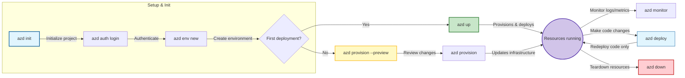
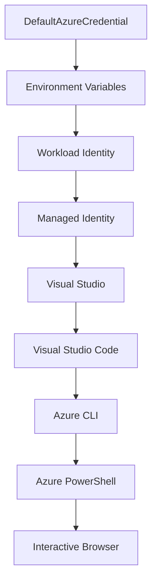

# Noțiunile de bază AZD - Concepte fundamentale și elemente de bază

**Navigarea capitolelor:**
- **📚 Acasă curs**: [AZD Pentru Începători](../../README.md)
- **📖 Capitol curent**: Capitolul 1 - Fundament și Pornire rapidă
- **⬅️ Anterior**: [Prezentare generală a cursului](../../README.md#-chapter-1-foundation--quick-start)
- **➡️ Următor**: [Instalare și Configurare](installation.md)
- **🚀 Capitol următor**: [Capitolul 2: Dezvoltare axată pe AI](../chapter-02-ai-development/microsoft-foundry-integration.md)

## Introducere

> Revizuit conform `azd 1.37.2` (noiembrie 2026). Comenzile Bash folosesc substituenți citați pe care trebuie să îi înlocuiți. Fluxurile de lucru ale șabloanelor folosesc `.` pentru a inițializa directorul curent; fără un argument pentru director, inițializarea șablonului creează un subdirector și nu schimbă directorul de lucru al shell-ului dvs. Snippets-urile avansate sunt ilustrative, nu proiecte complete.

Această lecție vă introduce în Azure Developer CLI (azd), un instrument puternic din linia de comandă care accelerează călătoria dvs. de la dezvoltare locală la implementarea pe Azure. Veți învăța conceptele fundamentale, caracteristicile principale și veți înțelege cum azd simplifică implementarea aplicațiilor native cloud.

## Obiectivele învățării

Până la finalul acestei lecții, veți:
- Înțelege ce este Azure Developer CLI și scopul său principal
- Învață conceptele de bază ale șabloanelor, mediilor și serviciilor
- Explorați caracteristici cheie, inclusiv dezvoltarea prin șabloane și Infrastructura ca și Cod
- Înțelege structura proiectului azd și fluxul de lucru
- Fiți pregătit să instalați și să configurați azd pentru mediul dvs. de dezvoltare

## Rezultatele învățării

După finalizarea acestei lecții, veți putea:
- Explica rolul azd în fluxurile moderne de lucru pentru dezvoltarea cloud
- Identifica componentele structurii unui proiect azd
- Descrie modul în care șabloanele, mediile și serviciile funcționează împreună
- Înțelege beneficiile Infrastructurii ca și Cod cu azd
- Recunoaște diferitele comenzi azd și scopurile lor

## Ce este Azure Developer CLI (azd)?

Azure Developer CLI (azd) este un instrument din linia de comandă conceput să accelereze călătoria dvs. de la dezvoltare locală la implementarea pe Azure. Simplifică procesul de construire, implementare și gestionare a aplicațiilor native cloud pe Azure.

### Ce puteți implementa cu azd?

azd suportă o gamă largă de tipuri de sarcini — și lista este în continuă creștere. Astăzi, puteți folosi azd pentru a implementa:

| Tip sarcină | Exemple | Același flux de lucru? |
|---------------|----------|----------------|
| **Aplicații tradiționale** | Aplicații web, API REST, site-uri statice | ✅ `azd up` |
| **Servicii și microservicii** | Container Apps, Function Apps, back-end-uri multi-serviciu | ✅ `azd up` |
| **Aplicații alimentate de AI** | Aplicații de chat cu Microsoft Foundry Models, soluții RAG cu AI Search | ✅ `azd up` |
| **Agenți inteligenți** | Agenți găzduiți Foundry, orchestrări multi-agent | ✅ `azd up` |

Informația esențială este că **ciclul de viață azd rămâne același indiferent de ce implementați**. Inițializați un proiect, provisionați infrastructura, implementați codul, monitorizați aplicația și curățați resursele—indiferent dacă este un site simplu sau un agent AI sofisticat.

Această continuitate este proiectată. azd tratează capabilitățile AI ca un alt tip de serviciu pe care aplicația dvs. îl poate utiliza, nu ca ceva fundamental diferit. Un endpoint de chat susținut de Microsoft Foundry Models este, din perspectiva azd, doar un alt serviciu de configurat și implementat.

### 🎯 De ce să folosiți AZD? O comparație din lumea reală

Să comparăm implementarea unei aplicații web simple cu bază de date:

#### ❌ FĂRĂ AZD: Implementare manuală pe Azure (peste 30 de minute)

**Comparație ilustrativă Bash, nu un starter de aplicație executabil.** Presupune codul aplicației existent, nume unice pentru resurse, autentificarea Azure CLI și orice extensii CLI necesare. Folosiți exercițiul șablonului de mai jos pentru calea susținută completă.

```bash
# Step 1: Create resource group
az group create --name myapp-rg --location eastus

# Step 2: Create App Service Plan
az appservice plan create --name myapp-plan \
  --resource-group myapp-rg \
  --sku B1 --is-linux

# Step 3: Create Web App
az webapp create --name myapp-web-unique123 \
  --resource-group myapp-rg \
  --plan myapp-plan \
  --runtime "NODE:22-lts"

# Step 4: Create Cosmos DB account (10-15 minutes)
az cosmosdb create --name myapp-cosmos-unique123 \
  --resource-group myapp-rg \
  --kind MongoDB

# Step 5: Create database
az cosmosdb mongodb database create \
  --account-name myapp-cosmos-unique123 \
  --resource-group myapp-rg \
  --name tododb

# Step 6: Create collection
az cosmosdb mongodb collection create \
  --account-name myapp-cosmos-unique123 \
  --resource-group myapp-rg \
  --database-name tododb \
  --name todos

# Step 7: Get connection string
CONN_STR=$(az cosmosdb keys list \
  --name myapp-cosmos-unique123 \
  --resource-group myapp-rg \
  --type connection-strings \
  --query "connectionStrings[0].connectionString" -o tsv)

# Step 8: Configure app settings
az webapp config appsettings set \
  --name myapp-web-unique123 \
  --resource-group myapp-rg \
  --settings MONGODB_URI="$CONN_STR"

# Step 9: Enable logging
az webapp log config --name myapp-web-unique123 \
  --resource-group myapp-rg \
  --application-logging filesystem \
  --detailed-error-messages true

# Step 10: Set up Application Insights
az monitor app-insights component create \
  --app myapp-insights \
  --location eastus \
  --resource-group myapp-rg

# Step 11: Link App Insights to Web App
INSTRUMENTATION_KEY=$(az monitor app-insights component show \
  --app myapp-insights \
  --resource-group myapp-rg \
  --query "instrumentationKey" -o tsv)

az webapp config appsettings set \
  --name myapp-web-unique123 \
  --resource-group myapp-rg \
  --settings APPINSIGHTS_INSTRUMENTATIONKEY="$INSTRUMENTATION_KEY"

# Step 12: Build application locally
npm install
npm run build

# Step 13: Create deployment package
zip -r app.zip . -x "*.git*" "node_modules/*"

# Step 14: Deploy application
az webapp deployment source config-zip \
  --resource-group myapp-rg \
  --name myapp-web-unique123 \
  --src app.zip

# Step 15: Wait and pray it works 🙏
# (No automated validation, manual testing required)
```

**Probleme:**
- ❌ Peste 15 comenzi de reținut și de executat în ordine
- ❌ 30-45 minute de muncă manuală
- ❌ Ușor de făcut greșeli (greșeli de tastare, parametri incorecți)
- ❌ Credențialele necesită manipulare explicită; jurnalele de depanare și trasarea shell-ului le pot expune
- ❌ Fără revenire automată dacă ceva eșuează
- ❌ Dificil de replicat pentru membri ai echipei
- ❌ Diferit de fiecare dată (nereproductibil)

#### ✅ CU AZD: Implementare automată (5 comenzi, 10-15 minute)

```bash
# Step 1: Initialize from template
azd init --template todo-nodejs-mongo .

# Step 2: Authenticate
azd auth login

# Step 3: Select the environment created during init
azd env select dev

# Step 4: Preview changes (optional but recommended)
azd provision --preview

# Step 5: Deploy everything
azd up

# ✨ Done! Everything is deployed, configured, and monitored
```

**Beneficii:**
- ✅ **5 comenzi** vs. peste 15 pași manuali
- ✅ **10-15 minute** timp total (în mare parte așteptare pentru Azure)
- ✅ **Mai puține greșeli manuale** - flux de lucru consistent, bazat pe șabloane
- ✅ **Manipulare securizată a secretelor** - multe șabloane folosesc stocare secretă gestionată de Azure
- ✅ **Implementări repetabile** - același flux de lucru de fiecare dată
- ✅ **Definiții repetabile ale infrastructurii** - supuse cotelor, disponibilității regiunilor și versiunilor șabloanelor
- ✅ **Pregătit pentru echipă** - oricine poate implementa cu aceleași comenzi
- ✅ **Infrastructură ca și Cod** - șabloane Bicep controlate prin versiune
- ✅ **Monitorizare definită prin șablon** - Application Insights când este inclus în șablon

### Timp și Fiabilitate

Timpul indicat mai sus sunt estimări, nu benchmark-uri. azd reduce comenzile pe care trebuie să le coordonați, dar nu garantează durata implementării, eliminarea erorilor sau oferă revenire automată pentru aplicație/bază de date. Păstrați versiunile de lucru în controlul sursei și testați procedurile de recuperare.

## Concepte fundamentale

### Șabloane
Șabloanele sunt fundamentul azd. Ele conțin:
- **Codul aplicației** - Codul sursă și dependențele dvs.
- **Definiții ale infrastructurii** - Resurse Azure definite în Bicep sau Terraform
- **Fișiere de configurare** - Setări și variabile de mediu
- **Scripturi de implementare** - Fluxuri de lucru automate de implementare

### Medii
Mediile reprezintă ținte diferite de implementare:
- **Dezvoltare** - Pentru testare și dezvoltare
- **Staging** - Mediu pre-producție
- **Producție** - Mediu live de producție

Fiecare mediu menține propriul său:
- Nume și valori de mediu; izolarea resurselor depinde de șablonul infrastructurii
- Setări de configurare
- Stare de implementare

### Servicii
Serviciile în `azure.yaml` descriu componentele aplicației ce pot fi implementate:
- **Frontend** - Aplicații web, SPA-uri
- **Backend** - API-uri, microservicii

Bazele de date și stocarea sunt, în mod normal, provisionate ca resurse de infrastructură, nu ca gazde de serviciu inventate precum `host: postgres`.

## Caracteristici cheie

### 1. Dezvoltare bazată pe șablon
```bash
# Browse available templates
azd template list

# Initialize from a template
azd init --template "<template-name>" .
```

### 2. Infrastructură ca și Cod
- **Bicep** - limbaj specific domeniului Azure
- **Terraform** - Instrument multi-cloud pentru infrastructură
- Bicep compilează în șabloane ARM; ARM JSON brut nu este un `infra.provider` încorporat separat.

### 3. Fluxuri de lucru integrate
```bash
# Complete deployment workflow
azd up            # Provision + Deploy this is hands off for first time setup

# 🧪 NEW: Preview infrastructure changes before deployment (SAFE)
azd provision --preview    # Simulate infrastructure deployment without making changes

azd provision     # Create Azure resources if you update the infrastructure use this
azd deploy        # Deploy application code or redeploy application code once update
azd down          # Clean up resources
```

#### 🛡️ Planificare sigură a infrastructurii cu previzualizare
Comanda `azd provision --preview` este un element revoluționar pentru implementări sigure:
- **Analiză dry-run** - Arată ce va fi creat, modificat sau șters
- **Fără aplicare a infrastructurii** - Revizuiește modificările providerului; inspectați mai întâi hook-urile proiectului, deoarece acestea pot executa comenzi cu efecte secundare
- **Colaborare în echipă** - Distribuiți rezultatele previzualizării înainte de implementare
- **Input pentru planificarea costurilor** - Inspectați SKU-urile propuse, apoi calculați prețurile cu Azure Pricing Calculator; previzualizarea nu calculează prețuri

```bash
# Example preview workflow
azd provision --preview           # See what will change
# Review the output, discuss with team
azd provision                     # Apply changes with confidence
```

### 📊 Vizual: Fluxul de lucru al dezvoltării AZD



**Explicația fluxului de lucru:**
1. **Init** - Porniți cu un șablon sau un proiect nou
2. **Auth** - Autentificați-vă cu Azure
3. **Environment** - Creați un mediu izolat de implementare
4. **Preview** - 🆕 Întotdeauna previzualizați mai întâi schimbările infrastructurii (practică sigură)
5. **Provision** - Creați/actualizați resurse Azure
6. **Deploy** - Urmăriți codul aplicației
7. **Monitor** - Observați performanța aplicației
8. **Iterate** - Faceți modificări și reimplementați codul
9. **Cleanup** - Eliminați resursele când ați terminat

### 4. Managementul mediului
```bash
# Create and manage environments
azd env new "<environment-name>"
azd env select "<environment-name>"
azd env list
```

### 5. Extensii și comenzi AI

azd folosește un sistem de extensii pentru a adăuga capabilități dincolo de CLI-ul de bază. Acest lucru este deosebit de util pentru sarcini AI:

```bash
# List available extensions
azd extension list

# Install the GA Foundry bundle (requires azd >= 1.37.0)
azd ext install microsoft.foundry

# Initialize an AI agent project interactively
azd ai agent init

# Test a deployed agent (shows latency and time-to-first-byte)
azd ai agent invoke

# Start the MCP server for AI-assisted development (Alpha)
azd mcp start
```

**Ciclul de viață al agentului, complet.** Pachetul GA `microsoft.foundry` include `azure.ai.agents` și alte șase extensii de bază. Instalați `azure.ai.evaluations` separat pentru evaluare. Folosiți `azd >= 1.37.0` pentru acest flux de lucru. Nu aveți nevoie de toate acestea din prima zi:

| Etapă | Comandă | Ce face |
|-------|---------|--------------|
| **Scaffold** | `azd ai agent init --template <path-to-azure.yaml>` | Adoptați un șablon de proiect agent actual |
| **Rulați local** | `azd ai agent run`, apoi `azd ai agent invoke --local "Test prompt"` în alt terminal | Inspectați activitatea locală în Agent Inspector; apelurile de modele încă folosesc Azure |
| **Implementați** | `azd deploy` | Pentru agenții găzduiți în mod cod, încărcați sursa pentru o construire remote Foundry |
| **Testați** | `azd ai agent invoke` | Apelați agentul și vedeți timpul răspunsului |
| **Măsurați** | `azd ai eval init`, `generate`, `run start` | Configurați, implementați și rulați evaluări folosind extensia separată |
| **Îmbunătățiți** | `azd ai agent optimize --eval <evaluation-name> --optimize-model <optimizer-deployment>` | Refuzați o evaluare compatibilă pentru optimizarea agentului |
| **Inspectați** | `azd ai agent endpoint show` | Vizualizați configurarea endpoint-ului live |
| **Curățați** | `azd ai agent delete` | Ștergeți un agent găzduit și toate versiunile sale |

> Începeți cu [ghidul agentului găzduit GA](../chapter-02-ai-development/microsoft-foundry-integration.md#hosted-agent-walkthrough-ga), care acoperă precondițiile, provisioning-ul și curățarea sigură. Extensiile sunt detaliate mai departe în referința [Comenzilor AI AZD CLI](../chapter-08-production/production-ai-practices.md#azd-ai-cli-commands-and-extensions).

## 📁 Structura proiectului

O structură tipică pentru proiectul azd:
```
my-app/
├── .azure/                  # Local environments and selected-environment config
│   ├── config.json
│   └── dev/.env
├── .devcontainer/          # Development container config
├── .github/workflows/      # GitHub Actions
├── .vscode/               # VS Code settings
├── infra/                 # Infrastructure code
│   ├── main.bicep        # Main infrastructure template
│   ├── main.parameters.json
│   └── modules/          # Reusable modules
├── src/                  # Application source code
│   ├── api/             # Backend services
│   └── web/             # Frontend application
├── azure.yaml           # azd project configuration
└── README.md
```

## 🔧 Fișiere de configurare

### azure.yaml
Fișierul principal de configurare al proiectului:
```yaml
name: my-awesome-app
metadata:
  template: my-template@1.0.0

services:
  web:
    project: ./src/web
    language: js
    host: appservice
  api:
    project: ./src/api
    language: js
    host: appservice

hooks:
  preprovision:
    shell: pwsh
    run: echo "Preparing to provision..."
```

### .azure/config.json
Selectarea locală a mediului implicit (ilustrativ; gestionat de azd):
```json
{
  "defaultEnvironment": "dev"
}
```

## 🎪 Fluxuri de lucru comune cu exerciții practice

> **💡 Sfaturi de învățare:** Urmați aceste exerciții în ordine pentru a vă dezvolta abilitățile AZD progresiv.

### 🎯 Exercițiul 1: Inițializați primul dvs. proiect

**Obiectiv:** Creați un proiect AZD și explorați structura acestuia

**Pași:**
```bash
# Use a proven template
mkdir azd-basics-practice
cd azd-basics-practice
# Choose "dev" for the environment name when prompted
azd init --template todo-nodejs-mongo .

# Explore the generated files
ls -la  # View all files including hidden ones

# Key files created:
# - azure.yaml (main config)
# - infra/ (infrastructure code)
# - src/ (application code)
```

**✅ Succes:** Aveți directoarele azure.yaml, infra/ și src/

---

### 🎯 Exercițiul 2: Implementare pe Azure

**Obiectiv:** Finalizați implementarea completă end-to-end

**Pași:**
```bash
# 1. Authenticate
azd auth login

# 2. Select the dev environment created in Exercise 1
azd env select dev
azd env set AZURE_LOCATION eastus

# 3. Preview changes (RECOMMENDED)
azd provision --preview

# 4. Deploy everything
azd up

# 5. Verify deployment
azd show    # View your app URL
```

**Timp estimat:** 10-15 minute  
**✅ Succes:** URL-ul aplicației se deschide în browser

---

### 🎯 Exercițiul 3: Medii multiple

**Obiectiv:** Implementați în dev și staging

**Pași:**
```bash
# Already have dev, create staging
azd env new staging
azd env set AZURE_LOCATION westus2
azd up

# Switch between them
azd env list
azd env select dev
```

**✅ Succes:** Două grupuri separate de resurse în Azure Portal

**Curățare:** Exercițiul 3 creează o a doua implementare ce implică costuri. Ștergeți ambele când ați terminat:

```bash
azd down --environment dev
azd down --environment staging
```

---

### 🛡️ Curățare distructivă: `azd down --force --purge`

Când doriți în mod intenționat să ștergeți resursele Azure ale mediului selectat:

```bash
azd down --force --purge
```

**Ce face:**
- `--force`: Fără solicitări de confirmare
- `--purge`: Șterge permanent și resursele șterse soft suportate (de ex. Key Vaults), acolo unde protecția de purjare permite. Nu șterge directorul local `.azure/`.

**Folosiți când:** ați terminat cu un mediu de unică folosință. Nu tratați curățarea distructivă ca primul răspuns la o eroare de autentificare, cotă sau configurare.

---

## 🎪 Referința fluxului original de lucru

### Începerea unui proiect nou
```bash
# Method 1: Use existing template
azd init --template todo-nodejs-mongo .

# Method 2: Start from scratch
azd init

# Method 3: Use current directory
azd init .
```

### Ciclu de dezvoltare
```bash
# Set up development environment
azd auth login
azd env new dev
azd env select dev

# Deploy everything
azd up

# Make changes and redeploy
azd deploy

# Clean up when done
azd down --force --purge # Deletes this environment's discovered Azure resources; review before forcing deletion.
```

## Înțelegerea `azd down --force --purge`
Comanda `azd down --force --purge` este o metodă puternică pentru a demola complet mediul azd și toate resursele asociate. Iată o descriere a ceea ce face fiecare flag:
```
--force
```
- Ocolește solicitările de confirmare.
- Util în automatizare sau scripturi unde introducerea manuală nu este fezabilă.
- Nu ignoră permisiunile, protecția de purjare sau eșecurile de ștergere.

```
--purge
```
Șterge permanent resursele Azure șterse soft suportate fără o confirmare suplimentară. Protecția la purjare și permisiunile se aplică în continuare. Nu **elimină** mediile locale sau folderul `.azure/`.


### De ce să folosești ambele?
Folosește ambele numai dacă intenționezi să ștergi resursele Azure ale mediului selectat și să purjezi resursele recuperabile. Aceasta este o curățare distructivă, nu o reparație generală sau resetare a stării locale.

Este deosebit de util după ștergeri manuale de resurse în portalul Azure sau când schimbi șabloane, medii sau convenții de denumire pentru grupurile de resurse.


### Gestionarea mai multor medii
```bash
# Create staging environment
azd env new staging
azd env select staging
azd up

# Switch back to dev
azd env select dev

# Compare environments
azd env list
```

## 🔐 Autentificare și acreditări

Distinge între autentificarea pentru implementare (`azd auth login`) și autentificarea SDK-ului aplicației (`DefaultAzureCredential`). Sunt separate. azd nu folosește implicit acreditările Azure CLI.

### Autentificarea Azure CLI (`az login`)

Rulează `azd auth login` pentru azd. Următoarele comenzi Azure CLI sunt opționale și autentifică comenzile `az` separat:

```bash
# Interactive login (opens browser)
az login

# Login with specific tenant
az login --tenant "<tenant-id>"

# Login with service principal
az login --service-principal -u "<app-id>" -p "<password>" --tenant "<tenant-id>"

# Check current login status
az account show

# List available subscriptions
az account list --output table

# Set default subscription
az account set --subscription "<subscription-id>"
```

### Fluxul de autentificare
1. **Autentificare interactivă**: Deschide browser-ul tău implicit pentru autentificare
2. **Flux de cod pentru dispozitiv**: Pentru medii fără acces la browser
3. **Principal de serviciu**: Pentru scenarii de automatizare și CI/CD
4. **Identitate gestionată**: Pentru aplicații găzduite în Azure

### Lanțul DefaultAzureCredential

`DefaultAzureCredential` este un tip de acreditări care oferă o experiență simplificată de autentificare prin încercarea automată a mai multor surse de acreditări într-o anumită ordine:

#### Lanțul de acreditări SDK pentru aplicații

Lanțul exact depinde de limbajul SDK Azure Identity, versiune, plugin-uri instalate și opțiuni. Această diagramă este conceptuală, nu o secvență fixă de autentificare azd; SDK-urile recente pot include și acreditări Azure Developer CLI.


#### 1. Variabile de mediu
```bash
# Set environment variables for service principal
export AZURE_CLIENT_ID="<app-id>"
export AZURE_CLIENT_SECRET="<password>"
export AZURE_TENANT_ID="<tenant-id>"
```

#### 2. Identitate de Workload (Kubernetes/GitHub Actions)
Folosit automat în:
- Azure Kubernetes Service (AKS) cu identitate de workload
- GitHub Actions cu federație OIDC
- Alte scenarii de identitate federată

#### 3. Identitate gestionată
Pentru resurse Azure precum:
- Mașini virtuale
- Serviciul App
- Azure Functions
- Instanțe de containere

```bash
# Inspect a deployed Container App's configured identity (requires az login)
az containerapp show --name "<app-name>" --resource-group "<rg-name>" --query identity
```

#### 4. Integrare unelte dezvoltator
- **Visual Studio**: Folosește automat contul autentificat
- **VS Code**: Suportul depinde de SDK și configurarea brokerului/plugin-ului
- **Azure CLI**: Folosește acreditările `az login` (cel mai comun pentru dezvoltarea locală)

### Configurarea autentificării AZD

```bash
# Method 1: Direct azd authentication (recommended)
azd auth login

# Method 2: Direct azd authentication
azd auth login --use-device-code  # For headless environments

# Method 3: Check authentication status
azd auth login --check-status

# Method 4: Logout and re-authenticate
azd auth logout
azd auth login
```

### Practici recomandate pentru autentificare

#### Pentru dezvoltarea locală
```bash
# 1. Log in to azd
azd auth login

# 2. Select the subscription for this initialized environment
azd env set AZURE_SUBSCRIPTION_ID "<subscription-id>"

# 3. Check azd sign-in details (read the status message)
azd auth login --check-status
```

#### Pentru pipeline-uri CI/CD
```yaml
# Partial GitHub Actions steps: assumes checkout, azd installation,
# required AZURE_* environment values, and pipeline secret configuration.
- name: Deploy with azd
  run: |
    azd auth login --client-id ${{ secrets.AZURE_CLIENT_ID }} \
                    --client-secret ${{ secrets.AZURE_CLIENT_SECRET }} \
                    --tenant-id ${{ secrets.AZURE_TENANT_ID }}
    azd up --no-prompt
```

#### Pentru medii de producție
- Folosește **Identitatea gestionată** când rulezi pe resurse Azure
- Folosește **Principalul de serviciu** pentru scenarii de automatizare
- Evită stocarea acreditărilor în cod sau fișiere de configurare
- Folosește **Azure Key Vault** pentru configurația sensibilă

### Probleme comune de autentificare și soluții

#### Problemă: „Nicio subscripție găsită”
```bash
# Solution: Set default subscription
az account list --output table
az account set --subscription "<subscription-id>"
azd env set AZURE_SUBSCRIPTION_ID "<subscription-id>"
```

#### Problemă: „Permisiuni insuficiente”
```bash
# Solution: Check and assign required roles
az role assignment list --assignee $(az account show --query user.name --output tsv)

# Common required roles:
# - Contributor (for resource management)
# - User Access Administrator (for role assignments)
```

#### Problemă: „Token expirată”
```bash
# Solution: Re-authenticate
az logout
az login
azd auth logout
azd auth login
```

### Autentificare în diferite scenarii

#### Dezvoltare locală
```bash
# Personal development account
az login
azd auth login
```

#### Dezvoltare în echipă
```bash
# Use specific tenant for organization
az login --tenant contoso.onmicrosoft.com
azd auth login --tenant-id "<tenant-id>"
```

#### Scenarii multi-chiriaș
```bash
# Switch between tenants
az login --tenant tenant1.onmicrosoft.com
azd auth login --tenant-id "<tenant-1-id>"
# Select an environment configured with tenant 1's subscription
azd env select tenant1-dev
# Deploy to tenant 1
azd up

az login --tenant tenant2.onmicrosoft.com  
azd auth login --tenant-id "<tenant-2-id>"
azd env select tenant2-dev
# Deploy to tenant 2
azd up
```

### Considerații de securitate

1. **Stocarea acreditărilor**: Niciodată să nu stocați acreditările în codul sursă
2. **Limitarea domeniului**: Folosiți principiul privilegiului minim pentru principalii de serviciu
3. **Rotirea token-urilor**: Rotiți regulat secretele principalilor de serviciu
4. **Audit**: Monitorizați activitățile de autentificare și implementare
5. **Securitatea rețelei**: Folosiți endpoint-uri private când este posibil

### Depanarea autentificării

```bash
# Debug authentication issues
azd auth login --check-status
az account show
az account get-access-token

# Common diagnostic commands
whoami                          # Current user context
az ad signed-in-user show      # Microsoft Entra ID user details
az group list                  # Test resource access
```

## Descoperirea comenzilor

### Descoperire
```bash
azd template list              # Browse templates
azd template list --help       # Template discovery options
azd init --help               # Initialization options
```

### Managementul proiectului
```bash
azd show                     # Project overview
azd env list                # Available environments and selected default
azd config show            # Configuration settings
```

### Monitorizare
```bash
azd monitor                  # Open Azure portal monitoring
azd monitor --logs           # View application logs
azd monitor --live           # View live metrics
azd pipeline config          # Set up CI/CD
```

## Practici recomandate

### 1. Folosiți nume semnificative
```bash
# Good
azd env new production-east
azd init --template todo-nodejs-mongo .

# Avoid
azd env new env1
azd init --template template1 .
```

### 2. Folosiți șabloane
- Porniți de la șabloane existente
- Personalizați pentru nevoile dvs.
- Creați șabloane reutilizabile pentru organizația dvs.

### 3. Izolarea mediului
- Folosiți medii separate pentru dev/staging/prod
- Nu implementați niciodată direct în producție din mașina locală
- Folosiți pipeline-uri CI/CD pentru implementări în producție

### 4. Managementul configurației
- Folosiți identitate gestionată și Key Vault pentru secrete; valorile ordinare `azd env set` sunt plain text locale
- Păstrați configurația sub controlul versiunilor
- Documentați setările specifice mediului

## Progresul în învățare

### Începător (săptămânile 1-2)
1. Instalați azd și autentificați-vă
2. Implementați un șablon simplu
3. Înțelegeți structura proiectului
4. Învățați comenzile de bază (up, down, deploy)

### Intermediar (săptămânile 3-4)
1. Personalizați șabloanele
2. Gestionați mai multe medii
3. Înțelegeți codul infrastructurii
4. Configurați pipeline-uri CI/CD

### Avansat (săptămâna 5+)
1. Creați șabloane personalizate
2. Modele avansate de infrastructură
3. Implementări multi-regiune
4. Configurări la nivel enterprise

## Pașii următori

**📖 Continuați cu capitolul 1:**
- [Instalare și configurare](installation.md) - Instalați și configurați azd
- [Primul proiect](first-project.md) - Tutorial practic complet
- [Ghid de configurare](../chapter-03-configuration/configuration.md) - Opțiuni avansate de configurare

**🎯 Gata pentru capitolul următor?**
- [Capitolul 2: Dezvoltare AI-First](../chapter-02-ai-development/microsoft-foundry-integration.md) - Începeți să construiți aplicații AI

## Resurse suplimentare

- [Prezentare generală Azure Developer CLI](https://learn.microsoft.com/en-us/azure/developer/azure-developer-cli/)
- [Galerie de șabloane](https://azure.github.io/awesome-azd/)
- [Exemple comunitare](https://github.com/Azure-Samples)

---

## 🙋 Întrebări frecvente

### Întrebări generale

**Î: Care este diferența între AZD și Azure CLI?**

R: Azure CLI (`az`) este pentru gestionarea resurselor Azure individuale. AZD (`azd`) este pentru gestionarea întregilor aplicații:

```bash
# Azure CLI - Low-level resource management
az webapp create --name myapp --resource-group rg
az sql server create --name myserver --resource-group rg
# ...many more commands needed

# AZD - Application-level management
azd up  # Deploys entire app with all resources
```

**Gândiți-vă astfel:**
- `az` = Operați pe cărămizi Lego individuale
- `azd` = Lucrați cu seturi complete Lego

---

**Î: Trebuie să cunosc Bicep sau Terraform pentru a folosi AZD?**

R: Nu! Începeți cu șabloanele:
```bash
# Use existing template - no IaC knowledge needed
azd init --template todo-nodejs-mongo .
azd up
```

Puteți învăța Bicep mai târziu pentru personalizarea infrastructurii. Șabloanele oferă exemple funcționale din care puteți învăța.

---

**Î: Cât costă să rulez șabloane AZD?**

R: Costurile variază în funcție de regiune, SKU, timp de funcționare, mod bază de date și utilizare model. Un mediu de dezvoltare poate genera costuri lunare semnificative chiar și când este inactiv; nu presupuneți un interval universal de 50–150$:

```bash
# Preview resource changes (not prices)
azd provision --preview

# Always cleanup when not using
azd down --force --purge  # Removes all resources
```

**Sfat profesional:** Folosiți nivelurile gratuite atunci când sunt disponibile:
- App Service: nivel F1 (gratuit)
- Azure OpenAI: fără alocare garantată generală gratuită lunară de tokeni; verificați prețurile curente pentru modele și oferte
- Cosmos DB: conturile provisionate eligibile pot opta pentru nivel gratuit; șabloanele serverless nu se califică automat

---

**Î: Pot folosi AZD cu resurse Azure existente?**

R: Da, dar este mai ușor să începeți de la zero. AZD funcționează cel mai bine când gestionează întreg ciclul de viață. Pentru resurse existente:

```bash
# Option 1: Import existing resources (advanced)
azd init
# Then modify infra/ to reference existing resources

# Option 2: Start fresh (recommended)
azd init --template "<verified-template-name>" .
azd up  # Creates new environment
```

---

**Î: Cum îmi partajez proiectul cu colegii?**

R: Comiteți proiectul AZD în Git (dar NU și dosarul .azure):

```bash
# Already in .gitignore by default
.azure/        # Contains secrets and environment data
*.env          # Environment variables

# Team members then:
git clone "<your-repo>"
# Change into the cloned repository before running the remaining commands.
azd auth login
azd env new "<their-name>-dev"
azd up
```

Toți obțin infrastructura identică din aceleași șabloane.

---

### Întrebări de depanare

**Î: „azd up” a eșuat la jumătate. Ce fac?**

R: Verificați eroarea, remediați și încercați din nou:

```bash
# Capture detailed diagnostics (redact sensitive values before sharing)
azd up --debug

# Common fixes:

# 1. If quota exceeded:
azd env set AZURE_LOCATION "westus2"  # Try different region

# 2. If resource name conflict:
azd down --force --purge  # Clean slate
azd up  # Retry

# 3. If auth expired:
az login
azd auth login
azd up
```

**Cea mai comună problemă:** Subscripția Azure greșită selectată
```bash
az account list --output table
az account set --subscription "<correct-subscription>"
azd env set AZURE_SUBSCRIPTION_ID "<correct-subscription-id>"
```

---

**Î: Cum pot implementa doar modificările de cod fără reprovisionare?**

R: Folosiți `azd deploy` în loc de `azd up`:

```bash
azd up          # First time: provision + deploy (slow)

# Make code changes...

azd deploy      # Subsequent times: deploy only (fast)
```

Comparativ viteză:
- `azd up`: 10-15 minute (proviționează infrastructura)
- `azd deploy`: 2-5 minute (doar cod)

---

**Î: Pot personaliza șabloanele de infrastructură?**

R: Da! Editați fișierele Bicep în `infra/`:

```bash
# After azd init
cd infra/
code main.bicep  # Edit in VS Code

# Preview changes
azd provision --preview

# Apply changes
azd provision
```

**Sfat:** Începeți cu pași mici - schimbați mai întâi SKU-urile:
```bicep
// infra/main.bicep
sku: {
  name: 'B1'  // Change to 'P1V2' for production
}
```

---

**Î: Cum șterg tot ce a creat AZD?**

R: O singură comandă elimină toate resursele:

```bash
azd down --force --purge

# This deletes:
# - Azure resources/resource groups discovered for the selected environment
# - Supported soft-deleted resources, if purge protection allows
# Local .azure files remain; shared/external resources may remain too.
```

**Rulați întotdeauna când:**
- Ați terminat testarea unui șablon
- Treceți la un proiect diferit
- Doriți să începeți de la zero

**Verificați costurile:** Confirmați ștergerea în Azure și verificați resursele reținute/partajate. Costurile deja generate rămân valabile.

---

**Î: Ce fac dacă am șters accidental resurse în Azure Portal?**

R: Starea AZD poate fi nesincronizată. Abordare cu început curat:

```bash
# 1. Delete remaining resources only if that is your intent
azd down --force --purge

# 2. Start fresh
azd up

# Alternative: Let AZD detect and fix
azd provision  # Will create missing resources
```

---

### Întrebări avansate

**Î: Pot folosi AZD în pipeline-uri CI/CD?**

R: Da! Exemplu GitHub Actions:

```yaml
# .github/workflows/deploy.yml
name: Deploy with AZD

on:
  push:
    branches: [main]

jobs:
  deploy:
    runs-on: ubuntu-latest
    steps:
      - uses: actions/checkout@v4
      
      - name: Install azd
        run: curl -fsSL https://aka.ms/install-azd.sh | bash
      
      - name: Azure Login
        run: |
          azd auth login \
            --client-id ${{ secrets.AZURE_CLIENT_ID }} \
            --client-secret ${{ secrets.AZURE_CLIENT_SECRET }} \
            --tenant-id ${{ secrets.AZURE_TENANT_ID }}
      
      - name: Deploy
        env:
          AZURE_ENV_NAME: dev
          AZURE_LOCATION: ${{ vars.AZURE_LOCATION }}
          AZURE_SUBSCRIPTION_ID: ${{ vars.AZURE_SUBSCRIPTION_ID }}
        run: azd up --no-prompt
```

---

**Î: Cum gestionez secretele și datele sensibile?**

R: Folosiți explicit Key Vault. `azd env set` scrie valori obișnuite în fișierul local de mediu; nu creează automat un vault, nu alocă roluri și nu injectează secrete în aplicație.

```bash
# Interactive: create/select a Key Vault secret and save its reference
azd env set-secret DATABASE_PASSWORD
```

Aveți nevoie de permisiuni corespunzătoare pentru vault. Infrastructura/aplicația trebuie să conecteze secretul consumatorului său și să acorde identitate runtime acces. Nu afișați valorile rezolvate ale secretelor în jurnale.

**Nu comitați niciodată:**
- Dosarul `.azure/` (conține date de mediu)
- Fișierele `.env` (secrete locale)
- Șiruri de conexiune

---

**Î: Pot implementa în mai multe regiuni?**

R: Da, creați un mediu per regiune:

```bash
# East US environment
azd env new prod-eastus
azd env set AZURE_LOCATION eastus
azd up

# West Europe environment
azd env new prod-westeurope
azd env set AZURE_LOCATION westeurope
azd up

# Each environment is independent
azd env list
```

Pentru aplicații cu adevărat multi-regiune, personalizați șabloanele Bicep pentru implementări simultane în mai multe regiuni.

---

**Î: Unde pot găsi ajutor dacă am blocaje?**

1. **Documentația AZD:** https://learn.microsoft.com/azure/developer/azure-developer-cli/
2. **Issues GitHub:** https://github.com/Azure/azure-dev/issues
3. **Discord:** [Azure Discord](https://discord.gg/microsoft-azure) - canal #azure-developer-cli
4. **Stack Overflow:** Etichetă `azure-developer-cli`
5. **Acest curs:** [Ghid de depanare](../chapter-07-troubleshooting/common-issues.md)

**Sfat profesional:** Înainte de a întreba, rulați:
```bash
azd show       # Shows current state
azd version    # Shows your version
```
Includeți aceste informații în întrebare pentru un răspuns mai rapid.

---

## 🎓 Ce urmează?

Acum înțelegeți bazele AZD. Alegeți-vă calea:

### 🎯 Pentru începători:
1. **Următorul pas:** [Instalare și configurare](installation.md) - Instalați AZD pe mașina dvs.
2. **Apoi:** [Primul proiect](first-project.md) - Implementați prima dvs. aplicație
3. **Exersați:** Completați toate cele 3 exerciții din această lecție

### 🚀 Pentru dezvoltatori AI:
1. **Săriți la:** [Capitolul 2: Dezvoltare AI-First](../chapter-02-ai-development/microsoft-foundry-integration.md)
2. **Implementați:** Într-un director de proiect gol, începeți cu `azd init --template get-started-with-ai-chat .`
3. **Învățați:** Construiți pe măsură ce implementați

### 🏗️ Pentru dezvoltatori experimentați:
1. **Revizuiți:** [Ghid de configurare](../chapter-03-configuration/configuration.md) - Setări avansate
2. **Explorați:** [Infrastructură ca cod](../chapter-04-infrastructure/provisioning.md) - Deep dive în Bicep
3. **Construiți:** Creați șabloane personalizate pentru stiva dvs.

---

**Navigare capitole:**
- **📚 Acasă curs**: [AZD pentru începători](../../README.md)
- **📖 Capitolul curent**: Capitolul 1 - Bazele & Pornire rapidă  
- **⬅️ Anterior**: [Prezentare curs](../../README.md#-chapter-1-foundation--quick-start)
- **➡️ Următor**: [Instalare și configurare](installation.md)
- **🚀 Capitol următor**: [Capitolul 2: Dezvoltare AI-First](../chapter-02-ai-development/microsoft-foundry-integration.md)

---

<!-- CO-OP TRANSLATOR DISCLAIMER START -->
**Declinare a responsabilității**:
Acest document a fost tradus folosind serviciul de traducere AI [Co-op Translator](https://github.com/Azure/co-op-translator). În timp ce ne străduim pentru acuratețe, vă rugăm să rețineți că traducerile automate pot conține erori sau inexactități. Documentul original în limba sa nativă trebuie considerat sursa autorizată. Pentru informații critice, se recomandă traducerea profesională realizată de un om. Nu ne asumăm responsabilitatea pentru eventualele neînțelegeri sau interpretări greșite care decurg din utilizarea acestei traduceri.
<!-- CO-OP TRANSLATOR DISCLAIMER END -->