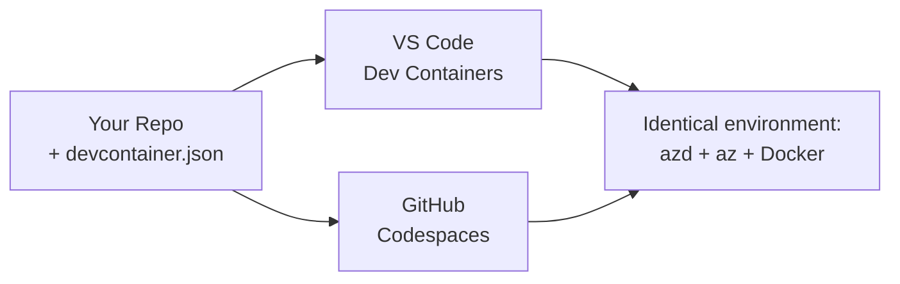

# Containere Dev & GitHub Codespaces pentru azd

**Navigare capitole:**
- **📚 Pagina principală curs**: [AZD pentru începători](../../README.md)
- **📖 Capitolul actual**: Capitolul 1 - Bază & Pornire rapidă
- **⬅️ Anterior**: [Adu-ți propria aplicație](bring-your-own-app.md)
- **🚀 Capitolul următor**: [Capitolul 2: Dezvoltare AI-First](../chapter-02-ai-development/README.md)

> Ținta revizuirii comenzii și configurației: `azd 1.37.2` (noiembrie 2026). Construirea containerelor și implementările Azure nu au fost executate ca parte a acestei revizuiri.

## Introducere

Instalarea azd, a runtime-ului potrivit pentru limbaj, Docker și a CLI-ului Azure pe fiecare mașină este o corvoadă — și este motivul principal pentru care un tutorial care „funcționează pe mașina mea” eșuează pentru altcineva. Un **container dev** rezolvă această problemă descriind întregul tău lanț de unelte într-un fișier. Oricine deschide proiectul în VS Code sau GitHub Codespaces primește exact același mediu, cu azd deja instalat. Această lecție îți arată cum să adaugi unul.

## Obiective de învățare

La finalul acestei lecții vei:
- Înțelege ce este un container dev și de ce ajută cu azd
- Adăuga un `.devcontainer/devcontainer.json` minim la un proiect
- Include azd, Azure CLI și Docker prin *funcționalități* Dev Container
- Deschide proiectul în GitHub Codespaces sau VS Code

## Rezultate de învățare

După finalizarea acestei lecții vei putea:
- Scrie un `devcontainer.json` pentru un proiect azd
- Adăuga azd și uneltele Azure fără instalări manuale
- Rula `azd up` din interiorul unui container sau Codespace

---

## Ce este un container dev?

Un container dev este un mediu de dezvoltare bazat pe Docker definit printr-un fișier `.devcontainer/devcontainer.json` în depozitul tău. Când deschizi proiectul:

- **VS Code** (cu extensia Dev Containers) construiește containerul și se conectează la el.
- **GitHub Codespaces** construiește același container în cloud și îți oferă un editor în browser.

În orice caz, fiecare colaborator primește unelte identice — fără „ai instalat azd?” ca motiv de depanare.



---

## Pasul 1: Creează fișierul devcontainer

Creează `.devcontainer/devcontainer.json` în rădăcina proiectului tău:

```json
{
  "name": "azd-project",
  "image": "mcr.microsoft.com/devcontainers/base:bookworm",
  "features": {
    "ghcr.io/devcontainers/features/azure-cli:1": {},
    "ghcr.io/azure/azure-dev/azd:0": { "version": "1.37.2" },
    "ghcr.io/devcontainers/features/docker-in-docker:2": {},
    "ghcr.io/devcontainers/features/node:1": {}
  },
  "customizations": {
    "vscode": {
      "extensions": [
        "ms-azuretools.azure-dev",
        "ms-azuretools.vscode-bicep"
      ]
    }
  },
  "forwardPorts": [3000],
  "postCreateCommand": "azd version"
}
```

Ce face fiecare parte:

| Cheie | Scop |
|-----|---------|
| `image` | Sistemul de operare de bază pentru container |
| `features` | Instalatori preconstruiți — aici: Azure CLI, **azd**, Docker și Node.js |
| `customizations.vscode.extensions` | Instalează automat extensiile azd și Bicep pentru VS Code |
| `forwardPorts` | Expune portul aplicației tale în browser |
| `postCreateCommand` | Rulează o singură dată după ce containerul este construit (aici, un test de sănătate) |

> Versiunea funcționalității (`azd:0`) și versiunea CLI instalată sunt diferite. Setează opțiunea `version` a funcționalității la `"1.37.2"` pentru a fixa versiunea CLI; nu folosi o versiune CLI ca tag al funcționalității.

---

## Pasul 2: Potrivește funcționalitatea cu limbajul aplicației tale

Schimbă funcționalitatea `node` cu cea pe care o folosește aplicația ta:

```jsonc
// Python project
"ghcr.io/devcontainers/features/python:1": {},

// .NET project
"ghcr.io/devcontainers/features/dotnet:2": {},

// Java project
"ghcr.io/devcontainers/features/java:1": {},

// Go project
"ghcr.io/devcontainers/features/go:1": {}
```

Păstrează `docker-in-docker` când construiești imagini local. O construcție ACR la distanță configurată (`docker.remoteBuild: true`) este o alternativă; tipul gazdei singur nu implică întotdeauna Docker local.

---

## Pasul 3: Deschide-l

**În VS Code:**
1. Instalează extensia **Dev Containers**.
2. Deschide folderul proiectului.
3. Apasă **Reopen in Container** când ți se cere (sau rulează *Dev Containers: Reopen in Container*).

**În GitHub Codespaces:**
1. Trimite repo-ul pe GitHub.
2. Apasă **Code → Codespaces → Create codespace on main**.
3. Așteaptă să se construiască containerul — azd este gata în terminal.

---

## Pasul 4: Implementarea din interiorul containerului

Containerul are azd preinstalat, deci fluxul de lucru obișnuit funcționează:

```bash
azd auth login --use-device-code   # device code is handy inside Codespaces
azd up
```

> **De ce `--use-device-code`?** Într-un container la distanță sau Codespace nu există un browser local pentru redirecționare, așa că autentificarea cu device-code este calea sigură. Vei lipi un cod într-o filă de browser ca să finalizezi autentificarea.

---

## Capcane comune

| Capcană | Remediere |
|---------|----------|
| `azd up` nu poate construi o imagine | Adaugă funcționalitatea `docker-in-docker` |
| Autentificarea în browser se blochează în Codespaces | Folosește `azd auth login --use-device-code` |
| Uneltele diferă între colegi | Fixează CLI prin opțiunea `version` a funcționalității azd și fixează runtime-urile limbajului |
| Aplicația nu este accesibilă în browser | Adaugă portul la `forwardPorts` |

---

## Rezumat

- Un container dev face lanțul tău de unelte azd reproduse pentru toată lumea.
- Adaugă azd, Azure CLI și Docker prin *funcționalități* Dev Container.
- Potrivește funcționalitatea limbajului cu aplicația ta și păstrează `docker-in-docker` pentru gazdele containerelor.
- Folosește autentificarea device-code când rulezi în Codespaces.

---

## 🔗 Navigare

| Direcție | Resursă |
|-----------|----------|
| **Anterior** | [Adu-ți propria aplicație](bring-your-own-app.md) |
| **Acasă capitol** | [Capitolul 1: Bază & Pornire rapidă](README.md) |
| **Următorul capitol** | [Capitolul 2: Dezvoltare AI-First](../chapter-02-ai-development/README.md) |

## 📖 Resurse conexe

- [Instalare & Configurare](installation.md)
- [Fișă rapidă comenzi](../../resources/cheat-sheet.md)
- [Specificația oficială Dev Containers](https://containers.dev/)
- [Funcționalitatea azd Dev Container](https://github.com/Azure/azure-dev/tree/main/ext/devcontainer)

---

<!-- CO-OP TRANSLATOR DISCLAIMER START -->
**Declinare a responsabilității**:
Acest document a fost tradus folosind serviciul de traducere AI [Co-op Translator](https://github.com/Azure/co-op-translator). În timp ce ne străduim pentru acuratețe, vă rugăm să rețineți că traducerile automate pot conține erori sau inexactități. Documentul original în limba sa nativă trebuie considerat sursa autorizată. Pentru informații critice, se recomandă traducerea profesională realizată de un om. Nu ne asumăm responsabilitatea pentru eventualele neînțelegeri sau interpretări greșite care decurg din utilizarea acestei traduceri.
<!-- CO-OP TRANSLATOR DISCLAIMER END -->