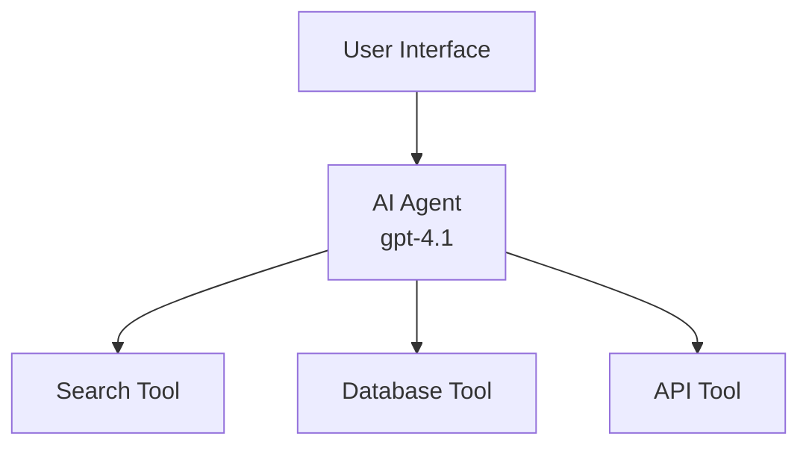
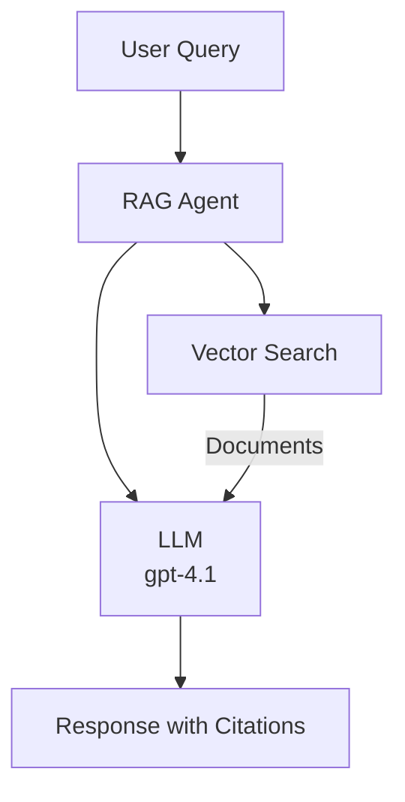
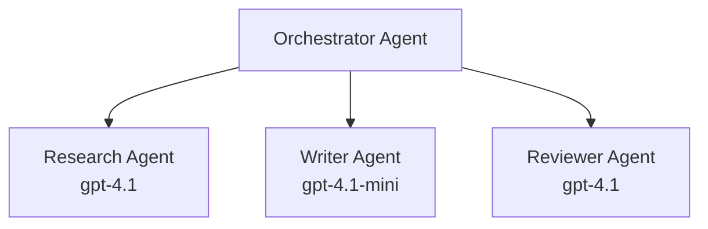

# Agenți AI cu Azure Developer CLI

**Navigare capitol:**
- **📚 Acasă curs**: [AZD Pentru Începători](../../README.md)
- **📖 Capitolul curent**: Capitolul 2 - Dezvoltare AI-First
- **⬅️ Capitolul anterior**: [Integrare Microsoft Foundry](microsoft-foundry-integration.md)
- **➡️ Următorul capitol**: [Implementarea Modelului AI](ai-model-deployment.md)
- **🚀 Avansat**: [Soluții Multi-Agent](../../examples/retail-scenario.md)

---

## Introducere

Agenții AI sunt programe autonome care pot percepe mediul înconjurător, pot lua decizii și pot întreprinde acțiuni pentru a atinge obiective specifice. Spre deosebire de chatboții simpli care răspund la solicitări, agenții pot:

- **Folosi instrumente** - Apela API-uri, căuta în baze de date, executa cod
- **Planifica și raționa** - Descompune sarcini complexe în pași
- **Învăța din context** - Menține memorie și adaptează comportamentul
- **Colabora** - Lucrează cu alți agenți (sisteme multi-agent)

Acest ghid îți arată cum să implementezi agenți AI în Azure utilizând Azure Developer CLI (azd).

Folosirea contextului conversației nu echivalează cu antrenarea modelului: memoria persistentă, controlul accesului și retenția trebuie implementate/configurate de aplicație.

> **Actualizare Foundry GA (2026-11-09):** Instalați pachetul general disponibil `microsoft.foundry` 1.0 folosind `azd >= 1.37.0`. Evaluările se instalează separat; caracteristicile opționale în previzualizare și fragmentul SDK clasic de mai jos nu sunt promovate la GA prin anunțul pachetului. Această îndrumare se bazează pe [anunțul GA](https://devblogs.microsoft.com/azure-sdk/microsoft-foundry-azure-developer-cli-ga/) și documentație, nu pe o implementare Azure live.

## Obiective de învățare

Prin parcurgerea acestui ghid, vei putea:
- Înțelege ce sunt agenții AI și cum se diferențiază de chatboți
- Implementa sabloane pre-construite de agenți AI folosind AZD
- Configura Foundry Agents pentru agenți personalizați
- Implementa modele de bază pentru agenți (utilizare instrumente, RAG, multi-agent)
- Monitoriza și depana agenții implementați

## Rezultate așteptate

La final, vei putea:
- Implemeta aplicații de agenți AI în Azure cu o singură comandă
- Configura instrumentele și capabilitățile agenților
- Implementa generarea augmentată prin recuperare (RAG) cu agenți
- Proiecta arhitecturi multi-agent pentru fluxuri de lucru complexe
- Diagnostica probleme comune la implementarea agenților

---

## 🤖 Ce face un Agent diferit de un Chatbot?

| Caracteristică | Chatbot | Agent AI |
|---------|---------|----------|
| **Comportament** | Răspunde la solicitări | Întreprinde acțiuni autonome |
| **Instrumente** | Poate folosi căutare sau instrumente | De regulă folosește instrumente într-un ciclu orientat spre scop |
| **Memorie** | Depinde de aplicație | Memorie persistentă doar dacă este implementată explicit |
| **Planificare** | Răspuns unic | Raționament în mai mulți pași |
| **Colaborare** | Entitate unică | Poate lucra cu alți agenți |

### O analogie simplă

- **Chatbot** = O persoană amabilă care răspunde la întrebări la un birou de informații
- **Agent AI** = Un asistent personal care poate face apeluri, programa întâlniri și finaliza sarcini pentru tine

---

## 🚀 Pornire rapidă: Implementarea primului agent

Alege o opțiune într-un **director de lucru nou și gol**. Comanda finală `.` inițializează acolo; fără o destinație explicită, AZD curent poate crea un subdirector cu numele șablonului și nu-ți schimbă directorul shell-ului. Păstrează șabloane/medii separate în directoare distincte.

Intervalele de timp/cost de mai jos sunt ilustrative, nu cotații validate. Verifică cerințele curente, prețurile, cotele modelului și serviciile opționale ale fiecărui exemplu înainte de implementare.

### Opțiunea 1: Șablon Foundry Agents (Recomandat)

```bash
# Initialize the AI agents template
azd init --template get-started-with-ai-agents .

# Deploy to Azure
azd up
```

**Ce se implementează:** Infrastructura curentă a exemplului și opțiunile selectate determină modelul, instrumentele, gazduirea și resursele de monitorizare. Consultă README-ul și `infra/` înainte de aprovizionare; nu presupune că fiecare șablon de agent include Search sau o interfață web.

**Timp:** ~15-20 minute
**Cost:** ~$100-150/lună (dezvoltare)

### Opțiunea 2: Agenți de Scriere Creativă cu Prompty

```bash
# Initialize the Prompty-based agent template
azd init --template https://github.com/Azure-Samples/contoso-creative-writer .

# Deploy to Azure
azd up
```

**Ce se implementează:** Un exemplu FastAPI/Prompty multi-agent de scriere folosind Azure OpenAI, Bing Grounding, și Azure AI Search. Fostul depozit `agent-openai-python-prompty` redirecționează aici; nu este un șablon minimal Azure Functions pentru agent meteo. Urmează README-ul curent pentru cerințele de gazduire, cotă model și Bing Grounding.

**Timp:** ~10-15 minute
**Cost:** ~$50-100/lună (dezvoltare)

### Opțiunea 3: Agent Chat RAG

```bash
# Initialize RAG chat template
azd init --template azure-search-openai-demo .

# Deploy to Azure
azd up
```

**Ce se implementează:**
- ✅ Modele Microsoft Foundry
- ✅ Azure AI Search cu date de exemplu
- ✅ Pipeline de procesare documente
- ✅ Interfață chat cu citări

**Timp:** ~15-25 minute
**Cost:** ~$80-150/lună (dezvoltare)

### Opțiunea 4: Agent găzduit cu pachetul GA Foundry

Folosește [parcurgerea completă pentru agent găzduit](microsoft-foundry-integration.md#hosted-agent-walkthrough-ga) pentru exemplul de bază Python Agent Framework Responses API. Această cale de implementare necesită Python 3.13+, uv curent, permisiuni Foundry și cotă regională model. Autentifică apelurile SDK locale separat când folosești acreditările Azure CLI.

```bash
azd auth login
azd ext install microsoft.foundry
```

În directorul gol, inițializează exemplul:

```text
azd ai agent init --template https://github.com/microsoft-foundry/foundry-samples/blob/main/samples/python/hosted-agents/agent-framework/responses/01-basic/azure.yaml --deploy-mode code --src .
```

Alege un proiect nou sau existent, revizuiește `azure.yaml` și rulează `azd provision`. Folosește `azd ai agent run` pentru a deschide Agent Inspector și, dintr-un alt terminal în acel director, `azd ai agent invoke --local "Explain how this agent is hosted."`. După verificarea locală, folosește `azd deploy` și `azd ai agent invoke "Explain how this agent is hosted."` pentru a compara răspunsul implementat. Foundry construiește la distanță sursa încărcată; construirea locală a unui container nu este necesară.

**Când să folosești `azd ai agent init` față de `azd init --template`:**

| Abordare | Potrivit pentru | Cum funcționează |
|----------|----------|------|
| `azd init --template` | Pornind de la o aplicație exemplu funcțională | Clonează un depozit șablon complet cu cod + infrastructură |
| `azd ai agent init --template` | Adoptând un proiect agent Foundry curent | Folosește un document de proiect `azure.yaml` și definițiile sale |

> **Sfat:** Opțiunile 1-3 pornesc de la șabloane complete de aplicații; Opțiunea 4 învață fluxul de lucru al agentului găzduit GA. Nicio comandă de inițializare nu migrează automat manifestele agenților vechi. Pentru a adăuga o definiție directă a agentului la un proiect existent, vezi [îndrumările de inițializare și migrare](../chapter-08-production/production-ai-practices.md#initializing-agent-projects-with-azd-ai-agent-init).

Instalează `azure.ai.evaluations` separat pentru a genera și revizui date/teste, configura o evaluare și rula aceasta folosind `azd ai eval`. Optimizarea poate reutiliza o evaluare compatibilă; revizuiește candidații înainte de a implementa una explicit. Urmează [fluxul de evaluare](../chapter-08-production/production-ai-practices.md#evaluation-migration-and-quality-checks) și [migrarea optimizării](../chapter-08-production/production-ai-practices.md#optimization-configuration-migration) înainte de a reutiliza exemple mai vechi. Pentru curățare, resursele unui proiect Foundry reutilizat rămân după `azd down`; un grup de resurse nou creat este șters. Vezi [îndrumarea pentru curățare](microsoft-foundry-integration.md#7-clean-up-deliberately).

---

## 🏗️ Modele arhitecturale ale agenților

### Model 1: Agent unic cu instrumente

Cel mai simplu model de agent - un agent ce poate folosi mai multe instrumente.



**Potrivit pentru:**
- Boti de suport pentru clienți
- Asistenți de cercetare
- Agenți de analiză a datelor

**Exemplu aplicație relevant:** `azure-search-openai-demo` demonstrează RAG, nu un ciclu generic cu instrument arbitrar.

### Model 2: Agent RAG (Generare augmentată cu recuperare)

Un agent care recuperează documente relevante înainte de a genera răspunsuri.



**Potrivit pentru:**
- Baze de cunoștințe enterprise
- Sisteme Q&A documentare
- Cercetare legală și conformitate

**Șablon AZD:** `azure-search-openai-demo`

### Model 3: Sistem Multi-Agent

Mai mulți agenți specializați care lucrează împreună la sarcini complexe.



**Potrivit pentru:**
- Generare complexă de conținut
- Fluxuri de lucru în mai mulți pași
- Sarcini care necesită expertize diferite

**Află mai multe:** [Modele de coordonare multi-agent](../chapter-06-pre-deployment/coordination-patterns.md)

---

## ⚙️ Configurarea instrumentelor agenților

Agenții devin puternici atunci când pot folosi instrumente. Iată cum să configurezi instrumentele comune:

### Configurarea instrumentelor în Foundry Agents

Acest **fragment clasic Agent Service SDK** vizează `azure-ai-projects==1.0.0` și `azure-ai-agents==1.1.0` cu `azure-identity`. Nu este versiunea mai nouă versioned-agent/Responses API folosită de unele șabloane Foundry curente, nici extensia `azure.ai.agents` AZD (un pachet diferit). Nu combina aceste generații API. Setează `PROJECT_ENDPOINT` la un punct final clasic Foundry și `MODEL_DEPLOYMENT_NAME` la o implementare model suportată deja; autentifică cu `az login` local și acordă permisiunile proiectului necesare.

```python
# agent_config.py
import os
from azure.ai.projects import AIProjectClient
from azure.ai.agents.models import FunctionTool
from azure.identity import DefaultAzureCredential

def search_knowledge_base(query: str) -> str:
    """Search the demonstration knowledge base.

    :param query: Search text.
    :return: Matching demonstration information.
    """
    # Local fixture only, not a production search implementation.
    return "Demo policy: returns are accepted within 30 days."

project_client = AIProjectClient(
    endpoint=os.environ["PROJECT_ENDPOINT"],
    credential=DefaultAzureCredential(),
)
search_tool = FunctionTool(functions={search_knowledge_base})
project_client.agents.enable_auto_function_calls(search_tool)
agent = project_client.agents.create_agent(
    model=os.environ["MODEL_DEPLOYMENT_NAME"],
    name="Support Agent",
    instructions="Use search_knowledge_base for policy questions. Label results as demo data.",
    tools=search_tool.definitions,
)
```

Înregistrarea unui schema funcție nu execută Python pe serviciu. În acest SDK, `enable_auto_function_calls` plus `agents.runs.create_and_process(...)` rulează callback-uri în procesul clientului tău. Vezi [exemplul SDK lansat](https://github.com/Azure/azure-sdk-for-python/blob/azure-ai-agents_1.1.0/sdk/ai/azure-ai-agents/samples/agents_tools/sample_agents_auto_function_call.py). Închide clientul și șterge agenții/thread-urile demonstraționale la final.

### Configurarea mediului

Următoarele nume sunt **intrări șablon personalizate ilustrative**, nu comutatoare AZD încorporate. Mai întâi transmite fiecare valoare prin `infra/main.parameters.json`, infrastructură și cod aplicație. `azd env set` singur nu schimbă instrumentele sau instrucțiunile unui agent.

```bash
# Set up agent-specific environment variables
azd env set AZURE_OPENAI_MODEL "gpt-4.1"
azd env set AGENT_INSTRUCTIONS "You are a helpful assistant..."
azd env set ENABLE_CODE_INTERPRETER "true"
azd env set ENABLE_FILE_SEARCH "true"

# Apply wired infrastructure and application changes
azd up
```

---

## 📊 Monitorizarea agenților

### Integrare Application Insights

Dacă șablonul selectat aprovizioanează Application Insights și configurează instrumentarea:

```bash
# Open monitoring dashboard
azd monitor --overview

# Open the Application Insights logs view (not a streaming log tail)
azd monitor --logs

# View live metrics
azd monitor --live
```

### Metrii cheie de urmărit

| Metru | Descriere | Țintă |
|--------|-------------|--------|
| Întârziere răspuns | Timp pentru generarea răspunsului | < 5 secunde |
| Utilizare tokeni | Tokeni pe cerere | Monitorizează costul |
| Rată succes apel instrument | % execuții instrument reușite | > 95% |
| Rată erori | Cereri agent eșuate | < 1% |
| Satisfacția utilizator | Scoruri feedback | > 4.0/5.0 |

### Jurnalizare personalizată pentru agenți

```python
import os
from azure.monitor.opentelemetry import configure_azure_monitor
from opentelemetry import trace

# Configure Azure Monitor with OpenTelemetry
configure_azure_monitor(
    connection_string=os.environ["APPLICATIONINSIGHTS_CONNECTION_STRING"]
)

tracer = trace.get_tracer(__name__)

def log_agent_interaction(user_query, agent_response, tools_used, latency_ms):
    with tracer.start_as_current_span("agent_interaction") as span:
        span.set_attributes({
            "query_length": len(user_query),  # Do not log raw prompts or personal data
            "response_length": len(agent_response),
            "tools_used": tools_used,
            "latency_ms": latency_ms
        })
```

> **Notă:** Instalează pachetul necesar: `pip install azure-monitor-opentelemetry`. Adaugă dependențele OpenTelemetry; namespace-ul import nu este o condiție pentru instalarea unui pachet numit `opentelemetry`.

---

## 💰 Considerații privind costurile

### Costuri lunare estimate după model

Acestea sunt intervale ilustrative de planificare, nu cotații sau limite de cheltuieli. Regiunea, tokenii modelului, SKU-urile Search/calcul, sesiunile de instrumente, stocarea și traficul pot depăși aceste valori. Verifică ghidul de cost pentru exemplu și prețurile Azure înainte de `azd up`.

| Model | Mediu Dezvoltare | Producție |
|---------|-----------------|------------|
| Agent unic | $50-100 | $200-500 |
| Agent RAG | $80-150 | $300-800 |
| Multi-agent (2-3 agenți) | $150-300 | $500-1,500 |
| Enterprise Multi-agent | $300-500 | $1,500-5,000+ |

### Sfaturi pentru optimizarea costurilor

1. **Folosește gpt-4.1-mini pentru sarcini simple** (doar dacă șablonul tău consumă această intrare)
   ```bash
   azd env set AZURE_OPENAI_MODEL "gpt-4.1-mini"
   ```

2. **Implementează caching limitat pentru interogări repetate și sigure.** Include autorizarea chiriaș/utilizator, implementarea modelului, instrucțiunile și versiunea de recuperare în cheia cache-ului; setează expirare. Nu împărtăși răspunsurile conversației private printr-un cache de interogări la nivel de proces. Obiectul agent SDK nu are metodă generică `agent.run()`.

3. **Setează limite de tokeni pe execuție**
   ```python
   # Set max_completion_tokens when running the agent, not during creation
   run = project_client.agents.runs.create_and_process(
       thread_id=thread.id,
       agent_id=agent.id,
       max_completion_tokens=1000  # Budget across the run; may finish as incomplete
   )
   ```

4. **Scalează Container Apps eligibile la zero când nu sunt folosite**
   ```bash
   # Custom-template input: must map to template.scale.minReplicas
   azd env set MIN_REPLICAS "0"
   ```
   Aplică schimbarea infrastructurii cu `azd provision` sau `azd up`. Scalarea la zero are nevoie de un declanșator potrivit și nu oprește Search, stocarea sau taxele model/instrument.

---

## 🔧 Depanarea agenților

### Probleme și soluții comune

<details>
<summary><strong>❌ Agentul nu răspunde la apeluri de instrumente</strong></summary>

```bash
# Inspect the application deployment (not the agent's registered tools)
azd show

# Verify OpenAI deployment
az cognitiveservices account deployment list \
  --name $AZURE_OPENAI_NAME \
  --resource-group $RG_NAME

# Check agent logs
azd monitor --logs
```

**Cauze comune:**
- Semnătura funcției instrumentului necorespunzătoare
- Permisiuni necesare lipsă
- Punctul final API inaccesibil
</details>

<details>
<summary><strong>❌ Întârziere mare la răspunsul agentului</strong></summary>

```bash
# Check Application Insights for bottlenecks
azd monitor --live

# Consider using a faster model
azd env set AZURE_OPENAI_MODEL "gpt-4.1-mini"
azd up
```

**Sfaturi de optimizare:**
- Folosește răspunsuri streaming
- Implementează caching pentru răspunsuri
- Redu mărimea ferestrei de context
</details>

<details>
<summary><strong>❌ Agentul returnează informații incorecte sau halucinate</strong></summary>

```python
# Improve with better system prompts
instructions = """
You are a helpful assistant. IMPORTANT:
- Only answer based on provided context
- If you don't know, say "I don't know"
- Always cite your sources
- Never make up information
"""

# Use these instructions in the agent definition.
# For classic file search, first upload/index documents in a vector store,
# then use FileSearchTool(vector_store_ids=[...]) and pass both its
# .definitions and .resources when creating the agent.
```
Instrucțiunile și recuperarea reduc riscul; niciuna nu garantează răspunsuri factuale. Evaluează întrebările fundamentate și în afara scopului față de răspunsuri cunoscute.
</details>

<details>
<summary><strong>❌ Erori de depășire a limitei de tokeni</strong></summary>

```python
# Implement context window management
def truncate_context(messages, max_tokens=8000, model="gpt-4.1"):
    """Approximate content-only budget for objects with .content strings."""
    import tiktoken
    encoding = tiktoken.encoding_for_model(model)
    total_tokens = 0
    truncated = []
    
    for msg in reversed(messages):
        msg_tokens = len(encoding.encode(msg.content))
        if total_tokens + msg_tokens > max_tokens:
            break
        truncated.insert(0, msg)
        total_tokens += msg_tokens
    
    return truncated
```
Acest ajutor exclude schemele rol/instrument, instrucțiunile sistemului, tokeni de imagine și overhead-ul protocolului. Rezervă spațiu pentru acestea și completare; nu descompune perechile apel-instrument/rezultat sau elimina instrucțiuni sistem necesare. Instalează `tiktoken` separat. Nu este un validator general al ferestrei de context.
</details>

---

## 🎓 Exerciții practice

### Exercițiul 1: Implementarea unui agent de bază (20 de minute)

**Scop:** Implementează primul tău agent AI folosind AZD

```bash
# Step 1: Initialize template
azd init --template get-started-with-ai-agents .

# Step 2: Login to Azure
azd auth login
# If you work across tenants, add --tenant-id <tenant-id>

# Step 3: Deploy
azd up

# Step 4: Test the agent
# Expected output after deployment:
#   Deployment Complete!
#   Endpoint: https://<app-name>.<region>.azurecontainerapps.io
# Open the URL shown in the output and try asking a question

# Step 5: View monitoring
azd monitor --overview

# Step 6: Review the listed resources and confirm cleanup
azd down
```

**Criterii de succes:**
- [ ] Agentul răspunde la întrebări
- [ ] Poate accesa panoul de monitorizare prin `azd monitor`
- [ ] Resursele au fost curățate cu succes

### Exercițiul 2: Adăugarea unui instrument personalizat (30 minute)

**Scop:** Extinde un agent cu un instrument personalizat

**Punct de plecare:** Folosește clientul SDK clasic din [Configurarea Instrumentului](#tool-configuration-in-foundry-agents), nu un șablon arbitrar cu o generație diferită a SDK-ului.

1. Adaugă acest fișier determinist la `agent_config.py`:
   ```python
   def get_weather(location: str) -> str:
       """Return demonstration weather, not live conditions.

       :param location: City name.
       :return: A clearly labelled fixture.
       """
       print(f"TOOL_CALLED: {location}")
       return f"Demo weather in {location}: Sunny, 72°F (fixture, not live)"
   ```
2. Înlocuiește blocul de înregistrare și creare a search-tool cu:
   ```python
   weather_tool = FunctionTool(functions={get_weather})
   project_client.agents.enable_auto_function_calls(weather_tool)
   agent = project_client.agents.create_agent(
       model=os.environ["MODEL_DEPLOYMENT_NAME"],
       name="Weather Agent",
       instructions="Call get_weather for weather questions; explain that it returns demo data.",
       tools=weather_tool.definitions,
   )
   thread = project_client.agents.threads.create()
   try:
       project_client.agents.messages.create(
           thread_id=thread.id, role="user", content="Use get_weather for Seattle."
       )
       run = project_client.agents.runs.create_and_process(
           thread_id=thread.id, agent_id=agent.id
       )
       if run.status != "completed":
           raise RuntimeError(f"Run status: {run.status}; error: {run.last_error}")
       for message in project_client.agents.messages.list(thread_id=thread.id):
           for text in message.text_messages:
               print(text.text.value)
   finally:
       project_client.agents.threads.delete(thread.id)
       project_client.agents.delete_agent(agent.id)
       project_client.close()
   ```
3. Rulează local (asta apelează proiectul Azure existent și implică taxe pentru model):
   ```bash
   python agent_config.py
   # Expected: TOOL_CALLED: Seattle, then a completed answer labelled demo data.
   ```

**Criterii de succes:**
- [ ] Agentul recunoaște întrebările legate de vreme
- [ ] Instrumentul este apelat corect
- [ ] Răspunsul include informații despre vreme

### Exercițiul 3: Construiește un agent RAG (45 minute)

**Scop:** Creează un agent care răspunde la întrebări din documentele tale

```bash
# Step 1: Deploy RAG template
azd init --template azure-search-openai-demo .
azd up

# Step 2: Upload your documents
# For the sample's local ingestion path, place supported files in data/.
# Run from the sample root after following its Python environment setup:
./scripts/prepdocs.sh
# Windows PowerShell equivalent: .\\scripts\\prepdocs.ps1

# Step 3: Test with domain-specific questions
# Open the web app URL from the azd up output
# Ask questions about your uploaded documents
# Responses should include citation references like [doc.pdf]
```

**Criterii de succes:**
- [ ] Agentul răspunde din documentele încărcate
- [ ] Răspunsurile includ citări
- [ ] Întrebările de test în afara domeniului sunt gestionate fără afirmații nesuportate (nu o garanție pentru fiecare întrebare viitoare)

Dacă `USE_CLOUD_INGESTION=true`, folosește în schimb fluxul de ingestie/încărcare în cloud al exemplului; wrapper-ul local evită intenționat ingestia. După testare, rulează `azd down` în mediul RAG și revizuiește resursele care trebuie șterse.

---

## 📚 Pași Următori

Acum că înțelegi agenții AI, explorează aceste subiecte avansate:

| Subiect | Descriere | Legătură |
|-------|-------------|------|
| **Sisteme Multi-Agent** | Construiește sisteme cu mai mulți agenți colaborativi | [Exemplu Multi-Agent Retail](../../examples/retail-scenario.md) |
| **Modele de Coordonare** | Învață modele de orchestrare și comunicare | [Modele de Coordonare](../chapter-06-pre-deployment/coordination-patterns.md) |
| **Dezvoltare în Producție** | Implementare a agenților pregătită pentru întreprindere | [Practici AI în Producție](../chapter-08-production/production-ai-practices.md) |
| **Evaluarea Agentului** | Testarea și evaluarea performanței agentului | [Depanarea AI](../chapter-07-troubleshooting/ai-troubleshooting.md) |
| **Laborator AI Workshop** | Practic: Pregătește soluția AI pentru AZD | [Laborator AI Workshop](ai-workshop-lab.md) |

---

## 📖 Resurse Suplimentare

### Documentație Oficială
- [Microsoft Foundry Agent Service](https://learn.microsoft.com/azure/ai-services/agents/)
- [Pornire rapidă Microsoft Foundry Agent Service](https://learn.microsoft.com/azure/ai-services/agents/quickstart)
- [Cadru de Agenți Semantic Kernel](https://learn.microsoft.com/semantic-kernel/)

### Șabloane AZD pentru Agenți
- [Începe cu Agenții AI](https://github.com/Azure-Samples/get-started-with-ai-agents)
- [Agenți pentru Scriere Creativă cu Prompty](https://github.com/Azure-Samples/contoso-creative-writer)
- [Demo Azure Search OpenAI](https://github.com/Azure-Samples/azure-search-openai-demo)

### Resurse Comunitare
- [Awesome AZD - Șabloane de Agenți](https://azure.github.io/awesome-azd/?tags=ai-agents)
- [Azure AI Discord](https://discord.gg/microsoft-azure)
- [Microsoft Foundry Discord](https://discord.gg/nTYy5BXMWG)

### Abilități pentru Agenți pentru Editorul tău
- [**Abilități Microsoft Azure pentru Agenți**](https://skills.sh/microsoft/github-copilot-for-azure) - Instalează abilități reutilizabile pentru agenți AI pentru dezvoltare Azure în GitHub Copilot, Cursor sau orice agent suportat. Include abilități pentru [Azure AI](https://skills.sh/microsoft/github-copilot-for-azure/azure-ai), [Microsoft Foundry](https://skills.sh/microsoft/github-copilot-for-azure/microsoft-foundry), [implementare](https://skills.sh/microsoft/github-copilot-for-azure/azure-deploy) și [diagnosticare](https://skills.sh/microsoft/github-copilot-for-azure/azure-diagnostics):
  ```bash
  npx skills add microsoft/github-copilot-for-azure
  ```

---

**Navigare**
- **Lecția Anterioară**: [Integrarea Microsoft Foundry](microsoft-foundry-integration.md)
- **Lecția Următoare**: [Dezvoltarea Modelului AI](ai-model-deployment.md)

---

<!-- CO-OP TRANSLATOR DISCLAIMER START -->
**Declinare a responsabilității**:
Acest document a fost tradus folosind serviciul de traducere AI [Co-op Translator](https://github.com/Azure/co-op-translator). În timp ce ne străduim pentru acuratețe, vă rugăm să rețineți că traducerile automate pot conține erori sau inexactități. Documentul original în limba sa nativă trebuie considerat sursa autorizată. Pentru informații critice, se recomandă traducerea profesională realizată de un om. Nu ne asumăm responsabilitatea pentru eventualele neînțelegeri sau interpretări greșite care decurg din utilizarea acestei traduceri.
<!-- CO-OP TRANSLATOR DISCLAIMER END -->