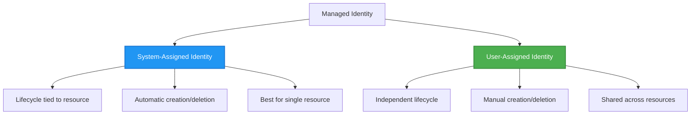

# Modele de autentificare și identitate gestionată

⏱️ **Timp estimat**: 45-60 minute lectură; alocați timp suplimentar pentru integrarea exercițiilor | 💰 **Impact financiar**: Identity/RBAC sunt gratuite; resursele compute, stocare și Key Vault sunt tarifate | ⭐ **Complexitate**: Intermediar

> Revizuit conform `azd 1.37.2` (noiembrie 2026). Această lecție conține **fragmente ilustrative de integrare, nu un șablon `secure-app` complet descărcabil**. Creați fișierele referite, furnizați infrastructura corespunzătoare și înlocuiți marcajele înainte de implementare. Nu au fost aprovizionate resurse Azure în timpul revizuirii.

**📚 Parcurs de învățare:**
- ← Anterior: [Managementul Configurației](configuration.md) - Gestionarea variabilelor de mediu și secretelor
- 🎯 **Ești aici**: Autentificare și Securitate (Identitate gestionată, Key Vault, modele sigure)
- → Următor: [Infrastructură ca Cod](../chapter-04-infrastructure/README.md) - Aprovizionare și implementare resurse
- 🏠 [Pagina principală a cursului](../../README.md)

---

## Ce veți învăța

Finalizând această lecție, veți:
- Înțelege modelele de autentificare Azure (chei, șiruri de conexiune, identitate gestionată)
- Implementa **Identitatea Gestionată** pentru autentificare fără parolă
- Asigura secretele prin integrarea cu **Azure Key Vault**
- Configura **controlul accesului bazat pe roluri (RBAC)** pentru implementările AZD
- Aplica cele mai bune practici de securitate în Container Apps și servicii Azure
- Migra de la autentificare bazată pe chei la autentificare bazată pe identitate

## De ce este importantă Identitatea Gestionată

### Problema: Autentificarea tradițională

**Înainte de Identitatea Gestionată:**
```javascript
// ❌ SECURITY RISK: Hardcoded secrets in code
const connectionString = "Server=mydb.database.windows.net;User=admin;Password=P@ssw0rd123";
const storageKey = "xK7mN9pQ2wR5tY8uI0oP3aS6dF1gH4jK...";
const cosmosKey = "C2x7B9n4M1p8Q5w3E6r0T2y5U8i1O4p7...";
```

**Probleme:**
- 🔴 **Secrete expuse** în cod, fișiere de configurare, variabile de mediu
- 🔴 **Rotirea credentialelor** necesită modificări de cod și redeploy
- 🔴 **Coșmaruri de audit** - cine a accesat ce și când?
- 🔴 **Dispersie** - secrete împrăștiate în mai multe sisteme
- 🔴 **Riscuri de conformitate** - pică audituri de securitate

### Soluția: Identitatea Gestionată

**După Identitatea Gestionată:**
```javascript
// ✅ SECURE: No secrets in code
const credential = new DefaultAzureCredential();
const client = new BlobServiceClient(
  "https://mystorageaccount.blob.core.windows.net",
  credential  // Azure automatically handles authentication
);
```

**Beneficii:**
- ✅ **Zero secrete** în cod sau configurare
- ✅ **Rotire automată** – Azure se ocupă de aceasta
- ✅ **Traseu complet de audit** în jurnalele Microsoft Entra ID
- ✅ **Securitate centralizată** – gestionare în Azure Portal
- ✅ **Conformitate asigurată** – respectă standardele de securitate

**Analogie**: Autentificarea tradițională este ca și cum ai purta mai multe chei fizice pentru diferite uși. Identitatea Gestionată este ca un ecuson de securitate care oferă acces automat pe baza identității tale – fără chei de pierdut, copiat sau rotit.

---

## Prezentare arhitecturală

### Fluxul de autentificare cu Identitate Gestionată

```mermaid
sequenceDiagram
    participant App as Your Application<br/>(Container App)
    participant MI as Managed Identity<br/>(Microsoft Entra ID)
    participant KV as Key Vault
    participant Storage as Azure Storage
    participant DB as Azure SQL
    
    App->>MI: Request access token<br/>(automatic)
    MI->>MI: Verify identity<br/>(no password needed)
    MI-->>App: Return token for requested audience<br/>(lifetime varies)
    
    App->>KV: Get secret<br/>(using token)
    KV->>KV: Check RBAC permissions
    KV-->>App: Return secret value
    
    App->>Storage: Upload blob<br/>(using token)
    Storage->>Storage: Check RBAC permissions
    Storage-->>App: Success
    
    App->>DB: Query data<br/>(using token)
    DB->>DB: Check SQL permissions
    DB-->>App: Return results
    
    Note over App,DB: Request a separate token for each service audience;<br/>SDK credentials handle caching and renewal
```

### Tipuri de Identități Gestionate



| Caracteristică | Alocată sistemului | Alocată utilizatorului |
|---------|----------------|---------------|
| **Ciclu de viață** | Legată de resursă | Independentă |
| **Creare** | Automată odată cu resursa | Creare manuală |
| **Ștergere** | Ștearsă odată cu resursa | Persistă după ștergerea resursei |
| **Partajare** | Doar o resursă | Mai multe resurse |
| **Caz de utilizare** | Scenarii simple | Scenarii complexe multi-resurse |
| **Alegerea șablonului** | Definită în infrastructură | Definită în infrastructură |

---

## Precondiții

### Unelte necesare

Ar trebui să le aveți deja instalate din lecțiile anterioare:

```bash
# Verify Azure Developer CLI
azd version
# ✅ Expected: azd version 1.0.0 or higher

# Verify Azure CLI
az --version
# ✅ Expected: azure-cli 2.50.0 or higher
```

### Cerințe Azure

- Abonament Azure activ
- Permisiuni pentru:
  - Crearea identităților gestionate
  - Atribuirea rolurilor RBAC
  - Crearea resurselor Key Vault
  - Implementarea Container Apps

### Cunoștințe prealabile

Ar trebui să fi finalizat:
- [Ghidul de instalare](../chapter-01-foundation/installation.md) - configurare AZD
- [Bazele AZD](../chapter-01-foundation/azd-basics.md) - concepte principale
- [Managementul Configurației](configuration.md) - variabile de mediu

---

## Lecția 1: Înțelegerea modelelor de autentificare

### Model 1: Șiruri de conexiune (tradițional – Evitați)

**Cum funcționează:**
```bash
# Connection string contains credentials
STORAGE_CONNECTION_STRING="DefaultEndpointsProtocol=https;AccountName=myaccount;AccountKey=xK7mN9pQ2wR5..."
COSMOS_CONNECTION_STRING="AccountEndpoint=https://myaccount.documents.azure.com:443/;AccountKey=C2x7..."
SQL_CONNECTION_STRING="Server=myserver.database.windows.net;User=admin;Password=P@ssw0rd..."
```

**Probleme:**
- ❌ Secrete vizibile în variabilele de mediu
- ❌ Înregistrate în sistemele de implementare
- ❌ Dificil de rotit
- ❌ Fără traseu de audit al accesului

**Când să folosiți:** Când serviciul țintă necesită autentificare bazată pe chei. Preferati identitatea unde este susținută; altfel, stocați cheile în siguranță și rotiți-le, inclusiv în producție.

---

### Model 2: Referințe Key Vault (mai bine)

**Cum funcționează:**
**Fragmente Bicep parțiale:** câmpurile necesare ale vault-ului, identitatea Container App și intrarea sa `configuration.secrets` nu sunt prezentate. `secretRef` denumește un secret Container App; nu este **în sine** un URI Key Vault. Pentru a folosi Key Vault, definiți secretul denumit cu `keyVaultUrl` și o autorizare `identity`.

```bicep
// Store secret in Key Vault
resource keyVault 'Microsoft.KeyVault/vaults@2023-02-01' = {
  name: 'mykv'
  properties: {
    enableRbacAuthorization: true
  }
}

// Reference in Container App
env: [
  {
    name: 'STORAGE_KEY'
    secretRef: 'storage-key'  // References Key Vault
  }
]
```

**Beneficii:**
- ✅ Secrete stocate sigur în Key Vault
- ✅ Management centralizat al secretelor
- ✅ Rotire fără modificări de cod

**Limitări:**
- ⚠️ Se folosesc încă chei/parole
- ⚠️ Necesită gestionarea accesului la Key Vault

**Când să folosiți:** Pas tranzitoriu de la șiruri de conexiune la identitate gestionată.

---

### Model 3: Identitate Gestionată (cea mai bună practică)

**Cum funcționează:**
**Bicep parțial:** încorporați blocul de identitate într-un Container App complet și furnizați `storageAccount` și definiția rolului. O atribuire de rol necesită și un `name` determinist.

```bicep
// Enable managed identity
resource containerApp 'Microsoft.App/containerApps@2023-05-01' = {
  name: 'myapp'
  identity: {
    type: 'SystemAssigned'  // Automatically creates identity
  }
}

// Grant permissions
resource roleAssignment 'Microsoft.Authorization/roleAssignments@2022-04-01' = {
  name: guid(storageAccount.id, containerApp.id, storageBlobDataContributorRole)
  scope: storageAccount
  properties: {
    roleDefinitionId: storageBlobDataContributorRole
    principalId: containerApp.identity.principalId
    principalType: 'ServicePrincipal'
  }
}
```

**Cod aplicație:**
```javascript
// No secrets needed!
const { DefaultAzureCredential } = require('@azure/identity');
const { BlobServiceClient } = require('@azure/storage-blob');

const credential = new DefaultAzureCredential();
const blobServiceClient = new BlobServiceClient(
  'https://mystorageaccount.blob.core.windows.net',
  credential
);
```

**Beneficii:**
- ✅ Zero secrete în cod/config
- ✅ Rotire automată a credențialelor
- ✅ Traseu complet de audit
- ✅ Permisiuni bazate pe RBAC
- ✅ Pregătit pentru conformitate

**Când să folosiți:** Preferabil pentru aplicații găzduite în Azure care accesează servicii ce suportă autentificarea Microsoft Entra.

---

### Model 4: Principali de serviciu (CI/CD & automatizare)

Identitatea gestionată este standardul de aur *pentru resurse care rulează în interiorul Azure*. Dar ce facem cu lucrurile care rulează **în afara** Azure — cum ar fi un pipeline CI/CD pe un agent de build, sau un script pe laptopul dvs. care nu poate folosi autentificarea interactivă? Aici intervine un **principal de serviciu**: o identitate non-umană cu propriile credențiale pe care un proces automatizat le poate folosi pentru autentificare.

**Cum funcționează:**

Creați un principal de serviciu restricționat la un grup de resurse (principiul privilegiului minim):

```bash
az ad sp create-for-rbac \
  --name "myapp-cicd" \
  --role contributor \
  --scopes "/subscriptions/<sub-id>/resourceGroups/<rg-name>"
```

Aceasta afișează un ID client, secret client și ID tenant. azd se poate autentifica cu ele non-interactiv:

```bash
azd auth login \
  --client-id "<appId>" \
  --client-secret "<password>" \
  --tenant-id "<tenant>"
```

**Se preferă credențialele federate (OIDC) față de secrete.** În loc de un secret client cu durată lungă, configurați o acreditare federată astfel încât pipeline-ul să schimbe un token cu durată scurtă – fără secret care să fie divulgat sau rotit:

```bash
azd auth login \
  --client-id "<appId>" \
  --federated-credential-provider "github" \
  --tenant-id "<tenant>"
```

> `azd pipeline config` configurează asta automat pentru dvs. Consultați ghidurile CI/CD din [Capitolul 8](../chapter-08-production/production-ai-practices.md).

**Beneficii:**
- ✅ Funcționează în afara Azure (agenți de build, on-prem, alte clouduri)
- ✅ Poate fi restricționat la un singur grup de resurse cu un rol
- ✅ Varianta federată (OIDC) nu folosește secret stocat

**Compromisuri:**
- ⚠️ Varianta bazată pe secret necesită stocare și rotire atentă
- ⚠️ Un secret divulgat oferă toate permisiunile SP—mențineți scopurile restrânse

**Când să folosiți:** Pipeline-uri CI/CD și automatizare care nu pot folosi identitatea gestionată. Preferă întotdeauna varianta **federată/OIDC** față de secretul client, și folosește identitatea gestionată ori de câte ori sarcina rulează în Azure.

**Depozitarea sigură a credențialelor:**
- Nu introduceți niciodată secrete în cod – folosiți magazinul de secrete al pipeline-ului (secrete GitHub Actions, grupuri de variabile Azure DevOps / Key Vault).
- Limitați SP la cel mai mic rol și grup de resurse necesar.
- Stabiliți o expirare și rotiți, sau eliminați secretul complet cu OIDC.

---

## Lecția 2: Implementarea Identității Gestionate cu AZD

### Implementare pas cu pas

Fragmentele următoare arată cum să integrați identitatea gestionată într-un proiect Container App. Nu sunt un starter „copy-and-run”: modulul Storage, infrastructura completă de mediu gestionat/registru, Dockerfile-ul și fișierul de parametri nu sunt toate furnizate aici. Porniți de la un șablon Container Apps funcțional și integrați aceste modele, păstrând configurația registrului și tag-urile serviciilor.

### Structura proiectului

```
secure-app/
├── azure.yaml                 # AZD configuration
├── infra/
│   ├── main.bicep            # Main infrastructure
│   ├── core/
│   │   ├── identity.bicep    # Managed identity setup
│   │   ├── keyvault.bicep    # Key Vault configuration
│   │   └── storage.bicep     # Storage with RBAC
│   └── app/
│       └── container-app.bicep
└── src/
    ├── app.js                # Application code
    ├── package.json
    └── Dockerfile
```

### 1. Configurați AZD (azure.yaml)

```yaml
name: secure-app
metadata:
  template: secure-app@1.0.0

services:
  api:
    project: ./src
    language: js
    host: containerapp

# Managed identity must be enabled in the infrastructure, not by this YAML.
```

### 2. Infrastructură: Activați Identitatea Gestionată

**Fișier: `infra/main.bicep`**

```bicep
targetScope = 'subscription'

param environmentName string
param location string = 'eastus'
param containerAppsEnvironmentId string
param containerImage string

var tags = { 'azd-env-name': environmentName }

// Resource group
resource rg 'Microsoft.Resources/resourceGroups@2021-04-01' = {
  name: 'rg-${environmentName}'
  location: location
  tags: tags
}

// Storage Account
module storage './core/storage.bicep' = {
  name: 'storage'
  scope: rg
  params: {
    name: 'st${uniqueString(rg.id)}'
    location: location
    tags: tags
  }
}

// Key Vault
module keyVault './core/keyvault.bicep' = {
  name: 'keyvault'
  scope: rg
  params: {
    name: 'kv-${uniqueString(rg.id)}'
    location: location
    tags: tags
  }
}

// Container App with Managed Identity
module containerApp './app/container-app.bicep' = {
  name: 'container-app'
  scope: rg
  params: {
    name: 'ca-${environmentName}'
    location: location
    tags: tags
    storageAccountName: storage.outputs.name
    keyVaultName: keyVault.outputs.name
    containerAppsEnvironmentId: containerAppsEnvironmentId
    containerImage: containerImage
  }
}

// Grant Container App access to Storage
module storageRoleAssignment './core/role-assignment.bicep' = {
  name: 'storage-role'
  scope: rg
  params: {
    principalId: containerApp.outputs.identityPrincipalId
    roleDefinitionId: 'ba92f5b4-2d11-453d-a403-e96b0029c9fe'  // Storage Blob Data Contributor
    targetResourceType: 'storage'
    targetResourceName: storage.outputs.name
  }
}

// Grant Container App access to Key Vault
module kvRoleAssignment './core/role-assignment.bicep' = {
  name: 'kv-role'
  scope: rg
  params: {
    principalId: containerApp.outputs.identityPrincipalId
    roleDefinitionId: '4633458b-17de-408a-b874-0445c86b69e6'  // Key Vault Secrets User
    targetResourceType: 'keyvault'
    targetResourceName: keyVault.outputs.name
  }
}

// Outputs
output AZURE_STORAGE_ACCOUNT_NAME string = storage.outputs.name
output AZURE_KEY_VAULT_NAME string = keyVault.outputs.name
output APP_URL string = containerApp.outputs.url
```

### 3. Container App cu identitate alocată sistemului

**Fișier: `infra/app/container-app.bicep`**

```bicep
param name string
param location string
param tags object = {}
param storageAccountName string
param keyVaultName string
param containerAppsEnvironmentId string
param containerImage string

resource containerApp 'Microsoft.App/containerApps@2023-05-01' = {
  name: name
  location: location
  tags: union(tags, { 'azd-service-name': 'api' })
  identity: {
    type: 'SystemAssigned'  // 🔑 Enable managed identity
  }
  properties: {
    managedEnvironmentId: containerAppsEnvironmentId
    configuration: {
      ingress: {
        external: true
        targetPort: 3000
      }
    }
    template: {
      containers: [
        {
          name: 'api'
          image: containerImage // Must exist; configure registry credentials for private images
          resources: {
            cpu: json('0.5')
            memory: '1Gi'
          }
          env: [
            {
              name: 'AZURE_STORAGE_ACCOUNT_NAME'
              value: storageAccountName
            }
            {
              name: 'AZURE_KEY_VAULT_NAME'
              value: keyVaultName
            }
            // 🔑 No secrets - managed identity handles authentication!
          ]
        }
      ]
    }
  }
}

// Output the identity for RBAC assignments
output identityPrincipalId string = containerApp.identity.principalId
output id string = containerApp.id
output url string = 'https://${containerApp.properties.configuration.ingress.fqdn}'
```

### 4. Modul pentru atribuirea rolurilor RBAC

**Fișier: `infra/core/role-assignment.bicep`**

```bicep
param principalId string
param roleDefinitionId string  // Azure built-in role ID
@allowed(['storage', 'keyvault'])
param targetResourceType string
param targetResourceName string

// Typed existing resources give Bicep a valid resource scope, not a string ID.
resource storageTarget 'Microsoft.Storage/storageAccounts@2023-01-01' existing = {
  name: targetResourceName
}
resource vaultTarget 'Microsoft.KeyVault/vaults@2023-02-01' existing = {
  name: targetResourceName
}

resource storageAssignment 'Microsoft.Authorization/roleAssignments@2022-04-01' = if (targetResourceType == 'storage') {
  name: guid(storageTarget.id, principalId, roleDefinitionId)
  scope: storageTarget
  properties: {
    roleDefinitionId: subscriptionResourceId('Microsoft.Authorization/roleDefinitions', roleDefinitionId)
    principalId: principalId
    principalType: 'ServicePrincipal'
  }
}

resource vaultAssignment 'Microsoft.Authorization/roleAssignments@2022-04-01' = if (targetResourceType == 'keyvault') {
  name: guid(vaultTarget.id, principalId, roleDefinitionId)
  scope: vaultTarget
  properties: {
    roleDefinitionId: subscriptionResourceId('Microsoft.Authorization/roleDefinitions', roleDefinitionId)
    principalId: principalId
    principalType: 'ServicePrincipal'
  }
}

// This module assigns at the target resource scope, not the whole resource group.
```

### 5. Cod aplicație cu Identitate Gestionată

**Fișier: `src/app.js`**

```javascript
const express = require('express');
const { DefaultAzureCredential } = require('@azure/identity');
const { BlobServiceClient } = require('@azure/storage-blob');
const { SecretClient } = require('@azure/keyvault-secrets');

const app = express();
const PORT = process.env.PORT || 3000;

// 🔑 Initialize credential (works automatically with managed identity)
const credential = new DefaultAzureCredential();

// Azure Storage setup
const storageAccountName = process.env.AZURE_STORAGE_ACCOUNT_NAME;
const blobServiceClient = new BlobServiceClient(
  `https://${storageAccountName}.blob.core.windows.net`,
  credential  // No keys needed!
);

// Key Vault setup
const keyVaultName = process.env.AZURE_KEY_VAULT_NAME;
const secretClient = new SecretClient(
  `https://${keyVaultName}.vault.azure.net`,
  credential  // No keys needed!
);

// Health check
app.get('/health', (req, res) => {
  res.json({ status: 'healthy', authentication: 'managed-identity' });
});

// Upload file to blob storage
app.post('/upload', async (req, res) => {
  try {
    const containerClient = blobServiceClient.getContainerClient('uploads');
    await containerClient.createIfNotExists();
    
    const blobName = `file-${Date.now()}.txt`;
    const blockBlobClient = containerClient.getBlockBlobClient(blobName);
    
    const content = 'Hello from managed identity!';
    await blockBlobClient.upload(content, Buffer.byteLength(content));
    
    res.json({
      success: true,
      blobName: blobName,
      message: 'File uploaded using managed identity!'
    });
  } catch (error) {
    console.error('Upload error:', error);
    res.status(500).json({ error: error.message });
  }
});

// Get secret from Key Vault
app.get('/secret/:name', async (req, res) => {
  try {
    const secretName = req.params.name;
    const secret = await secretClient.getSecret(secretName);
    
    res.json({
      name: secretName,
      retrieved: secret.value !== undefined, // Never return the secret value to callers
      message: 'Secret retrieved using managed identity!'
    });
  } catch (error) {
    console.error('Secret error:', error);
    res.status(500).json({ error: error.message });
  }
});

// List blob containers (demonstrates read access)
app.get('/containers', async (req, res) => {
  try {
    const containers = [];
    for await (const container of blobServiceClient.listContainers()) {
      containers.push(container.name);
    }
    
    res.json({
      containers: containers,
      count: containers.length,
      message: 'Containers listed using managed identity!'
    });
  } catch (error) {
    console.error('List error:', error);
    res.status(500).json({ error: error.message });
  }
});

app.listen(PORT, () => {
  console.log(`Secure API listening on port ${PORT}`);
  console.log('Authentication: Managed Identity (passwordless)');
});
```

**Fișier: `src/package.json`**

```json
{
  "name": "secure-app",
  "version": "1.0.0",
  "dependencies": {
    "express": "^4.18.2",
    "@azure/identity": "^4.0.0",
    "@azure/storage-blob": "^12.17.0",
    "@azure/keyvault-secrets": "^4.7.0"
  },
  "scripts": {
    "start": "node app.js"
  }
}
```

### 6. Implementați și testați

Rulați aceste comenzi **doar după** ce ați completat infrastructura lipsă, Dockerfile-ul și `main.parameters.json` corespunzător în propriul proiect. Autentificați azd cu `azd auth login`; autentificați-vă separat cu `az login` pentru verificările ulterioare Azure CLI. Endpoint-urile afișate sunt pentru demonstrații și necesită controale de acces corespunzătoare înainte de utilizarea publică.

```bash
# Initialize AZD environment
azd init

# Deploy infrastructure and application
azd up

# Get the app URL
APP_URL=$(azd env get-value APP_URL)

# Test health check
curl $APP_URL/health
```

**✅ Ieșire așteptată:**
```json
{
  "status": "healthy",
  "authentication": "managed-identity"
}
```

**Test încărcare blob:**
```bash
curl -X POST $APP_URL/upload
```

**✅ Ieșire așteptată:**
```json
{
  "success": true,
  "blobName": "file-1700404800000.txt",
  "message": "File uploaded using managed identity!"
}
```

**Test listare containere:**
```bash
curl $APP_URL/containers
```

**✅ Ieșire așteptată:**
```json
{
  "containers": ["uploads"],
  "count": 1,
  "message": "Containers listed using managed identity!"
}
```

---

## Roluri comune Azure RBAC

### ID-uri roluri încorporate pentru Identitate Gestionată

| Serviciu | Nume rol | ID rol | Permisiuni |
|---------|-----------|---------|-------------|
| **Storage** | Storage Blob Data Reader | `2a2b9908-6ea1-4ae2-8e65-a410df84e7d1` | Citire blob-uri și containere |
| **Storage** | Storage Blob Data Contributor | `ba92f5b4-2d11-453d-a403-e96b0029c9fe` | Citire, scriere, ștergere blob-uri |
| **Storage** | Storage Queue Data Contributor | `974c5e8b-45b9-4653-ba55-5f855dd0fb88` | Citire, scriere, ștergere cozi/mesaje |
| **Key Vault** | Key Vault Secrets User | `4633458b-17de-408a-b874-0445c86b69e6` | Citire secrete |
| **Key Vault** | Key Vault Secrets Officer | `b86a8fe4-44ce-4948-aee5-eccb2c155cd7` | Citire, scriere, ștergere secrete |
| **Cosmos DB** | Cosmos DB Built-in Data Reader | `00000000-0000-0000-0000-000000000001` | Citire date Cosmos DB |
| **Cosmos DB** | Cosmos DB Built-in Data Contributor | `00000000-0000-0000-0000-000000000002` | Citire, scriere date Cosmos DB |
| **SQL Database** | SQL DB Contributor | `9b7fa17d-e63e-47b0-bb0a-15c516ac86ec` | Gestionare resurse bază date; nu acordă acces date SQL |
| **Service Bus** | Azure Service Bus Data Owner | `090c5cfd-751d-490a-894a-3ce6f1109419` | Trimitere, primire, gestionare mesaje |

### Cum să găsiți ID-urile de rol

Cele două ID-uri de Cosmos DB for NoSQL de mai sus sunt **definiții native de roluri pe planul de date Cosmos**, nu ID-uri de rol de abonament Azure RBAC. Atribuiți-le cu `az cosmosdb sql role assignment create` (sau `Microsoft.DocumentDB/databaseAccounts/sqlRoleAssignments`), nu `az role assignment create`. Accesul la date SQL necesită un utilizator Entra în baza de date și permisiuni SQL.

```bash
# List all built-in roles
az role definition list --query "[].{Name:roleName, ID:name}" --output table

# Search for specific role
az role definition list --query "[?contains(roleName, 'Storage Blob')].{Name:roleName, ID:name}" --output table

# Get role details
az role definition list --name "Storage Blob Data Contributor"
```

---

## Exerciții practice

**Precondiții de integrare pentru toate cele trei exerciții:** un șablon Container App funcțional în propriul proiect, resurse Bicep corespunzătoare, autentificare Azure CLI/azd și autoritate de a atribui rolurile necesare. Sunt adaptări ghidate, nu startere locale independente; înlocuiți numele resurselor din exemplu cu propriile nume implementate.

### Exercițiul 1: Activați Identitatea Gestionată pentru o aplicație existentă ⭐⭐ (Mediu)

**Obiectiv**: Adăugați identitatea gestionată într-o implementare existentă Container App

**Scenariu**: Aveți o Container App care folosește șiruri de conexiune. Convertiți-o la identitatea gestionată.

**Punct de start**: Container App cu această configurație:

```bicep
// ❌ Current: Using connection string
env: [
  {
    name: 'STORAGE_CONNECTION_STRING'
    secretRef: 'storage-connection'
  }
]
```

**Pași**:

1. **Activați identitatea gestionată în Bicep:**

```bicep
resource containerApp 'Microsoft.App/containerApps@2023-05-01' = {
  name: 'myapp'
  identity: {
    type: 'SystemAssigned'  // Add this
  }
  // ... rest of configuration
}
```

2. **Acordați acces Storage:**

```bicep
// Get storage account reference
resource storageAccount 'Microsoft.Storage/storageAccounts@2023-01-01' existing = {
  name: storageAccountName
}

// Assign role
resource roleAssignment 'Microsoft.Authorization/roleAssignments@2022-04-01' = {
  name: guid(containerApp.id, 'ba92f5b4-2d11-453d-a403-e96b0029c9fe', storageAccount.id)
  scope: storageAccount
  properties: {
    roleDefinitionId: subscriptionResourceId('Microsoft.Authorization/roleDefinitions', 'ba92f5b4-2d11-453d-a403-e96b0029c9fe')
    principalId: containerApp.identity.principalId
    principalType: 'ServicePrincipal'
  }
}
```

3. **Actualizați codul aplicației:**

**Înainte (șir de conexiune):**
```javascript
const { BlobServiceClient } = require('@azure/storage-blob');

const blobServiceClient = BlobServiceClient.fromConnectionString(
  process.env.STORAGE_CONNECTION_STRING
);
```

**După (identitate gestionată):**
```javascript
const { DefaultAzureCredential } = require('@azure/identity');
const { BlobServiceClient } = require('@azure/storage-blob');

const credential = new DefaultAzureCredential();
const blobServiceClient = new BlobServiceClient(
  `https://${process.env.STORAGE_ACCOUNT_NAME}.blob.core.windows.net`,
  credential
);
```

4. **Actualizați variabilele de mediu:**

```bicep
env: [
  {
    name: 'STORAGE_ACCOUNT_NAME'
    value: storageAccountName  // Just the name, no secrets!
  }
  // Remove STORAGE_CONNECTION_STRING
]
```

5. **Implementați și testați:**

```bash
# Redeploy
azd up

# Test that it still works
APP_URL=$(azd show --output json | jq -er '.services.api.ingressUrl')
curl --fail -X POST "$APP_URL/upload"
```

**✅ Criterii de succes:**
- ✅ Aplicația se implementează fără erori
- ✅ Operațiunile Storage funcționează (încărcare, listare, descărcare)
- ✅ Nicio șir de conexiune în variabilele de mediu
- ✅ Identitatea este vizibilă în Azure Portal în fila „Identity”

**Verificare:**

```bash
# Check managed identity is enabled
az containerapp show \
  --name myapp \
  --resource-group rg-myapp \
  --query "identity.type"
# ✅ Expected: "SystemAssigned"

# Check role assignment
az role assignment list \
  --assignee $(az containerapp show --name myapp --resource-group rg-myapp --query "identity.principalId" -o tsv) \
  --scope /subscriptions/{sub-id}/resourceGroups/rg-myapp/providers/Microsoft.Storage/storageAccounts/mystorageaccount
# ✅ Expected: Shows "Storage Blob Data Contributor" role
```

**Timp:** 20-30 minute

---

### Exercițiul 2: Acces multi-serviciu cu identitate alocată utilizatorului ⭐⭐⭐ (Avansat)

**Obiectiv**: Creați o identitate alocată utilizatorului partajată între mai multe Container Apps

**Scenariu**: Aveți 3 microservicii care toate au nevoie de acces la același cont Storage și Key Vault.

**Pași**:

1. **Creați identitatea alocată utilizatorului:**

**Fișier: `infra/core/identity.bicep`**

```bicep
param name string
param location string
param tags object = {}

resource userAssignedIdentity 'Microsoft.ManagedIdentity/userAssignedIdentities@2023-01-31' = {
  name: name
  location: location
  tags: tags
}

output id string = userAssignedIdentity.id
output principalId string = userAssignedIdentity.properties.principalId
output clientId string = userAssignedIdentity.properties.clientId
```

2. **Atribuiți rolurile identității alocate utilizatorului:**

```bicep
// In main.bicep
module userIdentity './core/identity.bicep' = {
  name: 'user-identity'
  scope: rg
  params: {
    name: 'id-${environmentName}'
    location: location
    tags: tags
  }
}

// Grant Storage access
resource storageRoleAssignment 'Microsoft.Authorization/roleAssignments@2022-04-01' = {
  name: guid(storageAccount.id, environmentName, 'storage-contributor')
  scope: storageAccount
  properties: {
    roleDefinitionId: subscriptionResourceId('Microsoft.Authorization/roleDefinitions', 'ba92f5b4-2d11-453d-a403-e96b0029c9fe')
    principalId: userIdentity.outputs.principalId
    principalType: 'ServicePrincipal'
  }
}

// Grant Key Vault access
resource kvRoleAssignment 'Microsoft.Authorization/roleAssignments@2022-04-01' = {
  name: guid(keyVault.id, environmentName, 'kv-secrets-user')
  scope: keyVault
  properties: {
    roleDefinitionId: subscriptionResourceId('Microsoft.Authorization/roleDefinitions', '4633458b-17de-408a-b874-0445c86b69e6')
    principalId: userIdentity.outputs.principalId
    principalType: 'ServicePrincipal'
  }
}
```

3. **Atribuie identitate pentru mai multe Container Apps:**

```bicep
resource apiGateway 'Microsoft.App/containerApps@2023-05-01' = {
  name: 'api-gateway'
  identity: {
    type: 'UserAssigned'
    userAssignedIdentities: {
      '${userIdentity.outputs.id}': {}
    }
  }
  // ... rest of config
}

resource productService 'Microsoft.App/containerApps@2023-05-01' = {
  name: 'product-service'
  identity: {
    type: 'UserAssigned'
    userAssignedIdentities: {
      '${userIdentity.outputs.id}': {}
    }
  }
  // ... rest of config
}

resource orderService 'Microsoft.App/containerApps@2023-05-01' = {
  name: 'order-service'
  identity: {
    type: 'UserAssigned'
    userAssignedIdentities: {
      '${userIdentity.outputs.id}': {}
    }
  }
  // ... rest of config
}
```

4. **Codul aplicației (toate serviciile folosesc același model):**

```javascript
const { ManagedIdentityCredential } = require('@azure/identity');
const { BlobServiceClient } = require('@azure/storage-blob');

// For user-assigned identity, specify the client ID
const credential = new ManagedIdentityCredential(
  process.env.AZURE_CLIENT_ID  // User-assigned identity client ID
);

// Alternative (choose ONE credential declaration):
// const { DefaultAzureCredential } = require('@azure/identity');
// const credential = new DefaultAzureCredential({
//   managedIdentityClientId: process.env.AZURE_CLIENT_ID
// });

const blobServiceClient = new BlobServiceClient(
  `https://${process.env.STORAGE_ACCOUNT_NAME}.blob.core.windows.net`,
  credential
);
```

Setează valoarea runtime a fiecărui Container App `AZURE_CLIENT_ID` la `userIdentity.outputs.clientId` și `STORAGE_ACCOUNT_NAME` la numele tău de stocare în Bicep. Doar atribuirea identității sau rularea `azd env set` nu configurează aceste valori runtime.

5. **Deploiază și verifică:**

```bash
azd up

# Test all services can access storage
# Replace with the actual ingress URLs reported for your three services
curl --fail -X POST "$API_GATEWAY_URL/upload"
curl --fail -X POST "$PRODUCT_SERVICE_URL/upload"
curl --fail -X POST "$ORDER_SERVICE_URL/upload"
```

**✅ Criterii de succes:**
- ✅ O identitate partajată pentru 3 servicii
- ✅ Toate serviciile pot accesa Storage și Key Vault
- ✅ Identitatea persistă chiar dacă ștergi un serviciu
- ✅ Gestionare centralizată a permisiunilor

**Beneficiile identității atribuite utilizatorului:**
- O singură identitate de gestionat
- Permisiuni consistente între servicii
- Supraviețuiește ștergerii serviciilor
- Mai bun pentru arhitecturi complexe

**Timp**: 30-40 minute

---

### Exercițiul 3: Implementarea rotației secretelor în Key Vault ⭐⭐⭐ (Avansat)

**Obiectiv**: Stochează chei API de la terți în Key Vault și accesează-le folosind identitate gestionată

**Scenariu**: Aplicația ta trebuie să apeleze un API extern (OpenAI, Stripe, SendGrid) care necesită chei API.

**Pași**:

1. **Creează un Key Vault cu RBAC:**

**Fișier: `infra/core/keyvault.bicep`**

```bicep
param name string
param location string
param tags object = {}

resource keyVault 'Microsoft.KeyVault/vaults@2023-02-01' = {
  name: name
  location: location
  tags: tags
  properties: {
    enableRbacAuthorization: true  // Use RBAC instead of access policies
    sku: {
      family: 'A'
      name: 'standard'
    }
    tenantId: subscription().tenantId
    enableSoftDelete: true
    softDeleteRetentionInDays: 90
  }
}

// Allow Container App to read secrets
output id string = keyVault.id
output name string = keyVault.name
output uri string = keyVault.properties.vaultUri
```

2. **Stochează secrete în Key Vault:**

```bash
# Get Key Vault name
KV_NAME=$(azd env get-value AZURE_KEY_VAULT_NAME)

# Store third-party API keys
az keyvault secret set \
  --vault-name $KV_NAME \
  --name "OpenAI-ApiKey" \
  --value "sk-proj-xxxxxxxxxxxxx"

az keyvault secret set \
  --vault-name $KV_NAME \
  --name "Stripe-ApiKey" \
  --value "sk_live_xxxxxxxxxxxxx"

az keyvault secret set \
  --vault-name $KV_NAME \
  --name "SendGrid-ApiKey" \
  --value "SG.xxxxxxxxxxxxx"
```

3. **Codul aplicației pentru a prelua secrete:**

**Fișier: `src/config.js`**

```javascript
const { DefaultAzureCredential } = require('@azure/identity');
const { SecretClient } = require('@azure/keyvault-secrets');

class Config {
  constructor() {
    this.credential = new DefaultAzureCredential();
    this.secretClient = new SecretClient(
      `https://${process.env.AZURE_KEY_VAULT_NAME}.vault.azure.net`,
      this.credential
    );
    this.cache = {};
  }

  async getSecret(secretName) {
    // Check cache first
    if (this.cache[secretName]) {
      return this.cache[secretName];
    }

    try {
      const secret = await this.secretClient.getSecret(secretName);
      this.cache[secretName] = secret.value;
      console.log(`✅ Retrieved secret: ${secretName}`);
      return secret.value;
    } catch (error) {
      console.error(`❌ Failed to get secret ${secretName}:`, error.message);
      throw error;
    }
  }

  async getOpenAIKey() {
    return this.getSecret('OpenAI-ApiKey');
  }

  async getStripeKey() {
    return this.getSecret('Stripe-ApiKey');
  }

  async getSendGridKey() {
    return this.getSecret('SendGrid-ApiKey');
  }
}

module.exports = new Config();
```

4. **Folosește secretele în aplicație:**

**Fișier: `src/app.js`**

Această **fragment de aplicație de înlocuire** necesită `npm install openai`, o cheie reală de la terți, un model accesibil și infrastructura din proiectul tău funcțional. Apelează OpenAI direct, nu o implementare Azure OpenAI. Cheile din exemplu nu autorizează o cerere.

```javascript
const express = require('express');
const config = require('./config');
const { OpenAI } = require('openai');

const app = express();

// Initialize OpenAI with key from Key Vault
let openaiClient;

async function initializeServices() {
  const openaiKey = await config.getOpenAIKey();
  openaiClient = new OpenAI({ apiKey: openaiKey });
  console.log('✅ Services initialized with secrets from Key Vault');
}

app.post('/chat', async (req, res) => {
  try {
    const completion = await openaiClient.chat.completions.create({
      model: 'gpt-4.1',
      messages: [{ role: 'user', content: 'Hello!' }]
    });
    
    res.json({
      response: completion.choices[0].message.content,
      authentication: 'Key from Key Vault via Managed Identity'
    });
  } catch (error) {
    res.status(500).json({ error: error.message });
  }
});

// Start listening only after initialization succeeds.
initializeServices().then(() => {
  app.listen(3000, () => console.log('Key Vault demo running'));
}).catch(error => {
  console.error('Initialization failed:', error.message);
  process.exitCode = 1;
});
```

5. **Deploiază și testează:**

```bash
azd up

# Test that API keys work
curl -X POST https://myapp.azurecontainerapps.io/chat \
  -H "Content-Type: application/json" \
  -d '{"message":"Hello AI"}'
```

**✅ Criterii de succes:**
- ✅ Fără chei API în cod sau variabile de mediu
- ✅ Aplicația preia cheile din Key Vault
- ✅ API-urile terților funcționează corect
- ✅ Poți roti cheile fără modificări de cod

**Rotește un secret:**

```bash
# Update secret in Key Vault
az keyvault secret set \
  --vault-name $KV_NAME \
  --name "OpenAI-ApiKey" \
  --value "sk-proj-NEW_KEY_HERE"

# Find the active revision name, then restart it to clear the in-process cache
az containerapp revision list --name myapp --resource-group rg-myapp --output table
az containerapp revision restart \
  --name myapp \
  --resource-group rg-myapp \
  --revision "<active-revision-name>"
```

**Timp**: 25-35 minute

---

## Verificarea Cunoștințelor

### 1. Modele de Autentificare ✓

Testează-ți înțelegerea:

- [ ] **Întrebarea 1**: Care sunt cele trei modele principale de autentificare?
  - **Răspuns**: Stringuri de conexiune (moștenire), referințe Key Vault (tranziție), Identitate gestionată (cel mai bun)

- [ ] **Întrebarea 2**: De ce este identitatea gestionată mai bună decât stringurile de conexiune?
  - **Răspuns**: Fără secrete în cod, rotație automată, audit complet, permisiuni RBAC

- [ ] **Întrebarea 3**: Când ai folosi identitatea atribuită utilizatorului în locul celei atribuite sistemului?
  - **Răspuns**: Când identitatea este partajată între mai multe resurse sau când ciclul de viață al identității este independent de ciclul de viață al resursei

**Verificare practică:**
```bash
# Check what type of identity your app uses
az containerapp show \
  --name myapp \
  --resource-group rg-myapp \
  --query "identity.type"

# List all role assignments for the identity
az role assignment list \
  --assignee $(az containerapp show --name myapp --resource-group rg-myapp --query "identity.principalId" -o tsv)
```

---

### 2. RBAC și Permisiuni ✓

Testează-ți înțelegerea:

- [ ] **Întrebarea 1**: Care este ID-ul rolului pentru "Storage Blob Data Contributor"?
  - **Răspuns**: `ba92f5b4-2d11-453d-a403-e96b0029c9fe`

- [ ] **Întrebarea 2**: Ce permisiuni oferă "Key Vault Secrets User"?
  - **Răspuns**: Acces doar pentru citire la secrete (nu poate crea, actualiza sau șterge)

- [ ] **Întrebarea 3**: Cum acorzi acces unui Container App la Azure SQL?
  - **Răspuns**: Configurează autentificarea Microsoft Entra, creează identitatea ca utilizator în baza de date și acordă permisiunile SQL necesare. "SQL DB Contributor" gestionează doar resursele Azure; nu autorizează interogările.

**Verificare practică:**
```bash
# Find specific role
az role definition list --name "Storage Blob Data Contributor"

# Check what roles are assigned to your identity
PRINCIPAL_ID=$(az containerapp show --name myapp --resource-group rg-myapp --query "identity.principalId" -o tsv)
az role assignment list --assignee $PRINCIPAL_ID --output table
```

---

### 3. Integrare Key Vault ✓

Testează-ți înțelegerea:

- [ ] **Întrebarea 1**: Cum activezi RBAC pentru Key Vault în loc de politici de acces?
  - **Răspuns**: Setează `enableRbacAuthorization: true` în Bicep

- [ ] **Întrebarea 2**: Ce bibliotecă Azure SDK gestionează autentificarea cu identitate gestionată?
  - **Răspuns**: `@azure/identity` cu clasa `DefaultAzureCredential`

- [ ] **Întrebarea 3**: Cât timp rămân secretele Key Vault în cache?
  - **Răspuns**: Depinde de aplicație; implementează propria strategie de caching

**Verificare practică:**
```bash
# Test Key Vault access
az keyvault secret show \
  --vault-name $KV_NAME \
  --name "OpenAI-ApiKey" \
  --query "{name:name,enabled:attributes.enabled}"

# Check RBAC is enabled
az keyvault show \
  --name $KV_NAME \
  --query "properties.enableRbacAuthorization"
# ✅ Expected: true
```

---

## Cele mai bune practici de securitate

### ✅ FA:

1. **Folosește întotdeauna identitatea gestionată în producție**
   ```bicep
   identity: {
     type: 'SystemAssigned'
   }
   ```

2. **Folosește roluri RBAC cu privilegiu minim**
   - Folosește roluri "Reader" când este posibil
   - Evită "Owner" sau "Contributor" decât dacă este necesar

3. **Stochează cheile terților în Key Vault**
   ```javascript
   const apiKey = await secretClient.getSecret('ThirdPartyApiKey');
   ```

4. **Activează jurnalizarea auditului** (fragment parțial de resursă; unește cu declarațiile tale de vault și workspace)
   ```bicep
   resource vaultDiagnostics 'Microsoft.Insights/diagnosticSettings@2021-05-01-preview' = {
     name: 'vault-audit'
     scope: keyVault
     properties: {
       workspaceId: logAnalytics.id
       logs: [{ category: 'AuditEvent', enabled: true }]
     }
   }
   ```

5. **Folosește identități diferite pentru dev/staging/prod**
   ```bash
   azd env new dev
   azd env new staging
   azd env new prod
   ```

6. **Rotește secretele regulat**
   - Setează date de expirare pentru secretele Key Vault
   - Automatizează rotația cu Azure Functions

### ❌ NU:

1. **Niciodată să nu hardcodezi secretele**
   ```javascript
   // ❌ BAD
   const apiKey = "sk-proj-xxxxxxxxxxxxx";
   ```

2. **Nu folosi stringuri de conexiune în producție**
   ```javascript
   // ❌ BAD
   BlobServiceClient.fromConnectionString(process.env.STORAGE_CONNECTION_STRING)
   ```

3. **Nu acorda permisiuni excesive**
   ```bicep
   // ❌ BAD - too much access
   roleDefinitionId: subscriptionResourceId('Microsoft.Authorization/roleDefinitions', '8e3af657-a8ff-443c-a75c-2fe8c4bcb635')
   
   // ✅ GOOD - least privilege
   roleDefinitionId: subscriptionResourceId('Microsoft.Authorization/roleDefinitions', '2a2b9908-6ea1-4ae2-8e65-a410df84e7d1')
   ```

4. **Nu loga secretele**
   ```javascript
   // ❌ BAD
   console.log('API Key:', apiKey);
   
   // ✅ GOOD
   console.log('API Key retrieved successfully');
   ```

5. **Nu partaja identitățile de producție între medii**
   ```bicep
   // ❌ BAD - same identity for dev and prod
   // ✅ GOOD - separate identities per environment
   ```

---

## Ghid de depanare

### Problema: "Unauthorized" când accesezi Azure Storage

**Simptome:**
```
Error: Unauthorized (403)
AuthorizationPermissionMismatch: This request is not authorized to perform this operation
```

**Diagnosticul:**

```bash
# Check if managed identity is enabled
az containerapp show \
  --name myapp \
  --resource-group rg-myapp \
  --query "identity.type"
# ✅ Expected: "SystemAssigned" or "UserAssigned"

# Check role assignments
PRINCIPAL_ID=$(az containerapp show --name myapp --resource-group rg-myapp --query "identity.principalId" -o tsv)
az role assignment list --assignee $PRINCIPAL_ID

# Expected: Should see "Storage Blob Data Contributor" or similar role
```

**Soluții:**

1. **Acordă rol RBAC corect:**
```bash
STORAGE_ID=$(az storage account show --name mystorageaccount --resource-group rg-myapp --query "id" -o tsv)
az role assignment create \
  --assignee $PRINCIPAL_ID \
  --role "Storage Blob Data Contributor" \
  --scope $STORAGE_ID
```

2. **Așteaptă propagarea (poate dura 5-10 minute):**
```bash
# Check role assignment status
az role assignment list --assignee $PRINCIPAL_ID --scope $STORAGE_ID
```

3. **Verifică dacă codul aplicației folosește acreditarea corectă:**
```javascript
// Make sure you're using DefaultAzureCredential
const credential = new DefaultAzureCredential();
```

---

### Problema: Accesul la Key Vault este refuzat

**Simptome:**
```
Error: Forbidden (403)
The user, group or application does not have secrets get permission
```

**Diagnosticul:**

```bash
# Check Key Vault RBAC is enabled
az keyvault show \
  --name $KV_NAME \
  --query "properties.enableRbacAuthorization"
# ✅ Expected: true

# Check role assignments
az role assignment list \
  --assignee $PRINCIPAL_ID \
  --scope /subscriptions/{sub-id}/resourceGroups/rg-myapp/providers/Microsoft.KeyVault/vaults/$KV_NAME
```

**Soluții:**

1. **Activează RBAC pe Key Vault:**
```bash
az keyvault update \
  --name $KV_NAME \
  --enable-rbac-authorization true
```

2. **Acordă rolul Key Vault Secrets User:**
```bash
KV_ID=$(az keyvault show --name $KV_NAME --query "id" -o tsv)
az role assignment create \
  --assignee $PRINCIPAL_ID \
  --role "Key Vault Secrets User" \
  --scope $KV_ID
```

---

### Problema: DefaultAzureCredential eșuează local

**Simptome:**
```
Error: DefaultAzureCredential failed to retrieve a token
CredentialUnavailableError: No credential available
```

**Diagnosticul:**

```bash
# Check if you're logged in
az account show

# Check Azure CLI authentication
az ad signed-in-user show
```

**Soluții:**

1. **Autentifică-te în Azure CLI:**
```bash
az login
```

2. **Setează abonamentul Azure:**
```bash
az account set --subscription "Your Subscription Name"
```

3. **Pentru dezvoltare locală, folosește variabile de mediu:**
```bash
export AZURE_TENANT_ID="your-tenant-id"
export AZURE_CLIENT_ID="your-client-id"
export AZURE_CLIENT_SECRET="your-client-secret"
```

4. **Sau folosește o acreditare diferită local:**
```javascript
const { DefaultAzureCredential, AzureCliCredential } = require('@azure/identity');

// Use AzureCliCredential for local dev
const credential = process.env.NODE_ENV === 'production' 
  ? new DefaultAzureCredential()
  : new AzureCliCredential();
```

---

### Problema: Atribuirea unui rol durează prea mult să se propage

**Simptome:**
- Rolul este atribuit cu succes
- Primesc încă erori 403
- Acces intermitent (uneori funcționează, alteori nu)

**Explicație:**
Modificările RBAC în Azure pot necesita 5-10 minute pentru propagare globală.

**Soluție:**

```bash
# Wait and retry
echo "Waiting for RBAC propagation..."
sleep 300  # Wait 5 minutes

# Test access
curl --fail -X POST "$APP_URL/upload"

# If still failing, restart the app
az containerapp revision restart \
  --name myapp \
  --resource-group rg-myapp \
  --revision "<active-revision-name>"
```

---

## Considerații de costuri

### Costuri identitate gestionată

| Resursă | Cost |
|----------|------|
| **Identitate gestionată** | 🆓 **GRATUIT** - Nu se percepe taxă |
| **Atribuiri de rol RBAC** | 🆓 **GRATUIT** - Nu se percepe taxă |
| **Cereri token Microsoft Entra ID** | 🆓 **GRATUIT** - Inclus |
| **Operațiuni Key Vault** | $0.03 la 10.000 operațiuni |
| **Stocarea secretelor Key Vault** | Verifică prețurile curente; nu presupune o taxă lunară pe secret |

**Identitatea gestionată economisește bani prin:**
- ✅ Eliminarea operațiunilor Key Vault pentru autentificarea serviciu-la-serviciu
- ✅ Reducerea incidentelor de securitate (fără credențiale compromise)
- ✅ Scăderea costurilor operaționale (fără rotație manuală)

Numărul de cereri ale aplicației nu este egal cu numărul operațiunilor Key Vault: strategiile de cache și rotație determină costurile pentru citirea secretelor. Identitatea nu elimină costuri de calcul/stocare. Verifică [prețurile Key Vault](https://azure.microsoft.com/pricing/details/key-vault/) și Calculatorul de Prețuri Azure pentru regiunea ta, în loc să inferezi economii lunare doar din numărul cererilor.

---

## Află mai multe

### Documentație oficială
- [Azure Managed Identity](https://learn.microsoft.com/entra/identity/managed-identities-azure-resources/overview)
- [Azure RBAC](https://learn.microsoft.com/azure/role-based-access-control/overview)
- [Azure Key Vault](https://learn.microsoft.com/azure/key-vault/general/overview)
- [DefaultAzureCredential](https://learn.microsoft.com/dotnet/api/azure.identity.defaultazurecredential)

### Documentație SDK
- [@azure/identity (Node.js)](https://www.npmjs.com/package/@azure/identity)
- [Azure.Identity (C#)](https://www.nuget.org/packages/Azure.Identity/)
- [azure-identity (Python)](https://pypi.org/project/azure-identity/)

### Pașii următori în acest curs
- ← Anterior: [Gestionarea configurației](configuration.md)
- → Următor: [Infrastructure as Code](../chapter-04-infrastructure/README.md)
- 🏠 [Pagina principală a cursului](../../README.md)

### Exemple relaționate
- [Exemplu chat Microsoft Foundry Models](../../../../examples/azure-openai-chat) - Folosește identitate gestionată pentru Microsoft Foundry Models
- [Exemplu Microservicii](../../../../examples/microservices) - Modele de autentificare multi-serviciu

---

## Rezumat

**Ai învățat:**
- ✅ Trei modele de autentificare (stringuri de conexiune, Key Vault, identitate gestionată)
- ✅ Cum să activezi și configurezi identitatea gestionată în AZD
- ✅ Atribuiri de rol RBAC pentru serviciile Azure
- ✅ Integrarea Key Vault pentru secrete de la terți
- ✅ Identități atribuite utilizatorului vs sistemului
- ✅ Cele mai bune practici de securitate și depanare

**Puncte cheie:**
1. **Folosește întotdeauna identitatea gestionată în producție** - Fără secrete, rotație automată
2. **Folosește roluri RBAC cu privilegiu minim** - Acordă doar permisiunile necesare
3. **Stochează cheile terților în Key Vault** - Gestionare centralizată a secretelor
4. **Identități separate pe mediu** - Izolare dev, staging, prod
5. **Activează jurnalizarea auditului** - Monitorizează cine a accesat ce

**Pașii următori:**
1. Completează exercițiile practice de mai sus
2. Migrează o aplicație existentă de la stringuri de conexiune la identitate gestionată
3. Revino la fluxul de implementare pentru începători: [Primul proiect](../chapter-01-foundation/first-project.md)

---

<!-- CO-OP TRANSLATOR DISCLAIMER START -->
**Declinare a responsabilității**:
Acest document a fost tradus folosind serviciul de traducere AI [Co-op Translator](https://github.com/Azure/co-op-translator). În timp ce ne străduim pentru acuratețe, vă rugăm să rețineți că traducerile automate pot conține erori sau inexactități. Documentul original în limba sa nativă trebuie considerat sursa autorizată. Pentru informații critice, se recomandă traducerea profesională realizată de un om. Nu ne asumăm responsabilitatea pentru eventualele neînțelegeri sau interpretări greșite care decurg din utilizarea acestei traduceri.
<!-- CO-OP TRANSLATOR DISCLAIMER END -->