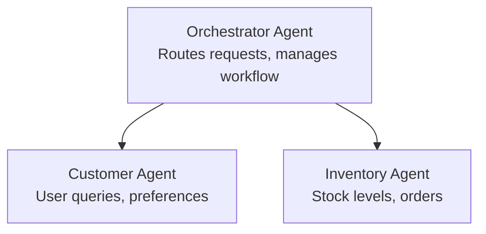

# Capitolul 5: Soluții AI Multi-Agent

**📚 Curs**: [AZD Pentru Începători](../../README.md) | **⏱️ Durată**: 2-3 ore | **⭐ Complexitate**: Avansat

---

## Prezentare generală

Acest capitol acoperă modele avansate de arhitectură multi-agent, orchestrarea agenților și implementări AI pregătite pentru producție în scenarii complexe.

> Ghidul de comandă revizuit conform referinței `azd 1.37.2` publicate. Implementările în cloud nu au fost executate.

## Obiectivele de învățare

Parcurgând acest capitol, vei:
- Înțelege modele de arhitectură multi-agent
- Implementa sisteme coordonate de agenți AI
- Implementa comunicarea agent-la-agent
- Construi soluții multi-agent pregătite pentru producție

---

## 📚 Lecții

| # | Lecție | Descriere | Durată |
|---|--------|-------------|------|
| 1 | [Bazele Multi-Agent](multi-agent-basics.md) | Practic: implementează o aplicație multi-agent funcțională cu `azd up` | 45 min |
| 2 | [Modele de coordonare](../chapter-06-pre-deployment/coordination-patterns.md) | Strategii de orchestrare a agenților (continuă în Capitolul 6) | 30 min |
| 3 | [Implementarea modelului ARM](../../examples/retail-multiagent-arm-template/README.md) | Exemplu de implementare cu un singur clic | 30 min |

> **Începe cu Lecția 1.** Este singura lecție complet practică și implementabilă din acest capitol. Lecția 2 este în Capitolul 6 (este împărțită cu planificarea pre-implementare), iar [Soluția Multi-Agent pentru Retail](../../examples/retail-scenario.md) este un plan de arhitectură — o referință de design, nu un șablon cu o singură comandă.

---

## 🚀 Pornire rapidă

```bash
# Option 1: Deploy the multi-agent template used in Lesson 1
azd init --template Azure-Samples/contoso-creative-writer .
azd up

# Option 2: Initialize a Foundry agent interactively (requires azure.ai.agents)
azd extension install azure.ai.agents
azd ai agent init
azd up
```

> **Ce abordare?** Folosește `azd init --template` pentru a începe de la un exemplu funcțional. Folosește `azd ai agent init` interactiv sau `azd ai agent init --template <path-to-azure.yaml>` pentru a adopta un proiect actual de agent. Vezi [referința AZD AI CLI](../chapter-08-production/production-ai-practices.md#azd-ai-cli-commands-and-extensions) pentru cerințe de versiune și migrarea evaluării.

Rulează aceste alternative în dosare separate și goale. Extensia agenților `1.0.0-beta.23` necesită `azd >= 1.37.0`; fluxul său interactiv nu generează pipeline-ul personalizat Service Bus în lecția de coordonare.

---

## 🤖 Arhitectura Multi-Agent



---

## 🎯 Soluția prezentată: Retail Multi-Agent

Soluția [Retail Multi-Agent](../../examples/retail-scenario.md) demonstrează:

- **Agentul Client**: Gestionează interacțiunile și preferințele utilizatorului
- **Agentul Inventar**: Administrează stocul și procesarea comenzilor
- **Orchestratorul**: Coordonează între agenți
- **Memorie Comună**: Gestionarea contextului între agenți

### Servicii Utilizate

| Serviciu | Scop |
|---------|---------|
| Microsoft Foundry Models | Înțelegerea limbajului |
| Azure AI Search | Catalog de produse |
| Cosmos DB | Starea și memoria agentului |
| Container Apps | Găzduirea agenților |
| Application Insights | Monitorizare |

---

## 🔗 Navigare

| Direcție | Capitol |
|-----------|---------|
| **Anterior** | [Capitolul 4: Infrastructură](../chapter-04-infrastructure/README.md) |
| **Următor** | [Capitolul 6: Pre-Implementare](../chapter-06-pre-deployment/README.md) |

---

## 📖 Resurse Aflate în Legătură

- [Ghidul Agenților AI](../chapter-02-ai-development/agents.md)
- [Practici AI pentru Producție](../chapter-08-production/production-ai-practices.md)
- [Depanarea AI](../chapter-07-troubleshooting/ai-troubleshooting.md)

---

<!-- CO-OP TRANSLATOR DISCLAIMER START -->
**Declinare a responsabilității**:
Acest document a fost tradus folosind serviciul de traducere AI [Co-op Translator](https://github.com/Azure/co-op-translator). În timp ce ne străduim pentru acuratețe, vă rugăm să rețineți că traducerile automate pot conține erori sau inexactități. Documentul original în limba sa nativă trebuie considerat sursa autorizată. Pentru informații critice, se recomandă traducerea profesională realizată de un om. Nu ne asumăm responsabilitatea pentru eventualele neînțelegeri sau interpretări greșite care decurg din utilizarea acestei traduceri.
<!-- CO-OP TRANSLATOR DISCLAIMER END -->