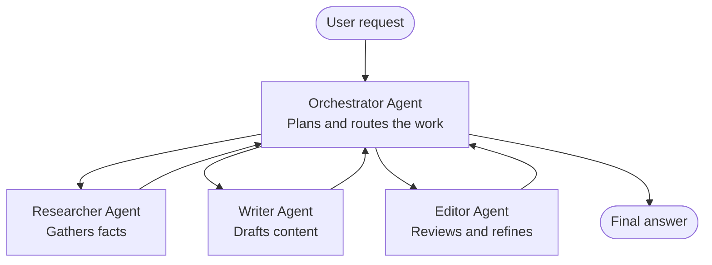

# Bazele Multi-Agent - Lansează-ți primul sistem AI coordonat

**Navigare capitol:**
- **📚 Acasă curs**: [AZD Pentru Începători](../../README.md)
- **📖 Capitolul curent**: Capitolul 5 - Soluții AI Multi-Agent
- **⬅️ Anterior**: [Capitolul 4: Infrastructură](../chapter-04-infrastructure/README.md)
- **➡️ Următor**: [Modele de coordonare](../chapter-06-pre-deployment/coordination-patterns.md)

> Ghidul comenzilor a fost verificat în raport cu referința `azd 1.37.2` lansată. Implementările în cloud nu au fost executate.

## Introducere

În capitolele anterioare ai lansat o singură aplicație — și în Capitolul 2 ai lansat un singur agent AI. Această lecție face pasul următor: lansarea unui **sistem multi-agent**, unde mai mulți agenți specializați lucrează împreună pentru a rezolva o problemă pe care niciun agent nu ar putea să o gestioneze bine singur.

Vestea bună pentru începători: **nu ai nevoie de comenzi noi.** O soluție multi-agent rămâne un proiect azd. Vei `azd init`, `azd up`, testa și `azd down` — exact fluxul de lucru pe care îl cunoști deja. Ce se schimbă este *structura* aplicației în interior.

## Obiective de Învățare

Până la sfârșitul acestei lecții, vei:
- Înțelege ce înseamnă „multi-agent” și când merită complexitatea suplimentară
- Recunoaște rolurile comune într-un sistem multi-agent (orchestrator + specialiști)
- Lansa un șablon multi-agent funcțional cu `azd up`
- Înțelege resursele Azure care susțin o aplicație multi-agent
- Ști cum să verifici, personalizezi și să dezmembrezi soluția în siguranță

## Rezultate de Învățare

După ce vei finaliza această lecție, vei putea:
- Explica diferența între un agent singular și un sistem multi-agent
- Alege între un agent singular cu instrumente și un design veritabil multi-agent
- Lansa și testa un șablon multi-agent complet cu azd
- Identifica unde rulează fiecare agent și cum comunică
- Curăța toate resursele pentru a evita costurile continue

---

## Ce Este un Sistem Multi-Agent?

Un agent AI singular este un model cu un set de instrucțiuni și (opțional) unele instrumente. Aceasta funcționează bine pentru sarcini concentrate. Dar pe măsură ce o sarcină crește — cercetare, apoi scriere, apoi editare, apoi verificare a faptelor — a include totul într-un singur prompt face agentul mai lent, mai puțin fiabil și mai greu de depanat.

Un **sistem multi-agent** împarte munca în specialiști care fiecare fac bine o sarcină, coordonați de un orchestrator:



### Cele două roluri pe care le vei vedea întotdeauna

| Rol | Sarcină | Exemplu |
|------|-----|---------|
| **Orchestrator** | Decide *ce urmează să se întâmple* și direcționează munca între agenți | „Mai întâi cercetează, apoi scrie, apoi editează” |
| **Specialist** | Face o singură sarcină concentrată și returnează un rezultat | Un „cercetător” care doar adună fapte |

### Ai nevoie chiar de mai mulți agenți?

Începe simplu. Folosește multi-agent **numai** când unul dintre aceste este adevărat:

- ✅ Sarcina are **etape distincte** care beneficiază de instrucțiuni diferite (cercetare vs. scriere vs. revizuire)
- ✅ Vrei ca specialiștii să ruleze **în paralel** pentru a economisi timp
- ✅ Diferitele etape necesită **instrumente sau surse de date diferite**
- ✅ Ai nevoie ca fiecare etapă să fie **testabilă și depanabilă independent**

Dacă sarcina ta este o simplă întrebare și răspuns sau un apel simplu la un instrument, un **agent singular cu instrumente** (Capitolul 2) este mai simplu, mai ieftin și mai ușor de utilizat.

> **Sfat pentru începători:** „Mai mulți agenți” nu înseamnă „mai bine.” Fiecare agent adaugă latență, cost și un nou element de monitorizat. Adaugă agenți doar când problema se împarte clar în părți.

---

## Două Modalități de a Construi Multi-Agent pe Azure

| Abordare | Ce este | Cea mai bună pentru |
|----------|-----------|----------|
| **Agent singular + instrumente** | Un agent Foundry care apelează funcții/instrumente | Fluxuri de lucru simple, începuturi |
| **Mai mulți agenți coordonați** | Mai mulți agenți cu un orchestrator | Etape distincte, lucru paralel, specializare |

Această lecție se concentrează pe a doua abordare, folosind un **șablon gata făcut**, astfel încât să poți vedea un sistem multi-agent real în acțiune înainte să-ți construiești propriul sistem.

---

## Practic: Lansează o Aplicație Multi-Agent Funcțională

Vom lansa **Contoso Creative Writer**, un exemplu oficial Azure care coordonează agenți de cercetare, produs, scriere și editare pentru a produce un articol. Înainte să continui, verifică [cerințele și costurile exemplului](https://github.com/Azure-Samples/contoso-creative-writer#azure-account-requirements): are nevoie de cotă de model, Azure AI Search, acces la Bing Grounding, Python, Docker și hook-uri compatibile cu Bash. Disponibilitatea modelului și a regiunii depind de abonamentul tău; implementarea nu este garantată prin simpla alegere a unei regiuni.

### Pasul 1: Inițializează șablonul

```bash
# Create a working folder
mkdir creative-writer && cd creative-writer

# Initialize from the official multi-agent template
azd init --template Azure-Samples/contoso-creative-writer .
```

> Poți explora oricând mai multe șabloane multi-agent în [Galeria Awesome AZD AI](https://azure.github.io/awesome-azd/?tags=ai). Alte opțiuni prietenoase pentru începători includ `get-started-with-ai-agents` și `azure-ai-travel-agents`.

### Pasul 2: Autentificare

```bash
# Required for azd workflows
azd auth login

# Also required by this sample's Azure CLI hooks
az login
```

### Pasul 3: Verifică mediul

```bash
# init normally creates/selects an environment; confirm it before proceeding
azd env list
# Only if you need an additional environment:
# azd env new dev
```

### Pasul 4: Previzualizează, apoi lansează

```bash
# See what will be created before spending anything (recommended)
azd provision --preview

# Provision infrastructure and deploy all agents in one step
azd up
```

`azd up` va solicita setările lipsă de abonament și regiune, apoi va provisiona resursele și va lansa aplicația. Previzualizarea nu rezervă cotă sau garantează succes; hook-urile șablonului pot rula încă în timpul previzualizării de provisioning, așa că verifică-le înainte. Pentru a extinde timpul de așteptare pe care azd îl folosește pentru fiecare **implementare de serviciu** (nu pentru provisioning-ul modelului):

```bash
azd deploy --timeout 1800
```

Un timeout oprește așteptarea azd; nu anulează implementarea în Azure. Verifică starea resursei înainte să încerci din nou.

> **Atenție la cost și capacitate:** Aplicațiile multi-agent lansează modele AI care consumă cotă și generează costuri. Dacă `azd up` eșuează din cauza cotei de model, vezi [Depanarea AI](../chapter-07-troubleshooting/ai-troubleshooting.md) pentru soluții legate de regiune și cotă, și Capitolul 6 [Planificare Capacitate](../chapter-06-pre-deployment/capacity-planning.md).

---

## Înțelegerea a ceea ce ai lansat

O aplicație tipică multi-agent ca aceasta provisionează un set de resurse Azure care corespund direct responsabilităților din diagrama de mai sus:

| Resursă | Motivul pentru care este acolo |
|----------|----------------|
| **Microsoft Foundry / Modele** | Găzduiește modelele lingvistice pe care le folosește fiecare agent |
| **Azure AI Search** | Oferă agentului de cercetare date fundamentate pentru căutare |
| **Container Apps** (sau App Service) | Găzduiește orchestratorul și codul agentului |
| **Cosmos DB** (în unele exemple) | Stochează starea/memoria partajată transmisă între agenți |
| **Application Insights** | Urmărește cererile *între* agenți pentru a putea depana fluxul |

### Cum comunică agenții între ei

În majoritatea exemplelor azd multi-agent, **orchestratorul rulează în codul aplicației tale** (de exemplu, folosind un cadru precum Semantic Kernel sau Microsoft Agent Framework). Orchestratorul apelează fiecare agent specialist pe rând, transmite rezultate și assemblează răspunsul final. Agenții împart context prin:

- **Apeluri de funcții/instrumente** — orchestratorul invocă un specialist și primește un rezultat înapoi
- **Memorie partajată** — o bază de date (de obicei Cosmos DB) stochează starea pe care ambele agenți o pot citi
- **Mesaje/evenimente** — pentru o cuplare mai slabă, agenții comunică printr-o coadă sau Service Bus

> **De ce contează asta la depanare:** fiindcă fiecare pas este separat, Application Insights îți arată *care* agent a fost lent sau a eșuat. Acesta este un motiv principal să împarți munca între agenți.

---

## Verifică Implementarea

Confirmă că sistemul funcționează efectiv înainte să continui:

```bash
# Show the deployed endpoints
azd show

# Open the app's monitoring dashboard
azd monitor

# Open Application Insights Logs (not a terminal log stream)
azd monitor --logs
```

Apoi deschide URL-ul aplicației de la `azd show` și cere un articol scurt. Folosește vizualizarea de depanare a exemplului pentru a inspecta fluxul agentului. Funcția de căutare a tranzacțiilor din Application Insights poate arăta pașii individuali doar dacă exemplul i-a instrumentat și corelat; azd nu adaugă automat segmente agent.

**Criterii de succes:**
- ✅ `azd show` listează un endpoint accesibil
- ✅ O cerere produce un rezultat care a parcurs clar mai multe etape
- ✅ Vizualizarea de depanare arată mai mulți pași agent; dacă trasarea este activată, verifică telemetria corespunzătoare după ingestie

---

## Personalizează: Adaugă sau ajustează un agent

Deoarece fiecare agent este doar instrucțiuni plus instrumente, personalizarea este accesibilă:

1. **Găsește definițiile agentului** în șablon (adesea un set de fișiere `prompts/`, `agents/` sau `*.prompty`).
2. **Reglează instrucțiunile agentului** — de exemplu, spune agentului editor să aplice un ton specific sau un număr de cuvinte.
3. **Redeplasează doar codul** (infrastructura rămâne neschimbată):

   ```bash
   azd deploy
   ```

Pentru a merge mai departe cu propriul tău proiect agent Foundry, folosește pachetul GA cu AZD 1.37.0+ într-un director gol separat:

```bash
azd ext install microsoft.foundry
azd ai agent init
azd up
azd ai agent invoke      # test, with response timing
```

Vezi [parcursul agentului găzduit GA](../chapter-02-ai-development/microsoft-foundry-integration.md#hosted-agent-walkthrough-ga) pentru testare locală Agent Inspector, implementarea codului de la distanță și preluarea curățării. Referința [AZD AI CLI](../chapter-08-production/production-ai-practices.md#azd-ai-cli-commands-and-extensions) acoperă și extensia pentru evaluări separate, optimizarea și ștergerea agentului.

---

## Curățenie

Aplicațiile multi-agent rulează mai multe servicii facturabile. Dezmembrează totul când ai terminat:

```bash
# Review the resources and confirm deletion interactively
azd down
```

Ștergerea este distructivă. Pentru un laborator de unică folosință, `azd down --force --purge` sare peste confirmările soft-delete de purjare și ștergere; purjarea este ireversibilă unde este suportată și poate fi blocată de protecția purjării. Ștergerea soft este o problemă de recuperare/reutilizare a numelui, nu o dovadă de costuri continue. Verifică pentru resurse reținute și facturare după curățenie.

Dacă ai inițializat și un agent găzduit pentru un proiect Foundry existent, `azd down` lasă agentul și celelalte resurse ale proiectului în loc. Șterge separat doar resursele nedorite pe care le deții. Pentru un proiect Foundry nou creat de mediul său AZD, `azd down` șterge grupul de resurse și tot ce este în el.

---

## O Notă Despre Sistemele Multi-Agent în Producție

Soluția [Retail Multi-Agent](../../examples/retail-scenario.md) din acest repo este un **plan de arhitectură**, nu un șablon de un singur comandă—documentează cum *ar fi* construit un sistem de retail în producție (și este explicit că o construcție completă este un efort substanțial). Folosește-l ca referință de design *după ce* ai implementat un exemplu funcțional aici. Pentru aspecte de producție (reziliență, cost, monitorizare, guvernanță), continuă cu [Capitolul 8: Practici AI în producție](../chapter-08-production/production-ai-practices.md).

---

## Rezumat

- Un sistem multi-agent împarte munca între specialiști coordonați de un orchestrator.
- Folosește-l doar când sarcina are etape distincte, paralelism sau diferite unelte pentru fiecare pas—altfel preferă un singur agent.
- Fluxul de lucru azd este neschimbat: `azd init` → `azd up` → test → `azd down`.
- Un șablon real ca `contoso-creative-writer` îți permite să vezi și să personalizezi o aplicație multi-agent funcțională chiar acum.
- Trasabilitatea Application Insights între agenți este unul dintre cele mai importante beneficii practice ale designului multi-agent.

---

## 🔗 Navigare

| Direcție | Lecție |
|-----------|--------|
| **Anterioară** | [Capitolul 4: Infrastructură](../chapter-04-infrastructure/README.md) |
| **Următoare** | [Modele de coordonare](../chapter-06-pre-deployment/coordination-patterns.md) |

## 📖 Resurse conexe

- [Ghid agenți AI](../chapter-02-ai-development/agents.md)
- [Modele de coordonare](../chapter-06-pre-deployment/coordination-patterns.md)
- [Practici AI în producție](../chapter-08-production/production-ai-practices.md)
- [Depanarea AI](../chapter-07-troubleshooting/ai-troubleshooting.md)

---

<!-- CO-OP TRANSLATOR DISCLAIMER START -->
**Declinare a responsabilității**:
Acest document a fost tradus folosind serviciul de traducere AI [Co-op Translator](https://github.com/Azure/co-op-translator). În timp ce ne străduim pentru acuratețe, vă rugăm să rețineți că traducerile automate pot conține erori sau inexactități. Documentul original în limba sa nativă trebuie considerat sursa autorizată. Pentru informații critice, se recomandă traducerea profesională realizată de un om. Nu ne asumăm responsabilitatea pentru eventualele neînțelegeri sau interpretări greșite care decurg din utilizarea acestei traduceri.
<!-- CO-OP TRANSLATOR DISCLAIMER END -->